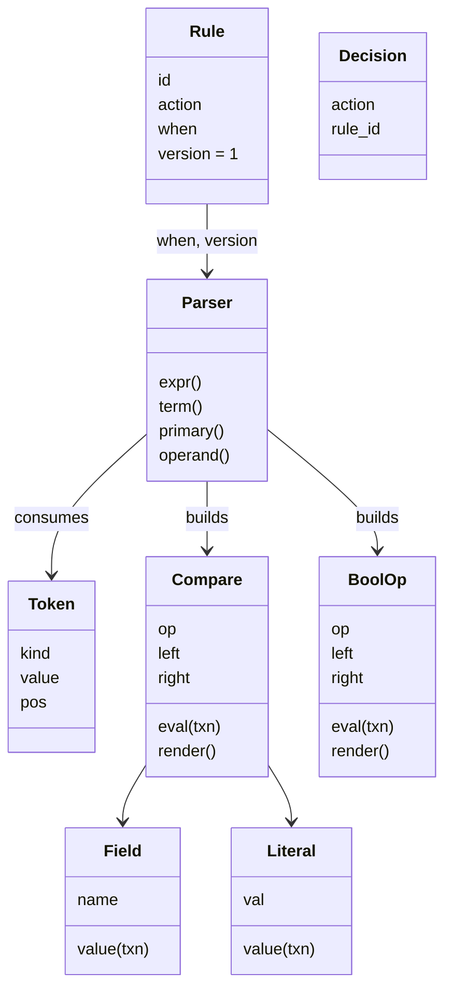

# 01 Answer key: transaction rules evaluator

> SPOILERS. The interviewer session reads this. The user reads it only after a run.

The model solution is in `solution/` (overlay on `candidate/`). It passes all 5 parts:
`python3 ai-coding/kit.py verify 01-transaction-rules`.

---

## 1. Part 1: the four planted bugs

All four sit in `_matches` and `evaluate` in `candidate/radar/engine.py`.

| Ticket | Line | Root cause | Minimal fix | Trap |
|---|---|---|---|---|
| RISK-101 value on the left | `field, value = when.split("==")` then `txn[field]` | Assumes the left side is the field, so it looks up `'"Evil Corp"'` and raises `KeyError` | Decide which side is quoted. Best: tokenize | Catching `KeyError` to "fix" the crash. The rule then silently never fires |
| RISK-102 substring | `return value in str(txn[field])` | `in` is a substring test, so `"Bad LLC"` matches `"Not Bad LLC"`. `str()` also makes `5` match `"5"` | `type(a) is type(b) and a == b` | Fixing to `==` but keeping `str()`, which breaks Part 2 (`True` vs `"True"`) and Part 4 |
| RISK-103 order | `sorted(rules, key=lambda r: r.action != BLOCK)` | Someone "optimised" by checking block rules first. Breaks first-match-wins and every allowlist | Iterate `rules` in list order | The AI keeps the sort and reorders only the test data |
| RISK-104 missing field | `txn[field]` | `KeyError` | `txn.get(field, MISSING)` and treat missing as no match | Using `txn.get(field)`, so a missing field equals a `None` value later |

Unticketed edge in the hidden tests: `merchant_name == "A == B Ltd"`. `split("==")` returns three parts and the unpack raises. Only a tokenizer handles it.

**Best Part 1 answer:** write a tokenizer now. It fixes 101, 102 and the `==`-in-value edge in one change and makes Part 2 a small diff. Saying "I'll tokenize because Part 2 will add operators" is the Staff signal. A regex like `^\s*(\w+)\s*==\s*"(.*)"\s*$` plus its mirror passes Part 1 but must be thrown away in Part 2.

---

## 2. Design the solution converges on

- **Tokenizer** (`tokenizer.py`): one regex alternation. Quoted strings are matched first, so `and`, `OR`, `(`, `=` inside quotes are text.
- **Parser** (`parser.py`): recursive descent. Version 1 is one loop over `AND|OR`, folding left. Version 2 is the textbook `expr := term (OR term)*`, `term := primary (AND primary)*`.
- **Tree nodes** carry `eval(txn)` and `render()`. `render()` fully parenthesises, which is what makes `migrate` a 3-line function.
- **Engine**: `_compile` parses every rule before deciding (Part 3). `parse` is `lru_cache`d, so a rule is parsed once, not once per transaction.
- **Patterns:** Interpreter (the tree), Composite (BoolOp of nodes). No Strategy class per operator; a dict of `operator.*` is enough.

---

## 3. Per part: what a good diff looks like

| Part | Good diff | Common AI trap to catch |
|---|---|---|
| 2 AND / OR | Add `and`/`or`/`bool` tokens and one `while` loop | `when.split(" and ")` or `re.split(r"\s+(AND\|OR)\s+")`: breaks on `"Bread and Butter"`. `eval()` of a rewritten string: unsafe and wrong precedence |
| 2 booleans | `true`/`false` unquoted become Python bools | Comparing `str(value) == literal`, so `"true"` matches `True` |
| 3 parens | `primary` recurses on `(` | Stack-based parser that silently ignores a missing `)` |
| 3 bad rules | Parse all rules up front, wrap the error with the rule id | Lazy parse inside the loop: a bad rule after the matching one never raises. Test `test_bad_rule_later_in_list_still_raises` catches it |
| 4 types | `type(a) is type(b)` before comparing | `isinstance(True, int)` is True in Python, and `1 == True`. `amount == true` must not match `amount: 1` |
| 4 missing field and `!=` | Missing short-circuits to false before the operator | `txn.get(f) != "US"` is True for a missing field |
| 4 explain | `Decision(action, rule_id)`, `evaluate` delegates to it | Changing `evaluate`'s return type and breaking Parts 1 to 3 |
| 5 version | `version: int = 1` on the frozen dataclass, parser picks grammar by version | Changing the v1 grammar in place. Every v1 test from Part 2 then fails |
| 5 migrate | Parse with v1, render fully parenthesised, set version 2 | Re-parsing the string with regex to insert parens. Proof of equivalence: exhaustive truth table over the fields (the hidden test does this) |

---

## 4. Part 5 rollout: the Staff answer

1. **Ship the v2 parser dark.** Every rule stays v1. Nothing changes.
2. **Migrate with proof, not hope.** `migrate` is mechanical: parse with v1, print fully parenthesised. Verify each migrated rule two ways: an exhaustive truth table over its comparisons (at most 2^k for k comparisons, and real rules have k under 10), and a shadow run over a day of real transactions with both versions, diffing decisions.
3. **Flip per rule, reversibly.** Store v1 text and v2 text side by side. Rollback is flipping `version` back. No data is lost.
4. **New rules default to v2** in the authoring UI, with a lint that warns on unparenthesised mixes of `AND` and `OR` for one release.
5. **Retire v1** only when the dashboard shows zero v1 rules for 30 days.
6. **What pages someone:** decision diff rate above 0 in the shadow run, and rule parse errors at publish time.

---

## 5. Follow-up questions and strong answers

| Question | Strong answer |
|---|---|
| 10,000 rules, 5,000 transactions per second. Where is the time? | Parsing, if done per call. Compile once at publish (`lru_cache` here). Then evaluation is O(rules × comparisons). Index rules by the fields they test, or group by a cheap prefilter like `card_country` |
| One bad rule takes down every decision (Part 3). Is that right in production? | No. Validate at publish time so a bad rule never ships. At evaluate time, fail closed on a bad block rule and alert, but never crash the whole decision path. The kit's behaviour is the publish-time check |
| Fail open or fail closed when the rules service is down? | Depends on the action. Accept-by-default keeps revenue flowing (Stripe's default), but log for later review. Name the trade-off: fraud loss vs blocked good customers |
| How do analysts test a rule before shipping? | Backtest on last 30 days of transactions, show how many would change decision, shadow mode (log only) for a day |
| How would you add `IN ("US", "CA")` or `NOT`? | New token, one grammar rule. `NOT` binds tightest. The tree design makes each a small diff |
| Thread safety? | Rules are immutable frozen dataclasses and trees. `lru_cache` is thread-safe in CPython. Hot reload swaps the whole rule list reference atomically |
