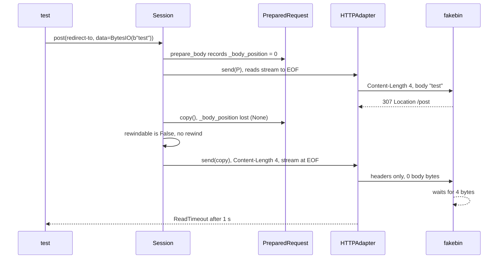

# 02 Answer key: HTTP redirect bug squash

> SPOILERS. The interviewer session reads this. The user reads it only after a run.

The model solution is in `solution/` (overlay on `candidate/`). It passes all 4 parts:
`python3 ai-coding/kit.py verify 02-http-redirect-bug-squash`.

---

## 1. Planted bugs

| Part | Ticket | Where | Root cause | Minimal fix | AI trap |
|---|---|---|---|---|---|
| 1a | 307 seekable tests hang | `models.py` `PreparedRequest.copy()` | `copy()` copies method, url, headers, cookies and body, but not `_body_position`. `resolve_redirects` works on the copy, sees `None`, and skips the rewind. The stream is at EOF, `Content-Length: 4` is still set, 0 bytes go out, the server waits, the client hits `ReadTimeout` | `p._body_position = self._body_position` | `body.seek(0)` in the adapter before every send. Or read the stream into `bytes` in `prepare_body`: passes, but buffers every upload in memory and changes what "streaming" means |
| 1b | Partial test sends `"hello "` | `utils.py` `rewind_body()` | Seeks to `0`, ignoring the recorded position. Also swallows `OSError` | `body_seek(prepared_request._body_position)` | Fixing only 1a. SEEKABLE passes because its start was 0. PARTIAL then fails with `'hello ' != ' world'`: `Content-Length` is 6, so the server keeps the first 6 bytes of a stream rewound too far |
| 2 | SEC-212 token leak | `sessions.py` `should_strip_auth()` | No hostname comparison at all. It only compares port and scheme, so any same-port, same-scheme redirect to another host keeps `Authorization`. The http to https branch also returns `False` for another host | `if old.hostname != new.hostname: return True` as the first check | `startswith` / `endswith` host checks (`api.example.com.evil.net`). Comparing raw `netloc` strings, which breaks `example.com` vs `example.com:80`. Stripping on every redirect, which breaks same-host flows |
| 3 | SUP-418 308 POST becomes GET | `sessions.py` `rebuild_method()` | Uses `response.is_permanent_redirect`, which is true for 301 **and** 308 | `response.status_code == codes.moved` | Editing `Response.is_permanent_redirect` to drop 308. Public API, other callers use it. Hidden test checks it is unchanged |
| 4 | Silent truncation | `sessions.py` rewind condition, `utils.py` `rewind_body()` | The rewind runs only when `_body_position is not None`. Generators and iterators have no position, so a 307 resends an exhausted generator as an empty chunked body and the server accepts it | On 307/308, any non-bytes body goes through `rewind_body`, which raises `UnrewindableBodyError` when there is no int position or `seek` fails | Raising only for generators (`_body_position is None`) and missing the `object()` sentinel case (`tell()` failed) and the `seek()`-fails case. Buffering generators in memory "to be safe" |

The symptom chain for Part 1, which the candidate should be able to narrate:

---

## 2. The call path the candidate should map in orientation

```mermaid
%% minireq request path. Red = where the Part 1 bugs live.
flowchart LR
    API[api.post] -->|Session| REQ[Session.request]
    REQ -->|Request| PREP[prepare_body<br/>records _body_position]
    PREP -->|PreparedRequest| SEND[Session.send]
    SEND -->|first hop| AD[HTTPAdapter.send<br/>reads stream to EOF]
    SEND -->|redirect| RR[resolve_redirects]
    RR -->|each hop| CP[PreparedRequest.copy]
    CP --> RM[rebuild_method<br/>Part 3]
    RM -->|non-307/308: drop body| RA[rebuild_auth<br/>should_strip_auth, Part 2]
    RA --> RW[rewind_body<br/>Part 1b, Part 4]
    RW -->|next hop| AD

    class API,REQ,SEND,RR,RM,RA service
    class AD client
    class PREP store
    class CP,RW critical

    classDef client   fill:#dbeafe,stroke:#2563eb,stroke-width:2px,color:#111
    classDef service  fill:#dcfce7,stroke:#16a34a,stroke-width:2px,color:#111
    classDef store    fill:#ede9fe,stroke:#7c3aed,stroke-width:2px,color:#111
    classDef critical fill:#fee2e2,stroke:#dc2626,stroke-width:4px,color:#111
```

Strong orientation (5 to 8 minutes): run the suite, see 2 errors with `ReadTimeout`, read the test, then follow `post` into `resolve_redirects` and notice the body is reused from a copy. Saying "a hang with a Content-Length means the server is waiting for bytes we never sent" is the key inference.

---

## 3. Per part: good diff vs trap

| Part | Good diff | What the interviewer should hear |
|---|---|---|
| 1 | 2 lines: carry `_body_position` in `copy()`, seek to it in `rewind_body`. Tests untouched | A hypothesis before each run: "the stream is at EOF on the second send". Then "why not `seek(0)`? Because the caller may have consumed a prefix" |
| 2 | 2 lines in `should_strip_auth` plus an end-to-end test via `localhost` | "Same host means hostname, not netloc, so `:80` vs no port still matches." Mentions `Proxy-Authorization` and cookies as the same class of leak |
| 3 | 1 line in `rebuild_method` plus a 308 test | Knows RFC 9110: 307/308 keep method and body, 301/302 may change POST to GET, 303 changes to GET |
| 4 | New exception, the rewind condition becomes "is it a stream", `rewind_body` raises instead of swallowing | Rollout plan first (below). Raises **before** sending to the new location. The hidden test checks the server log |

---

## 4. Staff follow-ups and strong answers

| Question | Strong answer |
|---|---|
| Why record the position instead of `seek(0)`? | The caller owns the stream's position. A resumable upload, or a multipart writer that already emitted a preamble, starts mid-stream. `seek(0)` resends bytes they chose to skip, and with `Content-Length` set the server keeps a wrong prefix. That is silent corruption, worse than the hang |
| How would you test this against a real server? | Keep the local httpbin in CI (requests uses pytest-httpbin). Add a matrix test: every redirect status (301, 302, 303, 307, 308) times every body type (str, bytes, form, JSON, seekable, partial seekable, generator, pipe), asserting bytes received equal bytes intended. One canary job against a staging service behind the real load balancer |
| Backport to the LTS branch? | Parts 1 to 3 are bug fixes: backport as a patch release, tests included. Part 4 changes behavior (raises where it used to "work"), so it ships in a minor release only. SEC-212 gets a security advisory and token rotation guidance. requests had the same class of bug: it fixed a same-host https to http variant in 2.20.0 (CVE-2018-18074) |
| What metric would have caught silent truncation? | Client: count of redirects that resent a streamed body, by status, and bytes sent vs `super_len` at prepare time. Server: requests whose received length is 0 or below the declared length. Best: an end-to-end digest header (e.g. `Content-Digest`) that the server verifies, turning truncation into a 400 |
| Part 4 rollout | It turns silent data loss into an exception, so some callers break loudly. Release N: log a warning and a metric for every would-raise event, find the top callers, contact owners. Release N+1: raise by default, with a session-level opt-out for one release. Release N+2: remove the opt-out. Callers that must stream through redirects send `allow_redirects=False` and re-open their source |
| Blast radius of SEC-212? | Every service that sends bearer tokens to an endpoint that can redirect off-host. Treat it as an incident: rotate the exposed tokens, search partner logs if possible, check `Proxy-Authorization` and cookies for the same leak |

---

## 5. Good clarifying questions (reward these)

- "Can I change the tests?" (No. Part 1 says so.)
- "Is AI allowed in this round?" (Mode-dependent. At Stripe, ask the recruiter.)
- "Should 308 behave like 307?" (Yes, that is Part 3.)
- "What should happen when the body cannot be rewound?" (That is Part 4. Before Part 4: keep current behavior.)
- "Is there a debugger set up?" (Yes, any. A Sep 2026 Stripe candidate lost about 15 minutes to a VS Code debugger that would not start. Use `print` and `pdb` if the IDE fails.)
