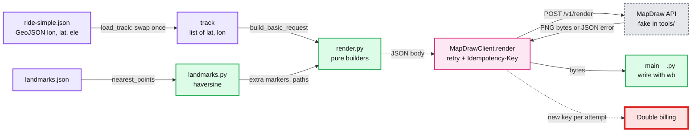
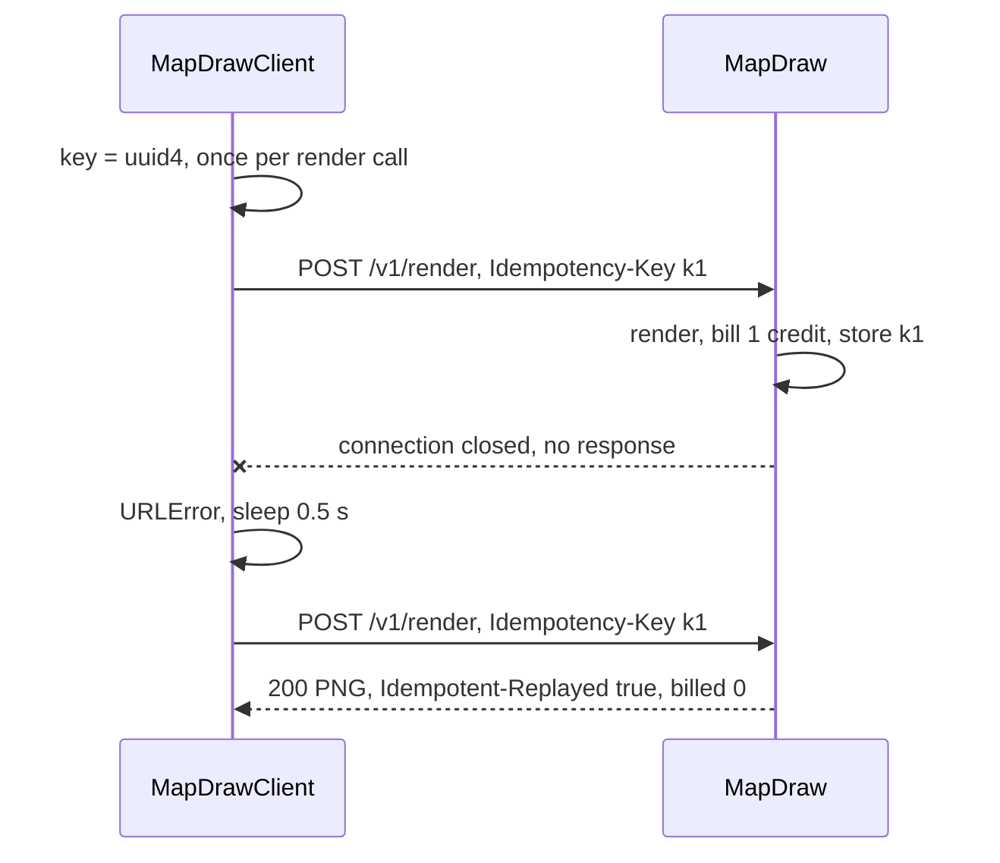

# 03 Answer key: BikeMap integration

> SPOILERS. The interviewer session reads this. The user reads it only after a run.

The model solution is in `solution/` (overlay on `candidate/` after Part 5's
files). It passes all 5 parts: `python3 ai-coding/kit.py verify 03-bikemap-integration`.

---

## 1. Planted problems

This is an integration round, so most of the work is getting the contract right.
Only two lines in the starter are wrong. The rest are data and doc traps.

| Where | What is wrong | Root cause | Minimal fix | Trap |
|---|---|---|---|---|
| `ridemap/track.py` `load_track` | Returns raw `[lon, lat, ele]` lists | Copies GeoJSON order straight through. Positions carry an elevation | Swap once, here: `(float(pos[1]), float(pos[0]))`. Validate length 2 or 3, numbers, ranges | `lat, lon = pos` (wrong order and crashes on 3 values). `pos[:2]` without the swap |
| `ridemap/mapdraw.py` `_request` header | `X-Api-Key` | The doc says `Authorization: Bearer <key>`. The fake answers 401 "No API key provided" | `req.add_header("Authorization", f"Bearer {key}")` | Adding both headers "to be safe" |
| `ridemap/mapdraw.py` `_request` body | `resp.read().decode("utf-8")` | A success is a PNG, not JSON or text. `UnicodeDecodeError` on byte 0x89 | Return bytes. Decode only error bodies | `errors="ignore"`, which writes a corrupt PNG that still "saves" |
| `ridemap/__main__.py` `cmd_part1` | Prints the raw list | Starter never formatted or handled errors | `f"{lat:.6f}, {lon:.6f}"`. Catch `RidemapError` in `main`, print `error: ...` to stderr, return 1 | Catching bare `Exception` and hiding real bugs |
| Data | Elevation in every position | Real GPS export | Accept 2 or 3 numbers | Rejecting the real file |
| Doc | Points are `{lat, lon}` objects, not GeoJSON arrays (changelog, 2025-11-10) | Vendor breaking change | Build objects | Sending `[lon, lat]` arrays (400) or `{lat: lon, lon: lat}` (400: lat out of range) |
| Doc | Label max 16 characters, 10 markers | Limits table | Shorten labels in Part 5 | Not reading the 400 body |

---

## 2. Design the solution converges on

- **One swap point.** `load_track` is the only place that knows GeoJSON is
  lon-first. Everything else speaks `(lat, lon)`.
- **Builders are pure** (`render.py`, `landmarks.py`): dict in, dict out. They
  are tested without a server.
- **The client owns transport policy:** auth, retries, backoff, idempotency,
  error decoding. The CLI only builds, renders and writes.
- **The red node** is the one real money bug: generating the idempotency key
  inside the retry loop.

---

## 3. Per part: what a good diff looks like

| Part | Good diff | Common AI trap to catch |
|---|---|---|
| 1 | `load_track` validates and swaps. `main` catches `RidemapError` | AI writes `lat, lon = coord` because "GeoJSON is lat, lon". It is not (RFC 7946) |
| 2 | Fix the header, return `bytes`, `open(out, "wb")`. `build_basic_request` is 5 lines | Reading `resp.json()`-style: "A JSON request does not mean the response is JSON too" (Oct 2026 report) |
| 2 | Center = midpoint of min and max | Mean of all points: a different number, fails the test |
| 3 | `range(0, len(track) - 1, 10)`, points `track[s:s + 11]` | `track[s:s + 10]`: 9 segments each and a gap at every boundary. `range(0, len(track), 10)` adds an empty or 1-point path when the length is 10k + 1 |
| 4 | Key once per call. `except HTTPError` before `URLError`. Retry set `{500, 502, 503, 504}` plus 429 and network errors | `except Exception: retry`. Retrying 400 and 401. `time.sleep` hardcoded. Ignoring `Retry-After` |
| 4 | `MapDrawError(status, message)` after attempt 5 | Off by one: 6 attempts, or 4 sleeps plus one extra |
| 5 | Haversine, `min` over indices, `meters <= max_distance_m` | Euclidean on degrees (wrong scale for longitude). Full names as labels: 400 on 3 landmarks |

---

## 4. Follow-up questions and strong answers

| Question | Strong answer |
|---|---|
| 1,000 users render at once, the vendor allows 25 per second per key | Put renders behind a queue with a token-bucket at 20 per second (headroom under 25). Return 202 plus a poll URL, or render on upload, not on view. More keys is a contract conversation, not a hack |
| Same ride rendered on every view | Cache by a hash of the request body, which is deterministic. Store PNGs in a blob store keyed by that hash. Invalidate only when the ride or style changes. This also cuts cost to one credit per ride |
| Is this healthy in production? | Metrics per status class, retry count, attempts per render, replay rate (`Idempotent-Replayed`), billed credits per day vs renders served, p99 latency. Page on 5xx above 5% for 10 min, or billed credits above expected by 20% |
| Confidence against the real vendor | Contract tests against the vendor sandbox in CI, nightly. Record and replay a few real responses. Compare the fake's validation rules with the real API's errors |
| Retry after a dropped connection returned 409 | The body changed between attempts (a non-deterministic field, a float re-rounded). Keep the serialized body bytes from attempt 1 and resend those, not a rebuilt dict |
| Blast radius of double billing | Every retry of every lost response costs a credit. At 2% drops and 1M renders per day that is 20,000 wasted credits a day, invisible until the invoice. The log line with the key makes it auditable |
| What do you log? | Idempotency key, attempt, status, `Request-Id`, `X-Render-Id`, replayed flag, wait time. Never the API key |
