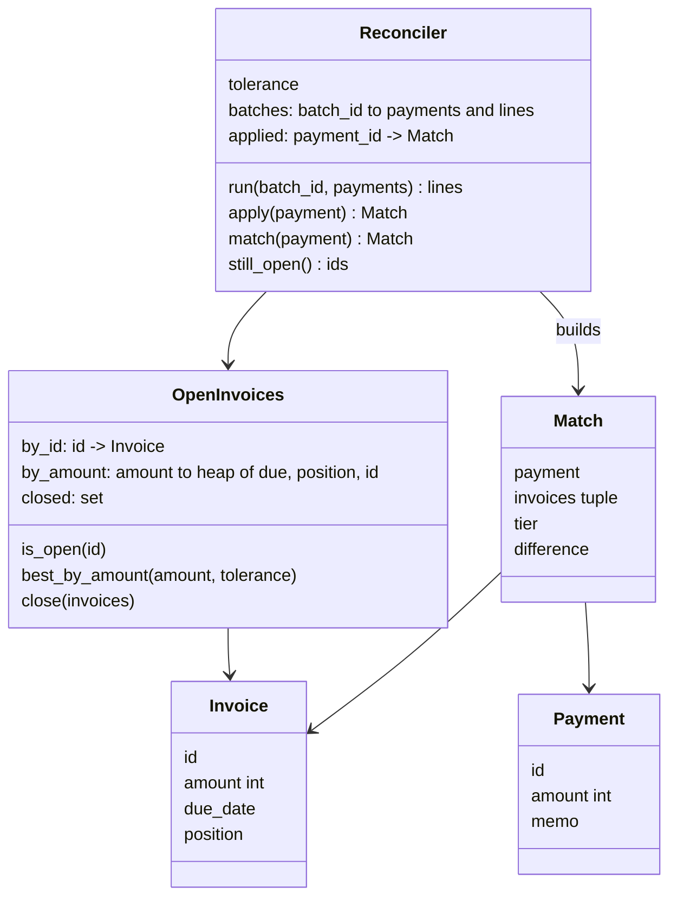

# 04 Answer key: invoice matching

> SPOILERS. The interviewer session reads this. The user reads it only after a run.

The model solution is in `solution/` (overlay on `candidate/`). It passes all 5 parts:
`python3 ai-coding/kit.py verify 04-invoice-matching`.

---

## 1. Part 1: what is broken

| Signal | Where | Root cause | Minimal fix | Trap |
|---|---|---|---|---|
| RECON-101 `INV-12` applied to `INV-1` | `matcher.py`, `INVOICE_ID = re.compile(r"INV-\d")` | `\d` is one digit, so the match stops at `INV-1` | `INV-\d+` with a right boundary, e.g. `(?<![\w-])INV-\d+(?!\d)`, then a dict lookup | Fixing the regex but keeping `.search()`, which returns only the first ID (see the rule 2 row) |
| RECON-102 crash on a comma in the memo | `parsing.py`, `parse_payment`: `line.split(",")` | The memo is the last field and may hold commas, so the unpack gets 4+ values | `line.split(",", 2)` | Switching to the `csv` module. A memo with a `"` in it then parses wrong. The memo is not CSV-quoted |
| RECON-103 `INV-4` paid twice | `matcher.py`, `MemoMatcher` | No notion of a closed invoice | A `closed` set, checked when resolving memo IDs | Deleting the invoice from `by_id`. It works for Part 1 but loses the difference between "unknown" and "paid", which Part 4's `open_after` needs |
| Two failing tests | `parsing.py`, `parse_amount` returns `float` | Lines print `amount 500.0`. `test_parse_payment` still passes because `500.0 == 500` in Python, which is the point: the candidate must trace the output, not trust the green parse test | `int(text)`. Amounts are integer cents by spec | Formatting with `:.0f` or `int()` at print time. The float survives into the Part 4 sums. The `"500.00"` comment tempts a Decimal detour: a good candidate asks, and the answer is "integers only" |
| Rule 2, no ticket | `invoice_id_in` uses `search` | Only the first ID is ever tried, even if it is unknown or already paid | `findall`, then the first open one | Missed entirely unless the candidate re-reads the rules. Hidden `test_first_open_named_wins` catches it |

**Best Part 1 answer:** run `cli.py` on `data/` first. It crashes on `p6` (RECON-102). With that fixed, it shows `p2` on `INV-1` and `p5` on `INV-4` again. Then fix parsing (split, int), then matching (regex, closed set, first open). Say out loud: "matching is a sequence of tiers over open invoices. I'll make the open-invoice set its own object, because amounts are coming next."

---

## 2. Design the solution converges on

- **Tiers in one method** (`Reconciler.match`): memo IDs (multi-invoice sum first, then first open named), then amount within tolerance. Exact is just difference 0, so one sort key `(abs diff, due_date, position)` covers Parts 2 and 3.
- **`position`** on `Invoice` makes "first in the invoice list" explicit, so nobody sorts the caller's list in place.
- **`Match.invoices` is a tuple** with an `invoice` property for old callers. Part 4 then touches the formatter and the export, nothing else.
- **Indexes** (`index.py`): `by_amount` is a heap per amount with lazy deletion of closed invoices. A tolerance lookup is `O(tolerance)` dict hits. For a huge tolerance, a sorted list of open amounts plus `bisect` is `O(log n + k)`.
- **Idempotency**: `batches` is keyed like an `Idempotency-Key` (same key, same body, same answer; same key, different body, error). `applied` dedupes payments the bank resends in a new file.

---

## 3. Per part: good diff vs AI trap

| Part | Good diff | Common AI trap to catch |
|---|---|---|
| 2 amount | Fall through when no **open** invoice is named. Pick by `(due_date, position)` | `invoices.sort(...)` in place, or `min` by due date only, so equal dates pick an arbitrary one. Falling through only when the memo has no ID at all, so a paid or unknown ID gives "no match" |
| 3 tolerance | One key: `(abs(diff), due_date, position)`. Suffix only on amount-tier matches | Picking the earliest due date among everything within tolerance, so a tolerance match beats an exact one. Suffix sign backwards. Adding a suffix to memo matches |
| 4 multi | `Match.invoices` tuple, memo order, distinct IDs, only open ones count | Summing all named IDs including paid ones. Changing the CSV columns, or dropping the second invoice from the export |
| 4 `open_after` | Read the closed set after the batch | Re-deriving it by parsing the output lines |
| 5 scale | Index by id and amount. Measure before and after | Keeping the per-payment list comprehension over all invoices. That is about 90 s at 50k x 50k; the index takes about 0.3 s |
| 5 reruns | Batch map plus payment map | Dedupe by batch only, so a resent payment in a new file pays a second invoice. Copying all state per run |

---

## 4. Part 5: where the time goes, and the production version

- **Today:** tiers 2 and 3 scan every open invoice per payment. That is `O(P x I)`: 10^6 x 10^5 = 10^11 comparisons, hours in Python.
- **Fix:** `by_id` dict for memo IDs (`O(1)`), `by_amount` heaps for exact and tolerance (`O(tolerance)` lookups, or `O(log I)` with bisect). Total about `O((P + I) log I)`.
- **In production** this is not an in-memory dict. Invoices live in a database:
  - close an invoice with a conditional update: `UPDATE invoices SET status = 'paid', paid_by = :pid WHERE id = :id AND status = 'open'`. Zero rows updated means someone else won.
  - `payment_id` is a primary key in a `payment_applications` table. A resent payment hits the unique constraint and reads back the first result.
  - batch reruns are keyed by the bank file's ID plus a hash of its contents.
- **Shard by customer**, not by amount. Matching is only meaningful inside one customer's invoices, which also shrinks every candidate list.

---

## 5. Follow-up questions and strong answers

| Question | Strong answer |
|---|---|
| "What if there is an exact match with forgiveness applied?" (asked at Stripe, Oct 2026) | Two candidates: one exact, one within tolerance but due earlier. Exact wins: it is certain, the other is a guess. Say it is a product decision, and ask finance |
| A memo match where the amounts differ. What should finance see? | Today it says "pays" and hides a shortfall. Add the difference to the line, keep the invoice open for the remainder, or route to review. Partial payments are the next real feature |
| "Any other things you could be missing?" | Refunds and reversals (a payment bounces after matching), duplicate invoices, currency mismatch, invoices reopened by a credit note, due-date time zones, a memo naming another customer's invoice |
| Two invoices tie on everything. Is "first in the list" right? | It is deterministic, which audit needs, but it is still a guess. Better: send ambiguous matches to a human review queue with both candidates, and auto-match only when unique |
| How would finance audit why a payment matched? | Store the tier, the candidates considered, the tolerance used and the code version with each match. The line format should not be the audit record |
| Multi-currency? | Never match across currencies. Amounts in minor units with the right exponent (JPY has 0 decimals, KWD has 3). Tolerance per currency |
