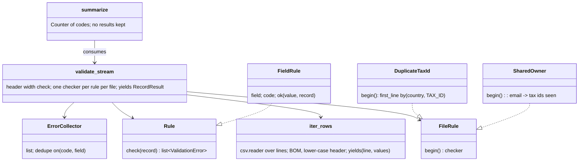

# 05 Answer key: KYC CSV validation

> SPOILERS. The interviewer session reads this. The user reads it only after a run.

The model solution is in `solution/kyc/` (overlay on `candidate/`). It passes all 4 parts:
`python3 ai-coding/kit.py verify 05-kyc-csv-validation`.

---

## 1. Part 1: the planted bugs

| # | Symptom | File and function | Root cause | Minimal fix | Visible test? | AI trap |
|---|---|---|---|---|---|---|
| 1 | `"Acme, Inc."` gives `WRONG_COLUMN_COUNT` | `csv_reader._split` | `line.split(",")` ignores quotes | `csv.reader` | yes | A hand-rolled quote state machine that misses `""` escapes |
| 2 | CRLF file raises `HeaderError: missing columns: owner_email` | `csv_reader._split` | `.strip(' "')` keeps `\r`, so the last header is `owner_email\r` | `csv.reader` over `io.StringIO(text, newline="")` | yes | `text.replace("\r", "")`, which also eats a `\r` inside a quoted value |
| 3 | Trailing newline adds a bogus `WRONG_COLUMN_COUNT` record | `csv_reader.read_rows` | `text.split("\n")` yields a final `""` | Skip blank rows | yes | Dropping only the last line, so a blank line in the middle still breaks |
| 4 | A record missing two fields shows one error | `errors.ErrorCollector.add` | Dict keyed by `code`: the second `MISSING_FIELD` overwrites the first | List, dedupe on `(code, field)` | yes | Keying by `field` instead: fixes the test, still collapses two codes on one field |
| 5 | `2023-02-30` accepted | `validators._is_date` | Day checked against 31 for every month | Shape regex plus `datetime.strptime` | yes | `date.fromisoformat` alone: Python 3.11+ accepts `20230115` (hidden test) |
| 6 | File with a BOM raises `HeaderError` | `csv_reader.read_rows` | `record_id` does not match | Strip `` from the first header cell (or decode with `utf-8-sig` in the CLI) | **hidden only** | Fixing only the CLI's `open()`, not `validate_csv(text)` |
| 7 | `Record_ID` header raises `HeaderError` | `csv_reader.read_rows` | Case-sensitive header match | `h.strip().lower()` | **hidden only** | |
| 8 | Line numbers wrong after a blank line | `pipeline` / `read_rows` | Line numbers come from `enumerate` over split lines | `csv.reader.line_num` | **hidden only** | Re-numbering after skipping blanks |

`data/merchants.csv` and `data/drops/` show bugs 1, 2, 3, 4 and 5 on the CLI, for a candidate who runs it before reading.

**Best Part 1 answer:** "We are hand-parsing CSV. Swap to the `csv` module, which fixes 1, 2, 3 and the escape case in one change." Then fix the collector and the date. The Staff signal is reading the spec in TASK.md and finding 6, 7 and 8 without a failing test.

---

## 2. Design the solution converges on

- **Two rule shapes.** A record rule is `check(record)`. A file rule is `begin()` returning a checker with per-file state. The pipeline calls `begin()` once per file, so state never leaks between calls (`test_fresh_state_per_call`).
- **`FieldRule` base** keeps each new rule to about 5 lines. Strategy pattern, plus a registry that is just a list (`DEFAULT_RULES`).
- **`validate_csv` is `list(validate_stream(StringIO(text, newline="")))`.** One code path, so Part 4 cannot drift from Parts 1 to 3.
- **What it refused to build:** a rule DSL, plugin discovery, a config file. A list of objects is enough until compliance edits rules without a deploy.

---

## 3. Per part: what a good diff looks like

| Part | Good diff | Common AI trap to catch |
|---|---|---|
| 2 registry | `Rule` protocol, `DEFAULT_RULES` list, `validate_csv(text, rules=None)`, Part 1 checks moved into classes | An abstract base class hierarchy, a decorator registry with import side effects, or `rules=` that appends instead of replaces |
| 2 forbidden words | `\b(bank\|test\|fake)\b` with `re.IGNORECASE` | `"bank" in name.lower()`: fails `Bankside Cafe` and `Contest Supplies` |
| 2 tax ids | Per-country `fullmatch`, default to the old rule | `re.match` without an end anchor accepts `12-34567890` |
| 2 too long | `len(value)` on `str` | `len(value.encode())` counts bytes, so `"é" * 60` fails |
| 3 cross-record | A second rule shape with per-file state | Module-level `seen = set()`, which leaks across files; or a second pass that needs the whole file (breaks Part 4) |
| 3 duplicates | Key is `(country, tax_id.upper())`, store the first line | Flagging the first occurrence too, or comparing across countries |
| 4 stream | Generators all the way: `csv.reader(lines)`, `yield` results | `"".join(lines)` then `validate_csv`: about 38 MB peak on the 50k-row test vs about 0.9 MB |
| 4 summarize | `Counter`, sort by `(-count, code)` | `list(results)` inside `summarize` |

---

## 4. Part 4 memory answer (say this before coding)

- Text and results are O(file). Streaming fixes both.
- The cross-record state is O(distinct tax ids + distinct emails). At 50 M records with mostly unique businesses that is about 50 M keys. In Python that is several GB. Options, cheapest first:
  1. Store a 64-bit hash of each key instead of the string (about 8 bytes plus set overhead; tiny false-positive rate, re-check positives on a second pass).
  2. External sort by key, then one linear scan (bounded memory, two passes, minutes not seconds).
  3. Push the dedupe into the database that onboarding already writes to: a unique index on `(country, tax_id)`.
- The Staff answer names (3) as the real home of the check, and (1) as the stopgap inside the batch job.

---

## 5. Follow-up questions and strong answers

| Question | Strong answer |
|---|---|
| Reject the whole file or accept the good rows? | Accept good rows, quarantine bad ones, unless the file is structurally broken (header error, more than X% invalid), which signals a bad export. Then reject all and page the partner contact |
| How does ops triage 40,000 errors? | Group by code, most urgent first (`SEVERITY`), sample 5 per code, fix at the source (partner export) not row by row. `summarize` is the dashboard's input |
| The partner adds a column next month. What breaks? | Nothing: extra columns are ignored and the header is matched by name. A renamed column breaks. Version the schema (`schema_version` column or file name), keep N and N-1 parsers during the switch |
| Where should the duplicate check live long term? | A unique constraint in the onboarding store. The batch check is an early warning, not the guarantee |
| How do you test the 2 GB path without a 2 GB file? | Generator input plus `tracemalloc` peak, and a laziness test that counts lines pulled (both are in the hidden tests) |
