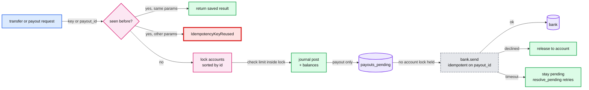

# 06 Answer key: ledger race

> SPOILERS. The interviewer session reads this. The user reads it only after a run.

The model solution is in `solution/ledger/` (overlay on `candidate/` plus the
Part 4 `bank.py`). It passes all 4 parts: `python3 ai-coding/kit.py verify 06-ledger-race`.
The hidden tests were run 5 times in a row on the solution (all OK) and 5 times
on the starter (Part 1 fails 6 of 6 tests every time). Each Part 1 bug was
also checked alone: fixing any two still fails the third's tests.

---

## 1. Part 1: the planted bugs

All in `candidate/ledger/service.py`.

| # | Symptom in PAY-311 | Function | Root cause | Fix | AI trap |
|---|---|---|---|---|---|
| 1 | A merchant below zero | `transfer` | **Check-then-act.** `if source.balance < amount` runs before the locks. Thirty threads all see 1,000 and all pass | Move the check inside the locked block | Adding a second check inside but keeping the first one "for speed" is fine. Removing the lock and using a global one is the lazy fix |
| 2 | Sum of balances drifts | `deposit` | **Lost update.** Reads `account.balance`, posts to the journal (which takes the journal lock, a natural switch point), then writes the stale value back. No account lock at all | `with account.lock:` around post and `+=` | Wrapping only `account.balance += amount` in the lock but leaving the journal post outside: balances right, journal order can disagree briefly. Still passes; mention it |
| 3 | Job froze, ops restarted it | `transfer` | **Lock order deadlock.** `with source.lock: with dest.lock:` takes locks in argument order. A to B and B to A each hold one and wait for the other | Acquire both in a global order (sorted `account_id`) | `threading.RLock` does not fix it. A `timeout=` on acquire turns a deadlock into random failures |
| 4 | (spec line) Transfer to self | `transfer` | Same non-reentrant lock taken twice: hangs forever. Sorting the pair does **not** fix this | Reject `src == dst` before locking, or dedupe the lock set | The AI's sorted-lock fix often still hangs here. Hidden test `test_transfer_to_same_account_returns_quickly` |

Why lock ordering prevents deadlock (the candidate must say this): a deadlock
needs a cycle in the wait-for graph. If every thread takes locks in the same
total order, a thread holding lock *k* only waits for locks above *k*, so no
cycle can form. The three-account cycle test (A to B, B to C, C to A) checks it.

**Global lock?** It passes the tests. It fails the TASK line "transfers between
unrelated accounts should not wait on each other" and caps throughput at one
transfer at a time. Score Design 2 at most, unless the candidate argues it
explicitly as the simplest correct first step and names the per-account
upgrade.

---

## 2. Design the solution converges on

- **`accounts.locked(*accounts)`**: one context manager that dedupes and sorts. Every multi-account operation goes through it.
- **Results, not exceptions** for business outcomes (Part 2). Exceptions stay for programmer errors (`IdempotencyKeyReused`).
- **`_once(key, params, run)`**: a slot per key with a `threading.Event`. The first caller runs; later callers wait and read the same result. An unexpected exception is not saved, so a retry can run again (Stripe does the same for requests that never started executing).
- **Payout state machine:** `new -> pending -> paid | declined`, or `new -> rejected`. The record has its own lock, so one payout id is serialized without holding any account lock.

---

## 3. Per part: what a good diff looks like

| Part | Good diff | Common AI trap to catch |
|---|---|---|
| 2 overdraft | `overdraft_limit` on `Account`, check `balance - amount < -limit` inside the lock | Checking `balance < amount` and forgetting the limit, or checking it outside the lock again |
| 2 results | `TransferResult` dataclass, `_reject()` appends to a locked list | `rejections` appended without a lock (list append is atomic in CPython, but say why) |
| 2 reconcile | `balance < -overdraft_limit` in `reconcile.py` | Not noticing `reconcile.py` at all: `test_reconcile_accepts_balances_within_limit` fails |
| 2 run_batch | `except Exception as e: return TransferResult("failed", None, ...)` | Returning `None` still, or raising out of the pool |
| 3 keys | Slot per key, check params, `Event` for in-flight callers | A dict lookup then insert without a lock: two concurrent first calls both run |
| 3 rejection saved | Store the result whatever its status | Only storing successes, so a retry of a rejected transfer succeeds later. Ask: is that what a client expects? Stripe saves the first result |
| 4 reserve | Journal move to `payouts_pending` under the account lock | Calling the bank first, then debiting: a timeout leaves money both sent and spendable |
| 4 lock scope | Release the account lock before `bank.send` | Holding it: `test_bank_call_does_not_hold_the_account` fails, and in prod one slow bank stalls every transfer for that merchant |
| 4 timeout | Leave pending, retry with the same `payout_id` | Releasing funds on timeout: if the bank did move the money, the merchant is paid twice |
| 4 reconcile | `total + net(PENDING) + net(BANK) == deposited` | Forgetting reconcile again |

---

## 4. Part 4: what can go wrong between bank and journal (say this before coding)

| Failure | Without reservation | With this design |
|---|---|---|
| Bank moved money, response lost (timeout) | Retry sends again: double payout | Same `payout_id` makes the bank return the first reference |
| Bank call succeeds, our process dies before the journal write | Money gone, journal silent | Money is in `payouts_pending`; on restart `resolve_pending` re-sends with the same id and books it |
| Bank declines | Fine | Reservation released |
| Merchant spends the money while the bank call is in flight | Overdraft | Reserved, so the transfer is rejected |
| Bank's idempotency window expires (often 24 h to 30 days) before we retry | Double payout | Alert on any payout pending longer than X hours; resolve before the window closes |

The Staff phrase: **"reserve, call, settle; the payout id is the idempotency key end to end."** This is the same shape as Stripe's own payment intents (authorize, then capture).

---

## 5. Follow-up questions and strong answers

| Question | Strong answer |
|---|---|
| Postgres instead of memory. What changes? | `SELECT ... FOR UPDATE` on both rows in id order (same deadlock rule), or a conditional `UPDATE accounts SET balance = balance - $1 WHERE id = $2 AND balance - $1 >= -limit` and check the row count. Journal insert in the same transaction. `READ COMMITTED` is enough with row locks; without them you need `SERIALIZABLE` and retries |
| How do you detect a conservation breach in production? | The nightly reconcile is too late. Run it continuously on a replica (sum of journal by account vs balance table), alert on any non-zero diff, and make journal rows the source of truth with balances as a cache |
| How long do you keep idempotency keys? | Stripe prunes keys after at least 24 hours. Keep them longer than the longest client retry window (a batch rerun the next morning needs about 36 h). Store them in the same database transaction as the transfer so a crash cannot save one without the other |
| The payout job is still too slow. Where next? | Shard by account so batches touch disjoint locks, then batch journal writes. Hot accounts (the platform fee account receives every fee) serialize everything: split it into N sub-accounts and sum them |
| Why not one global lock? | Correct and simple, but every transfer waits for every other. At 5,000 transfers a second with 2 ms holds, that is 10 s of lock time per second. Per-account locks scale with unrelated accounts |
