# 07 Answer key: webhook incident

> SPOILERS. The interviewer session reads this. The user reads it only after a run.

The model solution is in `solution/` (overlay on `candidate/`). It passes all 4 parts:
`python3 ai-coding/kit.py verify 07-webhook-incident`.

The log was produced by running the **starter** code against simulated merchants:
`interviewer/tools/make_incident_log.py`. If you change starter code, regenerate the
log and update the numbers in `test_p4_blast_radius.py`, `TICKET.md` and this file.

---

## 1. The three planted root causes

| Ticket item | File and function | Root cause | Minimal fix | AI trap |
|---|---|---|---|---|
| Northwind lost events | `hooks/retry.py` `RetryPolicy.max_age` | `3 * 24 * 60` is 3 days in **minutes**, compared with seconds. Gives up after attempt 6 at `age_s=3720` (62 min) | `3 * 24 * 60 * 60` | Raising the attempt count, or "fixing" by making the cap bigger. Neither touches max_age |
| Café Olé and Müller signatures | `hooks/dispatcher.py` `_attempt` calls `signing.sign_envelope(envelope, ...)` | `sign_envelope` re-encodes with `json.dumps` default `ensure_ascii=True`; the body is `ensure_ascii=False`. Same bytes for ASCII, different for any non-ASCII character | `signing.sign(body, ...)`: sign the exact bytes you send. Delete `sign_envelope` | Switching the body to `ensure_ascii=True`. Signatures then match, but the body bytes change for every non-ASCII merchant, which Part 2 forbids |
| Lumen duplicates | `hooks/serializer.py` `envelope(event, delivery_id, attempt)` | `"id": delivery_id`. Every attempt has a new `whd_` id, so receivers cannot dedupe a retry after a timeout | `"id": event.id` | Adding dedupe on our side ("don't retry after a timeout"). That turns at-least-once into at-most-once and loses events |

How each shows in the log:
- `delivery.gave_up ... attempts=6 age_s=3720` on 30 lines. The README promises 3 days.
- 400 `No signatures found` only on `charge.succeeded` (the only type with a descriptor or customer name) for `acct_1CafeOle`, `acct_1Muller`, and one `acct_1Bluebird` event at 11:12:17 (customer "Zoë"). The ticket names only two accounts: finding the third is a strong signal.
- `delivery.timeout ... delivery=whd_000157` then `delivery.sent ... event=evt_000111 delivery=whd_000197`: same event, different ids, matching the ids Lumen quoted.

**Ranked by impact** (the answer we want in Part 1): max_age first (it turns every
other failure into permanent loss, and hits every merchant with any outage),
then signatures (3 accounts, every non-ASCII event), then ids (duplicates only
after a timeout, but real money: double shipments).

---

## 2. Design after the fix

```mermaid
%% Delivery path after the fix. Red = where the incident lived.
flowchart LR
    P[publish<br/>Event evt_ id] -->|one Delivery per endpoint| Q[pending deliveries]
    Q -->|due| A[_attempt]
    A -->|envelope id = event id| S[to_bytes<br/>compact UTF-8]
    S -->|the same bytes| G[sign body]
    G -->|POST| T[transport]
    T -->|2xx| OK[delivered<br/>streak cleared]
    T -->|timeout or non-2xx| F[_failed]
    F -->|streak over 3 days| D[disable + notify<br/>skip pending]
    F -->|else| R[RetryPolicy<br/>max_age in seconds]
    R -->|next_attempt_at| Q
    R -->|None| X[abandoned]
    RP[replay endpoint, since] -->|new Delivery, created_at = now| Q

    class P,A,S,F service
    class Q store
    class T external
    class G,R critical
    class D,RP decision
    class OK,X store

    classDef service  fill:#dcfce7,stroke:#16a34a,stroke-width:2px,color:#111
    classDef store    fill:#ede9fe,stroke:#7c3aed,stroke-width:2px,color:#111
    classDef critical fill:#fee2e2,stroke:#dc2626,stroke-width:4px,color:#111
    classDef external fill:#e5e7eb,stroke:#6b7280,stroke-width:2px,color:#111,stroke-dasharray:4 3
    classDef decision fill:#fce7f3,stroke:#db2777,stroke-width:2px,color:#111
```

---

## 3. Per part: good diff vs trap

| Part | Good | Trap |
|---|---|---|
| 1 triage | Reads TICKET, greps the log (`awk '{print $3}' \| sort \| uniq -c` gives the shape in 10 s), forms one hypothesis per complaint, confirms in code. One red test per cause using the public API | Asking the AI "what is wrong with this repo" before reading the log. Tests that call `serializer.envelope` or `sign_envelope` directly: they break after the fix and do not count (hidden test runs them against the fixed code) |
| 2 fix | Three small diffs. Explains: the `id` fix is the receiver-visible one; the SDK always verified raw bytes, so old SDKs keep working after the signature fix | Changing `ensure_ascii` on the body. Rewriting the retry policy |
| 3 disable/replay | Streak map keyed by endpoint, cleared on success. Replay creates new `Delivery` rows with `created_at = now` | Replay with the original `created_at`: a 5-day-old event gives up on its first failure (hidden test `test_old_replayed_event_gets_a_fresh_retry_window`). Disabling by attempt count instead of time |
| 4 note | Script parses the log; finds 3 accounts not 2; makes the rollback call explicitly | Hand-counting with grep and pasting numbers |

Hidden test for Part 1 is mutation based: the candidate's `tests/` run against the
answer key (must pass) and against the answer key with one root cause put back (some
test must fail). A test that fails on the fixed code is ignored.

---

## 4. Rollout and rollback (Part 2 question)

- **Which fix is receiver-visible:** the `id` change. Receivers see `evt_` ids instead of `whd_`.
- **Old SDK:** unaffected by every fix. The SDK verifies the raw body, so signing the sent bytes makes old and new SDKs pass.
- **Rollout:** ship max_age and signing first (no receiver change). Then the id change, with a changelog note. During the deploy an in-flight retry can arrive once with a `whd_` id and once with the `evt_` id: one extra duplicate per in-flight retry. Draining or pausing retries for a minute removes it.
- **Rollback:** the signature fix and max_age are safe to roll back on their own. Rolling back the id change re-opens duplicates, so prefer forward fixes for it.
- **1.4.0:** rolling it back stops new signature failures in minutes because 1.3 sent and signed the same escaped bytes. It does not fix max_age or ids, which predate it.

---

## 5. Follow-up questions and strong answers

| Question | Strong answer |
|---|---|
| Do we guarantee ordering? | No, and say so (Stripe's docs do too). Retries reorder by design. Receivers use `created` or fetch current state from the API |
| Exactly once? | Not over HTTP with timeouts. At-least-once plus a stable event id for receiver dedupe. That is why bug 3 was severe |
| One endpoint hangs 30 s on every call. What happens to others? | Here, `run_due` is sequential: one slow endpoint delays everyone. Fix: per-endpoint queues, a concurrency cap per endpoint, shorter timeouts, a circuit breaker |
| 50 M deliveries due at once after our own outage | Jitter on backoff, per-endpoint rate caps, prioritise fresh events over old retries |
| How do you prove the signature fix in prod? | Shadow-verify: sign, then verify the sent bytes with the SDK in-process on a sample, metric on mismatch. It would have caught 1.4.0 on its first non-ASCII event |
