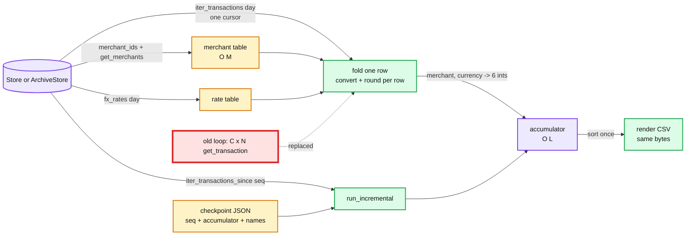

# 08 Answer key: settlement report performance

> SPOILERS. The interviewer session reads this. The user reads it only after a run.

The model solution is in `solution/` (overlay on `candidate/` plus the Part 3 store).
It passes all 4 parts: `python3 ai-coding/kit.py verify 08-settlement-report-perf`.

The golden report and the Part 2 digest were produced by the **starter** code:
`interviewer/tools/make_goldens.py`. If you change starter behaviour, regenerate them.
`interviewer/tests/kit08_reference.py` is the starter algorithm kept verbatim as the
oracle for random datasets.

---

## 1. What is slow, and the traps that change money

There are no bugs. The starter is correct and slow. The traps are places where a
"cleaner" rewrite changes the bytes.

| Item | Where | Effect | What a strong candidate does |
|---|---|---|---|
| N+1 round trips | `build_report` loops merchants x 6 currencies, `transaction_ids` per pair, `get_transaction` per id per currency, `fx_rate` per row | About (C+1)·N calls: 1.26 M at N = 200k | `get_merchants(merchant_ids())`, `fx_rates(day)`, `list_transactions(day)` then one pass. 4 calls |
| Sort inside the loop | `lines.sort()` after every append | O(L²) | Sort once at the end by `(merchant_id, currency)` |
| **Rounding order (main trap)** | `_line_for` converts and rounds each row, then sums | Sum-then-round changes 1,112 of 2,000 converted lines on the P1 dataset | Keeps per-row rounding and says why: the ledger books each row converted. Payouts must equal the ledger |
| Orphan rows | Starter iterates the merchant table, so rows of a merchant missing from it are ignored | Bulk rewrite crashes with `KeyError`, or adds lines | Skips them, and flags it as a separate data-quality ticket |
| CSV not quoted | `_format` uses f-strings; `Smith, Jones & Co` and `The "Best" Shop` break CSV | `csv.writer` changes bytes (quotes, `\r\n`) | Notes it, does not fix it inside a perf PR |
| Downstream reader | `payouts/batch.py` parses the report text, taking fields from both ends because names contain commas | Any column or line-ending change breaks payouts downstream. This is the concrete reason the format is frozen | Finds `batch.py` during orientation and cites it when asked "why byte-identical?" |
| Currency list | Only the 6 `CURRENCIES` are reported | A rewrite that groups by any currency adds lines if new currencies appear | Keeps the filter (no such rows in the test data; a good question to ask) |

**How to prove "same bytes"** (the Part 1 opening question): keep the old function as
an oracle, run both on seeded data of several shapes, diff the full text. Plus one
real day's report from production as a golden file. The hidden tests do exactly this.

---

## 2. Design after Part 3

---

## 3. Per part: good diff vs trap

| Part | Good | Trap |
|---|---|---|
| 1 fast | States the oracle plan first. Bulk reads, one pass, dict accumulator, sort at the end. Keeps per-row rounding | Sum-then-round. `csv.writer`. Grouping with `itertools.groupby` on unsorted rows. Changing `store.py` (a hidden test hashes it) |
| 2 streaming | Swaps `list_transactions` for `iter_transactions`; the fold already holds no rows. Merchant table loaded up front (O(M)), not per row | `list(store.iter_transactions(day))`: 65 MiB peak vs 5 MiB streaming on 300k rows. Calling `iter_transactions` twice (archive raises) |
| 3 incremental | Checkpoint = day, last seq, accumulator, names and payout currencies. Per-row rounding makes the accumulator additive. Copies the input checkpoint | Storing raw sums and converting at the end (breaks the bytes). Re-reading the whole day. Mutating the caller's checkpoint. Tuple keys (not JSON) |
| 4 defend | Numbers in N, M, C. Names Postgres `round(numeric)` ties-away-from-zero vs our half-even. Shadow run before switching | "SQL is faster" with no plan to prove equal money |

Measured on this kit: starter P1 dataset 378,762 calls; answer key 4 calls. Starter
300k-row day about 1.9 M calls; answer key 4 calls, 5.2 MiB peak, about 2 s with
tracemalloc on.

---

## 4. Follow-up questions and strong answers

| Question | Strong answer |
|---|---|
| How do you prove a perf change did not change money? | Old function as oracle on seeded data, byte diff; golden of a real day; reconcile report totals to ledger totals; shadow run both versions in prod for N days before cutting over |
| What do you alert on? | Report not finished by its deadline; total payout differs from ledger total by more than 0; row count differs from the ledger's count for the day; runtime p95 over budget |
| A merchant changes payout currency mid-day. What happens? | Starter and answer key use the current table, so the whole day converts to the new currency. Incremental keeps the old one from the checkpoint. A real answer: payout currency is part of each ledger row |
| Late row for yesterday after the report ran | Incremental is per day. A row for a closed day needs an adjustment line on today's report, never a silent rewrite of a sent file |
| Parallelise? | Partition by merchant id hash; per-row rounding makes partial accumulators additive, so merge is a sum. Only worth it past one core's 10 to 15 s |
