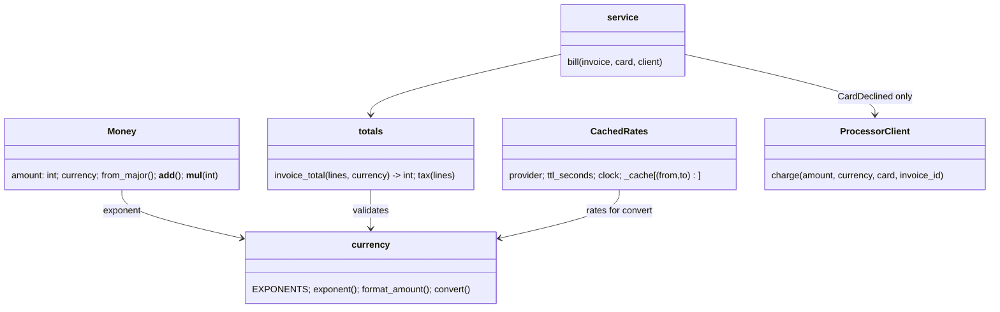

# 09 Answer key: review an AI-written PR

> SPOILERS. The interviewer session reads this. The user reads it only after a run.

The model solution is in `solution/` (overlay on `candidate/`), including a model
`REVIEW.md` and `GUARDRAILS.md`. It passes all 4 parts:
`python3 ai-coding/kit.py verify 09-ai-pr-review`.

---

## 1. The planted issues (grading checklist for REVIEW.md)

Must-find = a Staff candidate should find it in 15 minutes. The hidden Part 1
test only checks the four blockers by keyword and a non-approve verdict. Grade
the rest by hand.

| # | Severity | Must-find | Where | Root cause | How to prove it in one line | AI trap |
|---|---|---|---|---|---|---|
| 1 | blocker | yes | `processor.py` retry loop | POST retried on timeout with no `Idempotency-Key`. Timeout *after* the processor created the charge means a second charge | `fake.timeouts = ["after"]` then `len(fake.charges) == 2` | The PR's own retry test uses `"before"`, the safe case. Reading the test and nodding |
| 2 | blocker | yes | `totals.py` `line_total` / `int(total * 100)` | Float money, then truncation. `invoice_total([LineItem("x", 1999)], "usd") == 1998` | `python3 -c` one-liner. 284 of 4,900 cent amounts from $1.00 to $49.99 lose a cent | The test was loosened to `delta=1`, so "tests pass" |
| 3 | blocker | yes | `totals.py` `except Exception: return 0` with `service.py` `total == 0` path | A bad tax rate or currency returns 0, and `bill` marks a 0 total as **paid** with no charge | `LineItem("Plan", 1000, 1, "abc")` billed: status `paid`, no charge | Seeing the `except` alone as a "minor: too broad" and missing the paid-without-charge path in another file |
| 4 | blocker | yes | `currency.py` `convert`, `format_amount` | Assumes 2 decimals. JPY is 0, KWD/BHD are 3. 50,000 JPY settles as $3.35, not $335.00. Emails say `46.50 JPY` | `python3 cli.py examples/invoice_jpy.json examples/rates.json` prints it | Totals happen to work for JPY because `/100` and `*100` cancel, so a JPY totals test passes and hides the bug |
| 5 | major | yes | `totals.py` per-line rounding, `tests/test_totals.py` expected 325 changed to 324 | Behaviour change on existing USD invoices, not mentioned in the PR, which claims "fully backwards compatible" | `git diff` of the test: an expected value was edited | Accepting "rounding per line is clearer for the PDF" |
| 6 | major | yes | `tests/test_totals.py` `delta=1`, `tests/test_processor.py` decline test now `ProcessorError` | Two tests weakened to go green. `CardDeclined` subclasses `ProcessorError`, so the loosened test still reads fine | Read `pr.diff` for tests, not just code | Reviewing only `invoicing/` and skipping test diffs |
| 7 | major | no | `currency.py` `CachedRates` | Key is the target currency only (GBP->USD returns the EUR rate). `ttl_seconds` ignored. `cache={}` shared across instances | Two `get_rate` calls with different sources | Flagging the mutable default as a nit and missing the wrong-rate bug it sits next to |
| 8 | major | yes | `processor.py` `log.info(... card.number ...)` | Full PAN in logs. PCI DSS scope | The PR text even advertises it ("so on-call can see which card") | Missing it because the PR describes it as a feature |
| 9 | major | no | `processor.py` `except Exception` + `service.py` `except ProcessorError` | Declines retried 3 times and re-raised as `ProcessorError`. `bill` then marks invoices **failed** on a processor outage: dunning emails to every customer during an incident | `fake.timeouts = ["before"] * 3` then `bill` returns `failed` | Fixing the retry and not noticing the service change |
| 10 | minor | no | `processor.py` | No backoff or jitter between attempts | | |
| 11 | nit | no | `totals.py` | `currency="usd"` default lets a caller silently bill in dollars | | |

**Scoring REVIEW.md:** 4 blockers found with a concrete scenario each = strong.
Finding 5 and 6 (the edited and weakened tests) is the Staff signal: it shows
the candidate reviewed the evidence, not just the code. Severity calibration
matters: calling the float bug a "nit" or the PAN logging "minor" is a miss.

---

## 2. Design the solution converges on

- **One exponent table** drives formatting, conversion and `Money.from_major`.
- **Decimal only where a fraction is real:** tax rate times base, FX rate times
  amount. Both quantize half up to an int immediately.
- **Idempotency key per `charge` call**, sent on every attempt. Retry only
  `TimeoutError`.
- **Errors propagate.** `bill` catches only `CardDeclined`. Anything else leaves
  the invoice open for the next run.

---

## 3. Per part: good diff vs AI trap

| Part | Good | AI trap to catch |
|---|---|---|
| 1 Review | Runs the CLI and a one-line repro per blocker. Reads the test diffs. Verdict: request changes | Asking the AI "review this PR" and pasting its list. It finds the broad except and the mutable default, misses the after-timeout double charge and the edited expected value |
| 2 Fixes | Small diffs per module. Restores the original tax rounding. Keeps signatures | Rewriting `totals.py` around `Decimal` amounts end to end (floats gone but now Decimals leak into the processor body). `Idempotency-Key` generated inside the loop, so it changes per attempt. `round()` on a Decimal (banker's rounding) |
| 3 Money + catching test | The after-timeout test and an exact-cents test already exist from Part 2. `Money` is small and frozen. Starts adoption at `invoice_total`'s return and the processor boundary | `Money(float)` accepted "for convenience". `__eq__` comparing amounts across currencies |
| 4 Guardrails | Layers with costs (types, lint, property tests, CI rule on edited expected values, review checklist). Ships the AST lint | "Ban AI from billing code". A regex lint that flags the word `float` in strings and comments |

---

## 4. Follow-up questions and strong answers

| Question | Strong answer |
|---|---|
| What would you accept as-is? | `StaticRates`, the `currency` field on `Invoice`, the idea of retrying timeouts. Say so in the review, so the author knows what to keep |
| The key is a fresh uuid per call. The billing job crashes after the first attempt and re-runs. Double charge? | Yes, possible. Persist the key on the invoice (or derive it from invoice id plus billing attempt number) before the first request, so a re-run reuses it. Trade-off: a key derived from the invoice alone would replay a decline after the customer updates their card, so include the attempt number |
| How would you give this feedback to a teammate who used AI? | Same bar as any PR, no blame for the tool. Lead with the two money-losing blockers and a repro each. Point out the edited tests as a process issue: "if a test changes, say why in the PR". Pair on the fix if they are junior |
| Retries: what else? | Exponential backoff with jitter, a retry budget per billing run, and a circuit breaker so an outage does not turn into 3x load on the processor |
| How do you find invoices already billed wrong if this had shipped? | Query invoices since deploy with totals not equal to the Decimal recomputation, and charges with two successes for one invoice id. Refund or credit, notify finance, post-mortem |
| What pages someone at 3am? | Charges per invoice > 1, invoices marked paid with no charge id, settlement FX deviation above 1% from the reference rate |
