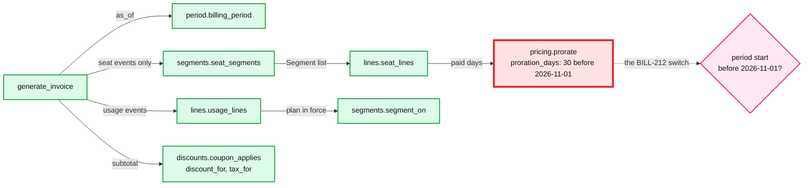

# 10 Answer key: characterization tests, then change legacy billing

> SPOILERS. The interviewer session reads this. The user reads it only after a run.

The model solution is in `solution/` (overlay on `candidate/` after Part 4's
catalog). It passes all 4 parts:
`python3 ai-coding/kit.py verify 10-billing-legacy-refactor`.

---

## 1. What is planted

**One known bug, BILL-212.** `generate_invoice` prorates every partial segment
by `paid_days / 30`. A February change bills 28/30 of a month. A change in a
31-day month bills 31/30. The task statement names it. Part 1 must pin it, not
fix it. Part 3 fixes it from 2026-11-01 only.

**Quirks a characterization suite must pin** (all deliberate legacy behaviour,
each one has a mutant):

| Mutant | What it changes | Behaviour it tests | Killed by a Feb-2026-only snapshot? |
|---|---|---|---|
| m01 | 10-seat tier becomes "more than 10" | volume tier boundaries (10 and 50 seats, floor division) | yes |
| m02 | trial end day becomes free | the trial ends at the start of `trial_end` | **no** |
| m03 | `once` coupon also applies in month 2 | once means the start month only | yes |
| m04 | `repeating` coupon gets one extra month | `months < duration_in_months` | yes |
| m05 | amount-off no longer capped at subtotal | discount never exceeds subtotal, so no negative totals | **no** |
| m06 | tax on subtotal before discount | tax applies after the coupon | yes |
| m07 | percent discount floors instead of half up | rounding mode of the coupon | yes (sub_0006, 61 seats) |
| m08 | setup fee charged every month | setup fee only in the start month | yes |
| m09 | last segment ignores mid-month seat changes | seat changes apply from their date | yes |
| m10 | a trial-covered full segment is charged full price | trial days are free even in a full-month segment | **no** |
| m11 | tax truncates instead of half up | tax rounding mode | yes |
| m12 | a cancel inside the period is ignored | cancel stops seats from its date | yes |
| m13 | December period ends Dec 31, not Jan 1 | December is 31 days, year rollover | **no** |

Measured: a golden snapshot of the 14 fixtures for **February 2026 only** (the
CLI example) kills 9 of 13 (69%) and fails the 75% bar. Jan to Mar kills 12 of
13 (m13 survives: no December). Every month from 2025-06 to 2026-10 kills 13 of
13. The lesson: pick inputs by the code's branches (December, trial edges,
coupon months, caps), not by the example in the task.

---

## 2. Design the solution converges on

- **Red node:** proration is where money changes. The switch lives in one
  function, `proration_days(period_start, period_end)`, keyed on the period's
  start date. Not a global flag, not a parameter callers can forget.
- **Seams that pay off in Part 4:** `seat_segments` filters to seat events, so
  usage cannot cut segments. `segment_on` gives "plan in force on a date" for
  free. `usage_lines` slots between seat lines and the coupon.
- **Patterns:** Extract Function and Golden Master (approval testing). No
  classes needed beyond the `Segment` value type.

---

## 3. Per part: good diff vs AI trap

| Part | Good | AI trap to catch |
|---|---|---|
| 1 Pin | Golden snapshot over every fixture and a spread of months (including December), recorded from the current code, plus a few named rule tests so failures are readable | Asking the AI to "write unit tests" for `generate_invoice`: it writes expected values from the *spec it imagines* (real-day proration, so BILL-212 "fixed" in the test), and the suite fails on today's code. Or tests only the CLI's February. Or "fixes" BILL-212 in passing |
| 2 Refactor | Small commits: extract period, then segments, then pricing, then discounts and tax; run the suite each time. Riskiest step: segments (event ordering, the `ev.at > seg_start` cut) | Letting the AI rewrite the whole function in one go. It "cleans up" the 30-day rule, the setup-fee-during-trial behaviour, or the floor in volume pricing, and the 400-invoice golden check fails |
| 3 BILL-212 | One function decides 30 vs real days from the period start. Old snapshot unchanged. New tests for Dec 2026 and Feb 2027 | A flag passed by callers (`version=2`) that defaults to the new behaviour, so every regenerated old invoice changes. Or comparing `as_of` instead of the period start |
| 4 Usage | Usage filtered out of segmenting, priced by `segment_on`, one line per metered plan | Adding `"usage"` to the old event loop, which then cuts seat segments, so a full month with usage is billed as two prorated pieces |

---

## 4. Part 3 rollout: the Staff answer

1. **Decide the boundary with finance first.** Periods starting on or after
   2026-11-01. Nothing issued changes. Write that down as the contract.
2. **Shadow before switching.** For November and December, compute both
   versions for every subscription, store the diff, and review the 20 biggest
   with finance. Expected: only partial-month segments differ (mid-month
   starts and changes). A month fully split by changes moves by 2/30 of the
   seat price in February and 1/30 in a 31-day month.
3. **Kill switch.** `REAL_DAYS_FROM` read from config, so pushing it out a
   month is a config change, not a deploy.
4. **Tell finance:** what changes, from when, the expected revenue effect
   (Feb: up, 31-day months: down, roughly net zero over a year), and that
   historical invoices regenerate identically.
5. **Customers:** no notice needed for a correction in their favour in 31-day
   months. Support gets a macro for "why is my proration different".
6. **What pages someone:** shadow diff rate above the expected share of
   mid-month changes, any regenerated pre-cutoff invoice that differs from the
   stored one.

---

## 5. Follow-up questions and strong answers

| Question | Strong answer |
|---|---|
| Why characterization tests and not tests from the spec? | There is no reliable spec; the code is the spec finance reconciles against. Pin first, then change on purpose, one diff at a time |
| How did you choose inputs? | From branches in the code: tiers at 10 and 50, trial boundaries, coupon month math, amount-off cap, December, cancel. Fixtures times many months, plus generated subscriptions if time allowed |
| How do you know the refactor is safe beyond your tests? | Run old and new side by side over a month of real subscriptions (or the 400-case generator) and diff every field. Ship behind no flag, because nothing should change |
| Regenerating October in December must match. What could still break it? | Catalog price changes. Invoices must read the price in force at the time, or store issued invoices and never regenerate. Name it as the next risk |
| Finance asks for the total revenue effect of BILL-212 for the past year | Run the real-days calculation over last year's subscriptions and sum the diff. Report it; do not reissue invoices without a product decision |
| What would you not refactor? | The data model and the CLI. They are not in the way, and touching them widens the blast radius for no gain |
