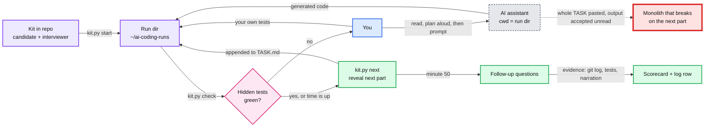
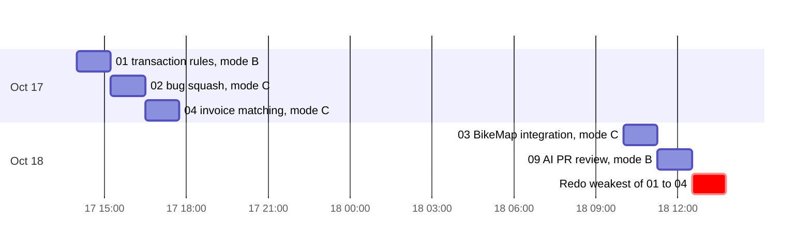

# AI Coding Rounds on Existing Code

> One-line answer: 10 timed kits. Each hands you a small existing repo with open tickets, failing tests, logs or a slow job. You fix it, extend it and defend it, with an AI assistant or without one, while an interviewer session reveals the next part and grades you. Kits 01 to 04 mirror the Stripe rounds candidates reported in Sep and Oct 2026.

- **Why these 10:** [research/stripe-rounds.md](research/stripe-rounds.md) (what Stripe ran, Aug to Oct 2026) and [research/brownfield-formats.md](research/brownfield-formats.md) (task types across Meta, Coinbase, DoorDash, Canva and others). Both were spot-checked on 2026-10-17.
- **How to drive the AI inside the round:** [../ai-programming-exercises/strategy.md](../ai-programming-exercises/strategy.md) §2 (60-minute playbook) and §4 (prompt templates).
- **Conventions and the interviewer protocol:** [CLAUDE.md](CLAUDE.md).

**Spoiler rule.** Only this file, `research/`, each kit's `README.md` and each kit's `candidate/` are safe to read before a run. A kit's `CLAUDE.md` and `interviewer/` hold the later parts and the answer key.

---

## 1. How a round runs



- **Parts arrive one at a time.** Old tests must keep passing. Nobody is expected to finish every part.
- **The red path is how candidates fail.** A rejected Stripe Staff candidate concluded the interviewer "wanted me to drive the design and write modular code, not to let the agent solve everything by itself". An Oct 2026 interviewer asked "what does the program do if the merchant name itself contains and or or?", the edge a one-shot regex misses.
- **The hidden tests are the interviewer's own.** `kit.py check --summary` shows counts only, the way an interviewer says "two edge cases still fail".

---

## 2. The 10 kits

Status: `todo` | `in-progress` | `done` (two runs logged, average score 3 or more).

| # | Kit | Round type | Simulates | Evidence | You start with | Stripe AI setting | Parts | Status |
|---|---|---|---|---|---|---|---|---|
| 01 | [transaction-rules](01-transaction-rules/) | Staged feature extension | AI Programming Exercise | 3 reports + 3 PracHub pages, Aug to Oct 2026 | ~80 lines, 3 green tests, 4 bug tickets | Built-in assistant (Opus in 2 reports). Practise B, then A | 5 | todo |
| 02 | [http-redirect-bug-squash](02-http-redirect-bug-squash/) | Bug squash in an unfamiliar library | Bug Squash (`requests` 307 body replay) | 2 reports + 1 page, Sep to Oct 2026 | ~930-line requests-like library, 30 tests, 2 failing | Unknown. Practise C, then B | 4 | todo |
| 03 | [bikemap-integration](03-bikemap-integration/) | Integrate a documented HTTP API | Integration (BikeMap) | 3 reports + 4 pages, Dec 2025 to Oct 2026 | ~100-line app, a 495-point ride, a 290-line API doc, a local fake API | Unknown, one guide says no. Practise C, then B | 5 | todo |
| 04 | [invoice-matching](04-invoice-matching/) | Fix, then extend in staged parts | Reconciliation (payments to invoices) | 4 reports + 3 pages, Sep 2025 to Oct 2026 | ~160 lines, 8 tests (2 failing), 3 finance tickets | Unknown. Practise C, then B | 5 | todo |
| 05 | [kyc-csv-validation](05-kyc-csv-validation/) | Fix failing tests in a multi-file repo, then extend | CSV verification records screen | 2 Senior sightings, Jul to Aug 2026 (Hello Interview) + PracHub titles | ~320 lines, 16 tests (5 failing) | B, then C | 4 | todo |
| 06 | [ledger-race](06-ledger-race/) | Concurrency bugs, then extend | Account balances under load | PracHub titles only | ~260 lines, 8 tests, a failing stress test | B, then C | 4 | todo |
| 07 | [webhook-incident](07-webhook-incident/) | Debug from a ticket and logs, no failing test | Bug bash, "a generic version of a real Stripe bug" | interviewing.io; Coinbase's official round format | ~450 lines, 14 green tests, a support ticket, an 850-line log | C, then B | 4 | todo |
| 08 | [settlement-report-perf](08-settlement-report-perf/) | Optimize slow code, output must not change | Meta's optimize phase, Google's pilot | Cross-company; no Stripe report | ~310 lines, 7 green tests, a report that takes 30+ minutes | B, then A | 4 | todo |
| 09 | [ai-pr-review](09-ai-pr-review/) | Review an AI-written PR | AI round: review and test the agent's code | 2 Stripe reports, Sep to Oct 2026; Coinbase official | ~275 lines, 19 green tests, `PR.md` and `pr.diff` | B | 4 | todo |
| 10 | [billing-legacy-refactor](10-billing-legacy-refactor/) | Change untested legacy code safely | Staff test-strategy probe | Weakest: guide advice only | ~260 lines, no tests, 14 fixtures | B | 4 | todo |

Every kit is Python 3.11+, standard library only. Each later part is a small diff only if you picked the right seam earlier. That is the Staff signal every kit measures.

---

## 3. Modes and commands

| Mode | Simulates | Start the assistant inside the run dir |
|---|---|---|
| **A** chat-only | A built-in chat panel (Stripe's platform AI, Meta's CoderPad) | `claude --disallowedTools "Edit Write NotebookEdit Bash"`. Add `--model haiku` for a weak-model day. You type and run tests yourself |
| **B** full agent | Stripe's "simulating using Codex", DoorDash, Shopify | `claude`. Commit after every green part |
| **C** no AI | interviewing.io says AI is "strictly prohibited" at Stripe. AI policy for bug squash and integration is unknown | No assistant. Your editor and debugger only |

```
$ python3 ai-coding/kit.py list
$ python3 ai-coding/kit.py start 02-http-redirect-bug-squash   # prints the run dir and Part 1
$ python3 ai-coding/kit.py check --summary <run_dir>           # hidden test counts for revealed parts
$ python3 ai-coding/kit.py next <run_dir>                      # reveal the next part
$ python3 ai-coding/kit.py verify all                          # kit health check, spoiler-free output
```

**Claude as the interviewer:** open a terminal in `ai-coding/NN-<slug>/`, run `claude`, and say "interview me". It starts the run, reveals parts, calls time, asks follow-ups and grades you (protocol in [CLAUDE.md](CLAUDE.md) §3). Your own assistant runs in a second terminal in the run dir.

**Before the real day:** make sure your editor's debugger works on a run dir. Set a breakpoint in a test once. A Sep 2026 Stripe candidate lost about 15 minutes to a VS Code debugger that would not start, and the debug round sank the loop.

---

## 4. Order with two days left (Stripe onsite 2026-10-19/20)



- 01 to 04 are the rounds Stripe actually ran in Sep and Oct 2026. Do them first.
- 09 trains the review muscle the AI round rewards: telling a correct generation from a plausible one.
- 05 to 08 and 10 are for after the onsite, or for other companies (Meta, Coinbase, DoorDash).

---

## 5. Rubric (score 1 to 4 per dimension)

Built from Canva's official areas (problem-solving, technical depth and ownership, AI collaboration), the Bug Squash scoring a Stripe-focused guide describes (reproduce, hypothesis, smallest root-cause fix, regression test), and the azizu06 practice rubric. Each kit's `CLAUDE.md` adds kit-specific anchors.

| Dimension | 4 looks like | 1 looks like |
|---|---|---|
| **Orientation** | Read the entry point, models and tests, and ran the tests before the first prompt. Named the suspicious lines | Prompted the AI in the first minute |
| **Design and seams** | Chose a structure that made later parts small diffs, and said why. Refused to over-build | Rewrote the code for each part |
| **Correctness and tests** | Own test per ticket and edge case. Hidden checks green through the last part reached. No weakened tests | No own tests. Hidden checks red |
| **Debugging** | A stated hypothesis before each AI call or breakpoint. Smallest root-cause fix plus a regression test | Shotgun edits until green |
| **AI usage** | Prompts name files and the plan. Reviewed every generation and rejected a wrong one. Typed small edits by hand. (Mode C: score pace instead) | Accepted output unread, or never used the AI in mode A or B |
| **Communication and Staff signal** | Narrated every 30 to 60 s. Named trade-offs, failure modes, rollout and rollback, and what pages at 3am | Silent stretches over 2 minutes. One true answer |

**Bar:** no 1s and an average of 3 or more.

---

## 6. Log

One row per run. The interviewer session offers to append it.

| Date | Kit | Mode | Parts reached | Hidden checks | O / D / C / Db / AI / Cm | Weakest moment | Fix next time |
|---|---|---|---|---|---|---|---|

---

## 7. Backlog (registered, not built)

| Candidate kit | Evidence | Why not now |
|---|---|---|
| Bank balances from CSV, monthly two-table match | 1 report (Aug 2026 phone screen) + 3 PracHub titles | Overlaps 04 and 05 |
| Real `requests` checkout variant of 02 | Matches the real round exactly | Needs `pip` deps in the run dir and a pinned tag checked by hand |
| Assign reviewers from changed files (git blame style) | 1 PracHub title, Apr 2026 | Title only |
| Mako or SnakeYAML bug squash | Search snippets only | Unverified |
| Subscription welcome and expiry emails | PracHub, Dec 2025 and Apr 2026 | A classic problem, not existing code |
| Sticky load balancer with shutdown, split tender | PracHub OA listings, 2026 | Intern and new-grad assessments |

---

## 8. Evidence notes

- **The AI policy conflicts.** interviewing.io's undated Stripe page says AI is "strictly prohibited". 2026 reports describe an AI round with "the AI built into the platform". Bug squash and integration rounds ran in a local IDE with no stated AI policy. So each kit lists a Stripe AI setting, and you practise both ways. Ask your recruiter.
- **No Stripe official page describes these rounds.** Everything comes from candidate reports and PracHub rewrites. PracHub says original input formats "were not preserved", so the kits use the reconstructed formats.
- **The kits are brownfield on purpose.** The real AI round starts from an empty function. Starting from a teammate's buggy code trains orientation and seam-finding, which every company in the formats survey grades.
