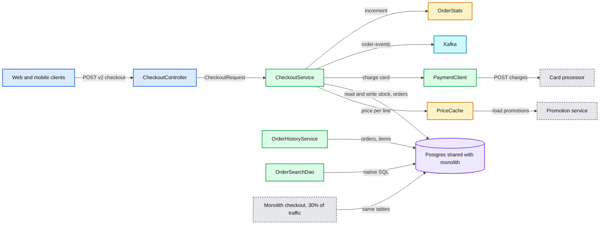

# 01 Checkout v2: review a PR that "moves checkout out of the monolith"

> A 650-line Spring Boot PR. CI is green, a peer already approved it, and the author labelled it `low-risk`. You are the required approver. Find what would hurt in production, rank it, and give a verdict.

| | |
|---|---|
| Time | 45 min, plus 15 min of follow-up questions if someone plays interviewer |
| Stack | Java 21, Spring Boot 3, Spring Data JPA (Hibernate 6), PostgreSQL 16 |
| Focus | Concurrency (`synchronized`, `volatile`, shared maps), transactions, JPA and SQL, payments, rollout |
| Size | 17 Java files (~565 lines), 2 SQL files, 1 test. Start with `PR.md`, then `CheckoutService.java` |
| Answers | `../answers/01-checkout-service.md` and a runnable `Repro.java`. **Do not open them before you finish.** |

## What the PR builds

No node is red on purpose. Deciding which one breaks first is your job.

## Rules

- Reading only. No AI, no running the code. Your IDE is fine for jumping between files.
- Write your review in `my-review.md` in this folder. Copy the format from [`../review-template.md`](../review-template.md).
- Stop at 45 minutes, even if you are not done. Ranking what you found matters more than finding everything.
- The PR has more issues than you can find in 45 minutes. Expect a mix of P0, P1, P2 and nits.

## Clock

| Min | Do |
|---|---|
| 0 to 3 | Read `PR.md`. Write down the 3 numbers that matter (traffic, pods, pool size) and 2 questions you would ask the author |
| 3 to 8 | Skim every file once. Build a map: what runs inside the transaction, what is shared between threads, what is remote |
| 8 to 33 | Find issues. Start with `CheckoutService`, `PaymentClient` and `PriceCache`. One line per issue, tagged P0, P1, P2 or nit |
| 33 to 40 | Rank. Pick your top 3. Write the verdict and the split-PR plan |
| 40 to 45 | Write the 60-second opening you would say out loud, plus what you would keep and one systemic fix |

## When you finish

1. Run the proofs: `java code-review/answers/01-checkout-service/Repro.java` (JDK 21+, no dependencies, ~10 s).
2. Debrief:
   - Either open `../answers/01-checkout-service.md` and score yourself against its §1 rubric,
   - Or start `claude` inside `code-review/` and say `debrief 01`. It grades `my-review.md` by finding ID and asks you the interviewer's follow-up questions.
3. Log the result in the table in [`../README.md`](../README.md).

## Optional: compile it yourself

The code compiles and the PR's test passes against Spring Boot 3.1 (checked on 2026-11-24). The repo carries no build files on purpose. To build it, copy `src/` into a scratch folder with a `pom.xml` that uses `spring-boot-starter-parent` 3.x plus `spring-boot-starter-data-jpa`, `spring-boot-starter-web` and `spring-boot-starter-test`, then run `mvn test`.
