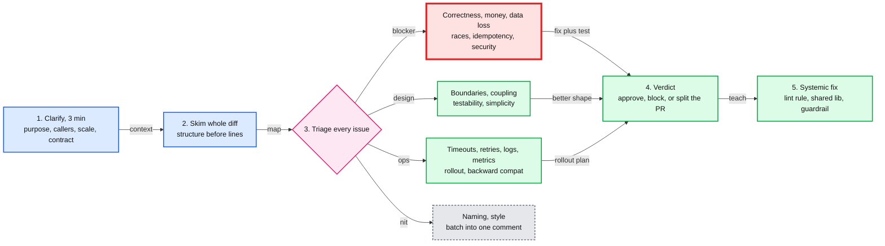

# code-review/

Practice for the code review round: you get someone else's pull request, find what would hurt in production, rank it, and give a verdict. The track also has two refresh files for the Java topics that come up most often.

## What a Staff-level review round grades

| | Senior | Staff and above |
|---|---|---|
| Order | Reads top to bottom | Ranks by blast radius, says the top 3 first |
| Finds | Line-level bugs | The bug that loses money at scale, and the design that invited it |
| Fix | Rewrites the line | Fix, plus the test that proves it, plus how to roll it out |
| Scope | This diff | Callers, schema and data migration, backward compatibility, on-call load |
| Verdict | A list of comments | Approve, block or split, and what to keep |
| After | Done | Coaches the author, turns repeated mistakes into a guardrail |

## Files

| File | What | Time |
|---|---|---|
| [`java-standards.md`](java-standards.md) | Core Java and concurrency refresh: memory model, `synchronized`, `volatile`, atomics, locks, concurrent collections, executors, virtual threads. Bad/good pairs with the review comment to write | 45 to 60 min |
| [`jpa-sql-standards.md`](jpa-sql-standards.md) | JPA, Hibernate, Spring `@Transactional` and SQL: entity lifecycle, N+1, locking, isolation, outbox, indexes, pagination, migrations | ~40 min |
| [`review-template.md`](review-template.md) | Copy into an exercise folder as `my-review.md` | |
| `answers/` | Spoilers. Answer keys and runnable proofs | after |

Each standards file ends with a one-page checklist. Scan both checklists 10 minutes before a round.

## Exercises

| # | Exercise | Stack | Focus | Time |
|---|---|---|---|---|
| 01 | [`01-checkout-service/`](01-checkout-service/) Checkout v2 moved out of a monolith | Java 21, Spring Boot 3, JPA, Postgres | `synchronized` and transactions, shared maps, payment retries, ordinal enums, N+1, SQL injection, rollout | 45 min |

Related practice elsewhere in the repo: [`ai-coding/09-ai-pr-review/`](../ai-coding/09-ai-pr-review/), a review of an AI-written Python PR, and [`hld/ecommerce-platform/`](../hld/ecommerce-platform/) for the inventory and checkout design behind exercise 01.

## How to run one

1. Read the exercise's `README.md` and `PR.md`. Start a 45-minute timer.
2. Write `my-review.md` from the template. No AI.
3. Run the exercise's `Repro.java` from `answers/` and open the answer key. Or start `claude` inside `code-review/` and say `debrief NN`.
4. Log it below. Re-run any exercise where you missed a P0, a week later.

## Log

| Date | # | Min | P0 found / total | Missed P0s | Top-3 right? | Note |
|---|---|---|---|---|---|---|
| | 01 | | / 11 | | | |
