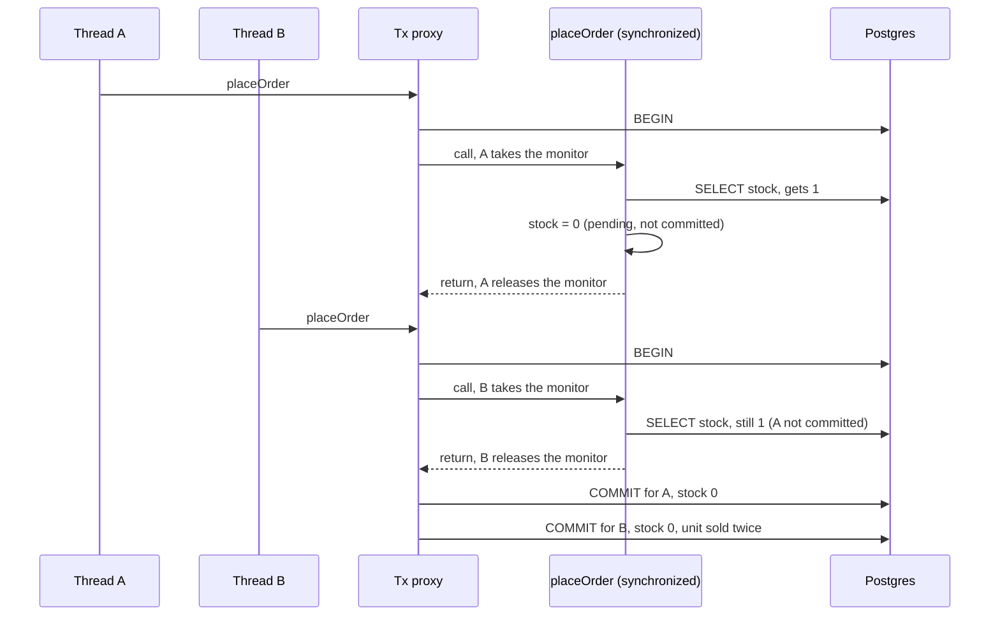
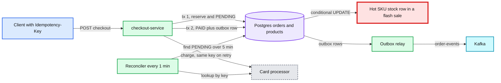

# Answer key: 01 Checkout v2 in checkout-service

> SPOILER. Open only after your review is written in `01-checkout-service/my-review.md`.

**Verdict: request changes, and block the merge.** The PR can double-charge, oversell, corrupt 400M existing order rows, leak card data, and allow SQL injection. Each of these is reachable on day one at normal traffic (150 checkouts/s). Split it into four PRs, fix the payment flow first, and roll it out behind a percentage flag.

Proofs: `java code-review/answers/01-checkout-service/Repro.java` runs six demos in about 10 s (JDK 21+, no dependencies). One run on a 14-core laptop:

```
[C1] volatile ++    expected 8,000,000 got 1,202,097 (lost 6,797,903)
[P0-2] synchronized + commit after return: last unit sold twice in 200 of 200 trials
[P0-2] conditional UPDATE fix:            last unit sold twice in 0 of 200 trials
[C2] HashMap get-then-put  expected 800,000 got 744,884
[C4] shared SimpleDateFormat: 20,171 wrong dates and 88,922 exceptions out of 160,000 calls
[P1-9] Long 127 == Long 127: true; Long 128 == Long 128: false; equals: true
[P0-5] 59.90 at 30% off, qty 3: total = 125.78999999999999, sent as "amount":125.78999999999999
```

P0-10 was checked with a real Jackson run: `JsonMappingException: Infinite recursion (StackOverflowError) (through reference chain: OrderItem["order"]->Order["items"]->...)`.

---

## 1. Grade yourself

| Bar | You did this |
|---|---|
| **Senior** | Found at least 6 of the 11 P0s, including P0-1 (double charge), P0-2 (oversell) and P0-9 (SQL injection). Gave a fix for each one. |
| **Staff** | Found at least 9 P0s within 25 minutes. Ranked them by blast radius. Linked findings across files (the 500 that triggers a retry and a second charge, the enum that breaks the monolith). Named the test that proves each P0. |
| **Senior Staff** | Everything above, plus: the capacity math (~20 checkouts/s against a 1,200/s peak), the migration and rollout risks (index lock, shared enum, mobile v5 still on the monolith), the bottleneck that remains after the fix (the hot stock row), a plan to split the PR, how to coach the author, and one systemic guardrail. |

Also score yourself on these:
- Did you open with a verdict and the top 3 issues, or did you read out issues line by line?
- Did you say what you would keep?
- Did you put the nits in one batched comment, or none at all?

---

## 2. The first 60 seconds, said out loud

> "Blocking. Three themes. First, money: the payment retry has no idempotency key, so a timeout becomes a second charge, the client can set its own price, and totals are doubles. Second, inventory: `synchronized` does not stop overselling. The lock is per JVM, there are 6 pods plus the monolith, and the lock is released before the transaction commits. Third, rollout: inserting `PAYMENT_PENDING` in the middle of an ordinal enum re-labels 400M existing orders, and the index build locks the shared `orders` table. I'd split this into four PRs. The right instincts are here (preventing oversell, retrying a flaky processor, keeping the audit durable), but the mechanisms are wrong. Let me go through the fixes."

---

## 3. P0: money, data loss, security (block)

| ID | Where | What breaks | Failure scenario with numbers | Fix | Test that proves it |
|---|---|---|---|---|---|
| P0-1 | `PaymentClient.java:32-57` | Retries `POST /charges` without an `Idempotency-Key` | The processor charges, then the response times out or returns 5xx. The client retries and charges again. ~0.5% of 12.9M daily checkouts hit the retry path, so up to ~65k possible double charges a day | Send `Idempotency-Key: <orderId>` on every attempt. Retry only connection errors, 429 and 5xx | WireMock: first call delays past the timeout, second returns 200. Assert both requests carry the same key |
| P0-2 | `CheckoutService.java:30-42` | `synchronized` does not prevent overselling | (a) The lock covers 1 JVM, but there are 6 pods plus the monolith. (b) The proxy commits after the synchronized method returns, so thread B reads stock that is not yet committed. Repro: 200 of 200 trials sold the last unit twice | One conditional write: `UPDATE products SET stock = stock - :n WHERE id = :id AND stock >= :n`. Check `rows == 1`. Add `CHECK (stock >= 0)` | Testcontainers Postgres, 50 threads buy a product with stock 10. Assert exactly 10 succeed and stock is 0 |
| P0-3 | `CheckoutService.java:31, 52` | The card is charged inside the DB transaction | The charge succeeds, then the commit fails (the audit insert fails, a deadlock, or the pod is killed). Money is taken, no order exists, and the charge id is lost | Three steps: tx 1 reserves stock and writes the order as `PAYMENT_PENDING`. The charge runs outside any tx, keyed by order id. Tx 2 marks it `PAID` or releases the stock. A reconciler resolves orders stuck in `PAYMENT_PENDING` | Kill the transaction after the charge (throw from a spy). Assert the reconciler finds the charge by its key |
| P0-4 | `CheckoutService.java:32`, `PaymentClient.java:43-44` | A declined card still commits the stock decrement | `PaymentDeclinedException` is checked, and Spring rolls back only on unchecked exceptions by default. The order stays `CREATED` and the units are never released. A 3% decline rate at 150/s leaks ~4.5 orders' worth of stock every second | Handle the decline explicitly: release the stock in tx 2. If you keep the exception, add `rollbackFor`. The step-3 design above makes it moot | Mock a 402. Assert stock is unchanged and the order is `PAYMENT_FAILED` |
| P0-5 | `CheckoutService.java:34, 45`, `Product.java:20`, `Order.java:26`, `PaymentClient.java:30` | Money is stored and computed as `double` | `59.90 * 0.7 * 3 = 125.78999999999999` is sent to the processor. `19.99` at 10% off gives a unit price of `17.991` | `BigDecimal` (or `long` minor units), with the scale set by the currency and an explicit `RoundingMode`. Round the unit price once. Use `NUMERIC(19,4)` columns (a schema migration) | Unit test: 3 x 59.90 at 30% off equals `125.79` exactly |
| P0-6 | `CheckoutService.java:38-46` | The client controls the price and quantity | `unitPrice: 0.01` buys anything for a cent. `qty: -5` passes `stock < qty`, adds 5 units of stock, and makes the total negative | Ignore any client price. Price on the server and reject a stale cart with 409. Use `@Valid` with `qty` from 1 to 99 | Request with `unitPrice 0.01` is charged the catalog price. `qty -5` returns 400 |
| P0-7 | `CheckoutController.java:25`, `PaymentClient.java:46` | Card number and CVV are written to the logs | A record's `toString` prints every component, so the logs hold the PAN and CVV in plain text. Storing the CVV after authorization breaks PCI DSS (Payment Card Industry Data Security Standard) | Never accept a raw card number. The client tokenizes with the processor, and the service sees only the token. Never log request bodies | A log-capture test asserts that no 13 to 19 digit run appears |
| P0-8 | `OrderStatus.java:5`, `Order.java:25`, `existing-schema.sql:17` | A new constant is inserted in the middle of an ordinal enum | Old ordinals: CREATED 0, PAID 1, SHIPPED 2, CANCELLED 3. Now PAID reads as `PAYMENT_PENDING`, SHIPPED as `PAID`, and CANCELLED as `SHIPPED` across 400M rows. New `PAID` rows (2) read as `SHIPPED` in the monolith | Add new constants at the end only. Move to `@Enumerated(EnumType.STRING)` with expand and contract: add a `status_text` column, write both, backfill, switch reads, drop the old column | Load a row with `status = 1` and assert the new code reads `PAID` |
| P0-9 | `OrderSearchDao.java:18-20` | SQL injection through `status` and `sortBy` | `sort=created_at; DROP TABLE orders` or `status=' OR '1'='1`. It is also wrong as written: `status` holds ordinals, so `status = 'PAID'` matches 0 rows | Bind `:status` as a parameter. Map `sortBy` through a whitelist (`Map.of("created", "created_at")`) | Request with `sort=id;select pg_sleep(5)` is rejected with 400 |
| P0-10 | `CheckoutController.java:28`, `OrderItem.java:38` | A successful checkout returns 500, then the client retries | Jackson serializes `Order` to `items`, then `OrderItem.getOrder()` back to `Order`, and recurses forever. That happens after the commit and after the charge. The client sees 500, retries, and gets a second order and a second charge (no idempotency key on `/v2/checkout`) | Return a response DTO (data transfer object), never an entity. Require an `Idempotency-Key` header on `POST /v2/checkout`, stored with a UNIQUE constraint, and replay the first response | MockMvc: POST twice with the same key. Assert one order, one charge and two identical 200 responses |
| P0-11 | `PriceCache.java:16, 35-38` | Prices and promotions are cached forever | Promotions load once, with the date of the first call. A 1-day 30% sale stays live until the pod restarts, and base price changes are ignored | Hold one immutable snapshot, refreshed every 60 s, and compute the price on each call (it costs microseconds). See §6 | Advance a fake `Clock` past midnight. Assert the next call uses the new day's promotions |

---

## 4. Concurrency findings (your focus area)

| ID | Sev | Where | What breaks | Fix |
|---|---|---|---|---|
| P0-2 | P0 | `CheckoutService.java:31-32` | `synchronized` plus `@Transactional`: the lock is released before the commit, and it protects one JVM only. See the diagram below | Move the invariant into the database (a conditional UPDATE) |
| P1-1 | P1 | `CheckoutService.java:32` | Every checkout on a pod runs one at a time behind a payment call (p50 300 ms). That is ~3.3/s per pod and **~20/s for 6 pods, against a 1,200/s peak**. With no timeout, one hung call freezes all 200 Tomcat threads on the pod | Remove the lock. Correctness comes from the database |
| C1 | P2 | `OrderStats.java:11, 16` | `volatile` gives visibility but not atomicity. `placed++` is a read, an add and a write, so updates are lost (repro: 1.2M of 8M kept) | `LongAdder`, or better, delete the class (see P2-10) |
| C2 | P1 | `PriceCache.java:16, 25-31` | A `HashMap` shared by the pod's 200 request threads, with get-then-put. Updates are lost (repro: 744,884 of 800,000), and a racing resize can corrupt the map. The first version of the repro hung forever in a corrupted map | `ConcurrentHashMap.computeIfAbsent`, or no per-SKU cache at all (§6) |
| C3 | P1 | `PriceCache.java:17, 35-38` | Double-checked locking on a field that is not `volatile`. Another thread can see a non-null reference to a map that is not fully built | `volatile`, a holder class, or an `AtomicReference` snapshot (§6) |
| C4 | P1 | `PriceCache.java:14, 38` | A static `SimpleDateFormat` is shared across threads. It keeps a mutable `Calendar` inside (repro: 20k wrong dates and 89k exceptions out of 160k calls) | `DateTimeFormatter.ISO_LOCAL_DATE`, which is immutable, or `LocalDate.now(clock).toString()` |
| C5 | P1 | `PriceCache.java:36-38` | A ~200 ms remote call runs while holding `this`. Every pricing thread on the pod waits behind it, and with no timeout, forever | Load outside the lock. Refresh on a scheduler, never on the request path |
| C6 | P2 | `OrderStats.java:18, 21, 28` | `static synchronized` locks `OrderStats.class`, while the instance `synchronized` locks `this`. These are two different monitors. `placedToday++` runs outside both, so the reset can race with the increment | One lock for all of the state, or one `AtomicReference<DayCount>` record swapped with `updateAndGet` |
| C7 | P2 | `CheckoutService.java:32` with virtual threads | If someone turns on `spring.threads.virtual.enabled=true` on JDK 21 to 23, the blocking HTTP call inside `synchronized` pins the carrier thread (fixed in JDK 24 by JEP 491) | Another reason to drop the lock. Use `ReentrantLock` where a lock is truly needed |



---

## 5. P1: correctness under load, outages, operability

| ID | Where | Issue | Fix |
|---|---|---|---|
| P1-1 | `CheckoutService.java:32` | Throughput collapses to ~20/s. See §4 | Remove the lock |
| P1-2 | `PaymentClient.java:20, 32-55` | No connect or request timeout. A fixed 1 s sleep with no jitter. Retries 400, 401 and 409, which never succeed. Worst case is an unbounded wait | `connectTimeout(1s)` plus a per-request `timeout(2s)` (just over the processor's p99). Exponential backoff with jitter. A retry budget. A circuit breaker |
| P1-3 | `PaymentClient.java:49-55` | `InterruptedException` is swallowed twice, so a shutdown cannot stop the thread and a graceful shutdown hangs | `Thread.currentThread().interrupt()` and stop retrying |
| P1-4 | `CheckoutService.java:31-52` | The DB connection is held across the payment call. With a pool of 10 and 300 ms per call, the pod tops out at ~33/s even without the lock, and the pool runs dry when the processor slows | Never make a remote call inside a transaction (P0-3 fixes this) |
| P1-5 | `CheckoutService.java:56` | The event is published before the commit, and `publish` is async, so a failure is ignored. Warehouse and email act on orders that later roll back, and some events are lost | A transactional outbox: write an `outbox` row in tx 2, and a relay publishes it |
| P1-6 | `CheckoutService.java:57, 63` | `recordAudit` is called on `this`, which skips the proxy, so `REQUIRES_NEW` is ignored. The audit joins the order transaction: an audit failure rolls back a paid order. Even if it did work, `REQUIRES_NEW` takes a second connection per checkout, and with a pool of 10 that can deadlock the pool | Write the audit row in the same tx 2 as the order. That is simpler and correct |
| P1-7 | `CheckoutController.java:29-31` | `catch (Exception)` maps everything to 500. Out of stock should be 409, a decline 402, bad input 400. Clients and gateways retry 500s, which makes P0-1 and P0-10 worse | `@ControllerAdvice` with typed exceptions mapped to 4xx, and 5xx only for real failures |
| P1-8 | `OrderHistoryService.java:21` | `findAll()` loads 400M orders into memory. The first call takes the pod down with an OutOfMemoryError | `findByCustomerIdOrderByCreatedAtDesc(customerId, pageable)` with an index on `(customer_id, created_at DESC)`, and keyset pagination |
| P1-9 | `OrderHistoryService.java:25` | `Long == Long` compares object references. `Long` caches only -128 to 127, so every customer with an id over 127 sees an empty history | `customerId.equals(o.getCustomerId())`, or better, filter in SQL |
| P1-10 | `OrderHistoryService.java:27`, `OrderItem.java:18, 21` | N+1 (one query per order to load its items): 1 query, then 1 per order for items, then the `product` per item, because `@ManyToOne` defaults to EAGER. 50 orders of 3 items is ~200 queries | A DTO projection with `count(*)` grouped by order, or `@EntityGraph`. Set `@ManyToOne(fetch = LAZY)` explicitly |
| P1-11 | `V42__checkout_v2.sql:4` | `CREATE INDEX` on the shared 400M-row `orders` table blocks inserts and updates for the whole build (minutes). It runs at pod start, so the monolith's checkout stops during the deploy | `CREATE INDEX CONCURRENTLY` in its own non-transactional migration, run before the deploy and not at pod start. Ask whether the index is needed at all |
| P1-12 | `PR.md` rollout | Gateway traffic switches 100% at deploy. The monolith (~30% of checkouts) and the new service write the same stock rows with different rules. After V42 and the new ordinals, rolling back does not undo the damage | The same conditional-UPDATE rule in both systems first. A gateway flag at 1%, then 10%, then 50%, then 100%, with a reconciliation dashboard. Enum and migration changes ship separately and before the service |
| P1-13 | `CheckoutRequest.java:5`, `OrderHistoryService.java:20` | `customerId` comes from the request body or a query parameter. Anyone can read anyone's order history (an IDOR, insecure direct object reference) | Take the customer id from the authenticated principal only |
| P1-14 | `CheckoutServiceTest.java` | One happy-path test built on mocks. The mocks skip the Spring proxy, so no test can catch P0-2, P0-3, P0-4, P1-6 or P0-10. "CI green" proves almost nothing here | Integration tests on Testcontainers Postgres plus WireMock: a concurrency test, a decline test, a timeout-plus-retry test and a duplicate-key test |

---

## 6. What the fixed core looks like

```java
// Three steps. Only the database guards stock. The charge runs outside any transaction.
public CheckoutResult placeOrder(UUID idempotencyKey, long customerId, CheckoutCommand cmd) {
    // Tx 1: replay check, reserve stock, order row PAYMENT_PENDING.
    Order order = tx.execute(s -> {
        Optional<Order> existing = orders.findByIdempotencyKey(idempotencyKey);
        if (existing.isPresent()) return existing.get();              // replay, no second charge
        Order o = Order.pending(idempotencyKey, customerId);
        for (Line line : cmd.linesSortedByProductId()) {             // fixed lock order: no deadlocks
            if (products.reserve(line.productId(), line.qty()) != 1) // UPDATE ... WHERE stock >= :qty
                throw new OutOfStockException(line.productId());     // unchecked: tx 1 rolls back
            o.addItem(line.productId(), line.qty(), pricing.unitPrice(line.productId())); // server price
        }
        return orders.save(o);
    });
    if (order.isFinal()) return CheckoutResult.from(order);

    // No transaction, no DB connection held. Same key on every retry.
    ChargeOutcome charge = payments.charge(order.getId().toString(), order.total(), cmd.paymentToken());

    // Tx 2: final state, plus outbox and audit in the same commit.
    return tx.execute(s -> switch (charge.status()) {
        case SUCCEEDED -> completer.markPaid(order.getId(), charge.chargeId());   // + outbox + audit rows
        case DECLINED  -> completer.markFailedAndRelease(order.getId());          // stock back
        case UNKNOWN   -> CheckoutResult.pending(order.getId());                  // reconciler decides
    });
}
```

```java
// PriceCache, simplified: cache only the remote data, as one immutable snapshot.
private final AtomicReference<Map<String, BigDecimal>> promos = new AtomicReference<>(Map.of());

@Scheduled(fixedDelay = 60_000)
void refresh() {                                   // off the request path, outside any lock
    promos.set(Map.copyOf(client.loadPromotions(LocalDate.now(clock))));
}

public BigDecimal unitPrice(String sku, BigDecimal base) {
    BigDecimal discount = promos.get().getOrDefault(sku, BigDecimal.ZERO);
    return base.multiply(BigDecimal.ONE.subtract(discount)).setScale(2, RoundingMode.HALF_EVEN);
}
```



**The red node.** The conditional UPDATE is correct, but it serializes on one row lock. At ~1 to 2 ms per update, one row tops out around 500 to 1,000 decrements a second. A flash sale on one SKU at 1,200 checkouts/s exceeds that. The next step is to split the stock into N bucket rows (`sku, bucket, stock`) and pick a random bucket, or to gate the sale at the edge. See [`hld/ecommerce-platform/`](../../hld/ecommerce-platform/) (40 carved buckets). Say this before the interviewer asks.

---

## 7. P2 and nits (one batched comment)

| ID | Where | Issue |
|---|---|---|
| P2-1 | `CheckoutService.java:37` | `findById(...).get()` throws `NoSuchElementException`, which becomes a 500. Use `orElseThrow(() -> new UnknownProductException(id))` mapped to 400 |
| P2-2 | `CheckoutService.java:42` | `products.save(p)` on a managed entity is noise. Dirty checking already writes it [nit] |
| P2-3 | `PaymentClient.java:29-30, 60-63` | JSON built by string concatenation (a quote in any field breaks it) and parsed by `indexOf`. Use Jackson |
| P2-4 | `Order.java:57-74` | `equals`/`hashCode` cover mutable fields and a null id, so the hash changes after persist and the entity is lost inside a `HashSet`. `toString` walks the items, which can trigger lazy loads. Use an id-based `equals` with a constant `hashCode`, and a short `toString` |
| P2-5 | `Order.java:28`, `V42__checkout_v2.sql:11`, `PriceCache.java:38` | `LocalDateTime.now()` and `TIMESTAMP` without a time zone. The promotion day comes from the JVM default zone. Use `Instant`, `timestamptz`, and an injected `Clock` with an explicit `ZoneId` |
| P2-6 | `Order.java:21`, `OrderItem.java:15` | `IDENTITY` ids turn off JDBC insert batching in Hibernate. Use `SEQUENCE` with a pooled optimizer [nit] |
| P2-7 | `OrderHistoryService.java:35` | `subList` throws when the page is past the end. Pagination belongs in SQL (P1-8) |
| P2-8 | `OrderSearchDao.java:20` | `OFFSET` pagination: page 2,000 reads and throws away 100,000 rows. Use keyset pagination on `(created_at, id)` |
| P2-9 | `existing-schema.sql` | No `CHECK (stock >= 0)`, no UNIQUE on `sku`, no foreign keys, no index on `order_items(order_id)`. These predate the PR, so raise them as a follow-up ticket, not a blocker. The P0-2 fix leans on the CHECK, though |
| P2-10 | `OrderStats.java` | Per-pod in-memory counters are wrong with 6 pods and reset on every deploy. Delete the class and use one Micrometer counter, `checkout.orders.placed`, which Prometheus sums across pods (Simplify) |
| P2-11 | `OrderHistoryService.java:20` | No `@Transactional(readOnly = true)`. Lazy `items` load only because open-in-view is on by default |

---

## 8. Say what you would keep

- Constructor injection and small classes with one job each.
- `CheckoutRequest` as a record.
- `OrderEventPublisher` as an interface. It makes the outbox swap a one-class change.
- The instincts were right. The author thought about overselling, a flaky processor and a durable audit trail. Only the mechanisms were wrong. Say this to the author.

---

## 9. Staff-level extras the interviewer is looking for

- **Split the PR.**
  - A: enum and migration fixes (ships first, and the monolith must deploy them too).
  - B: the checkout core with the three-step flow.
  - C: history and search.
  - D: delete `OrderStats`.
- **Coach the author.** Talk privately before writing 40 comments in public. Pair for one hour on the payment flow. Give the peer who wrote "LGTM" a short note on what to look for.
- **Systemic guardrails.** Most of these bugs will come back in the next service unless a tool stops them:
  - An ArchUnit rule: no `synchronized` in `@Service` classes, no `double` fields named `price` or `total` or `amount`, and no `HashMap` fields in singletons.
  - Error Prone in CI. It catches reference equality on boxed types, among other things.
  - A shared payment client library that always sends an idempotency key and sets timeouts.
  - A log redaction filter for card-number patterns.
  - A PR template asking "what happens on retry?" and "what runs inside the transaction?".
- **Operability.**
  - Alert on stock below 0 or `PAYMENT_PENDING` older than 10 minutes.
  - Alert on the charge-to-order reconciliation mismatch count.
  - SLO dashboard: checkout success rate and p99, split by monolith and service during the rollout.

---

## 10. Follow-up questions an interviewer would ask

1. **"Optimistic locking with `@Version`, or the conditional UPDATE?"** Under contention, a version check fails and retries in a loop: 1,200/s on one row means most attempts fail. A conditional UPDATE never fails on contention. It only waits for the row lock. Use `@Version` for low-contention edits such as an admin changing a product name.
2. **"`SELECT ... FOR UPDATE` instead?"** It is correct, but it holds the row lock from the read until the commit, so keep that transaction tiny and never span the charge. It also needs a fixed lock order across products, or two carts `[A, B]` and `[B, A]` deadlock.
3. **"The processor times out and you don't know if the charge happened. What do you show the customer?"** "Payment processing". The order stays `PAYMENT_PENDING`, and the reconciler asks the processor by idempotency key within minutes. Never retry with a new key.
4. **"How do you roll this out with the monolith still serving 30% of checkouts?"** Ship the same stock rule to the monolith first, then the enum fix, then the service behind a 1% flag. Compare the error rate and the charge-to-order mismatch count at each step. Roll back by flipping the flag, because nothing irreversible ships with the service.
5. **"The author pushes back: 'synchronized worked fine on staging.'"** Staging is 1 pod with 3 orders. Show the race with the 50-thread test (or the repro numbers) rather than arguing. That is Disagree and Commit done with data.
