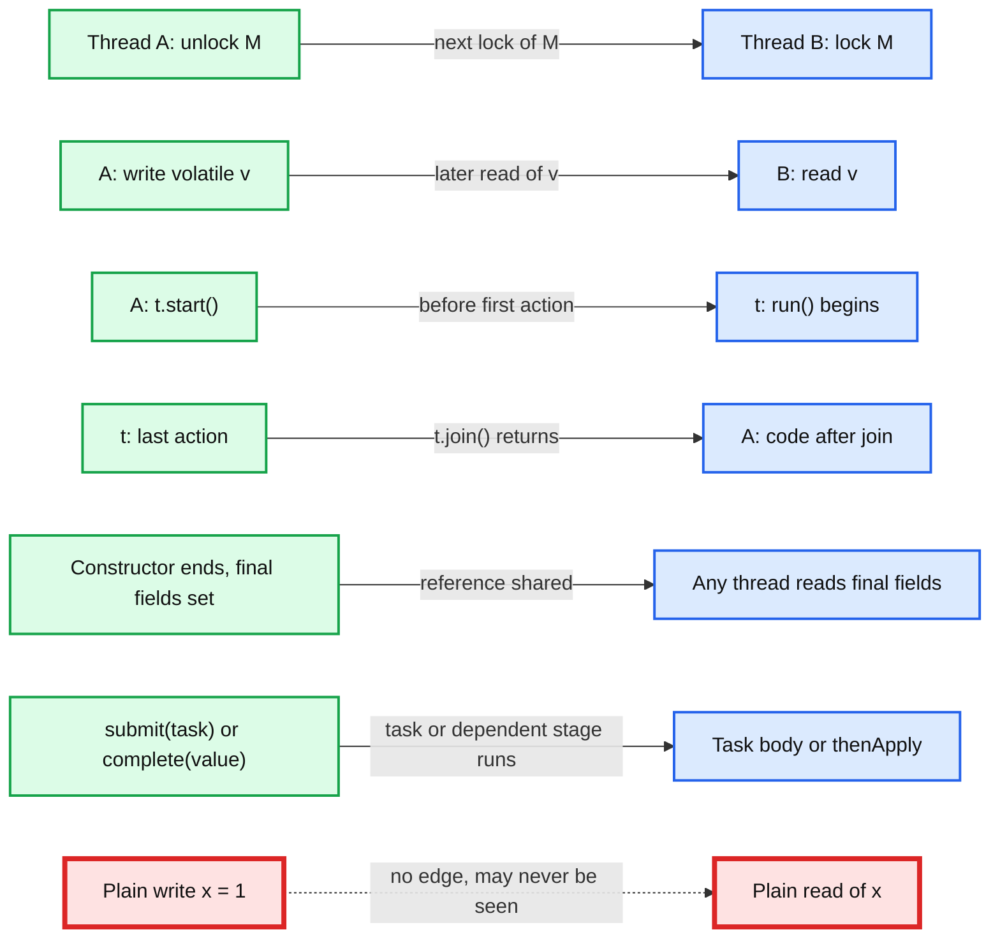
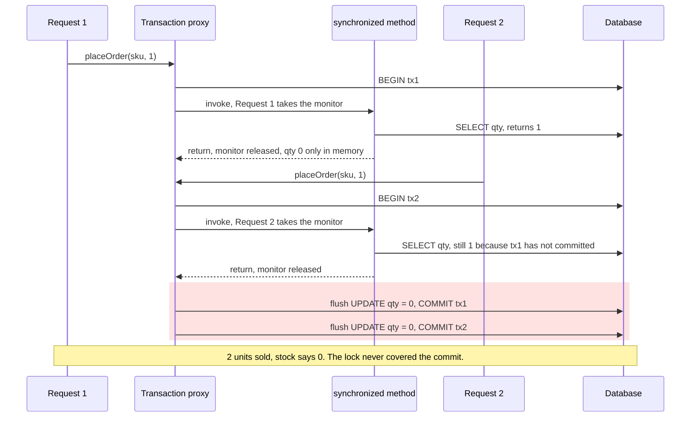
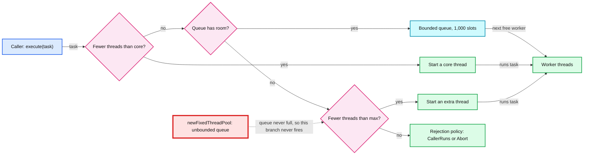
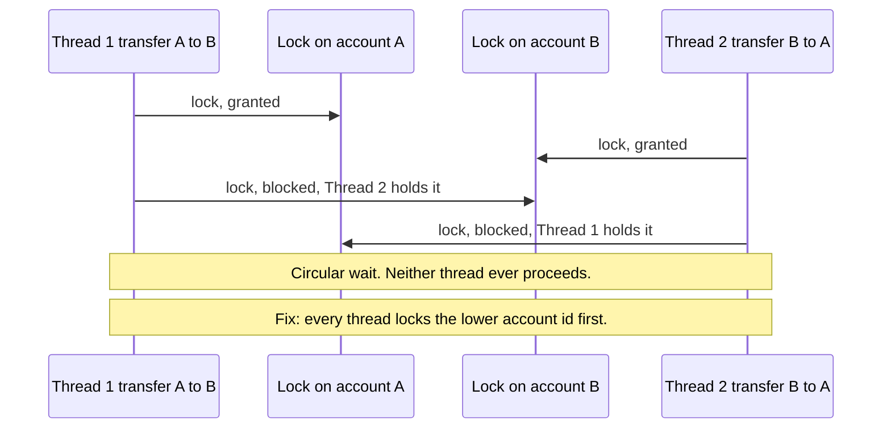
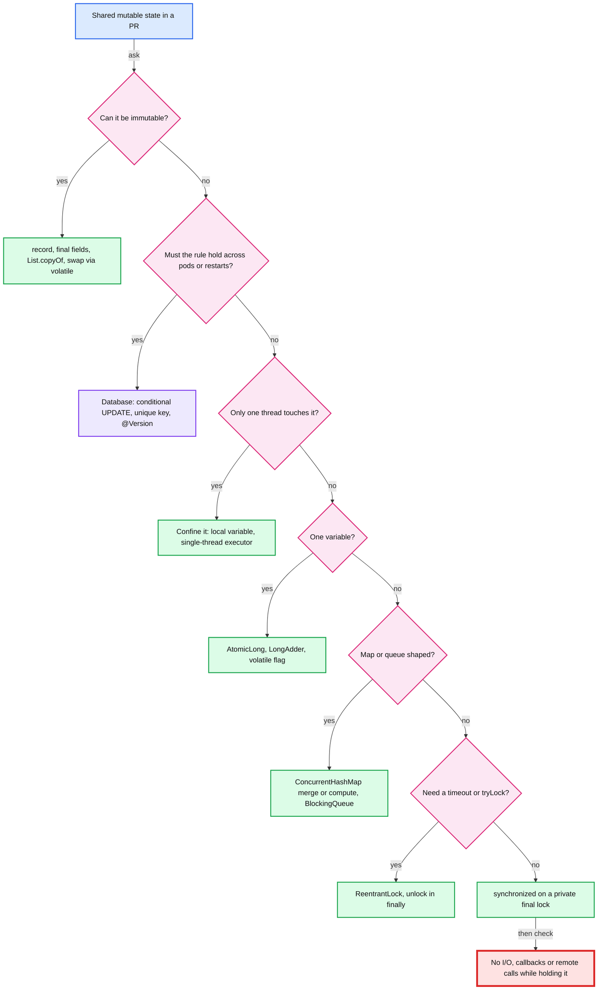

# Java standards for code review

**One line:** this file covers what a Staff reviewer checks in Java code. Concurrency comes first (§1 to §14), core Java follows (§15), and a 2-minute checklist closes it (§16). JPA and SQL rules are in [jpa-sql-standards.md](jpa-sql-standards.md).

---

## 0. How to use this file

- Read it in one sitting of 45 to 60 minutes. Before each round, scan only §16.
- Every rule has three parts: **Bad** code, **Good** code, and a **Review comment** written the way you would say it to the pull request (PR) author.
- Baseline is Java 21. Where the behaviour changes by version, the rule says so.
- The numbers marked "measured" came from one run on a 14-core laptop with JDK 27. They are there to show scale. They will not repeat exactly.

Severity tags used in every review comment:

| Tag | Means | Example |
|---|---|---|
| **[P0]** | Money, data loss, security | Overselling the last unit, double charge, SQL injection |
| **[P1]** | Wrong under load, or an outage risk | Deadlock, lost counter updates, pool exhaustion |
| **[P2]** | Maintainability, a future bug | Locking on `this`, hand-rolled wait/notify |
| **[nit]** | Style | Naming, log wording |

**Contents**

1. [Java Memory Model in one picture](#1-java-memory-model-in-one-picture)
2. [synchronized](#2-synchronized)
3. [volatile](#3-volatile)
4. [Atomics](#4-atomics)
5. [Explicit locks](#5-explicit-locks)
6. [wait/notify and coordination tools](#6-waitnotify-and-coordination-tools)
7. [Concurrent collections](#7-concurrent-collections)
8. [Immutability and safe publication](#8-immutability-and-safe-publication)
9. [JDK classes that are not thread safe](#9-jdk-classes-that-are-not-thread-safe)
10. [Executors and thread pools](#10-executors-and-thread-pools)
11. [Interrupts and cancellation](#11-interrupts-and-cancellation)
12. [Deadlock, livelock, starvation](#12-deadlock-livelock-starvation)
13. [Virtual threads](#13-virtual-threads)
14. [Decision tree and how to prove a race](#14-decision-tree-and-how-to-prove-a-race)
15. [Core Java review standards](#15-core-java-review-standards)
16. [Two-minute concurrency checklist](#16-two-minute-concurrency-checklist)

---

## 1. Java Memory Model in one picture

**One line:** a write in thread A is guaranteed visible to thread B only when a *happens-before* edge connects the write to the read. No edge means no guarantee.



- The Java Memory Model (JMM) lets the compiler, the JIT (just-in-time compiler) and the CPU reorder and cache plain reads and writes.
- Edges chain. If A writes `x`, then unlocks `M`, and B then locks `M`, B sees `x`. That is why one lock can guard many fields.
- A **data race** means two threads touch the same variable, at least one of them writes, and no edge orders them. The result can be a stale read, a reordered read, or a torn read: plain `long` and `double` writes may be split into two 32-bit halves.
- A plain field is not just "slightly stale". The JIT may hoist the read out of a loop, and then the loop never sees the change.

**Bad**

```java
class Worker implements Runnable {
    private boolean running = true;            // plain field
    public void run() { while (running) { doWork(); } }
    public void stop() { running = false; }    // called from another thread
}
```

**Good:** `private volatile boolean running = true;`. The write in `stop()` now happens-before the next read in `run()`.

> **Review comment:** [P1] `running` is read in a loop on one thread and written on another, with no `volatile` and no lock. The JIT may hoist the read, so `stop()` may never take effect. Make it `volatile`.

---

## 2. synchronized

### 2.1 What it gives you

- **Mutual exclusion.** Only one thread at a time runs inside the blocks that use the same monitor object.
- **Visibility.** Unlocking a monitor happens-before the next lock of that same monitor.
- **Reentrancy.** A thread that holds the monitor can enter it again. A synchronized method can call another synchronized method on the same object.
- **What it lacks:** a timeout, a try-lock and interruptible waiting. A thread blocked on `synchronized` waits forever. If you need any of these, use `ReentrantLock` (§5).

### 2.2 Which object is locked

| Code | Monitor |
|---|---|
| `synchronized void f()` | `this` |
| `static synchronized void g()` | `Foo.class` |
| `synchronized (lock) { ... }` | `lock` |

A static synchronized method and an instance synchronized method use **different monitors**. They do not exclude each other.

**Bad**

```java
class Sales {
    private static long total;                         // shared by all instances
    synchronized void add(long n) { total += n; }      // locks this instance only
    static synchronized long total() { return total; } // locks Sales.class
}
```

**Good**

```java
class Sales {
    private static final Object LOCK = new Object();
    private static long total;
    void add(long n) { synchronized (LOCK) { total += n; } }
    static long total() { synchronized (LOCK) { return total; } }
}
```

> **Review comment:** [P1] `add` locks the instance, but `total` is static. Two `Sales` objects each lock their own `this` and lose updates. Guard `total` with one static lock, or make it a `LongAdder`.

### 2.3 Lock on a private final object

- `synchronized (this)` and synchronized methods expose the monitor. Any caller can write `synchronized (yourService)` and block you, or join a deadlock.
- A private lock means only your class can take it.

```java
private final Object lock = new Object();     // nobody outside can lock this
```

> **Review comment:** [P2] The monitor is `this`, so any caller holding a reference can lock it too. Use a `private final Object lock`.

### 2.4 Never lock on these objects

- **String literals.** Literals are interned and shared across the whole JVM. Two unrelated classes that lock `"LOCK"` contend with each other.
- **Boxed `Integer` and `Long`.** `Long.valueOf` caches only -128 to 127. For id 500, each call boxes a new `Long`, so every thread locks a different object and nothing is excluded. For id 5, every caller in the JVM shares one monitor.
- **Other value-based classes**, such as `Optional` and `LocalDate`. Since JDK 16 (JEP 390), javac warns: `attempt to synchronize on an instance of a value-based class`.
- **A field that is reassigned.** If code does `synchronized (items)` and later `items = new ArrayList<>()`, two threads can hold two different "locks".
- **`getClass()`.** A subclass gets a different monitor.

**Bad**

```java
void reserve(Long productId, int qty) {
    synchronized (productId) {               // id 500: a new Long on each call, so no exclusion
        int left = stock.get(productId);
        stock.put(productId, left - qty);
    }
}
```

**Good** (in-memory state only, one JVM): a fixed set of lock stripes.

```java
private final Object[] stripes = new Object[64];
{ for (int i = 0; i < stripes.length; i++) stripes[i] = new Object(); }

private Object lockFor(long id) {
    return stripes[Math.floorMod(Long.hashCode(id), stripes.length)];
}

void reserve(long productId, int qty) {
    synchronized (lockFor(productId)) { /* read, check, write */ }
}
```

- A `ConcurrentHashMap<Long, Object>` filled with `computeIfAbsent` also works. It grows by one entry per key forever, so it needs eviction. Stripes are bounded.
- If the stock lives in a database, neither option is right. See §2.8.

> **Review comment:** [P0] `synchronized (productId)` locks a boxed `Long`. Above 127 each call boxes a fresh object, so two orders for the same product run together and stock goes negative. It also covers one JVM only. Move the check into a conditional `UPDATE`.

### 2.5 Guard every read and every write with the same lock

Locking only the writer is not enough. A reader without the lock can see a half-updated object.

**Bad**

```java
class PriceBand {
    private long lo, hi;
    synchronized void set(long lo, long hi) { this.lo = lo; this.hi = hi; }
    long width() { return hi - lo; }       // no lock: can see the new hi with the old lo
}
```

**Good:** make `width()` `synchronized` too. An alternative with no locks at all: hold an immutable `record Band(long lo, long hi)` in a `volatile` field and replace the whole record (§3).

> **Review comment:** [P1] `width()` reads `lo` and `hi` without the lock that `set()` uses. A reader can see one new field and one old field and compute a negative width. Synchronize the read too, or swap an immutable record.

### 2.6 A compound action needs one lock around the whole action

- **Check-then-act:** `if (!map.containsKey(k)) map.put(k, v);`
- **Read-modify-write:** `count = count + 1;`
- Thread-safe parts do not make a thread-safe whole. Each call on a synchronized list is atomic. A pair of calls is not.

**Bad**

```java
List<String> seen = Collections.synchronizedList(new ArrayList<>());

boolean firstTime(String requestId) {
    if (seen.contains(requestId)) return false;   // two threads both pass this check
    seen.add(requestId);
    return true;
}
```

**Good**

```java
Set<String> seen = ConcurrentHashMap.newKeySet();

boolean firstTime(String requestId) {
    return seen.add(requestId);                   // one atomic check-and-add
}
```

> **Review comment:** [P1] `contains` and `add` are each synchronized, but the pair is not. Two retries of the same request both see "not seen" and both run. Use `ConcurrentHashMap.newKeySet().add(id)` and branch on the boolean it returns. If this guards a payment, the real fix is a unique key in the database.

### 2.7 Never call alien code while holding a lock

- **Alien code** means code you do not control: listeners, callbacks, overridable methods, network calls, database calls, file I/O.
- Risk 1: **deadlock.** The listener takes another lock that some other thread holds while it waits for yours.
- Risk 2: **convoy.** A 2 s HTTP timeout under the lock makes every other thread queue for 2 s.

**Bad**

```java
synchronized void onPriceChange(Price p) {
    prices.put(p.sku(), p);
    for (PriceListener l : listeners) l.changed(p);   // alien code under the lock
    auditClient.post(p);                              // HTTP under the lock
}
```

**Good**

```java
void onPriceChange(Price p) {
    List<PriceListener> snapshot;
    synchronized (lock) {
        prices.put(p.sku(), p);
        snapshot = List.copyOf(listeners);            // copy under the lock
    }
    snapshot.forEach(l -> l.changed(p));              // call out after releasing it
    auditClient.post(p);
}
```

> **Review comment:** [P1] The audit POST runs while holding the monitor. When the audit service is slow, every price update queues behind a 2 s timeout. Copy what you need under the lock, and call out after.

### 2.8 synchronized protects one JVM, not a fleet

- With 3 pods there are 3 separate monitors. A Java lock never coordinates two pods.
- An invariant on shared data belongs in the database. This covers stock not going negative, a balance never overdrawn, and one charge per request. The tools are a conditional `UPDATE`, a unique constraint, `SELECT ... FOR UPDATE`, or a JPA `@Version` column. See [jpa-sql-standards.md](jpa-sql-standards.md).

> **Review comment:** [P0] `synchronized` serialises requests inside one JVM, but this service runs as N replicas behind the load balancer. Two pods can still sell the last unit. Enforce the rule in SQL (`... WHERE qty >= :n`) and check the updated row count.

### 2.9 synchronized on a `@Transactional` method does not protect the database



- Spring starts and commits the transaction in a proxy *around* your method. The monitor is released when the method returns. The commit runs after that, outside the lock.
- Under READ COMMITTED (the PostgreSQL default), request 2 cannot see request 1's uncommitted write, so it reads the old value.
- JPA usually sends the `UPDATE` at flush, which happens at commit. So the write itself also runs outside the lock.
- **Fix:** put the rule in SQL, or use `@Version` or a pessimistic lock. Then delete the `synchronized`.

> **Review comment:** [P0] The monitor on this `@Transactional` method is released before the proxy commits. A second request reads the pre-commit stock, and both orders succeed. It also does nothing across pods. Replace it with `UPDATE stock SET qty = qty - :n WHERE sku = :sku AND qty >= :n` and fail when 0 rows change.

---

## 3. volatile

- **What it gives:** visibility (a write happens-before every later read) and ordering (writes made before a volatile write cannot move after it).
- **What it does not give:** atomicity for compound actions. `count++` is three steps: read, add, write.

**Bad**

```java
private volatile int ordersPlaced;
void onOrder() { ordersPlaced++; }          // read-add-write: two threads lose increments
```

Measured: 8 threads × 1,000,000 `++` on a volatile `int` ended at **1,224,330 of 8,000,000**. 85% of the increments were lost.

**Good**

```java
private final LongAdder ordersPlaced = new LongAdder();
void onOrder() { ordersPlaced.increment(); } // measured: exactly 8,000,000
```

> **Review comment:** [P1] `volatile` makes each read fresh, but `++` is still read, add, write. Concurrent orders lose increments, about 85% of them in a quick 8-thread test. Use `LongAdder` or `AtomicLong`.

**Good uses of volatile**

1. **Stop flags** (§1).
2. **Publishing an immutable snapshot.** Readers see either the whole old map or the whole new one, never a mix.

```java
private volatile Map<String, BigDecimal> prices = Map.of();

void reload(Map<String, BigDecimal> fresh) { prices = Map.copyOf(fresh); } // one reference swap
BigDecimal price(String sku) { return prices.get(sku); }
```

If two writers can reload at the same time and must merge their changes, use `AtomicReference.updateAndGet` (§4).

### 3.1 Double-checked locking needs volatile

`instance = new Config()` can publish the reference before the constructor's writes to non-final fields are visible. Another thread then sees a non-null reference to a half-built object.

**Bad**

```java
private Config config;                        // not volatile
Config config() {
    if (config == null) {
        synchronized (lock) {
            if (config == null) config = loadConfig();
        }
    }
    return config;                            // can be a half-constructed object
}
```

**Good**

```java
private volatile Config config;
Config config() {
    Config c = config;                        // one volatile read on the fast path
    if (c == null) {
        synchronized (lock) {
            c = config;
            if (c == null) config = c = loadConfig();
        }
    }
    return c;
}
```

**Simpler: the holder-class idiom.** The JVM initialises a class lazily and thread-safely on first use.

```java
final class Configs {
    private Configs() {}
    private static final class Holder { static final Config INSTANCE = loadConfig(); }
    static Config get() { return Holder.INSTANCE; }
}
```

In Spring, a singleton bean already gives you this. Hand-written lazy singletons are usually a [P2] smell.

> **Review comment:** [P1] Double-checked locking without `volatile` can hand out a half-built `Config`. Mark the field `volatile`, or use the holder-class idiom, which is shorter.

---

## 4. Atomics

- `AtomicInteger` and `AtomicLong` give atomic single-variable operations: `incrementAndGet`, `addAndGet`, `compareAndSet` (CAS, compare-and-set), `updateAndGet`, `accumulateAndGet`.
- Two atomic calls in a row are **not** atomic together. `if (n.get() < max) n.incrementAndGet();` is still check-then-act.

**Bad**

```java
private final AtomicInteger inFlight = new AtomicInteger();
boolean tryAcquire(int max) {
    if (inFlight.get() >= max) return false;   // check
    inFlight.incrementAndGet();                 // act: two threads both pass at max - 1
    return true;
}
```

**Good** (a CAS loop)

```java
boolean tryAcquire(int max) {
    while (true) {
        int cur = inFlight.get();
        if (cur >= max) return false;
        if (inFlight.compareAndSet(cur, cur + 1)) return true;   // retry if someone else won
    }
}
```

The function passed to `updateAndGet` **may run more than once** under contention. It must be pure: no logging, no metrics, no I/O.

> **Review comment:** [P1] The lambda in `updateAndGet` emits a metric. Under contention the CAS retries and the metric double counts. Keep the function pure and emit after.

### 4.1 LongAdder for hot counters

- `LongAdder` spreads updates over per-thread cells, so it does not fight over one cache line the way `AtomicLong` does under heavy write contention.
- **Trade-offs:** `sum()` is not an atomic snapshot while writes are in flight. There is no `compareAndSet`. It uses more memory.
- Use it for metrics and statistics. Use `AtomicLong` when you need the exact current value to make a decision, for example an id sequence or a limit check.

### 4.2 AtomicReference with an immutable state object

Use it when two or more fields must change together without a lock.

```java
record Limits(int perMinute, int burst) {}

private final AtomicReference<Limits> limits = new AtomicReference<>(new Limits(100, 20));

void raiseBurst(int extra) {
    limits.updateAndGet(l -> new Limits(l.perMinute(), l.burst() + extra));
}
```

**ABA** (a value changes from A to B and back to A, and a CAS still succeeds) is rare in application code. `AtomicStampedReference` fixes it if a reviewer raises it.

---

## 5. Explicit locks

### 5.1 ReentrantLock: always unlock in finally

**Bad**

```java
lock.lock();
applyDiscount(cart);      // throws: the lock is never released, every later caller hangs
lock.unlock();
```

**Good**

```java
lock.lock();              // outside try: if lock() fails, finally must not unlock
try {
    applyDiscount(cart);
} finally {
    lock.unlock();
}
```

> **Review comment:** [P1] `unlock()` is not in a `finally`. One exception in `applyDiscount` leaves the lock held, and every later request blocks forever. Wrap the body in `try`/`finally`.

### 5.2 What ReentrantLock adds over synchronized

| Need | API |
|---|---|
| Give up after a deadline | `tryLock(200, TimeUnit.MILLISECONDS)` |
| Give up immediately | `tryLock()` |
| Waiting can be cancelled | `lockInterruptibly()` |
| Several wait conditions on one lock | `lock.newCondition()`, for example `notFull` and `notEmpty` |
| First-in, first-out (FIFO) order | `new ReentrantLock(true)`. Fair locks have much lower throughput. Use one only after you have measured starvation |

```java
if (!lock.tryLock(200, TimeUnit.MILLISECONDS)) {   // throws InterruptedException
    throw new BusyException("cart " + cartId + " is being updated");
}
try {
    applyDiscount(cart);
} finally {
    lock.unlock();
}
```

### 5.3 ReadWriteLock

- Many readers at once, or one writer alone.
- It pays off only when reads far outnumber writes **and** the read section does real work. For a 50 ns map lookup, the bookkeeping costs more than it saves.
- **No upgrade.** A thread that holds the read lock and calls `writeLock().lock()` deadlocks itself. Downgrading from write to read is allowed.
- In the default non-fair mode, a steady stream of readers can postpone a writer indefinitely.

### 5.4 StampedLock

- Optimistic reads take no lock at all. You read, then `validate(stamp)`, and fall back to a real read lock if a write happened in between.
- It is **not reentrant**. Re-entering deadlocks. It has no `Condition`.
- Use it only on a measured hot path.

```java
private final StampedLock sl = new StampedLock();
private double x, y;

double distanceFromOrigin() {
    long stamp = sl.tryOptimisticRead();
    double cx = x, cy = y;
    if (!sl.validate(stamp)) {                 // a writer got in: read again under a real lock
        stamp = sl.readLock();
        try { cx = x; cy = y; } finally { sl.unlockRead(stamp); }
    }
    return Math.hypot(cx, cy);
}
```

### 5.5 Which lock to pick

| Lock | Pick it when | Watch out for |
|---|---|---|
| `synchronized` | Default. Short critical sections | No timeout. Pins virtual threads on JDK 21 to 23 (§13) |
| `ReentrantLock` | You need tryLock, a timeout, interruptible waiting or Conditions | Forgetting `finally` |
| `ReentrantReadWriteLock` | Reads far outnumber writes and do real work | No read-to-write upgrade. Writer starvation |
| `StampedLock` | A measured hot read path | Not reentrant. Easy to misuse |

---

## 6. wait/notify and coordination tools

Rules if you meet `wait`/`notify` in a review:

1. Call them only while holding that object's monitor. Otherwise they throw `IllegalMonitorStateException`.
2. Always wait in a `while` loop, never an `if`. Wakeups can be spurious, and another consumer may take the item first.
3. Prefer `notifyAll`. Use `notify` only when every waiter waits for the same condition and only one of them can proceed.

**Bad**

```java
synchronized Order take() throws InterruptedException {
    if (queue.isEmpty()) wait();       // if, not while
    return queue.remove();             // a second woken consumer gets NoSuchElementException
}
```

**Good**

```java
private final BlockingQueue<Order> queue = new ArrayBlockingQueue<>(10_000);  // bounded
Order take() throws InterruptedException { return queue.take(); }
```

> **Review comment:** [P2] This is a hand-rolled queue on `wait`/`notify`, and the `if` should be a `while`. `ArrayBlockingQueue` does the same thing with a bound and has no bugs to find.

| Tool | Use it for |
|---|---|
| `BlockingQueue` (prefer `ArrayBlockingQueue` for a bound) | Producer and consumer hand-off |
| `CountDownLatch` | Wait until N one-time events have happened (also a start gate in tests, §14.1) |
| `CyclicBarrier` | N threads meet at a point, over and over |
| `Semaphore` | Cap concurrent access to N, for example 50 calls to a payment provider |
| `CompletableFuture` | Compose async results, with timeouts |

---

## 7. Concurrent collections

### 7.1 HashMap and ArrayList under concurrent writes

- You lose entries, `size()` drifts, and iterators throw `ConcurrentModificationException`.
- Measured: 8 threads × 100,000 get-then-put increments on a shared `HashMap` ended at **788,885 of 800,000**. In another run the map's internal size no longer matched its contents, and copying `values()` threw `ArrayIndexOutOfBoundsException`. `HashMap.merge` from 8 threads threw `ConcurrentModificationException`.
- On Java 7 and earlier, a concurrent resize could link a bucket into a cycle, and `get()` then spun at 100% CPU forever.

### 7.2 ConcurrentHashMap: one call is atomic, two calls are not

**Bad**

```java
Integer n = counts.get(sku);                 // ConcurrentHashMap, but still a race
counts.put(sku, n == null ? 1 : n + 1);
```

Measured: **796,240 of 800,000**. A thread-safe map alone does not fix a race between two calls.

**Good**

```java
counts.merge(sku, 1, Integer::sum);          // measured: exactly 800,000
```

| Need | Atomic call |
|---|---|
| Insert only if absent | `putIfAbsent(k, v)` or `computeIfAbsent(k, fn)` |
| Increment or combine | `merge(k, delta, Integer::sum)` |
| Read, change, write one key | `compute(k, (key, old) -> ...)` |
| Remove only if it still has a value | `remove(k, expectedValue)` |
| Replace only if unchanged | `replace(k, expected, next)` |

> **Review comment:** [P1] `get` then `put` is two atomic steps, not one. Concurrent orders for the same SKU (stock keeping unit) lose increments. Use `counts.merge(sku, 1, Integer::sum)`.

### 7.3 computeIfAbsent: keep the function short

- The function runs at most once per key. While it runs, it holds a lock on that key's bin (bucket), so other updates to keys in the same bin wait.
- **No I/O inside it.** A 300 ms HTTP call inside `computeIfAbsent` stalls every writer whose key hashes to that bin. For remote loads, use a cache library with async loading, or store `CompletableFuture` values.
- **Never modify the same map inside it.** Since Java 9 this can throw `IllegalStateException: Recursive update`. On Java 8 it could hang.

**Bad**

```java
long fib(int n) {
    if (n < 2) return n;
    return memo.computeIfAbsent(n, k -> fib(k - 1) + fib(k - 2));  // writes memo inside memo's function
}
```

Measured on JDK 27: `fib(30)` threw `java.lang.IllegalStateException: Recursive update`.

> **Review comment:** [P1] The mapping function calls back into the same map. On Java 9+ this throws "Recursive update", and on Java 8 it can hang. Compute the value first, then `putIfAbsent`.

### 7.4 Other ConcurrentHashMap facts

- Null keys and null values throw `NullPointerException`. A `get` that returns null means "absent".
- `size()` and `isEmpty()` are estimates while writes are in flight. Never use them for control flow, such as "stop accepting when size is 1,000".
- Iterators are weakly consistent. They never throw `ConcurrentModificationException`, and they may or may not show concurrent changes.

### 7.5 The other thread-safe collections

| Collection | Use | Catch |
|---|---|---|
| `Collections.synchronizedMap/List` | Legacy code | Iterating needs a manual `synchronized (map) { ... }` around the loop |
| `CopyOnWriteArrayList` | Listener lists: frequent reads, rare writes | Every write copies the whole array. With 10,000 elements and frequent adds, each add costs O(n) |
| `ConcurrentLinkedQueue` | Non-blocking unbounded queue | Unbounded: no back-pressure |
| `ConcurrentSkipListMap` | A sorted concurrent map | Slower than a hash map. O(log n) per operation |

---

## 8. Immutability and safe publication

**An immutable object is thread safe for free.** Every field is `final`, there are no setters, mutable inputs are copied in, and the class is `final` or a record.

- Final-field rule: once the constructor finishes, any thread that gets the reference sees the final fields correctly. This holds only if `this` did not escape during construction.
- **Records are shallow.** `record Order(List<Item> items)` still exposes a mutable list unless the constructor copies it:

```java
record Order(String id, List<Item> items) {
    Order {
        items = List.copyOf(items);       // a real copy. Rejects null elements
    }
}
```

**A view versus a copy**

| Call | Result | When the source list changes later |
|---|---|---|
| `Collections.unmodifiableList(list)` | A read-only **view** | The change shows through |
| `List.copyOf(list)` | A real **copy** | Not affected |

### 8.1 Do not let `this` escape the constructor

**Bad**

```java
class PriceWatcher {
    private final Map<String, BigDecimal> prices;
    PriceWatcher(EventBus bus) {
        bus.register(this);                 // other threads can call onEvent from here on
        this.prices = new HashMap<>();      // not assigned yet: onEvent can hit null
    }
}
```

**Good**

```java
class PriceWatcher {
    private final Map<String, BigDecimal> prices = new ConcurrentHashMap<>();
    private PriceWatcher() {}
    static PriceWatcher create(EventBus bus) {
        PriceWatcher w = new PriceWatcher();  // fully built first
        bus.register(w);                      // then published
        return w;
    }
}
```

The same rule applies to starting a thread in a constructor.

> **Review comment:** [P1] `register(this)` in the constructor publishes a half-built object. An event can arrive before `prices` is assigned and hit a NullPointerException. Register from a factory method after construction.

### 8.2 Ways to publish an object safely

- A static initializer.
- A `volatile` field or an `AtomicReference`.
- A `final` field of a properly constructed object.
- Putting it into a concurrent collection, such as `ConcurrentHashMap` or `BlockingQueue`.
- Writing and reading it under the same lock.

An "effectively immutable" object, meaning a mutable class that nobody changes after it is shared, is safe only if it was published in one of these ways.

---

## 9. JDK classes that are not thread safe

| Class | What goes wrong when shared | Use instead |
|---|---|---|
| `SimpleDateFormat` | Shares an internal `Calendar`. Under load you get wrong dates or `NumberFormatException` | `DateTimeFormatter` (immutable) |
| `java.util.Date`, `Calendar` | Mutable | `Instant`, `LocalDate`, `ZonedDateTime` |
| `StringBuilder` | Not synchronized | Keep it in a local variable |
| `HashMap`, `HashSet`, `ArrayList` | §7.1 | `ConcurrentHashMap`, `CopyOnWriteArrayList`, or confine to one thread |
| `Random` (shared) | Thread safe, but all threads contend on one seed with CAS | `ThreadLocalRandom.current()` |
| `DecimalFormat`, `MessageDigest`, `Cipher` | Mutable internal state | A new instance per use |

**Bad**

```java
private static final SimpleDateFormat DAY = new SimpleDateFormat("yyyy-MM-dd");
String day(Date d) { return DAY.format(d); }
```

**Good**

```java
private static final DateTimeFormatter DAY = DateTimeFormatter.ofPattern("yyyy-MM-dd");
String day(LocalDate d) { return DAY.format(d); }
```

> **Review comment:** [P1] A static `SimpleDateFormat` is shared by all request threads and corrupts output under load. Switch to `DateTimeFormatter`, which is immutable.

---

## 10. Executors and thread pools



Threads above `core` start only when the queue is full. With an unbounded queue the queue is never full, so `max` and the rejection policy never take effect.

### 10.1 The factory methods hide unbounded resources

| Factory | Queue | Max threads | What fails under overload |
|---|---|---|---|
| `newFixedThreadPool(n)` | `LinkedBlockingQueue`, unbounded | n | The queue grows until `OutOfMemoryError` |
| `newSingleThreadExecutor()` | Unbounded | 1 | Same |
| `newCachedThreadPool()` | `SynchronousQueue` (no slots) | `Integer.MAX_VALUE` | Thousands of threads. Native memory runs out |
| `newScheduledThreadPool(n)` | Unbounded delay queue | n | Same as fixed |
| `newVirtualThreadPerTaskExecutor()` | None | One virtual thread per task | Floods whatever is downstream. Cap it with a `Semaphore` (§13) |

**Good**

```java
ThreadPoolExecutor emailPool = new ThreadPoolExecutor(
        8, 8, 60, TimeUnit.SECONDS,
        new ArrayBlockingQueue<>(1_000),                  // bounded
        Thread.ofPlatform().name("email-", 0).factory(),  // named threads in thread dumps
        new ThreadPoolExecutor.CallerRunsPolicy());       // back-pressure on the caller
```

- **Sizing.** For CPU-bound work, use about the number of cores. For I/O-bound work, use cores × (1 + wait time / compute time). Example: 8 cores, with 90 ms waiting per 10 ms of CPU, gives 8 × 10 = 80 threads.
- **Shut it down.** Call `shutdown()`, then `awaitTermination(30, SECONDS)`, then `shutdownNow()`. Since Java 19, `ExecutorService` is `AutoCloseable`. In Spring, use a managed `ThreadPoolTaskExecutor` bean so the container shuts it down.

> **Review comment:** [P1] `Executors.newFixedThreadPool(8)` has an unbounded queue. During a provider outage, email tasks pile up until the pod runs out of memory. Use a `ThreadPoolExecutor` with a bounded queue and a rejection policy.

### 10.2 Exceptions disappear in async code

- `submit()` stores the exception inside the `Future`. If nobody calls `get()`, nobody ever sees it.
- `execute()` sends the exception to the thread's uncaught-exception handler. The worker thread dies and is replaced.

**Bad**

```java
pool.submit(() -> emailClient.send(order));   // the failure sits in a Future nobody reads
```

**Good**

```java
CompletableFuture.runAsync(() -> emailClient.send(order), emailPool)
        .orTimeout(5, TimeUnit.SECONDS)
        .whenComplete((ok, err) -> {
            if (err != null) log.warn("confirmation email failed, order={}", order.id(), err);
        });
```

### 10.3 CompletableFuture rules

- **Always pass an executor for I/O.** Without one, `supplyAsync` and `runAsync` run on `ForkJoinPool.commonPool()`, whose parallelism is cores minus 1 (measured: 13 on a 14-core machine). A handful of blocking calls fill it, and every parallel stream and async stage in the JVM stalls.
- **Handle errors:**
  - `exceptionally` recovers with a fallback value.
  - `handle` sees both the result and the error, and returns a new value.
  - `whenComplete` runs a side effect and passes the original outcome through.
- **Unwrap the cause.** `join()` throws `CompletionException`. `get()` throws `ExecutionException`. The real error is `getCause()`.
- **Add a timeout.** `orTimeout` and `completeOnTimeout` arrived in Java 9. They complete the future, but they **do not stop** the underlying work. The HTTP client still needs its own timeout.

> **Review comment:** [P1] `supplyAsync` without an executor runs this blocking HTTP call on the common pool, which has cores minus 1 threads. Ten slow calls stall every other async task in the service. Pass the I/O executor and add `orTimeout`.

### 10.4 ThreadLocal in pools

- Pool threads live forever. A value set during request 1 is still there when request 7 runs on the same thread. That means the wrong user, the wrong tenant, or a memory leak.
- A ThreadLocal does not follow work onto another thread. An async task sees the executor thread's value, not the caller's.

**Bad**

```java
void handle(Request r) {
    TENANT.set(r.tenantId());
    process(r);                 // no remove(): the next request on this thread inherits the tenant
}
```

**Good**

```java
void handle(Request r) {
    TENANT.set(r.tenantId());
    try {
        process(r);
    } finally {
        TENANT.remove();
    }
}
```

> **Review comment:** [P0] `TENANT` is never removed. The next request on this pool thread runs with the previous caller's tenant and can read their data. Remove it in `finally`, and pass the tenant explicitly to async tasks.

---

## 11. Interrupts and cancellation

- An interrupt is a polite request to stop. Blocking methods such as `sleep`, `wait`, `join`, `BlockingQueue.take` and `lockInterruptibly` throw `InterruptedException` **and clear the flag**.
- `shutdownNow()` and `Future.cancel(true)` work only by interrupting. If the code swallows the interrupt, nothing stops it.

**Bad**

```java
try {
    Thread.sleep(backoffMs);
} catch (InterruptedException e) {
    // ignore and retry
}
```

**Good**

```java
try {
    Thread.sleep(backoffMs);
} catch (InterruptedException e) {
    Thread.currentThread().interrupt();                         // restore the flag
    throw new RetryAbortedException("interrupted during back-off", e);
}
```

- If a method can declare `throws InterruptedException`, just let it propagate.
- `Future.cancel(true)` only sets the flag. A CPU loop that never checks `Thread.currentThread().isInterrupted()` keeps running.

> **Review comment:** [P1] The retry loop swallows `InterruptedException`, so `shutdownNow()` cannot stop it. On deploy, the pod waits out the 30 s Kubernetes grace period and gets killed. Restore the flag and stop retrying.

---

## 12. Deadlock, livelock, starvation



A deadlock needs four things at once: mutual exclusion, hold-and-wait, no pre-emption, and a circular wait. Break the circular wait.

**Bad**

```java
void transfer(Account from, Account to, BigDecimal amount) {
    synchronized (from.lock()) {
        synchronized (to.lock()) {        // transfer(a, b) and transfer(b, a) lock in opposite orders
            from.debit(amount);
            to.credit(amount);
        }
    }
}
```

**Good**

```java
void transfer(Account from, Account to, BigDecimal amount) {
    Account first  = from.id() < to.id() ? from : to;    // one global order: by id
    Account second = first == from ? to : from;
    synchronized (first.lock()) {
        synchronized (second.lock()) {
            from.debit(amount);
            to.credit(amount);
        }
    }
}
```

> **Review comment:** [P1] `transfer(a, b)` and `transfer(b, a)` take the same two locks in opposite orders and can deadlock. Always lock the lower account id first.

- **tryLock with a timeout** also breaks deadlock: on failure, release everything and retry. Without random jitter in the back-off, two threads can retry in lockstep forever. That is a **livelock**.
- **Pool starvation deadlock.** A task running in a pool of N threads submits a subtask to the same pool and waits for it. When N such tasks run together, all N threads wait and no thread is free to run a subtask. Use a separate pool, or compose without blocking.
- **Starvation** comes from unfair locks, a `ReadWriteLock` writer behind endless readers, or one hot key taking every turn.
- **Diagnose** with `jstack <pid>` or `jcmd <pid> Thread.print`. The dump prints `Found one Java-level deadlock:` with the threads and the monitors or `ReentrantLock`s involved.
- The same pattern happens in the database: two transactions update the same rows in opposite orders. The fix is the same, update rows in id order. See [jpa-sql-standards.md](jpa-sql-standards.md).

---

## 13. Virtual threads

Virtual threads became final in Java 21 (JEP 444). A platform thread reserves 1 MB of stack by default on 64-bit Linux. A virtual thread's stack lives on the heap and grows as needed, so one JVM can run millions of them.

| Rule | Why |
|---|---|
| One virtual thread per task. Never pool them | They are cheap to create. A pool only adds a queue |
| Gains come only from blocking I/O | CPU-bound work does not get faster |
| Cap downstream concurrency with a `Semaphore` | 10,000 virtual threads still share 20 database connections and one provider's rate limit |
| Avoid caching big objects in `ThreadLocal` | Each virtual thread gets its own copy. 1M threads × 64 KB is 64 GB. `ScopedValue` (final in JDK 25) is the replacement |
| Watch for pinning (below) | A pinned virtual thread blocks its carrier thread |

```java
private final Semaphore paymentPermits = new Semaphore(50);   // provider allows 50 concurrent calls

Receipt charge(Order o) throws InterruptedException {
    paymentPermits.acquire();
    try {
        return paymentClient.charge(o);
    } finally {
        paymentPermits.release();
    }
}
```

**Pinning, by version**

- **JDK 21 to 23:** a virtual thread that blocks *inside* `synchronized` (or inside a native frame) stays mounted on its carrier thread. There are about as many carriers as cores. On an 8-core box, 8 virtual threads stuck in slow I/O inside `synchronized` stall every virtual thread. The fix on those versions: use `ReentrantLock` around blocking I/O.
- **JDK 24 and later (JEP 491):** `synchronized` no longer pins. Native and foreign-function calls still do.
- **Detect it** with the Java Flight Recorder (JFR) event `jdk.VirtualThreadPinned`.

> **Review comment:** [P1] On JDK 21 this `synchronized` block wraps a 300 ms HTTP call on a virtual thread, which pins the carrier. With 8 carriers, 8 slow calls freeze the service. Use a `ReentrantLock` here, or move to JDK 24 or later.

---

## 14. Decision tree and how to prove a race



### 14.1 Prove a race in 15 lines

In a review round, a claimed race lands harder when you show how you would prove it. The shape:

1. N threads wait on a `CountDownLatch` start gate, so they all start together.
2. Each one runs the operation M times.
3. Assert the total. A lost update shows up as a total short of N × M.

```java
static void hammer(int threads, int perThread, Runnable op) throws Exception {
    CountDownLatch start = new CountDownLatch(1);
    ExecutorService pool = Executors.newFixedThreadPool(threads);
    try {
        List<Future<?>> done = new ArrayList<>();
        for (int t = 0; t < threads; t++) {
            done.add(pool.submit(() -> { start.await(); for (int i = 0; i < perThread; i++) op.run(); return null; }));
        }
        start.countDown();                              // release every thread at once
        for (Future<?> f : done) f.get(30, TimeUnit.SECONDS);
    } finally {
        pool.shutdownNow();
    }
}
// hammer(8, 1_000_000, counter::increment); assertEquals(8_000_000, counter.sum());
```

- A passing stress test does not prove the code is safe. A failing one does prove it is broken.
- For memory-model bugs such as a missing `volatile`, use OpenJDK's jcstress harness. Plain unit tests rarely catch them.
- For a database race, run two real transactions against a real database (for example with Testcontainers), not against a mock.

---

## 15. Core Java review standards

### 15.1 equals and hashCode

- Override both or neither, and use the same fields in both. Records generate both for you.
- A `hashCode` built on mutable fields breaks hash sets and maps. Mutating an element after inserting it strands it in the wrong bucket.

```java
Set<Sku> skus = new HashSet<>();
Sku s = new Sku("A1");
skus.add(s);
s.setCode("B2");
skus.contains(s);        // false: the entry still sits in the bucket for "A1"
```

- For JPA entities, equality has its own rules. See [jpa-sql-standards.md](jpa-sql-standards.md).

### 15.2 `==` on boxed numbers and strings

```java
Long a = 127L, b = 127L;   // a == b is true: both come from the cache
Long c = 128L, d = 128L;   // c == d is false: two different objects (measured)
```

- Compare boxed values with `equals` or `Objects.equals`, or use primitives. Compare strings with `equals`.
- Tests with small ids pass and production ids above 127 fail. That makes this a [P1].

> **Review comment:** [P1] `order.getCustomerId() == user.getId()` compares two `Long` objects by reference. It passes in tests with ids below 128 and fails in production. Use `Objects.equals`.

### 15.3 Money: BigDecimal, never double

- `0.1 + 0.2` is `0.30000000000000004` in `double` (measured).
- `new BigDecimal(0.1)` is `0.1000000000000000055511151231257827021181583404541015625` (measured). Use `new BigDecimal("0.10")` or `BigDecimal.valueOf(0.1)`.
- `new BigDecimal("2.0").equals(new BigDecimal("2.00"))` is **false**, because `equals` also compares scale. Compare values with `compareTo`.
- `divide` without a scale and a `RoundingMode` throws `ArithmeticException` on results like 1 / 3.
- Set the scale per currency (USD has 2 decimal places, KRW and JPY have 0). Or store amounts as `long` minor units, such as cents.

```java
BigDecimal unit  = new BigDecimal("19.99");
BigDecimal total = unit.multiply(BigDecimal.valueOf(3)).setScale(2, RoundingMode.HALF_EVEN);
BigDecimal share = total.divide(BigDecimal.valueOf(3), 2, RoundingMode.HALF_EVEN);
boolean positive = total.compareTo(BigDecimal.ZERO) > 0;     // not equals
```

> **Review comment:** [P0] `price` is a `double`. Totals drift by fractions of a cent, and refunds will not reconcile with charges. Use `BigDecimal` with an explicit scale and rounding mode, or `long` cents.

### 15.4 Time

- Use `Instant` for timestamps, stored in UTC. Use `LocalDate` for calendar dates. Use `ZonedDateTime` with an explicit `ZoneId` when the local wall clock matters, such as "deliver by 7 am local time".
- Never call `LocalDateTime.now()` or `new Date()` on a server. They silently use the JVM's default time zone.
- Inject a `Clock` so tests can freeze time:

```java
final class Expiry {
    private final Clock clock;
    Expiry(Clock clock) { this.clock = clock; }
    boolean expired(Instant deadline) { return Instant.now(clock).isAfter(deadline); }
}
// test: new Expiry(Clock.fixed(Instant.parse("2026-01-01T00:00:00Z"), ZoneOffset.UTC))
```

- `Duration` measures machine time in seconds and nanoseconds. `Period` measures calendar time in days, months and years. "One day" is not always 24 hours across a daylight saving time (DST) change.

### 15.5 Optional

- Use it as a return type for "may be absent". Do not use it for fields, parameters or collections. Return an empty list instead of `Optional<List<...>>`.
- Never call `.get()` without a check. Use `orElseThrow()`, `map`, `orElse` or `ifPresent`.
- `orElse(expensiveCall())` always runs the call. Use `orElseGet(() -> expensiveCall())`.

### 15.6 Exceptions

- **Never swallow.** An empty `catch` block hides the failure.
- **Do not catch `Exception` or `Throwable` broadly.** It also catches bugs (`NullPointerException`), interrupts wrapped in other exceptions, and `OutOfMemoryError`.
- **Keep the cause:** `throw new ChargeFailedException("charge failed, order=" + id, e);`
- **Log or rethrow, not both.** Doing both prints the same stack trace 3 times through 3 layers.
- **Do not use exceptions for control flow.**
- Spring rolls back only on unchecked exceptions by default. See [jpa-sql-standards.md](jpa-sql-standards.md).

> **Review comment:** [P1] `catch (Exception e) { log.error("failed"); }` drops both the stack trace and the failure, so the caller reports success. Catch the specific exception, pass `e` to the logger, and rethrow or return a failure.

### 15.7 try-with-resources

**Bad**

```java
BufferedReader in = Files.newBufferedReader(path);
String header = in.readLine();       // throws: in is never closed, a file handle leaks
in.close();
```

**Good**

```java
try (BufferedReader in = Files.newBufferedReader(path)) {
    String header = in.readLine();
}
```

- The same applies to JDBC (Java Database Connectivity) `Connection`, `Statement` and `ResultSet`, HTTP responses, and **`Files.lines(...)`**. That last one is a `Stream` holding an open file, and it must be closed.

### 15.8 Logging

- Use parameterised messages: `log.info("order {} placed", id)`. Do not build strings with `+`, which costs time even when the level is off.
- Pass the exception as the last argument so the stack trace is kept: `log.warn("charge failed, order={}", id, e)`.
- **No PII (personally identifiable information) and no secrets.** That means no card numbers, passwords, tokens, full addresses or phone numbers. Mask them or log an id.
- Levels: ERROR means a human must act. WARN means degraded but working. INFO is for business events. DEBUG is off in production.
- Do not log inside tight loops. 100,000 lines a second can fill a disk and hide the real error.

> **Review comment:** [P0] This line logs the full card number and the customer's address at INFO level. Logs are kept for 30 days and readable by the whole team. Log the order id and the last 4 digits only.

### 15.9 Collection gotchas

| Call | Gotcha |
|---|---|
| `Arrays.asList(arr)` | Fixed size: `add` throws `UnsupportedOperationException`. Writes go through to the array |
| `List.of`, `Set.of`, `Map.of` | Immutable. A null throws `NullPointerException`. `Set.of` and `Map.of` throw on duplicates. `List.of(...).contains(null)` throws |
| `list.subList(a, b)` | A view. A structural change to the parent list makes the view throw `ConcurrentModificationException`. Holding a small sublist keeps the whole parent alive |
| Removing inside a for-each loop | `ConcurrentModificationException`. Use `removeIf` or `Iterator.remove` |
| `Collectors.toMap` | Throws `IllegalStateException` on a duplicate key unless you pass a merge function |

### 15.10 Streams

- No side effects in `map`, `filter` or `peek`. Streams are lazy, so those calls may not run, or may run in any order.
- Use `collect(...)`. Do not `forEach` into an outside list.
- A stream can be consumed once. Reusing it throws `IllegalStateException`.
- `parallel()` runs on the common pool (§10.3). Never use it for blocking work. For CPU work, use it only after measuring, and only for large inputs (thousands of elements or more).

### 15.11 Defaults to expect in good code

- Immutable by default: `final` fields, records, `List.copyOf` at boundaries.
- Validate at public boundaries with `Objects.requireNonNull(arg, "arg")`. Inside the class, trust your own invariants.
- Return empty collections, never null.
- Make classes `final` unless they are designed to be extended.

---

## 16. Two-minute concurrency checklist

Scan this before a round. For every shared mutable field in the diff, ask "what guards this?"

- [ ] Every shared mutable field has a named guard: a lock, `volatile`, an atomic, immutability, or confinement to one thread.
- [ ] Reads use the same lock as writes (§2.5).
- [ ] Check-then-act and read-modify-write happen inside one lock or one atomic call: `merge`, `compute`, CAS, or a conditional `UPDATE` (§2.6).
- [ ] The lock object is `private final`. It is not `this`, a String, a boxed number, a value-based object or a reassigned field (§2.4).
- [ ] Static state is guarded by a static lock (§2.2).
- [ ] No I/O, remote call, callback or listener runs while holding a lock (§2.7).
- [ ] An invariant that spans pods lives in the database, not in `synchronized` (§2.8).
- [ ] No `synchronized` is wrapped around a `@Transactional` method to protect data (§2.9).
- [ ] `volatile` is never used for `++` or other compound updates (§3).
- [ ] Double-checked locking has `volatile`, or uses the holder idiom (§3.1).
- [ ] No shared `HashMap`, `ArrayList` or `SimpleDateFormat` across threads (§7, §9).
- [ ] `ConcurrentHashMap` has no get-then-put. Every `computeIfAbsent` function is short, does no I/O and does not touch the same map (§7.2, §7.3).
- [ ] Thread pools have a bounded queue, bounded threads, names, a rejection policy and a shutdown (§10.1).
- [ ] Async failures are observed, through `get()` or `whenComplete` (§10.2).
- [ ] Every `CompletableFuture` doing I/O passes an executor and has a timeout (§10.3).
- [ ] Every `ThreadLocal` is removed in `finally`. Context is passed explicitly to async tasks (§10.4).
- [ ] `InterruptedException` restores the flag or propagates (§11).
- [ ] Locks are taken in one global order and released in `finally` (§5.1, §12).
- [ ] Virtual threads are not pooled, downstream calls are capped with a `Semaphore`, and on JDK 21 to 23 there is no blocking I/O inside `synchronized` (§13).
- [ ] Each fix is proved, either by a stress test with a start gate or by a clear happens-before argument (§14.1).
