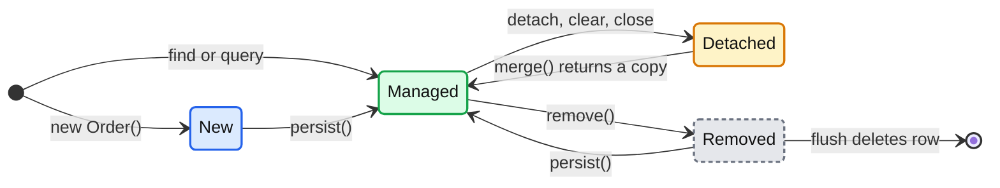
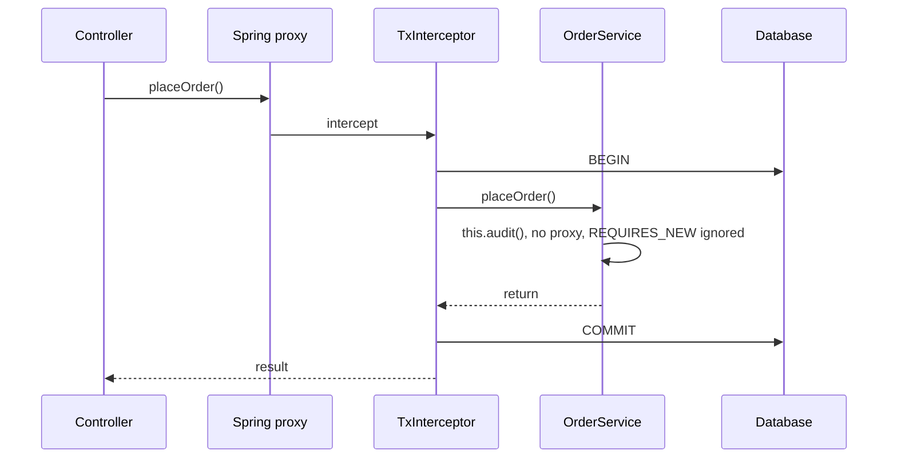
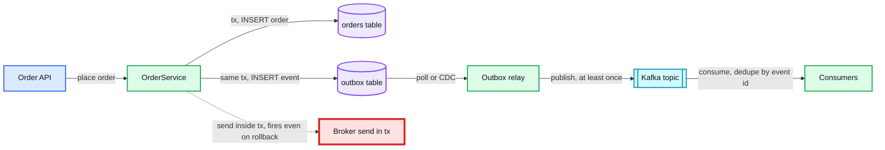
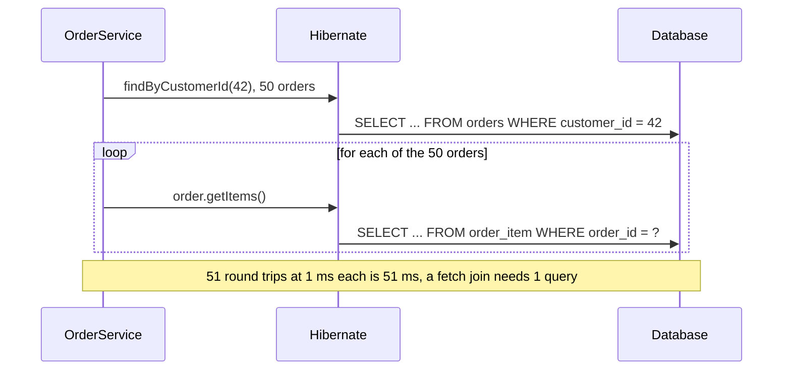
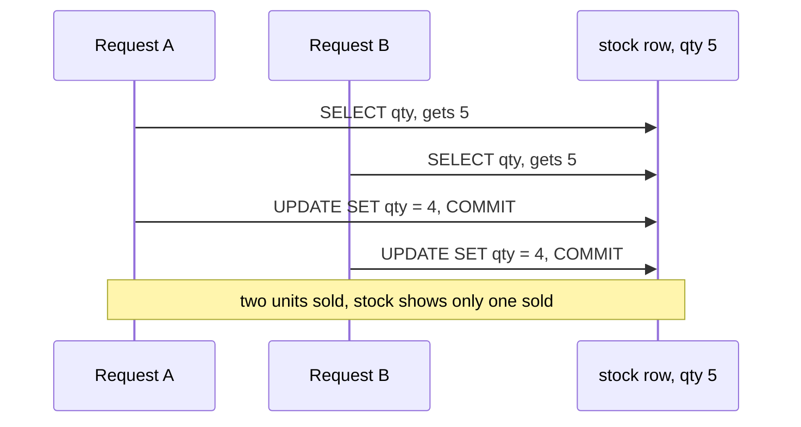
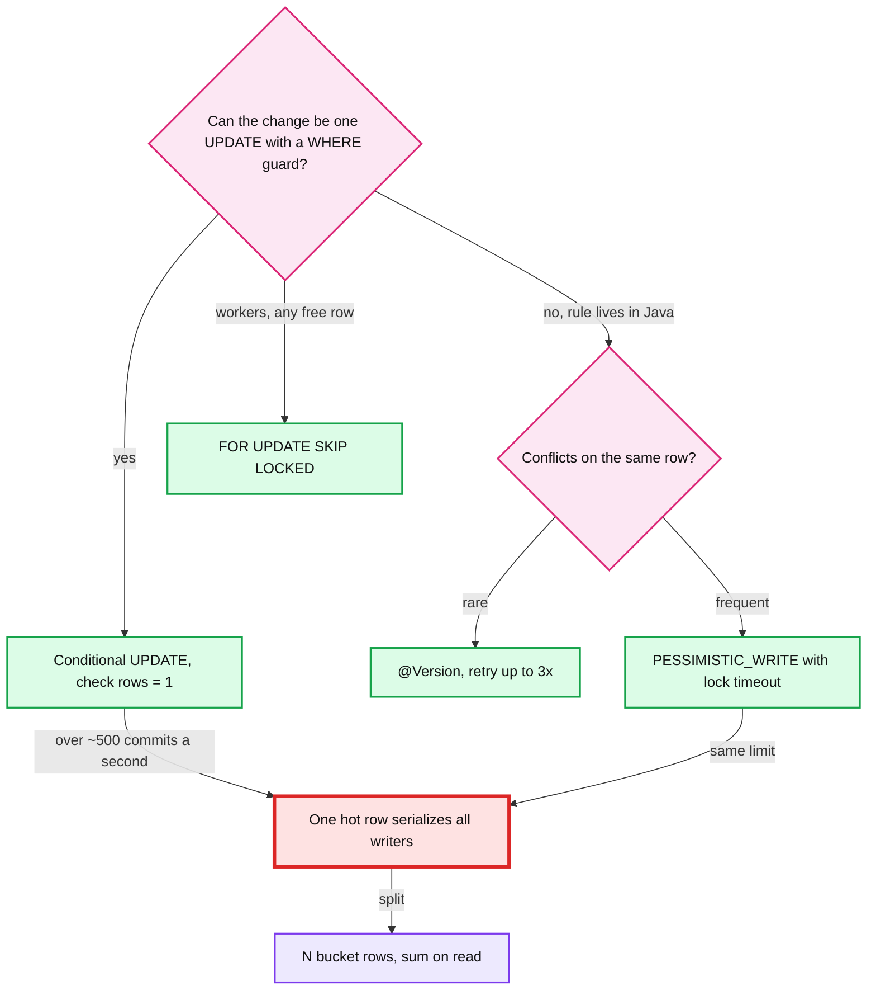

# JPA and SQL standards for code review

> **One line:** most JPA and SQL bugs in a pull request come from one of five causes. A transaction wraps the wrong work. A read-then-write races. A loop fires N+1 queries. A string is glued into a query. Or the database was never asked to enforce an invariant.

Baseline: Spring Boot 3.x, Spring Framework 6.x, Jakarta Persistence 3.x (JPA, the Java Persistence API), Hibernate 6.x, PostgreSQL and MySQL InnoDB.
Sibling file: [java-standards.md](java-standards.md) covers core Java and concurrency (`synchronized`, `volatile`, executors).

---

## 0. How to use

- Sit down once for about 40 minutes. Read each diagram first, then the Bad and Good pairs.
- Every rule ends with a **Review comment** you could paste into a PR. Severity tags:

| Tag | Means | Merge? |
|---|---|---|
| **[P0]** | Money or data loss, security hole | Blocks |
| **[P1]** | Wrong under load, concurrency or failure; outage risk | Blocks |
| **[P2]** | Performance or maintainability cost | Fix now or file a ticket |
| **[nit]** | Style | Batch into one comment |

- Two minutes before a round: read only the [§14 checklist](#14-two-minute-review-checklist).

**Contents**

1. [Entity lifecycle and dirty checking](#1-entity-lifecycle-and-dirty-checking)
2. [@Transactional pitfalls](#2-transactional-pitfalls)
3. [Dual writes and the outbox pattern](#3-dual-writes-and-the-outbox-pattern)
4. [Fetching and N+1](#4-fetching-and-n1)
5. [Concurrency control in the database](#5-concurrency-control-in-the-database)
6. [Isolation levels](#6-isolation-levels)
7. [Writes at scale](#7-writes-at-scale)
8. [Mapping standards](#8-mapping-standards)
9. [SQL safety](#9-sql-safety)
10. [Indexes and query shape](#10-indexes-and-query-shape)
11. [Let the database enforce invariants](#11-let-the-database-enforce-invariants)
12. [Connections and timeouts](#12-connections-and-timeouts)
13. [Schema migrations without downtime](#13-schema-migrations-without-downtime)
14. [Two-minute review checklist](#14-two-minute-review-checklist)

---

## 1. Entity lifecycle and dirty checking



- **Managed** means the persistence context tracks it. At flush (before commit, or before a query that needs it), Hibernate compares each managed entity to its snapshot and writes the changed ones. This is **dirty checking**.
- **Detached** (amber, "losable") means edits are thrown away unless you `merge()` them back.

### 1.1 `save()` on a managed entity is noise

```java
// Bad
@Transactional
public void rename(long id, String name) {
    Product p = repo.findById(id).orElseThrow();
    p.setName(name);
    repo.save(p);        // p is managed: the flush writes it anyway
}
```

- Good: drop the `save()`. Then any setter inside a transaction reads as what it is: a write.

Review comment: **[nit]** `p` is managed, so the commit writes it. The `save()` adds nothing and hides that every setter here is an UPDATE.

### 1.2 Mutating a managed entity in a read path writes to the database

```java
// Bad
@Transactional
public OrderView view(long id) {
    Order o = repo.findById(id).orElseThrow();
    o.setTotal(o.getTotal().setScale(2, RoundingMode.HALF_UP));  // UPDATE at commit
    return OrderView.from(o);
}

// Good
@Transactional(readOnly = true)
public OrderView view(long id) {
    Order o = repo.findById(id).orElseThrow();
    return OrderView.from(o);    // round inside the DTO, never on the entity
}
```

- With `readOnly = true`, Spring tells Hibernate to skip the flush and dirty checking, so the stray setter does not reach the database. It is still a bug: other code in the same request sees the changed value.
- Put `readOnly = true` on every query path. It also lets a routing data source send the query to a replica.

Review comment: **[P1]** this read path rounds `total` on a managed entity, so every page view runs an UPDATE and takes a row lock. Mark it `readOnly = true` and round in the view.

### 1.3 `merge()` returns a different instance

```java
// Bad
Order detached = sessionCache.get(id);
em.merge(detached);
detached.addItem(gift);              // lost: detached is still detached

// Good
Order managed = em.merge(detached);
managed.addItem(gift);               // tracked, written at flush
```

Review comment: **[P1]** `merge()` returns the managed copy. Edits made to `detached` after the call are never written.

### 1.4 `save()` with ids the application assigns runs a SELECT first

- Spring Data's `save()` calls `persist` for a new entity and `merge` for an existing one. When there is no `@Version`, it treats a non-null id as "existing".
- When the constructor assigns ids (a UUID, a TSID or an order number), every new row costs a SELECT plus an INSERT.
- Fix: add a `@Version` field (a null version means new), or implement `Persistable<ID>.isNew()`.

Review comment: **[P2]** ids are assigned in the constructor, so `save()` treats each new order as existing and runs a SELECT before every INSERT. That doubles the round trips. Add `@Version` or implement `Persistable`.

---

## 2. @Transactional pitfalls



- Spring adds transactions by wrapping the bean in a proxy. Only calls that come **through the proxy** get the transaction behaviour.
- So `this.method()` calls skip it, and **private methods are never transactional**.

### 2.1 Self-invocation skips the proxy

```java
// Bad
@Service
class OrderService {
    @Transactional
    public void placeOrder(Cmd c) {
        orders.save(Order.from(c));
        audit(c);                                   // this.audit(): no new transaction
    }

    @Transactional(propagation = Propagation.REQUIRES_NEW)
    public void audit(Cmd c) { auditRepo.save(new Audit(c)); }
}
```

- Good: move `audit` into its own bean (`AuditService`) and inject it, or use `TransactionTemplate` for the inner unit.

Review comment: **[P1]** `audit()` is called on `this`, so `REQUIRES_NEW` never applies and the audit row rolls back with the order. Move it to its own bean.

### 2.2 Checked exceptions commit by default

```java
// Bad
@Transactional
public void pay(long orderId) throws PaymentDeclinedException {
    stock.reserve(orderId);        // UPDATE stock
    gateway.charge(orderId);       // throws checked PaymentDeclinedException
}                                  // default rule: checked exception -> COMMIT

// Good
@Transactional(rollbackFor = PaymentDeclinedException.class)
public void pay(long orderId) throws PaymentDeclinedException { ... }
```

- By default Spring rolls back only on `RuntimeException` and `Error`.

Review comment: **[P0]** `PaymentDeclinedException` is checked, and Spring commits on checked exceptions by default, so a declined card keeps its stock reserved. Add `rollbackFor`, or better, move the charge out of the transaction (§2.5).

### 2.3 Catching inside a rollback-only transaction

```java
// Bad
@Transactional
public void importAll(List<Row> rows) {
    for (Row r : rows) {
        try { rowService.importOne(r); }            // @Transactional REQUIRED: joins this tx
        catch (RuntimeException e) { log.warn("skip {}", r.id()); }
    }
}   // commit throws UnexpectedRollbackException, all rows lost
```

- The inner method joins the outer transaction. Its exception marks the **shared** transaction rollback-only. Catching it does not undo the mark.

Review comment: **[P1]** the first bad row marks the shared transaction rollback-only. The whole import then rolls back at the end with `UnexpectedRollbackException`. Give each row (or each chunk) its own transaction.

### 2.4 `REQUIRES_NEW` holds two connections at once

- The outer transaction keeps its connection while the inner one takes a second.
- Take a pool of 10 with 10 concurrent requests. Each holds one connection and waits for a second. All 10 wait until HikariCP's `connectionTimeout` (default 30 s) and fail. That is a deadlock on the pool, not in the database.

Review comment: **[P1]** each request now needs two connections at once, so 10 concurrent requests on a pool of 10 deadlock for 30 s. Run the inner work after the outer commit, or size the pool for two connections per request.

### 2.5 No remote calls inside a transaction

```java
// Bad
@Transactional
public Order checkout(Cart cart) {
    Order o = orders.save(Order.from(cart));
    stock.decrement(cart);                        // row locks held from here
    PaymentResult r = paymentClient.charge(o);    // 200 ms to 30 s over HTTP
    o.markPaid(r.id());
    return o;                                     // commit can still fail AFTER the charge
}

// Good: two short transactions, the remote call between them
public Order checkout(Cart cart) {
    Order o = tx.execute(s -> orderService.createPending(cart));    // reserve stock, PENDING
    PaymentResult r = paymentClient.charge(o.id(), o.total(), o.idempotencyKey());
    return tx.execute(s -> orderService.markPaid(o.id(), r));       // PAID
}   // a reconciler settles orders stuck in PENDING with the gateway
```

- The bad version holds one connection plus the stock row lock for the whole HTTP call.
- At 50 checkouts a second with a 2 s gateway p99, that is 100 connections held at once, while the default pool is 10.
- If the commit fails after the charge, the customer pays and gets no order.
- The same rule covers Kafka sends, emails and calls to other services (§3).

Review comment: **[P0]** the charge runs inside the database transaction. A slow gateway pins a connection and the stock row lock, and a failed commit leaves a charge with no order. Charge between two short transactions, with an idempotency key.

### 2.6 `synchronized` on a `@Transactional` method does not protect the database

```java
// Bad
@Transactional
public synchronized void reserve(String sku, int n) {
    Stock s = stockRepo.findBySku(sku);
    if (s.getQty() >= n) s.setQty(s.getQty() - n);   // read, then write
}
```

- The proxy commits **after** the method returns, so the monitor is released before the commit. Thread 2 enters and reads the old committed quantity.
- `synchronized` also covers only one JVM. Two pods means two separate locks.
- See [java-standards.md](java-standards.md) for what `synchronized` does guarantee. Fix it in the database instead (§5).

Review comment: **[P0]** `synchronized` is released before the proxy commits, and it covers only one JVM, so two threads or two pods still oversell. Use a conditional UPDATE or `@Version`.

---

## 3. Dual writes and the outbox pattern



- **Send inside the transaction:** the event goes out even if the transaction later rolls back. Consumers see an order that never existed.
- **Send after commit:** a crash between the commit and the send loses the event for good.
- **Outbox:** insert the event row in the **same** transaction as the order. A relay then reads unpublished rows and sends them. It can poll with `FOR UPDATE SKIP LOCKED`, or use CDC (change data capture, for example Debezium reading the PostgreSQL WAL or the MySQL binlog).
- Delivery is at least once, so consumers dedupe by event id.

```java
// Bad
@Transactional
public void place(Order o) {
    orders.save(o);
    kafka.send("order-placed", o.getId().toString(), toJson(o));   // sent now, rolled back later?
}

// Good
@Transactional
public void place(Order o) {
    orders.save(o);
    outbox.save(new OutboxEvent(UUID.randomUUID(), "order-placed", o.getId(), toJson(o)));
}   // the relay publishes after commit, at least once
```

- `@TransactionalEventListener(phase = AFTER_COMMIT)` is the in-process option. It never fires for a rolled-back transaction. What it does **not** guarantee:
  - Delivery survives a crash. The event lives only in memory.
  - A failure in the listener undoes the commit. It cannot.
  - A database write inside the listener commits. It needs `REQUIRES_NEW`.
- Use it for cache eviction or metrics, not for events that must arrive.

Review comment: **[P0]** the Kafka send is inside the transaction, so a rollback leaves downstream holding an order that does not exist. A send after commit would instead lose events on a crash. Write an outbox row in this transaction.

---

## 4. Fetching and N+1



### 4.1 Lazy collections touched in a loop

```java
// Bad
return orderRepo.findByCustomerId(cid).stream()
        .map(o -> new OrderView(o.getId(), o.getItems().size()))   // 1 query per order
        .toList();
```

Good, pick one:

```java
@Query("select o from Order o join fetch o.items where o.customerId = :cid")
List<Order> findWithItems(@Param("cid") long cid);          // 1 query

@EntityGraph(attributePaths = "items")
List<Order> findByCustomerId(long cid);                      // same, declared on the method

@Query("select new com.shop.OrderView(o.id, count(i)) " +
       "from Order o left join o.items i where o.customerId = :cid group by o.id")
List<OrderView> views(@Param("cid") long cid);               // read path: no entities at all
```

- As a global safety net, set `spring.jpa.properties.hibernate.default_batch_fetch_size=50`. That turns N+1 into about N/50 + 1 queries, using `IN (...)` lists. `@BatchSize` does the same per association.
- Hibernate 6 removes the duplicate parent rows a fetch join produces. Hibernate 5 needed `distinct`.

Review comment: **[P1]** `getItems()` inside the stream fires one query per order: 51 queries for a page of 50, and about 1,000 for a large customer. Fetch the items with an entity graph, or project to a DTO.

### 4.2 To-one associations are EAGER by default

```java
// Bad
@ManyToOne                                   // default fetch = EAGER
private Customer customer;

// Good
@ManyToOne(fetch = FetchType.LAZY, optional = false)
private Customer customer;
```

- `@ManyToOne` and `@OneToOne` default to EAGER. `@OneToMany` and `@ManyToMany` default to LAZY.
- EAGER on a JPQL query means one extra select per distinct customer after the main query. That is N+1 you never wrote.

Review comment: **[P2]** `@ManyToOne` defaults to EAGER, so every order query also loads customers, one extra select each. Mark it LAZY and fetch it only where it is needed.

### 4.3 Two collections in one fetch

- Fetching two `List` collections at once (`join fetch o.items join fetch o.payments`) fails with `MultipleBagFetchException` ("cannot simultaneously fetch multiple bags").
- Switching to `Set` makes it run, but as a Cartesian product: 20 items times 5 payments is 100 rows per order.
- Fix: one collection per query (two queries in one transaction), or batch fetching.

Review comment: **[P2]** fetching `items` and `payments` together returns 20 x 5 = 100 rows per order. Fetch them in two queries.

### 4.4 Fetch join plus pagination runs in memory

```java
// Bad: LIMIT is not sent to the database
@Query("select o from Order o join fetch o.items where o.status = :s")
List<Order> findByStatus(@Param("s") Status s, Pageable page);

// Good: page the ids, then fetch by ids
@Query("select o.id from Order o where o.status = :s order by o.id")
List<Long> pageIds(@Param("s") Status s, Pageable page);

@Query("select o from Order o join fetch o.items where o.id in :ids order by o.id")
List<Order> findWithItems(@Param("ids") List<Long> ids);
```

- Hibernate loads **every** matching row, pages it in memory and logs a warning.
- Set `hibernate.query.fail_on_pagination_over_collection_fetch=true` to turn that warning into an error.

Review comment: **[P1]** a fetch join with `Pageable` loads every matching order into the heap and pages there. With 2M PAID orders, that is an out-of-memory error. Page the ids first, then fetch by ids.

### 4.5 `LazyInitializationException` and open-in-view

- Touching a lazy association after the persistence context has closed throws `LazyInitializationException`.
- Spring Boot defaults `spring.jpa.open-in-view` to `true` and logs a warning at startup. This keeps the persistence context open until the HTTP response is written, which hides the exception.
- The cost: lazy loads now run in the controller or the JSON serializer, outside any transaction. Each is a hidden query, and the request can hold a database connection until the response is written.

Review comment: **[P2]** this only works because open-in-view is on: the JSON serializer lazy-loads `items` for every order. Set `spring.jpa.open-in-view=false` and fetch what the response needs inside the service.

---

## 5. Concurrency control in the database



- A read in the application followed by a write is a race at **any** default isolation level (§6). Pick one of four guards.

### 5.1 Conditional UPDATE (first choice for counters)

```java
@Modifying
@Query("update Stock s set s.qty = s.qty - :n where s.sku = :sku and s.qty >= :n")
int decrement(@Param("sku") String sku, @Param("n") int n);

// caller
if (stockRepo.decrement(sku, n) != 1) throw new OutOfStockException(sku);
```

- One statement, no read in the application. The row lock is held for milliseconds, and the guard sits in the WHERE clause.

### 5.2 Optimistic locking with `@Version`

```java
@Entity
class Stock {
    @Id String sku;
    int qty;
    @Version long version;    // UPDATE ... SET qty = ?, version = version + 1 WHERE sku = ? AND version = ?
}
```

- If another transaction committed first, the UPDATE matches 0 rows and Hibernate throws `OptimisticLockException`. Spring wraps it as `ObjectOptimisticLockingFailureException`.
- Retry the **whole** transaction up to 3 times with jitter, then fail. Good when conflicts are rare and the rule lives in Java code.

### 5.3 Pessimistic locking

```java
@Lock(LockModeType.PESSIMISTIC_WRITE)
@QueryHints(@QueryHint(name = "jakarta.persistence.lock.timeout", value = "2000"))
@Query("select s from Stock s where s.sku = :sku")
Optional<Stock> lockBySku(@Param("sku") String sku);
```

- Hibernate issues a row lock (`SELECT ... FOR UPDATE` or an equivalent). Other writers wait until commit.
- **Always set a lock timeout.** PostgreSQL `lock_timeout` defaults to 0, which waits forever. MySQL `innodb_lock_wait_timeout` defaults to 50 s.

### 5.4 `SKIP LOCKED` for worker queues

```sql
SELECT id FROM job
WHERE status = 'READY'
ORDER BY id
LIMIT 10
FOR UPDATE SKIP LOCKED;     -- PostgreSQL 9.5+, MySQL 8.0+
```

- Each worker gets a different 10 rows instead of everyone queueing on the same first row.

### 5.5 Which to pick



| Situation | Pick | Why |
|---|---|---|
| Stock, balance or quota with a floor | Conditional UPDATE | One statement, no retry loop |
| Edit form, rare conflict, rule in Java | `@Version` | No lock held while the code runs |
| Frequent conflict, multi-row rule in Java | `PESSIMISTIC_WRITE` plus timeout | Waiters queue instead of a retry storm |
| Job or outbox workers | `SKIP LOCKED` | Workers do not block each other |
| One row past ~500 commits a second | Split into N bucket rows | A row lock held ~2 ms caps one row at ~500 commits a second |

- The red node is the real limit. No Java-side lock raises it.

### 5.6 Database deadlocks

```java
// Bad: T1 transfers 1 -> 2 while T2 transfers 2 -> 1
Account a = accounts.lockById(from);   // T1 locks 1, T2 locks 2
Account b = accounts.lockById(to);     // T1 waits for 2, T2 waits for 1: deadlock

// Good: always lock in id order
long first = Math.min(from, to), second = Math.max(from, to);
accounts.lockById(first);
accounts.lockById(second);
```

- Retry the whole transaction (bounded, with jitter) on:
  - SQLSTATE `40001`, serialization failure. MySQL also reports deadlocks (error 1213) with this state.
  - SQLSTATE `40P01`, the PostgreSQL deadlock.
- Keep transactions short. Every millisecond a lock is held is a millisecond another transaction can queue behind it.

Review comment: **[P1]** two opposite transfers lock the two accounts in opposite order and deadlock. Lock in ascending id order and retry `40001` and `40P01` up to 3 times.

---

## 6. Isolation levels

What the SQL standard allows, plus the two anomalies the standard does not name:

| Level | Dirty read | Non-repeatable read | Phantom | Lost update (read then write in app) | Write skew |
|---|---|---|---|---|---|
| READ UNCOMMITTED | possible | possible | possible | possible | possible |
| READ COMMITTED | no | possible | possible | possible | possible |
| REPEATABLE READ | no | no | possible per standard | depends on the database | possible |
| SERIALIZABLE | no | no | no | no | no |

How the two databases differ:

| | PostgreSQL | MySQL InnoDB |
|---|---|---|
| Default level | READ COMMITTED | REPEATABLE READ |
| READ UNCOMMITTED | Behaves as READ COMMITTED | Allows dirty reads |
| REPEATABLE READ | One snapshot from the first query of the transaction. No phantoms. A concurrent update of the same row aborts with `40001`, so the lost update is caught | Plain SELECT reads a snapshot, but UPDATE and locking reads see the latest committed row. A read-then-write in the application still loses updates |
| SERIALIZABLE | Serializable snapshot isolation. Aborts with `40001` on unsafe patterns, so you must retry | With autocommit off, plain SELECTs become `SELECT ... FOR SHARE` |

**Write skew** example: the rule is "at least 1 doctor on call". Two doctors check at the same moment, each sees 2 on call, and each goes off call. Each transaction updated a different row, so no row lock collided.

```sql
-- Good at READ COMMITTED: lock the set you read
SELECT id FROM on_call WHERE shift_id = ? AND active FOR UPDATE;
-- then count in the app and update only if count > 1
```

- Do not raise isolation for the whole application. Fix the one transaction, using a row lock, a constraint or SERIALIZABLE plus retry.

Review comment: **[P1]** two concurrent requests can each see "2 on call" and each remove one. READ COMMITTED (the PostgreSQL default) allows this write skew. Lock the shift's rows with `FOR UPDATE`, or run this transaction at SERIALIZABLE and retry `40001`.

---

## 7. Writes at scale

### 7.1 `IDENTITY` ids disable insert batching

```java
// Bad: Hibernate must INSERT row by row to learn each id
@Id @GeneratedValue(strategy = GenerationType.IDENTITY)
private Long id;

// Good (PostgreSQL)
@Id
@GeneratedValue(strategy = GenerationType.SEQUENCE, generator = "order_seq")
@SequenceGenerator(name = "order_seq", sequenceName = "order_seq", allocationSize = 50)
private Long id;   // DB sequence must use INCREMENT BY 50 to match
```

```properties
spring.jpa.properties.hibernate.jdbc.batch_size=50
spring.jpa.properties.hibernate.order_inserts=true
spring.jpa.properties.hibernate.order_updates=true
```

- MySQL has no sequences. For bulk inserts there, use application-assigned ids, or `JdbcTemplate.batchUpdate` with `rewriteBatchedStatements=true` on the Connector/J URL.

Review comment: **[P2]** `IDENTITY` ids turn this 10,000-row import into 10,000 round trips. Use a pooled SEQUENCE and `hibernate.jdbc.batch_size=50`.

### 7.2 The persistence context grows until it runs out of memory

```java
// Bad: 1,000,000 managed entities, each with a dirty-checking snapshot
@Transactional
public void importAll(Stream<Row> rows) {
    rows.forEach(r -> repo.save(toEntity(r)));
}

// Good: flush and clear every batch, commit in chunks
int i = 0;
for (Row r : chunk) {                       // chunk = 1,000 rows, one transaction each
    em.persist(toEntity(r));
    if (++i % 50 == 0) { em.flush(); em.clear(); }
}
```

- Chunked commits also mean a failure at row 999,999 does not roll back the first 999,998. And no single transaction holds locks and undo for minutes.

Review comment: **[P1]** one transaction keeps 1M managed entities plus their snapshots, so the heap grows until out-of-memory and each flush gets slower. Flush and clear every 50 and commit every 1,000.

### 7.3 Bulk JPQL updates bypass the persistence context

```java
@Modifying(clearAutomatically = true, flushAutomatically = true)
@Query("update Order o set o.status = 'EXPIRED' where o.status = 'PENDING' and o.createdAt < :cutoff")
int expireOlderThan(@Param("cutoff") Instant cutoff);
```

- The bulk update writes straight to the table. Entities already loaded keep their old values.
- `clearAutomatically = true` drops those stale copies. `flushAutomatically = true` writes pending changes first, so the clear does not throw them away.
- Bulk updates skip `@Version` increments and `@PreUpdate` callbacks. Optimistic locks will not see the change.

Review comment: **[P1]** after this bulk update, the `Order` objects already loaded in this transaction still say PENDING, and the next flush writes PENDING back. Add `clearAutomatically` and `flushAutomatically`.

### 7.4 Delete large ranges in chunks

```sql
-- Bad: one 40M-row delete holds locks and bloats WAL/undo for minutes
DELETE FROM audit_log WHERE created_at < now() - interval '90 days';

-- Good (PostgreSQL): loop until 0 rows deleted
DELETE FROM audit_log
WHERE id IN (SELECT id FROM audit_log
             WHERE created_at < now() - interval '90 days'
             LIMIT 5000);

-- Good (MySQL): DELETE supports LIMIT directly
DELETE FROM audit_log WHERE created_at < NOW() - INTERVAL 90 DAY LIMIT 5000;
```

- Better still for time-series data: partition by month and drop old partitions.

Review comment: **[P1]** a single 40M-row DELETE locks rows and floods WAL (the write-ahead log) and replication. Delete in batches of 5,000, or drop monthly partitions.

---

## 8. Mapping standards

### 8.1 Enums as STRING, never ORDINAL

```java
// Bad: default is ORDINAL, PAID = 1, SHIPPED = 2
@Enumerated private Status status;

// Good
@Enumerated(EnumType.STRING) @Column(length = 20, nullable = false)
private Status status;
```

- Insert `PENDING_REVIEW` between `PAID` and `SHIPPED`, and every stored `2` now reads as `PENDING_REVIEW`.

Review comment: **[P0]** the status is stored by ordinal, so reordering or inserting an enum value silently changes the status of existing orders. Store `EnumType.STRING`.

### 8.2 Money is `BigDecimal` with explicit precision

```java
@Column(precision = 19, scale = 4, nullable = false)   // NUMERIC(19,4)
private BigDecimal amount;

@Column(length = 3, nullable = false)                  // ISO 4217 currency code
private String currency;
```

- `double` cannot hold 0.1 exactly: `0.1 + 0.2` is `0.30000000000000004`.
- Compare amounts with `compareTo`, not `equals`: `new BigDecimal("2.0").equals(new BigDecimal("2.00"))` is `false`. See [java-standards.md](java-standards.md).

Review comment: **[P0]** `price` is a `double` column, so totals drift by fractions of a cent and refunds will not reconcile. Use `BigDecimal` with `NUMERIC(19,4)` and store the currency.

### 8.3 Time is an instant in UTC (Coordinated Universal Time)

- Use `Instant` or `OffsetDateTime` in Java. Use `timestamptz` in PostgreSQL. Set `spring.jpa.properties.hibernate.jdbc.time_zone=UTC`.
- `LocalDateTime` has no zone. Moving a server to a new zone, or a daylight saving change, shifts every stored value.

Review comment: **[P1]** `createdAt` is a `LocalDateTime` written in the server's zone, so a pod in another zone writes shifted times and the "older than 30 minutes" job expires the wrong orders. Use `Instant` and `timestamptz`.

### 8.4 Entity `equals` and `hashCode`

```java
// Bad
@Data @Entity                      // Lombok: equals, hashCode and toString over ALL fields
class Order {
    @Id @GeneratedValue Long id;
    @OneToMany(mappedBy = "order") List<OrderItem> items;
}
```

- `hashCode` changes when the id is set at persist, so the entity gets lost inside a `HashSet`.
- `equals` and `toString` touch the lazy `items`: extra queries, or `LazyInitializationException`.
- With a bidirectional link, `toString` recurses until `StackOverflowError`.

```java
// Good: id equality, constant hash
@Override public boolean equals(Object o) {
    if (this == o) return true;
    if (!(o instanceof Order other)) return false;    // instanceof also matches Hibernate proxies
    return id != null && id.equals(other.getId());
}
@Override public int hashCode() { return Order.class.hashCode(); }   // same before and after persist
```

- Or compare an immutable business key, such as SKU or email, marked `@NaturalId`.

Review comment: **[P1]** `@Data` builds `hashCode` from the generated id and the lazy `items`. The hash changes on persist, and `toString` lazy-loads and recurses. Use id-based `equals` with a constant `hashCode`, and exclude associations from `toString`.

### 8.5 Bidirectional associations: set the owning side

```java
// Bad: only the inverse side is set, so order_id is written as NULL
order.getItems().add(item);

// Good: helper keeps both sides in step
public void addItem(OrderItem item) {
    items.add(item);
    item.setOrder(this);           // the @ManyToOne side owns the foreign key
}
```

Review comment: **[P1]** only `order.items` is set, and Hibernate writes the foreign key from `item.order`, so the row is saved with a null `order_id`. Add an `addItem` helper that sets both sides.

### 8.6 Cascade and orphan removal

- `CascadeType.ALL` or `REMOVE` on `@ManyToMany` deletes rows other parents still use. One deleted product removes the shared tag.
- Cascade at most `PERSIST` and `MERGE` there.
- `orphanRemoval = true` deletes a child row when it leaves the collection. It is right for parts that only exist inside the parent (order lines). It is wrong for anything shared.
- Use `Set`, not `List`, for `@ManyToMany`. Removing one element from a `List` (a "bag") makes Hibernate delete every join row and insert them all again.

Review comment: **[P0]** `cascade = ALL` on `Product.tags` means deleting one product deletes tags that 3,000 other products use. Drop `REMOVE` from the cascade.

### 8.7 `findById` vs `getReferenceById`

```java
// Bad: SELECT customer only to set a foreign key
order.setCustomer(customerRepo.findById(cid).orElseThrow());

// Good: a proxy, no SELECT; the FK constraint catches a bad id at flush
order.setCustomer(customerRepo.getReferenceById(cid));
```

Review comment: **[P2]** this loads the whole customer only to set `customer_id`. That is one extra query per order. Use `getReferenceById`.

---

## 9. SQL safety

### 9.1 Never build queries from strings

```java
// Bad: status = "x' OR '1'='1" returns every customer's orders
String sql = "SELECT * FROM orders WHERE status = '" + status + "' ORDER BY " + sort;
return jdbc.queryForList(sql);

// Good: bind values, whitelist identifiers
private static final Map<String, String> SORT_COLUMNS =
        Map.of("created", "created_at", "total", "total_amount");

String col = SORT_COLUMNS.getOrDefault(sort, "created_at");
String sql = "SELECT id, status, total_amount FROM orders WHERE status = ? ORDER BY " + col;
return jdbc.queryForList(sql, status);
```

- The same applies to JPQL (`createQuery("... where name = '" + n + "'")` is injectable) and to native `@Query` strings.
- Identifiers (column names in `ORDER BY`, table names) cannot be bound, so map user input to a fixed set.

Review comment: **[P0]** `status` and `sort` are concatenated into SQL, which is SQL injection: one request can read every order. Bind `status`, and map `sort` through a fixed column whitelist.

### 9.2 Escape `LIKE` input

```java
String safe = term.replace("\\", "\\\\").replace("%", "\\%").replace("_", "\\_");
q.setParameter("p", safe + "%");     // JPQL: where p.name like :p escape '\'
```

Review comment: **[P2]** user input goes into `LIKE` unescaped, so a search for `%` matches all 30M products and scans the table. Escape `%`, `_` and `\`.

### 9.3 Least privilege

- The application user gets DML only (SELECT, INSERT, UPDATE, DELETE) on its own schema. No DDL, no superuser.
- Migrations run as a separate user. Read-replica clients use a read-only user.
- Database passwords come from a secret store, never a committed `application.yml`.

Review comment: **[P0]** the database password is committed in `application-prod.yml`. Rotate it now and load it from the secret store.

---

## 10. Indexes and query shape

### 10.1 Composite index order: equality columns first, then the range or sort column

```sql
-- Query: WHERE customer_id = ? AND created_at >= ? ORDER BY created_at DESC LIMIT 20
CREATE INDEX idx_orders_customer_created ON orders (customer_id, created_at DESC);

-- Wrong order (created_at, customer_id): the range on the first column
-- means customer_id cannot narrow the scan
```

### 10.2 A function or cast on an indexed column defeats the index

```sql
-- Bad: the index on email is unused
SELECT id FROM users WHERE lower(email) = lower(?);

-- Good: expression index
CREATE INDEX idx_users_email_lower ON users (lower(email));      -- PostgreSQL
CREATE INDEX idx_users_email_lower ON users ((lower(email)));    -- MySQL 8.0.13+
```

- Implicit casts do the same. In MySQL, comparing a `VARCHAR` column to a number converts every row and skips the index.

### 10.3 More query-shape rules

- A leading wildcard (`LIKE '%phone'`) cannot use a B-tree index. Use a trigram index (PostgreSQL `pg_trgm` with GIN) or a search engine.
- `SELECT *` pulls wide `TEXT` and JSON columns and rules out covering indexes. List the columns.
- `COUNT(*)` on a 50M-row table on every request: PostgreSQL must visit the rows. Use a `Slice` ("is there a next page") or a cached or estimated count.

### 10.4 OFFSET pagination vs keyset pagination

```sql
-- Bad: page 10,000 at 20 per page reads and discards 199,980 rows
SELECT id, created_at, total FROM orders
WHERE customer_id = ?
ORDER BY created_at DESC, id DESC
LIMIT 20 OFFSET 199980;

-- Good: keyset (seek), about 20 rows read on any page
SELECT id, created_at, total FROM orders
WHERE customer_id = ?
  AND (created_at, id) < (?, ?)        -- values from the last row of the previous page
ORDER BY created_at DESC, id DESC
LIMIT 20;
```

- If the planner does not use the index for the row comparison, expand it: `created_at < ? OR (created_at = ? AND id < ?)`.
- Trade-off: keyset cannot jump to page 500. That is fine for feeds, exports and infinite scroll.
- Spring Data: a `Page<T>` also runs a COUNT query on every page. `Slice<T>` skips it. Spring Data 3.1+ adds `Window` and `ScrollPosition` for keyset scrolling.

Review comment: **[P2]** deep OFFSET makes page N cost N x 20 rows: page 10,000 reads about 200,000 rows. Switch the export to keyset pagination on `(created_at, id)`.

### 10.5 Prove it with the plan

- PostgreSQL: `EXPLAIN (ANALYZE, BUFFERS)`. MySQL 8.0.18+: `EXPLAIN ANALYZE`.
- Look for a sequential scan on a big table, estimated rows 100x off the actual rows, and a sort spilling to disk.
- `ANALYZE` **executes** the statement. Wrap any DML in `BEGIN; ... ROLLBACK;`.

---

## 11. Let the database enforce invariants

```java
// Bad: two requests both see false, then both insert
if (!userRepo.existsByEmail(email)) {
    userRepo.save(new User(email));
}
```

```sql
-- Good: the database is the last line
ALTER TABLE users   ADD CONSTRAINT uq_users_email  UNIQUE (email);
ALTER TABLE stock   ADD CONSTRAINT ck_stock_qty    CHECK (qty >= 0);   -- MySQL enforces CHECK from 8.0.16
ALTER TABLE payment ADD CONSTRAINT uq_payment_idem UNIQUE (idempotency_key);
```

```sql
-- Idempotent insert, PostgreSQL
INSERT INTO payment (idempotency_key, order_id, amount, status)
VALUES (?, ?, ?, 'PENDING')
ON CONFLICT (idempotency_key) DO NOTHING
RETURNING id;           -- no row back means a duplicate: load and return the first result

-- Idempotent insert, MySQL
INSERT INTO payment (idempotency_key, order_id, amount, status)
VALUES (?, ?, ?, 'PENDING')
ON DUPLICATE KEY UPDATE id = id;
```

- Catch `DataIntegrityViolationException` and map it to 409 Conflict, not 500.
- Add foreign keys and `NOT NULL` wherever the model says "always".
- Trade-off: foreign keys cost a lookup on every write and cannot span shards. Where you drop one, a reconciler job takes its place.

Review comment: **[P0]** `existsByEmail` then `save` races, so two sign-ups with the same email both succeed. Add a UNIQUE constraint and turn the violation into a 409.

---

## 12. Connections and timeouts

- **Pool size.** HikariCP's `maximumPoolSize` defaults to 10. Its wiki suggests starting near `(cores x 2) + effective spindles`. Small pools beat big ones.
- **Total connections.** Instances times pool size must stay under the database's `max_connections`, which defaults to 100 in PostgreSQL. 12 pods x 10 = 120 fails during a scale-out. Use PgBouncer in transaction mode if you need more clients.
- **Little's law sizing.** Connections in use = requests a second x seconds each connection is held.
  - 500 req/s x 20 ms = 10 connections.
  - The same 500 req/s holding the connection across a 300 ms HTTP call = 150 connections. This is the number behind §2.5.
- **Fail fast.** HikariCP `connectionTimeout` defaults to 30 s. Set it below the request timeout so callers fail fast.
- **Statement timeouts:**
  - PostgreSQL: `statement_timeout`, or `SET LOCAL statement_timeout = '2s'` inside one transaction.
  - MySQL: `max_execution_time` (milliseconds, for SELECT).
  - JPA: the `jakarta.persistence.query.timeout` hint (milliseconds).
  - Spring: `@Transactional(timeout = 5)` (seconds).
- **Lock timeouts:** PostgreSQL `lock_timeout` (default 0, waits forever). MySQL `innodb_lock_wait_timeout` (default 50 s).
- **Long transactions in PostgreSQL** hold back VACUUM, so dead rows pile up and tables bloat. They also hold their locks. Alert on sessions that stay `idle in transaction`, and set `idle_in_transaction_session_timeout`.

Review comment: **[P1]** this transaction has no timeout and calls a report query with no LIMIT. One slow run holds a connection and its locks with no bound. Set `@Transactional(timeout = 5)` and a statement timeout.

---

## 13. Schema migrations without downtime

```mermaid
%% Expand then contract: rename orders.amount to total_amount while old and new app versions overlap
flowchart LR
    S1["1. Add total_amount, nullable"] -->|deploy app v2| S2["2. Write both columns"]
    S2 -->|batch job, 5k rows per tx| S3["3. Backfill old rows"]
    S3 -->|counts match| S4["4. Read total_amount"]
    S4 -->|all pods on v4| S5["5. Stop writing amount"]
    S5 -->|one release later| S6["6. Drop amount"]
    S1 -.->|shortcut, rename in one deploy| X["Old pods query amount and fail"]
    classDef client   fill:#dbeafe,stroke:#2563eb,stroke-width:2px,color:#111
    classDef service  fill:#dcfce7,stroke:#16a34a,stroke-width:2px,color:#111
    classDef store    fill:#ede9fe,stroke:#7c3aed,stroke-width:2px,color:#111
    classDef cache    fill:#fef3c7,stroke:#d97706,stroke-width:2px,color:#111
    classDef queue    fill:#cffafe,stroke:#0891b2,stroke-width:2px,color:#111
    classDef critical fill:#fee2e2,stroke:#dc2626,stroke-width:4px,color:#111
    classDef external fill:#e5e7eb,stroke:#6b7280,stroke-width:2px,color:#111,stroke-dasharray:4 3
    classDef decision fill:#fce7f3,stroke:#db2777,stroke-width:2px,color:#111
    class S1,S6 store
    class S2,S3,S4,S5 service
    class X critical
```



- **Rolling deploys run v1 and v2 together for minutes.** Every schema step must work with both. A rename in one deploy breaks the old pods and removes the rollback path.
- **Adding a column:**
  - PostgreSQL 11+ adds a column with a **constant** default as a metadata-only change.
  - A volatile default such as `gen_random_uuid()` or `clock_timestamp()` rewrites the whole table.
- **Adding `NOT NULL` on a big PostgreSQL table without a long lock:**
  1. Add `CHECK (col IS NOT NULL) NOT VALID`.
  2. `VALIDATE CONSTRAINT`.
  3. `SET NOT NULL`. PostgreSQL 12+ uses the valid check to skip the scan.
- **Indexes:**
  - PostgreSQL `CREATE INDEX CONCURRENTLY` does not block writes. It cannot run inside a transaction block, and a failed build leaves an INVALID index you must drop.
  - MySQL InnoDB adds secondary indexes online with `ALGORITHM=INPLACE, LOCK=NONE`.
- **The schema comes from migrations** (Flyway or Liquibase). `spring.jpa.hibernate.ddl-auto` must be `validate` or `none` outside local development. `update` never drops or renames, and each pod may apply it differently.
- **The lock queue:** in PostgreSQL, an `ALTER TABLE` waiting for its exclusive lock blocks every query that arrives after it. Set `lock_timeout = '5s'` in the migration and retry, rather than stalling all traffic behind one long SELECT.

Review comment: **[P1]** the column is renamed in the same release that changes the code, so v1 pods error for the length of the rollout and rollback is impossible. Split it into expand, backfill and contract across releases.

---

## 14. Two-minute review checklist

- [ ] No remote call (HTTP, payment gateway, broker send) inside `@Transactional`.
- [ ] Propagation and rollback rules apply only through another bean. No self-calls, no private transactional methods.
- [ ] Checked exceptions that must roll back are listed in `rollbackFor`.
- [ ] Read paths are `readOnly = true` and never mutate managed entities.
- [ ] Every read-modify-write has a guard: a conditional UPDATE, `@Version`, or a row lock with a timeout.
- [ ] No `synchronized` or other in-JVM lock stands in for a database lock.
- [ ] Events go through an outbox, not a broker send inside or right after the transaction.
- [ ] No lazy collection is touched in a loop. The fetch plan or DTO projection is explicit.
- [ ] Every `@ManyToOne` and `@OneToOne` is `LAZY`. Open-in-view is `false`.
- [ ] No fetch join combined with `Pageable`.
- [ ] Enums are `STRING`. Money is `BigDecimal` with precision and scale. Time is `Instant` with `timestamptz` in UTC.
- [ ] No Lombok `@Data` on entities. Bidirectional helpers set the owning side.
- [ ] No `CascadeType.REMOVE` on `@ManyToMany`. `@ManyToMany` uses `Set`.
- [ ] No string-built SQL or JPQL. Identifiers are whitelisted. `LIKE` input is escaped.
- [ ] Uniqueness, non-negative and foreign-key rules are database constraints, and violations map to 4xx.
- [ ] Idempotency keys have a UNIQUE constraint, and the insert uses `ON CONFLICT` or `ON DUPLICATE KEY`.
- [ ] Each query matches an index (equality columns first). No function on an indexed column. No deep OFFSET.
- [ ] Bulk writes batch (SEQUENCE ids, `batch_size`) and flush and clear. Big deletes run in chunks.
- [ ] Statement and lock timeouts are set. Pool size x instances < `max_connections`.
- [ ] Migrations are expand and contract. Indexes are built `CONCURRENTLY`. `ddl-auto` is `validate`.
- [ ] Every retry loop (deadlock, optimistic lock, `40001`) is bounded and uses jitter.
