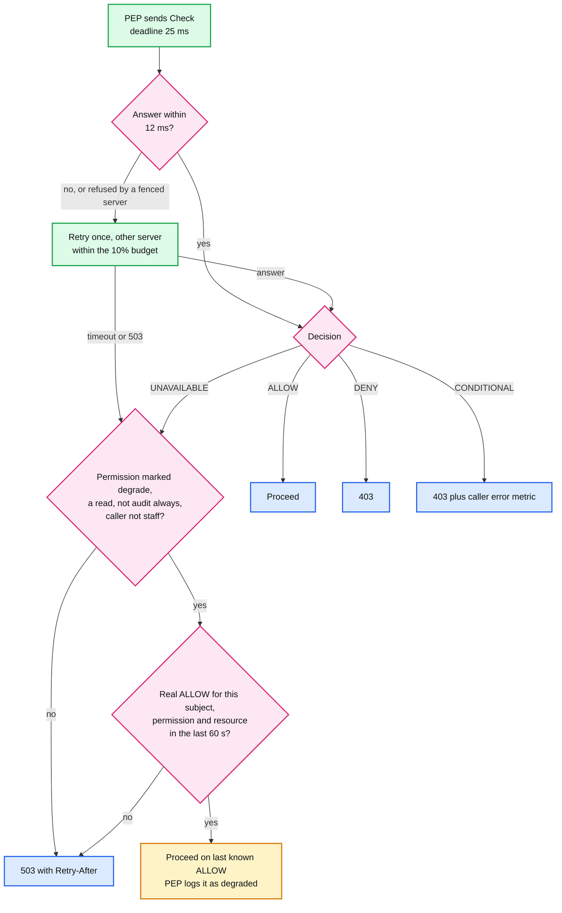
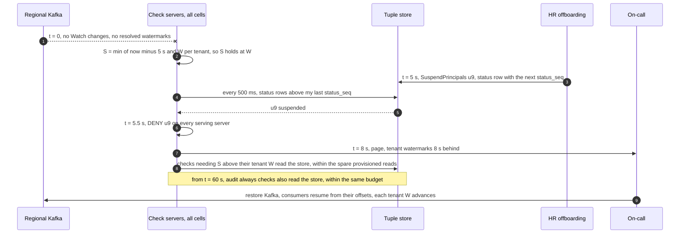
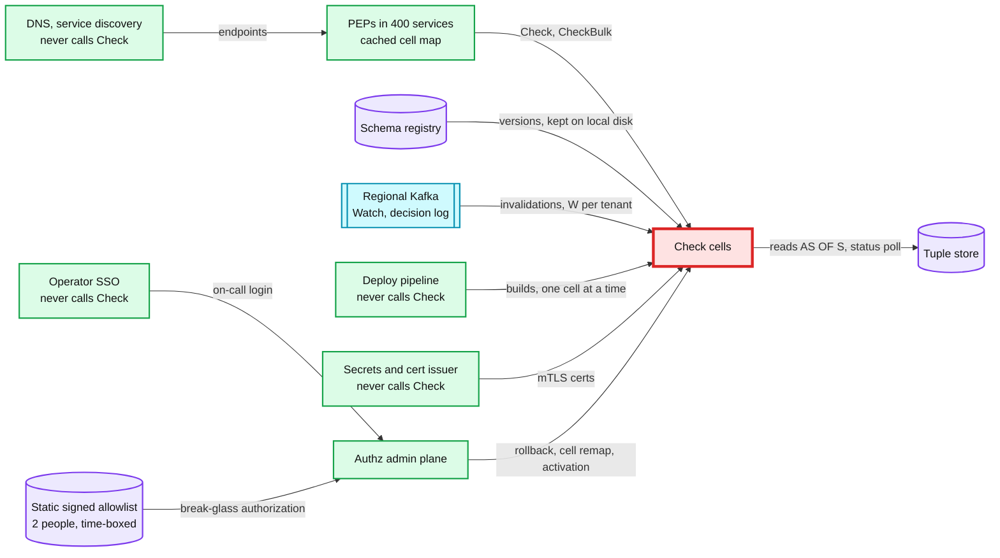

# Deep dive: availability and failure modes

> One-line answer: when the check service cannot answer, the PEP (policy enforcement point, the client library in each service) returns **503 with Retry-After, never 403**, except for a few reviewed low-risk reads that may reuse an ALLOW seen in the last 60 s. A retry absorbs a server, a cell absorbs a bad build (~25% of a region's tenants), a region absorbs a store outage. Each mechanism here exists because a simpler first draft failed in simulation: a store sized for the warm path (98% busy at peak, 171% to 741% in cold events), a stall guard that sent the whole fleet to the store (391%), cross-region reads that cannot fit a 25 ms deadline (49% of checks 503), one spillover cell that collapsed under retries, and a suspension feed whose readiness rule turned a Kafka outage into a global outage. The budget is **52.6 min a year per region** (99.99%). The draft spent ~40 of it, the design ~3.

Zoom-in on [`../solution.md`](../solution.md) §2, §5.2, §5.4, §5.7 and §10.4. Reusable blocks: [`../../../concepts/rate-limiting-and-load-shedding.md`](../../../concepts/rate-limiting-and-load-shedding.md) (shedding, retry budgets), [`../../../concepts/replication-and-quorums.md`](../../../concepts/replication-and-quorums.md) and [`../../../concepts/raft.md`](../../../concepts/raft.md) (why 2+2+1 survives a region), [`../../../concepts/caching-patterns.md`](../../../concepts/caching-patterns.md) (cold caches). Siblings: [`consistency-and-new-enemy.md`](consistency-and-new-enemy.md) (the suspension overlay), [`check-latency-caching-and-hot-spots.md`](check-latency-caching-and-hot-spots.md) (the relation cache), [`migration-and-safe-policy-changes.md`](migration-and-safe-policy-changes.md) (schema activation). Same shape elsewhere: [`../../feature-flag-service/deep-dives/fail-static-and-bad-snapshots.md`](../../feature-flag-service/deep-dives/fail-static-and-bad-snapshots.md).

---

## 1. 503, not 403, and the one exception

An authorization service has two ways to be wrong when it is down. A stale ALLOW is a security bug. A 403 is an outage dressed up as policy: UIs hide data, sync clients delete local copies, and users file access requests. "We do not know" is a 503.



**Why the retry should stay in the cell.** A pathological check (a query of death) that crashes a server would, retried in another cell, crash a server there too. Inside the cell, the blast radius stays at ~25% of a region's tenants.

**The `degrade: last_known_60s` opt-in, with its rules written down:**
- The PEP stamps an entry only on a **real** ALLOW. Reuse never refreshes it, so a 10-minute outage gives at most 60 s of reuse per `(subject, permission, resource)`, then 503. Memory per process, ~10k entries [estimate], lost on restart. Every reuse is logged.
- Never for writes, `audit: always` permissions or internal staff. Security approves each permission in schema review: a handful (directory, org chart, own profile).
- **The risk, in one sentence:** a user revoked in the ~6 s before our outage, or suspended during it, can read directory-class data for up to 60 s after their last real ALLOW. The suspension overlay cannot help, because it lives in the service that is down. Session revocation by the identity system still applies.

---

## 2. Layers of redundancy, and what each one needs in reserve

| Layer | Unit | Absorbs | Blast radius | Recovery |
|---|---|---|---|---|
| Server | 6 per US cell, 5 per EU cell, 16 cores, ~35% CPU at peak, N+2 per cell | crash, slow host, stale suspension poll | its in-flight checks | PEP retry, +12 ms |
| Cell | 4 in us-east, 4 in us-west, 3 in eu-central, ~63 servers | bad build, query of death, hot tenant | ~25% of a region's tenants | rollback, or remap across the other cells by tenant hash |
| Store replica | 2 readable per range in every region (eu-central: 1 voter plus 1 non-voting) | node loss | none: the other local copy serves | re-replication in the background |
| Region | 3 regions, 5 voters (2+2+1), ~86 store nodes (32, 32, 22) | region loss | that region's callers | products shift over ~15 min, the 3 surviving voters must all ack |

Each recovery moves load somewhere. The script asks whether the somewhere can take it, for the first draft (~50 store nodes, ~1 read per check warm, 4.75-server cells) and for the design (solution.md §2: ~0.15 reads per check warm, ~4 cold, nodes run at 70% of a ~20k reads/s ceiling [estimate], 6-server cells). Part 3 is a Monte Carlo of one 2-level check: two sequential leaf reads (a group, then its binding) in parallel with an exclusion leaf, Zanzibar's store latency (0.5 ms median, 2 ms p95, hedged at p95), and the PEP's 12 ms per try, one retry, 25 ms deadline. A retry asks for the same keys, and single-flight makes it wait for reads already in flight.

```python
import math, random
random.seed(7)

CHECKS = {"us-east": 450_000, "us-west": 275_000}       # checks/s at each region's peak
CEIL = 20_000                                            # reads/s per store node [estimate]
SIZING = {"first draft": ({"us-east": 23, "us-west": 14}, 1.0),   # nodes, warm reads per check
          "v2": ({"us-east": 32, "us-west": 32}, 0.15)}
COLD = 4.0                                               # reads per check with an empty relation cache
E, W, cell = CHECKS["us-east"], CHECKS["us-west"], CHECKS["us-east"] / 4

print("1. Store reads as a share of the region's ceiling (20k reads/s per node)")
for name, (nodes, warm) in SIZING.items():
    for case, region, load in [
            ("peak, warm", "us-east", E * warm),
            ("one us-east cell cold", "us-east", (E - cell) * warm + cell * COLD),
            ("cache bypassed fleet-wide (draft stall guard)", "us-east", E * COLD),
            ("us-east lost, all of it lands on us-west cold", "us-west", W * warm + E * COLD)]:
        print(f"   {name:12} {case:46} {load/1e3:6.0f}k reads/s {load / (nodes[region] * CEIL):5.0%}")

def ramp_peak(ramp_min, warm_min):
    """v2: us-east moves to us-west linearly over ramp_min. Moved traffic warms from COLD to 0.15
    reads per check with time constant tau (warm_min is ~3 tau). Peak share of us-west's ceiling."""
    tau, peak = warm_min * 60 / 3, 0.0
    for t in range(1, 3600):
        m = min(t, ramp_min * 60) or t
        rate = E / (ramp_min * 60) if ramp_min else 0
        moved = (rate * (0.15 * m + (COLD - 0.15) * tau * (math.exp(-(t - m) / tau) - math.exp(-t / tau)))
                 if ramp_min else E * (0.15 + (COLD - 0.15) * math.exp(-t / tau)))
        peak = max(peak, W * 0.15 + moved)
    return peak / (32 * CEIL)

print("   v2 failover ramp, peak share of us-west's ceiling (70% is the target):")
for ramp in (0, 5, 15):
    print(f"      ramp {ramp:2} min: HR-shaped (warm in 1 min) {ramp_peak(ramp, 1):5.0%},"
          f" documents (warm in 10 min) {ramp_peak(ramp, 10):5.0%}")

# 2. M/M/1-style response time, calibrated so p99 is 7.5 ms at 50% CPU: mean = BASE / (1 - rho)
BASE, PER_TRY = 7.5 / math.log(100) * 0.5, 12.0
def timeout_frac(rho):
    return 1.0 if rho >= 1 else math.exp(-PER_TRY * (1 - rho) / BASE)

def settle(offered, budget):                 # a timed-out first try has still burned its CPU
    rho = offered
    for _ in range(500):
        new = offered * (1 + min(timeout_frac(rho), budget))
        if new >= 1:
            return "collapse"
        rho = new
    return f"{rho:4.0%} CPU, {timeout_frac(rho):5.1%} first tries time out"

print("\n2. A dead us-east cell's tenants move")
for name, servers in [("first draft, 4.75 servers per cell", 4.75), ("v2, 6 servers per cell", 6)]:
    base = cell * 0.3e-3 / (servers * 16)
    print(f"   {name} ({base:.0%} CPU normally):")
    for how, extra, budget in [("into one cell, retry every timeout", 1.0, 1.0),
                               ("into one cell, 10% retry budget", 1.0, 0.1),
                               ("spread over 3 cells, 10% retry budget", 1 / 3, 0.1)]:
        print(f"      {how:40} {settle(base * (1 + extra), budget)}")

# 3. One check through the PEP. Store read: median 0.5 ms, p95 2 ms, hedged at p95.
SIG = math.log(2 / 0.5) / 1.645
def store_read(remote):
    t = random.lognormvariate(math.log(0.5), SIG)
    if t > 2.0:
        t = min(t, 2.0 + random.lognormvariate(math.log(0.5), SIG))
    return t + (random.uniform(30, 70) if remote else 0.0)

def check(hit, remote, per_try, deadline):
    """A 2-level check: two sequential leaf reads (a group, then its binding) in parallel with
    an exclusion leaf. A retry asks for the same keys and waits on reads already in flight."""
    leaf = lambda: 0.05 if random.random() < hit else store_read(remote)
    t1 = 1.1 + random.expovariate(1 / 0.5) + max(leaf() + leaf(), leaf())
    if t1 <= per_try:
        return t1
    t2 = max(per_try + 1.1 + random.expovariate(1 / 0.5) + 0.1, t1)   # retry, different server
    return t2 if t2 <= deadline and t2 - per_try <= per_try else None

print("\n3. 200k simulated checks per row, latency of the answered ones")
for name, hit, remote, per_try, deadline in [
        ("local store, hit 95%, 25 ms", 0.95, False, 12, 25),
        ("reads cross-region, hit 80%, 25 ms", 0.80, True, 12, 25),
        ("reads cross-region, hit 95%, 25 ms", 0.95, True, 12, 25),
        ("region degraded, hit 80%, 150 ms", 0.80, True, 150, 150)]:
    ok = sorted(t for t in (check(hit, remote, per_try, deadline) for _ in range(200_000)) if t is not None)
    print(f"   {name:36} answered p50 {ok[len(ok)//2]:5.1f} ms  p99 {ok[int(len(ok)*.99)]:5.1f} ms"
          f"  503 {1 - len(ok) / 200_000:6.2%}")
```

```text
1. Store reads as a share of the region's ceiling (20k reads/s per node)
   first draft  peak, warm                                        450k reads/s   98%
   first draft  one us-east cell cold                             788k reads/s  171%
   first draft  cache bypassed fleet-wide (draft stall guard)    1800k reads/s  391%
   first draft  us-east lost, all of it lands on us-west cold    2075k reads/s  741%
   v2           peak, warm                                         68k reads/s   11%
   v2           one us-east cell cold                             501k reads/s   78%
   v2           cache bypassed fleet-wide (draft stall guard)    1800k reads/s  281%
   v2           us-east lost, all of it lands on us-west cold    1841k reads/s  288%
   v2 failover ramp, peak share of us-west's ceiling (70% is the target):
      ramp  0 min: HR-shaped (warm in 1 min)  274%, documents (warm in 10 min)  286%
      ramp  5 min: HR-shaped (warm in 1 min)   35%, documents (warm in 10 min)  157%
      ramp 15 min: HR-shaped (warm in 1 min)   23%, documents (warm in 10 min)   76%

2. A dead us-east cell's tenants move
   first draft, 4.75 servers per cell (44% CPU normally):
      into one cell, retry every timeout       collapse
      into one cell, 10% retry budget           98% CPU, 71.2% first tries time out
      spread over 3 cells, 10% retry budget     59% CPU,  0.3% first tries time out
   v2, 6 servers per cell (35% CPU normally):
      into one cell, retry every timeout        71% CPU,  1.5% first tries time out
      into one cell, 10% retry budget           71% CPU,  1.5% first tries time out
      spread over 3 cells, 10% retry budget     47% CPU,  0.0% first tries time out

3. 200k simulated checks per row, latency of the answered ones
   local store, hit 95%, 25 ms          answered p50   1.6 ms  p99   3.9 ms  503  0.00%
   reads cross-region, hit 80%, 25 ms   answered p50   1.5 ms  p99   3.5 ms  503 48.83%
   reads cross-region, hit 95%, 25 ms   answered p50   1.5 ms  p99   3.5 ms  503 14.24%
   region degraded, hit 80%, 150 ms     answered p50   3.0 ms  p99 114.1 ms  503  0.00%
```

What it shows, and what the design does about it:
- **The store is provisioned for the cold moments.** The first draft's ~50 nodes ran at 98% at peak, and one cold cell took us-east to 171%. The design runs warm at 11%, and a cold cell fits (78%). That is why ~86 nodes look idle on a normal day.
- **A failover must ramp.** All of us-east landing on us-west at once is ~2.9x us-west's ceiling. Ramped over 15 minutes, HR-shaped traffic peaks at 23% and document-shaped traffic at 76%, just over the 70% target. Over 5 minutes, documents still hit 157%. So the ~15-minute ramp in solution.md §5.4 is the minimum, not a nicety. The cost: users of a lost region move over those 15 minutes, not at once.
- **No fleet-wide cache bypass, ever.** The first draft bypassed the relation cache when the Watch watermark was 30 s old. That is 391% of the draft store, and still 281% of the 86-node store. The design keeps a watermark per tenant (section 4) and never bypasses fleet-wide.
- **Cross-region reads cannot fit the deadline.** Any check with a miss on its critical path times out twice: 48.8% of checks 503 at an 80% hit rate, 14.2% at a warm 95%. So the design has a **region-degraded** mode (PEPs use a 150 ms budget for that region's tenants: 0% 503, p99 ~114 ms) and a second readable replica in every region, so a single node loss never triggers it.
- **Spread a dead cell, by tenant hash.** With the draft's 4.75-server cells, one spillover cell collapsed under retries. With 6-server cells it runs at 71% CPU and 1.5% first-try timeouts, against 47% and ~0% when spread over three cells. Spreading still wins (headroom for the next failure, smaller cold slice per cell), but the case for it at this cell size is headroom, not collapse.
- **A fenced server must not spend the retry budget** [proposal]. A server whose suspension poll is stale refuses checks with a retriable UNAVAILABLE (section 4). In a 6-server cell, one fenced server takes `1/6 = 16.7%` of first tries. If those retries count against the 10% budget, `16.7% - 10% = 6.7%` of that cell's checks get a 503 (23.3% with two fenced). Fix: a refusal from a fenced server is free (no work was done), and the PEP ejects that server from its pick list after the first refusal.

---

## 3. Load shedding and retries

The order (solution.md §5.4): shadow checks, exports and LookupSubjects, LookupResources, background-job checks, interactive checks last. The rules that make it hold under real overload:
1. **The class comes from the calling service's registration**, checked against its mTLS (mutual TLS) identity. A batch job cannot label itself interactive. Every calling service also has a quota.
2. **Shed whole checks at admission.** Dispatched sub-problems inherit their check's class and deadline and are never shed on their own: shedding a half-evaluated check wastes the work done and fails it anyway.
3. **A retry budget in every PEP.** At most 10% of calls retried, no retry on a 503 marked "shedding", and fenced-server refusals outside the budget (section 2).
4. **Fair share only when shedding** [proposal]. Checks have no per-tenant limits in normal operation, and should not. Under overload, shedding interactive checks from tenants above their fair share of in-flight checks first makes one tenant's spike cost that tenant, not the cell.

---

## 4. Shared feeds: why suspensions are polled from a table

The first draft pushed suspensions through a Kafka topic, with a 500 ms heartbeat, and a server left the load balancer when its feed was 2 s behind. A per-server safety rule that reads a shared feed is a global kill switch. An interim fix made the rule cell-relative and added a backstop: every check also reads the subject's `PRINCIPAL_STATUS` leaf through the relation cache. The design (solution.md §5.2) drops Kafka from the termination path: every check server polls `PRINCIPAL_STATUS` at its leaseholder every 500 ms for rows above its last `status_seq` (~130 tiny reads/s fleet-wide), and a server whose last poll is over 2 s old while its cell's median is fresh refuses checks in-process.

The simulation runs us-east's 24 servers for 90 s. One component fails from 10 s to 50 s, and user u9 is suspended at 15.3 s. "Worst suspend-to-deny" is the longest any **serving** server still answered for u9. Removal is modelled as instant at 2 s for every rule, which flatters the draft: real readiness probes took p99 4.7 s (solution.md §5.2).

```python
import math, random, statistics
random.seed(11)

CELL = [c for c, n in enumerate([6, 6, 6, 6]) for _ in range(n)]   # us-east: 24 servers, 4 cells
N, DT, END, OUT, T_SUSP = len(CELL), 0.1, 90.0, (10.0, 50.0), 15.3   # u9 suspended at 15.3 s
SCEN = {"one server's link stuck": ({"link"}, {3}),       # what fails during OUT, whose link
        "relay down": ({"relay"}, set()),
        "status leaseholder unreachable": ({"leaseholder"}, set()),
        "region's Kafka down": ({"kafka"}, set()),
        "4 of 6 servers in cell 0 stuck": ({"link"}, {0, 1, 2, 3})}
MECH = {"draft: Kafka feed, own lag > 2 s": ("kafka", "own"),
        "interim: Kafka feed, cell-relative": ("kafka", "cell"),
        "v2: 500 ms poll, in-process gate": ("poll", "cell")}

def run(failed, stuck, path, rule):
    last, knows, ready_min, worst = [0.0] * N, [math.inf] * N, N, 0.0
    for step in range(int(END / DT)):
        t = round(step * DT, 1)
        out = OUT[0] <= t < OUT[1]
        down = {"relay", "kafka"} if path == "kafka" else {"leaseholder"}   # what breaks this path
        for i in range(N):
            if out and (i in stuck or failed & down):
                continue
            if t % 0.5 < 1e-9:               # a heartbeat or a successful poll, every 500 ms
                last[i] = t - random.uniform(0.05, 0.3)
            if t >= T_SUSP and knows[i] == math.inf:
                knows[i] = t + random.uniform(0.05, 0.3) + (0.5 if path == "poll" else 0)
        lag = [t - x for x in last]
        med = {c: statistics.median(lag[i] for i in range(N) if CELL[i] == c) for c in set(CELL)}
        W = OUT[0] if out and "kafka" in failed else t - 1.0
        S = math.floor(t - 5) if path == "kafka" and t - W > 30 else min(math.floor(t - 5), W)
        ready = 0                            # draft stall guard at 30 s, v2 has none
        for i in range(N):
            if lag[i] > 2 and (rule == "own" or med[CELL[i]] < 1):
                continue                     # removed, or answers retriable UNAVAILABLE
            ready += 1
            if t >= T_SUSP and not (knows[i] <= t or S >= T_SUSP):   # overlay, or the status leaf
                worst = max(worst, t - T_SUSP + DT)
        ready_min = min(ready_min, ready)
    return ready_min, worst

print(f"{'what fails for 40 s':31} {'mechanism':35} {'min serving':>11} {'worst suspend-to-deny':>22}")
for name, (failed, stuck) in SCEN.items():
    for mech, (path, rule) in MECH.items():
        r, w = run(failed, stuck, path, rule)
        print(f"{name:31} {mech:35} {r:>8} /{N} " + (f"{w:>20.1f} s" if r else f"{'global outage':>22}"))
```

```text
what fails for 40 s             mechanism                           min serving  worst suspend-to-deny
one server's link stuck         draft: Kafka feed, own lag > 2 s          23 /24                  0.3 s
one server's link stuck         interim: Kafka feed, cell-relative        23 /24                  0.3 s
one server's link stuck         v2: 500 ms poll, in-process gate          23 /24                  0.8 s
relay down                      draft: Kafka feed, own lag > 2 s           0 /24          global outage
relay down                      interim: Kafka feed, cell-relative        24 /24                  5.7 s
relay down                      v2: 500 ms poll, in-process gate          24 /24                  0.8 s
status leaseholder unreachable  draft: Kafka feed, own lag > 2 s          24 /24                  0.3 s
status leaseholder unreachable  interim: Kafka feed, cell-relative        24 /24                  0.3 s
status leaseholder unreachable  v2: 500 ms poll, in-process gate          24 /24                  5.7 s
region's Kafka down             draft: Kafka feed, own lag > 2 s           0 /24          global outage
region's Kafka down             interim: Kafka feed, cell-relative        24 /24                 24.8 s
region's Kafka down             v2: 500 ms poll, in-process gate          24 /24                  0.8 s
4 of 6 servers in cell 0 stuck  draft: Kafka feed, own lag > 2 s          20 /24                  0.3 s
4 of 6 servers in cell 0 stuck  interim: Kafka feed, cell-relative        24 /24                  5.7 s
4 of 6 servers in cell 0 stuck  v2: 500 ms poll, in-process gate          24 /24                  5.7 s
```

- **The draft rule is a global outage** when the relay or the region's Kafka fails: every server is 2 s behind at once, and all 24 leave.
- **The interim rule survives, but its backstop shares the failure.** With Kafka down, the Watch stream is down too, the status leaf is read at a frozen snapshot, and the suspension waits for the draft's 30 s stall guard: 24.8 s, against a 2 s SLO (service level objective).
- **The poll never depends on Kafka.** 0.8 s in every case where the poll works. When the status leaseholder is unreachable, or most of a cell is stuck, nobody fences (that would be an outage) and the status leaf, which still has a live Watch stream, lands it in 5.7 s. Both page.
- **A majority counts as "the whole cell".** With 4 of 6 servers stuck, the cell median is stale, so nobody fences. That is the rule working as written. The page should say "cell median stale", so the on-call does not wait for every server.

**The Watch stream stalls the same way, so it got the same treatment.** The draft computed one watermark W per server and bypassed the cache when W was 30 s old: 391% of the store (section 2). The design (solution.md §5.1) keeps `W_t` per tenant from the region's own tenant-partitioned Kafka, so a stuck range stalls only its tenants. Default checks stay at `S = W_t` and get staler, never wrong. Lag over 8 s pages. Checks that need `S > W_t` read the store within a ~1.5x per-server budget, and after 60 s of lag so do `audit: always` checks for that tenant.



---

## 5. Cell remaps and the relation cache

"Any cell can serve any tenant" is how a remap works. It had a consistency cost in the first draft: each server consumed Watch changes only for its cell's tenants, but W was one number per server. Two ways a server ends up serving a tenant it does not hear about:
- **Misrouted:** a PEP with a stale cell map (up to 10 s), or a remap back, sends tenant B to a cell that does not consume B's changes. The server's W keeps advancing on other tenants, so a missing invalidation for B "proves" nothing changed.
- **Remapped in:** B is added to the cell and its subscription starts from "latest". The 2-minute recent-changes log starts there too, so a fill at `S = now - 5 s` can predate it.

```python
import math
KEY = ("tenantB", "document:d1", "viewer")

class Server:
    """Relation cache plus the recent-changes log. subs: tenant -> commit ts its Watch subscription
    started from. per_tenant=False is the first draft: one resolved watermark W per server."""
    def __init__(self, history, per_tenant):
        self.history, self.per_tenant, self.subs, self.log, self.cache, self.W = history, per_tenant, {}, [], {}, 0
    def read(self, S):                       # MVCC store read of KEY AS OF S
        return [v for ts, v in self.history if ts <= S][-1]
    def watch(self, ts, key, resolved):      # a change is delivered only for subscribed tenants
        if key[0] in self.subs and ts >= self.subs[key[0]]:
            self.log.append((ts, key))
            if key in self.cache:
                self.cache[key][2] = min(self.cache[key][2], ts)   # stamp invalidated_at
        self.W = max(self.W, resolved)
    def w_for(self, tenant):                 # per tenant: no W until 2 min of replay is in the log
        start = self.subs.get(tenant)
        if not self.per_tenant:
            return self.W
        return self.W if start is not None and self.W - start >= 120 else -math.inf
    def check(self, S, user):
        e, w = self.cache.get(KEY), self.w_for(KEY[0])
        if e and e[1] <= S < e[2] and S <= w:
            return ("ALLOW" if user in e[0] else "DENY") + " (cache)"
        subjects = self.read(S)
        if S <= w:                           # fill: invalidated_at from the log, else infinity
            self.cache[KEY] = [subjects, S, min([t for t, k in self.log if k == KEY and t > S], default=math.inf)]
        return ("ALLOW" if user in subjects else "DENY") + " (store)"
    def truth(self, S, user):
        return "ALLOW" if user in self.read(S) else "DENY"

for per_tenant in (False, True):
    label = "v2: W per tenant, 2 min replay" if per_tenant else "first draft: one W per server"
    s = Server([(0, {"bob", "alice"})], per_tenant)
    s.subs["tenantA"] = 0                    # tenant B is not in this cell
    s.watch(90, ("tenantA", "doc:x", "viewer"), resolved=99)
    fill = s.check(95, "bob")                # a stale cell map sends B's check here
    s.history.append((101, {"alice"}))       # Alice removes Bob at 101, never delivered here
    s.watch(101, KEY, resolved=109)
    print(f"{label:31} misrouted: fill {fill}, at S=105 Bob gets {s.check(105, 'bob')}, truth {s.truth(105, 'bob')}")
    s = Server([(0, {"bob", "alice"}), (198, {"alice"})], per_tenant)
    s.subs["tenantB"] = 80 if per_tenant else 200   # remapped in at 200: replay 2 min, or "latest"
    s.watch(198, KEY, resolved=200)
    fill = s.check(196, "bob")
    s.watch(205, ("tenantB", "doc:y", "viewer"), resolved=209)
    print(f"{label:31} remapped:  fill {fill}, at S=205 Bob gets {s.check(205, 'bob')}, truth {s.truth(205, 'bob')}")
```

```text
first draft: one W per server   misrouted: fill ALLOW (store), at S=105 Bob gets ALLOW (cache), truth DENY
first draft: one W per server   remapped:  fill ALLOW (store), at S=205 Bob gets ALLOW (cache), truth DENY
v2: W per tenant, 2 min replay  misrouted: fill ALLOW (store), at S=105 Bob gets DENY (store), truth DENY
v2: W per tenant, 2 min replay  remapped:  fill ALLOW (store), at S=205 Bob gets DENY (store), truth DENY
```

The draft served Bob a stale ALLOW after Alice removed them, and in the misrouted case nothing would ever invalidate the entry. The design's rules (solution.md §5.1, promise 4): `W_t` per tenant, so a tenant not consumed here has no `W_t` and bypasses the relation cache; replay the last 2 minutes of a tenant's partitions on start, restart, remap, rebalance or gap before serving it from cache; drop a tenant's entries when it is no longer consumed.

---

## 6. Circular dependencies and the static allowlist

The authorization service must start, deploy and be operated while it is down. Everything on that path, including operator single sign-on (SSO), must work without a single Check.



- **The test:** with every check server down, can the team log in, deploy the previous build, issue certificates to the new servers, and remap a cell? Each "never calls Check" box must answer yes. The two easiest to miss are operator SSO (if it asks "may this engineer use this app" through Check) and the certificate issuer (if it authorizes "may this service get a cert" through Check). Either one makes a cold start impossible.
- **The static allowlist.** A file listing who may operate the admin plane, signed by two keys kept offline, verified locally by the admin tools with no network call, valid for 7 days and re-signed weekly at the on-call handover [estimate]. An expired list pages, so it never lapses mid-incident.
- **Cached, not called.** PEPs keep the last cell map. Check servers keep every schema version used in the last 24 h on local disk, so the registry is not a boot dependency. A control-plane outage freezes changes, it never stops decisions.

---

## 7. The decision-log spool

Records go to memory, then a 10 GB local disk spool, then Kafka. `audit: always` checks fail closed (503) only when the spool is full.

- **Headroom:** a us-east server takes `450k / 24 ≈ 19k` checks/s at peak, ~10% logged, 200 B each: ~0.37 MB/s. 10 GB lasts **~6 to 7 h at peak**.
- **A DENY storm** (a bad schema flipping ALLOWs, a client probing): every DENY is logged, up to 100% of checks, ~3.7 MB/s: **~40 to 45 minutes** before the spool is full and salary pages return 503. So identical DENYs are aggregated per minute, with a count, before they reach the spool.
- **The spool dies with its server.** During a Kafka outage, a deploy, scale-in or crash-replace would throw away hours of `audit: always` records. So a server never terminates with a non-empty spool (deploys wait), and a replaced host's volume is reattached.

---

## 8. Google, 14 Dec 2020, and what it teaches

Google's authentication failed for ~47 minutes (03:46 to 04:33 PT). The User ID Service had moved to a new quota system. The old tooling reported its usage as zero, and after a grace period automated quota enforcement cut its Paxos leader off from writing, so reads went stale and lookups failed. Google's remediation: review automation "to prevent fast implementation of global changes", and "limit the impact on the data plane". Source: [`../research/real-world-survey.md`](../research/real-world-survey.md) §6.

| What happened there | Our analog | Our guard |
|---|---|---|
| Automation acted on a metric that said "zero" | Readiness probes, autoscalers, store quotas, the cleanup job | Anything that removes capacity acts on one cell at a time and refuses when its input says "zero" or "everyone" (the cell-relative suspension gate is this rule) |
| A safety mechanism removed the ability to serve | The draft's readiness rule and stall guard | Cell-relative gate, per-tenant `W_t`, budgeted store reads (section 4) |
| Stale reads turned into errors | `W_t` freezes, the relation cache stops being usable | Staleness grows for that tenant only, never wrong, page at 8 s |
| One identity service, every product down | The check cells on every request path | Cells, regions, 503 not 403, `degrade` for a few reads |
| "Prevent fast implementation of global changes" | Schema versions, builds, config, cell map edits | Schema cohort by cohort, builds cell by cell, 1 h bake |

---

## 9. The budget: 52.6 minutes a year per region

99.99% of checks at the PEP, counting 503s and deadline misses: `0.0001 x 525,960 min = 52.6 min/yr`, ~4.4 min a month. A wrong answer from a bad schema is not in this budget: it is a correctness incident with its own gate (flip counts). "Minutes" means full-outage-equivalent minutes: events x duration x share of the region's checks failing. Every input is an [estimate].

| Source | Events/yr | Each lasts | Share failing in the draft | Draft min | Design min |
|---|---|---|---|---|---|
| Bad build reaches one cell | 2 | 3 min | 25% of tenants x ~50% | 0.8 | 0.8 |
| Query of death or hot tenant in one cell | 2 | 5 min | 25% x ~20% | 0.5 | 0.5 |
| eu store node lost (one replica) | 6 | 10 min | 1/14 of tenants x 49% | 2.1 | 0 (second readable replica) |
| eu store rolling restarts | 12 x 14 nodes | 1.5 min | 1/14 x 49% | 8.8 | 0 |
| A region's local replicas impaired | 1 | 15 min | 49% | 7.3 | 0 (region-degraded, slower) |
| Kafka down past 30 s | 1 | 20 min | store at 4x, ~75% | 15 | 0 (no bypass, staler) |
| Dead cell | 1 | 10 min | dead cell, then a collapsed spillover cell | 5 | 0.8 (3 min to remap) |
| One server fenced by the suspension gate | 12 | 5 min | not in the draft | n/a | 1.0 (0 if refusals are free) |
| **Total** | | | | **~40 of 52.6** | **~3** |

The point is not the exact numbers. Four mechanisms that each looked safe alone spent three quarters of the draft's budget, and the fixes are sizing, configuration and small rules, not new systems.

---

## 10. Trade-offs, and numbers to say out loud

| Decision | Chose | Gave up |
|---|---|---|
| Unknown answer | 503, plus `degrade` for a few reviewed reads | Directory pages survive our outage for only 60 s per key |
| Store size | ~86 nodes for the cold moments | ~36 nodes that idle on a normal day |
| Region loss | Ramp the failover over ~15 min | Users of the lost region move over 15 minutes, not at once |
| Region store impaired | Region-degraded mode, 150 ms budget, then evacuate | Product p99 ~114 ms for those minutes |
| Dead cell | Spread by tenant hash, 10% retry budget | A dead cell's tenants touch every cell's caches |
| Suspensions | Polled from a table, in-process gate | ~130 reads/s, and ~6 s when the status leaseholder is unreachable |
| Watch stall | Per-tenant `W_t`, no bypass | Low-risk revokes wait for the stream to recover |
| Spool | Drain before terminate, aggregate DENYs | Deploys wait during a Kafka outage |

- 52.6 min/yr per region. 25 ms deadline, 12 ms per try, 1 retry, 10% retry budget, fenced-server refusals free.
- Cross-region store fallback: 49% (hit 80%) or 14% (hit 95%) of checks miss 25 ms. At 150 ms: 0%, p99 ~114 ms.
- Store warm 11% of ceiling, one cold cell 78%. Failover at once ~2.9x the ceiling, ramped over 15 min 76%. Dead cell: 71% CPU in one cell, 47% spread.
- Suspension: 0.8 s by poll, 5.7 s by the backstop. The draft's Kafka feed: a global outage, or 24.8 s with the interim fix.
- Spool: ~6 to 7 h at peak, ~40 to 45 min in a DENY storm before aggregation.
