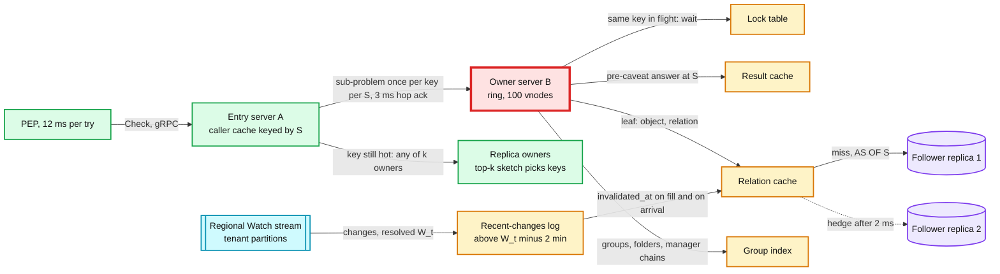
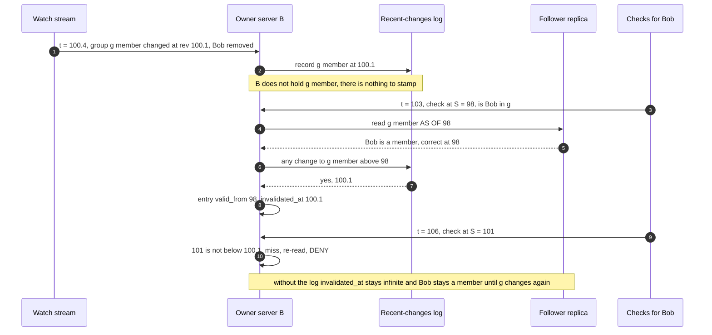

# Deep dive: check latency, caching and hot spots

> One-line answer: a check is one in-region hop to an entry server, sub-problems hashed to owner servers on a ring, and two snapshot-correct caches in front of the local follower. Simulated on a Zipf workload at the §2 write rate: a result cache keyed by the 1 s snapshot alone hits **17 to 28%** of leaf reads (Zanzibar reports 2% to 24% per path), the watch-invalidated relation cache hits **90 to 99% warm**, but only **41 to 96% in the first 10 minutes of a cold cell** and **83% for 20 minutes after a cold rolling deploy** (documents workload). So the warm store load is small (~0.15 reads per check), and the cold moments set its size (~86 nodes, ~1 read per check at each region's peak). The watermark rule returned **0 stale reads** under reorder, duplicates, replay, 60 s and 3 min stalls, 8 s lag and restarts, but only while its promises hold: dropping the recent-changes log alone gave **128k stale reads**. Latency: p99 4.8 ms at an 80% hit rate with hedged store reads, 5.8 ms for an ALLOW through a 3-deep manager chain, 13.7 ms for a cold 6-deep group walk (52 ms unhedged), 2.6 ms through the group index. A DENY that walks a 10-deep chain is p99 12.3 ms warm and 20.4 ms cold, which is why manager chains are flattened too.

Zoom-in on [`../solution.md`](../solution.md) §5.1 (caches and the snapshot rule), §5.3 (deep groups, hot keys, hot tenants, deploys), §2 and §10.3 (capacity). Reusable blocks: [`../../../concepts/caching-patterns.md`](../../../concepts/caching-patterns.md) (single-flight, versioned keys), [`../../../concepts/sharding.md`](../../../concepts/sharding.md) (consistent hashing), [`../../../concepts/stream-processing.md`](../../../concepts/stream-processing.md) (watermarks), [`../../../concepts/rate-limiting-and-load-shedding.md`](../../../concepts/rate-limiting-and-load-shedding.md). Sibling: [`consistency-and-new-enemy.md`](consistency-and-new-enemy.md) (what S is and why).

---

## 1. The path and its caches



The PEP (policy enforcement point) is the client library in every calling service. It memoizes identical checks within one request, keyed with their consistency. Everything else in the picture is inside the check cell.

## 2. The ring and the hop

- **Owner by consistent hashing,** 100 virtual nodes per server (SpiceDB's default replication factor). Identical sub-problems from many checks meet on one owner, which is what makes the lock table and the result cache work. Zanzibar reports 22 M delegated RPCs (remote procedure calls) per second at a 4.2 M/s check peak.
- **Balance.** Simulated (§7): the busiest of 5 servers owns 1.11x the mean key space at the median ring and 1.29x at the p99 ring, 1.19x and 1.36x with 20 servers. One vnode per server would give 2.2x and 3.8x. At a 50% CPU (central processing unit) target, 1.29x is 65%: fine.
- **The owner judges S against its own `W_t`.** The entry server picks S from its own watermark for the tenant. Servers consume their partitions independently, so the owner may be behind. Trusting the caller's watermark would use entries the owner has not yet stamped: 222 stale reads in the safety test (§5).
- **The 3 ms hop timeout must time the owner, not the work.** Past 3 ms the dispatcher evaluates the sub-problem itself or tries the key's next replica, so a slow owner does not hold the check. Measured against the sub-problem's full answer it would fire far too often (§7): on 13% of 3-level sub-problems with warm caches, and on 85% of them cold, exactly when the store can least afford a second copy of the work. That second copy is the server-to-server hedging Zanzibar refused ("duplicating the most expensive workloads"). So the owner acknowledges a dispatch at once, and the 3 ms covers that acknowledgement. The answer is bounded by the check's deadline.

## 3. Result cache, lock table, and caching on the caller

- **Four layers, four lifetimes.** The PEP memo lives one request. The caller cache, the lock table and the result cache are keyed by S and live ~1 s. The relation cache lives until the data changes.
- **What the result cache holds.** Key `(tenant, schema_version, object, permission or relation, subject, S)`. Values are stored **before caveats** (ALLOW, DENY, or CONDITIONAL with the residual caveats and their bound parameters), so a request's own context is applied every time. Each entry carries the earliest `expires_at` it depended on. Tainted results (a cycle cut, a sub-problem budget hit) are never stored.
- **What it buys.** An entry says "the answer at S": it can be old, never wrong, and it dies when S ticks. Simulated (§6): 17 to 28% of leaf reads, almost all of them the tenant-wide keys (`org:acme#binding`), because two checks of the same employee within one second are rare. Zanzibar measured the same shape: 10% on the delegate's side plus 12% from its lock table, 24% plus 9% for delegated reads, and "less than 1%" to 2% on the delegator's side. Its conclusion: "While these hit rates appear low, they prevent 500K internal RPCs per second from creating hot spots."
- **Cache on the caller too.** Zanzibar caches "at both the caller and the callee of internal RPCs, effectively forming cache trees". The design does the same, because the first draft's owner-only cache plus a top-k sketch still sent ~200k RPCs/s at one owner until detection kicked in. An S-keyed entry can never be wrong, so every entry server keeps the results it receives for all keys with no detection step, and a key read by 200k checks/s costs the owner **about one RPC per entry server per second**.
- **The lock table and cancellation.** The second asker for a key in flight waits for the first, unless the key is already on its own dispatch path (that wait would never end). Union branches are cancelled when another branch wins, which leaves the key empty while others wait on it. Zanzibar's fix, worth copying: "we delay eager cancellation when there are waiters on the corresponding lock table entry".
- **The second boundary.** Every hot S-keyed entry expires at once when S ticks. The relation cache absorbs it: the recomputation re-reads leaves from memory, not from the store. Without the relation cache, each tick is a small stampede on the store.

## 4. Relation cache and its six promises

An entry is `(tenant, object, relation) -> {subjects with caveats and expires_at, valid_from, invalidated_at}`. A read at S may use it only if **`valid_from ≤ S < invalidated_at`, `S <` the entry's earliest `expires_at`, and `S ≤ W_t`**, `W_t` being the resolved watermark this server has consumed for the tenant. Below `W_t`, a missing invalidation proves there was no change. That is true only while six promises hold. §5 breaks four of them, one at a time.

1. **The recent-changes log.** A change can arrive while this server does not hold the key, and a later fill at an older S must still learn about it (the race below). Each server logs every change for its cell's tenants, revisions above `W_t - 2 min`. Pruned by the clock instead of by `W_t`, the log forgets changes during a stall longer than 2 minutes: 95 stale reads.
2. **`invalidated_at` only goes down.** A cache key covers many rows (every subject of the relation), and the stream orders changes per row at best, so two changes to one key can arrive out of order. "Stamp the first one that arrives" gave 438 stale reads.
3. **The owner's own `W_t`** (§2): 222 stale reads when violated.
4. **Replay before serving.** On start, restart, remap, consumer rebalance or any offset gap, replay the last 2 minutes of the affected tenants' partitions before serving them from cache. Starting from "now" gave 981 stale reads. A tenant this server does not consume bypasses the relation cache, and a tenant it stops consuming loses its entries.
5. **Expiry is checked on every read,** in both caches and in the group index. Expiry is not a write, so no invalidation arrives when a JIT (just-in-time) grant ends.
6. **A verifier** re-reads 0.1% of hits from the store at the same S. A mismatch pages and flushes the tenant. It is the only defence when the stream itself is wrong: a lost change under an advancing watermark gave 7,837 stale reads that no rule could see.



## 5. Simulation: can the watermark rule ever return a stale value?

A stress test, not a workload model: one tenant, 40 keys, 4 changes/s (each key changes every ~10 s), 400 reads/s, 10 minutes, 5 seeds.
- Each change is delivered 50 ms to 3 s after commit, so changes reorder freely. W (the tenant's `W_t`, there is one tenant) is the highest revision with nothing older undelivered, minus 300 ms. Checks use the design's snapshot rule with no stall bypass (S waits at W), and 5% carry a zookie from the last 2 s.
- A read is stale when the cached value differs from the store's value at S. "worst" is how far S had moved past the change the entry hid. Each variant switches off one promise. "One key's changes lost" breaks W itself, the case only the verifier can catch.

```python
import bisect, itertools, math, random

def run(seed, rule="min", use_log=True, lag=(50, 3000), dup=0.0, replay=None, stall=None,
        lost=None, restart=None, replay_on_restart=True, trust_caller_w=False, prune_by_now=False):
    rng = random.Random(seed)
    K, T = 40, 600_000.0                                  # 40 keys, 10 minutes in ms
    hist, events, t = {k: [-1e12] for k in range(K)}, [], 0.0
    while t < T:                                          # 4 changes/s, revision = commit ms
        t += rng.expovariate(0.004); k = rng.randrange(K); hist[k].append(t)
        d = t + rng.uniform(*lag)                         # delivery: lagged, so reordered
        if stall and stall[0] <= d < stall[1]: d = stall[1] + rng.uniform(0, 2000)
        events.append((t, k, d))
    by_rev = sorted(events)                               # W: no undelivered revision below it
    deliv = [(d, k, r) for r, k, d in events if k != lost]
    deliv += [(d + rng.uniform(0, 10_000), k, r) for r, k, d in events if rng.random() < dup]
    if replay: deliv += [(replay + rng.uniform(0, 2000), k, r)
                         for r, k, d in events if replay - 60_000 <= r <= replay]
    if restart and replay_on_restart:                     # resume from 2 minutes back
        deliv += [(restart + 1, k, r) for r, k, d in events if restart - 120_000 <= r and d < restart]
    deliv.sort()
    cum, checks, t = list(itertools.accumulate(1 / (i + 1) for i in range(K))), [], 0.0
    while t < T:                                          # 400 reads/s, Zipf over keys
        t += rng.expovariate(0.4); checks.append((t, rng.choices(range(K), cum_weights=cum)[0]))
    cache, log, W, di, ptr = {}, {k: [] for k in range(K)}, 0.0, 0, 0
    st = dict(hits=0, stale=0, worst=0.0, miss=0, restarted=False)
    for now, k in checks:
        while di < len(deliv) and deliv[di][0] <= now:    # consume the stream up to now
            _, kk, r = deliv[di]; di += 1
            if use_log:                                   # recent-changes log: above W - 2 min
                bisect.insort(log[kk], r)
                while log[kk] and log[kk][0] < (now if prune_by_now else W) - 120_000: log[kk].pop(0)
            e = cache.get(kk)
            if e and r > e[0]:
                if rule == "min": e[1] = min(e[1], r)
                elif e[1] == math.inf: e[1] = r          # "first arrival" stamping
        while ptr < len(by_rev) and by_rev[ptr][2] <= now: ptr += 1
        W = max(W, min(now - 300, by_rev[ptr][0] - 1 if ptr < len(by_rev) else now))
        if restart and now >= restart and not st["restarted"]:
            cache.clear(); st["restarted"] = True
            if not replay_on_restart: log = {kk: [] for kk in range(K)}
        S = min(math.floor((now - 5000) / 1000) * 1000, W)   # no bypass: S waits at W
        if rng.random() < 0.05: S = max(S, rng.uniform(now - 2000, now - 100))  # zookie
        W_used = W + rng.uniform(0, 4000) if trust_caller_w else W
        truth = hist[k][bisect.bisect_right(hist[k], S) - 1]
        e = cache.get(k)
        if e and e[0] <= S < e[1] and S <= W_used:
            st["hits"] += 1
            if e[2] != truth:                             # stale: how far past the hidden change
                missed = hist[k][bisect.bisect_right(hist[k], e[2])]
                st["stale"] += 1; st["worst"] = max(st["worst"], S - missed)
            continue
        st["miss"] += 1
        if S < W - 120_000: continue                      # older than the log covers
        later = log[k][bisect.bisect_right(log[k], S):] if use_log else []
        cache[k] = [S, later[0] if later else math.inf, truth]   # valid_from, invalidated_at
    return st

def show(name, **kw):
    tot = [run(s, **kw) for s in range(1, 6)]
    h, s = sum(x["hits"] for x in tot), sum(x["stale"] for x in tot)
    w = max(x["worst"] for x in tot) / 1000
    print(f"{name:<42}{h / (h + sum(x['miss'] for x in tot)):6.1%}{s:8d}  {w:7.1f}")

print(f"{'variant (5 seeds x 10 min)':<42}{'hit':>6}{'stale':>8}  {'worst s':>7}")
show("first-arrival rule, held keys only", rule="first", use_log=False)
show("min rule, held keys only", use_log=False)
show("first-arrival rule + recent-changes log", rule="first")
show("min rule + log (the design)")
show("  + 20% duplicates, replay at 5 min", dup=0.2, replay=300_000)
show("  + stream stall 60 s at 3 min", stall=(180_000, 240_000))
show("  + lag up to 8 s (more than 5 s)", lag=(50, 8000))
show("  + restart, log resumes from 2 min back", restart=300_000)
show("  + restart, log starts empty", restart=300_000, replay_on_restart=False)
show("  + owner trusts the caller's W", trust_caller_w=True, lag=(50, 8000))
show("  + one key's changes lost, W advances", lost=0)
show("  + stall 3 min, longer than the log", stall=(180_000, 360_000))
show("  + same, log pruned by now, not W", stall=(180_000, 360_000), prune_by_now=True)
```

Output:

```text
variant (5 seeds x 10 min)                   hit   stale  worst s
first-arrival rule, held keys only         91.2%  127649     33.0
min rule, held keys only                   91.2%  128151     33.0
first-arrival rule + recent-changes log    90.3%     438      2.2
min rule + log (the design)                90.3%       0      0.0
  + 20% duplicates, replay at 5 min        90.3%       0      0.0
  + stream stall 60 s at 3 min             90.3%       0      0.0
  + lag up to 8 s (more than 5 s)          89.4%       0      0.0
  + restart, log resumes from 2 min back   90.3%       0      0.0
  + restart, log starts empty              90.3%     981     17.4
  + owner trusts the caller's W            89.6%     222      3.7
  + one key's changes lost, W advances     90.5%    7837      6.2
  + stall 3 min, longer than the log       90.3%       0      0.0
  + same, log pruned by now, not W         90.3%      95     42.5
```

**What it decided.**

| Variant | Stale reads | So the implementation |
|---|---|---|
| Stamp only keys held when the change arrives (either rule) | ~128k, about 12% of hits. Up to 33 s here, only because every key changes every ~10 s. A real key that changes weekly stays wrong until evicted | Keeps the recent-changes log and consults it on every fill |
| Log, but "first arrival" stamping | 438, up to 2.2 s | Lowers `invalidated_at` to the minimum |
| The design, with duplicates, a replay, 60 s and 3 min stalls, 8 s lag | 0 in every case | The rule holds when its promises hold |
| Log pruned by the clock, 3 min stall | 95, up to 42 s | Keeps revisions above `W_t - 2 min`, not above `now - 2 min` |
| Restart with an empty log | 981, up to 17 s | Replays 2 minutes of the stream before serving |
| Owner trusts the caller's W | 222 | Judges S against its own `W_t` |
| A key's changes lost while W advances | 7,837 | W advances per partition only after every earlier message in it is processed, and the verifier catches the rest |

## 6. Simulation: leaf hit rates and store reads per check

What the model assumes. Values marked `[estimate]` are mine.
- **A slice of one cell at true per-key rates.** Hit rates are per-key properties, so 5 tenants (600, 200, 100, 50, 50 principals) at the real peak rate per principal (1 M/s over 30 M, ~0.033/s) stand in for the cell.
- **Each check is the 5-leaf ALLOW walk:** the object's `self`, `parent` (manager or folder), `blocked`, the parent's `self`, the tenant's `org` bindings. Objects are Zipf within the tenant, subjects Zipf 0.5. **Objects per principal** is the knob that matters: 1 for HR (human resources), 16 or 64 for documents [estimate].
- **Changes:** 10k/s at peak over 3 B tuples, ~3.3 x 10^-6 per tuple per second (and a 100x row). **Zookies:** 1% of checks newer than `W_t` (Zanzibar's Recent traffic is about two orders of magnitude below Safe), and a 10% row.
- **Caches:** (a) S-keyed result cache only, for leaves and the composite "check" and "manager chain" answers. (b) relation cache only. (c) both. Capacity is not the limit (§11). Poisson arrivals. **Deploy row:** a cold restart of one of 5 servers every 2 minutes from 3 h.

```python
import bisect, itertools, random, zlib

def zipf_cdf(n, s):
    w = list(itertools.accumulate(1 / (i + 1) ** s for i in range(n)))
    return [x / w[-1] for x in w]

def run(seed, opp=1, s=0.8, write_x=1, hours=8, zookie=0.01, deploy_at=None, servers=5):
    rng = random.Random(seed)
    tenants = [600, 200, 100, 50, 50]                       # principals in this slice of a cell
    rate = sum(tenants) / 30                                # 1 M/s peak over 30 M principals
    tcdf = list(itertools.accumulate(t / sum(tenants) for t in tenants))
    objs = [p * opp for p in tenants]                       # objects per principal: 1 HR, 16 docs
    ocdf = {n: zipf_cdf(n, s) for n in set(objs)}
    ucdf = {n: zipf_cdf(n, 0.5) for n in set(tenants)}
    per_t = [o * 3 + o // 8 + 50 for o in objs]             # tuples: 3 per object, parent self, org
    kcdf = list(itertools.accumulate(k / sum(per_t) for k in per_t))
    w_rate = sum(per_t) * 3.3e-6 * write_x                  # 10k/s peak over 3 B tuples, per tuple
    writes, t, H = {}, 0.0, hours * 3600
    while True:                                             # changes, by key: commit times
        t += rng.expovariate(w_rate)
        if t > H: break
        ti = bisect.bisect(kcdf, rng.random()); i = rng.randrange(per_t[ti]); o = objs[ti]
        k = (("org", ti, 0) if i < 50 else (ti, "p", i - 50) if i < 50 + o // 8
             else (ti, (i - 50 - o // 8) // 3, ("self", "parent", "blocked")[i % 3]))
        writes.setdefault(k, []).append(t)
    def changed(k, a, b):                                   # any change to k in (a, b]?
        w = writes.get(k)
        if not w: return False
        i = bisect.bisect_right(w, a)
        return i < len(w) and w[i] <= b
    rel_b, rel_c, res_a, res_c, cur_S = {}, {}, set(), set(), -1
    edges = [600, 3600, 3 * 3600, 3 * 3600 + 1200, H]        # report windows
    out = [[0] * 5 for _ in edges]                          # checks, leaf reads, store a, b, c
    t, restarted = 6.0, 0
    while True:
        t += rng.expovariate(rate)
        if t >= H: break
        if deploy_at and t >= deploy_at + restarted * 120 and restarted < servers:
            for d in (rel_b, rel_c):                        # one server per 2 min restarts
                for k in [k for k in d if zlib.crc32(repr(k).encode()) % servers == restarted]:
                    del d[k]
            restarted += 1
        S = int(t - 5)                                      # floor_1s(now - 5 s)
        if S != cur_S: res_a.clear(); res_c.clear(); cur_S = S
        ti = bisect.bisect(tcdf, rng.random())
        o = bisect.bisect(ocdf[objs[ti]], rng.random())
        u = bisect.bisect(ucdf[tenants[ti]], rng.random())
        p = (ti, "p", o // 8)                               # the parent: manager or folder
        leaves = [(ti, o, "self"), (ti, o, "parent"), (ti, o, "blocked"), ("org", ti, 0)]
        fresh = rng.random() < zookie                       # S above W: skip relation cache
        row = out[bisect.bisect(edges, t)]; row[0] += 1
        def rel(cache, k):                                  # relation cache: miss = store read
            vf = cache.get(k)
            if vf is not None and not fresh and not changed(k, vf, S): return 0
            cache[k] = S
            return 1
        row[1] += 5
        row[3] += sum(rel(rel_b, k) for k in leaves + [p])
        for res, col in ((res_a, 2), (res_c, 4)):           # result cache keyed by S
            if ("chk", ti, u, o) in res and not fresh: continue
            res.add(("chk", ti, u, o))
            need = leaves if ("line", p, u) in res and not fresh else leaves + [p]
            res.add(("line", p, u))
            for k in need:
                if col == 2:
                    if k in res and not fresh: continue
                    res.add(k); row[2] += 1
                else: row[4] += rel(rel_c, k)
    return out

def show(name, **kw):
    out = run(1, **kw)
    n, leaf, a = (sum(r[i] for r in out) for i in (0, 1, 2))
    b, c, nl = out[-1][3], out[-1][4], out[-1][0]
    print(f"{name:<46}{1 - a / leaf:6.1%}{a / n:6.2f} |" +
          "".join(f"{1 - r[3] / r[1]:7.1%}" for r in out) + f" |{b / nl:6.2f}{c / nl:6.2f}")

print(f"{'':<46}{'(a) result only':>12} | {'(b) relation cache hit, by window':^35} |"
      f"{'reads/check':>12}")
print(f"{'scenario':<46}{'hit':>6}{'reads':>6} |{'0-10m':>7}{'10-60m':>7}{'1-3h':>7}"
      f"{'3h+20m':>7}{'to 8h':>7} |{'b':>6}{'c':>6}")
show("HR: 1 object per principal, Zipf 0.8")
show("HR, 100x write rate", write_x=100)
show("HR, 10% of checks carry a zookie newer than W", zookie=0.10)
show("Docs: 16 objects per principal, Zipf 0.8", opp=16)
show("Docs: 16 per principal, rolling deploy at 3 h", opp=16, deploy_at=3 * 3600 + 1)
show("Docs: 64 per principal, uniform", opp=64, s=0.0)
```

Output (leaf hit rates. The "reads/check" columns are store reads per check in the last window):

```text
                                              (a) result only |  (b) relation cache hit, by window  | reads/check
scenario                                         hit reads |  0-10m 10-60m   1-3h 3h+20m  to 8h |     b     c
HR: 1 object per principal, Zipf 0.8           27.6%  3.62 |  95.8%  99.0%  99.0%  99.0%  99.0% |  0.05  0.05
HR, 100x write rate                            27.7%  3.62 |  95.2%  98.4%  98.4%  98.2%  98.4% |  0.08  0.08
HR, 10% of checks carry a zookie newer than W  25.1%  3.74 |  86.8%  90.1%  90.0%  89.9%  90.0% |  0.50  0.50
Docs: 16 objects per principal, Zipf 0.8       20.3%  3.98 |  74.3%  94.5%  98.7%  98.9%  98.9% |  0.05  0.05
Docs: 16 per principal, rolling deploy at 3 h  20.3%  3.98 |  74.3%  94.5%  98.7%  83.4%  98.3% |  0.09  0.09
Docs: 64 per principal, uniform                17.1%  4.14 |  40.8%  76.6%  96.3%  98.4%  98.6% |  0.07  0.07
```

**What it decided.**

| Question | Simulated | So the design |
|---|---|---|
| Does a 1 s result cache alone size the store? | 17 to 28% of leaves, 3.6 to 4.1 store reads per check, in Zanzibar's 2% to 24% range | No. It is for hot spots. Sized on it, us-east alone would need ~115 to 135 store nodes at 70% of a 20k reads/s ceiling |
| What does the relation cache reach warm? | 98 to 99%, capped by the zookie share (90% at 10% fresh zookies) | 0.05 to 0.1 reads per check on this 5-leaf path. The design plans ~0.15 to cover DENYs (~18 leaves) |
| Does the write rate matter? | 100x writes: 99.0% to 98.4% | No. At peak there is about 1 change per 500 leaf reads |
| Does (c) beat (b) on store reads? | Equal to two decimals | The result cache buys CPU and hot-spot relief, not store reads |
| How cold is a cold cell? | 41 to 96% in the first 10 min. At 64 objects per principal, 77% from minute 10 to 60 | The cold path sets the store's size, and remaps, failovers and deploys are shaped so little traffic is cold at once |
| What does a cold rolling deploy cost? | 98.9% to 83.4% for 20 minutes | Warm restarts (§10). Ticket when the warm hit rate stays under 85% for 15 minutes |

**What the model leaves out.** Real traffic is burstier than Poisson (a search page checks 100 related documents at once), which helps the result cache. Long-tail scans (exports, access reviews, LookupResources) touch keys nobody reads again, which hurts the relation cache, so they run as separate traffic classes and should not fill it.

## 7. Simulation: hedged reads, the latency budget, the ring and the hop timeout

- Store read: lognormal, median 0.5 ms and p95 2 ms (Zanzibar's Spanner numbers), plus a 0.5% slow tail of 10 to 50 ms (a garbage-collection pause, a busy node) [estimate]. Hedged at p95 to the other in-region replica. Cache hit 0.02 ms, dispatch 0.3 ms plus jitter, PEP hop and queueing ~0.8 ms [estimate].
- A walk of depth d: per level a dispatch, then that level's `self` and next pointer in parallel. `- blocked` is read in parallel with the walk. The group index is one hedged read (median 0.15 ms, p99 1 ms, Leopard's numbers).

```python
import math, random

rng = random.Random(7)
SIG = math.log(4) / 1.645                     # lognormal: median 0.5 ms, p95 2 ms (Zanzibar's Spanner)
hop = lambda: 0.3 + rng.expovariate(1 / 0.1)  # one dispatch to the key's owner
pep = lambda: 0.5 + rng.expovariate(1 / 0.3)  # PEP to check server and back, plus queueing

def store(hedge):
    one = lambda: (rng.uniform(10, 50) if rng.random() < 0.005   # 0.5% slow tail [estimate]
                   else 0.5 * math.exp(rng.gauss(0, SIG)))
    a = one()
    return min(a, 2.0 + one()) if hedge and a > 2.0 else a      # hedge at p95 = 2 ms

def check(kind, h, hedge, depth):
    leaf = lambda: 0.02 if rng.random() < h else store(hedge)   # relation cache hit, or a read
    if kind == "index":                       # one group index read: median 0.15, p99 1 ms
        idx = 0.15 * math.exp(rng.gauss(0, math.log(6.7) / 2.326))
        return pep() + hop() + min(idx, 0.5 + 0.15 * math.exp(rng.gauss(0, 0.8)))
    chain = sum(hop() + max(leaf(), leaf()) for _ in range(depth))  # per level: self and next
    return max(chain, leaf()) + pep()         # the exclusion is read in parallel with the walk

pct = lambda xs, q: xs[min(len(xs) - 1, int(q * len(xs)))]
print(f"{'case':<40}{'p50':>6}{'p99':>6}{'p99.9':>7}{'>12ms':>7}{'>25ms':>7}")
for name, kind, h, hedge, depth in [
        ("warm, 2 levels, hit 95%, hedged", "walk", 0.95, True, 2),
        ("2 levels, hit 80%, hedged", "walk", 0.80, True, 2),
        ("2 levels, hit 80%, no hedging", "walk", 0.80, False, 2),
        ("2 levels, hit 20% (Zanzibar-like)", "walk", 0.20, True, 2),
        ("manager chain 3 deep, hit 80%", "walk", 0.80, True, 3),
        ("manager chain 3 deep, cold cache", "walk", 0.0, True, 3),
        ("group 6 deep, recursion, hit 80%", "walk", 0.80, True, 6),
        ("group 6 deep, recursion, cold cache", "walk", 0.0, True, 6),
        ("group 6 deep, cold cache, no hedging", "walk", 0.0, False, 6),
        ("group 6 deep, group index", "index", 1.0, True, 0)]:
    xs = sorted(check(kind, h, hedge, depth) for _ in range(200_000))
    over = lambda ms: 100 * sum(x > ms for x in xs) / len(xs)
    print(f"{name:<40}{pct(xs, .5):6.1f}{pct(xs, .99):6.1f}{pct(xs, .999):7.1f}"
          f"{over(12):6.2f}%{over(25):6.2f}%")

print("\nring: busiest server's load / mean, 500 random rings each")
for n, v in [(n, v) for n in (5, 20) for v in (1, 10, 100)]:
    worst = []
    for _ in range(500):
        pts = sorted((rng.random(), s) for s in range(n) for _ in range(v))
        share = [0.0] * n
        for i, (p, s) in enumerate(pts):          # a point owns the arc before it
            share[s] += p - (pts[i - 1][0] - 1 if i == 0 else pts[i - 1][0])
        worst.append(max(share) * n)
    worst.sort()
    print(f"  {n:2d} servers, {v:3d} vnodes: median {worst[250]:.2f}x, p99 {worst[495]:.2f}x")

print("\ndispatched sub-problem of k sequential levels: share over the 3 ms hop timeout")
for h, label in ((0.8, "hit 80%"), (0.0, "cold")):
    row = []
    for k in (1, 2, 3, 6):
        xs = [hop() + sum(max(store(True) if rng.random() >= h else 0.02,
                              store(True) if rng.random() >= h else 0.02) + (hop() if i else 0)
                          for i in range(k)) for _ in range(100_000)]
        row.append(f"k={k}: {100 * sum(x > 3.0 for x in xs) / len(xs):5.1f}%")
    print(f"  {label:<8}" + "   ".join(row))

print("\na DENY walks the whole manager chain (hedged)")
for name, h, depth in [("chain 10 deep, hit 80%", 0.8, 10), ("chain 10 deep, cold", 0.0, 10),
                       ("chain 12 deep, hit 80%", 0.8, 12), ("chain 12 deep, cold", 0.0, 12)]:
    xs = sorted(check("walk", h, True, depth) for _ in range(200_000))
    over = lambda ms: 100 * sum(x > ms for x in xs) / len(xs)
    print(f"  {name:<38}{pct(xs, .5):6.1f}{pct(xs, .99):6.1f}{pct(xs, .999):7.1f}"
          f"{over(12):6.2f}%{over(25):6.2f}%")
```

Output (ms, and the share of checks over the 12 ms per-try timeout and the 25 ms deadline, then the ring, then dispatched sub-problems against a 3 ms timeout, then a DENY that walks the whole manager chain):

```text
case                                       p50   p99  p99.9  >12ms  >25ms
warm, 2 levels, hit 95%, hedged            1.6   3.8    5.0  0.00%  0.00%
2 levels, hit 80%, hedged                  2.0   4.8    6.2  0.00%  0.00%
2 levels, hit 80%, no hedging              2.0   6.3   43.7  0.52%  0.34%
2 levels, hit 20% (Zanzibar-like)          3.2   6.2    7.7  0.01%  0.01%
manager chain 3 deep, hit 80%              2.6   5.8    7.4  0.00%  0.00%
manager chain 3 deep, cold cache           4.8   8.4   10.1  0.03%  0.01%
group 6 deep, recursion, hit 80%           4.6   8.7   10.6  0.03%  0.01%
group 6 deep, recursion, cold cache        9.0  13.7   16.0  5.67%  0.03%
group 6 deep, cold cache, no hedging       9.2  52.2   62.3 16.49%  5.29%
group 6 deep, group index                  1.3   2.6    3.3  0.00%  0.00%

ring: busiest server's load / mean, 500 random rings each
   5 servers,   1 vnodes: median 2.20x, p99 3.84x
   5 servers,  10 vnodes: median 1.37x, p99 1.99x
   5 servers, 100 vnodes: median 1.11x, p99 1.29x
  20 servers,   1 vnodes: median 3.43x, p99 6.39x
  20 servers,  10 vnodes: median 1.66x, p99 2.34x
  20 servers, 100 vnodes: median 1.19x, p99 1.36x

dispatched sub-problem of k sequential levels: share over the 3 ms hop timeout
  hit 80% k=1:   0.5%   k=2:   4.4%   k=3:  13.3%   k=6:  78.9%
  cold    k=1:   2.6%   k=2:  35.3%   k=3:  84.8%   k=6: 100.0%

a DENY walks the whole manager chain (hedged)
  chain 10 deep, hit 80%                   7.3  12.3   14.4  1.30%  0.01%
  chain 10 deep, cold                     14.6  20.4   23.6 90.72%  0.07%
  chain 12 deep, hit 80%                   8.7  13.9   16.4  5.73%  0.01%
  chain 12 deep, cold                     17.3  23.7   27.1 99.74%  0.33%
```

**What it decided.**

| Question | Simulated | So the design |
|---|---|---|
| Does p99 under 10 ms hold? | 4.8 ms at an 80% hit rate, 6.2 ms even at 20% | Yes, with room for queueing the model does not include |
| An ALLOW through a 3-deep manager chain? | 5.8 ms at 80%, 8.4 ms fully cold | Fits. An ALLOW stops at the first manager who matches |
| A DENY, which walks the whole chain? | 10 deep: p99 12.3 ms warm, 20.4 ms cold, and 91% of cold checks miss the 12 ms try. 12 deep: 13.9 and 23.7 ms | Manager chains go in the group index too (`chain_ancestors`). Recursion stays as the fallback |
| Is hedging optional? | Without it, 0.34% of checks miss the 25 ms deadline | No: 34x the 0.01% error budget of 99.99%. Every region keeps two readable replicas (a non-voting one in eu-central), so the hedge stays in region |
| The 6-deep group? | 8.7 ms at 80%, 13.7 ms cold and hedged, 52 ms unhedged | The group index: 2.6 ms |
| Can a dispatch timeout cover the whole answer? | 3 ms trips on 13% of warm and 85% of cold 3-level sub-problems | The 3 ms times the owner's acknowledgement (§2) |

## 8. The group index

- **Four maps per tenant:** `member_to_groups(user)` (direct groups, ~3 per user), `group_descendants(group)`, `group_ancestors(group)` and `chain_ancestors(employee)` (the employees above it). "Is u7 in all_eng" is one intersection, and `manager->line_up` is one `chain_ancestors(e42)` read. `SubjectGroups` exposes the expanded set for search tokens. ~10 GB per region (200 M chain entries of it) on ~6 servers.
- **Used only when its per-tenant watermark covers S,** else recursion. The default S is ~5 s old, so an index lagging under ~3 s [estimate] is always usable. Past ~5 s every deep check falls back to recursion (8.7 to 13.7 ms for a 6-deep group, 12.3 to 20.4 ms for a 10-deep DENY chain), so index lag deserves its own alert before that point.
- **Keyed by schema version,** so a version that changes a flattened relation recurses until the index is rebuilt for it.
- **Only plain edges.** An edge with a caveat or an `expires_at` stays out of the index and on the recursive path. A flattened membership would lose its caveat, and an expiry fires no event to remove it.
- **Groups, folder ancestry and manager chains.** For groups, the write amplification of a new nesting edge is bounded by the number of groups. For a chain it is subtree size times depth: moving a vice president with ~20k reports rewrites ~200k entries, and that tenant's chain checks recurse for the 13 to 40 s it takes. Leopard reports "potentially tens of thousands" of index events from one tuple change. The first draft kept chains recursive on the strength of the 5.8 ms ALLOW, then the DENY rows (§7) showed a full walk misses the 12 ms try. A manager cycle from bad HR data is never flattened: it stays recursive, the dispatch-path cut ends it, and it alerts.

## 9. Hot keys and hot tenants

The red node in the §1 diagram is this section.

- **The math.** 200k RPCs/s at ~30 us of CPU each [estimate] is ~6 cores, 37% of a 16-core owner for one key. The tenant has its own cell (it is far above 5% of us-east), and its hot keys still land on one server of that cell.
- **Caller cache first,** then replication to k owners for whatever is still hot (a key read at many different S, such as a fresh-zookie storm). The top-k sketch is the second line, not the first.
- **Big keys.** `group:all_eng#member` with 100k members is ~2 MB as one relation-cache value, and each change re-reads all of it. Point membership comes from the group index, and such keys are better cached per `(object, relation, subject)`.
- **Hot tenants.** A dedicated cell above ~5% of a region. Per-tenant concurrency limits on LookupResources, LookupSubjects and bulk writes, a quota per calling service, and a 1,000 sub-problem budget per check. Never a per-tenant limit on checks.

## 10. Deploys

- **Why warm restarts.** A cold rolling deploy of one server per 2 minutes on a 5-server cell dropped the documents workload from 98.9% to **83.4% for the next 20 minutes** (§6, "3h+20m" column), about 0.8 store reads per check. A cold rolling deploy is a full cold start spread over 10 minutes. The sim moves each key once per restart. A real restart moves it twice (out to the ring neighbours, then back), so it is worse.
- **The warm restart.** A draining server writes its caches and watermarks to local disk. On start it loads them, replays the Watch stream from those watermarks through the min rule (the same path as any late invalidation), then takes its ring slots. The safety argument is unchanged. One server per cell every 2 minutes, one cell at a time.

## 11. Capacity math

| Component | Math | Result |
|---|---|---|
| Check servers | `1 M x 0.3 ms = 300 cores`. Cells 4, 4, 3. A US cell runs 6 servers (4 plus 2 spare), an EU cell 5 | **~63**, N+2 per cell. us-west absorbing us-east: ~700k checks/s, ~210 of 384 cores, ~55% |
| Store, warm | ~0.15 reads per check at 1 M checks/s | ~150k reads/s fleet-wide: a few nodes of real load |
| Store, provisioned | ~1 read per check at each region's own peak, 70% of a ~20k reads/s ceiling [estimate]: us-east 450k / 14k | **~86 nodes** (32, 32, 22), mostly idle on a normal day |
| A dead us-east cell, spread over the others | `112k x 2.96 + 338k x 0.15 ≈ 380k reads/s` (64 objects per principal, first 10 min) | Fits the 448k planned for us-east |
| us-east failing over into us-west, all at once | `450k x 2.96 + 450k x 0.15 ≈ 1.4 M reads/s` against a ~640k ceiling | ~2.2x. So the shift ramps over ~15 minutes |
| The same over a 15-minute ramp [estimate] | At minute 15, a third of the moved traffic is 10 to 60 min warm, two thirds under 10 min | 16 objects per principal: ~500k, inside the ceiling. 64: ~1.1 M, still ~1.8x. Document-heavy regions need a slower ramp or pre-warming |
| Relation cache memory | Hot set ~30 GB per region (solution §10.3), ~8 GB per us-east cell | 6 x 16 GB per cell: ~12x headroom |
| Recent-changes log | Per cell 250 changes/s average, ~3.3k/s at import peaks, x 120 s | ~30k entries average, ~400k (~40 MB) at peak |
| Hedged reads | At most 5% more store reads, on misses only | A few thousand reads/s fleet-wide when warm |

## 12. Numbers to say out loud

- Result cache alone: 17 to 28% of leaves, Zanzibar 2% to 24%. It is for hot spots.
- Relation cache: 90 to 99% warm, 41 to 96% in a cold cell's first 10 minutes, 83% after a cold rolling deploy. Warm ~0.15 reads per check, provisioned ~1, ~86 store nodes.
- The rule `valid_from ≤ S < invalidated_at`, `S <` earliest expiry, `S ≤ W_t` is safe only with its six promises. 0 stale reads with them, 128k without the log.
- p99 4.8 ms at 80% hits with hedging. Unhedged, 0.34% of checks miss 25 ms. 6-deep cold walk 13.7 ms, group index 2.6 ms.
- Manager chains are flattened: a 10-deep DENY walk is p99 12.3 ms warm, 20.4 ms cold. Group index ~10 GB per region.
- Hot key: 200k RPCs/s to one owner, about 1 per entry server per second with a caller cache keyed by S.
- A 3 ms hop timeout times the owner's acknowledgement: on the full answer it would trip on 85% of cold 3-level sub-problems.
- ~63 check servers, N+2 per cell. A cold region failover needs ~2.2x the store at once, so it ramps.
