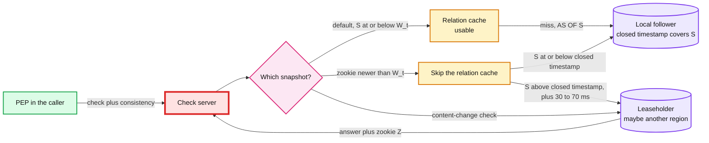
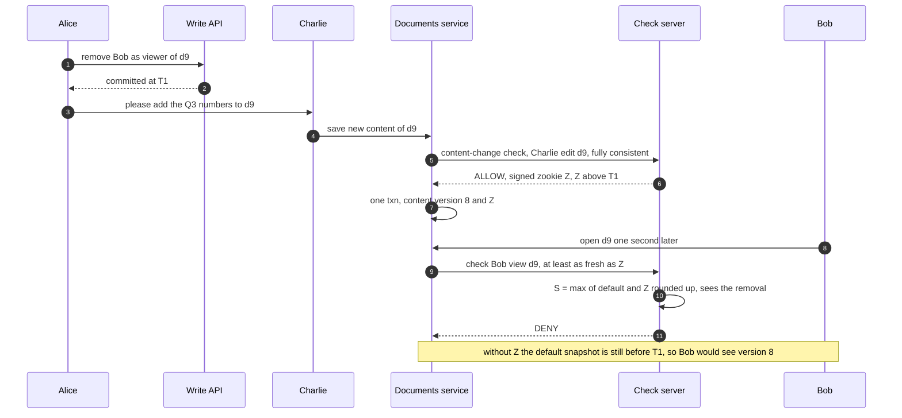
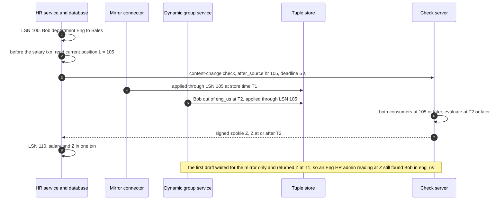
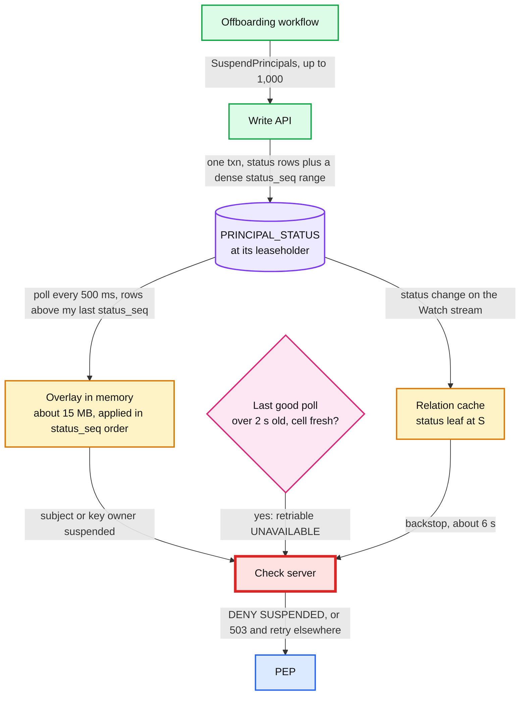

# Deep dive: consistency, zookies and the new-enemy problem

> One-line answer: every check reads one MVCC (multi-version concurrency control) snapshot. By default it is `min(floor_1s(now - 5 s), W_t)`, served by the local follower, so an ordinary revoke lands in 5 to 6 s (simulated p99 5.9 s, worst 8.0 s, against a 60 s decision cache's p99 64 s). Zanzibar's two new-enemy examples need different fixes: one snapshot per check already stops **Example A** (a new document in a folder: 0 leaks), and the zookie stored with the content stops **Example B** (new content in an existing document: 100% leaks at 2 s without it, 0 with it). Mirrored facts need `after_source`, read before the content commit, and it waits for **every** consumer of the source: waiting for the mirror alone still leaked 43% at 0.5 s when the fact travelled through dynamic groups. Terminations ride a suspension overlay that every check server polls from the store every 500 ms and enforces in-process: simulated p99 0.5 s healthy and 1.4 s when one server's polls fail. Readiness probes alone gave p99 4.7 s, which is why the gate lives inside the server.

Zoom-in on [`../solution.md`](../solution.md) §5.2 (new enemy, mirrored tuples, suspension overlay), §5.1 (the snapshot rule), §3.3 (store choice and zookies) and §10.6 (consistency per edge). Reusable blocks: [`../../../concepts/mvcc-and-isolation.md`](../../../concepts/mvcc-and-isolation.md), [`../../../concepts/replication-and-quorums.md`](../../../concepts/replication-and-quorums.md), [`../../../concepts/leases-fencing-clocks.md`](../../../concepts/leases-fencing-clocks.md). CDC (change data capture) positions and failover: [`../../cdc-pipeline/deep-dives/failover-and-recovery.md`](../../cdc-pipeline/deep-dives/failover-and-recovery.md). Sibling: [`check-latency-caching-and-hot-spots.md`](check-latency-caching-and-hot-spots.md) tests the relation cache's watermark rule.

---

## 1. The model, one row per path

| Path | Snapshot S | Served by | Guarantee |
|---|---|---|---|
| Write (`WriteRelationships`, `SuspendPrincipals`) | Commit timestamp T | Leaseholder, 3 of 5 voters, always across regions (~70 ms p50) | Linearizable. Externally consistent: a write that finished before another started has a lower T |
| Default check | `min(floor_1s(now - 5 s), W_t)` | Local follower plus relation cache | Bounded staleness, ~5 s. One snapshot for every sub-problem, so never half a change |
| Check with a zookie Z | `max(default, Z')`, where Z' is Z rounded up to the second unless that is in the future | Follower if its closed timestamp covers S, else the leaseholder | Causal: sees every write at or before Z |
| Content-change check (`fully_consistent`) | Now, at the leaseholder | Leaseholder | Sees every write that committed before the call. Returns the zookie Z |
| Suspension | None for the overlay. The status leaf is read at S | Memory (polled every 500 ms), then the relation cache | 2 s bound (overlay). ~6 s floor (the leaf) |
| Group index, search ACLs (access control lists) | Their own per-tenant watermark | Index servers | Used only when the watermark covers S |
| Mirrored tuples | `(epoch, LSN)` of the source (log sequence number) | Mirror connector | Ordered per source. Fenced by `after_source` |

`W_t` is the resolved watermark this server has consumed **for tenant t**: one changefeed per region writes into that region's Kafka, partitioned by tenant, and `W_t` is the minimum resolved timestamp over the ranges holding that tenant. The PEP (policy enforcement point) is the client library in every calling service. The changefeed can only resolve time the store has closed, so `S ≤ W_t` also means the local follower can serve S. That one inequality keeps both the cache and the replica read local.



---

## 2. The default snapshot and the ordinary revoke

- **Why 5 s.** A follower can answer `AS OF S` only once S is below its closed timestamp, which CockroachDB keeps a few seconds behind by default. Zanzibar draws the same line: its Spanner replication heartbeats run every 8 s, "Safe" requests carry zookies "more than 10 seconds old and can be served within the region most of time", and "Recent" ones often cross regions (Check Recent p95 60 ms against Safe ~9.5 ms).
- **The revoke bound, as arithmetic.** A revoke commits at c, somewhere inside a second. The default S first reaches c when `floor_1s(now - 5 s) ≥ c`, that is at `ceil(c) + 5 s`: **5 to 6 s**. Add any time `W_t` lags more than 5 s behind now. The simulation (§6) gives p50 5.1 s, p99 5.9 s, worst 8.0 s. The SLO (service level objective) is 10 s p99.
- **A stalled stream costs staleness for that tenant, never correctness, and never a fleet-wide overload.** If `W_t` freezes, default checks wait at `S = W_t`, and so does every revoke for that tenant until the stream recovers (simulated: ~59 s for a 60 s stall). A tenant over 8 s behind pages. Checks that need `S > W_t` read the store within the region's spare provisioned reads (~0.85 reads per check at peak), and after 60 s of lag so do `audit: always` checks. The first draft did the opposite: past a 30 s stall it bypassed the relation cache for everyone, which bounded revokes at 28 to 29 s (simulated) but sent ~4 reads per check at a store sized for ~1, a 4x overload, because one global W froze with any single range. Per-tenant watermarks are what make the slow-but-safe answer affordable.
- **A zookie from another region.** Z is a commit timestamp, valid everywhere. In a region where Z is above `W_t`, the check skips the relation cache. Where Z is above the local closed timestamp, the check is forwarded to a check server in the tenant's home region, which reads the local leaseholder, rather than reading each leaf cross-region or waiting seconds for the follower. Fresh-zookie checks: p99 under 100 ms in the home region, under 150 ms elsewhere [estimate], deadline 300 ms.
- **Clocks.** `now` is the store's clock as seen in the latest store response, not the host's, so a skewed host can neither make every tenant look lagged nor stretch revokes, and S never exceeds `W_t`. A host drifting more than 1 s from the store fences itself ([`../../../concepts/leases-fencing-clocks.md`](../../../concepts/leases-fencing-clocks.md)).

---

## 3. The new-enemy problem has two forms, and they need different fixes

Zanzibar's paper gives both:
- **Example A, "neglecting ACL update order".** Alice removes Bob from a folder, then Charlie moves new documents into it. The documents inherit the folder's ACL.
- **Example B, "misapplying old ACL to new content".** Alice removes Bob from a document, then Charlie adds new contents to it.

**Example A is solved by snapshots alone.** The new document's link to the folder is itself a tuple (`document:d9#parent@folder:F`), written after the removal. The paper: "if a check is evaluated at T < TA2, the document ACLs will not include the folder ACL". A stale snapshot that still has Bob in F does not have d9 in F yet. Simulated: 0 leaks at every gap (§7).

**Example B needs the zookie.** The content lives in the product database, which the tuple store cannot see. Bob's tuple on d9 existed before, so a stale snapshot shows Bob as a viewer of a document whose new content Bob must not see. Simulated: 100% of reads in the 3 s after a change made 2 s after the revoke are ALLOWed by default checks, 0 with the zookie. That is why solution.md §5.2 walks Example B.

**The trap that turns A back into B.** A product that checks the container (`view folder:F`) instead of the new object reads the folder's ACL at a stale snapshot and lets Bob in. Simulated: 100% leaks at 0.5 s and 2 s. So the PEP library always checks the object being returned, never its folder.



**Protocol rules.**
- **The store decides how Z is issued.** On a Spanner-class store, TrueTime's commit wait makes "every earlier ACL commit has a lower timestamp" true outright. On a hybrid-logical-clock store (CockroachDB class), a content-change check can get a timestamp below an earlier commit it never read, so Z is issued as the check's timestamp **plus the maximum clock offset** (500 ms by default). The design prefers Spanner class for this reason.
- **The content-change check is a leaseholder read per sequential level.** About 10 ms in the tenant's home region, ~70 ms per level from another region. It runs under the 300 ms fresh budget, never the 25 ms default. ~10k/s at peak, with autosave coalesced to one check per document per 5 s. Explicit saves, uploads, comments, money and HR writes always get their own.
- **Every read of that content version sends Z,** including the ones that do not look like reads: search snippets, previews, notifications, exports. The PEP's `filter_page` splits a page: rows whose zookie is at or below the default snapshot go in one CheckBulk at the default snapshot, and the few fresh rows go in a second, parallel CheckBulk at least as fresh as their zookies. One fresh row's content never leaks through a default check, and one fresh row never drags the whole page to the leaseholder.
- **Zookies are signed.** A zookie only ever raises S, so a forged old one is harmless. A forged future one is not: it would pin reads to the leaseholder or make them wait. Zookies carry an HMAC (hash-based message authentication code), and one more than 1 s ahead of the store's clock is rejected as an error, not a 503.
- **Round Z up to the quantum, but count the wait.** Zanzibar rounds evaluation timestamps up "to a coarse granularity ... while respecting staleness constraints from request zookies", and `ceil_1s(Z)` lets fresh checks of one document share result-cache keys. The cost: right after a save, `ceil_1s(Z)` is up to 1 s ahead of the clock (1.5 s with the HLC offset), and a read at a future timestamp waits for the clock to pass it. A viewer refreshing within ~1 s of the save can exceed the 300 ms deadline. Rounding up only when `ceil_1s(Z)` is not ahead of the store's clock removes that wait.
- **Zookie age and GC (garbage collection).** MVCC keeps 24 h of versions. A zookie older than ~5 s is already below the default snapshot, so it costs nothing, and one older than 24 h is a no-op. Only an exact-snapshot read (explain) can fail after GC, and explain then falls back to the changelog archive.

---

## 4. Mirrored tuples: `after_source`, in the right order, for every consumer

HR (human resources) data reaches the store two ways. The **mirror connector** turns `manager_id` and `org_id` into tuples. The **dynamic group service** turns `department` and `country` into `in_scope` membership tuples. Both read the same CDC stream at different speeds: the group service writes through the bulk lane (5k tuples/s per tenant), so it can sit behind a rule rebuild.



**Rules.**
- **Read the position first.** The HR service reads `pg_current_wal_lsn()` before the salary transaction, checks with `after_source = {hr: L}`, then commits salary and Z together. Using the salary's own LSN after its commit would leave the new salary readable under the old zookie for the whole wait.
- **One applied watermark per consumer per source**, and `after_source` waits for all of them. Simulated (§7): mirror-only waiting leaks 43% of reads at a 0.5 s gap and still 0.26% at 10 s, because group updates queue in the bulk lane. Waiting for both: 0.
- **Watermarks move on every LSN, mapped or not, and on CDC heartbeats.** A connector that advanced only when it wrote a tuple would leave the check waiting for the next manager change ([`../../cdc-pipeline/deep-dives/log-capture-and-positions.md`](../../cdc-pipeline/deep-dives/log-capture-and-positions.md)).
- **5 s deadline.** The wait is p99 ~2 s. It is a write-path call, so an expiry fails the save, not a read.
- **Versions survive a source failover.** After an unsafe Postgres failover, the promoted server can reuse an LSN range that a lost transaction already used, so a real change could get a lower LSN than a phantom. Mirrored tuples carry `(epoch, LSN)`, the epoch bumps on promotion, then a re-snapshot and sweep.
- **One source transaction, one store transaction.** The mirror applies each HR transaction whole (CDC carries the boundaries, up to 1,000 updates), so a manager swap never shows a state HR never had.
- **Dynamic group membership is a mirrored fact too.** It carries `(rule_version, epoch, LSN)` and is upserted only if newer from both the incremental listener and rebuilds, so a rebuild that read HR at LSN 100 cannot re-add someone who left Eng at LSN 105. Rule edits are blue/green: while v15 builds, attribute changes go to both versions, the flip waits until v15 has caught up with v14 and moves every reference to the group in one transaction, and `after_source` waits on the building version too.

---

## 5. The suspension overlay and its 2 s bound



- **Why a poll, not a feed.** The first draft pushed suspensions through Kafka with heartbeats, then needed an outbox to avoid a dual write. Polling the table needs neither: one strong read of "rows above my `status_seq`" every 500 ms (~130 tiny reads/s fleet-wide) is complete by construction, because a dense sequence taken inside the transaction cannot skip a committed suspension. It also keeps the termination path off the Watch stream, so a Kafka stall never delays a firing. Simulated: p99 0.5 s healthy.
- **Readiness is too slow to enforce 2 s, so the gate is in-process.** A probe sees the problem at its next tick (every 1 s here [estimate]), then the load balancer or the PEP's endpoint list takes 1 to 3 s [estimate] to drop the server. Simulated on the first draft's feed: a frozen server kept allowing Bob for p99 **4.7 s**, close to the ~6 s backstop. The design's gate: on every check, a server whose last successful poll is over 2 s old while its cell's median is fresh answers a retriable UNAVAILABLE, and the PEP retries on another server in the same request. Simulated p99 **1.7 s** on the feed and **1.4 s** on the poll.
- **The whole cell stale** (the status leaseholder unreachable): nobody fences, because that would turn a polling problem into a check outage. The status leaf lands the suspension in 5 to 6 s (simulated p99 5.9 s), and the on-call is paged. The leaf covers the subject and, for API keys and service accounts, the owner, and `PRINCIPAL_STATUS` rides the changefeed so the relation cache is invalidated by it.
- **The status leaf must not share a range with the poll.** If `PRINCIPAL_STATUS` were a small shared table, every tenant's status rows would sit in a handful of ranges: folded into each tenant's `W_t`, one stuck status range would freeze every tenant's watermark at once, and left out, the cached leaf would have no safety bound. So the table is keyed by tenant like `TUPLE`: each tenant's status rows sit inside its own spans and `W_t` covers the leaf. The 500 ms poll reads a small global index on `status_seq`, a different range, so the poll and the backstop do not fail together.
- **A check already in flight** when the overlay applies can still return ALLOW, for at most its deadline: 25 ms, or 300 ms with a fresh zookie. The bound is "2 s plus one deadline". Streaming endpoints re-check at least every 30 s.
- **Cleanup is fenced and slow on purpose.** After a 7-day grace, a job deletes the person's **owned** tuples, each batch preconditioned on `status_seq` being unchanged, so a resume cancels it. Mirrored tuples are left to their source. The status row stays until cleanup is done plus 30 days, and the overlay entry leaves only with the row.

---

## 6. Simulation: the revocation window

What the model assumes. Values marked `[estimate]` are mine.
- 5,000 revokes. Each commits at a random point c in a second. Bob, the revoked user, retries twice a second (an attacker or a refreshing page). The window is the time from c to Bob's last ALLOW.
- Watch watermark lag: lognormal, median 1.5 s, p99 ~4 s [estimate]. A "stall" freezes W for 60 s starting 1 s before the revoke, with the first draft's 30 s guard and without it (v2).
- A per-service decision cache with a 60 s TTL (time to live) in front of default checks, the template answer, for contrast.
- "draft" rows are the first design's Kafka suspension feed: relay 50 to 300 ms, apply 10 to 200 ms per server, 6 servers [estimate]. "Freezes" stops one server's feed 0 to 2 s before the suspension. Readiness probes every 1 s, endpoint removal 1 to 3 s more [estimate]. The "v2" poll rows: every server polls at its own phase every 500 ms, 1 to 70 ms to the leaseholder [estimate]. The gate answers 503 and the PEP retries on a healthy server. The status leaf (backstop) lands when the default S passes c.

```python
import math, random

rng = random.Random(11)
SERVERS = 6                                           # check servers in the cell

def w_lag():                                          # Watch resolved-watermark lag [estimate]
    return 1.5 * math.exp(rng.gauss(0, 0.43))         # median 1.5 s, p99 ~4 s

def default_S(t, stall=None, guard=True):             # S = min(floor_1s(now - 5 s), W)
    W = t - w_lag()
    if stall and stall[0] <= t: W = min(W, stall[0]) if t < stall[1] else W
    if guard and W < t - 30: return math.floor(t - 5) # draft's 30 s stall guard
    return min(math.floor(t - 5), W)

def trial(mode):
    """Revoke or suspend commits at t = c, a random point in second 0. Bob retries twice a
    second. Returns seconds from the commit to the last ALLOW, and the ALLOWs after it."""
    c = rng.random()
    t, last, allowed = -120.0 - rng.uniform(0, 60), c, 0
    cache_until, cache_allow = -1e9, False
    relay = c + rng.uniform(0.05, 0.3)                  # outbox relay publish delay
    apply_at = [relay + rng.uniform(0.01, 0.2) for _ in range(SERVERS)]
    stuck_at = c - rng.uniform(0.0, 2.0)               # server 0's feed freezes near t = 0
    probe = rng.uniform(0, 1.0)                       # readiness probe phase, every 1 s
    lag_seen = stuck_at + 2.0                          # lag passes 2 s here
    removed = (lag_seen + (probe - lag_seen) % 1.0 + rng.uniform(1.0, 3.0))  # probe, then LB
    if mode.startswith("poll"):                       # v2: poll the status leaseholder
        ph = [rng.uniform(0, 0.5) for _ in range(SERVERS)]          # every 500 ms
        rtt = [rng.uniform(0.001, 0.07) for _ in range(SERVERS)]    # [estimate]
        apply_at = [c + (ph[s] - c) % 0.5 + rtt[s] for s in range(SERVERS)]
        lag_seen = stuck_at - (stuck_at - ph[0]) % 0.5 + 2.0        # last good poll + 2 s
    while t < 90:
        t += rng.expovariate(2.0)
        if mode == "ttl60":                           # per-service decision cache, 60 s TTL
            if t >= cache_until:
                cache_allow, cache_until = default_S(t) < c, t + 60
            ok = cache_allow
        elif mode in ("snapshot", "stall", "stall_v2"):
            ok = default_S(t, stall=(-1.0, 59.0) if mode != "snapshot" else None,
                           guard=mode != "stall_v2") < c
        else:                                         # suspension overlay variants
            live = [s for s in range(SERVERS) if not (mode == "readiness" and s == 0
                                                       and t >= removed)]
            s = rng.choice(live)
            backstop = default_S(t) >= c              # status leaf at S shows the suspension
            if mode == "feed_down": seen = backstop
            elif s == 0 and mode in ("readiness", "gate", "poll_gate") and t >= stuck_at:
                if mode != "readiness" and t >= lag_seen:  # in-process gate: 503, PEP retries
                    s = rng.choice(range(1, SERVERS))
                    seen = t >= apply_at[s] or backstop
                else: seen = backstop
            else: seen = t >= apply_at[s] or backstop
            ok = not seen
        if ok and t > c: last, allowed = t, allowed + 1
    return last - c, allowed

def pct(xs, q):
    xs = sorted(xs); return xs[min(len(xs) - 1, int(q * len(xs)))]

print(f"{'mechanism (5,000 revokes, Bob retries 2/s)':<52}{'p50':>6}{'p99':>6}{'max':>6}{'allowed':>9}")
for name, mode in [("ordinary revoke, per-service cache with 60 s TTL", "ttl60"),
                   ("ordinary revoke, default snapshot", "snapshot"),
                   ("draft: Watch stalled 60 s, 30 s stall guard", "stall"),
                   ("draft: Kafka suspension feed, healthy", "healthy"),
                   ("draft: 1 server's feed freezes, readiness", "readiness"),
                   ("draft: 1 server's feed freezes, in-process gate", "gate"),
                   ("no overlay at all, status leaf backstop", "feed_down"),
                   ("v2: Watch stalled 60 s, no bypass", "stall_v2"),
                   ("v2: 500 ms status poll, healthy", "poll"),
                   ("v2: 1 server's polls fail, in-process gate", "poll_gate")]:
    res = [trial(mode) for _ in range(5000)]
    w = [r[0] for r in res]
    print(f"{name:<52}{pct(w, .5):6.1f}{pct(w, .99):6.1f}{max(w):6.1f}"
          f"{sum(r[1] for r in res) / len(res):9.1f}")
```

Output (seconds from the commit to the last ALLOW, and the mean number of ALLOWed requests after the commit):

```text
mechanism (5,000 revokes, Bob retries 2/s)             p50   p99   max  allowed
ordinary revoke, per-service cache with 60 s TTL      34.9  64.4  65.7     70.7
ordinary revoke, default snapshot                      5.1   5.9   8.0     11.0
draft: Watch stalled 60 s, 30 s stall guard           28.1  28.9  29.0     57.1
draft: Kafka suspension feed, healthy                  0.0   0.4   0.5      0.6
draft: 1 server's feed freezes, readiness              1.3   4.7   5.4      1.6
draft: 1 server's feed freezes, in-process gate        0.1   1.7   2.0      0.8
no overlay at all, status leaf backstop                5.1   5.9   6.1     11.0
v2: Watch stalled 60 s, no bypass                     58.1  58.9  59.0    117.2
v2: 500 ms status poll, healthy                        0.0   0.5   0.6      0.6
v2: 1 server's polls fail, in-process gate             0.0   1.4   1.8      0.7
```

**What it decided.**

| Question | Simulated | So the design |
|---|---|---|
| Does a TTL decision cache work for revocation? | p50 35 s, p99 64 s, ~71 stale ALLOWs per revoke. A refresh in the first 5 s re-caches the old ALLOW for 60 s more | No decision caches in callers. The PEP memoizes within one request only |
| Is "~6 s" right for an ordinary revoke? | p99 5.9 s, worst 8.0 s when `W_t` lags more than 5 s | Keeps the 10 s p99 SLO, with room |
| What does a stalled stream cost? | Draft guard: 28 to 29 s, at a 4x store overload. v2: ~59 s for the stalled tenants, no overload | Per-tenant watermarks, page at 8 s, the store read budget for fresh and `audit: always` checks |
| Does readiness enforce 2 s? | p99 4.7 s on a frozen server | The in-process gate: p99 1.7 s (feed), 1.4 s (poll) |
| Is a 500 ms poll fast enough? | p99 0.5 s, max 0.6 s | Poll the table. No Kafka, outbox or relay on the termination path |
| No overlay at all? | p99 5.9 s via the status leaf | The floor when a whole cell cannot poll. Page |

---

## 7. Simulation: the new-enemy window

- A revoke at a random point c of second 0. New content (or a new document) at `T2 = c + g`. The victim reads 0 to 3 s after T2. Default snapshots use the same W lag as §6.
- Mirror connector apply lag: lognormal, median 0.8 s, p99 2 s. Dynamic group service: median 1 s, p99 5 s, and 20% of updates wait behind a rebuild in the bulk lane, exponential with a 2 s mean [estimate].
- The `after_source` rows wait for the salary's own position, which covers the earlier manager change exactly as reading the position first does. The read-first order additionally closes the window before the commit (§4).
- The rows where the answer is structural (a snapshot cannot contain d9's parent link without Bob's earlier removal) print 0 by construction. They are there to put the cases side by side.

```python
import math, random

rng = random.Random(5)

def lognorm(median, p99):
    return median * math.exp(rng.gauss(0, math.log(p99 / median) / 2.326))

def default_S(t):                                   # min(floor_1s(now - 5 s), W)
    return min(math.floor(t - 5), t - lognorm(1.5, 4.0))

def one(case, g):
    """Revoke at a random point c of second 0. New content at T2 = c + g. The victim
    reads 0 to 3 s after T2. Returns True if the read is ALLOWed (a leak)."""
    c = rng.random(); T2 = c + g; read = T2 + rng.uniform(0, 3)
    Z = T2 + 0.01                                   # content-change check, fully consistent
    if case == "doc_default":                       # new doc: parent tuple written at T2
        S = default_S(read); return S >= T2 and S < c        # needs both: impossible
    if case == "folder_default":                    # product checks the folder, not the doc
        return default_S(read) < c
    if case == "content_default":                   # Example B: new content, old document
        return default_S(read) < c
    if case == "content_zookie":
        return max(default_S(read), Z) < c
    # mirrored: HR manager change at LSN L1 (time c), salary write at LSN L2 (time T2)
    mirror_L1 = c + lognorm(0.8, 2.0)               # mirror connector applies L1 [estimate]
    mirror_L2 = max(mirror_L1, T2 + lognorm(0.8, 2.0))   # applies in LSN order
    group_L1 = c + lognorm(1.0, 5.0) + rng.expovariate(1 / 2.0) * (rng.random() < 0.2)
    if case == "mirror_no_after":                   # zookie Z from a check made at T2
        return max(default_S(read), Z) < mirror_L1
    if case == "mirror_after":                      # wait for mirror's watermark >= L2
        return max(default_S(read), max(Z, mirror_L2)) < mirror_L1
    if case == "group_after_mirror_only":           # the fact moved through dynamic groups
        return max(default_S(read), max(Z, mirror_L2)) < group_L1
    if case == "group_after_all":                   # wait for every consumer of hr
        return max(default_S(read), max(Z, mirror_L2, group_L1)) < group_L1

cases = [("A. new doc in folder, default snapshot", "doc_default"),
         ("A. same, product checks the folder", "folder_default"),
         ("B. new content in old doc, default", "content_default"),
         ("B. same, zookie from content check", "content_zookie"),
         ("HR mirror, zookie only", "mirror_no_after"),
         ("HR mirror, after_source on mirror", "mirror_after"),
         ("HR dept via dynamic group, after_source on mirror", "group_after_mirror_only"),
         ("HR dept via dynamic group, after_source on both", "group_after_all")]
gaps = [0.5, 2.0, 5.0, 10.0]
print(f"{'leak rate, 20,000 reads per case':<52}" + "".join(f"{'g=' + str(g) + ' s':>10}" for g in gaps))
for name, case in cases:
    row = [sum(one(case, g) for _ in range(20_000)) / 20_000 for g in gaps]
    print(f"{name:<52}" + "".join(f"{x:10.2%}" for x in row))
```

Output (share of reads ALLOWed after the revoke, by the gap g between the revoke and the new content):

```text
leak rate, 20,000 reads per case                       g=0.5 s   g=2.0 s   g=5.0 s  g=10.0 s
A. new doc in folder, default snapshot                   0.00%     0.00%     0.00%     0.00%
A. same, product checks the folder                     100.00%   100.00%    16.70%     0.00%
B. new content in old doc, default                     100.00%   100.00%    17.17%     0.00%
B. same, zookie from content check                       0.00%     0.00%     0.00%     0.00%
HR mirror, zookie only                                  87.41%     1.01%     0.00%     0.00%
HR mirror, after_source on mirror                        0.00%     0.00%     0.00%     0.00%
HR dept via dynamic group, after_source on mirror       43.06%    14.87%     3.04%     0.26%
HR dept via dynamic group, after_source on both          0.00%     0.00%     0.00%     0.00%
```

**What it decided.**

| Question | Simulated | So the design |
|---|---|---|
| Does a new document in a folder need a zookie? | 0 leaks: its parent tuple is newer than the removal | Snapshots stop Example A. The zookie protocol is for content |
| Does a stale check leak new content? | 100% of reads at g = 0.5 to 2 s, 17% at 5 s, 0 at 10 s | The zookie, stored with the content, on every read of it |
| Is checking the folder instead of the document safe? | No: same leak as Example B | The PEP checks the returned object, never its folder |
| Is a zookie enough for mirrored HR facts? | 87% leaks at 0.5 s, 1% at 2 s | `after_source` on the source position |
| Is the mirror's watermark enough? | Not when the fact flows through dynamic groups: 43% at 0.5 s, 0.26% at 10 s | Wait for every consumer of the source |

---

## 8. Numbers to say out loud

- Default snapshot `min(floor_1s(now - 5 s), W_t)`. Ordinary revoke 5 to 6 s, p99 5.9 s, SLO 10 s. A stalled tenant waits, pages at 8 s, never reads wrong.
- A 60 s decision cache: p99 64 s and ~71 stale ALLOWs per revoke. That is the number that kills the template answer.
- Example A: snapshots. Example B: the zookie. Container checks reintroduce A. List pages use the max zookie on the page.
- Zookies: signed, rounded up to the second unless that is in the future, plus 500 ms on an HLC store. Fresh checks p99 under 100 ms at home, forwarded home from elsewhere, deadline 300 ms.
- `after_source`: read the position first, wait for every consumer, p99 ~2 s, deadline 5 s, versions `(epoch, LSN)`.
- Suspension: 500 ms poll, p99 0.5 s. In-process gate p99 1.4 s on a failing server (readiness alone 4.7 s). No overlay: ~6 s by the status leaf.
