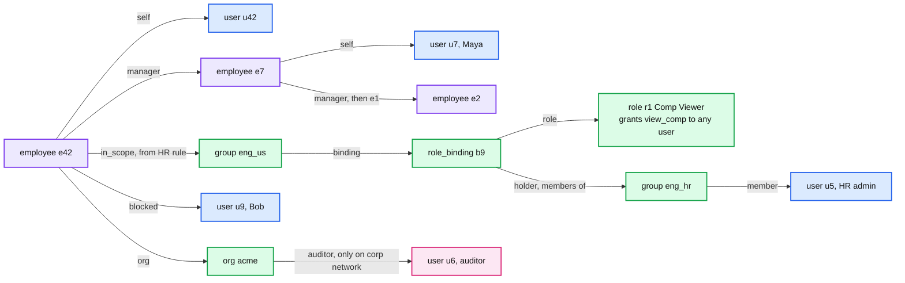
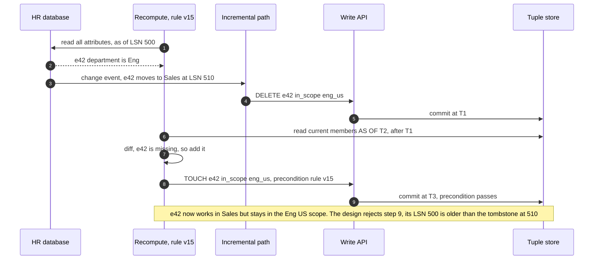
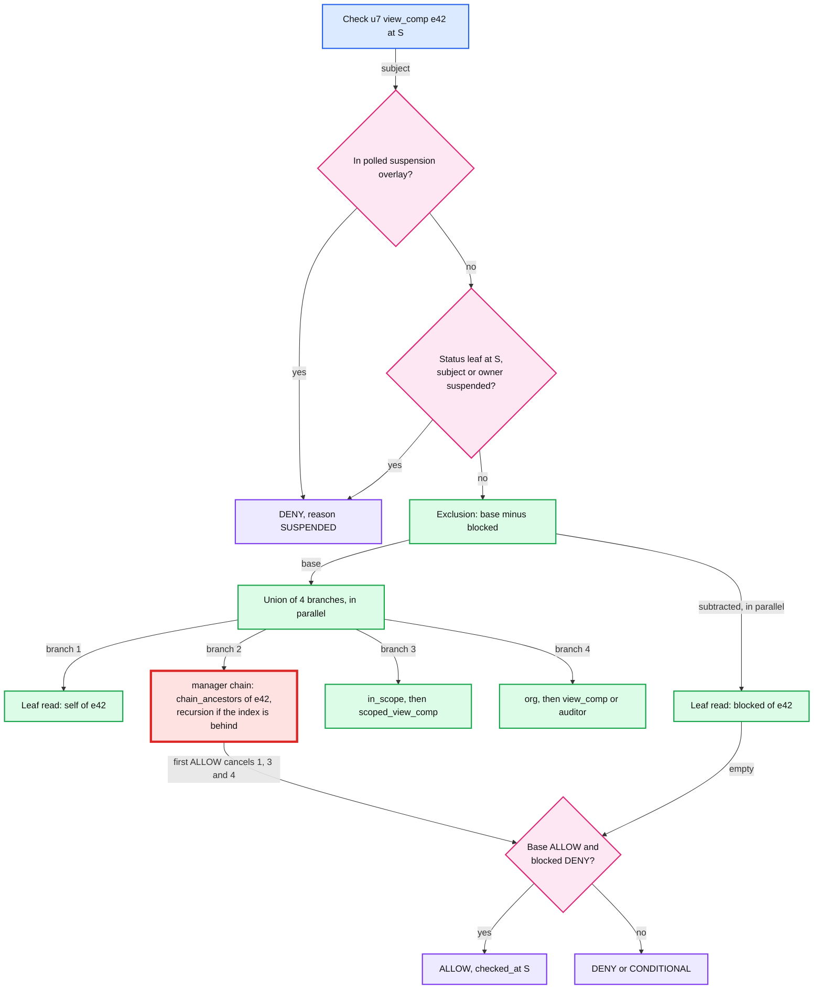

# Deep dive: data model and evaluation

> One-line answer: access facts are **tuples** (edges in a graph), the **schema** gives each permission a small expression over those edges (union `+`, intersection `&`, exclusion `-`, arrow `->`), and a check is a **three-valued walk** (ALLOW, CONDITIONAL, DENY) at one snapshot that stops at the first ALLOW. The evaluator below runs the [`../solution.md`](../solution.md) §3.3 schema on the running example. Maya's ALLOW costs **5 leaf reads**, a stranger's DENY **18** (a DENY must finish every branch), a missing caveat context **19**. The runs are also the evidence for four things the design does differently from its first draft: `edit_comp` ends in **`- self`** (the draft let an HR admin edit their own pay), the caveat is **attached to `org.auditor`** (the draft attached it to nothing), cycles are **refused at write time, cut and tainted at run time, and capped at 1,000 sub-problems** (the draft's "ends at depth 50" cached a wrong DENY that became a wrong ALLOW), and **expiry is checked on every cache and index read** (the draft kept an expired just-in-time grant alive).

Design context: [`../solution.md`](../solution.md) §3.3 (schema), §4.1 (evaluation rules), §4.2 (owned vs mirrored tuples, dynamic groups), §5.1 (caches), §5.3 (group index), §10.10 (security). Siblings: [`list-filtering-and-search.md`](list-filtering-and-search.md) (the same model walked backwards), [`check-latency-caching-and-hot-spots.md`](check-latency-caching-and-hot-spots.md), [`consistency-and-new-enemy.md`](consistency-and-new-enemy.md). Concepts: [`../../../concepts/mvcc-and-isolation.md`](../../../concepts/mvcc-and-isolation.md), [`../../../concepts/caching-patterns.md`](../../../concepts/caching-patterns.md).

---

## 1. Tuples are edges, the schema is the walk



Blue = principals, purple = objects mirrored from the human resources (HR) database, green = authorization objects owned by the write API, pink = an edge that holds only under a caveat.

- **A tuple** is `object#relation@subject`, e.g. `employee:e42#manager@employee:e7`: seven key fields, an optional caveat with parameters (at most 4 KB), an optional `expires_at`, and for mirrored rows a `source_version` (the source's epoch and log sequence number, LSN).
- **A userset** subject is a set: `role_binding:b9#holder@group:eng_hr#member` means "every member of eng_hr". Evaluating it is a nested check. That is where depth and cycles come from (section 6).
- **A wildcard** `user:*` is accepted only by relations declared with it (`grants_view_comp: user:*`), so a tenant admin cannot write `employee:e42#self@user:*`. It means every user **of the object's tenant**: a subject arriving through a declared cross-tenant relation never matches it.

## 2. The operators and the three-valued rules

| Construct | Schema text | Zanzibar name | Meaning | Stops early when |
|---|---|---|---|---|
| Relation | `relation manager: employee` | `_this` | Stored subjects. Usersets expand by a nested check | a tuple matches |
| Arrow | `manager->line_up` | `tuple_to_userset` | For each subject of `manager`, evaluate `line_up` on it, union the results | the first ALLOW |
| Union | `a + b` | union | ALLOW if any branch allows | the first ALLOW |
| Intersection | `a & b` | intersection | ALLOW only if both allow | the first DENY |
| Exclusion | `a - b` | exclusion | ALLOW if `a` allows and `b` definitely denies | `a` is DENY, or `b` is ALLOW |
| Caveat | `user with on_corp_network` | none | The tuple holds only if a Common Expression Language (CEL) expression is true | never, it is per tuple |
| Expiry | `expires_at` on the tuple | none | The tuple does not exist at snapshots at or after it | never, it is a read filter |

Order the results **DENY < CONDITIONAL < ALLOW**. Union is the maximum, intersection the minimum, exclusion is `min(a, not b)` with `not CONDITIONAL = CONDITIONAL` (Kleene's three-valued logic). That is §4.1's table written as arithmetic. The cases that matter:

| a | b | `a + b` | `a & b` | `a - b` |
|---|---|---|---|---|
| ALLOW | CONDITIONAL | ALLOW | CONDITIONAL | CONDITIONAL |
| CONDITIONAL | DENY | CONDITIONAL | DENY | CONDITIONAL |
| CONDITIONAL | ALLOW | ALLOW | CONDITIONAL | DENY |
| DENY | CONDITIONAL | CONDITIONAL | DENY | DENY |

- **A caveat with missing context on the subtracted side gives CONDITIONAL, never ALLOW.** The policy enforcement point (PEP) maps it to 403 plus an error metric. The safe direction.
- **CONDITIONAL never short-circuits a union.** Every other branch must finish, so it is among the most expensive answers (section 5).
- **A DENY base ends an exclusion.** `DENY - anything` is DENY, so `b` may be skipped once `a` denies (the evaluator below saves one read that way). `b` is never skipped while `a` can still allow (§4.1).

## 3. How roles, relationships and attributes land

### 3.1 Custom roles are tuples

Role-based access control (RBAC) without a schema change per tenant. "Comp Viewer" bound to the eng_hr group over the Eng US scope is four tuples: `role:r1#grants_view_comp@user:*`, `role_binding:b9#role@role:r1`, `role_binding:b9#holder@group:eng_hr#member`, `group:eng_us#binding@role_binding:b9`.

- **A role edit re-grants every binding of that role**, in every scope at once, the editor included. So the design's escalation check (§10.10) runs on role-definition edits too, against **every scope the role is bound to**. The first draft checked only the scope being granted, which let a scoped admin who may edit roles reach the union of all scopes.
- **Role ids are never reused.** A deleted role leaves harmless bindings behind (DENY through a missing role). A new role with the old id would silently re-attach them.
- **A new permission word is a schema change** touching five definitions (`role`, `role_binding`, `group`, `org`, `employee`). Tenants compose roles from the vocabulary, the platform owns it. Stripe's "write permissions imply read permissions" lives in the schema the same way: `read_charges = binding->read_charges + binding->write_charges`.

### 3.2 Relationships, and why `edit_comp` ends in `- self`

Relationship-based access control (ReBAC) is the arrows: `manager->line_up` walks the chain, `in_scope->scoped_view_comp` walks into the groups that scope a binding. The design's rule:

```text
permission edit_comp = (in_scope->scoped_edit_comp + org->edit_comp) - blocked - self   // nobody edits their own pay
```

The first draft stopped at `- blocked`. An HR admin who falls inside their own scope then matches their own record: section 5 shows **u5 edit_comp on e5 is ALLOW** under the draft, DENY under the design, and the design still lets u5 edit e42. Org-wide admins had the same hole through `org->edit_comp`. HR attribute edits that move people between scopes are HR-product permissions with `- self` too (§10.10), so nobody moves themselves into an admin's scope.

### 3.3 Slow attributes are dynamic groups

Attribute-based access control (ABAC) on slow attributes is materialized: the group service evaluates `department == "Eng" and country == "US"` and writes `employee:e42#in_scope@group:eng_us`. Two writers touch those tuples: the **recompute** after a rule edit and the **incremental path** after one employee's attributes change. The first draft fenced only the recompute, with a precondition on `rule_version`, and that does not order it against the incremental path:



- **The design:** every membership tuple carries `source_version = (rule_version, epoch, LSN)`, upserts apply only if newer from **both** paths, and deletes leave tombstones until a reconciled-through floor. The recompute's add (LSN 500) loses to the tombstone (510). A nightly reconcile compares each group with its rule.
- **Rule edits are blue/green.** The first draft narrowed a rule by deleting members in the bulk lane: 90,000 removals at 5k tuples/s is **~18 s** to the last commit plus ~6 s of default staleness, past the 10 s revoke target, with every partial state visible across 90 batches of 1,000. The design builds `group:eng_us.v15` in the bulk lane (~1 s to evaluate 100k employees, ~20 s to write), then **one small transaction** moves the group's bindings from v14 to v15. Narrowing is atomic at one commit timestamp, and a listing plan's `rule_version` always matches the tuples at its snapshot.
- **What makes the flip safe.** While v15 builds, the incremental path writes each attribute change to both v14 and v15, and the flip waits until v15's applied LSN has caught up with v14's, so v15 never starts life missing a mid-build move. The flip moves **every** reference to the group in one transaction: scope bindings, holder tuples and parent-group memberships. `after_source` waits on a building version too.
- **A dynamic group used as a holder** ("everyone titled HR Partner holds Comp Viewer") needs `group:G#member@user:...` tuples instead, because `holder` takes users. The group service writes whichever shape the binding uses.

### 3.4 Fast attributes are caveats

A caveat is a CEL expression over **parameters stored on the tuple** plus **context sent with the check**, cost capped at 100, parameters at 4 KB. The design attaches the running example's caveat to external auditors:

```text
caveat on_corp_network(request_ip ipaddress, allowed_cidr string) { request_ip.in_cidr(allowed_cidr) }

definition org {
    relation binding: role_binding
    relation member: user | group#member
    relation auditor: user with on_corp_network          // external auditors, only from the corporate network
    permission view_comp = binding->view_comp + auditor
    permission edit_comp = binding->edit_comp
}
```

- **Why it is spelled out.** The first draft declared `caveat on_corp_network(request_ip ipaddress, allowed cidr)` but no relation allowed `with on_corp_network`, so no tuple could carry it, and `cidr` is not a parameter type (SpiceDB's own example is `caveat ip_allowlist(user_ip ipaddress, cidr string)`).
- **Tuple parameters win over request context on a name clash,** or a caller sends `allowed_cidr = 0.0.0.0/0`. Section 5 runs that forgery: DENY.
- **`request_ip` comes from the connection,** or from `X-Forwarded-For` only as set by our own trusted proxies. Behind a load balancer the raw connection is the balancer.
- **Never a caveat for a slow attribute.** A caveat cannot be indexed, so listing, the group index and search all treat it as "check at display time".

### 3.5 Expiry and exclusions

- **Expiry is judged at S, so it lands ~5 to 6 s late.** Default checks read `S = min(floor_1s(now - 5 s), W_t)`. Section 5 shows ALLOW 4.5 s after a grant expired. No write happened, so no zookie helps. Accepted, because explain at S stays exact.
- **Expiry is not a write.** No change event fires, so both caches and the group index check `S < earliest expires_at` on every read (§5.1, promise 5). Section 6 shows what the first draft's rules did without that.
- **Exclusions are schema-only** (`- blocked`, `- self`): named relations, so every DENY still explains as one path. The AWS Identity and Access Management (IAM) rule "an explicit deny in either of these policies overrides the allow" survives in that form.

## 4. The check algorithm



1. **Guards.** The suspension overlay, which every server polls from `PRINCIPAL_STATUS` every 500 ms. Then the backstop: the subject's status, and the owner's for an API key or service account, read as an ordinary leaf at S, so a suspension lands in ~6 s even with no overlay (§5.2).
2. **Snapshot and schema.** `S = min(floor_1s(now - 5 s), W_t)`, raised to a zookie if one is sent. The schema version is the one active for the tenant's cohort at S, and dispatched sub-problems carry it, so one check sees one schema.
3. **Walk.** Each sub-problem `(tenant, schema version, object, permission or relation, subject, S)` goes by consistent hashing to its owner: result cache (stored before caveats), then lock table, then evaluation. Leaves read the relation cache, then the local replica `AS OF S`.
4. **Cancellation.** The first ALLOW cancels its siblings, but Zanzibar delays eager cancellation "when there are waiters on the corresponding lock table entry": another check may be waiting on that branch.
5. **Limits.** At most 50 nested dispatches and 1,000 sub-problems per check, then an error (403 plus an alert). The legitimate worst case is ~44 levels (30 folder levels, 10 group levels, ~4 binding hops) when the group index does not cover S and recursion runs in full.

## 5. A runnable evaluator for the §3.3 schema

`SCHEMA` is the design. `FIRST_DRAFT` differs only in `edit_comp`. Branches run left to right and the first ALLOW stops the rest. `leaf reads` counts every relation read, including the status backstop. The number in brackets is how many are on the checked employee itself.

```python
import ipaddress, math
from collections import namedtuple

DENY, COND, ALLOW = 0, 1, 2                      # ordered: union = max, intersection = min
NAMES = ("DENY", "CONDITIONAL", "ALLOW")
T = namedtuple("T", "obj rel subj caveat params expires", defaults=(None, None, None))
R = lambda r: ("rel", r)                         # stored tuples of a relation (with usersets)
A = lambda r, p: ("arrow", r, p)                 # r->p
U = lambda *xs: ("+",) + xs
SCHEMA = {                                       # solution.md section 3.3 (the design), compiled
    "group.scoped_view_comp": A("binding", "view_comp"), "group.scoped_edit_comp": A("binding", "edit_comp"),
    "role_binding.view_comp": ("&", R("holder"), A("role", "grants_view_comp")),
    "role_binding.edit_comp": ("&", R("holder"), A("role", "grants_edit_comp")),
    "org.view_comp": U(A("binding", "view_comp"), R("auditor")), "org.edit_comp": A("binding", "edit_comp"),
    "employee.line_up": U(R("self"), A("manager", "line_up")),
    "employee.view_comp": ("-", U(R("self"), A("manager", "line_up"),
                                  A("in_scope", "scoped_view_comp"), A("org", "view_comp")), R("blocked")),
    "employee.edit_comp": ("-", ("-", U(A("in_scope", "scoped_edit_comp"), A("org", "edit_comp")), R("blocked")),
                           R("self")),
}
FIRST_DRAFT = dict(SCHEMA, **{"employee.edit_comp": SCHEMA["employee.edit_comp"][1]})   # no "- self"
CAVEATS = {"on_corp_network": (("request_ip", "allowed_cidr"),
           lambda c: ipaddress.ip_address(c["request_ip"]) in ipaddress.ip_network(c["allowed_cidr"]))}

class Evaluator:
    def __init__(self, tuples, schema=SCHEMA, short_circuit=True):
        self.idx, self.schema, self.sc, self.reads, self.own, self.resource = {}, schema, short_circuit, 0, 0, None
        for t in tuples:
            self.idx.setdefault((t.obj, t.rel), []).append(t)

    def check(self, obj, perm, subj, S, ctx=None, depth=0):
        if depth > 50:
            raise RecursionError("max dispatch depth 50")
        return self.ev(self.schema.get(obj.split(":")[0] + "." + perm, R(perm)), obj, subj, S, ctx or {}, depth)

    def read(self, obj, rel, S):                 # one leaf read AS OF S. Expired tuples do not exist
        self.reads, self.own = self.reads + 1, self.own + (obj == self.resource)
        return [t for t in self.idx.get((obj, rel), []) if t.expires is None or t.expires > S]

    def caveat(self, t, ctx):
        if t.caveat is None:
            return ALLOW
        names, fn = CAVEATS[t.caveat]
        c = {**ctx, **(t.params or {})}          # tuple params win over request context
        return COND if any(n not in c for n in names) else (ALLOW if fn(c) else DENY)

    def ev(self, e, obj, subj, S, ctx, d):
        op, out = e[0], DENY
        if op in ("rel", "arrow"):
            for t in self.read(obj, e[1], S):
                if op == "arrow":
                    hit = self.check(t.subj, e[2], subj, S, ctx, d + 1)
                elif t.subj == subj or (t.subj == "user:*" and subj.startswith("user:")):
                    hit = ALLOW
                elif "#" in t.subj:              # userset, e.g. group:eng_hr#member
                    hit = self.check(*t.subj.split("#"), subj, S, ctx, d + 1)
                else:
                    hit = DENY
                out = max(out, min(hit, self.caveat(t, ctx)))
                if out == ALLOW and self.sc:
                    break
            return out
        if op == "+":
            for x in e[1:]:
                out = max(out, self.ev(x, obj, subj, S, ctx, d))
                if out == ALLOW and self.sc:     # first ALLOW cancels the other branches
                    break
            return out
        a = self.ev(e[1], obj, subj, S, ctx, d)
        if a == DENY and self.sc:                # & and - both end on a DENY base
            return DENY
        b = self.ev(e[2], obj, subj, S, ctx, d)
        return min(a, b) if op == "&" else min(a, 2 - b)   # 2 - b: ALLOW->DENY, COND->COND

T0 = 1_000_000                                   # a snapshot, in seconds
def tup(s, **kw):                                # "object#relation@subject", subject may be a userset
    obj, rest = s.split("#", 1)
    return T(obj, *rest.split("@", 1), **kw)
TUPLES = [tup(s) for s in """
    employee:e42#self@user:u42 employee:e42#manager@employee:e7 employee:e7#self@user:u7
    employee:e7#manager@employee:e2 employee:e2#self@user:u2 employee:e2#manager@employee:e1
    employee:e1#self@user:u1 employee:e42#blocked@user:u9 employee:e42#in_scope@group:eng_us
    employee:e42#org@org:acme employee:e5#self@user:u5 employee:e5#in_scope@group:eng_us
    role:r1#grants_view_comp@user:* role:r2#grants_view_comp@user:* role:r2#grants_edit_comp@user:*
    role_binding:b9#role@role:r1 role_binding:b9#holder@group:eng_hr#member
    role_binding:b10#role@role:r2 role_binding:b10#holder@group:eng_hr#member
    group:eng_us#binding@role_binding:b9 group:eng_us#binding@role_binding:b10
    group:eng_hr#member@user:u5 group:eng_hr#member@user:u9 group:eng_hr#member@user:u8
    """.split()] + [
    tup("group:eng_hr#member@user:u4", expires=T0 + 3600),                 # JIT grant, one hour
    tup("org:acme#auditor@user:u6", caveat="on_corp_network", params={"allowed_cidr": "10.0.0.0/8"})]
OVERLAY = set()                                  # polled suspension overlay (stale in this run)
STATUS = {"user:u8": T0 - 10}                    # PRINCIPAL_STATUS: HR admin u8 suspended at T0 - 10

def decide(ev, obj, perm, subj, S, ctx):         # what the check server does per check
    if subj in OVERLAY:
        return DENY                              # reason SUSPENDED, before any evaluation
    ev.reads += 1                                # backstop: status is an ordinary leaf read at S
    if STATUS.get(subj, math.inf) <= S:
        return DENY
    ev.resource = obj
    return ev.check(obj, perm, subj, S, ctx)

def run(label, subj, perm="view_comp", obj="employee:e42", S=T0, ctx=None, ev=None, want=None):
    ev = ev or Evaluator(TUPLES)
    r = decide(ev, obj, perm, subj, S, ctx)
    print(f"{label:44} {NAMES[r]:11} leaf reads {ev.reads:2} ({ev.own} on {obj.split(':')[1]})")
    assert want is None or r == want, label

run("Maya u7 (manager of e42)", "user:u7", want=ALLOW)
run("  same, no short-circuit", "user:u7", ev=Evaluator(TUPLES, short_circuit=False), want=ALLOW)
run("HR admin u5 (eng_hr, scope eng_us)", "user:u5", want=ALLOW)
run("Bob u9 (eng_hr, but blocked on e42)", "user:u9", want=DENY)
run("stranger u3 (a DENY walks every branch)", "user:u3", want=DENY)
run("auditor u6, no context", "user:u6", want=COND)
run("auditor u6, request_ip 10.1.2.3", "user:u6", ctx={"request_ip": "10.1.2.3"}, want=ALLOW)
run("u6 forges allowed_cidr 0.0.0.0/0", "user:u6", ctx={"request_ip": "8.8.8.8", "allowed_cidr": "0.0.0.0/0"},
    want=DENY)
run("JIT u4 at S = T0 + 3599", "user:u4", S=T0 + 3599, want=ALLOW)
run("JIT u4 at S = T0 + 3600 (expires_at)", "user:u4", S=T0 + 3600, want=DENY)
now = T0 + 3604.5                                # wall clock 4.5 s after expiry
run(f"JIT u4, default S = floor(now - 5) = T0+{math.floor(now - 5) - T0}", "user:u4", S=math.floor(now - 5),
    want=ALLOW)
run("HR admin u8, overlay stale, status leaf", "user:u8", want=DENY)
run("first draft: u5 edit_comp on own record e5", "user:u5", "edit_comp", "employee:e5",
    ev=Evaluator(TUPLES, FIRST_DRAFT), want=ALLOW)
run("design (- self): u5 edit_comp on e5", "user:u5", "edit_comp", "employee:e5", want=DENY)
run("design keeps u5 edit_comp on e42", "user:u5", "edit_comp", want=ALLOW)
```

```text
Maya u7 (manager of e42)                     ALLOW       leaf reads  5 (3 on e42)
  same, no short-circuit                     ALLOW       leaf reads 23 (5 on e42)
HR admin u5 (eng_hr, scope eng_us)           ALLOW       leaf reads 16 (4 on e42)
Bob u9 (eng_hr, but blocked on e42)          DENY        leaf reads 16 (4 on e42)
stranger u3 (a DENY walks every branch)      DENY        leaf reads 18 (4 on e42)
auditor u6, no context                       CONDITIONAL leaf reads 19 (5 on e42)
auditor u6, request_ip 10.1.2.3              ALLOW       leaf reads 19 (5 on e42)
u6 forges allowed_cidr 0.0.0.0/0             DENY        leaf reads 18 (4 on e42)
JIT u4 at S = T0 + 3599                      ALLOW       leaf reads 16 (4 on e42)
JIT u4 at S = T0 + 3600 (expires_at)         DENY        leaf reads 18 (4 on e42)
JIT u4, default S = floor(now - 5) = T0+3599 ALLOW       leaf reads 16 (4 on e42)
HR admin u8, overlay stale, status leaf      DENY        leaf reads  1 (0 on e42)
first draft: u5 edit_comp on own record e5   ALLOW       leaf reads 12 (2 on e5)
design (- self): u5 edit_comp on e5          DENY        leaf reads 13 (3 on e5)
design keeps u5 edit_comp on e42             ALLOW       leaf reads 13 (3 on e42)
```

- **Short-circuit is worth ~5x on an ALLOW:** 5 reads for Maya against 23 with every branch evaluated.
- **A DENY is the expensive answer.** The stranger costs 18: every branch runs to the end, including the whole manager chain to the top of the org (8 reads for 4 levels). At a real org depth of 8 to 12 levels that walk is ~14 ms warm and ~22 ms cold by extrapolation, past the 12 ms try, which is why the design flattens chains into `chain_ancestors` (one index read). Bob's base ALLOWs through the Eng US scope, then `blocked` turns it into DENY (16). A DENY-heavy workload (post-filtering a list, [`list-filtering-and-search.md`](list-filtering-and-search.md) section 2) costs ~3x the reads of manager ALLOWs.
- **The HR admin's 16 is a sequential artifact.** In parallel the scope branch finishes after 6 sequential reads (`in_scope`, `binding`, `holder`, `member`, `role`, `grants_view_comp`) and cancels the chain walk.
- **Only 3 to 5 reads land on the checked object.** The rest hit shared keys (`group:eng_us#binding`, `role:r1`, `group:eng_hr#member`, the managers' records) that every check in the tenant reads and the relation cache serves at close to 100%. That is the split §2 sizes the store on.
- **CONDITIONAL costs 19,** since nothing short-circuits on it. A caller that forgets context makes every one of its checks one of the slowest kind.
- **The forgery fails** (the tuple's `10.0.0.0/8` wins), **expiry lands late** (ALLOW at wall clock T0 + 3604.5), **the backstop works** with a stale overlay (one read), and **`- self` closes the self-edit** without touching u5's access to e42.

## 6. Cycles, cached sub-results, and indexes that forget expiry

The first draft said cycles in data (A in B in A) "end there", at depth 50. This script tests that claim, then what the shared result cache does with a cut cycle, then the design's budget, then what flattening and the cache rule did to expiry and caveats.

```python
import math

class Groups:    # membership only. cache = the shared result cache at one snapshot. cut = path check
    def __init__(self, edges, cut=True, taint=True, budget=None):
        self.edges, self.cut, self.taint, self.cache, self.dispatches = edges, cut, taint, {}, 0
        self.budget = budget                     # the design: at most 1,000 sub-problems per check

    def member(self, g, u, path=()):
        if (g, u) in self.cache:
            return self.cache[(g, u)], set()
        self.dispatches += 1
        if self.budget and self.dispatches > self.budget:
            raise RuntimeError("sub-problem budget 1,000")
        if len(path) > 50:
            raise RecursionError("max dispatch depth 50")
        if self.cut and g in path:
            return False, {g}                    # back edge: adds nothing to membership
        res, cuts = False, set()
        for s in self.edges.get(g, []):
            if s == u:
                res = True
            elif s.startswith("group:"):
                r, c = self.member(s[6:], u, path + (g,))
                res, cuts = r, cuts | c
            if res:
                break
        cuts.discard(g)
        if res or not cuts or not self.taint:   # ALLOW is always safe to cache, DENY only if untainted
            self.cache[(g, u)] = res
        return res, cuts

CYCLE = {"a": ["group:b"], "b": ["group:a", "user:u7"]}   # a contains b, b contains a and u7
g = Groups(CYCLE, cut=False, taint=False)
try:
    g.member("a", "user:u3")
except RecursionError as e:
    print(f"no cycle cut: is u3 in a -> {e} after {g.dispatches} dispatches")

for taint in (False, True):
    g = Groups(CYCLE, cut=True, taint=taint)
    first = g.member("b", "user:u7")[0]          # some earlier check walks b -> a -> (b on path)
    second = g.member("a", "user:u7")[0]         # truth: u7 is in b, b is in a, so u7 is in a
    banned = second                              # an exclusion: view = viewer - banned, banned = group a
    print(f"cut, taint-aware={taint!s:5}: u7 in b {first}, then u7 in a {second}, "
          f"so 'viewer - banned(a)' for u7 is {'ALLOW (leak)' if not banned else 'DENY'}")

print("k groups that all contain each other, u3 in none (path cut, no cache for tainted DENYs):")
for k in (3, 5, 7, 9):
    clique = {f"g{i}": [f"group:g{j}" for j in range(k) if j != i] for i in range(k)}
    g = Groups(clique)
    g.member("g0", "user:u3")
    print(f"  k={k}: {g.dispatches:>7,} dispatches per negative check, {k * (k - 1)} tuples to write")
g = Groups(clique, budget=1_000)
try:
    g.member("g0", "user:u3")
except RuntimeError as e:
    print(f"  k=9 with the design's budget: error '{e}' after {g.dispatches - 1:,} dispatches")

# Derived structures that drop expiry or caveats. JIT: u4 in group ops until T0 + 3600.
T0 = 1_000_000
TUPLES = [("ops", "user:u4", T0 + 3600, None), ("ops", "user:u6", None, "on_corp_network"),
          ("all", "group:ops", None, None)]
def truth(group, u, S, ctx):                     # the evaluator: expiry at S, caveat needs context
    for g, s, exp, cav in TUPLES:
        if g != group or (exp is not None and exp <= S) or (cav and ctx.get("ip_ok") is not True):
            continue
        if s == u or (s.startswith("group:") and truth(s[6:], u, S, ctx)):
            return True
    return False

def flatten(keep):                               # Leopard-style (set, element) pairs, built at T0
    f = {g: {s for g2, s, e, c in TUPLES if g2 == g and keep(e, c)} for g, *_ in TUPLES}
    f["all"] |= f["ops"]                         # no room for an expiry or a caveat on a pair
    return f
flat = flatten(lambda e, c: True)                # first draft: every edge
flat2 = flatten(lambda e, c: e is None and c is None)   # design: such edges stay on the recursive path
rel_cache = {("ops", "member"): (T0, math.inf, [s for g, s, e, c in TUPLES if g == "ops"])}
def rel_cache_hit(S, honour_expiry):             # valid_from <= S < invalidated_at, no write since T0
    vf, inv, subjects = rel_cache[("ops", "member")]
    if honour_expiry:                            # design: S < earliest expires_at on every read
        inv = min([inv] + [e for g, s, e, c in TUPLES if g == "ops" and e is not None])
    return "user:u4" in subjects if vf <= S < inv else "miss, re-read"

S1 = T0 + 7200                                   # an hour after u4's grant expired, no writes since
for u, S in (("user:u4", S1), ("user:u6", T0)):  # u4 expired at S1, u6 sends no context
    print(f"{u} in all: evaluator {truth('all', u, S, {})}, first-draft index {u in flat['all']}, "
          f"design index {u in flat2['all']} (then recursion over the excluded edges)")
print(f"relation cache for (ops, member) at S1: first-draft rule -> {rel_cache_hit(S1, False)}, "
      f"design rule -> {rel_cache_hit(S1, True)}")
```

```text
no cycle cut: is u3 in a -> max dispatch depth 50 after 52 dispatches
cut, taint-aware=False: u7 in b True, then u7 in a False, so 'viewer - banned(a)' for u7 is ALLOW (leak)
cut, taint-aware=True : u7 in b True, then u7 in a True, so 'viewer - banned(a)' for u7 is DENY
k groups that all contain each other, u3 in none (path cut, no cache for tainted DENYs):
  k=3:      11 dispatches per negative check, 6 tuples to write
  k=5:     261 dispatches per negative check, 20 tuples to write
  k=7:  11,743 dispatches per negative check, 42 tuples to write
  k=9: 876,809 dispatches per negative check, 72 tuples to write
  k=9 with the design's budget: error 'sub-problem budget 1,000' after 1,000 dispatches
user:u4 in all: evaluator False, first-draft index True, design index False (then recursion over the excluded edges)
user:u6 in all: evaluator False, first-draft index True, design index False (then recursion over the excluded edges)
relation cache for (ops, member) at S1: first-draft rule -> True, design rule -> miss, re-read
```

**Why the design handles cycles in three layers.**
- **The depth limit alone bounded nothing.** Without a cache, a 2-group cycle turned every negative check into 52 dispatches and an error. With the result cache and lock table, it was worse: "is u3 in a at S" is in flight, its child dispatches the same key, finds it in the lock table and **waits for itself** until the 12 ms per-try deadline, then a 503. So in the design the lock table never waits on a key on its own dispatch path.
- **Layer 1, the path cut.** Each dispatch carries its path. A key already on the path returns "no via this path" (a cycle adds no members).
- **Layer 2, taint.** A cut makes the *intermediate* answer wrong: checking "u7 in b" left "u7 in a = False" in the shared cache. As membership that is a wrong 403. Under an exclusion (`viewer - banned`, `banned` = group a) it is a **wrong ALLOW** (second line). So a result that depended on a cut is never cached. Cuts only remove members, so an ALLOW is always real.
- **Layer 3, refusal and a budget.** The path cut alone is factorial in a clique: **876,809 dispatches from 72 tuples** that one tenant admin can write. The write API refuses a group edge that would close a cycle, by walking up from the parent inside the write transaction (at most 10 levels), so two concurrent writes that close a cycle conflict under serializable isolation and one aborts. The 1,000 sub-problem budget stops whatever slips through after exactly 1,000 dispatches.
- **Group cycles cannot form, manager cycles can.** Manager edges are mirrored, so the write API cannot refuse them. The connector applies each HR transaction whole, so a manager swap never shows a cycle HR never had, but bad HR data can still arrive as one. Such a chain is left out of `chain_ancestors`, stays recursive, the path cut (layers 1 and 2) ends it, and an alert fires.
- **Recursion through an exclusion in the schema** (`x = a - y`, `y = b + z->x`) has no well-defined answer. The schema compiler rejects it (stratified negation, as in Datalog).

**Expiry and caveats in derived structures.**
- **Expiry never produces a change event.** An hour after u4's grant ended, the first draft's flattened index still had u4 in `all`, and its relation cache entry was still "valid" by `valid_from ≤ S < invalidated_at`, because no change arrived for that key. The recent-changes log cannot help: there is no change to log. SpiceDB documents the same trap: "SpiceDB will respond with the cached value even if a fresh datastore read would exclude that relationship."
- **Leopard stores `(T, s, e)` triples.** There is no field for a caveat, so flattening u6's on-network membership made it unconditional.
- **The design:** both caches and the group index check `S < earliest expires_at` on every read, and the group index leaves caveated or expiring edges out entirely. The check walks those edges by recursion and gets the evaluator's answer (the two "design index" lines). Search sync tags such documents `needs_check` ([`list-filtering-and-search.md`](list-filtering-and-search.md) section 5).

## 7. Trade-offs

| Choice | Alternative | Why this one | What it costs |
|---|---|---|---|
| Three values, CONDITIONAL kept to the end | Missing context = DENY inside the engine | A caller's missing context shows up as its own metric, not a mystery 403 | A third answer every PEP maps to 403 |
| Exclusion only through schema relations | Tenant-authored deny rules | Every DENY explains as one path | Tenants cannot write arbitrary "never" rules |
| Tuple caveat parameters win | Request context wins | A caller cannot widen a caveat | No per-request override, by design |
| Expiry as a tuple field, judged at S | Caveat `now < expires_at` | Explain at S is exact, no context needed | Lands ~5 to 6 s late. Every cache and index checks it on read |
| Roles as tuples | A schema per tenant | A tenant's edit touches only its data | A role edit is a bulk re-grant that needs the all-scopes escalation check |
| Dynamic groups materialized, versioned, blue/green edits | Evaluate the rule at check time | Listing, reverse lookups and reviews work on tuples | Version fences on both write paths, 2x tuples for a group during an edit |
| Write-time refusal, path cut, taint, 1,000 budget | Depth limit only | Correct answers and bounded cost even for mirrored cycles | One serializable ancestor walk per group edge write |

**Refused:** tenant-authored deny rules, recursion through an exclusion, caveats for slow attributes, flattening any edge with a caveat or an expiry or a manager cycle, and reusing role ids.
