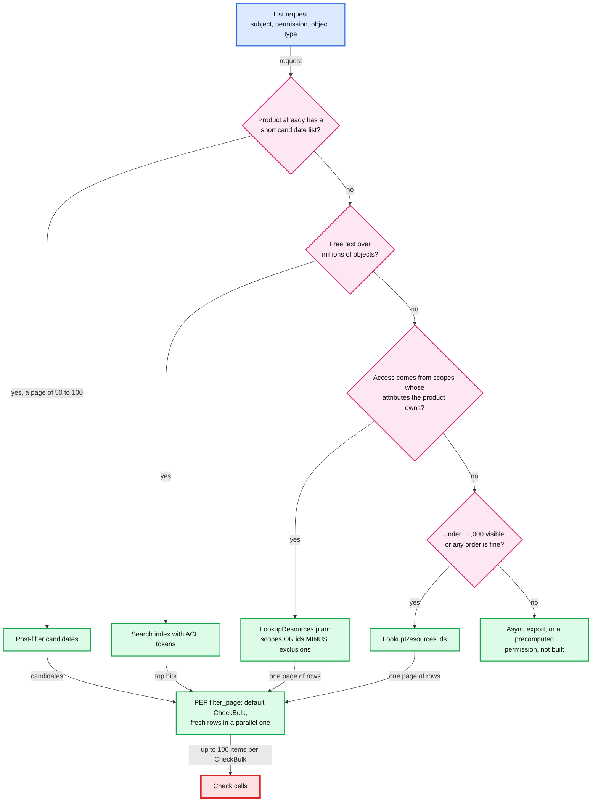
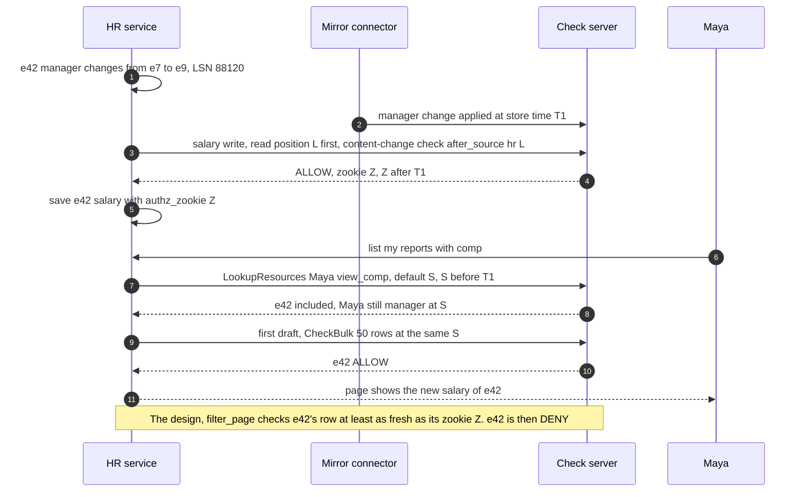
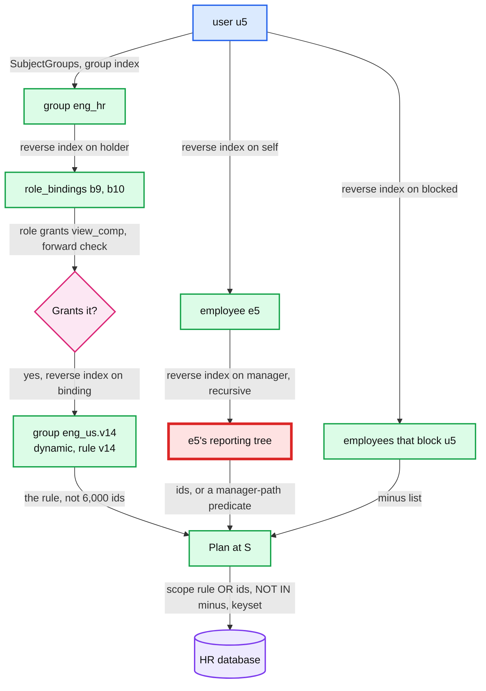

# Deep dive: list filtering and search

> One-line answer: pick the listing strategy by the **shape of the answer**. Post-filter a short candidate list in the PEP's `filter_page`. Walk backwards with LookupResources when the visible set is small. Return a **plan** (`scopes OR ids MINUS exclusions`) when the permission is shaped like a filter. Put access control list (ACL) tokens in the search index for free text. Then authorize every displayed row at a snapshot **no older than its content**. Each of those rules replaced something in the first draft that failed when measured: a fixed 1.5x top-up needs **7.2 sequential CheckBulk rounds (p99 45 ms)** at a 10% pass rate and returns a short page **97%** of the time at 5%, while sizing from the observed pass rate needs ~1 round. OFFSET paging showed **101 rows twice** or **skipped 222** over 20 pages, while keyset paging does neither. A post-check at the lookup snapshot let a just-removed manager see a new salary. A scope-only answer silently dropped rows. Indexing inherited shares on each document passed 64 tokens and rewrote every document under a shared folder.

Design context: [`../solution.md`](../solution.md) §4.3 (strategies and the plan), §5.5 (scale, search, pagination), §4.4 (access reviews), §5.2 (zookies and `after_source`). Siblings: [`data-model-and-evaluation.md`](data-model-and-evaluation.md) (the forward walk, dynamic groups, why DENYs are expensive), [`consistency-and-new-enemy.md`](consistency-and-new-enemy.md) (snapshots and zookies). Concepts: [`../../../concepts/mvcc-and-isolation.md`](../../../concepts/mvcc-and-isolation.md), [`../../../concepts/fan-out-fan-in.md`](../../../concepts/fan-out-fan-in.md).

---

## 1. Four strategies, chosen by the shape of the answer



| Strategy | Use when | Cost per page | Freshness | Caveats and exclusions | Breaks when |
|---|---|---|---|---|---|
| **Post-filter** | The product already ranked or fetched candidates (inbox, search hits, a product query) | CheckBulk rounds of up to 100 at ~5 ms, sized by the pass rate. Each item counts as a check | The page's authorization snapshot | Exact, with the request's context | Pass rate under ~5%: short pages (section 2) |
| **LookupResources ids** | Few visible objects: under ~1,000 for a sorted interactive list, ~10k for an export | Proportional to the result, pages of 1,000 with a 500 ms deadline | One enumeration snapshot per cursor | Caveated branches come back separately. Exclusions become a minus list | A sorted first page needs every id |
| **Plan** | Access is "everyone matching a rule", and the product owns the attributes the rule reads | One remote procedure call (RPC), then the product's own indexed query | Product data is live, tuples lag ~1 to 2 s, `filter_page` reconciles | Minus list for exclusions, caveat-gated scopes listed separately | The rule uses Common Expression Language (CEL) outside the SQL-safe subset |
| **Search ACL tokens** | Free text over millions of objects | One search query with the user's principal, group and folder tokens, then `filter_page` | Index ~2 s behind. Never shown stale, may be counted stale | Not indexable: tagged `needs_check`, always post-checked | A folder **move** rewrites its subtree (section 5) |

- **Why ids only under ~1,000 for sorted lists.** LookupResources streams ids in walk order. To show page 1 sorted by name, the caller needs all of them: at 10k that is 10 pages, each allowed 500 ms. So ~10k is an export size, not a list-page size.
- **The precomputed option is a seam, not built.** AuthZed Materialize recomputes a named permission "as relationships or schemas change" [search snippet]. The design refuses precomputing everything (§5.1) and adds one named permission only if a product proves the other four fail.

## 2. Post-filter: short pages, the top-up, and pagination drift

The first draft fetched 1.5x the page and topped up batch by batch, up to 10 batches, on an OFFSET query. The design sizes each round from the pass rate seen so far (the cursor carries it) and pages by key. The simulation measures both. One round is one wave of CheckBulks (up to 100 items each) sent in parallel. `ms` is the p99 number of rounds times 5 ms. Then it pages through 1,000 sorted rows with 10% denied, by OFFSET and by a keyset cursor, with and without access changing between pages.

```python
import math, random

PAGE, BULK_MAX, CAP = 50, 100, 1_000     # page size, CheckBulk max items, candidates per page (10 x 100)
RTT = 5                                  # ms per CheckBulk round (solution.md 4.3: ~5 ms for 100)

def fixed(rng, p):
    """The first draft: fetch 1.5x the page, top up batch by batch, stop after 10 batches."""
    shown = rounds = calls = 0
    while shown < PAGE and rounds < 10:
        shown += sum(rng.random() < p for _ in range(int(1.5 * PAGE)))
        rounds += 1; calls += 1
    return min(shown, PAGE), rounds, calls, 75 * rounds

def adaptive(rng, p, prior):
    """The design: size each round from the pass rate seen so far (the cursor carries it).
    One round = several CheckBulks of <= 100 in parallel. Hard cap: 1,000 candidates per page."""
    shown = rounds = calls = scanned = 0
    seen, passed = 20, 20 * prior                # prior worth 20 observations
    while shown < PAGE and scanned < CAP:
        rate = max(passed / seen, 0.01)
        n = min(CAP - scanned, math.ceil((PAGE - shown) / rate * 1.2))
        ok = sum(rng.random() < p for _ in range(n))
        shown, scanned, seen, passed = shown + ok, scanned + n, seen + n, passed + ok
        rounds += 1; calls += math.ceil(n / BULK_MAX)
    return min(shown, PAGE), rounds, calls, scanned

rng = random.Random(30)
print(f"{'pass rate':>9} | {'fixed 1.5x: rounds  ms  CheckBulks  short':>41} | "
      f"{'adaptive: rounds  ms  CheckBulks  scanned  short':>48}")
for p in (0.99, 0.9, 0.7, 0.5, 0.3, 0.1, 0.05, 0.02):
    row = []
    for f in (lambda: fixed(rng, p), lambda: adaptive(rng, p, prior=p)):
        res = [f() for _ in range(2_000)]
        mean = lambda i: sum(r[i] for r in res) / len(res)
        p99r = sorted(r[1] for r in res)[int(0.99 * len(res))]
        short = sum(r[0] < PAGE for r in res) / len(res)
        row.append((mean(1), p99r * RTT, mean(2), mean(3), short))
    (r1, l1, c1, _, s1), (r2, l2, c2, n2, s2) = row
    print(f"{p:9.2f} | {r1:12.1f} {l1:5.0f} {c1:9.1f} {s1:8.0%} | {r2:15.1f} {l2:5.0f} {c2:9.1f} "
          f"{n2:8.0f} {s2:6.0%}")

# Drift: 1,000 rows sorted by name, 10% denied to this viewer. 20 pages. Then the same with access
# changing between pages (2% of rows flip each page), checked at a fresh snapshot per page.
def page_through(mode, flips):
    rng = random.Random(7)
    visible = [rng.random() > 0.10 for _ in range(1_000)]
    shown, last, flipped = [], -1, set()
    for page in range(20):
        start = {"offset_50": page * PAGE, "offset_75": page * 75, "keyset": last + 1}[mode]
        got, i = [], start
        while len(got) < PAGE and i < 1_000:      # fetch 75 rows at a time from start, post-check
            got += [r for r in range(i, min(i + 75, 1_000)) if visible[r]]
            i += 75
        got = got[:PAGE]
        shown += got
        last = got[-1] if got else last
        for _ in range(flips):                    # grants and revokes land between page views
            r = rng.randrange(1_000); visible[r] = not visible[r]; flipped.add(r)
    ever = set(shown)                             # skipped = visible the whole time, passed, never shown
    skipped = sum(1 for r in range(last + 1) if visible[r] and r not in flipped and r not in ever)
    return len(shown) - len(ever), skipped, len(shown)

for flips in (0, 20):
    for mode in ("offset_50", "offset_75", "keyset"):
        d, s, n = page_through(mode, flips)
        print(f"flips/page {flips:2} {mode:9}: shown {n:4}, duplicates {d:3}, "
              f"always-visible rows skipped {s:3}")
```

```text
pass rate | fixed 1.5x: rounds  ms  CheckBulks  short | adaptive: rounds  ms  CheckBulks  scanned  short
     0.99 |          1.0     5       1.0       0% |             1.0     5       1.0       61     0%
     0.90 |          1.0     5       1.0       0% |             1.0     5       1.0       67     0%
     0.70 |          1.2    10       1.2       0% |             1.0     5       1.0       86     0%
     0.50 |          2.0    10       2.0       0% |             1.0    10       2.0      120     0%
     0.30 |          2.8    15       2.8       0% |             1.0    10       3.0      202     0%
     0.10 |          7.2    45       7.2       0% |             1.1    10       6.1      603     0%
     0.05 |         10.0    50      10.0      97% |             1.0     5      10.0     1000    47%
     0.02 |         10.0    50      10.0     100% |             1.0     5      10.0     1000   100%
flips/page  0 offset_50: shown  993, duplicates 101, always-visible rows skipped   0
flips/page  0 offset_75: shown  670, duplicates   0, always-visible rows skipped 222
flips/page  0 keyset   : shown  892, duplicates   0, always-visible rows skipped   0
flips/page 20 offset_50: shown  983, duplicates 209, always-visible rows skipped   0
flips/page 20 offset_75: shown  666, duplicates   0, always-visible rows skipped 113
flips/page 20 keyset   : shown  797, duplicates   0, always-visible rows skipped   0
```

What it says:
- **1.5x is fine above a 70% pass rate and slow below 30%.** At 10% the fixed top-up runs 7.2 rounds one after another (p99 45 ms of CheckBulk alone). Sizing the round from the observed rate sends ~6 CheckBulks in parallel in one round: p99 10 ms for the same work.
- **Below ~5% no post-filter works.** Even 1,000 candidates (10 CheckBulks) leave 47% of pages short at 5% and 100% at 2%. That is the signal to switch strategy (ids or a plan) rather than return "more results may be hidden" on every page. The design returns that flag only after 10 empty batches.
- **A low pass rate multiplies checks.** A page at 10% evaluates ~600 CheckBulk items, 120x a normal request's ~5 checks, and DENYs are the expensive checks (18 leaf reads against 5 in [`data-model-and-evaluation.md`](data-model-and-evaluation.md) section 5).
- **OFFSET plus post-filtering is wrong either way.** `OFFSET page x 50` (the first draft's `LIMIT 50 OFFSET 100`) re-shows the rows the previous page's top-up consumed: **101 duplicates** in 20 pages, 209 when access changes. `OFFSET page x 75` skips the tail of each batch: **222 rows never shown**. The product database cannot know how many rows the post-check dropped, so the offset is always wrong.
- **A keyset cursor is exact.** `WHERE (name, id) > (:last_name, :last_id)` resumes after the last row shown: 0 duplicates and 0 skips, even with 20 grants and revokes landing between pages, each page authorized at a fresh snapshot.

**The cursor carries:** the last sort key and id, the observed pass rate, the LookupResources **enumeration snapshot** (if any), and the **authorization floor**. Section 3 is why those last two are different things.

## 3. Which snapshot authorizes a page

The first draft post-checked a page "with one CheckBulk at the same snapshot" as the LookupResources call: a default snapshot, ~5 s old. A row whose content changed after it carries a newer zookie, and that post-check ignored it (LSN is the HR database's log sequence number):



- **The design.** `filter_page` splits the page by each row's `authz_zookie`. Rows whose zookie is at or below the default snapshot go in one CheckBulk at the default snapshot (never below the cursor's floor). The few fresh rows go in a second, parallel CheckBulk at least as fresh as the newest of their zookies. One CheckBulk at the page's max zookie would also be correct, but one actively edited document (autosave refreshes its zookie every 5 s) would then send the whole page to the leaseholder on every view (p99 ~100 ms in the home region, ~250 ms elsewhere, instead of 10 ms).
- **Search too.** A search hit shows a snippet of indexed content, so the sync indexes each content version's zookie with it, and `filter_page` uses the max over the page.
- **Enumeration snapshot vs authorization floor.** If the first draft's cursor snapshot were used to authorize page 7, a user who pages for 20 minutes would keep seeing rows revoked 19 minutes ago. So the cursor's snapshot only keeps LookupResources ordering stable (exact, within the 24 h multi-version concurrency control (MVCC) window). SpiceDB's own guidance for `at_exact_snapshot` is "only ... if you are paginating over results within a short window", and it fails with "Snapshot Expired" after garbage collection. Authorization uses it only as a floor. With a keyset cursor, a fresher snapshot per page cannot cause duplicates or skips (section 2).

## 4. LookupResources and the plan



**Why the answer is a union, not one scope.** u5's `view_comp` is `(self + manager->line_up + in_scope->scoped_view_comp + org->view_comp) - blocked`. The first draft returned only the scopes. If u5 also manages 12 people in Sales, those 12 come from `manager->line_up`, not from any scope, and a product that applies only the scopes **silently drops them**. A post-check can remove extra rows but can never notice missing ones. So the design's plan carries every branch:

```text
{ snapshot: S,
  include_scopes: [{group: eng_us.v14, rule: "department == 'Eng' && country == 'US'", rule_version: 14}],
  include_ids:    [e5, the 12 reports],                          # self and manager->line_up
  exclude_ids:    [e17, any other employee whose blocked has u5], # the "- blocked" branch
  conditional:    [{via: org:acme auditor, caveat: on_corp_network, missing: [request_ip]}],
  cursor: ... }
```

```sql
SELECT id, name, salary, authz_zookie FROM employees
WHERE tenant_id = :t
  AND ((department = 'Eng' AND country = 'US') OR id IN (:include_ids))
  AND id NOT IN (:exclude_ids)
  AND (name, id) > (:last_name, :last_id)
ORDER BY name, id
LIMIT 75
```

- **A large id list becomes a predicate too.** A vice president with 10k reports gets `manager_path LIKE '/e1/e7/%'` instead of 10k ids. It is valid for the same reason as the scope rule: the HR database owns the manager chain the tuples mirror.
- **Only a translatable rule is a predicate.** Dynamic group rules are restricted at save time to a SQL-safe CEL subset (`==`, `!=`, `in`, `<`, `>`, `&&`, `||` over columns the product declares, with NULL handling spelled out). Open Policy Agent (OPA) partial evaluation does the same job and produces `WHERE employees.department = 'engineering'`.
- **Caveats and exclusions.** LookupResources takes the request's context. A branch whose caveat lacks context comes back under `conditional`, and the product treats it as excluded plus an error metric. `blocked` is one reverse-index read. A generic exclusion is not: SpiceDB's guide warns that intersections and exclusions "can significantly hurt LookupResources performance" [search snippet], because each candidate needs a forward check.
- **Paging the walk.** Pages of 1,000 with a 500 ms deadline, at one enumeration snapshot, with a cursor and `complete: false` when the deadline hits. OpenFGA stops at 1,000 results or 3 s, and a GitHub issue reports that partial results come back with no signal. Silent truncation is the bug to avoid.

**When the rule and the tuples disagree.** The rule runs twice: as SQL on live HR rows, and as materialized `in_scope` tuples that lag. `filter_page` catches only one direction.

| Case | SQL says | Tuples say at S | Result |
|---|---|---|---|
| Employee just moved into Eng | in | out (~1 to 2 s lag) | `filter_page` drops the row, the page tops up. Safe, slightly short |
| Employee just moved out of Eng | out | in | Row missing from the list, still openable directly for ~2 s plus ~6 s. An ordinary revoke |
| Rule edit v14 to v15 | the version bound at S | the same version | No gap: the blue/green flip moves the bindings at one commit, so a plan at S names the version whose tuples answer at S ([`data-model-and-evaluation.md`](data-model-and-evaluation.md) section 3.3) |
| SQL over-matches (case, collation) | in | out | `filter_page` drops it. Safe |
| **SQL under-matches (NULL handling)** | **out** | **in** | **Row silently missing from every page.** E.g. a group service that treats a missing country as `""` makes `country != "US"` true, while SQL `country <> 'US'` drops NULL rows |

The last row is why the CEL subset spells out NULL handling, why translation tests run the CEL and SQL forms over the same fixture rows (NULLs included), and why a nightly job compares each plan's row count with the `in_scope` tuple count at one snapshot and pages the owning team on a gap over 0.1% [estimate]. `filter_page` never sees the rows that are missing.

## 5. Search: ACL tokens in the index

```mermaid
%% Search with ACL tokens. The index answers "maybe", filter_page decides. Red = the check cells, which every result page lands on.
flowchart LR
    WQ[[Regional Watch stream]] -->|"tuple changes, per-tenant W"| SYNC[ACL sync job]
    SYNC -->|"direct shares, ancestor folders, content zookie"| IDX[(Search index)]
    U[User u7 searches] -->|"query"| SS[Search service]
    GI[Group index] -->|"SubjectGroups u7"| SS
    SS -->|"text match AND any token"| IDX
    IDX -->|"top 75 hits, about N total"| SS
    SS -->|"filter_page, fresh as max zookie"| CHK[Check cells]
    CHK -->|"ALLOW or DENY per hit"| SS
    SS -->|"50 results, about N"| U

    class U client
    class SYNC,SS service
    class IDX store
    class GI cache
    class WQ queue
    class CHK critical

    classDef client   fill:#dbeafe,stroke:#2563eb,stroke-width:2px,color:#111
    classDef service  fill:#dcfce7,stroke:#16a34a,stroke-width:2px,color:#111
    classDef store    fill:#ede9fe,stroke:#7c3aed,stroke-width:2px,color:#111
    classDef cache    fill:#fef3c7,stroke:#d97706,stroke-width:2px,color:#111
    classDef queue    fill:#cffafe,stroke:#0891b2,stroke-width:2px,color:#111
    classDef critical fill:#fee2e2,stroke:#dc2626,stroke-width:4px,color:#111
```



**The design indexes the path, not the ACL.** Each document gets its direct share tokens (principals and groups on the document itself), its ancestor folder ids (at most 30) and its content zookie. A query matches the user's principal, `SubjectGroups(u7)` (~8 groups on average, up to ~20), and the folders with a direct share to any of those tokens. The first draft wrote each document's full inherited ACL instead, and two numbers broke it:
- **Inheritance, not width, hit the 64-token cap.** At 3 direct shares per folder [estimate], a document 22 folders deep carries ~66 inherited principals with no wide share anywhere. Folder trees go 30 deep (§1.2).
- **A folder share rewrote every document below it.** A top folder with 200k documents below [estimate], at 10k document updates/s per index [estimate], is ~20 s, not ~2 s. With the folder path, a share rewrites **0** documents. A folder **move** still rewrites its subtree, but moves are rarer than shares.

Details that make it work:
- **Which folders go in the query.** Only folders with a **direct** share to u7 or one of u7's groups: every document already carries all of its ancestors, so a match on a shared root covers everything below it. That is one reverse-index read. The first draft's "every folder u7 can view" would have turned a root shared with 5,000 subfolders into 5,001 query terms instead of 1. Above ~1,000 terms [estimate] the query is split.
- **`SubjectGroups` needs ancestors.** It takes `member_to_groups(u7)` (direct, ~3) and expands each through `group_ancestors` (the groups that contain it). The first draft expanded "upward through `group_descendants`", which maps the other way, so the design's group index keeps both maps.
- **Never indexable, always post-checked:** caveated access, exclusions anywhere on the path (`- blocked` breaks pure inheritance), and expiring tuples (an expiry is not a change event, see [`data-model-and-evaluation.md`](data-model-and-evaluation.md) section 6). The sync tags such documents `needs_check`.
- **Counts say "about".** A hit revoked inside the ~2 s sync lag, or a `needs_check` hit that fails, can be counted in "about 1,240 results". It is never shown.

## 6. Access reviews

- **One object: "who can see e42's comp".** `LookupSubjects(employee:e42, view_comp, user)` with a path per subject. For the running example: u42 (self), Maya u7 (manager), u2 and u1 (`line_up`), every eng_hr member through b9 over eng_us (rule v14, shown with its text), auditor u6 **conditional on the corporate network**, minus Bob u9 (blocked). The wildcard in `role:r1#grants_view_comp@user:*` is intersected with the holders, so it never shows as "everyone".
- **A whole tenant, quarterly: an export, never live calls.** Read the tenant's tuples `AS OF S` (the largest is ~10 M tuples, ~3 GB), evaluate offline with the same evaluator, and write per-permission subject lists to object storage. One snapshot makes the whole review consistent, and nothing touches the check cells (exports are shed before checks). The 24 h MVCC window covers an export of minutes. 100k employees x ~26 subjects each [estimate: ~6 in the chain plus ~20 scoped admins] is ~2.6 M rows.
- **The offline evaluator is tested against the live one.** A sample of review rows is re-checked with live Check at S. A mismatch means the export lies, so it blocks the review.
- **Show what the access hangs on:** the path, the dynamic group rule and its version, the caveat condition, the `expires_at` of just-in-time (JIT) grants, and suspended principals whose owned tuples still exist (cleanup starts after a 7-day grace, and mirrored tuples wait for their source).
- **Close the loop.** A reviewer's revoke goes through the write API and returns a zookie. The review re-runs that row `at_least_as_fresh` the zookie and shows it gone.
- **Who may run it:** admins of the tenant and auditors only. LookupSubjects is an enumeration tool (§10.10).

## 7. Trade-offs

| Decision | Option A | Option B | Chose | Why |
|---|---|---|---|---|
| Top-up sizing | Fixed 1.5x batches | Sized from the observed pass rate | **Observed rate, carried in the cursor** | 7.2 sequential rounds become ~1 at a 10% pass rate |
| Paging | OFFSET | Keyset on (sort key, id) | **Keyset** | OFFSET duplicates 101 or skips 222 rows in 20 pages |
| Page authorization snapshot | The lookup or cursor snapshot | Each row at least as fresh as its content zookie | **Split by zookie age, in `filter_page`** | The lookup snapshot leaks content written after a revoke. One max-zookie CheckBulk sends whole pages to the leaseholder |
| List answer shape | Scopes only | Scopes OR ids MINUS exclusions | **The full plan** | Scopes alone silently drop the manager branch |
| Rule pushdown | Any CEL | A SQL-safe subset, checked at save | **Subset** | Untranslatable rules cannot become SQL. They fall back to ids |
| Search tokens | Inherited ACL per document | Direct shares plus ancestor folder path | **Folder path** | A share costs 0 document writes, and the 64 cap stops binding |
| Access reviews | Live LookupSubjects | Export at one snapshot | **Export** | One consistent snapshot, zero load on check cells |

**Refused:** OFFSET paging behind a post-filter, authorizing a page at a cursor's snapshot, silent truncation of a listing, precomputing every (user, object) pair, and running tenant-wide access reviews on the check cells.
