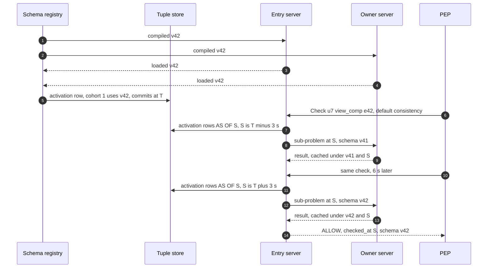
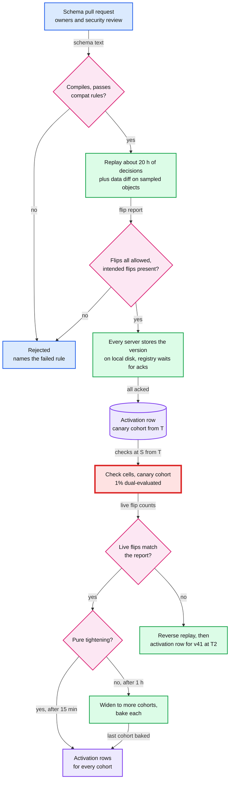
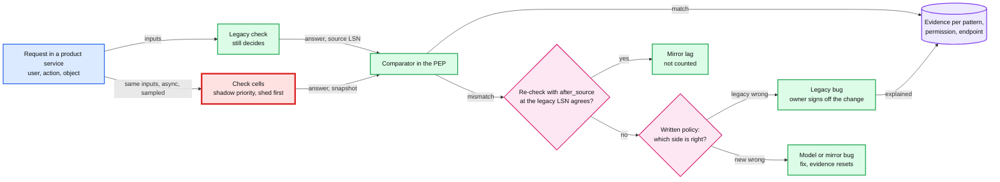
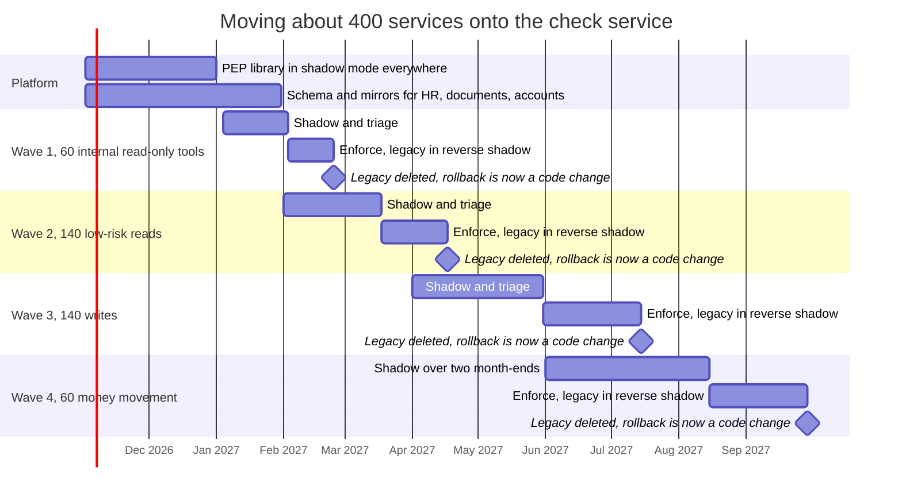

# Deep dive: migration and safe policy changes

> One-line answer: three kinds of change get three gates. A **schema version** (global blast radius) must pass compatibility rules, a replay of logged decisions plus a data diff that explain every flip, and an activation that is a **row in the tuple store read at the check's own snapshot**, so every check sees exactly one version. It rolls out over 16 tenant cohorts with a 1 h bake and live dual evaluation, or after 15 minutes for a pure tightening. A **tenant edit** is data: an access preview, an escalation check that refuses any gain the editor does not hold, and a second admin above 100k `(principal, object)` pairs per admin per day. A **service migration** moves ~400 services one endpoint at a time: mirror, shadow, triage, enforce behind a flag, reverse shadow, delete. The gate counts **checks seen**, pooled by check pattern, because the simulation below shows "14 clean days" proves a mismatch rate below 1 in 10^6 only above ~2.5 checks/s.

Zoom-in on [`../solution.md`](../solution.md) §5.6, §4.4 and §10.9. Reusable blocks: [`../../../concepts/mvcc-and-isolation.md`](../../../concepts/mvcc-and-isolation.md) (why a row read at the snapshot gives one answer everywhere), [`../../../concepts/stream-processing.md`](../../../concepts/stream-processing.md) (mirrors fed by change data capture, CDC). Siblings: [`data-model-and-evaluation.md`](data-model-and-evaluation.md) (the schema and evaluator), [`availability-and-failure-modes.md`](availability-and-failure-modes.md) (shadow checks are shed first). The same problem for flags: [`../../feature-flag-service/deep-dives/safe-changes-and-flag-lifecycle.md`](../../feature-flag-service/deep-dives/safe-changes-and-flag-lifecycle.md).

---

## 1. Three kinds of change, three gates

| Change | Who | Blast radius | Gate | Rollback |
|---|---|---|---|---|
| Schema version | Platform team, reviewed with the owning team and security | Every tenant | Compat rules, replay plus data diff, activation per cohort, 1 h bake with live dual evaluation (15 min for a pure tightening) | A new activation row for the previous version, one step back only, after a reverse replay (section 2) |
| Tenant edit: role, binding, group member, dynamic group rule | Tenant admin | One tenant | Access preview, escalation check, second admin above 100k pairs per admin per 24 h (section 5) | Another write, with `If-Match`, previewed the same way |
| Service migration, per endpoint | Product team | One endpoint | Shadow evidence, then enforce behind a flag, then reverse shadow (section 6) | The enforce flag, until legacy code is deleted |

---

## 2. Schema compatibility rules, and expand then contract

A version is immutable. The registry compiles it and checks it against the live tuples (it counts them) before anything else runs.

| Change | Rule | Why |
|---|---|---|
| Add a type, relation or permission that nothing uses yet | Allowed | Zero flips by construction |
| Change a permission's expression | Allowed, replay required | This is where flips come from |
| Add an exclusion or an intersection | Replay required, security reviews | Turns ALLOWs into DENYs by design |
| Remove a relation, or narrow its allowed subject types | Refused while any matching tuple exists | Silent loss of every grant that used it |
| Rename a relation | Treated as remove plus add, so refused while tuples exist | Use expand then contract below |
| Add a caveat, or a new required context field, to an existing relation | Refused unless the field has a default | Otherwise every caller that does not send it gets CONDITIONAL, which the PEP (policy enforcement point, the client library in each service) maps to 403, and replay cannot see it for callers whose records carry no context |
| A permission that recurses through an exclusion | Refused at compile time | Exclusion over recursion has no stable answer on cyclic data |
| Change a caveat parameter's type | Refused while tuples carry the old type | Old parameters would fail to evaluate |
| Remove `audit: always`, add `degrade` | Security approval | They change what is logged and what survives our outage |

**Expand then contract.** A restructure is three versions, never one. v50 adds relation `delegate` and uses it nowhere: zero flips, activate. Backfill `delegate` tuples in the bulk lane (5k tuples/s per tenant). v51 uses `delegate` in `view_comp`: replay, activate. v52 removes the old relation once the registry counts zero tuples on it.

**Why rollback is one step only.** The first draft treated rollback as "activate the old version again, instantly". That holds only if the old version defines every relation that now holds tuples. If one release both added `- suspended_by_tenant` (a new exclusion) and tenants wrote tuples into it, re-activating the old version either fails the "removes a relation still holding tuples" rule, or, if forced, drops the exclusion and turns those DENYs into ALLOWs. With expand then contract, every rollback is one step back to a version that knows every relation in use, and it is replayed in reverse (new to old) like any change.

---

## 3. Shadow replay, with a worked flip report

The replay re-evaluates logged decisions from the last ~20 h (the multi-version concurrency control, MVCC, window is 24 h, minus the time the replay takes) under the old and new versions, each at its logged snapshot. Flips are grouped by permission, tenant, direction and **the path that granted under the old version**. The author states the intent as both the flips that are allowed and the flips that must appear.

The script below is one synthetic tenant on the solution.md §3.3 schema: 2,000 employees in a 7-wide manager tree, 10 org-wide comp viewers, 5 HR partners scoped to a dynamic group, two `blocked` tuples. It logs 300,000 `view_comp` checks (an `audit: always` permission, so every check is logged) and replays them under three candidate v42s. The intent of all three: skip-level managers lose `view_comp`.

```python
import random
from collections import Counter
random.seed(3)

# One synthetic tenant, the solution.md section 3.3 schema. Employee i is user ui (relation self).
N = 2000
MGR = {i: (i - 1) // 7 for i in range(1, N)}           # 7 reports each, chains 4 deep
HR = {f"u{i}" for i in range(1990, 2000)}               # holders of the org-wide Comp Viewer binding
ENG_HOLDERS = {f"u{i}" for i in range(1980, 1985)}      # holders of a binding scoped to group eng_us
IN_SCOPE = {i for i in range(N) if i % 3 == 0}          # employees in eng_us (a dynamic group)
BLOCKED = {100: {"u1990"}, 8: {"u1"}}                   # explicit "never"
ORG_MEMBERS = {f"u{i}" for i in range(N)}

# v41 = (self + manager->line_up + in_scope->scoped_view_comp + org->view_comp) - blocked
CANDIDATES = {   # intent of every candidate: skip-level managers lose view_comp
    "v42a": "(self + manager->self + in_scope->scoped_view_comp + org->view_comp), exclusion lost",
    "v42b": "(self + manager->self + in_scope->scoped_view_comp + org->view_comp) - blocked",
    "v42c": "(self + manager->self + in_scope->scoped_view_comp + org->member) - blocked",
}

def branches(user, e, version):
    """Granting branches of view_comp on employee e, or None when blocked wins."""
    got, m, depth = set(), MGR.get(e), 1
    if user == f"u{e}":
        got.add("self")
    while m is not None:                                 # manager->line_up
        if user == f"u{m}" and (depth == 1 or version == "v41"):
            got.add("manager, depth 1" if depth == 1 else "manager, depth 2+")
        m, depth = MGR.get(m), depth + 1
    if e in IN_SCOPE and user in ENG_HOLDERS:
        got.add("in_scope binding")
    if user in (ORG_MEMBERS if version == "v42c" else HR):
        got.add("org binding")
    return None if user in BLOCKED.get(e, ()) and version != "v42a" else got

managers = sorted(set(MGR.values()))
kids = {m: [c for c, p in MGR.items() if p == m] for m in managers}
def descendants(m):
    return [d for c in kids.get(m, []) for d in [c] + descendants(c)]
log = []                                                 # view_comp is audit: always, all logged
for _ in range(300_000):
    r = random.random()
    if r < 0.40:
        e = random.randrange(N); u = f"u{e}"
    elif r < 0.70:
        m = random.choice(managers); u = f"u{m}"
        deep = [d for d in descendants(m) if d not in kids[m]] if random.random() < 0.3 else []
        e = random.choice(deep or kids[m])
    elif r < 0.85:
        u, e = random.choice(sorted(HR)), random.randrange(N)
    elif r < 0.95:
        u, e = random.choice(sorted(ENG_HOLDERS)), random.randrange(N)
    else:
        u, e = f"u{random.randrange(N)}", random.randrange(N)
    log.append((u, e))

def label(b):
    return "blocked" if b is None else (" + ".join(sorted(b)) or "no path")

INTENT = ("ALLOW to DENY", "manager, depth 2+")      # allowed, and expected to appear
print(f"Replay of {len(log):,} logged view_comp checks against v41, intent: skip-level managers lose it\n")
for cand, text in CANDIDATES.items():
    flips, subjects = Counter(), {}
    for u, e in log:
        old, new = branches(u, e, "v41"), branches(u, e, cand)
        a, b = bool(old), bool(new)                     # None (blocked) and empty set are DENY
        if a != b:
            key = ("ALLOW to DENY" if a else "DENY to ALLOW", label(old))
            flips[key] += 1
            subjects.setdefault(key, set()).add(u)
    print(f"{cand} = {text}")
    bad = 0
    for (direction, path), n in sorted(flips.items(), key=lambda kv: -kv[1]):
        ok = (direction, path) == INTENT
        bad += 0 if ok else n
        print(f"   {direction:14} old path {path:22} {n:>7,} checks {len(subjects[(direction, path)]):>5} subjects"
              f"   {'matches intent' if ok else 'UNEXPLAINED'}")
    missing = INTENT not in flips
    print(f"   verdict: {'BLOCK' if bad or missing else 'eligible for canary'}, {bad:,} unexplained flips"
          + (", and the intended flips are missing" if missing else "") + "\n")
```

```text
Replay of 300,000 logged view_comp checks against v41, intent: skip-level managers lose it

v42a = (self + manager->self + in_scope->scoped_view_comp + org->view_comp), exclusion lost
   ALLOW to DENY  old path manager, depth 2+        3,904 checks    41 subjects   matches intent
   DENY to ALLOW  old path blocked                     35 checks     2 subjects   UNEXPLAINED
   verdict: BLOCK, 35 unexplained flips

v42b = (self + manager->self + in_scope->scoped_view_comp + org->view_comp) - blocked
   ALLOW to DENY  old path manager, depth 2+        3,904 checks    41 subjects   matches intent
   verdict: eligible for canary, 0 unexplained flips

v42c = (self + manager->self + in_scope->scoped_view_comp + org->member) - blocked
   DENY to ALLOW  old path no path                 34,874 checks  1988 subjects   UNEXPLAINED
   verdict: BLOCK, 34,874 unexplained flips, and the intended flips are missing
```

- **v42a** forgot the exclusion while rewriting the line. 35 checks by 2 subjects flip DENY to ALLOW: a conflict-of-interest block stops working. It is found because the decision log keeps **every DENY**, so the leak direction is always fully in the replay, even for a class this rare (~1 in 10^4 here).
- **v42b** is the correct change: 3,904 intended flips, 41 skip-level managers, nothing else. Eligible for the canary.
- **v42c** typed `org->member` for `org->view_comp`: every employee can see every salary. It also **masks** the intended change (skip-level managers are org members), which is why "the intended flips must appear" is part of the intent. A report with no flips at all is not a pass.

**What replay cannot see, and the fix for each:**
- **Permissions nobody exercised in the window.** A month-end payroll approval or a quarterly access review has zero records on a Tuesday, so zero flips. Add a **data diff**: for each permission whose compiled expression changed, sample ~10k objects per affected type [estimate], compute LookupSubjects under both versions, and diff.
- **Breakage on non-audit permissions.** Only 1% of their ALLOWs are logged, so an ALLOW to DENY class rarer than ~1 in 10^6 of that permission's checks can slip through. The data diff and the live bake below cover it.
- **Caveats.** A record without request context replays a caveated branch as CONDITIONAL. So `audit: always` records carry the caveat inputs they read (an IP is 16 B), and other caveated permissions lean on the data diff.

---

## 4. Activation: why every check sees exactly one version

The first draft activated per cell: the registry wrote `activate v42 at T` for one cell, servers confirmed they had loaded v42, and "checks with snapshot ≥ T use v42". Two things broke it. A server that heard about T late could evaluate a check at S ≥ T with v41 while its neighbours used v42. And tenants move between cells (remaps), so a tenant moved from a v42 cell to a v41 cell went back in time, and a zookie-guarded sequence could see v42 and then v41. The design (solution.md §5.6):

1. **The activation is a row in the tuple store**, `SCHEMA_ACTIVATION(cohort, activate_at, version)`, read at the check's snapshot S like any tuple. "S ≥ T" and "the row is visible at S" become the same statement on every server, with no clock agreement and no race with a server that heard late.
2. **Cohort, not cell.** Tenants are hashed into 16 cohorts, so the version follows the tenant wherever it is served. Cells stay the unit for builds.
3. **Chosen once, carried everywhere.** The entry server picks S and the version, and every dispatched sub-problem carries both. Owner servers evaluate with the version in the request, and the result cache key holds it. Every server keeps every version used in the last 24 h on local disk (explain and old zookies read old snapshots), so the registry is not a boot dependency.



**The bake needs live dual evaluation.** Live traffic alone cannot show a flip, because it only has the new answer. So the canary cohort evaluates 1% of its checks under the previous version too (~1% more CPU [estimate]) and pages on any DENY to ALLOW difference. Bake 1 h, then widen. A **pure tightening** (replay shows only ALLOW to DENY flips, typically a security fix) may go to all cohorts after a 15-minute canary.

**One gap in the fast path** [proposal]. The canary pages on DENY to ALLOW, which is the leak direction. A tightening's failure mode is the other one: an ALLOW to DENY class the replay did not predict (a permission nobody exercised in the window), which is a mass 403 in every tenant 15 minutes later. So the canary should compare live flips in **both** directions against the replay's predicted classes (direction plus old path, as in section 3) and stop on any class it did not predict. For a tightening, that comparison is the only live signal.



---

## 5. Tenant edits and the access preview

A tenant editing a role, a binding, a group's members or a dynamic group rule writes tuples, never schema. The preview evaluates the change in a scratch overlay at snapshot S and shows "Maya gains 1,240 employees, loses 0" (solution.md §4.4). For a scope-shaped change the delta is a predicate the HR database counts: employees matching the new rule and not the old one, times the bindings that reference the group.

The first draft gated one case: "more than 1,000 principals gain an `audit: always` permission, second admin". Three ways around it shaped the design (solution.md §5.6, §10.10):
- **Edits that grant without a binding.** Editing a role's definition re-grants every binding of the role. Adding a member to a group that holds bindings, or widening a dynamic group's rule, grants over every new member, including bindings for `edit_comp` the editor does not hold. So **every widening edit** runs the preview diff and is refused if it gives anyone a permission the editor does not hold over that scope.
- **Scope widening counts as one principal.** An HR admin whose scope goes from Eng (~6,000 employees) to the whole company (100k) is 1 principal gaining ~94k `(principal, employee)` pairs, invisible to a principal count. So the threshold counts **pairs**: a second admin above 100k pairs of an `audit: always` permission [estimate]. Note that this very example, at ~94k, still passes (next paragraph).
- **Splitting.** Ten edits of 999 pass any per-edit threshold, so the pairs are counted **per admin over 24 h**.

**One gap left: the threshold is absolute** [proposal]. The largest tenant has 100k employees, so "one new person can see every salary in the company" is at most 100k pairs and never needs a second admin, in any tenant. A relative trigger closes it: also ask for a second admin when a single principal gains an `audit: always` permission over more than ~10% of the tenant's objects of that type [estimate].

**Preview, then apply, without drift.** The preview returns `(zookie, rule_version, object versions, delta hash)`. The apply carries `If-Match` on the edited object and the rest as preconditions, and gets 409 if any changed, so another admin's edit in between forces a new preview. A rule edit is applied blue/green: the group service builds `group:eng_us.v15` in the bulk lane while the incremental path writes attribute changes to both v14 and v15. Once v15's applied LSN has caught up with v14's, one transaction moves **every** reference to the group (scope bindings, holder tuples, parent-group memberships) from v14 to v15, so a narrowing lands atomically. An `after_source` wait covers the building version too.

---

## 6. Moving 400 services: shadow, triage, enforce, reverse shadow

The steps are solution.md §5.6: inventory, model and mirror, shadow, triage, enforce per endpoint, reverse shadow for two weeks, delete legacy. The mirror connector stays: it is now the data path. In shadow mode the PEP gets the legacy answer together with the LSN (log sequence number) of the source database that legacy read.



- **Mirror lag.** Legacy reads its own fresh database, while Check reads a mirror ~1 to 2 s behind at a snapshot ~5 s old. Every mismatch is re-checked with `after_source` at the LSN legacy read. If the answers then agree, it was lag.
- **Direction decides the risk.** Legacy ALLOW and new DENY breaks users once enforced. Legacy DENY and new ALLOW leaks once enforced. Both block. Two more classes show up in practice: an **identity mismatch** (legacy checked the calling service, not the user) and **missing context** (CONDITIONAL).
- **Shadow load is real.** With all 400 services shadowing, the check service sees its full future load before it enforces anything. Shadow checks are the lowest class and shed first ([`availability-and-failure-modes.md`](availability-and-failure-modes.md) section 3), and high-traffic endpoints are sampled.

**How long is long enough?** The first draft's gate was "zero unexplained mismatches for 14 days". The simulation asks how many days of shadow an endpoint needs before a rare mismatch class shows up at least once, with a B2B weekly shape (business hours, quiet weekends). Class A is uniform at 1 in 10^6 checks. Class B only happens on the last 2 days of a month (a month-end payroll path) at 1 in 10^5 of those checks. For class B, "served for 95%" counts month-end checks only.

```python
import bisect, math, random
random.seed(5)

WEEK = 24 * 7
def weight(h):                               # hour of the week, Monday 00:00 = 0. B2B shape
    day, hr = divmod(h % WEEK, 24)
    if day >= 5:
        return 0.15                          # weekend
    return 4.0 if 9 <= hr < 17 else 0.35     # business hours vs nights
MEAN = sum(map(weight, range(WEEK))) / WEEK
HORIZON = 24 * 600                           # 7 months of possible starts plus a year to detect

def month_end(h):                            # last 2 days of each 30-day month
    return (h // 24) % 30 >= 28

def cumulative(avg_per_s, sample, p, month_end_only):
    """Expected mismatches seen by the end of each hour."""
    c = [0.0]
    for h in range(HORIZON):
        lam = avg_per_s * 3600 * weight(h) / MEAN * sample * p
        c.append(c[-1] + (0.0 if month_end_only and not month_end(h) else lam))
    return c

def days_to_first(c, trials=4000):
    out = []
    for _ in range(trials):
        start = random.randrange(24 * 210)   # any hour of any weekday of any month
        hit = bisect.bisect_left(c, c[start] + random.expovariate(1.0))
        out.append((hit - start) / 24 if hit < len(c) else math.inf)
    return sorted(out)

def fmt(d):
    return "never" if d == math.inf or d > 365 else f"{d:6.1f}"

print(f"peak hour / average = {4.0 / MEAN:.1f}x\n")
print(f"{'class':34} {'avg/s':>6} {'sample':>6} {'served for 95%':>14} {'p50 days':>9} {'p95 days':>9} {'seen by day 14':>15}")
for cls, p, me in [("A: uniform, 1 in 10^6", 1e-6, False),
                   ("B: month-end only, 1 in 10^5 then", 1e-5, True)]:
    for avg, sample in [(0.1, 1.0), (1, 1.0), (3, 1.0), (10, 1.0), (10, 0.1), (100, 0.1)]:
        d = days_to_first(cumulative(avg, sample, p, me))
        n95 = math.log(20) / p / sample      # checks served (B: month-end checks) for a 95% chance
        seen14 = sum(x <= 14 for x in d) / len(d)
        print(f"{cls:34} {avg:>6} {sample:>6.0%} {n95/1e6:>12.1f} M {fmt(d[len(d)//2]):>9} "
              f"{fmt(d[int(len(d)*.95)]):>9} {seen14:>15.0%}")

print("\nRule of three: zero mismatches in N shadowed checks bounds the rate below 3/N at 95%.")
for avg in (0.1, 1, 10, 100):
    n = avg * 86_400 * 14
    print(f"   {avg:>5} checks/s for 14 clean days: N = {n/1e6:8.2f} M, rate < 1 in {n/3:,.0f}")
```

```text
peak hour / average = 3.4x

class                               avg/s sample served for 95%  p50 days  p95 days  seen by day 14
A: uniform, 1 in 10^6                 0.1   100%          3.0 M      80.8     344.7             11%
A: uniform, 1 in 10^6                   1   100%          3.0 M       8.1      33.2             70%
A: uniform, 1 in 10^6                   3   100%          3.0 M       2.8      11.7             97%
A: uniform, 1 in 10^6                  10   100%          3.0 M       1.0       3.9            100%
A: uniform, 1 in 10^6                  10    10%         30.0 M       8.0      35.7             70%
A: uniform, 1 in 10^6                 100    10%         30.0 M       1.0       3.9            100%
B: month-end only, 1 in 10^5 then     0.1   100%          0.3 M     117.4     never              8%
B: month-end only, 1 in 10^5 then       1   100%          0.3 M      19.7      59.1             36%
B: month-end only, 1 in 10^5 then       3   100%          0.3 M      15.3      41.7             46%
B: month-end only, 1 in 10^5 then      10   100%          0.3 M      13.8      27.8             51%
B: month-end only, 1 in 10^5 then      10    10%          3.0 M      19.4      58.6             37%
B: month-end only, 1 in 10^5 then     100    10%          3.0 M      14.2      27.6             50%

Rule of three: zero mismatches in N shadowed checks bounds the rate below 3/N at 95%.
     0.1 checks/s for 14 clean days: N =     0.12 M, rate < 1 in 40,320
       1 checks/s for 14 clean days: N =     1.21 M, rate < 1 in 403,200
      10 checks/s for 14 clean days: N =    12.10 M, rate < 1 in 4,032,000
     100 checks/s for 14 clean days: N =   120.96 M, rate < 1 in 40,320,000
```

- **14 days is a traffic level, not a guarantee.** It sees a 1 in 10^6 class with 95% confidence only above ~2.5 checks/s average (`3 M / (14 x 86,400)`). At 1 check/s it takes ~33 days, and at 0.1 checks/s most of a year.
- **Sampling divides the evidence.** 10% sampling at 10 checks/s behaves like 1 check/s at 100%.
- **Calendar classes ignore traffic.** A month-end-only class is seen in 14 days about half the time at any traffic level, because half of all 14-day windows contain no month-end.
- **The rule of three** says what a clean window proves: zero mismatches in N checks bounds the rate below 3/N at 95%. 14 clean days at 1 check/s proves less than 1 in 403,200.

**So the gate counts evidence** (solution.md §5.6). Per (check pattern, permission), pooled across the endpoints that share it (the inventory finds 5 to 10 patterns): at least 3 M shadowed checks with zero unexplained mismatches (rate below 1 in 10^6 at 95%) [estimate]. Per endpoint: at least 14 days, and the window includes a month-end if the endpoint runs periodic jobs. An endpoint too quiet to pool (a rarely used admin tool) replays a year of its legacy request logs through both engines offline, which is the same idea Stripe documents for restricted keys (section 7).



Wave sizes are [estimate]. The order is solution.md's: internal read-only tools, low-risk reads, writes, money movement. Expect the last 10% of services to take half the time.

---

## 7. What Stripe and Figma say in public

Neither publishes shadow durations, mismatch rates or rollback stories for an internal authorization migration ([`../research/real-world-survey.md`](../research/real-world-survey.md) §5). The 14 days, the two weeks of reverse shadow and the evidence gate here are design choices, not quotes.

- **Stripe, restricted API keys.** A restricted key is a "drop-in replacement" for a secret key, and the docs suggest deriving its permissions from the existing key's request logs: log-driven migration, the offline replay above. They advise one restricted key per service, and a denied request's error names the permission to add. Key rotation keeps old and new keys working for up to 7 days, which is a reverse shadow in miniature. Dashboard roles are a union: "If you assign a user multiple roles, they're assigned all the permissions of each individual role."
- **Figma, permissions DSL (domain-specific language).** One policy language and one evaluator ported across platforms, so client and server agree. Permission checks had been ~20% of database load, and lazy loading "more than halved" evaluation time. The migration leaned on "hundreds of tests written over many years", and the result was that they "all but eliminated incidents and bugs caused by drifts in the logic between our Ruby and LiveGraph codebase". The post as fetched has no shadow mode or mismatch numbers.

The lesson from both: the evidence came from the old system's own history (Stripe's request logs, Figma's years of tests). Shadow mode is the way to collect that history when you do not already have it.

---

## 8. Trade-offs, and numbers to say out loud

| Decision | Chose | Gave up |
|---|---|---|
| Schema restructure | Expand then contract, three versions | Weeks instead of one release |
| Activation unit | A row in the store per tenant cohort (16) | Builds and schema versions roll out on different units |
| Replay intent | Allowed flips and expected flips, plus a data diff | Authors must write intent as paths, not prose |
| Pure tightening | All cohorts after a 15-minute canary | A wrong tightening reaches every tenant in 15 minutes, so the canary must compare both directions |
| Tenant edit gate | Escalation check on every widening edit, pairs per admin per 24 h | More refusals and second-admin prompts in big HR reorganizations |
| Migration gate | Checks seen, pooled by pattern, a month-end where relevant | Quiet endpoints wait longer or need an offline log replay |

- Replay window ~20 h of a 24 h MVCC window. 16 cohorts. Canary 1% dual-evaluated, 1 h bake, 15 min for a pure tightening.
- v42b: 3,904 intended flips from 41 skip-level managers in 300,000 checks. v42a: 35 leaking checks, found because every DENY is logged.
- 1 in 10^6 at 95%: ~3 M checks. 14 days covers it only above ~2.5 checks/s. At 1 check/s it takes ~33 days.
- Second admin above 100k `(principal, object)` pairs of an `audit: always` permission per admin per 24 h [estimate].
- ~400 services, four waves, about a year. Rollback is the enforce flag until legacy code is deleted.
