# Diagrams: authorization service

The D1 to D12 set from `hld/CLAUDE.md` §4. Diagrams already in [`solution.md`](solution.md) are listed with a pointer, not pasted twice. Every diagram below adds a zoom-in or a path that `solution.md` does not draw. Numbers match `solution.md`. Sizes, counts and durations that are new here are marked [estimate] in the caption.

Acronyms used throughout: PEP (policy enforcement point, the client library in each service), CDC (change data capture), LSN (log sequence number of a product database), MVCC (multi-version concurrency control), CEL (Common Expression Language, used for caveats), HLC (hybrid logical clock), ACL (access control list), SSO (single sign-on), HR (human resources), vnodes (virtual nodes on a hash ring), S (the snapshot a check reads at), W_t (the resolved watermark a server has consumed for tenant t), Z (a zookie, a signed snapshot token).

| # | Diagram | Where |
|---|---|---|
| D1 | Context | below |
| D2 | Data flow | below |
| D3 | Component architecture | Zoom-out: `solution.md` §6 (check cells in red). Built step by step in §4.1 to §4.4. One cell: §5.1. Below: D3a inside one check server, D3b write path, D3c derived-index pipeline |
| D4 | Happy path per FR | Already in `solution.md`: FR1 one warm check §4.1, FR2 owned write then read-your-writes §4.2, the new-enemy protocol for Example B §5.2. Below: D4a FR3 an HR list through a LookupResources plan, D4b FR3 a search page, D4c FR4 explain a logged decision. FR2 mirrored writes: D3b and D5c |
| D5 | Failure paths | A bad build in a cell and a region's Kafka stalling: §10.4. Below: D5a one server's status poll stale, D5b a whole cell's poll stale, D5c a salary edit behind a lagging mirror, D5d a region lost, D5e a stale relation-cache entry refused |
| D6 | Decision flows | Group index or recursion: §5.3. Below: D6a PEP result mapping, D6b snapshot selection and cache use, D6c listing strategy |
| D7 | Entity relationship | Store schema with `SCHEMA_ACTIVATION`, `status_seq` and `source_version`: §3.3. Below: D7a change stream, derived indexes, decision log. D7b control plane, product side, in-memory state |
| D8 | State machines | Schema version: §5.6. Below: D8a principal, D8b blue/green rule edit, D8c tuple |
| D9 | Deployment / topology | Zoom-out: §5.4. Below: one region in detail plus what crosses regions |
| D10 | Scaling / partitioning | below |
| D11 | Failure mode map | below, D11a check path, D11b writes, pipelines, control plane |
| D12 | Rollout / migration | below |

---

## D1. Context (zoom-out)

The authorization service as one box. About 400 services call it ~1 M times a second at peak. Everything else writes to it or reads its records.

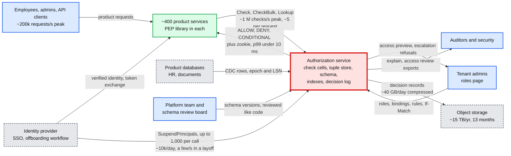

## D2. Data flow (DFD)

What moves where, with format, size and rate. Rates are peak unless marked avg. RPC (remote procedure call) message sizes are [estimate].

```mermaid
%% D2: data flow. Rounded boxes are processes, cylinders are stores. The heavy edge is the check RPC. Warm, the store sees only ~0.15 reads per check. Everything on the write side is about 1,000 times smaller than the check edge.
flowchart LR
    PEP(PEP library<br/>in ~400 services) -->|"Check request, protobuf ~200 B<br/>1 M/s peak, 200k/s avg,<br/>~10k/s content-change checks"| CHK(Check servers<br/>~63 in 11 cells, 3 regions)
    CHK -->|"decision plus signed zookie ~100 B<br/>same rate"| PEP
    TS[(Tuple store<br/>~3 B tuples, 0.9 TB logical,<br/>~5.4 TB on disk)] -->|"leaf rows AS OF S, ~90 B each<br/>~150k reads/s warm, ~0.15 per check"| CHK
    TS -->|"PRINCIPAL_STATUS rows above last status_seq<br/>every 500 ms, ~130 reads/s fleet"| CHK
    WAPI(Write API) -->|"txn of up to 1,000 tuples, ~300 B stored each<br/>1k tuples/s avg, 10k/s peak, ~70 ms p50"| TS
    PDB[(Product databases<br/>HR, documents)] -->|"CDC rows, epoch and LSN"| MIR(Mirror connectors<br/>and dynamic groups)
    MIR -->|"TOUCH or DELETE with source_version<br/>bulk lane 5k tuples/s per tenant"| WAPI
    TS -->|"one changefeed per region, ~200 B per change<br/>1k/s avg, ~17 GB/day"| WQ[(Watch stream<br/>Kafka per region, tenant partitions,<br/>7 days, ~120 GB per replica)]
    WQ -->|"changes plus resolved timestamps<br/>~250/s per cell, ~3.3k/s at import peaks"| CHK
    WQ -->|"group, folder and manager edges<br/>no caveated or expiring edges"| GIX(Group index<br/>~10 GB, ~6 servers per region)
    GIX -->|"SubjectGroups, membership tests<br/>~2 M lookups/s, under 1 ms"| CHK
    WQ -->|"document shares, folder moves"| SYNC(Search ACL sync)
    SYNC -->|"direct share tokens, folder path,<br/>content zookie, ~2 s behind"| SIDX[(Search index)]
    CHK -->|"decision records ~200 B, ~10% of checks<br/>~100k/s peak, 20 MB/s"| DLQ[(Decision log<br/>Kafka, then object storage,<br/>~15 TB/yr, 13 months)]

    class PEP,CHK,WAPI,MIR,GIX,SYNC service
    class TS,SIDX store
    class PDB external
    class WQ,DLQ queue

    classDef service  fill:#dcfce7,stroke:#16a34a,stroke-width:2px,color:#111
    classDef store    fill:#ede9fe,stroke:#7c3aed,stroke-width:2px,color:#111
    classDef queue    fill:#cffafe,stroke:#0891b2,stroke-width:2px,color:#111
    classDef external fill:#e5e7eb,stroke:#6b7280,stroke-width:2px,color:#111,stroke-dasharray:4 3
```

- Warm, the relation cache turns ~4 store reads per check into ~0.1. The store is sized for the cold moments instead: ~1 read per check at each region's own peak, at 70% of a ~20k reads/s node ceiling, ~86 nodes (32, 32, 22). The data itself fits on ~6.
- The status poll is the only read in this picture that crosses regions: two regions poll the status table's leaseholder in the third. No Kafka is on the termination path.

## D3. Component architecture

The zoom-out is the final design in `solution.md` §6, with the check cells in red. §5.1 zooms into one cell (entry server, owner server, lock table, two caches). Three more zoom-ins follow.

### D3a. Inside one check server

Everything a check touches, in order. The suspension set and the snapshot picker run before evaluation. The owner of a hot sub-problem key is the part that breaks first.

```mermaid
%% D3a: one check server. Red = the owner of a hot sub-problem key (solution 5.1, 5.3). The six relation-cache promises live here: the recent-changes log, min-only invalidation, the owner's own W_t, replay before serving, expiry on every read, the verifier.
flowchart LR
    IN[Check RPC from PEP<br/>subject, permission, resource, context] -->|"subject, and owner of a personal key"| SUS[Suspension set and gate<br/>about 15 MB, status_seq order]
    POLL[Status poller<br/>every 500 ms at the leaseholder] -->|"rows above last status_seq"| SUS
    SUS -->|"not suspended, poll fresh"| SNAP{Snapshot picker<br/>S from now, W_t, Z}
    WQ[[Watch consumer<br/>tenant partitions, W_t per tenant]] -->|"W_t"| SNAP
    SNAP -->|"S"| EVAL[Evaluator<br/>union, intersection, exclusion,<br/>CEL per request, depth 50,<br/>1,000 sub-problems]
    SCH[Schema versions on local disk<br/>cohort activation rows at S] -->|"version for the tenant at S"| EVAL
    EVAL -->|"sub-problems carry the version"| DISP[Dispatcher, caller-side cache<br/>ring 100 vnodes, 3 ms hop ack]
    DISP -->|"key hashed to its owner"| OWN[Owner server<br/>lock table, pre-caveat result cache]
    OWN -->|"leaf reads at S, incl. status leaf"| REL[Relation cache<br/>valid_from, invalidated_at, expiry]
    WQ -->|"stamp the minimum revision"| REL
    WQ -->|"every change for the cell's tenants"| LOG[Recent-changes log<br/>revisions above W_t minus 2 min]
    LOG -->|"on fill: first change above S"| REL
    REL -->|"miss, S above W_t, or tenant not consumed"| TS[(Local follower replica<br/>AS OF S, hedged at p95)]
    REL -->|"0.1% of hits"| VER[Verifier<br/>mismatch pages, flushes tenant]
    VER -->|"re-read at the same S"| TS
    EVAL -->|"groups, folders, manager chains,<br/>if index watermark covers S"| GIX[Group index client]

    class IN client
    class EVAL,DISP,GIX,POLL,VER service
    class OWN critical
    class SUS,SCH,REL,LOG cache
    class SNAP decision
    class TS store
    class WQ queue

    classDef client   fill:#dbeafe,stroke:#2563eb,stroke-width:2px,color:#111
    classDef service  fill:#dcfce7,stroke:#16a34a,stroke-width:2px,color:#111
    classDef store    fill:#ede9fe,stroke:#7c3aed,stroke-width:2px,color:#111
    classDef cache    fill:#fef3c7,stroke:#d97706,stroke-width:2px,color:#111
    classDef queue    fill:#cffafe,stroke:#0891b2,stroke-width:2px,color:#111
    classDef critical fill:#fee2e2,stroke:#dc2626,stroke-width:4px,color:#111
    classDef decision fill:#fce7f3,stroke:#db2777,stroke-width:2px,color:#111
```

- Every server is both an entry server and an owner. The entry side keeps the results it receives (caller-side cache), so a hot key costs its owner ~1 request per server per second, not 200k.
- The gate: a server whose last successful poll is over 2 s old while its cell's median is fresh answers every check with a retriable UNAVAILABLE. The subject's status leaf, read through the relation cache, is the backstop (D5b).
- The log holds ~30k entries on average, ~400k (~40 MB) at an import peak. It exists because the first draft stamped only the keys a server held, and a later fill at an older S then served past the change (D5e). Decisions leave through a buffer, a local spool and Kafka (§4.4).

### D3b. Write path

Four writers, one transaction shape. Interactive and bulk writes share the store but not the lane.

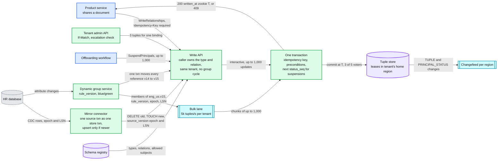

- The idempotency key is required: a keyless retry, after another admin's revoke, would quietly re-grant. The key and its response zookie are stored in the same transaction, 24 h. `source_version` carries an epoch because a promoted Postgres primary can reissue LSNs on a new timeline. An epoch change triggers a re-snapshot and sweep. Dynamic group members also carry the `rule_version`, so a slow recompute never undoes a newer incremental change. See [`../../concepts/exactly-once.md`](../../concepts/exactly-once.md).

### D3c. Derived-index pipeline

Every consumer of a region's Watch stream keeps a watermark per tenant. A check or a list page uses a derived index only when that watermark covers its snapshot.

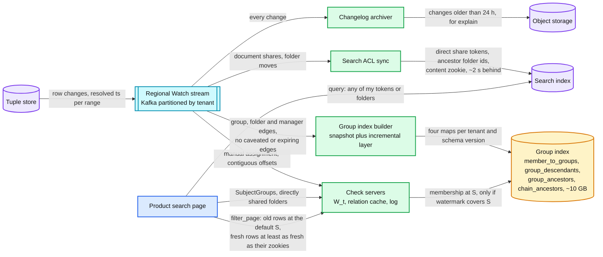

An offset gap or a consumer rebalance drops the affected tenants' cache entries and replays their last 2 minutes before serving them from cache again. Each consumer ignores changes at or below the revision it has applied, so a replay is harmless. Manager chains are flattened too (`chain_ancestors`), because a DENY must walk to the top of the org, 8 to 12 levels, ~14 ms warm and ~22 ms cold by recursion, past the 12 ms try. A VP move rewrites ~200k entries, ~20 s to ~7 min depending on the builder's rate, during which that tenant's chain checks fall back to recursion. A manager cycle from bad HR data is never flattened: it stays recursive, the dispatch-path cut ends it, and it alerts. A folder share rewrites zero documents, because documents carry their folder path. See [`../../concepts/stream-processing.md`](../../concepts/stream-processing.md).

## D4. Happy paths, one per FR

### D4a. FR3: an HR admin's employee list, page 3, through a LookupResources plan

The HR admin is `user:u5`, holder of binding `b9` (role `r1`, "Comp Viewer") through `group:eng_hr`, scoped to the dynamic group `eng_us`, plus one direct grant on `e88`. `e17` has u5 on its `blocked` list (a conflict of interest).

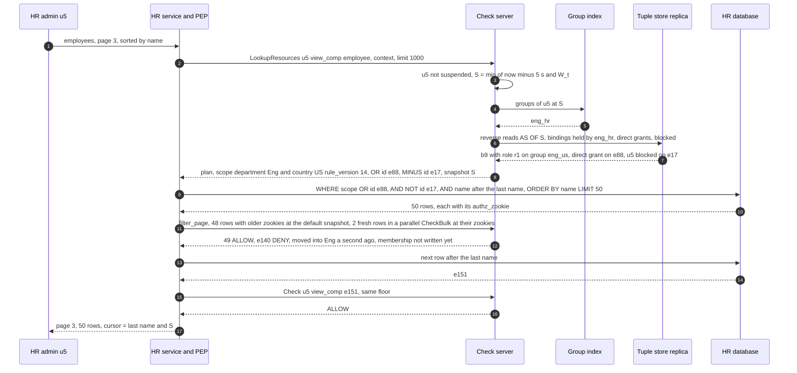

- Keyset paging, never OFFSET: over 20 post-filtered pages at 10% denied, OFFSET repeated 101 rows or skipped 222, keyset 0 and 0 (simulated, `solution.md` §5.5).
- The next page is authorized at `max(default, cursor S, the page's zookies)`, so a revoke lands on the next page. The predicate is valid only because the HR database owns the attributes the rule reads. Caveat-gated scopes come back as a separate list.

### D4b. FR3: a search page over 20 M documents

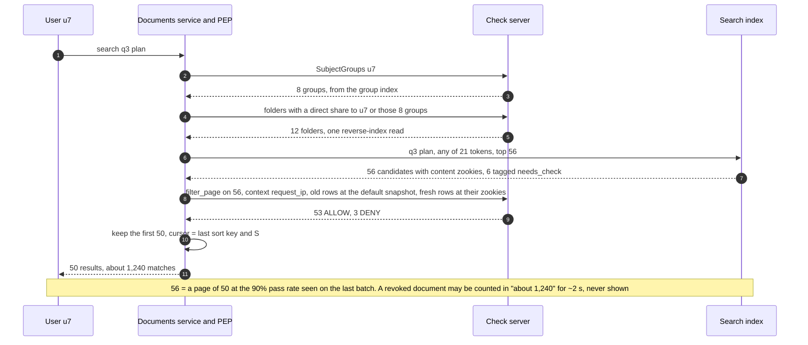

Sizing the fetch from the observed pass rate needs ~1 round where a fixed 1.5x top-up needed ~7 at a 10% pass rate (`solution.md` §5.5). The 12 folders are [estimate]. Listing every folder u7 can view would add each subfolder of a shared root as a needless term. Above ~1,000 terms [estimate] the query splits.

### D4c. FR4: explain a logged decision

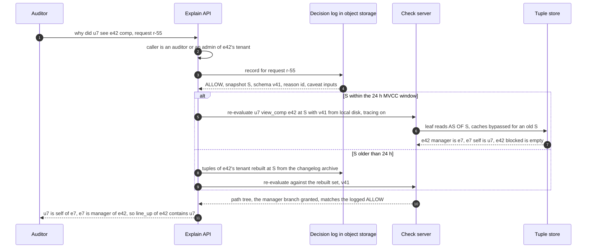

## D5. Failure paths

`solution.md` §10.4 has two: a bad build in one cell, and a region's Kafka cluster stalling for 10 minutes. Five more follow.

### D5a. A termination while one server's status poll is stale

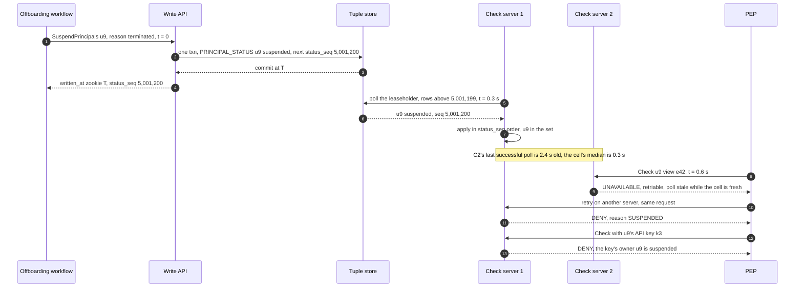

The design gates in-process because readiness probes were too slow: a probe tick plus endpoint removal kept a frozen server allowing Bob for p99 4.7 s, the gate p99 1.7 s (simulated, `solution.md` §5.2). After a 7-day grace, the cleanup job deletes Bob's owned tuples, each batch fenced on `status_seq`.

### D5b. A whole cell's status poll is stale

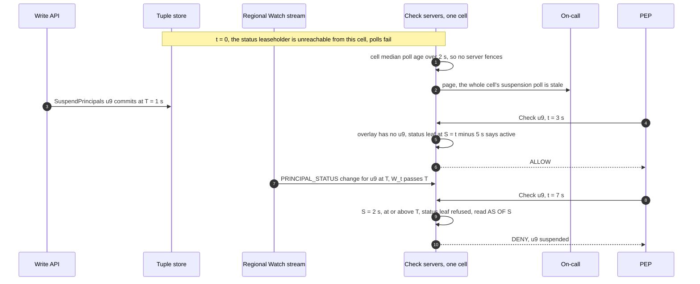

Window: ~6 s instead of 2 s, the ordinary revoke bound. The poll has no Kafka in it, so a Kafka outage never causes this case.

### D5c. A salary edit behind a lagging mirror

The mirrored new-enemy case (`solution.md` §5.2): Maya stopped being Bob's manager in the HR database, the mirror has not applied it yet, and an HR admin now saves Bob's new salary.

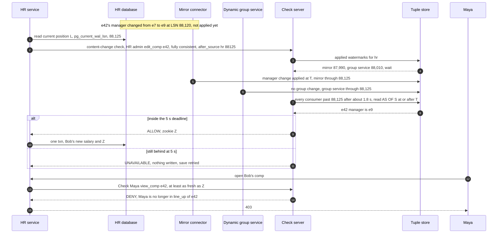

Why this order: the first draft used the salary's own LSN after committing it, which left the new salary readable under the old zookie for the whole wait. Waiting for the mirror alone still leaked 43% of reads at a 0.5 s gap, because a department change arrives through the group service (simulated, `solution.md` §5.2). Both consumers advance their watermark on every LSN, including unmapped rows, and on CDC heartbeats.

### D5d. A region is lost

us-east holds 2 of the 5 voters of every range and the leases of the tenants homed there. Lease timing is the `solution.md` §10.4 [estimate]. See [`../../concepts/raft.md`](../../concepts/raft.md) and [`../../concepts/leases-fencing-clocks.md`](../../concepts/leases-fencing-clocks.md).

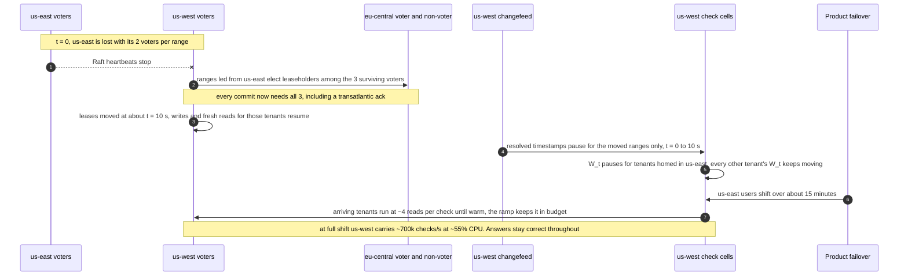

Every region keeps two readable copies of every range (the eu-central non-voter exists for this), so a single node loss never pushes a region's reads elsewhere. us-west's 32 store nodes are sized at ~1 read per check at us-east's peak.

### D5e. A stale relation-cache entry is refused

Bob is removed from `group:hr` at revision 100. Two things could go wrong: a fresh read served from an old entry, and a server that was not holding the key filling it at an older snapshot after the change already went past.

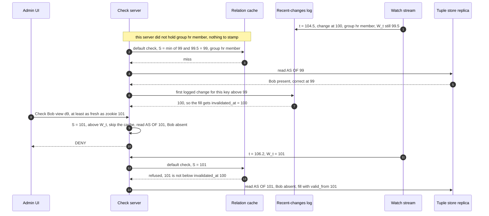

The design keeps the log because the first draft stamped only the keys a server held. Without the log, step 7 fills with `invalidated_at` unknown and step 13 hits: a stale ALLOW for Bob. A seeded run of that draft (2,000 keys, 4 changes/s, delivery lag 0.2 to 3 s, W = now minus 3 s, 600 s): 1,617 stale leaf reads out of ~227k hits (0.7%). With the log: 0. The deep dive's larger run of the same race found ~128k (12% of hits).

## D6. Decision flows

The group index or recursion choice is in `solution.md` §5.3. Three more follow.

### D6a. PEP result mapping

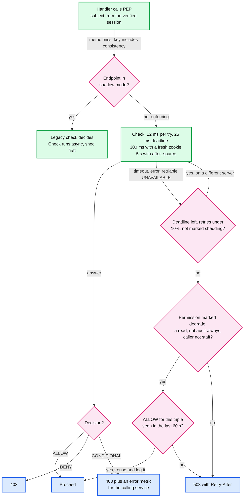

CONDITIONAL means the caller forgot to send context: a bug in the caller, counted against it, never shown to the user as "no access". The memo key includes the consistency, so a default ALLOW never answers a later `at_least_as_fresh(Z)` check in the same request.

### D6b. Snapshot selection and relation-cache use

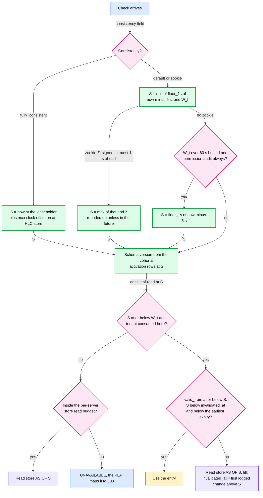

A tenant whose `W_t` is more than 8 s behind pages the on-call. Its default checks stay at `S = W_t`: staler, never wrong. `now` comes from the store's clock, not the host's (a host more than 1 s off fences itself), and S never exceeds `W_t`, so nothing can read the future. The design has no stall-time bypass because the first draft's had one: bypass the cache for everyone when a single global W was 30 s old. That sent ~4 reads per check to a store sized for ~1, a 4x overload for every tenant at once.

### D6c. Listing strategy

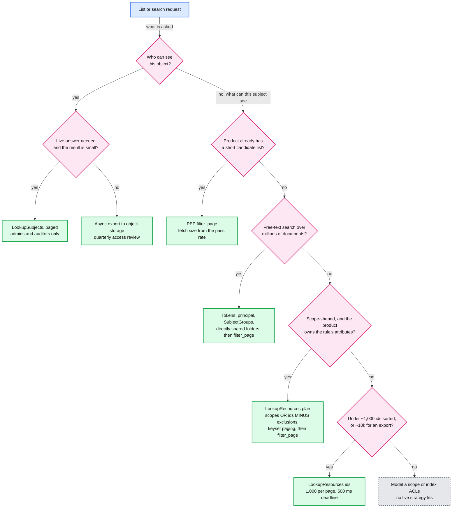

The grey box is a design conversation with the product team, not a runtime path. A plan must carry all three parts: a scope alone drops the employees visible through `self` or the manager chain, and a post-check can remove extra rows but never notice missing ones. [`deep-dives/list-filtering-and-search.md`](deep-dives/list-filtering-and-search.md) has the decision table.

## D7. Entity relationship

The store schema (TUPLE with `source_version`, SCHEMA_VERSION, SCHEMA_ACTIVATION, PRINCIPAL_STATUS with `status_seq`, DYNAMIC_GROUP_RULE, IDEMPOTENCY_KEY) is in `solution.md` §3.3. Below, entities from §3.3 appear only with the attributes needed for the relationships.

### D7a. Change stream, derived indexes, decision log

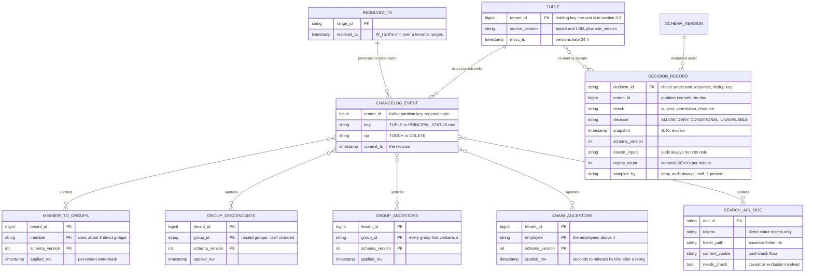

Access patterns: Watch consumers read `CHANGELOG_EVENT` in offset order per tenant partition and advance each tenant's watermark from `RESOLVED_TS`. A check reads one key of a group map at a time. Search reads `SEARCH_ACL_DOC` by token or folder id. Explain reads `DECISION_RECORD` by request within a tenant and day, kept 13 months [estimate].

### D7b. Control plane, product side, in-memory state

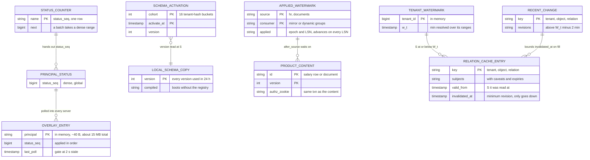

`OVERLAY_ENTRY`, `TENANT_WATERMARK`, `RELATION_CACHE_ENTRY` and `RECENT_CHANGE` live in each check server's memory. A warm restart writes them to local disk and replays the Watch stream from the saved watermarks before taking ring slots. `PRODUCT_CONTENT` lives in the product's own database.

## D8. State machines

The schema version lifecycle (draft, shadow, canary, active, retired) is in `solution.md` §5.6. Three more follow.

### D8a. A principal: active, suspended, cleaned

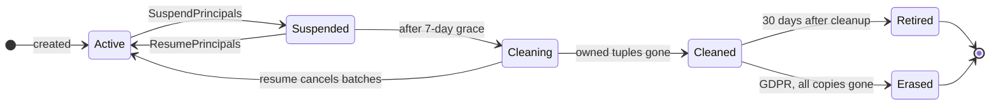

Every transition takes a new `status_seq`, and servers apply rows in that order. Mirrored tuples are left to their source. `SuspendTenant` is one row for a whole tenant. GDPR erasure keeps only a pseudonymous id in the decision log.

### D8b. A dynamic group rule edit, blue/green

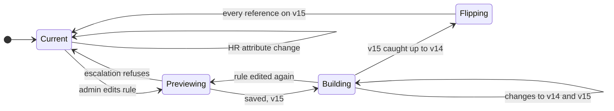

Building `group:eng_us.v15` takes ~1 s to evaluate and ~20 s to write for 100k employees in the bulk lane, while the incremental path writes attribute changes to both versions. The flip waits until v15's applied LSN has caught up with v14's, then one small transaction moves every reference to the group (scope bindings, holder tuples, parent-group memberships). `after_source` waits on a building version too. The first draft applied the diff in batches: removing 90k members took ~18 s and exposed partial states. Members carry `(rule_version, epoch, LSN)` and are upserted only if newer.

### D8c. A tuple, including expiry

```mermaid
%% D8c: one tuple version. A zookie check sees it as soon as it commits, a default check about 6 s later. Expiry and deletion are both decided per snapshot, so a check at an older S still sees it.
stateDiagram-v2
    direction LR
    [*] --> Committed: TOUCH at T
    Committed --> Live: default S reaches T
    Live --> Live: TOUCH, new version
    Live --> Expired: expires_at at or before S
    Expired --> Live: renewed by a TOUCH
    Live --> Deleted: DELETE at T2
    Live --> Tombstone: mirror delete
    Tombstone --> Collected: reconciled-through floor
    Expired --> Collected: 24 h after expiry
    Deleted --> Collected: 24 h MVCC window
    Collected --> [*]
```

`Tombstone` exists only for mirrored tuples: it keeps the delete's `(epoch, LSN)` so a replayed older insert is ignored, until a reconciliation sets a "reconciled through" floor. Expiry fires no change event, so both caches and the group index check `expires_at` on every read. A caveated or expiring edge never enters the group index.

## D9. Deployment / topology

The zoom-out is `solution.md` §5.4. Below: us-east in detail, the other two regions collapsed.

```mermaid
%% D9: one region in detail. Red = the check cells, on every request path. Only Raft traffic, writes and the 500 ms status poll cross a region boundary. A check never does, and each region's Watch stream is its own.
flowchart LR
    subgraph USE[us-east, ~45% of checks]
        direction TB
        PEPE[Product services<br/>PEP] -->|"Check, home cell"| CE[Check cells 1 to 4<br/>6 servers each, 16 cores, 16 GB]
        CE -->|"group lookups, under 1 ms"| GIE[Group index<br/>~6 servers, ~10 GB]
        CE -->|"leaf reads AS OF S"| STE[(Store, 32 nodes<br/>2 voters per range,<br/>status table leaseholder)]
        WAE[Write API, mirror<br/>connectors, group service] -->|"txn, ~70 ms p50"| STE
        STE -->|"regional changefeed"| KE[[Kafka us-east<br/>tenant partitions]]
        KE -->|"changes, W_t"| CE
    end
    subgraph USW[us-west]
        CW[Check cells 1 to 4<br/>6 servers each] -->|"AS OF S"| STW[(Store, 32 nodes<br/>2 voters per range)]
        STW -->|"regional changefeed"| KW[[Kafka us-west]]
    end
    subgraph EUC[eu-central]
        CEU[Check cells 1 to 3<br/>5 servers each] -->|"AS OF S"| STEU[(Store, 22 nodes<br/>1 voter, 1 non-voter)]
    end
    STE <-->|"Raft, every commit needs<br/>a remote ack"| STW
    STW <-->|"Raft"| STEU
    CW -->|"status poll, 500 ms"| STE
    CEU -->|"status poll, 500 ms"| STE
    KE -->|"decision records, batched"| LAKE[(Object storage<br/>15 TB/yr)]

    class PEPE,WAE service
    class CE,CW,CEU critical
    class GIE cache
    class STE,STW,STEU store
    class KE,KW queue
    class LAKE external

    classDef service  fill:#dcfce7,stroke:#16a34a,stroke-width:2px,color:#111
    classDef store    fill:#ede9fe,stroke:#7c3aed,stroke-width:2px,color:#111
    classDef cache    fill:#fef3c7,stroke:#d97706,stroke-width:2px,color:#111
    classDef queue    fill:#cffafe,stroke:#0891b2,stroke-width:2px,color:#111
    classDef critical fill:#fee2e2,stroke:#dc2626,stroke-width:4px,color:#111
    classDef external fill:#e5e7eb,stroke:#6b7280,stroke-width:2px,color:#111,stroke-dasharray:4 3
```

- ~63 check servers: 24 in us-east, 24 in us-west, 15 in eu-central, N+2 per cell. us-west taking all of us-east runs at ~55% CPU, so on failover the store is the constraint, not the check servers.
- ~86 store nodes (32, 32, 22): ~1 read per check at each region's own peak, 70% of a ~20k reads/s ceiling [estimate]. eu-central's Kafka and group index are not drawn. The status table's leaseholder is drawn in us-east for the example.

## D10. Scaling / partitioning

Two partitionings matter: the store's ranges (data, keyed by tenant) and each cell's ring (compute, keyed by sub-problem). The hot spot is on the ring, not in the store, because caches absorb repeated reads of one key before they reach a range.

```mermaid
%% D10: tenants to cells, sub-problems to ring owners, tuples to ranges. Red = the ring owner of a hot key in a big tenant. The fixes, in order of effect: caller-side cache, hot-key replication, whole-object reads, a dedicated cell.
flowchart LR
    TEN[200k tenants<br/>median ~40 people] -->|"cell map, hash of tenant"| BIG{Tenant above ~5%<br/>of the region's checks?}
    BIG -->|"no"| SC[Shared cells<br/>4, 4 and 3 per region]
    BIG -->|"yes, acme 20% of 1 M/s"| DC[Dedicated cell for acme<br/>~200k checks/s]
    SC -->|"sub-problem key"| RING[Ring per cell<br/>100 vnodes per server]
    DC -->|"sub-problem key"| RING
    RING -->|"org acme binding, every acme check"| HOT[Owner of the hot key<br/>~200k lookups/s without a fix]
    F1[Fix 1: caller-side cache<br/>~1 request per server per second] -.->|"collapses repeats"| HOT
    F2[Fix 2: top-k sketch<br/>hot key to k owners] -.->|"spreads load"| HOT
    F3[Fix 3: hot objects read whole,<br/>lock table collapses misses] -.->|"one store read per key per S"| HOT
    DEAD[A dead cell] -->|"tenants spread over all other cells<br/>by tenant hash, replay 2 min"| SC
    RING -->|"leaf miss"| RNG[(Store ranges<br/>key = tenant_id first,<br/>split by size and load)]
    RNG -->|"acme: 10 M tuples, ~3 GB"| ACR[(acme spans a few ranges<br/>leases in its home region)]
    IMP[[Bulk import<br/>5k tuples/s per tenant]] -->|"10 M tuples in ~33 min"| ACR

    class TEN client
    class BIG decision
    class SC,DC,RING,F1,F2,F3 service
    class HOT critical
    class DEAD client
    class RNG,ACR store
    class IMP queue

    classDef client   fill:#dbeafe,stroke:#2563eb,stroke-width:2px,color:#111
    classDef service  fill:#dcfce7,stroke:#16a34a,stroke-width:2px,color:#111
    classDef store    fill:#ede9fe,stroke:#7c3aed,stroke-width:2px,color:#111
    classDef queue    fill:#cffafe,stroke:#0891b2,stroke-width:2px,color:#111
    classDef critical fill:#fee2e2,stroke:#dc2626,stroke-width:4px,color:#111
    classDef decision fill:#fce7f3,stroke:#db2777,stroke-width:2px,color:#111
```

- A dead cell's tenants go to every other cell, never to one spillover cell: one spillover cell ran at ~89% CPU and collapsed under retries, spreading gave ~59% (simulated, `solution.md` §5.4).
- Store: 0.9 TB of logical data split by `tenant_id` first. At a 512 MB range size that is ~1,800 ranges, and a 3 GB tenant spans ~6 [estimate]. Read rate, not data size, is the constraint. See [`../../concepts/sharding.md`](../../concepts/sharding.md) and [`../../concepts/rate-limiting-and-load-shedding.md`](../../concepts/rate-limiting-and-load-shedding.md).

## D11. Failure mode map

Component and failure, then blast radius (on the arrow), then mitigation. Split in two to stay under 15 nodes. The full table is `solution.md` §5.7.

### D11a. The check path

```mermaid
%% D11a: red = a bad check cell (bad build, hot key, pathological check), the failure that hits the most callers fastest. Everything else is bounded to one server, one class of check, or one region's misses.
flowchart TD
    CP[Check path] -->|"fails"| F1[Check server dies]
    CP -->|"fails"| F2[Cell: bad build, hot key,<br/>pathological check]
    CP -->|"fails"| F3[Region's store unhealthy]
    CP -->|"fails"| F4[One server's status poll stale]
    CP -->|"fails"| F5[Group index down or behind]
    CP -->|"fails"| F6[Overload in a cell]
    F1 -->|"its in-flight checks, one retry ~12 ms"| M1[N+2 per cell,<br/>PEP retries on another server]
    F2 -->|"~25% of a region's tenants"| M2[Caller-side cache, hot-key replication,<br/>1,000 sub-problem budget, cell-by-cell<br/>deploys, remap spread by tenant hash]
    F3 -->|"that region's misses, +30 to 70 ms"| M3[Region-degraded mode, 150 ms budget,<br/>then evacuate the region]
    F4 -->|"terminated users on that server"| M4[In-process gate: it refuses checks,<br/>the PEP retries elsewhere]
    F5 -->|"deep-group and chain checks, p99 ~9 to 22 ms"| M5[Fall back to recursion]
    F6 -->|"lowest class first"| M6[Shed shadow checks, exports and LookupSubjects,<br/>LookupResources, background, interactive last]

    class CP service
    class F1,F3,F4,F5,F6 decision
    class F2 critical
    class M1,M2,M3,M4,M5,M6 service

    classDef service  fill:#dcfce7,stroke:#16a34a,stroke-width:2px,color:#111
    classDef critical fill:#fee2e2,stroke:#dc2626,stroke-width:4px,color:#111
    classDef decision fill:#fce7f3,stroke:#db2777,stroke-width:2px,color:#111
```

### D11b. Writes, pipelines and the control plane

```mermaid
%% D11b: no red. None of these is on the check path itself. A schema activation has the widest blast radius (one cohort, then all), which is why it gets the slowest rollout.
flowchart TD
    WP[Writes, pipelines,<br/>control plane] -->|"fails"| F7[Watch stream stalls,<br/>some ranges or a region's Kafka]
    WP -->|"fails"| F8[Status leaseholder unreachable<br/>from a whole cell]
    WP -->|"fails"| F9[Mirror connector stuck]
    WP -->|"fails"| F10[Schema activation ships<br/>a bad version]
    WP -->|"fails"| F11[Decision log Kafka down]
    WP -->|"fails"| F12[Tenant admin grants too much]
    WP -->|"fails"| F13[Changefeed skips a change<br/>but advances resolved]
    F7 -->|"those tenants' revokes slow, nothing wrong"| M7[Per-tenant W_t, page at 8 s,<br/>fresh checks read store within budget]
    F8 -->|"terminations land in ~6 s, not 2 s"| M8[Nobody fences, status leaf<br/>backstop, page]
    F9 -->|"new HR relationships late"| M9[Lag alert at 60 s, after_source<br/>waits up to 5 s instead of leaking]
    F10 -->|"one cohort, then all"| M10[Compat rules, replay plus data diff,<br/>canary dual evaluation, one-step rollback]
    F11 -->|"audit only, ~6 h of spool"| M11[Spool, drain before terminate,<br/>then audit always checks fail closed]
    F12 -->|"that tenant"| M12[Escalation check, access preview,<br/>pair-counted second admin]
    F13 -->|"silent stale reads"| M13[Verifier re-reads 0.1% of hits,<br/>pages and flushes the tenant]

    class WP service
    class F7,F8,F9,F10,F11,F12,F13 decision
    class M7,M8,M9,M10,M11,M12,M13 service

    classDef service  fill:#dcfce7,stroke:#16a34a,stroke-width:2px,color:#111
    classDef decision fill:#fce7f3,stroke:#db2777,stroke-width:2px,color:#111
```

## D12. Rollout / migration

Moving ~400 services from their own checks to this service (`solution.md` §5.6). Waves go from low risk to money movement. Each endpoint keeps its own rollback point, the enforce flag, until its legacy check is deleted. Wave sizes and durations are [estimate], sized so the last ~10% of services take about half the calendar.

```mermaid
%% D12: platform first, then four waves. An endpoint enforces after zero unexplained mismatches over at least 3 M shadow checks for its pattern, in a window that includes a month-end, then runs 2 weeks of reverse shadow. Milestones are rollback points.
gantt
    title Migration of 400 services to the check service
    dateFormat YYYY-MM-DD
    axisFormat %b %Y
    section Platform
    PEP library in 5 languages, shadow mode     :p1, 2026-11-02, 60d
    Replay job and mismatch dashboard           :p2, 2026-11-02, 60d
    Rollback point, nothing enforced            :milestone, m0, after p1, 0d
    section Wave 1, 60 internal read-only tools
    Inventory, model, mirror                    :w1a, after m0, 30d
    Shadow and triage through a month-end       :w1b, after w1a, 35d
    Enforce at 3 M clean checks per pattern     :w1c, after w1b, 14d
    Reverse shadow 2 weeks                      :w1d, after w1c, 14d
    Rollback point, enforce flag                :milestone, m1, after w1c, 0d
    section Wave 2, 150 low-risk reads
    Inventory, model, mirror                    :w2a, after w1a, 45d
    Shadow and triage through a month-end       :w2b, after w2a, 45d
    Enforce and reverse shadow                  :w2c, after w2b, 28d
    Rollback point, enforce flag                :milestone, m2, after w2b, 0d
    section Wave 3, 150 writes
    Inventory, model, mirror                    :w3a, after w2a, 45d
    Shadow and triage through a month-end       :w3b, after w3a, 60d
    Enforce and reverse shadow                  :w3c, after w3b, 28d
    Rollback point, enforce flag                :milestone, m3, after w3b, 0d
    section Wave 4, 40 money movement and long tail
    Inventory, model, mirror                    :w4a, after w3a, 60d
    Shadow, quiet endpoints replay legacy logs  :w4b, after w4a, 120d
    Enforce and reverse shadow                  :w4c, after w4b, 28d
    Rollback point, enforce flag                :milestone, m4, after w4b, 0d
    section Retire
    Delete legacy checks per endpoint           :r1, after w1d, 330d
    Mirror connectors stay as the data path     :milestone, m5, after w4c, 0d
```

- The gate is counted in checks seen, pooled across endpoints that share a pattern: "14 clean days" proves a 1-in-10^6 mismatch rate only above ~2.5 checks/s, and a month-end-only class shows up in 14 days about half the time (simulated, `solution.md` §5.6). Quiet endpoints replay legacy logs offline. Mismatches are triaged as a legacy bug, a model bug, or mirror lag (re-check at a later snapshot to tell them apart). Shadow checks are the first thing shed under load.
