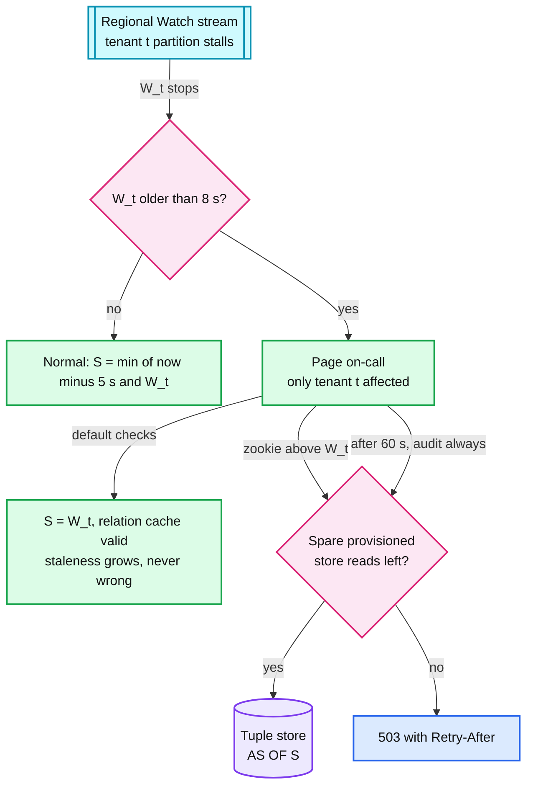
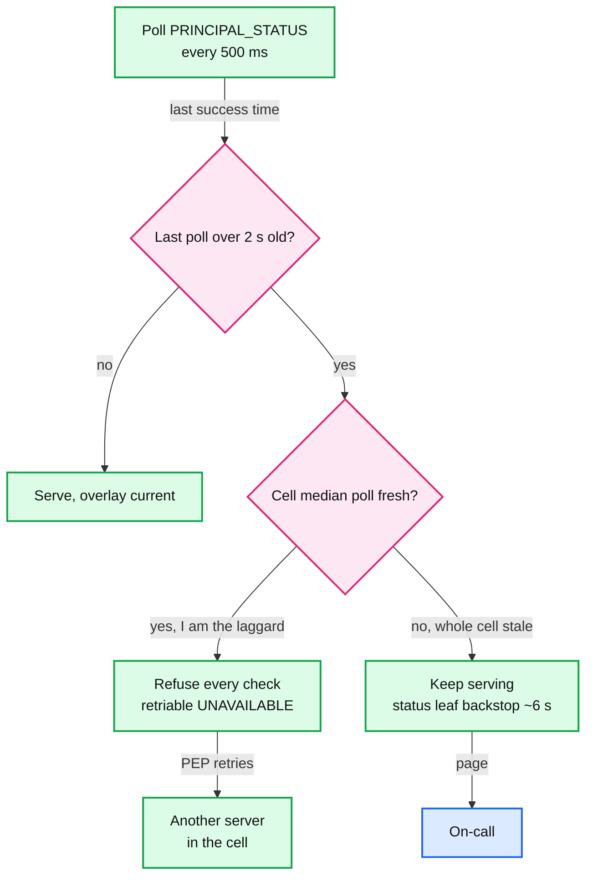
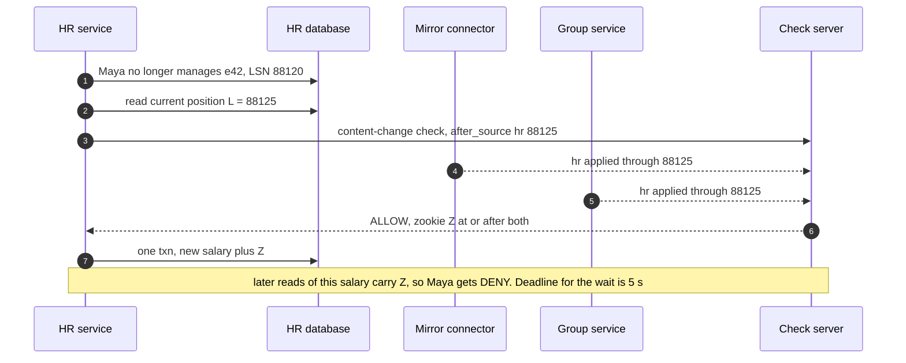
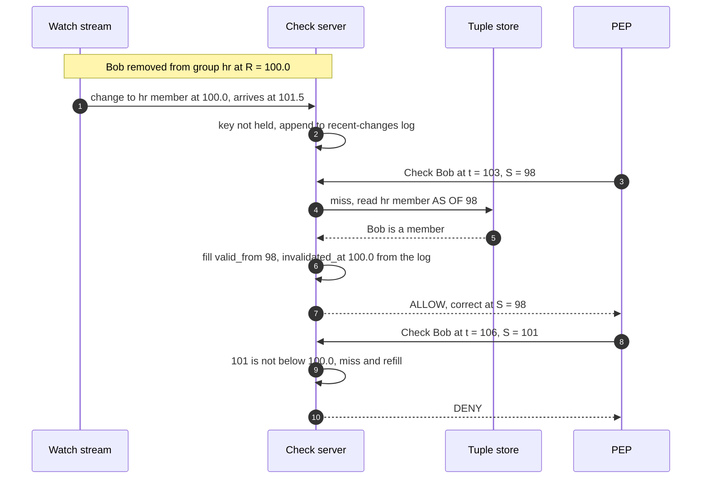
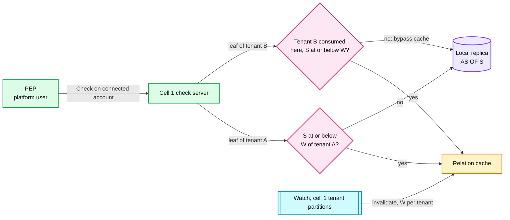
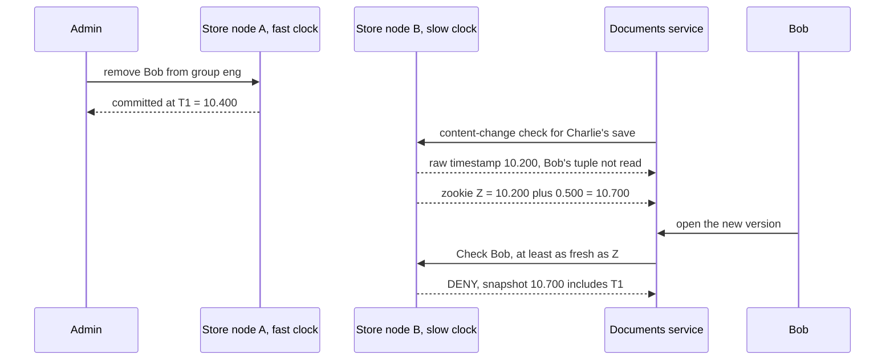
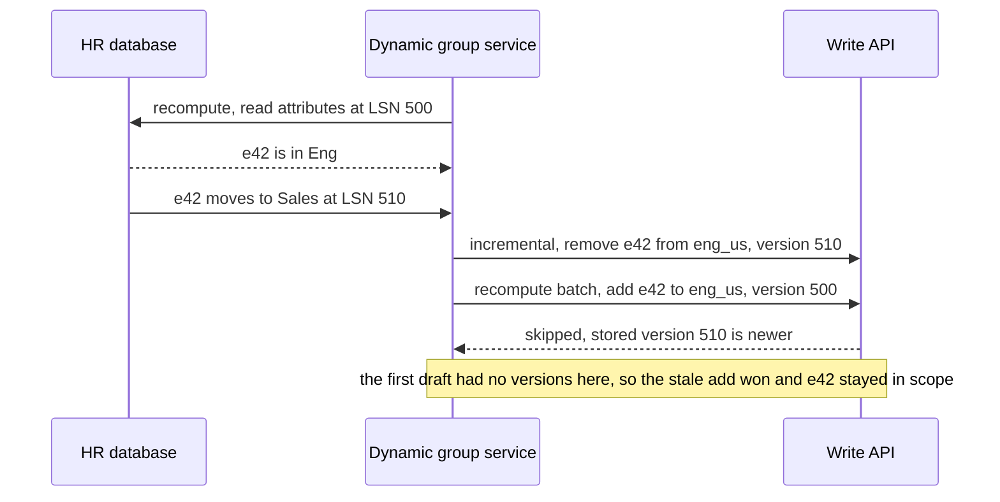
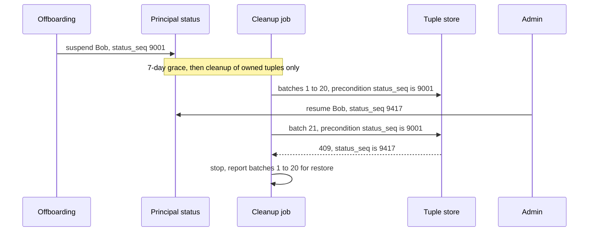
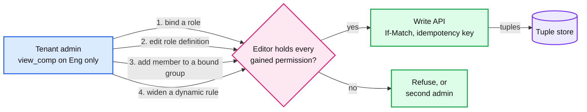

# Edge cases: authorization service

Every entry is answerable in under 60 seconds out loud. Categories: failure, consistency, scale, data, operations, security. Design reference: [`solution.md`](solution.md). Diagram set: [`diagrams.md`](diagrams.md).

Most entries came from an adversarial pass over the first draft of the design: racing admins, lagging streams, mirrored databases that fail over, terminated employees with long-lived sessions, hostile tenant admins. Each entry now says what the design does. Where the first draft failed, the entry keeps that failure as the reason ("the first draft did X, simulated: ..."). A **Gap:** line marks the few cases the current design still does not handle. Numbers tagged **[sim]** come from three small scripts run for this file (standard library Python, seeded where random). The model is stated where the output is pasted. Treat them like estimates.

Terms used throughout: PEP (policy enforcement point, the check library inside each calling service), S (the snapshot a check reads), `W_t` (the resolved watermark a check server has consumed for tenant t), zookie (a signed snapshot token), CDC (change data capture), LSN (log sequence number, a position in a database's write-ahead log).

---

## Failure

## Edge case: a check server dies in the middle of a check
- **Trigger:** a process crash or host loss while it holds in-flight checks and owns ~1/N of its cell's sub-problem keys.
- **Symptom:** the PEP's first try times out at 12 ms. Servers that dispatched sub-problems to it wait on a dead owner.
- **Answer:**
  - The PEP retries once on a different server inside the 25 ms deadline, within a 10% retry budget. The caller sees ~12 ms extra on those checks.
  - Each dispatch hop must be acknowledged within 3 ms. Past that, the dispatching server evaluates the sub-problem itself or tries the key's next replica, so nobody waits for the dead owner. The 3 ms times the acknowledgement, not the answer, so cold work is never re-run.
  - The ring moves ~1/N of keys (100 virtual nodes per server). N+2 per cell absorbs the capacity. Planned restarts are warm (caches and watermarks saved to local disk), so only crashes start cold.
- **Confidence:** [ ] shaky  [ ] ok  [ ] confident

## Edge case: a region's local store replicas are unhealthy
- **Trigger:** both readable replicas in us-east are slow or down for many ranges (a bad store build), while the check servers are fine.
- **Symptom:** every cache miss reads the nearest other region, +30 to 70 ms.
- **Answer:**
  - The first draft called this "slower, still correct" under the normal 25 ms deadline. **[sim]** At an 80% leaf hit rate, 36% to 79% of checks (depth 1 to 6) exceed 25 ms and would return 503.
  - So the design runs a **region-degraded mode**: the check service tells PEPs to use a 150 ms budget for that region's tenants, and the on-call treats it as a trigger to evacuate the region. **[sim]** At a warm 95% hit rate, depth 6 is p99 116 ms, inside 150 ms. With cold caches (80%), depth 4 is 164 ms and does not fit, so evacuation is the real fix.
- **Confidence:** [ ] shaky  [ ] ok  [ ] confident

## Edge case: one store node in eu-central dies
- **Trigger:** a disk or host failure on one of eu-central's store nodes.
- **Symptom:** in the first draft (5 voters placed 2, 2, 1), eu-central held one copy per range. ~7% of EU ranges would go cross-region for the ~11 minutes it takes to rebuild ~64 GB.
- **Answer:**
  - The design adds a **non-voting replica in eu-central**, so every region has two readable copies of every range. A single node loss changes nothing a user can see.
  - The cost is storage, not nodes: nodes are sized by reads. Disk goes from ~4.5 TB to ~5.4 TB.
- **Confidence:** [ ] shaky  [ ] ok  [ ] confident

## Edge case: a whole US region is lost
- **Trigger:** us-east disappears. It holds 2 of 5 voters and ~45% of check traffic.
- **Symptom:** writes and fresh reads for us-east-homed tenants stall while leases move. Products shift users to us-west.
- **Answer:**
  - Quorum: 3 voters survive and all 3 must acknowledge, so every commit pays the transatlantic round trip, and one more replica loss stops writes for that range. (The first draft said "3 of the 4 remaining".) Leases move in ~10 s [estimate].
  - Check CPU: us-west (4 cells of 6 servers) carries ~700k checks/s at ~55% CPU.
  - Store: us-west is provisioned at ~1 read per check for us-east's peak (32 nodes, 640k reads/s ceiling, run at 70%). Moved traffic arrives cold at ~4 reads per check. **[sim, selected rows]** An instant shift needs 2.87x the ceiling, a 5-minute ramp of document traffic 1.57x. A 15-minute ramp peaks at 0.22x (HR-shaped, warms in ~1 min) or 0.76x (documents, ~10 min), so the design ramps failovers over ~15 minutes.

```text
ramp_min  warm_min  peak_reads/s  at_min  vs_70%_target  vs_ceiling
       0         1     1,837,500     0.0          4.10x       2.87x
      15         1       143,500    15.0          0.32x       0.22x
       5        10     1,002,285     5.0          2.24x       1.57x
      15        10       485,723    15.0          1.08x       0.76x
```
- **Confidence:** [ ] shaky  [ ] ok  [ ] confident

## Edge case: the Watch stream stalls for some tenants, or for a whole region
- **Trigger:** one range's changefeed stops emitting resolved timestamps, or a region's Kafka cluster is down for 10 minutes.
- **Symptom:** `W_t` stops advancing for the affected tenants.
- **Answer:**
  - Watermarks are **per tenant**, so one stuck range freezes only the tenants it holds. Default checks stay at `S = W_t`: staleness grows, never a wrong answer. A tenant lagging over 8 s pages, inside the 10 s revoke SLO (service level objective).
  - Checks that need `S > W_t` (fresh zookies) read the store within the region's spare provisioned reads (~0.85 reads per check at peak). Over budget: 503. After 60 s of lag, `audit: always` checks for that tenant read the store too, within the same budget. Suspensions never wait: they are polled from the store.
  - Why: the first draft used one global W and a 30 s guard that bypassed the relation cache fleet-wide. That is ~4 to 5 store reads per check against a store sized for ~1. **[sim]** Even at the store p99 it claimed (15 ms), 21% to 38% of 3 to 4 deep checks missed the 12 ms try (overload rows under "latency budget").
- **Diagram:**


- **Confidence:** [ ] shaky  [ ] ok  [ ] confident

## Edge case: the suspension poll is stale on one server, or everywhere
- **Trigger:** one check server's poll stalls (a long GC pause, a bad network card). Or the `PRINCIPAL_STATUS` leaseholder is unreachable, so every server is stale at once.
- **Symptom:** a terminated user might still pass on the stale server.
- **Answer:**
  - Every server polls `PRINCIPAL_STATUS` at its leaseholder every 500 ms for rows above its last `status_seq` (~130 tiny reads/s fleet-wide). No Kafka in the termination path, so it shares no failure with the Watch stream.
  - **In-process gate:** a server whose last successful poll is over 2 s old while its cell's median is fresh answers every check with a retriable UNAVAILABLE, and the PEP retries elsewhere. The first draft left the load balancer through a readiness probe instead. Simulated in the deep dive: readiness p99 4.7 s, the gate p99 1.7 s.
  - Whole cell stale: nobody fences (that would be a global outage). The **backstop** carries it: every check reads the subject's status, and the owner's for keys and service accounts, as a leaf through the relation cache. The Watch stream invalidates it, so a suspension lands in ~6 s. Page.
- **Diagram:**


- **Confidence:** [ ] shaky  [ ] ok  [ ] confident

## Edge case: the HR mirror connector is stuck while HR saves salaries
- **Trigger:** the connector's replication slot stalls. Comp saves use `after_source = {hr: L}` content-change checks.
- **Symptom:** every comp save waits for an applied watermark that is not moving.
- **Answer:**
  - The save waits instead of leaking. `after_source` checks have a 5 s deadline (the healthy wait is p99 ~2 s), then the save fails with 503. Mirror lag over 60 s opens a ticket, over 5 min pages.
  - The first draft gave these checks the 150 ms fresh deadline, so most would have timed out even when healthy.
  - Idle sources do not block: every consumer advances its watermark on every LSN it reads, including rows that map to no tuple, and on CDC heartbeats.
- **Confidence:** [ ] shaky  [ ] ok  [ ] confident

## Edge case: the decision log's Kafka is down during a deny storm
- **Trigger:** Kafka is unavailable for hours, and a broken client or a scraper makes most checks DENY.
- **Symptom:** the 10 GB local spool per server fills faster than usual.
- **Answer:**
  - Normal peak: ~100k records/s over 63 servers is ~320 KB/s each, ~9 h of spool. If every check were logged: `1 M/s x 200 B / 63 ≈ 3.2 MB/s`, ~53 minutes. (The design quotes ~6 h and ~40 min, computed with the first draft's ~45 servers.) Identical DENYs are aggregated per minute, which stretches that a lot.
  - Sampled records drop first. `audit: always` records never drop: when the spool is full those checks fail closed with a 503.
  - A server never terminates with a non-empty spool. Deploys wait for it to drain, and a replaced host's volume is reattached.
- **Confidence:** [ ] shaky  [ ] ok  [ ] confident

## Edge case: the schema registry is down while servers restart
- **Trigger:** the registry's database is unavailable during an autoscale event or a rolling deploy.
- **Symptom:** in the first draft, a new server could not load the schema, could not pass readiness, and capacity shrank exactly when it was needed.
- **Answer:**
  - Every check server keeps every schema version used in the last 24 h on local disk and boots from it. The registry is needed only to change the schema, not to start a server.
  - The registry is on the circular-dependency list with the deploy pipeline, secrets, certificate issuer, DNS and operator SSO: none of them may call Check.
- **Confidence:** [ ] shaky  [ ] ok  [ ] confident

## Edge case: a check server's clock is wrong
- **Trigger:** NTP breaks on one host. Its clock drifts 10 s behind, or 40 s ahead.
- **Symptom:** in the first draft S and the lag both started from the local clock. A clock 10 s behind made revokes take ~16 s on that server. A clock ahead made every tenant look lagged, so after 60 s its `audit: always` checks went to the store and hit the budget (503s). A 250 ms skew alarm only paged.
- **Answer:**
  - `now` is the store's clock as seen in the latest store response, not the host clock. S and every lag measurement start from it, and S never exceeds `W_t`, so the server cannot read the future.
  - A host whose clock drifts more than 1 s from the store's fences itself, like the suspension gate, and the PEP retries elsewhere. See [`../../concepts/leases-fencing-clocks.md`](../../concepts/leases-fencing-clocks.md).
- **Confidence:** [ ] shaky  [ ] ok  [ ] confident

---

## Consistency

## Edge case: Alice removes Bob, then new content appears (both Zanzibar examples)
- **Trigger:** Example A: Bob is removed from folder F, then a new document goes into F. Example B: Bob is removed from document d9, then Charlie saves new text in d9. Bob opens it 1 s later with a default snapshot ~5 s old.
- **Symptom:** Example B leaks: d9's own viewer tuple still lists Bob at that snapshot. Simulated in the deep dive: 100% of such reads leak at a 2 s gap.
- **Answer:**
  - **Example A needs no zookie.** The new document's `parent` tuple is read in the same check, at one snapshot: before it exists there is no path, after it the removal is visible too. Simulated: 0 leaks. It breaks only if a product checks the folder instead of the document, so the PEP always checks the returned object.
  - **Example B needs a zookie.** The documents service makes a `fully_consistent` content-change check before saving, stores Z with version 8 in the same transaction, and every read of version 8 sends `at_least_as_fresh(Z)`. DENY.
  - Autosave is coalesced to one content-change check per document per 5 s. Explicit saves, uploads, comments, money and HR writes always get their own.
- **Confidence:** [ ] shaky  [ ] ok  [ ] confident

## Edge case: the new enemy through a mirrored relation (which LSN, and which consumers)
- **Trigger:** Maya stops managing employee e42 in HR. HR then writes a new salary. The mirror applies the manager change ~1 to 2 s later.
- **Symptom:** a content-change check made in between returns a zookie that misses the manager change, and Maya sees the new salary.
- **Answer:**
  - **Read the position first.** HR reads `L = pg_current_wal_lsn()` before the salary transaction, checks with `after_source = {hr: L}`, then commits salary plus Z in one transaction. The first draft used the salary's own LSN, which exists only after commit, so Z needed a second write and readers in between used the old zookie.
  - **Wait for every consumer.** A department change reaches authorization through the dynamic group service, not the mirror, so both publish an applied watermark and the check waits for both. Waiting for the mirror alone still leaked 43% of reads at a 0.5 s gap (simulated in the deep dive).
- **Diagram:**


- **Confidence:** [ ] shaky  [ ] ok  [ ] confident

## Edge case: a relation cache fill races an invalidation
- **Trigger:** Bob is removed from `group:hr` at R. The Watch event arrives while the owning server does **not** hold that key. Bob retries 2 s later at S < R, and the miss fills the key with the old member list.
- **Symptom:** if the server stamps only keys it holds, the entry gets `invalidated_at = infinity`, and every later check with S ≥ R passes the rule. A stale ALLOW with no time limit.
- **Answer:**
  - Each server keeps a **recent-changes log** for its cell's tenants: every change with a revision above `W_t - 2 min` (~30k entries on average, ~400k or ~40 MB at an import peak). A fill at S sets `invalidated_at` to the first logged revision above S. `invalidated_at` only ever goes down.
  - **[sim]** One server, 300 s, 20k leaf reads/s (Zipf), 200 changes/s, 30% of changes followed by a retry within 0.5 to 10 s, Watch delay 1.5 s, LRU of 60k keys. Stamping only held keys: 1,745 of ~60,000 changes left a stale entry, the oldest 299 s (the whole run, so unbounded). With the log: 0.
- **Diagram:**



```text
stamp_only  hits=5,541,736 stale_hits= 5,852 keys_stale=1,745 rate= 1056.0 per M hits  worst_age= 299.3 s
recent_log  hits=5,539,981 stale_hits=     0 keys_stale=    0 rate=    0.0 per M hits  worst_age=   0.0 s
log_gap     hits=5,540,085 stale_hits= 3,775 keys_stale=  104 rate=  681.4 per M hits  worst_age= 150.9 s
gap_replay  hits=5,517,734 stale_hits=     0 keys_stale=    0 rate=    0.0 per M hits  worst_age=   0.0 s
```
- **Confidence:** [ ] shaky  [ ] ok  [ ] confident

## Edge case: the Watch consumer skips offsets
- **Trigger:** a consumer-group rebalance hands a partition away and back, or an offset reset jumps ahead. Events in the gap are never seen.
- **Symptom:** a watermark that kept advancing would claim "every change at or below W was seen" when it was not.
- **Answer:**
  - Check servers use manual partition assignment and require contiguous offsets. `W_t` advances only from resolved markers consumed in order, so it stops at a gap. On any jump, rebalance, restart or remap, the server drops the affected tenants' entries and replays their last 2 minutes before serving them from cache.
  - **[sim]** `log_gap` above: with the log but 3 s of events skipped while W kept moving, 104 keys went stale, the oldest 151 s. `gap_replay` (W stops at the gap, then drop and replay): 0.
  - A verifier re-reads 0.1% of hits from the store at the same S, for the bug no rule catches. Offsets and watermarks: [`../../concepts/stream-processing.md`](../../concepts/stream-processing.md).
- **Confidence:** [ ] shaky  [ ] ok  [ ] confident

## Edge case: a check reads a tenant this cell does not consume
- **Trigger:** a cross-tenant check (a Connect platform on a connected account, an accounting firm's staff on a client), or a tenant just remapped to this cell.
- **Symptom:** in the first draft the server cached tenant B's keys and judged them against its own single watermark. Nothing ever invalidated them.
- **Answer:**
  - Watermarks are per tenant. A tenant the server does not consume, or is still replaying after a remap, bypasses the relation cache: its leaves are read from the local replica at S.
  - When a server stops consuming a tenant, it drops that tenant's entries. A dispatched sub-problem is judged against the **owner's** own `W_t`, never a watermark the caller sent.
- **Diagram:**


- **Confidence:** [ ] shaky  [ ] ok  [ ] confident

## Edge case: zookies on a store without commit wait
- **Trigger:** an admin removes Bob from a group at T1 on a store node with a fast clock. The content-change check runs on a node with a slow clock and does not read Bob's tuple.
- **Symptom:** on a hybrid-logical-clock store, Z can come out below T1, and Bob's read at Z misses the removal. The research file records SpiceDB's warning: "`fully_consistent` does not guarantee read-after-write consistency on CockroachDB".
- **Answer:**
  - Spanner class is preferred: TrueTime's commit wait makes Z > T1 always.
  - On a CockroachDB-class store, Z is issued as the check's timestamp plus the maximum clock offset (500 ms by default). Readers of a fresh Z wait that much longer. The cost lands on the few fresh reads.
- **Diagram:**


- **Confidence:** [ ] shaky  [ ] ok  [ ] confident

## Edge case: a zookie minted in the home region is used in another region
- **Trigger:** an admin in us-east grants or revokes at T. A reader in eu-central sends `at_least_as_fresh(T)` 1 s later.
- **Symptom:** S is at or above T, above the EU replica's closed timestamp and above `W_t`, so the relation cache is skipped and each leaf would go to the us-east leaseholder.
- **Answer:**
  - Correct by construction: zookies are global timestamps.
  - The first draft read each leaf cross-region: 30 to 70 ms per sequential read, so an HR admin's ~6-read critical path took 180 to 420 ms, over the 300 ms deadline at p99.
  - The design forwards a fresh check to a check server in the tenant's home region: one hop plus local leaseholder reads, ~40 to 100 ms, p99 under 150 ms [estimate].
- **Confidence:** [ ] shaky  [ ] ok  [ ] confident

## Edge case: a stale page or a keyless retry undoes a revoke
- **Trigger:** admin A removes Maya from the "Comp Viewer" binding. Admin B, whose page loaded earlier, saves the binding with its old holder list. Or a client's grant commits, the response is lost, another admin revokes it, and the client retries.
- **Symptom:** Maya is back and the revoke is silently undone. The first draft claimed "even a retry without a key is harmless".
- **Answer:**
  - Tenant admin edits carry `If-Match` on the object's version. B gets 409, reloads, and the access preview shows what the edit would now change.
  - `Idempotency-Key` is **required** on every write. A retry returns the original zookie and writes nothing. The same key with a different body is a 409. Keys live 24 h. See [`../../concepts/exactly-once.md`](../../concepts/exactly-once.md).
- **Confidence:** [ ] shaky  [ ] ok  [ ] confident

## Edge case: a dynamic group recompute races an attribute change
- **Trigger:** a recompute reads HR at LSN 500 and finds e42 in Eng. At LSN 510, e42 moves to Sales, and the incremental path removes e42 from `eng_us`. The recompute then writes its add.
- **Symptom:** in the first draft the stale add won, and e42 stayed in an HR admin's scope until the next change. A precondition on `rule_version` did not help: the rule had not changed.
- **Answer:**
  - Membership tuples carry `source_version = (rule_version, epoch, LSN)`, and both paths upsert only if newer. The recompute's add (LSN 500) loses to the stored removal (LSN 510).
  - Rule edits are blue/green: build `group:eng_us.v15` in the bulk lane while the incremental path writes attribute changes to **both** v14 and v15. When v15's applied LSN has caught up with v14's, one small transaction moves every reference (scope bindings, holder tuples, parent-group memberships) to v15. Narrowing is atomic, instead of 90k removals trickling out over ~18 s. `after_source` waits on a building version too.
- **Diagram:**


- **Confidence:** [ ] shaky  [ ] ok  [ ] confident

## Edge case: a schema activation races checks and a cell remap
- **Trigger:** v42 (skip-level managers lose `view_comp`) activates for the canary cohort at T. A check arrives with S just above T. Then that tenant's cell fails and the tenant is remapped.
- **Symptom:** in the first draft, activation was per cell, so a remap could move a tenant back to v41.
- **Answer:**
  - An activation is a row, `SCHEMA_ACTIVATION(cohort, activate_at, version)`, read at the check's own S. Every server answers "which version for this tenant at S" the same way, wherever the tenant is served. Dispatched sub-problems carry their version. Servers keep every version used in the last 24 h.
  - The canary cohort dual-evaluates 1% under v41 and pages on any DENY to ALLOW. A pure tightening may widen after 15 minutes.
  - **Gap:** activation rows are global, not tenant data, so no `W_t` covers them. If their changefeed lags, a server either reads them from the store on every check (one hot range at ~1 M reads/s) or uses an old row. Fix: schedule `activate_at` at least 60 s after commit, have servers poll activation rows every 1 s, and gate a server whose poll is over 30 s stale.
- **Confidence:** [ ] shaky  [ ] ok  [ ] confident

## Edge case: a cache key that forgets a dimension
- **Trigger:** the first draft keyed results as `(schema_version, object, permission, subject, S)` and the PEP memo as `(subject, permission, resource)`.
- **Symptom:** three leaks. Object ids are unique only within a tenant, so two tenants' `employee:e42` shared an entry. An ALLOW computed with an office IP could be served to a home IP at the same S. A default ALLOW could answer a later `at_least_as_fresh(Z)` check in the same request.
- **Answer:**
  - The result-cache key is `(tenant, schema_version, object, permission or relation, subject, S)`. Values are stored **before caveats** (ALLOW, DENY, or CONDITIONAL with residual caveats), and caveats are evaluated per request.
  - The PEP memo key includes the consistency. Tainted results (a cycle cut, a budget hit) are never cached. See [`../../concepts/caching-patterns.md`](../../concepts/caching-patterns.md): a key must name everything the value depends on.
- **Confidence:** [ ] shaky  [ ] ok  [ ] confident

## Edge case: a just-in-time grant expires, or a caveated membership is flattened
- **Trigger:** support gets `group:admins` membership until 14:00 via `expires_at`. Or an auditor's tuple carries `on_corp_network`.
- **Symptom:** expiry writes nothing, so no Watch event fires. A flattened index entry would keep saying "member" after 14:00, and would drop the network condition.
- **Answer:**
  - Expiry is checked on every read: a relation-cache entry is usable only for `S < earliest expires_at` in it. Result-cache entries carry the earliest expiry they depended on.
  - The group index **excludes** caveated and expiring edges. Those stay on the recursive path.
  - Expiry compares to S, which is ~5 s old, so access lasts ~5 to 6 s past `expires_at`. Say it, or issue grants 6 s shorter.
- **Confidence:** [ ] shaky  [ ] ok  [ ] confident

## Edge case: two suspensions, or a suspend and a resume, commit at the same moment
- **Trigger:** HR suspends Bob while an admin resumes another principal. Pollers read "rows above my last `status_seq`".
- **Symptom:** if transaction 102 committed before 101, a poller could see 102, advance past 101, and never see it.
- **Answer:**
  - `status_seq` comes from one counter row updated in the same transaction. Writers serialize on that row, so sequence order is commit order and every poll sees a gap-free prefix.
  - Rows are applied in `status_seq` order, so a delayed suspend never overrides a later resume, or the reverse. A batch of up to 1,000 takes a dense range.
- **Confidence:** [ ] shaky  [ ] ok  [ ] confident

---

## Scale

## Edge case: the latency budget when a check must recurse
- **Trigger:** the interviewer asks whether p99 < 10 ms holds when a check walks sequential leaf reads: a group or chain while the index is behind S, or a caveated edge, which is never flattened.
- **Symptom:** §2's ~7.5 ms budget assumes one miss and two hops. A DENY on a manager chain must walk to the top of the org, 8 to 12 levels.
- **Answer:**
  - **[sim, selected rows]** PEP hop 0.5 ms, dispatch 0.3 ms per hop, queueing exp(mean 0.3 ms), store read lognormal (median 0.5 ms, p99 ~5 ms), `- blocked` read in parallel. At an 80% leaf hit rate: depth 3 p99 6.6 ms, depth 6 9.2 ms, depth 12 13.8 ms with 2.1% of checks past the 12 ms try. Hedged at p95: 5.3, 7.4 and 11.3 ms.
  - That depth-12 row is why manager chains are flattened (`chain_ancestors(employee)`, one index read). Recursion stays as the fallback, and it fits at the depths where it is still used.
  - This model's tail is lighter than the deep dive's, which finds 0.34% of unhedged checks missing 25 ms. Hedging store reads is mandatory either way. It breaks under an overloaded store (the first draft's stall guard) and on cross-region reads.

```text
mode      hit   depth   p50    p99   >12ms  >25ms
plain    0.80     3    2.0    6.6   0.1%   0.0%
plain    0.80     6    3.3    9.2   0.3%   0.0%
plain    0.80    12    6.0   13.8   2.1%   0.0%
hedge    0.80     3    2.0    5.3   0.0%   0.0%
hedge    0.80     6    3.3    7.4   0.0%   0.0%
hedge    0.80    12    6.0   11.3   0.5%   0.0%
overload 0.00     3    7.9   30.7  20.9%   2.1%
overload 0.00     4   10.5   35.3  37.9%   4.0%
xregion  0.80     1    1.3   70.9  36.0%  36.0%
xregion  0.80     4   48.2  163.6  67.2%  67.2%
xregion  0.80     6   60.8  204.6  79.0%  79.0%
xregion  0.95     6    2.8  116.0  30.1%  30.1%
```
- **Confidence:** [ ] shaky  [ ] ok  [ ] confident

## Edge case: one tenant is 20% of traffic and every check reads its org binding
- **Trigger:** every check in tenant acme reads `org:acme#binding` and `role:r1#grants_view_comp`. Each key has one owner on the ring.
- **Symptom:** ~200k/s of sub-problems would land on one server, and a retry would land on the same owner.
- **Answer:**
  - **Caller-side cache** (Zanzibar caches at both caller and callee): after the first dispatch in each 1 s quantum, every server answers the hot key locally. The owner sees ~1 request per server per second.
  - A top-k sketch replicates the hottest keys to k owners. The lock table collapses concurrent misses. Hot objects are read whole.
  - acme is above 5% of its region, so it gets its own cell. The 3 ms hop acknowledgement stops a slow owner from stalling its callers.
- **Confidence:** [ ] shaky  [ ] ok  [ ] confident

## Edge case: a reorg moves a VP with 20k reports
- **Trigger:** HR moves a VP with 20k reports to a new place in the org. Manager chains are flattened as `chain_ancestors(employee)`.
- **Symptom:** every employee below the VP gets new ancestors: subtree size times depth, ~200k index entries for one move.
- **Answer:**
  - While the index catches up, its per-tenant watermark is behind S, so that tenant's chain checks fall back to recursion. Correct, slower (depth 12 p99 ~11 to 14 ms, sim above). Reorgs are rare, DENYs that walk the whole chain are not.
  - The mirror applies the HR transaction as one store transaction, so the chain never shows a half-moved org.
  - How long: ~200k entries take ~20 s at ~10k updates/s for one tenant's builder [estimate], up to ~7 minutes at Leopard's observed incremental rate of ~500/s. The first draft promised 13 to 40 s without stating a rate.
- **Confidence:** [ ] shaky  [ ] ok  [ ] confident

## Edge case: an autosaving document makes every read fresh
- **Trigger:** a collaborative document autosaves every 2 s, and 100 viewers reload the latest version.
- **Symptom:** a zookie per save would make every viewer's check a "Recent" one (Zanzibar p95 ~60 ms, against ~11 ms for "Safe"), forever while the document is busy.
- **Answer:**
  - Content-change checks are coalesced to one per document per 5 s for autosave. A draft keyword typed within 5 s of a removal can still be read by the removed user: accepted for drafts only.
  - Explicit saves, uploads, comments, money and HR writes always get their own check. Peak cost: ~10k content-change checks/s, ~50k leaseholder reads/s.
  - A list page's `filter_page` splits the rows: those whose zookie is at or below the default snapshot go in one CheckBulk at that snapshot, and the few fresh rows go in a second, parallel CheckBulk at least as fresh as their zookies. One busy document cannot send the whole page to the leaseholder.
- **Confidence:** [ ] shaky  [ ] ok  [ ] confident

## Edge case: a layoff suspends 10k people in 10 minutes
- **Trigger:** a 100k-employee tenant lays off 10%.
- **Symptom:** a burst of suspensions now, ~1 M tuple deletes later.
- **Answer:**
  - `SuspendPrincipals` takes up to 1,000 principals per transaction, so the burst is ~10 transactions. Every server sees them on its next 500 ms poll: denied within 2 s.
  - Cleanup waits a 7-day grace (terminations get reversed), then deletes owned tuples only: `10k x ~100 = 1 M` at 5k/s per tenant is ~200 s, fenced on `status_seq`. Mirrored tuples go when HR records change.
  - The deletes flood the Watch stream for that tenant. The recent-changes log is sized for it (~400k entries at an import peak).
- **Confidence:** [ ] shaky  [ ] ok  [ ] confident

## Edge case: how many check servers, and does a region failover fit
- **Trigger:** the first draft counted ~45 servers with N+2 per **region**, but described N+2 per **cell**.
- **Symptom:** with ~45 servers, us-west absorbing us-east would run at ~105% CPU.
- **Answer:**
  - Cells 4, 4, 3 (us-east, us-west, eu-central). A US cell runs 6 servers (4 for its share of peak plus 2 spare), an EU cell 5: **~63 servers**.
  - us-west mirrors us-east so it can take its traffic: ~700k checks/s is ~210 of 384 cores, ~55% CPU. On failover the store is the constraint, not the check servers (region entry above).
- **Confidence:** [ ] shaky  [ ] ok  [ ] confident

## Edge case: 10x checks tomorrow
- **Trigger:** a new product puts a check in every hot loop: 10 M checks/s.
- **Symptom:** ~10x check servers and store reads.
- **Answer:**
  - Check servers scale by adding cells: ~630 servers. The suspension poll grows with servers (~1.3k reads/s), still tiny.
  - The store is provisioned for cold moments (~1 read per check at each region's peak), so 10x is ~860 nodes. Warm traffic needs only ~0.15 reads per check. Making cold moments rarer (warm restarts, ramped failovers, spread remaps) is the lever that lets the store be sized nearer to warm.
  - Push back: a check per row in a loop is a listing problem. Use CheckBulk or LookupResources.
- **Confidence:** [ ] shaky  [ ] ok  [ ] confident

---

## Data

## Edge case: a schema change flips decisions nobody asked about
- **Trigger:** a hypothetical v43 widens `view_comp` to all managers in the org. Shadow replay re-evaluates ~20 h of **logged** decisions.
- **Symptom:** replay shows few DENY to ALLOW flips, because most newly allowed (manager, employee) pairs were never checked in that window. Replay sees only questions somebody asked.
- **Answer:**
  - Replay is paired with a **data diff**: LookupSubjects under both versions on a sample of objects per type. The author lists the flips that must appear and that may. An unexplained flip blocks, and so does a missing intended one.
  - Contrast v42 (skip-level managers lose `view_comp`): replay shows 3,904 ALLOW to DENY flips from 41 subjects, zero DENY to ALLOW, and the data diff agrees.
  - Rollout per cohort (16 tenant-hash buckets), 1 h bake. A pure tightening such as a security fix may go to all cohorts after a 15-minute canary.
- **Confidence:** [ ] shaky  [ ] ok  [ ] confident

## Edge case: CDC replays, deletes and re-inserts on a mirrored relation
- **Trigger:** the connector restarts from an old position after rows were deleted, re-inserted and reconciled.
- **Symptom:** an old insert could resurrect a deleted manager edge.
- **Answer:**
  - Upsert only if `source_version = (epoch, LSN)` is newer. Deletes become tombstones carrying their version, kept until a reconciliation sets a "reconciled through" floor. Anything below the floor is rejected.
  - The connector applies one source transaction as one store transaction (CDC carries the boundaries, up to 1,000 updates), so a manager swap never shows a state HR never had. Turning `manager_id = e9` into "delete e7, add e9" needs the old value: CDC before-images, or a read of the current tuples in that transaction.
  - A nightly reconcile compares each source with its tuples.
- **Confidence:** [ ] shaky  [ ] ok  [ ] confident

## Edge case: the HR database fails over and its LSNs go backwards
- **Trigger:** the HR Postgres primary dies. A replica that was 2 s behind is promoted. Writes the old primary made but never shipped are lost, and the new primary reuses those LSNs for different writes ([Postgres timelines](https://www.postgresql.org/docs/current/continuous-archiving.html#BACKUP-TIMELINES)).
- **Symptom:** with a bare LSN, new real writes compare as "older" than a lost write the connector already applied, and are ignored.
- **Answer:**
  - `source_version` is `(epoch, LSN)`. The epoch bumps on every promotion, and an epoch change triggers a re-snapshot and sweep of that source.
  - `after_source` positions carry the epoch too.
- **Confidence:** [ ] shaky  [ ] ok  [ ] confident

## Edge case: a new service's mirror backfills 50 M tuples
- **Trigger:** migration step "model and mirror" for a large service: snapshot its database, then tail CDC.
- **Symptom:** every tuple is a Watch event for check servers and the group index. At the 10k/s write peak, 50 M tuples is ~83 minutes.
- **Answer:**
  - Backfills run in the bulk lane at 5k tuples/s per tenant. Snapshot rows carry the snapshot's version, and CDC rows after it win. The new object types are still in shadow, so a lagging index hurts nothing yet.
  - **Gap:** a service-wide backfill touches every tenant at once, and a per-tenant cap does not bound the total. Add a global bulk-lane cap (~5k/s [estimate], ~2.8 h for 50 M), so the Watch stream and each cell's recent-changes log stay inside their ~400k-entry import peak.
- **Confidence:** [ ] shaky  [ ] ok  [ ] confident

## Edge case: a GDPR (General Data Protection Regulation) erasure for a former employee
- **Trigger:** Bob asks to be erased.
- **Symptom:** Bob's id lives in tuples, 24 h of MVCC (multi-version concurrency control) versions, 7 days of Kafka, search tokens, decision logs and the changelog archive in the lake.
- **Answer:**
  - Suspend, `DeleteRelationships` by subject, wait out MVCC (24 h) and Kafka retention (7 days). Search tokens drop on the next sync.
  - Rewrite or crypto-shred the lake archive's partitions, which explain uses for decisions older than 24 h. Decision logs hold only pseudonymous ids, kept 13 months [estimate].
- **Confidence:** [ ] shaky  [ ] ok  [ ] confident

## Edge case: three years of growth
- **Trigger:** 40%/yr tuple growth and growing check volume.
- **Symptom:** limits that were comfortable stop being so.
- **Answer:**
  - Tuples: `3 B x 1.4^3 ≈ 8.2 B`, ~2.5 TB logical, ~15 TB on disk with 5 voters plus 1 non-voting replica. The largest tenant goes to ~27 M tuples (~8 GB). Still easy: the store is sized by reads.
  - Decision logs: ~15 TB/yr growing with checks, capped by 13 months of retention.
  - Mirrored tombstones shrink at every reconciliation.
- **Confidence:** [ ] shaky  [ ] ok  [ ] confident

---

## Operations

## Edge case: what pages at 3am
- **Trigger:** the on-call asks which alerts are real.
- **Symptom:** a check service has many dashboards and only a few failures that matter.
- **Answer:**
  - From `solution.md` §8: a cell burning its error budget, a whole cell's suspension poll stale, any tenant's watermark over 8 s behind, a verifier mismatch, a mirror over 60 s behind (5 min to page), a DENY to ALLOW difference in the canary cohort.
  - Worth adding: host clock skew over 1 s (the server fences), an epoch change on a mirrored source, the decision-log spool over 50%, and store read utilization during a failover ramp.
  - Pages nobody: one tenant's DENY spike (tenant dashboard and support queue).
- **Confidence:** [ ] shaky  [ ] ok  [ ] confident

## Edge case: a resume races the cleanup job
- **Trigger:** Bob is suspended by mistake. Cleanup starts. An admin resumes Bob halfway through.
- **Symptom:** in the first draft cleanup started at once, had no fence, deleted mirrored tuples too, and the overlay entry expired after 30 days whether or not cleanup had finished.
- **Answer:**
  - Cleanup waits a **7-day grace**, so most mistakes are undone before anything is deleted. It deletes **owned** tuples only: mirrored ones go when the source changes, and deleting them here would fight the connector.
  - Every batch carries a precondition that `status_seq` is unchanged, so a resume stops it. Tuples already deleted can be restored from the changelog archive.
  - The status row stays until cleanup is done plus 30 days, and the overlay entry leaves only with the row.
- **Diagram:**


- **Confidence:** [ ] shaky  [ ] ok  [ ] confident

## Edge case: a ticket says "Bob still has access"
- **Trigger:** a customer reports that Bob opened a salary page after being removed.
- **Symptom:** the on-call must say whether it was a bug, staleness, or a real grant.
- **Answer:**
  - Find the decision record: snapshot S, schema version, reason id. Run Explain at S to get the path. Compare S with the removal's commit time: within ~6 s is the default bound. Beyond that, check the tenant's watermark lag, mirror lag, the server's clock and the verifier.
  - `audit: always` records carry the caveat inputs they read, so a decision that depended on `on_corp_network` replays exactly. Degraded ALLOWs (`degrade: last_known_60s`) are logged by the PEP, because the check server never saw them.
- **Confidence:** [ ] shaky  [ ] ok  [ ] confident

## Edge case: the verifier finds a mismatch in the biggest tenant
- **Trigger:** the background verifier, which re-reads 0.1% of relation-cache hits from the store, finds a stale entry for acme (20% of traffic).
- **Symptom:** the rule is "page and flush that tenant". Flushing acme makes ~200k checks/s cold at once.
- **Answer:**
  - Correctness first: a mismatch means a changefeed bug, so flushing is right.
  - **Gap:** cold acme traffic is `200k x ~4 ≈ 800k` reads/s, above us-east's 640k ceiling, with no ramp. Flush only the keys in the ranges whose changefeed misbehaved, or bypass the cache for acme's keys at a rate the store budget allows and re-warm by replaying, like a remap.
- **Confidence:** [ ] shaky  [ ] ok  [ ] confident

## Edge case: migrating 400 services doubles check traffic
- **Trigger:** shadow mode: each PEP calls Check asynchronously for every legacy decision.
- **Symptom:** shadow traffic can equal production traffic, and mismatch dashboards fill with noise from the 5 s default snapshot.
- **Answer:**
  - Shadow checks are first in the shedding order. Triage re-checks every mismatch at a later snapshot: mismatches that vanish are lag, not model bugs.
  - The gate is counted in checks, not days: zero unexplained mismatches over at least 3 M shadow checks per (pattern, permission), pooled across endpoints that share a pattern, in a window that includes a month-end. Quiet endpoints replay legacy logs offline.
  - Enforce per endpoint behind a flag, two weeks of reverse shadow, and the flag is the rollback.
- **Confidence:** [ ] shaky  [ ] ok  [ ] confident

## Edge case: the authorization service is down and you need it to fix it
- **Trigger:** a bad build takes out the admin plane, and the deploy pipeline would ask Check whether the on-call may deploy.
- **Symptom:** the outage blocks its own fix.
- **Answer:**
  - The deploy pipeline, secrets, config, certificate issuer, DNS, operator SSO and the store never call Check. The admin plane uses a static signed allowlist: two people, time-boxed, audited.
  - Cell-by-cell deploys limit a bad build to ~25% of one region's tenants. Their tenants can be spread over the other cells by tenant hash (one spillover cell would run at ~89% CPU, spreading gives ~59%).
  - Lesson from Google's 14 Dec 2020 outage (~47 min): automation cut a shared identity dependency on a "zero usage" reading. Ours refuses capacity cuts on a "zero" input.
- **Confidence:** [ ] shaky  [ ] ok  [ ] confident

---

## Security

## Edge case: a tenant admin grows their own access
- **Trigger:** an admin who holds `view_comp` only over Eng wants comp access over Sales and executives.
- **Symptom:** the first draft gated only binding a role. Three other edits widen access just as well.
- **Answer:**
  - Every widening edit runs the **escalation check**: binding a role, editing a role's definition (it re-grants every binding of the role), adding a member to a group that holds bindings, widening a dynamic group rule. The access-preview diff must show no gain the editor lacks over that scope.
  - HR attribute edits that feed scopes (department, location) are HR-product permissions with `- self`. Grants of an `audit: always` permission over more than 100k (principal, object) pairs per admin per 24 h need a second admin.
- **Diagram:**


- **Confidence:** [ ] shaky  [ ] ok  [ ] confident

## Edge case: a service writes tuples it does not own, or links two tenants
- **Trigger:** a compromised documents service writes group memberships, or a tuple from tenant A's object to tenant B's group.
- **Symptom:** it could plant grants far outside its own data.
- **Answer:**
  - Writes are limited per `(object type, relation)` per calling service: the HR mirror writes `employee.manager`, the group service writes `employee.in_scope`, and nobody else does. Cross-tenant tuples are refused unless the schema declares the relation (Connect platforms, accounting firms).
  - Wildcards like `user:*` mean users of the object's tenant, never everyone.
  - **Gap:** that wildcard rule breaks declared cross-tenant holders. A binding in client tenant C with an accounting firm's group as holder evaluates `holder & role->grants_view_comp`, and the firm's staff are not users of C, so the intersection always DENYs. Define the wildcard as "any subject allowed by the binding's holder types", or give cross-tenant roles an explicit external subject type.
- **Confidence:** [ ] shaky  [ ] ok  [ ] confident

## Edge case: enumeration through Check, explain or LookupSubjects
- **Trigger:** a compromised internal service, or a curious tenant admin, probes the graph.
- **Symptom:** "who manages whom", "who can see the CEO's salary", via yes or no answers at high rate.
- **Answer:**
  - LookupSubjects and explain are limited to the resource tenant's admins and auditors. Check returns ALLOW or DENY and a reason id. The text is only in the audit trail.
  - A service may call Check only for the object types it protects, within a per-calling-service quota ([`../../concepts/rate-limiting-and-load-shedding.md`](../../concepts/rate-limiting-and-load-shedding.md)). Every DENY is logged, so a probing caller shows up as a DENY spike.
  - A stronger seam if needed: Check for a user subject requires a token from that user's own request.
- **Confidence:** [ ] shaky  [ ] ok  [ ] confident

## Edge case: the caveat context is forged
- **Trigger:** `on_corp_network(request_ip, allowed_cidr)` on `org.auditor`. A client sends its own `X-Forwarded-For`.
- **Symptom:** a forged header would satisfy the caveat from a home network.
- **Answer:**
  - The PEP fills `request_ip` from the connection, or from `X-Forwarded-For` only as set by our own trusted proxies. Corporate address ranges must not overlap data-center ranges, or every proxied request would pass.
  - Tuple parameters win over request context, so a caller cannot widen `allowed_cidr`. Missing context is CONDITIONAL, which the PEP maps to a 403 plus an error metric. Never ALLOW.
- **Confidence:** [ ] shaky  [ ] ok  [ ] confident

## Edge case: malformed or hostile input
- **Trigger:** a client sends a forged zookie for a far-future timestamp, a 1 MB context, or an object id containing `#`, `@` or `:`.
- **Symptom:** a future S would pin reads to the leaseholder or make them wait. A huge context burns CPU. Odd ids could parse as a different tuple if anything joins strings.
- **Answer:**
  - Zookies are HMAC-signed and rejected if more than 1 s ahead of the store's clock. CEL (Common Expression Language) cost is capped at 100. Tuple caveat parameters are capped at 4 KB.
  - Tuples are structured fields, never joined strings. Ids use a fixed character set and a length cap.
  - **Gap:** the request context itself has no size cap. Cap it (4 KB [estimate]) at the PEP and the server.
- **Confidence:** [ ] shaky  [ ] ok  [ ] confident

## Edge case: a tenant admin writes a graph that burns a shared cell
- **Trigger:** two admins add `group:a` into `group:b` and `group:b` into `group:a` at the same moment, or one builds a dense web of nesting.
- **Symptom:** a cycle, or checks that walk thousands of sub-problems in a cell shared with ~25% of the region's tenants.
- **Answer:**
  - Group cycles cannot form: the write API refuses an edge that would close one, in the same transaction. The reachability read must use tuples inside the serializable transaction, so the two concurrent edges conflict and one aborts. The asynchronous group index would let both through.
  - Manager cycles can still arrive from bad HR data through the mirror. The index builder refuses to flatten them and alerts. At evaluation, a key already on the dispatch path returns "no via this path" and the result is tainted (never cached). Every check has a 1,000 sub-problem budget and depth 50.
- **Confidence:** [ ] shaky  [ ] ok  [ ] confident

## Edge case: a terminated user keeps a long-lived session or stream
- **Trigger:** Bob holds a websocket, a gRPC stream, a long download or a paged export when suspended.
- **Symptom:** the 2 s bound applies when a check runs. A connection authorized earlier keeps flowing.
- **Answer:**
  - Streaming endpoints re-check at least every 30 s, so the bound for an open stream is ~30 s. The identity system revokes sessions and tokens in parallel.
  - The PEP memo lives one request. `degrade: last_known_60s` reuse is never allowed for internal staff or `audit: always` permissions, and is logged.
- **Confidence:** [ ] shaky  [ ] ok  [ ] confident

## Edge case: a terminated engineer owned API keys and a service account
- **Trigger:** the departing engineer owns personal API keys and the service account that runs the payroll sync.
- **Symptom:** the overlay denies any key or service account whose owner is suspended. Personal keys die within 2 s, which is right. The payroll sync dies too.
- **Answer:**
  - The backstop status leaf reads the owner's status as well as the subject's, so even a stale poll catches the keys within ~6 s.
  - Agents and jobs acting for a user use a delegation (`user_perm & delegation`), so they stop with the user. That is also right.
  - **Gap:** the design gives every service account an owning **user**, so one termination is an outage for every integration that person created. Give service accounts a team or org owner that cannot be suspended, plus a named custodian, and have offboarding list every key and account the person created for rotation.
- **Confidence:** [ ] shaky  [ ] ok  [ ] confident

## Edge case: search tokens for wide shares and folder trees
- **Trigger:** a document is shared directly with 200 people. A root folder holding ~200k documents is shared with a new group.
- **Symptom:** inheriting tokens onto each document would need dozens of tokens per document, and one folder share would rewrite ~200k documents.
- **Answer:**
  - The index holds, per document, its **direct** share tokens, its **ancestor folder ids**, and its content zookie. Query tokens are the user's principal, `SubjectGroups(user)` (~8 groups, up to ~20), and the folders with a **direct** share to any of those tokens (one reverse-index read). A folder share rewrites zero documents.
  - Not "every folder the user can view": documents already carry every ancestor id, so a shared root with 5,000 subfolders is 1 term, not 5,001. Above ~1,000 terms [estimate] the query splits.
  - Every displayed page is post-checked by the PEP's `filter_page` with the request's context, fresh rows at least as fresh as their content zookies.
- **Confidence:** [ ] shaky  [ ] ok  [ ] confident

## Edge case: a scope plan and a paging cursor show the wrong rows
- **Trigger:** the HR list pages through 50k employees using the scope predicate `department == "Eng" and country == "US"`.
- **Symptom:** the first draft had four holes. A scope alone drops people visible through `self` or the manager chain and includes `blocked` ones. LookupResources took no context. OFFSET paging repeats and skips rows. A pinned cursor snapshot kept a revoked user paging for up to 24 h.
- **Answer:**
  - LookupResources returns a plan: `scopes OR ids MINUS exclusions`, with caveat-gated scopes listed separately, and it takes `context`. Rules use a SQL-safe CEL subset with explicit NULL handling.
  - Keyset paging only. Simulated in the deep dive over 20 pages at 10% denied: OFFSET gave 101 duplicates or 222 skipped rows, keyset gave 0. Fetch size follows the observed pass rate.
  - The cursor keeps an enumeration snapshot for ordering, but each page is authorized at `max(default, cursor S)`, and its few fresh rows at least as fresh as their zookies, so a revoke lands on the next page. The post-check lives in the PEP's `filter_page`, not in each product.
- **Confidence:** [ ] shaky  [ ] ok  [ ] confident
