# HLD: Authorization service

> One-line answer: a **central check service** answers `check(subject, permission, resource, context)` for every service in the company: **~1 M checks a second at peak, p99 under 10 ms** at the caller. Permissions live in a small, code-reviewed **schema** (unions, intersections, exclusions and arrows over relations). Access facts are **relationship tuples** (`employee:e42#manager@employee:e7`) in a 3-region consensus SQL store with MVCC, ~3 B of them. Custom roles are **tuples, not schema**. Attribute rules on slow data (department, level) are **materialized dynamic groups**. Attribute rules on request data (IP, ticket expiry) are **caveats** evaluated at check time. Every check reads **one snapshot**: by default ~5 s old and never newer than the change stream its tenant's caches have consumed, so it is served by the local replica. A relation cache invalidated from that stream turns ~4 store reads per check into ~0.1, and its watermark rule means a late invalidation can make it miss, never lie. A content write gets a **zookie** (a snapshot token) from a fully consistent check and stores it with the content, so later reads demand "at least this fresh", which closes the new-enemy problem. Terminations ride a **suspension overlay** that every check server polls every 500 ms and enforces in-process, so a fired employee is denied everywhere within 2 s. The red node is the check service itself: it is on every request path, so it gets regional cells, consistent-hash dispatch with single-flight, a flattened group index, and it **fails closed as a 503, never a 403**.

Sources: the Zanzibar paper (Pang et al., USENIX ATC 2019), SpiceDB and OpenFGA docs, Airbnb Himeji, Uber's Charter and authfx, Figma's permissions DSL post, AWS IAM policy evaluation logic, Stripe's roles and restricted-key docs, Rippling's permissions product pages, Google's 14 Dec 2020 incident report and Microsoft Entra continuous access evaluation. Facts and URLs are in [`research/`](research/). The closest solved problem is [`../feature-flag-service/`](../feature-flag-service/): same "a decision on every request" shape, opposite data shape (an 8 MB snapshot you ship to every process, against 1 TB of tuples you cannot). Written flow-first: §4 builds one diagram one functional requirement at a time, §5 breaks and mutates it one non-functional requirement at a time, §6 shows the final design and the core flows. Many details in §5 and §10 came from an adversarial review with simulations; the deep dives show the runs.

---

## 1. Understanding the problem

An authorization service is **a remote function called on every request, over a large graph that changes all day, where a stale "yes" is a security bug and a slow "no" is an outage**. Say three facts in the first minute. They decide the design before any box is drawn:

1. **It is on every request path.** ~5 checks per request at ~200k requests/s. Its availability caps every product's availability, and its latency adds to every p99. Most of this design is the read path.
2. **The data is big and changes constantly.** ~3 B tuples (~0.9 TB) and ~1k writes/s. A feature flag snapshot is 8 MB and changes 0.035 times a second, so flags ship to every process. Tuples cannot. So a check is a network call, and the job is to make it behave like a local one: one in-region hop, a cache that is never wrong, no cross-region read on the hot path.
3. **The two failure directions cost different things.** A stale ALLOW leaks a salary or a payout. A failed check blocks a payroll run. So the design is strict where staleness leaks (revocations followed by new content, terminations) and relaxed everywhere else, because "strongly consistent everywhere" costs a cross-region read on every check.

The template trap is "a roles table in each service plus Redis with a 60 s TTL". Name why it fails: a revoke takes the TTL to land, a role edit invalidates an unknown set of cached answers, "HR admin for Engineering in the US" becomes a role per combination, and nobody can answer "who can see this salary".

### 1.1 Functional requirements

Core:

1. **Check.** `check(subject, permission, resource, context, consistency)` returns ALLOW, DENY or CONDITIONAL (a caveat needs context the caller did not send), plus the snapshot it was evaluated at. A batch form takes up to 100 checks.
2. **Manage access facts and policy.** Services and tenant admins write tuples atomically, with preconditions and an idempotency key, and get a zookie back. The platform team owns a versioned schema. Tenants define custom roles as data. Product databases (the HR system, documents) mirror their relationships in through change data capture (CDC).
3. **List and filter.** "Which employees can this user see" (LookupResources) and "who can see this object" (LookupSubjects), paged and fast enough for list pages, search and access reviews.
4. **Audit and explain.** A decision log, an explain API that shows the path that granted access, and access reviews.

Below the line: authentication and sessions ([`../../concepts/oauth.md`](../../concepts/oauth.md)), a customer-facing policy language (AWS IAM style JSON), row-level security inside each product database, entitlements by billing plan (feature flags, [#56](../feature-flag-service/)), consent, data residency. §10.11 names the seam for each.

### 1.2 Non-functional requirements

Ask for scale first. The numbers below are the working set this answer states, sized for a multi-product B2B SaaS company (Rippling or Stripe shape).

| Dimension | Target | Why this number |
|---|---|---|
| Check latency | Default consistency: p50 ~2 ms, p99 < 10 ms at the caller, in region, deadline 25 ms. With a zookie newer than the cache watermark: p99 < 100 ms in the tenant's home region. Elsewhere the check is forwarded to a check server in the home region: p99 < 150 ms [estimate]. Deadline 300 ms | 5 checks per request must not show up in a product p99 of ~200 ms. Zanzibar answers "more than 95% of authorization checks within 10 milliseconds" (its "Safe" checks: p95 ~11 ms, p99 ~20 ms; "Recent" checks p95 ~60 ms). Himeji reports p99 12 ms. Our schemas are shallower and every default read stays in region, which is how p99 10 ms is reachable |
| Check throughput | 1 M/s peak, 200k/s average. CheckBulk items count | §2 |
| Check availability | 99.99% per region at the caller (52 min/yr). One cell or one region failing is invisible elsewhere | It is a dependency of every request. Zanzibar and Himeji both report 99.999% |
| Revocation, suspension | Denied on every serving check server within 2 s p99 | Termination and account compromise. Entra's continuous access evaluation allows up to 15 min; we can do better because we own the check |
| Revocation, ordinary | 10 s p99 for default checks (simulated p99 5.9 s). 0 s for checks that carry a zookie at or after the revoke. A change-stream stall counts as burn against this SLO (§10.4) | The new-enemy case gets 0 s. Everything else tolerates seconds |
| Consistency | One snapshot per check. Writes externally consistent. Default reads bounded-stale (~5 s). `at_least_as_fresh(zookie)` is causal | Stated in full below |
| Writes | 1k tuples/s average, 10k/s peak. Bulk imports in a separate lane capped per tenant | HR syncs, onboarding, sharing |
| Write latency | p50 ~70 ms, p99 < 300 ms | Every commit crosses regions: 5 voting replicas placed 2, 2, 1, so no region holds a majority. Zanzibar's writes run p50 127 ms, p95 233 ms |
| Durability | RPO 0 for tuples and schema. The decision log may lose seconds of sampled records, never `audit: always` ones | A lost revoke is a security bug |
| Explainability | Any logged decision can be explained within the MVCC window (24 h), and later from the changelog archive | "Why did Bob see Alice's salary on Tuesday?" |
| Scale | 200k tenants, 30 M principals, ~3 B tuples. Largest tenant 100k employees and ~10 M tuples. Groups nested up to 10 deep, folder trees up to 30, manager chains up to 15 | §2 |

**Consistency model, stated once:** the tuple store is linearizable with externally consistent commit timestamps. Every check evaluates all of its sub-problems at **one snapshot**, so it never mixes a before and an after. With no zookie the snapshot is ~5 s old and never newer than the change stream that tenant's caches have consumed (bounded staleness, served locally). With a zookie it is **at least as fresh as that write** (causal, and read-your-writes for an admin). The suspension overlay is eventual with a 2 s bound, enforced on every check, and monotonic per principal. Derived indexes (group index, search ACLs) are eventual with known watermarks: a check uses one only when its watermark covers the check's snapshot, and a list page is re-checked at display time.

---

## 2. Back-of-envelope

**Population.** 200k tenants (median ~40 people, largest 100k) and **30 M principals**: ~25 M users, ~5 M API keys and service accounts [estimate].

**Tuples.**
- ~100 tuples per principal on average (role bindings, group memberships, manager edge, department edge, owned and shared objects): `30 M x 100 = 3 B tuples` [estimate].
- A tuple is ~90 B of fields (tenant, object type and id, relation, subject type, id and relation, caveat, expiry, source version). With the primary key index and a reverse index, ~300 B stored: `3 B x 300 B ≈ 0.9 TB` logical.
- 5 voting replicas across 3 regions (2, 2, 1) plus one non-voting replica in eu-central: **~5.4 TB** on disk. Growth ~40%/yr [estimate].
- Largest tenant: `100k x 100 = 10 M tuples ≈ 3 GB`. Data volume is not the problem. Read rate is.

**Checks.**
- ~200k requests/s at peak across the UI, the public API and internal jobs, ~5 checks per request [estimate]: **1 M checks/s peak**.
- B2B traffic follows business hours, so peak is ~5x average: **200k/s average, ~17 B checks/day**.
- **Read:write ratio** `200k / 1k = 200:1`. Feature flags are ~6 x 10^8:1. That difference is the whole architecture: flags ship the data to the reader, authorization keeps the data central and caches it next to the evaluator.

**Fan-out inside a check.** One check expands into sub-problems, one per relation or arrow visited. Counted on the running example ([`deep-dives/data-model-and-evaluation.md`](deep-dives/data-model-and-evaluation.md)): an ALLOW through the manager reads 5 **leaves** (one `(object, relation)` each, the only thing that touches the store), a DENY must exhaust every branch and reads ~18, an HR admin's ALLOW through a scoped binding reads ~16 (6 on the critical path). Only 3 to 5 of those are on the checked object (e42's manager, its scope groups, its `blocked` list). The rest are shared keys (the tenant's bindings, roles, groups) that nearly every check in the tenant reads.
- **Do not size the store on a magic hit rate.** Zanzibar's paper reports per-path cache hit rates of only 2% to 24% (plus 3% to 12% from its lock table). Its cache's main job was to stop hot spots: "they prevent 500K internal RPCs per second from creating hot spots". At peak it still made ~20 M store reads/s (hedging helped "1% of Spanner reads, or 200K reads per second").
- This design adds a **relation cache** for leaves, invalidated from the Watch stream but trusted only up to the tenant's resolved watermark (§5.1). Simulated on HR-shaped and document-shaped workloads ([`deep-dives/check-latency-caching-and-hot-spots.md`](deep-dives/check-latency-caching-and-hot-spots.md)): a snapshot-keyed result cache alone hits 17% to 28%, ~4 store reads per check, Zanzibar-like. The relation cache hits 90% to 99% once warm: **~0.05 to 0.1 store reads per check**. A check whose zookie is newer than the watermark skips it and costs ~5 reads.
- **So the warm steady state is cheap, and the cold moments set the size.** Warm, peak traffic needs ~0.15 reads per check, ~150k reads/s fleet-wide. A cache goes cold when a cell's tenants are remapped, a region fails over, or a deploy restarts servers cold. That traffic then runs at ~4 reads per check until it warms (~1 minute for HR-shaped traffic, ~10 minutes for documents).
- **Provisioning.** The store serves **~1 read per check at each region's own peak**. us-east: ~450k reads/s at 70% of a ~20k reads/s per-node ceiling [estimate] is ~32 nodes. us-west mirrors it so either US region can take the other's traffic (~32). eu-central ~22. **~86 store nodes**, mostly idle on a normal day. The data itself would fit on 6. The cheaper option, ~50 nodes and a degraded failover, is in §7.
- The number to defend is the cold path: failovers are paced by measured store reads (~15 minutes for typical tenants), a dead cell's tenants are spread across all the other cells, and deploys restart warm (§5.3, §5.4), so only a small share of traffic is ever cold at once.

**Check servers.**
- ~0.3 ms of CPU per check (RPC, cache lookups, caveat evaluation) [estimate]: `1 M/s x 0.3 ms = 300 cores` at peak.
- Cells: 4 in us-east, 4 in us-west, 3 in eu-central. A US cell runs 6 servers (4 for its share of peak plus 2 spare), an EU cell 5: **~63 check servers** of 16 cores, each holding a ~16 GB slice of the caches.
- Region failover: us-west absorbing us-east carries ~700k checks/s, ~210 cores of its 384, ~55% CPU. On failover the store is the constraint, not the check servers.

**Latency budget, p99, in region.** PEP (policy enforcement point, the client library) to check server 0.5 ms. Two dispatch hops at 0.3 ms. One store read on a miss: Zanzibar measured Spanner reads at 0.5 ms median and 2 ms p95, so assume p99 ~5 ms for a local follower read. Caveat evaluation in CEL ~10 us (Uber reports "a few microseconds"). Queueing ~1 ms. **~7.5 ms p99, ~2 ms p50** when sub-problems hit. Simulated (deep dive): a 2-level check is p99 4.8 ms at an 80% hit rate with hedged store reads; a 3-deep manager chain 5.8 ms; a 6-deep group by recursion 8.7 ms warm and 13.7 ms cold, 2.6 ms through the group index. **Store reads must be hedged at their p95**: without hedging 0.34% of checks miss the 25 ms deadline, 34 times the error budget. Checks themselves are never hedged between servers: Zanzibar refused to, because "hedging check requests would result in duplicating the most expensive workloads".

**Writes.**
- 1k tuple writes/s average, 10k/s peak (HR syncs, onboarding, sharing) [estimate].
- Every commit crosses regions. With replicas placed 2, 2, 1, no region holds 3 of 5, so a commit waits for the nearest other region: ~70 ms p50 between us-east and us-west [estimate]. With a US region lost, the 3 survivors must all acknowledge, and commits pay the transatlantic round trip as well.
- Bulk lane: a new 100k-employee tenant imports ~10 M tuples. At a 5k tuples/s per-tenant cap that is ~33 minutes, and it never competes with interactive writes. A ~10k tuples/s per-region cap [estimate] also bounds fleet-wide backfills, which would otherwise flood the Watch stream and every server's recent-changes log at once.

**Content-change checks.** ~10k/s at peak [estimate]: explicit saves, uploads, comments, salary edits, with autosave coalesced to one per document per 5 s (§5.2). Each reads at the leaseholder (usually in the tenant's home region) and skips the relation cache: ~5 leaves each, ~50k leaseholder reads/s, ~1% of checks.

**Changelog.** `1k/s x 86,400 ≈ 86 M changes/day x ~200 B ≈ 17 GB/day`, more on import days. Each region writes changes into its own Kafka cluster, partitioned by tenant, so no region's checks depend on another region's Kafka. On CockroachDB the feeds are one per cell, over that cell's tenant spans (§10.1). 7 days of retention (~120 GB per replica). Consumers: check servers (relation cache invalidation and watermarks), the group index, the search ACL sync, audit. A cell sees ~250 changes/s on average and ~3.3k/s at peak with bulk imports, so each server's 2-minute recent-changes log (§5.1) holds ~30k entries on average and ~400k (~40 MB) at peak.

**Suspensions.** ~15% yearly churn on 25 M users is ~3.75 M terminations a year, ~10k a day, a few per second during a layoff. Each check server polls `PRINCIPAL_STATUS` for rows with a higher `status_seq` every 500 ms at the table's leaseholder: `63 x 2 ≈ 130` tiny reads/s fleet-wide. The overlay holds each entry through the 7-day grace, the cleanup and 30 more days: ~370k entries x 40 B = **~15 MB per check server**.

**Group index.** ~25 M users x ~3 direct groups = 75 M member edges, plus group-to-group edges kept in both directions (descendants and ancestors), plus manager chains: ~25 M employees x ~8 levels = 200 M chain entries. At ~25 to 40 B per entry with overhead, **~10 GB** per region [estimate]. Users average ~8 groups once nesting is expanded, up to ~20. Fits in RAM on ~6 index servers per region.

**Decision log.** All denies, all checks on permissions tagged `audit: always`, all checks by internal staff, 1% of the rest: ~10% of checks [estimate]. `20k/s x 200 B = 4 MB/s ≈ 345 GB/day` raw, ~40 GB/day compressed, **~15 TB/yr** in object storage, kept 13 months [estimate].

**Cost, in one line.** ~63 check servers, ~86 store nodes across 3 regions (sized for cold caches and region failover, not for the warm steady state), ~6 group index servers per region, 3 regional Kafka clusters, ~15 TB/yr of decision logs. The real cost is engineering: migrating ~400 services and governing one schema (§5.6, §8).

---

## 3. The set-up

### 3.1 Core entities

| Entity | What it is |
|---|---|
| **Principal** | Who asks. `user`, `api_key`, `service_account`. Identity comes from authentication, never from a request body. A personal API key has an owning user. Integration keys and service accounts are owned by a team or the org, so no single termination takes down the payroll sync; a person's keys are rotated to a named custodian at offboarding |
| **Object** | What is asked about, as `type:id`: `employee:e42`, `document:d9`, `account:acct_1`, `payout:po_7`. Ids are unique within a tenant |
| **Relationship tuple** | One access fact: `object#relation@subject`, where the subject is a principal or a **userset** (`group:hr#member`). Optional caveat name and parameters, optional `expires_at`, and a `source_version` for mirrored rows. Kept as MVCC versions |
| **Schema** | Per object type: its relations (with allowed subject types) and its permissions (expressions over relations). Platform-owned, versioned, immutable once published, activated per tenant cohort |
| **Caveat** | A named CEL expression over parameters stored on the tuple plus context sent with the check, e.g. `request_ip.in_cidr(allowed_cidr)`, `now < expires_at` |
| **Role, role binding** | A custom role is an object whose relations say which permissions it grants. A binding ties a role to holders (users or groups) and to a scope (an org, a department, a dynamic group). All tuples |
| **Dynamic group** | An attribute rule (`department == "Eng" and country == "US"`) whose members a group service materializes into tuples from HR data. Rippling calls these Supergroups |
| **Zookie** | An opaque token that encodes a commit timestamp, signed by the service (HMAC) so callers cannot forge one. Returned by every write and every check. "Evaluate at least this fresh" |
| **Decision** | ALLOW, DENY, CONDITIONAL (with missing context fields), or UNAVAILABLE. Plus the snapshot, the schema version and a reason id |
| **Suspension** | A principal (or a whole tenant) marked suspended: terminated, compromised. Polled by every check server every 500 ms, checked before anything else |

### 3.2 API

Data plane (gRPC, mTLS, called by the PEP library in every service):

| Call | Request | Response | Notes |
|---|---|---|---|
| `Check` | `{subject, permission, resource, context?, consistency?, after_source?}` | `{decision, checked_at: zookie, reason_id, missing_context?}` | `consistency` is `default`, `at_least_as_fresh(zookie)`, or `fully_consistent` (content-change checks only). `after_source = {hr: LSN}` waits until every consumer of that source has applied it (§5.2) |
| `CheckBulk` | up to 100 items, one consistency for all, context | one result per item | One snapshot for the whole batch, at least as fresh as every item's zookie. Each item counts as a check |
| `LookupResources` | `{subject, permission, resource_type, context, consistency, cursor, limit ≤ 1,000}` | stream of ids, or a plan: scope predicates plus ids minus exclusions (§4.3) | Paged, deadline 500 ms per page. For interactive sorted lists only when the answer is under ~1,000 ids |
| `LookupSubjects` | `{resource, permission, subject_type, cursor}` | stream of subjects | Access reviews. Large ones run as an async export |
| `SubjectGroups` | `{subject, consistency}` | every group the subject is in, nesting expanded, from the group index | Search ACL tokens (§5.5) |
| `Explain` | `{subject, permission, resource, at: zookie}` | the path that granted, or the closest misses | Re-evaluates at the logged snapshot and schema version |

Control plane (REST and gRPC, every call audited):

| Call | Request | Response | Notes |
|---|---|---|---|
| `WriteRelationships` | `Idempotency-Key` (required), `{updates: [TOUCH or DELETE tuple] ≤ 1,000, preconditions: [must exist, must not exist]}` | `200 {written_at: zookie}`, `409` precondition failed | Atomic. A caller may only write the `(object type, relation)` pairs it owns: the HR mirror writes `employee.manager`, the group service writes `employee.in_scope` |
| `DeleteRelationships` | `{filter, preconditions}` | `{written_at, deleted}` | Bulk, e.g. "every owned tuple whose subject is user:u9". Runs in the bulk lane above 10k rows |
| `ReadRelationships` | `{filter, consistency}` | stream of tuples | Debugging, admin UIs |
| `Watch` | `{object_types, after: zookie}` | ordered stream of changes with revisions, plus resolved watermarks | Feeds every derived index |
| `PutSchema` | `{schema_text, base_version}` | `{schema_version}` or validation report | Platform team only. Gated by the checks in §5.6 |
| `SuspendPrincipals` / `ResumePrincipals` / `SuspendTenant` | `{principals ≤ 1,000, reason}` | `{written_at: zookie, status_seq}` | One transaction takes a dense range of `status_seq` values. Check servers poll for them (§5.2) |

Tenant admin API (used by the customer-facing roles page): `PUT /roles/{id}` and `PUT /role_bindings/{id}` with `If-Match` on the object's version, `PUT /dynamic_groups/{id}`, `GET /access_preview?change=...`. Each one runs the escalation check (§10.10), then calls `WriteRelationships`. Tenants never touch the schema.

### 3.3 Data model

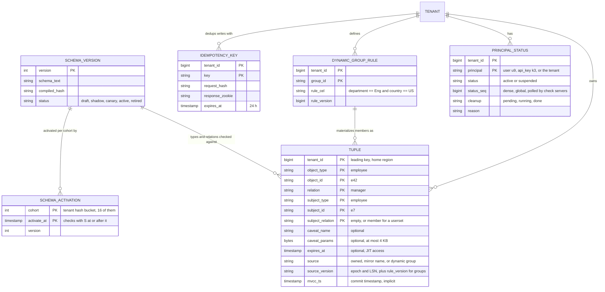

**Access patterns and the keys that serve them.**
- **Forward read (the hot one).** "Subjects of `(employee:e42, manager)`" and "is `user:u7` in `(group:hr, member)`": a prefix scan or point lookup on the primary key `(tenant, object_type, object_id, relation, subject...)`. One range, usually one row.
- **Reverse read.** "Everything `user:u7` is directly related to": a secondary index on `(tenant, subject_type, subject_id, subject_relation, object_type, relation, object_id)`. Used by LookupResources, the group index builder and termination cleanup.
- **Snapshot read.** Every read is `AS OF` a timestamp. MVCC keeps 24 h of versions (SpiceDB's default GC window too), so a zookie up to a day old can still be honored exactly, and explain works within that window.
- **Watch.** The store's changefeed emits every change to `TUPLE` and `PRINCIPAL_STATUS` with its commit timestamp, plus **resolved timestamps** ("no more changes at or below T will arrive"). A consumer keeps a watermark that covers each tenant, `W_t`, so one stuck range never freezes the whole fleet: on Spanner from change-stream partition heartbeats mapped to the tenant's key ranges, on CockroachDB (whose resolved timestamp is feed-wide) from one feed per cell, so a stuck range freezes at most one cell (§10.1). Derived indexes use `W_t` as their watermark. `PRINCIPAL_STATUS` is keyed by tenant like `TUPLE`, so its rows sit inside the tenant's spans and `W_t` covers them, while the suspension poll reads a small global index on `status_seq`, a different range.
- **Partitioning.** The leading key is `tenant_id`, so one tenant's tuples are contiguous and split into ranges by size and load. A 10 M-tuple tenant spans a few ranges. Each tenant has a **home region** where its range leases live, so its fresh reads and its writes start near its users.

Store choice: a **consensus-replicated SQL store with MVCC and follower reads**, 5 voting replicas per range across 3 regions (2, 2, 1) plus one non-voting replica in eu-central, so every region has two readable copies. Three properties decide it, and each one is named in a later section: snapshot reads at a timestamp (one snapshot per check, §4.1), externally consistent commit timestamps (zookies, §5.2), and a changefeed with resolved timestamps (every derived index, §5.1). **Spanner class is the better fit**, because TrueTime's commit wait gives external consistency outright. On a hybrid-logical-clock store (CockroachDB class), a content-change check could get a timestamp below an earlier ACL commit it never read, so there the zookie is issued as `check timestamp + max clock offset` (500 ms by default), and the few checks that use a fresh zookie wait that much longer. Postgres sharded by tenant is the cheaper alternative, rejected in §7 because zookies across shards and cross-region failover would be ours to build.

**The schema, for the running example** (SpiceDB-style syntax, an HR product):

```text
definition user {}

definition group {
    relation member: user | group#member
    relation binding: role_binding          // roles granted over the employees in this group (scope)
    permission scoped_view_comp = binding->view_comp
    permission scoped_edit_comp = binding->edit_comp
}

definition role {                            // a tenant's custom role is data: one wildcard tuple per permission it grants
    relation grants_view_comp: user:*
    relation grants_edit_comp: user:*
}

definition role_binding {
    relation role: role
    relation holder: user | group#member
    permission view_comp = holder & role->grants_view_comp
    permission edit_comp = holder & role->grants_edit_comp
}

caveat on_corp_network(request_ip ipaddress, allowed_cidr string) { request_ip.in_cidr(allowed_cidr) }

definition org {
    relation binding: role_binding
    relation member: user | group#member
    relation auditor: user with on_corp_network          // external auditors, only from the corporate network
    permission view_comp = binding->view_comp + auditor
    permission edit_comp = binding->edit_comp
}

definition employee {
    relation org: org
    relation self: user
    relation manager: employee
    relation in_scope: group                 // dynamic groups this employee falls in, materialized from HR data
    relation blocked: user                   // explicit "never", e.g. a conflict of interest
    permission line_up = self + manager->line_up                       // me, my manager, their manager, ...
    permission view_comp = (self + manager->line_up + in_scope->scoped_view_comp + org->view_comp) - blocked
    permission edit_comp = (in_scope->scoped_edit_comp + org->edit_comp) - blocked - self   // nobody edits their own pay
}
```

How the three models land in it:
- **RBAC**: `role` and `role_binding`. A tenant's "Comp Viewer" role is the tuple `role:r1#grants_view_comp@user:*`. Binding it to the HR group is `role_binding:b1#role@role:r1` plus `role_binding:b1#holder@group:hr#member`. No schema change, ever, for a tenant's roles.
- **ReBAC**: `manager->line_up` walks the manager chain. `in_scope->...` walks into a group. `self` is ownership.
- **ABAC**: slow attributes (department, country, level) become dynamic group membership (`employee:e42#in_scope@group:eng_us`). Fast attributes (IP, time, open ticket) are caveats on a tuple (`org:acme#auditor@user:a1[on_corp_network]`), evaluated against the check's context. A parameter stored on the tuple always wins over the same name in the request context, so a caller cannot widen a caveat.
- **Deny**: only through schema-level exclusion (`- blocked`, `- self`). Tenants cannot write arbitrary deny rules. AWS IAM's "explicit deny wins" is the same idea, kept to named relations so every decision stays explainable.
- **Wildcards** such as `user:*` mean every user **of the object's tenant**, plus principals of a tenant linked to it by a declared cross-tenant relation (an accountant firm, a Connect platform), never every user in the system.

---

## 4. High-level design

One diagram, grown one functional requirement at a time. Each step says what is still missing. Every arrow says what flows on it.

### 4.1 Check: one snapshot, one region, a tree of sub-problems

**What breaks first.** Each service checking against its own tables (the starting point at most companies) gives 400 different meanings of "admin", no audit, and a termination that 400 teams must each handle. A policy engine with policies as code (OPA, Cedar) fixes the logic, but every check must be handed all the facts it needs ("is u7 in Bob's manager chain, which groups is e42 in"), and those facts are exactly the 1 TB graph. So the facts move into the authorization service as tuples, and the logic moves into one schema.

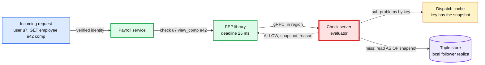

The check server is red from the first diagram: it is on every request path in the company, so it is the thing that breaks first under load (hot sub-problems, cold caches) and the thing whose failure is everyone's failure. §5.1, §5.3 and §5.4 are about it.

**Walk one check: can manager Maya (`user:u7`) view the comp of employee `e42`?**
1. The payroll service's PEP builds `Check(user:u7, view_comp, employee:e42)`. The subject comes from the verified session, never from the request body.
2. The check server confirms u7 is not suspended (§5.2) and picks the snapshot: `S = floor_1s(now - 5 s)`, capped at the tenant's cache watermark, so every read can be served by the local follower replica (§5.1).
3. It loads the schema version active for this tenant's cohort at S, and in it `employee.view_comp`: `(self + manager->line_up + in_scope->scoped_view_comp + org->view_comp) - blocked`.
4. It evaluates the union branches **in parallel** and stops at the first ALLOW:
   - `self`: read `(employee:e42, self)` gives `user:u42`. Not u7.
   - `manager->line_up`: read `(employee:e42, manager)` gives `employee:e7`. Sub-problem `line_up(e7) contains u7?`: `(employee:e7, self)` is `user:u7`. **ALLOW.**
   - The other branches are cancelled.
5. The exclusion `- blocked` must be evaluated in full: read `(employee:e42, blocked)`, empty. The result stays ALLOW.
6. Return `{ALLOW, checked_at: S, reason_id}`. The PEP lets the request through.

Every sub-problem (`line_up(e7) contains u7 at S`) is a cache key. The next check that walks through e7's chain at the same snapshot reads it from the cache.

**Evaluation rules, fixed and documented:**

| Construct | Rule |
|---|---|
| `a + b` (union) | ALLOW if any branch allows. Branches run in parallel, the first ALLOW cancels the rest. ALLOW beats CONDITIONAL beats DENY |
| `a & b` (intersection) | ALLOW only if both allow. DENY if either denies. Otherwise CONDITIONAL |
| `a - b` (exclusion) | ALLOW only if `a` allows and `b` definitely denies. If `a` denies, DENY, and `b` may be skipped. If `a` can still allow and `b` is CONDITIONAL, the result is CONDITIONAL. `b` is never skipped while `a` can still allow |
| `rel->perm` (arrow) | For each subject of `rel`, evaluate `perm` on it. A union over those subjects, dispatched in chunks of 100 |
| Caveat on a tuple | Evaluate the CEL expression on tuple parameters plus check context (tuple parameters win). Missing context makes that branch CONDITIONAL |
| CONDITIONAL at the top | The PEP treats it as **deny plus an error metric**, because it means the caller forgot to send context |
| `expires_at` | A tuple whose `expires_at` is at or before the snapshot does not exist for that check |
| Cycles and depth | The write API refuses a group edge that would create a cycle, by reading the group-to-group tuples inside the same serializable transaction (the async index would let two concurrent opposite edges through). At evaluation, a sub-problem already on the current dispatch path returns "no via this path" and the result is marked tainted (never cached). A check that exceeds 50 nested dispatches or a budget of 1,000 sub-problems fails with an error (deny, alert). The schema compiler rejects recursion through an exclusion |

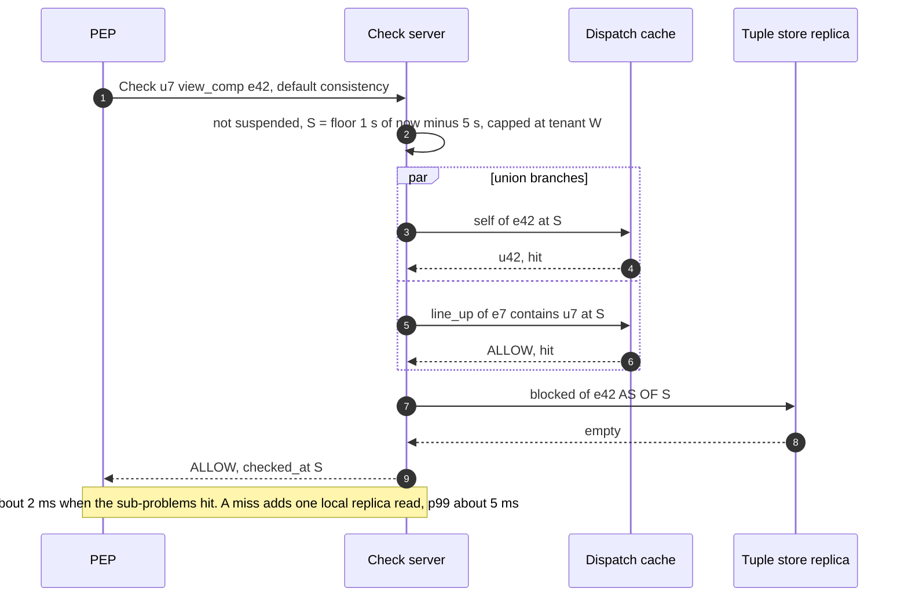

**Still missing:** how tuples get in, who owns the schema, how a role edit happens, and how product data (who manages whom) reaches the store.

### 4.2 Manage access facts and policy: owned tuples, mirrored tuples, one schema

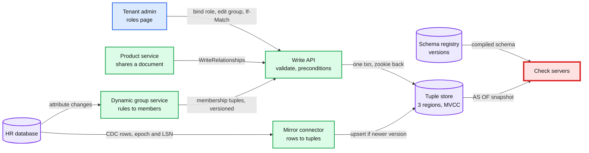

**Two kinds of tuples, because there are two sources of truth.**
- **Owned tuples** exist only here: role bindings, custom roles, group memberships typed in by an admin, document shares. The write API is their source of truth.
- **Mirrored tuples** are copies of facts that live in a product database: who manages whom and which org an employee belongs to (HR database), who owns a document (documents database). The product database stays the truth. A **mirror connector** reads its CDC stream and upserts tuples with `source_version = (epoch, LSN)`, ignoring any row older than what it already wrote. The epoch changes when the source database promotes a new primary, because Postgres reuses LSNs on a new timeline, and an epoch change triggers a re-snapshot and sweep. This avoids the dual write: a product service never has to update its database and the authorization store in one step and hope both succeed.

**One owned write: an admin binds the "Comp Viewer" role to the Eng HR group.**
1. The admin UI sends `PUT /role_bindings/b9 {role: r1, holder: group:eng_hr, scope: group:eng_us}` with `If-Match` on the binding's version, so a stale page cannot undo someone else's revoke.
2. The tenant admin API runs the **escalation check**: this admin must already hold every permission `r1` grants, over the whole `eng_us` scope (§10.10).
3. It calls `WriteRelationships` with a required `Idempotency-Key` and three tuples: `role_binding:b9#role@role:r1`, `role_binding:b9#holder@group:eng_hr#member`, `group:eng_us#binding@role_binding:b9`. Keys are mandatory: a retry without one, after another admin's revoke, would quietly re-grant.
4. One transaction: check the idempotency key and preconditions, apply the three TOUCHes, commit at timestamp T. Return `{written_at: zookie(T)}`.
5. The admin UI keeps the zookie and sends it with its next "who can see what" view, so the admin sees the change at once (read-your-writes), even though default checks elsewhere may take ~6 s.

**One mirrored write: Bob moves under a new manager in the HR system.**
1. HR writes `employees.manager_id = e9` for e42 at LSN 88,120.
2. The connector turns the row change into `DELETE employee:e42#manager@employee:e7` plus `TOUCH employee:e42#manager@employee:e9`, both with `source_version = (epoch 3, 88120)`. It applies **one source transaction as one store transaction** (CDC carries the boundaries, up to the 1,000-update cap), so a multi-row HR change such as a manager swap never shows a state HR never had, like a transient cycle in the chain.
3. It publishes its **applied watermark** per source: "hr applied through LSN 88,120". It advances that watermark on every LSN it reads, including rows that map to no tuple, and on CDC heartbeats when the source is idle. §5.2 uses it to close the new-enemy window for mirrored tuples.

**Dynamic groups** turn attribute rules into tuples. The group service holds each rule (`department == "Eng" and country == "US"`), listens to HR attribute changes, and writes membership tuples (`employee:e42#in_scope@group:eng_us`) with `source_version = (rule_version, epoch, LSN)`, upsert only if newer, so a slow recompute can never undo a newer incremental change. A **rule edit** is built blue/green: the service materializes `group:eng_us.v15` in the bulk lane (100k employees, ~1 s to evaluate, ~20 s to write) while the incremental path keeps writing attribute changes to **both** v14 and v15. When v15's applied LSN has caught up with v14's, one small transaction moves every reference to the group (scope bindings, holder tuples, parent-group memberships) from `v14` to `v15`. Narrowing a rule is therefore atomic, not 90k removals trickling out over 18 s, and an employee who moved during the build is not left behind until the nightly reconcile. `after_source` waits on a building version too. Rippling's product pages describe this feature ("Supergroups ... built using attributes like level or location", "as an employee's attributes change, their permissions update"). The cost is that permissions now depend on HR data quality: a wrong department grants access with no explicit grant anywhere. The access preview (§4.4) and the escalation check exist for that. A nightly job reconciles every group against its rule.

**The schema** is owned by the platform team, reviewed like code, stored as immutable versions, and activated per tenant cohort. Product teams propose changes for their own object types. §5.6 covers how a change is validated before it can affect a single decision.

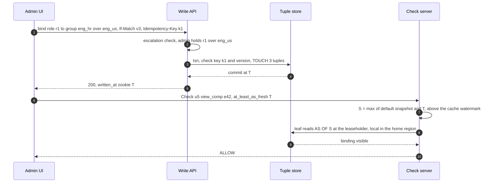

**Still missing:** "which employees can I see" for a list page, and anything an auditor can use.

### 4.3 List and filter: pick the strategy by result size

Checking every row of a list one by one works for 20 rows and fails for 50,000. LookupResources walks the graph backwards from the subject, which works for hundreds and fails when the answer is "everyone in Engineering". So the caller picks a strategy by how many results the subject can see, and the API makes that cheap to decide.

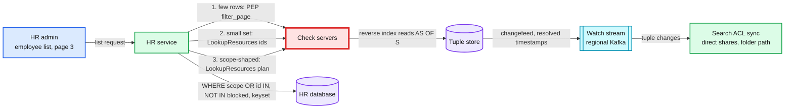

| Strategy | When | How | Cost |
|---|---|---|---|
| **1. Post-filter** | The product already has a short candidate list (a search page of 50, an inbox) | The PEP's `filter_page` checks the candidates with the request's context and drops the denied. Rows whose content zookie is at or below the default snapshot go in one CheckBulk, the few fresh rows in a second one at least as fresh as their zookies, in parallel | 1 RPC, ~5 ms for 100. Pages come back short, so the fetch size follows the observed pass rate |
| **2. LookupResources ids** | The subject can see few objects (under ~1,000 for an interactive sorted list, ~10k for an export): documents shared with me, accounts I support | Reverse walk: subject, then its groups (from the group index), then the bindings and objects that reference them | Proportional to the result. Streamed, 1,000 per page, 500 ms deadline per page |
| **3. A plan** | The permission is scope-shaped (HR admin for "department in Eng, Sales"). The answer is a filter, not a list | LookupResources returns `scopes OR ids MINUS exclusions`: each dynamic group scope with its **rule** and `rule_version`, the ids from non-scope branches (self, line of management, direct grants), and the `blocked` ids to subtract. Caveat-gated scopes are listed separately | One RPC. The product database filters, sorts and pages |
| **4. ACLs in the search index** | Free-text search over millions of documents | A sync job from the Watch stream indexes, per document, its direct share tokens, its **ancestor folder ids**, and its content zookie. A query matches "any of my principal and group tokens, or any folder shared directly with one of them" | Index staleness ~2 s. Always post-checked (strategy 1) |

**Walk the HR admin's page 3.**
1. The HR service calls `LookupResources(user:u5, view_comp, employee, context, limit=1000)`.
2. The check server sees that u5's access comes from bindings scoped to `group:eng_us`, a dynamic group, plus one direct grant. It returns the plan: `{scope: department == "Eng" and country == "US", rule_version 14} OR id IN (e88) MINUS id IN (e17)`, where e17 has u5 on its `blocked` list (a conflict of interest). Rules use a small subset of CEL that translates to SQL with explicit NULL handling, so the predicate cannot quietly drop rows.
3. The HR service runs `SELECT ... WHERE ((department = 'Eng' AND country = 'US') OR id IN ('e88')) AND id NOT IN ('e17') AND name > :last_name ORDER BY name LIMIT 50`: keyset paging, never OFFSET, because post-filtered OFFSET pages repeat and skip rows.
4. The PEP's `filter_page` post-checks the 50 rows: one CheckBulk at the default snapshot for rows with older zookies, and a second, parallel one at least as fresh as the newest `authz_zookie` for the few rows changed in the last ~5 s (§5.2). Otherwise one actively edited row would send the whole page to the leaseholder. Normally all 50 pass. A row that fails (a rule version change in flight) is dropped and the page is topped up.

The predicate path is valid because the HR database **is** the source of the attributes the rule reads. A product that does not own those attributes uses strategy 2 or 4. A nightly job compares the predicate's count with the materialized membership. [`deep-dives/list-filtering-and-search.md`](deep-dives/list-filtering-and-search.md) has the decision table and the pagination edge cases.

**Still missing:** a record of decisions, and a way to answer "why".

### 4.4 Audit and explain: log the decision with its snapshot, explain by re-evaluating

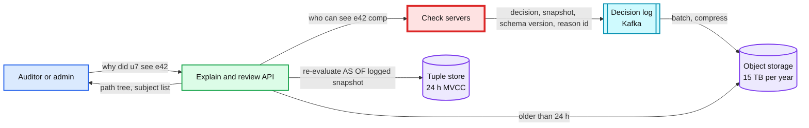

- **What is logged.** Every DENY (identical repeats aggregated per minute), every check on a permission tagged `audit: always` (comp, SSN, payouts) including the caveat inputs it read, every check by internal staff, and 1% of the rest. The PEP logs its own degraded ALLOWs (§5.4). Each record: subject, permission, resource, decision, snapshot, schema version, caller service, request id, reason id, latency. The write is async (an in-memory buffer to Kafka), so logging never adds latency. Under pressure the buffer spills to a local disk spool and drops sampled records first. It never drops `audit: always` records: only when the spool is full too do those checks fail closed (§5.4). Retention 13 months [estimate], with pseudonymous subject ids.
- **Explain.** Given a logged decision, re-run the check **at the logged snapshot and schema version** with tracing on, and return the path: `user:u7 is self of employee:e7, e7 is manager of e42, so line_up(e42) contains u7`. Within 24 h the MVCC store answers directly. Older decisions are replayed from the changelog archive in the lake.
- **Access review.** `LookupSubjects(employee:e42, view_comp, user)` lists everyone who can see e42's comp, with the path for each. A quarterly review for a whole tenant runs as an async export, not as a live API call.
- **Access preview.** Before a role, binding, group or rule change is applied, run LookupResources for the affected holders under the current state and under the proposed change (evaluated in a scratch overlay, nothing written) and show "Maya gains 1,240 employees, loses 0". Rippling's product page describes this preview. The same diff drives the escalation check and the second-admin threshold (§10.10).

**What this design does not have yet:** a latency story at 1 M checks/s, a guarantee against the new-enemy problem, a plan for a 100k-member group or a hot tenant, behaviour when the service is slow or down, and a safe way to change the schema or to move 400 services onto it. That is §5.

---

## 5. Deep dives

Each one is the question an interviewer asks, what breaks in the §4 design, the fix, and what changed.

### 5.1 "Every request calls you, 1 M checks a second. How is p99 under 10 ms, and what does the cache really buy?"

**The ladder.**

| Rung | Approach | Why it breaks, in numbers |
|---|---|---|
| Bad | Every check reads the tenant's leaseholder, no cache | 5 to 18 leaf reads per check, so 5 M+ leaseholder reads/s. A us-west caller of a us-east tenant pays ~60 ms per read, and a manager chain reads sequentially: 200 ms checks |
| Good | Each service caches decisions for 60 s (the template) | A revoke takes up to 60 s in 400 different caches with 400 TTLs (simulated p99 64 s). A role edit changes an unknown set of cached decisions. A unique check still pays the full cost. Every deploy starts 400 cold caches |
| **Great** | Regional check servers read the **local follower replica at one snapshot**. Sub-problems are dispatched by consistent hashing to the server that owns them, which holds two snapshot-correct caches and a lock table | One in-region hop from the caller. ~0.1 store reads per check when warm. Hot sub-problems are computed once per snapshot |

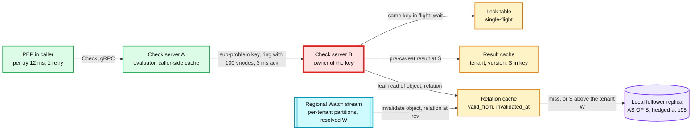

**Two caches, because they do two different jobs.**
- **Result cache (Zanzibar's).** Key `(tenant, schema_version, object, permission or relation, subject, S)`. It holds composite answers such as "`line_up(e7)` contains `u7` at S", stored **before caveats**: ALLOW, DENY, or CONDITIONAL with the residual caveats and their bound parameters. Caveats are evaluated per request against that request's context, so an ALLOW computed for an office IP is never served to a home IP. Because S is in the key, an entry can never be wrong, except through expiry: each entry carries the earliest `expires_at` it depended on and is unusable at or after it. Tainted results (a cycle cut, a budget hit) are never stored. It lives about one snapshot quantum (1 s) plus a little. Its job is hot spots: a burst of identical sub-problems at one snapshot is computed once. The **lock table** makes that true under concurrency: the second request for a key already in flight waits for the first instead of starting its own (Zanzibar keeps one per server for "cache stampede"), unless the key is already on its own dispatch path. Like Zanzibar, the **caller side** keeps the results it receives too, so a hot key is answered locally on every server after its first dispatch in a quantum.
- **Relation cache (Himeji's idea, made snapshot-safe).** Key `(tenant, object, relation)`, value the subject list with caveats and expiries, plus `valid_from` (the snapshot it was read at) and `invalidated_at` (the revision of the first later change, unknown until one arrives). Each check server consumes the regional Watch stream for its cell's tenants and stamps `invalidated_at` on the keys it holds. A read at snapshot S may use the entry only if **`valid_from ≤ S < invalidated_at`, `S < earliest expires_at` in the entry, and `S ≤ W_t`**, where `W_t` is the resolved watermark this server has consumed for that tenant ("no change at or below `W_t` is still on its way"). Below `W_t`, a missing invalidation proves there was no change. So a late or lost invalidation can make the cache **miss**, never **lie**. Entries live until the data changes, not until a quantum ends, which is why leaves hit 90% to 99% once warm where a quantum-keyed cache sees 17% to 28% (simulated). Airbnb's Himeji invalidates its cache from change events (SpinalTap and Kafka) and reports a ~98% hit ratio [unverified].

**The relation cache is only as safe as six promises.** The simulation in the deep dive breaks each one and counts stale reads. Kept together, through duplicates, a replay, a 60 s stall, 8 s of lag and a restart: **0 stale reads**.
1. **The recent-changes log closes the fill race.** A change that arrives while a server does not hold a key would otherwise be dropped, and a fill made later at an older S would claim validity past it (simulated: ~128k stale reads, 12% of hits). Each server keeps every change for its cell's tenants, `(tenant, object, relation) -> revisions`, for revisions above `W_t - 2 min` (~30k entries on average, ~400k at an import peak, ~40 MB). A fill at S sets `invalidated_at` to the first logged revision above S.
2. **`invalidated_at` only goes down.** It is the minimum revision seen, never "the first one to arrive" (438 stale reads when violated).
3. **The owner judges S against its own `W_t`**, never against a watermark the dispatching server sent (222 stale).
4. **Replay before serving.** On start, restart, a remap, a consumer rebalance or any offset gap, a server replays the last 2 minutes of the affected tenants' partitions before it serves them from cache (981 stale with an empty log). A tenant it does not consume at all (a cross-tenant edge, a remap still replaying) bypasses the relation cache. When it stops consuming a tenant, it drops that tenant's entries.
5. **Expiry is not a write.** No change event fires when `expires_at` passes, so expiry is checked on every read, in both caches and in the group index.
6. **Trust, but verify.** A background verifier re-reads 0.1% of relation-cache hits from the store at the same S. Any mismatch pages and flushes the keys of the suspect ranges, then re-warms them by replay within the read budget. Flushing a whole big tenant would itself be a cold moment (200k checks/s at ~4 reads each). This catches what the rules cannot: a changefeed bug that advances the resolved timestamp past a change it never emitted (simulated: 7,837 stale reads with nothing else to catch it).

**The snapshot rule, final form.**

```text
W_t        = this server's resolved watermark covering tenant t, from its own partitions of the regional Watch stream
now        = the store's clock as seen in the latest store response, not the host clock (host skew over 1 s fences the server)
default    S = min( floor_1s(now - 5 s), W_t )          # never above W_t, so the relation cache is usable
zookie     S = max( default, Z' )                        # Z' = ceil_1s(Z) unless that is ahead of now, else Z. If S > W_t, leaf reads skip the relation cache
no W_t     tenant not consumed here: its leaf reads skip the relation cache
lagging    W_t older than now - 8 s: page. Default checks stay at S = W_t (staleness grows for that tenant only, never wrong).
           Checks that need S > W_t read the store within the region's spare provisioned reads (~0.85 reads per check at peak). Over budget: 503
           After 60 s of lag, checks on audit: always permissions for that tenant also read the store, within the same budget
```

A stalled stream therefore costs staleness for the stalled tenants (salaries and payouts excepted after 60 s), and a bounded amount of extra store load. It never costs correctness, and it never sends the whole fleet to the store at once. That was the first version of this rule: bypass the cache when `W` is 30 s old. It would have pushed ~4 reads per check at a store sized for ~1, a 4x overload for every tenant at once, because one global `W` stalls with any one range. `now` comes from the store's clock, so a skewed host can neither make every tenant look lagged nor stretch revokes, and S never exceeds `W_t`. A zookie is rounded up to the quantum only when that is not in the future: otherwise a reader right after a save would wait up to a second for the store to reach S (simulated: half of reads 0.2 s after a save missed the 300 ms deadline).

**Other pieces of the Great rung.**
- **Dispatch.** Sub-problem keys hash onto a ring per cell (100 virtual nodes per server, SpiceDB's default replication factor; simulated, the busiest of 20 servers carries 1.19x the mean). Identical sub-problems from many checks meet on one server, which is what makes the lock table and result cache effective. Zanzibar reports 22 M delegated RPCs/s at a 4.2 M/s check peak, ~5 per check. Each hop must be **acknowledged within 3 ms**: past that, the dispatching server evaluates that sub-problem itself (reading the store directly) or tries the key's next replica, so a retry does not just land on the same slow owner again. The 3 ms times the acknowledgement, not the answer. The check deadline bounds the answer: a 3 ms answer timer would fire on 35% to 85% of cold 2 to 3 level sub-problems and re-run them, the server-to-server hedging Zanzibar refused (simulated).
- **Parallel branches.** Union branches run concurrently and the first ALLOW cancels the rest, so the critical path is the depth of the deepest winning branch (2 to 4 hops), not the number of sub-problems.
- **Request memo and CheckBulk.** The PEP memoizes `(subject, permission, resource, consistency)` within one request, so a default ALLOW never answers a later `at_least_as_fresh(Z)` check. A list page uses one CheckBulk (up to 100 items at one snapshot) instead of 100 calls.
- **Deadlines and hedging.** The PEP sends the remaining request budget as the deadline (default 25 ms). One attempt with a 12 ms per-try timeout, then one retry on a different server, within a 10% retry budget per PEP. A refusal from a fenced server (§5.2) did no work, so it does not count against the budget, and the PEP drops that server from its pick list for 10 s after the first refusal. Otherwise one fenced server in a 6-server cell would turn ~7% of that cell's checks into 503s. Store and index reads are hedged at their p95. That is mandatory, not tuning: without it 0.34% of checks miss the deadline (simulated).

**Push back on the textbook answer.** "Cache decisions in each service for a minute." The decision is the wrong unit. A role edit changes one leaf (`role:r1#grants_view_comp`), and every decision that passed through it is now suspect. A per-decision cache cannot find those, so it can only wait out a TTL. A per-leaf cache invalidated from the change stream follows the edit exactly, and the watermark rule makes it safe to be late. Second push back: "precompute every permission." 30 M principals times the objects they can reach is the explosion Zanzibar avoided. It precomputes only group membership (Leopard, §5.3), and AuthZed Materialize precomputes only the permissions you name.

**What changed:** per-tenant watermarks from regional, tenant-partitioned Watch streams; the relation cache with its six promises; pre-caveat result caching with tenant in the key; caller-side caching; the 3 ms hop acknowledgement; the snapshot rule without a fleet-wide bypass; the PEP's memo key, deadline, retry budget and mandatory hedging. [`deep-dives/check-latency-caching-and-hot-spots.md`](deep-dives/check-latency-caching-and-hot-spots.md) simulates hit rates, latency and the six promises.

### 5.2 "Alice removes Bob from a document, then Charlie adds new content to it. How do you guarantee Bob never sees it?"

This is Zanzibar's **new-enemy problem**. The paper gives two forms. **Example A**: "Alice removes Bob from the ACL of a folder", then a new document is put in the folder. **Example B**: "Alice removes Bob from the ACL of a document", then Charlie adds new contents. In both, Bob must not see the new content.

**Example A is already solved by one snapshot per check**, as long as the document's link to its folder is itself a tuple read in the same check. Any snapshot either predates the new document's `parent` tuple (no path, DENY) or postdates the removal (DENY). Simulated: 0 leaks. It breaks only if a product checks the folder instead of the document, so the PEP library always checks the object being returned.

**Example B is not.** Alice's removal commits at T1. Charlie saves new text in the same document at T2 = T1 + 2 s. Bob opens it at T2 + 1 s. Bob's default snapshot is `T2 + 1 s - 5 s = T1 - 2 s`, before the removal: the document's own viewer tuple still lists Bob. ALLOW, and Bob reads text written after losing access. Simulated: 100% of such reads leak at a 2 s gap.

**The ladder.**

| Rung | Approach | Cost |
|---|---|---|
| Bad | Accept bounded staleness everywhere ("it is only 5 seconds") | The window is exactly when someone who was just removed is most motivated to look |
| Good | `fully_consistent` on every check | Every check reads the leaseholder and skips the caches. Zanzibar's "Recent" class shows the price: p95 ~60 ms against ~10 ms for "Safe". At 1 M/s that is the whole budget |
| **Great** | **Zookies on the content path.** Pay for freshness only on content that changed in the last few seconds | One leaseholder check per content write. Reads of new content pay freshness for ~5 s, then become ordinary |

**The protocol, three steps.**
1. **Content-change check.** Before the documents service saves Charlie's text, it calls `Check(charlie, edit, document:d9, fully_consistent)`. The answer carries a zookie Z. Every ACL write that committed before this check has a timestamp below Z, including Bob's removal. On a Spanner-class store that is TrueTime's commit wait. On a hybrid-logical-clock store it holds only because Z is issued as the check's timestamp plus the maximum clock offset (§3.3). Zookies are signed, and one more than 1 s ahead of the store's clock is rejected, so a caller cannot pin reads to the future.
2. **Store Z with the content.** The service writes the new version and Z in the **same database transaction**: `documents(id, version, body_ref, authz_zookie)`.
3. **Read with Z.** Every check for that content version sends `at_least_as_fresh(Z)`, including list pages and search results that show it (the PEP's `filter_page` checks the few freshly changed rows at least as fresh as their zookies, §4.3). The snapshot is `max(default, Z) ≥ Z > T1`, so it sees Bob's removal. DENY.

Why it is cheap: once Z is more than ~5 s old, the default snapshot is already newer than Z, so the zookie costs nothing. Only reads in the first few seconds after a content change go fresh, and in the home region the leaseholder is local. **Autosave** is coalesced to one content-change check per document per 5 s. Inside that window a draft keyword typed within 5 s of a removal can still be read by the removed user. Accepted for drafts. Explicit saves, uploads, comments and every money or HR write always get their own check.

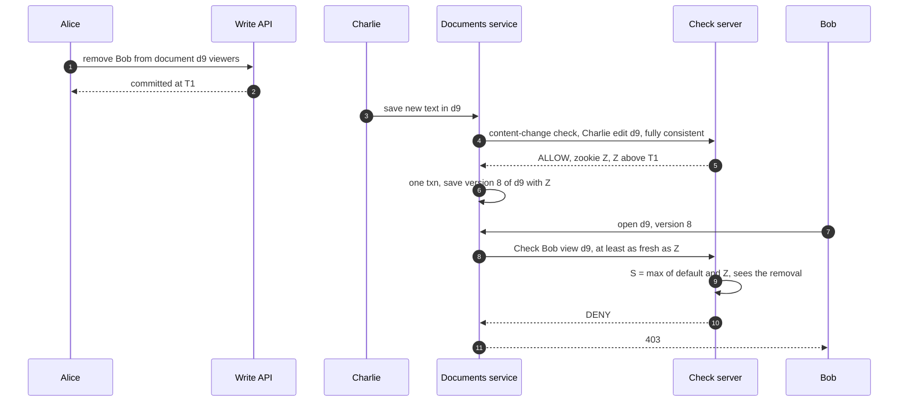

**Mirrored tuples need one more step, in the right order.** Maya stops being Bob's manager in the HR database. HR then writes Bob's new salary. The mirror connector applies the manager change ~1 to 2 s later, so a content-change check made in between would return a zookie that does not include it.
1. **Before** the salary transaction, the HR service reads its database's current position L (`pg_current_wal_lsn()`).
2. It calls `Check(hr_user, edit_comp, employee:e42, fully_consistent, after_source = {hr: L})`. The check server waits until **every consumer of that source** has applied L: the mirror connector and the dynamic group service each publish their own applied watermark, because a department change reaches authorization through the group service, not the mirror (waiting for the mirror alone still leaked 43% of reads at a 0.5 s gap, simulated). Then it evaluates at or after the store timestamp where L was applied and returns Z. The wait is p99 ~2 s, so `after_source` checks get a **5 s deadline**.
3. HR commits the salary and Z in one transaction.

Any manager change committed before step 1 is now covered. Doing it after the salary commit instead (with the salary's own LSN) would leave the new salary readable under the old zookie for the length of the wait. Only sensitive writes pay this. Comp changes are rare.

**Why the default is 5 s.** A follower replica can serve a read at S only after it knows no write at or below S can still arrive (CockroachDB calls this the closed timestamp, a few seconds behind by default; Spanner's bounded-staleness reads work the same way). 5 s keeps nearly every default read local. SpiceDB's default quantization interval is also 5 s, with up to 10% extra staleness to smooth cache turnover. Zanzibar learns its default staleness per request from Spanner's hints and calls it "purely a performance optimization", because zookies are always respected. Simulated, an ordinary revoke reaches default checks at p99 5.9 s (worst 8.0 s), against p99 64 s for a 60 s decision cache. The SLO says 10 s p99.

**Terminations get their own path: the suspension overlay.**
- **Why not just delete tuples.** A departing employee has hundreds of tuples across many object types, plus API keys and service accounts they own. Deleting them all is a bulk job that takes minutes, can fail halfway, and in-flight default checks still read 5 s in the past.
- **Mechanism.** `SuspendPrincipals([user:u9])` writes `PRINCIPAL_STATUS(u9, suspended)` and takes the next value of a dense, global `status_seq` in the same transaction (a batch of up to 1,000 takes a range; `SuspendTenant` is one row for a whole tenant). Every check server polls the table's leaseholder every 500 ms for rows above the last `status_seq` it has seen (~130 tiny reads/s fleet-wide) and keeps the set in memory (~15 MB). Every check consults it **before** evaluation: if the subject, or the owning user of a personal API key, is suspended, the answer is DENY with reason `SUSPENDED`, at any snapshot. Polling a table needs no Kafka, so the termination path does not share a failure with the Watch stream. Rows are applied in `status_seq` order, so a delayed suspend can never override a later resume, or the reverse.
- **The bound is enforced in-process, on every check.** A server whose last successful poll is more than 2 s old **while its cell's median is fresh** answers every check with a retriable UNAVAILABLE, and the PEP retries on another server within the same request (such refusals do not count against the retry budget, §5.1). A server that cannot learn its cell's median (cut off from its peers) treats it as fresh, and so fences. Readiness probes are too slow for this: with a probe tick plus endpoint removal, a frozen server kept allowing Bob for p99 4.7 s. With the 500 ms poll a healthy cell denies at p99 ~0.5 to 0.8 s, and with one server's polls failing the in-process gate holds it to p99 1.4 s (simulated). If the cell's median is stale too (the status leaseholder is unreachable, or most servers are stuck), nobody fences, because that would turn a polling problem into a global check outage. The backstop takes over (~5.7 s simulated) and the on-call is paged.
- **The backstop.** Every check also reads the subject's `PRINCIPAL_STATUS` (and the owner's, for personal keys) as an ordinary leaf through the relation cache. Status rows are keyed by tenant, so `W_t` covers them and their changes in the Watch stream invalidate the cached leaf, while the poll reads a different range. Even with no overlay at all, a suspension lands within the ordinary revoke bound (~6 s).
- **Then clean up, carefully.** After a 7-day grace period (terminations get reversed), a job deletes the person's **owned** tuples in the bulk lane, each batch with a precondition that `status_seq` has not changed, so a resume cancels it, and each deleted batch is archived so a resume can restore it. Mirrored tuples are left to their source: the HR system's own update removes them, and deleting them here would fight the connector. The status row is kept until cleanup is done plus 30 days, and the overlay entry leaves only when the row does.
- **Long-lived connections.** A streaming endpoint re-checks at least every 30 s, and the identity system revokes sessions and tokens in parallel. The overlay covers whatever still asks.
- **For comparison:** Microsoft Entra's continuous access evaluation propagates critical events with "latency of up to 15 minutes". We can promise 2 s because we sit on every request, rather than relying on a token's lifetime.

**What changed:** the `fully_consistent` content-change check with signed zookies, `authz_zookie` columns in product tables, `after_source` with the read-position-first order, a per-consumer applied watermark and a 5 s deadline, the `PRINCIPAL_STATUS` table with `status_seq`, the 500 ms poll and the in-process gate, the status leaf backstop, the fenced cleanup. [`deep-dives/consistency-and-new-enemy.md`](deep-dives/consistency-and-new-enemy.md) simulates the revocation window, both new-enemy examples and the suspension bound.

### 5.3 "One group has 100k members nested 6 deep, and one tenant is 20% of all traffic. What breaks?"

Walk the request path and name each bottleneck in the order it bites.

1. **Deep nesting breaks latency.** `group:all_eng` contains `group:platform` contains ... six levels down to `user:u7`. Each level is a dispatch plus a leaf read, and they are sequential. Simulated, recursion is p99 8.7 ms warm and 13.7 ms cold (hedged), 52 ms cold without hedging. **Fix: a group index**, Zanzibar's Leopard idea. Three maps per tenant: `member_to_groups(user)` (groups the user is directly in, ~3), `group_descendants(group)` (every group nested inside it, itself included) and `group_ancestors(group)` (every group that contains it). "Is u7 in all_eng" becomes `member_to_groups(u7) ∩ group_descendants(all_eng) ≠ ∅`: one index read, p99 2.6 ms end to end (simulated). Leopard serves these in "fewer than 150 µsec at the median". The index is an offline snapshot plus an incremental layer fed by the Watch stream, keyed by schema version, with its own per-tenant watermark. A check uses it only when that watermark covers the check's snapshot, and otherwise falls back to recursion.
2. **What the index flattens, and what it must not.** Groups, folder ancestry and **manager chains** (`chain_ancestors(employee)`, the employees above it) are flattened. The chain was first left recursive because an ALLOW through a direct manager is p99 5.8 ms (3 deep, simulated). But a **DENY** must walk to the top of the org, 8 to 12 levels in a 100k-person company, p99 12.3 ms warm and 20.4 ms cold at 10 levels (simulated), past the 12 ms try. The cost of flattening is a reorg: a VP move rewrites subtree size times depth entries (~20k reports, ~200k entries): ~20 s at ~10k updates/s for one tenant's builder [estimate], up to ~7 minutes at Leopard's observed incremental rate of ~500/s, during which that tenant's chain checks fall back to recursion. Reorgs are rare, DENYs are not. An edge with a caveat or an `expires_at` stays out of the index and on the recursive path: a flattened "member" would lose its caveat, and an expiry fires no change event to remove it.
3. **Wide fan-out is fine.** An employee in 30 dynamic groups makes `in_scope->scoped_view_comp` a 30-way union. Branches are batched (SpiceDB dispatches in chunks of 100) and the first ALLOW cancels the rest.
4. **Hot keys break one server.** Every check in tenant acme reads `org:acme#binding` (~50 bindings) and `role:r1#grants_view_comp`. Each key hashes to one owner. A tenant with 20% of 1 M checks/s would send ~200k/s to that owner. **Fix, in order of effect:** the caller-side cache (§5.1) answers a hot key locally on every server after its first dispatch in each 1 s quantum, so the owner sees ~1 request per server per second, not 200k. A top-k sketch replicates the hottest keys to k owners. Hot objects are read and cached whole (Zanzibar reads all tuples of a hot object at once). The lock table collapses concurrent misses.
5. **A hot tenant can starve a cell.** Tenants are hashed to cells (§5.4). A tenant above ~5% of a region's traffic gets its own cell. Expensive calls (LookupResources, LookupSubjects, bulk writes) have **per-tenant concurrency limits**, and every calling service has a quota, so a buggy batch job cannot flood a cell. Checks are not limited per tenant in normal operation: they follow product traffic, and throttling them would turn one tenant's success into its outage. Under overload, though, a cell sheds first from tenants above their fair share of in-flight checks, so one tenant's spike does not become the whole cell's outage [proposal]. The per-check budget of 1,000 sub-problems (§4.1) stops a tenant's pathological group graph from burning a shared cell.
6. **A deploy breaks the cache.** A cold rolling deploy dropped a document workload's leaf hit rate from 98.9% to 83.4% for ~20 minutes (simulated). **Fix: warm restart.** A draining server writes its caches and watermarks to local disk. On start it loads them, replays the Watch stream from those watermarks, and only then takes its ring slots. One server per cell every 2 minutes.

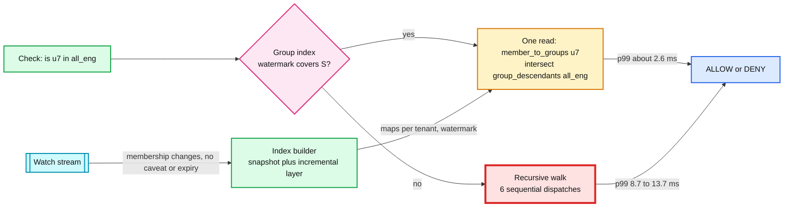

**The index's own cost.** Adding group G under group H changes `group_descendants` for H and every ancestor of H, and `group_ancestors` for G and everything below it. The amplification is bounded by the number of **groups** involved, not members, so it stays small. Chains are the exception, as above. Group cycles cannot form: the write API refuses an edge that would create one (§4.1). A manager cycle can still arrive from a bad HR record through the mirror, so the builder refuses to flatten it (it stays on the recursive path, where the dispatch-path cut ends it) and alerts.

**Push back on the textbook answer.** "It is a graph, use a graph database." The graph here is shallow and split into 200k tenant islands. What the check needs is a key-value read at a timestamp, external consistency for zookies, and three-region replication at 1 M checks/s. A graph database gives traversal and none of those three.

**What changed:** the group index (groups, folders and manager chains, schema-versioned, watermarked, no caveated or expiring edges), caller-side caching and hot-key replication, dedicated cells for very large tenants, per-tenant limits on expensive calls and per-service quotas, warm restarts. Deep dive: [`deep-dives/check-latency-caching-and-hot-spots.md`](deep-dives/check-latency-caching-and-hot-spots.md).

### 5.4 "You are on every request path. What happens when you are slow or down?"

**Fail closed, as a 503, never a 403.**

| Decision | PEP returns | Why |
|---|---|---|
| ALLOW | proceed | |
| DENY | 403 | The caller has no access |
| CONDITIONAL | 403, plus an error metric for the calling service | The caller forgot to send context. That is a bug, not a deny |
| UNAVAILABLE or deadline | **503 with Retry-After** | "We do not know." A 403 here would make UIs hide data, sync clients delete local copies, and users file access requests during our outage |

Failing open is not on the table for a system whose whole job is saying no. The one exception is opt-in and narrow: a permission the schema marks `degrade: last_known_60s` (reviewed, low-risk reads such as "view the company directory") lets the PEP reuse an ALLOW it saw in the last 60 s, and only when the answer is UNAVAILABLE. Never for writes, never for `audit: always` permissions, never for internal staff. The PEP logs every such degraded ALLOW. The accepted risk is that a revoked user reads low-risk data for up to 60 s during our outage.

**Layers of redundancy, from small to large.**
1. **Server.** N+2 per cell. The PEP's retry goes to a different server. A server that knows it is unsafe (suspension poll stale while its cell is fresh) refuses checks itself rather than waiting to be removed (§5.2).
2. **Cell.** us-east and us-west run 4 cells each, eu-central 3. A tenant maps to a home cell through a small cell map the PEP caches. A pathological check, a hot tenant or a bad build hits ~25% of a region's tenants. Deploys go one cell at a time. Any cell **can** serve any tenant (the store is shared), so a dead cell's tenants are remapped **across all the other cells by tenant hash**, never into one spillover cell. With 6-server cells at ~35% CPU, one spillover cell would run at ~71% with 1.5% first-try timeouts, spreading gives ~47% (simulated). Neither collapses, but only spreading leaves headroom for the next failure. (With the first draft's thinner cells, one spillover cell hit ~89% and collapsed under retries.) The receiving servers replay those tenants' last 2 minutes before using their caches (§5.1). PEP retries stay within a 10% budget and never retry a 503 marked "shedding".
3. **Region.** Every region holds two readable replicas of every range (the non-voting eu-central replica exists for this), so a single store node loss never leaves a region without a local copy. If a region's store is unhealthy anyway, its check servers read from the nearest region (+30 to 70 ms). That cannot fit a 12 ms try, so it is a **region-degraded** mode: the check service tells PEPs to use the 150 ms budget for that region's tenants, and the on-call treats it as a trigger to evacuate the region. If the whole region is gone, traffic moves with the products' own regional failover, **paced by the measured store reads per check of the tenants already moved**, not by a fixed clock: all at once would be ~2.9x the receiving store's ceiling, a 15-minute ramp peaks at 22% to 76% of it for typical tenants (simulated), and document-heavy tenants (many objects per user) can need ~50 minutes [estimate]. The store keeps quorum with one region lost.
4. **Load.** Admission control per server on in-flight checks. Each calling service registers a class, and every dispatched sub-problem inherits its check's class, so a check is shed whole or not at all. Shed in order: shadow checks (§5.6), exports and LookupSubjects, LookupResources, background-job checks, interactive checks last.

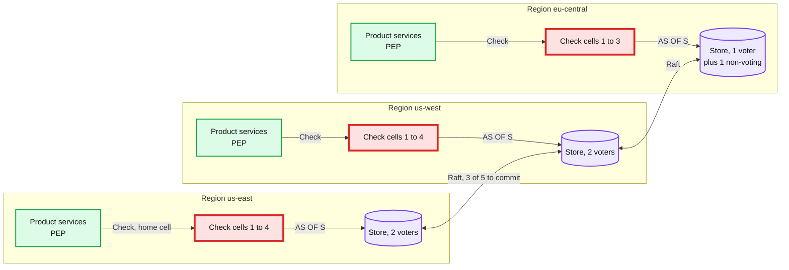

**Circular dependencies, the Staff-level trap.** The authorization service must be startable and operable while the authorization service is down. Its deploy pipeline, secrets manager, config service, certificate issuer, DNS, operator SSO and store must not call Check on their own paths. The schema registry is not a boot dependency either: every check server keeps every schema version used in the last 24 h on local disk and boots from it. Its own admin plane is authorized by a **static, signed allowlist**: two people, time-boxed, audited. Otherwise the outage you are fixing blocks the fix.

**The incident that shapes this.** On 14 Dec 2020 Google's authentication failed for ~47 minutes (03:46 to 04:33 PT). The User ID Service had moved to a new quota system, the old tooling reported its usage as zero, and after a grace period automated quota enforcement cut its Paxos leader off from writing, so reads went stale and lookups failed. Google's own remediation: review automation "to prevent fast implementation of global changes", and "limit the impact on the data plane". For us: quota, config and schema changes on the check path roll out cohort by cohort with a bake, and any automation that would cut capacity refuses when its input says "zero load".

**The decision log never blocks checks for long.** Records go to an in-memory buffer, then a local disk spool (10 GB, ~6 to 9 h at normal rates, ~40 to 55 min under a DENY storm before aggregation), then Kafka. Sampled records are dropped first under pressure, and identical DENYs are aggregated per minute. A server never terminates with a non-empty spool: deploys wait for it to drain, and a replaced host's volume is reattached. Only if the spool is full do `audit: always` checks fail closed. No audit, no access to salaries.

**What changed:** the 503 mapping in the PEP and logged degraded ALLOWs, cells with remaps spread by tenant hash, a retry budget, two readable replicas per region and a region-degraded mode, shedding classes from registration, the static allowlist and local schema copies, the spool's drain rule and DENY aggregation. [`deep-dives/availability-and-failure-modes.md`](deep-dives/availability-and-failure-modes.md).

### 5.5 "An HR admin can see 50,000 employees and wants page 3 sorted by name. A search box covers 20 M documents. What breaks?"

§4.3 picked a strategy by result size. At scale, four things break.

1. **LookupResources on a scope-shaped answer.** Returning 50,000 ids on every page request is ~1 MB per call, and the product still has to sort them. **Fix:** the plan, `scopes OR ids MINUS exclusions`. The scope part carries each dynamic group's rule and `rule_version`. The HR database filters, sorts and pages. The same idea as OPA's partial evaluation, which turns a policy into `WHERE employees.department = 'engineering'`. The plan must carry all three parts: a scope alone silently drops the employees visible through `self` or the manager chain, and includes the `blocked` ones, and a post-check can remove extra rows but can never notice missing ones.
2. **Search over documents.** A reverse walk from the user cannot find 20 M documents' worth of matches in time. **Fix:** ACL tokens in the search index. A sync job on the Watch stream writes, per document, its **direct** share tokens (principals and groups on the document itself) and its **ancestor folder ids**, plus its content zookie. At query time the user's tokens are `{user:u7}`, plus `SubjectGroups(u7)` (the group index, ~8 groups on average, up to ~20), plus the folders that have a **direct** share to any of those tokens (one reverse-index read). Documents already carry every ancestor folder id, so listing every folder u7 can view would add each subfolder of a shared root as a needless term: 5,001 terms instead of 1 for a root with 5,000 subfolders. Above ~1,000 terms [estimate] the query splits. Indexing inherited shares onto each document would instead pass 64 tokens around 22 folders deep, and one folder share would rewrite every document below it (~200k documents, ~20 s). With the folder path, sharing a folder rewrites zero documents.
3. **Freshness and what an index cannot hold.** The search index is ~2 s behind and cannot evaluate caveats (IP, ticket expiry) or exclusions (`blocked`). **Fix:** every displayed page is post-checked by the PEP's `filter_page`, with the request's context: rows with older content zookies in one CheckBulk at the default snapshot, rows changed in the last ~5 s in a second one at least as fresh as their zookies (§5.2). Documents whose access involves a caveat or an exclusion are tagged `needs_check` and always post-checked. A revoked document can be counted in "about 1,240 results" for ~2 s. It is never shown. The UI says "about".
4. **Pagination.** Keyset paging only: a post-filtered OFFSET page repeats and skips rows (simulated over 20 pages at 10% denied: 101 duplicates or 222 skipped rows, keyset 0 and 0). Fetch size follows the pass rate observed on the previous batch: a fixed 1.5x top-up needs ~7 sequential rounds at a 10% pass rate (p99 45 ms), sizing from the pass rate needs ~1 (p99 10 ms). The cursor remembers the last product key and an **enumeration snapshot** that keeps the ordering stable, but each page is **authorized** at `max(default, cursor S, the page's content zookies)`, so a revoke lands on the next page instead of after the cursor expires. After 10 empty batches, return a short page with a "more results may be hidden" flag rather than spin.

**Access reviews.** "Who can see Bob's comp" across a 100k-person tenant is LookupSubjects with paths. It runs as an async export to object storage, never as a live call on the check cells.

**Push back on the textbook answer.** "Return all visible ids and let the product join." It is correct and it is 50,000 ids per page view. The permission is shaped like a filter, so return a filter, plus the few ids and exclusions that are not.

**What changed:** the three-part plan with `rule_version` and a SQL-safe CEL subset, the search sync's folder-path tokens and content zookies, `SubjectGroups`, `filter_page` in the PEP, keyset cursors with an enumeration snapshot and an authorization floor, the nightly count reconcile. [`deep-dives/list-filtering-and-search.md`](deep-dives/list-filtering-and-search.md).

### 5.6 "How do you change the permission model safely, and how do you move 400 services onto it?"

**Schema changes are the global blast radius.** One bad rewrite of `employee.view_comp` changes decisions for every tenant at once.

1. **Compile and check compatibility.** A schema version is immutable. The registry refuses a version that removes a relation still holding tuples (it counts them), narrows a relation's allowed subject types while such tuples exist, makes a permission reference something undefined, recurses through an exclusion, or adds a required caveat context field without a default (every existing caller would turn CONDITIONAL, which maps to 403). A restructure is **expand then contract**, three versions: add the new relation unused, backfill it, use it, then remove the old one once it holds zero tuples.
2. **Shadow replay.** Re-evaluate the last ~20 h of logged decisions (every DENY, every `audit: always` record with its caveat inputs, the 1% sample) under the old and the new version, each at its logged snapshot. The report counts flips by permission, tenant, direction and the path that granted before. **ALLOW to DENY** breaks users. **DENY to ALLOW** may leak. The author states the intent as the flips that must appear and the flips that may: an unexplained flip blocks, and so does a missing intended flip, because a bad change can mask a good one. Replay only sees questions somebody asked, so it is paired with a **data diff**: LookupSubjects under both versions on a sample of objects per type.
3. **Activate per cohort, by timestamp, as data.** An activation is a row in the tuple store: `SCHEMA_ACTIVATION(cohort, activate_at T, version)`, with tenants hashed into 16 cohorts. The rows are global, so no tenant watermark covers them: `activate_at` is always at least 60 s after the row commits, every server polls the table every 1 s, and a server whose poll is more than 30 s stale refuses checks. Every server therefore knows an activation before it takes effect, and answers "which version for this tenant at S" the same way, wherever the tenant is served, even after a remap. Every server keeps every version referenced in the last 24 h, and a dispatched sub-problem carries its version. The canary cohort also evaluates 1% of checks under the previous version and compares every live flip, in both directions, against the classes the replay predicted (direction plus old path). Any class it did not predict stops the rollout: a DENY to ALLOW is a leak, and an unpredicted ALLOW to DENY is a mass 403 for a permission nobody exercised in the replay window. Bake 1 h, then widen. A version whose replay shows only ALLOW to DENY flips (a pure tightening, typically a security fix) may skip to all cohorts after a 15-minute canary, under the same comparison.
4. **Rollback** is one step back only, by a new activation row, after a reverse replay. It is not free in general: rolling back past a version that added a relation now holding tuples either fails the compat rule or drops a new exclusion and turns DENYs into ALLOWs. Expand then contract keeps every single step reversible.

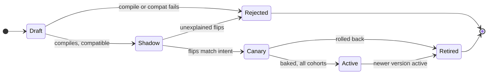

**Tenant edits are data, gated differently.** A tenant editing a role, a binding, a group's members or a dynamic group rule never changes the schema. Each edit goes through the access preview (§4.4) and the escalation check: an edit that would give anyone a permission the editor does not hold over that scope is refused, and that includes editing a role's definition (it re-grants every binding of the role) and widening a rule (it grants over every new member). An edit needs a second admin when it would grant an `audit: always` permission over more than 100k (principal, object) pairs, counted per admin over 24 h so it cannot be split into small edits, **or** give any single principal that permission over more than ~10% of the tenant's objects of that type [estimate]. The relative rule matters because the largest tenant has 100k employees: "one new person can see every salary" is at most 100k pairs.

**Migrating 400 services** (Stripe's version of the prompt is exactly this):
1. **Inventory.** Per service: its endpoints and the check each one does today. Map each to a schema permission. Most services turn out to share 5 to 10 patterns (owner, team member, admin of the account, role scope).
2. **Model and mirror.** Write the object types. Build a mirror connector from each service's database so the tuples exist without changing service code: snapshot, then tail CDC.
3. **Shadow.** The PEP runs in shadow mode: the service's own check decides, and the PEP calls Check asynchronously (shed first under load) with the same inputs and logs both. A dashboard counts mismatches per (service, endpoint, permission, direction).
4. **Triage.** Each mismatch is a legacy bug, a model bug, or mirror lag (re-check at a later snapshot to tell). Fix and repeat.
5. **Enforce per endpoint** behind a flag. The gate is counted in **checks seen**, not days: zero unexplained mismatches over at least 3 M shadow checks per (pattern, permission), pooled across endpoints that share a pattern, in a window that includes a month-end. Simulated: "14 clean days" proves a mismatch rate below 1 in 10^6 only for endpoints above ~2.5 checks/s, and a month-end-only class shows up in 14 days only about half the time. Quiet endpoints replay legacy logs offline. Run the legacy check in reverse shadow for two more weeks. Rollback is the flag.
6. **Delete** the legacy check. The mirror connector stays, because it is now the data path.

Order: internal read-only tools, then low-risk reads, then writes, then money movement. Expect the long tail: the last 10% of services take half the time.

The research found no published mismatch numbers for this pattern. Figma's move to one permissions engine leaned on "hundreds of tests written over many years". Stripe's own docs do the key-level version of it: they suggest deriving a restricted key's permissions from the existing key's request logs.

**What changed:** compat rules including expand then contract and context defaults, replay with caveat inputs and expected flips, the data diff, activation rows per cohort with canary dual evaluation and an expedited tightening path, one-step rollback, the escalation check on every widening edit, the pair-counted second-admin rule, the PEP's shadow and reverse-shadow modes, a migration gate counted in checks. [`deep-dives/migration-and-safe-policy-changes.md`](deep-dives/migration-and-safe-policy-changes.md).

### 5.7 "What fails, and what is the blast radius?"

| Component | Failure | Blast radius | What the user sees | Mitigation |
|---|---|---|---|---|
| **Check cell** | **Hot key, bad build, pathological check** | **~25% of a region's tenants** | Slow pages, then 503s | Caller-side cache and hot-key replication, sub-problem budget, cell-by-cell deploys, remap across the other cells, shedding order |
| Check server | Dies | Its in-flight checks | One retry, ~12 ms extra | N+2 per cell, PEP retry on another server |
| Store, one node | Down | Its ranges in that region | Nothing: the second local replica serves | Two readable replicas per region |
| Store, one region | Unhealthy | That region's cache misses | +30 to 70 ms per miss, longer budgets | Region-degraded mode, then evacuate the region |
| Store, all | Down | No writes. Reads stop on cache misses | 503s on misses, ALLOWs from cache only where `degrade` allows | None cheap. This is the true SPOF, so 5 voters in 3 regions |
| Watch stream, one tenant's ranges | Stalls | Those tenants' caches stop advancing | Their revokes slow down, nothing wrong | Per-tenant watermark, page at 8 s |
| Watch stream, a region's Kafka | Down | That region's tenants' caches | Revokes slow down; fresh-zookie checks use the store within budget | Regional clusters, read budget, page |
| Suspension poll | One server stale | Terminated users on that server | Nothing: it refuses checks, the PEP retries elsewhere | In-process gate |
| Suspension poll | Status leaseholder unreachable | Terminated users everywhere | Suspension lands in ~6 s instead of 2 s | Nobody fences. Status leaf backstop. Page |
| Group index | Down or behind | Deep-group checks | Slower checks (p99 ~9 to 14 ms) | Fallback to recursion |
| Mirror connector | Stuck | New HR relationships | New manager cannot see report, old one still can, for minutes | Lag alert at 60 s. `after_source` makes sensitive writes wait instead of leak |
| Schema activation | Bad version | One cohort, then all | Wrong ALLOWs or DENYs | Compat rules, replay plus data diff, canary dual evaluation, one-step rollback |
| Decision log | Kafka down | Audit | Nothing for hours (disk spool) | Spool, drain before terminate, then fail closed for `audit: always` |
| A tenant admin | Grants too much | That tenant | Over-broad access | Escalation check, access preview, pair-counted second admin, audit |

---

## 6. Final design and the core flows

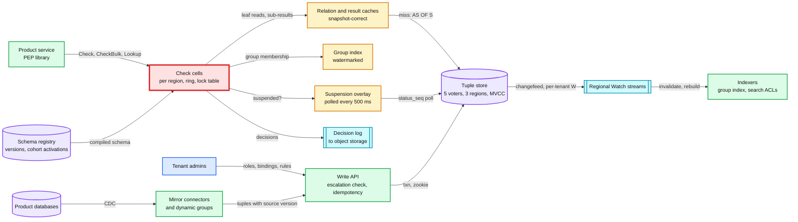

The explain and review API sits beside the decision log and the check cells (§4.4). Zoom-ins for every component are in [`diagrams.md`](diagrams.md).

### Flow 1: a warm check (~2 ms)
1. The payroll service's PEP sends `Check(user:u7, view_comp, employee:e42)` with a 25 ms deadline.
2. The check server confirms u7 is not suspended, picks `S = min(floor_1s(now - 5 s), W_t)`, and reads the schema version active for the tenant's cohort at S.
3. Branches run in parallel. `manager->line_up` is one read of `chain_ancestors(e42)` in the group index: it contains e7, whose user is u7. ALLOW. `- blocked` is read from the relation cache: empty.
4. ALLOW with `checked_at = S`. One log record, because `view_comp` is `audit: always`.

### Flow 2: an admin grants a role and sees it at once
1. The escalation check passes. `WriteRelationships` with three tuples, an `If-Match` and an idempotency key commits at T. Zookie T.
2. The admin UI sends its next checks with `at_least_as_fresh(T)`. In the tenant's home region the leaseholder is local.
3. Everyone else sees the grant within ~6 s through default checks.

### Flow 3: the new enemy is stopped (Example B)
1. Alice removes Bob from document d9 (T1). Charlie saves new text. The documents service's content-change check returns Z > T1. It stores Z with version 8 of d9.
2. Bob opens d9 a second later. The check carries Z, so it reads at S ≥ Z, sees the removal: DENY.

### Flow 4: a termination
1. HR marks Bob terminated. The offboarding workflow calls `SuspendPrincipals([user:u9])`: committed with the next `status_seq`.
2. Within ~0.5 s most check servers' polls see it, within 2 s every serving server denies u9 and every personal API key Bob owns. Team-owned integration keys keep working, and Bob's personal keys are rotated to a named custodian. A server whose poll is stale while its cell is fresh refuses checks, and the PEP retries elsewhere.
3. The identity system kills sessions. After 7 days, the cleanup job deletes Bob's owned tuples, fenced on `status_seq`. Mirrored tuples go when the HR record changes.

### Flow 5: an HR admin's list page
1. LookupResources returns the plan: `(department == "Eng" and country == "US") OR id IN (e88) MINUS id IN (e17)`, rule_version 14.
2. The HR service filters, sorts and keyset-pages in its own database. `filter_page` post-checks the 50 rows: one CheckBulk at the default snapshot, plus a small one at least as fresh as the zookies of rows changed in the last ~5 s. 50 of 50 pass.

### Flow 6: a check cell goes bad
1. A bad build in cell 2 raises p99 to 40 ms. PEP retries succeed on other servers in the same cell at first, then fail.
2. The cell's error SLO alert fires in ~2 minutes. On-call rolls back the cell, or remaps its tenants across the other three cells by tenant hash. The receiving servers replay 2 minutes of those tenants' changes before caching. Other cells' tenants never noticed.

### Flow 7: a schema change
1. v42 removes skip-level managers from `view_comp`. It compiles and passes compatibility. Replay of 300k logged `view_comp` checks shows 3,904 ALLOW to DENY flips, all from 41 skip-level managers, which is the intent, and zero DENY to ALLOW. The data diff agrees.
2. Activation rows go to the canary cohort at T, with dual evaluation on 1%. Bake an hour, then the remaining cohorts.

---

## 7. Trade-offs

| Decision | Option A | Option B | Chose | Why |
|---|---|---|---|---|
| Permission model | RBAC tables per service | Policy engine over attributes (OPA, Cedar) | **ReBAC tuples plus caveats** (with RBAC as tuples) | RBAC explodes into a role per scope combination and cannot express "manager of". A policy engine needs every fact handed to it, and the facts are the 1 TB graph. Tuples hold the facts, caveats hold request-time conditions |
| Where checks run | In the caller, over a per-tenant snapshot | Central check service | **Central** | A 100k-person tenant is ~3 GB of tuples and changes several times a second. Shipping that to 400 services' processes is the flag design applied to the wrong data shape |
| Consistency | `fully_consistent` everywhere | Bounded staleness everywhere | **Bounded staleness plus zookies where content changes** | Fresh checks cost ~6x latency (Zanzibar Recent vs Safe). Staleness alone leaves Example B open. Zookies pay only in the few seconds after a content change |
| Caching | Per-service decision cache with TTL | Snapshot-keyed result cache plus watch-invalidated relation cache | **Snapshot-correct caches** | A TTL is a revocation delay you cannot reason about (simulated p99 64 s). Watermark-guarded invalidation can miss, never lie, and turns ~4 store reads per check into ~0.1 |
| Watermark scope | One per server | One per tenant | **Per tenant** | One global watermark stalls every tenant when any one range stalls, which once made the stall guard a fleet-wide 4x store overload |
| Store size | Sized for warm traffic (~50 nodes), degraded failover | Sized for cold caches and region failover (~86 nodes) | **~86** | Warm needs ~0.15 reads per check. A failover or remap runs at ~4 until warm. The cheaper option is a fair choice if the business accepts slower checks during a regional failover |
| Store | Postgres sharded by tenant | Consensus SQL with MVCC and follower reads | **Consensus SQL, Spanner class preferred** | Snapshot reads at a timestamp, external consistency for zookies, local follower reads, region survival. On Postgres every one of those is ours to build |
| Deep groups and chains | Recursive evaluation | Flattened index (Leopard) | **Index for groups, folders and manager chains. Recursion for caveated and expiring edges, and as the fallback** | Six sequential hops break p99, and a DENY walks the whole chain (p99 20.4 ms cold at 10 levels). A reorg costs subtree times depth writes and up to minutes of fallback for one tenant, which is rare |
| Attribute rules | Fetch attributes at check time | Materialize as dynamic groups | **Materialize slow attributes, caveat fast ones** | Fetching attributes per check is the policy-engine data problem again. Materialized groups also make listing and reverse lookups work |
| Rule edits | Diff applied in batches | Blue/green group version, one-transaction flip | **Blue/green** | A narrowing edit is a revoke. 90k removals in batches take ~18 s and expose partial states |
| Custom roles | Schema per tenant | Roles as tuples | **Tuples** | 200k tenants editing schemas is 200k chances to break the global blast radius. Tuples change only that tenant's data |
| Termination | Delete tuples | Suspension overlay first | **Overlay, polled from the store, enforced in-process** | One write, 2 s bound on every serving server. Deletion is minutes long and can fail halfway. Polling keeps Kafka out of the termination path |
| Failure mode | Fail open | Fail closed | **Closed, as 503**, with opt-in 60 s reuse for reviewed low-risk reads | A 403 during our outage tells clients to delete data and users to request access |
| Cell failure | One spillover cell | Spread across the other cells | **Spread by tenant hash** | One spillover cell runs at ~71% CPU with 1.5% first-try timeouts, spread ~47%. Spreading keeps headroom for a second failure |
| Listing | Post-filter only | Lookup ids only | **By result size: post-filter, ids, a plan, search ACLs** | No single strategy survives both "20 rows" and "50,000 rows sorted by name" |
| Decision log | Log everything | Sample | **All denies and sensitive checks, 1% of the rest** | 15 TB/yr instead of ~150 TB/yr. Sensitive access is always reconstructable |
| Explicit deny | Tenant-authored deny rules (AWS IAM style) | Schema-level exclusions only | **Exclusions only** | Keeps every decision explainable as one path. Tenants get `blocked`, not a policy language |

**Refused to build:** a tenant-facing policy language, per-tenant schemas, a decision cache inside every service, strong consistency on every check, an authentication service, a graph database, precomputed answers for every (user, object) pair.

---

## 8. Staff-level notes

**Failure modes and blast radius.** The table is §5.7. The short version: a region can go dark without a wrong answer; a cell can go bad and only its tenants notice; a stalled stream slows revokes for its tenants but never makes an answer wrong; the two global hazards are the store (5 voters in 3 regions) and the schema (compat rules, replay plus data diff, cohort activation).

**Migration.** §5.6. Mirror first so no service changes code to get its tuples in, shadow per endpoint, enforce behind a flag once enough checks have been seen, reverse shadow, delete. The PEP library is the one piece every service adopts, so it ships first, in shadow mode, everywhere.

**Operability.**
- **SLOs:** check availability 99.99% per region at the PEP, counting 503s and deadline misses. Check p99 under 10 ms for default consistency. Suspension-to-deny under 2 s on every serving server. Watch watermark lag under 8 s per tenant.
- **What pages at 3 am:** (1) a cell's check error rate or p99 burning its error budget; (2) a cell's **median** suspension poll stale (nobody fences then, and the backstop is carrying terminations at ~6 s); (3) any tenant's watermark more than 8 s behind (its revokes are slowing); (4) the relation-cache verifier finding a mismatch (a correctness bug, flush and investigate); (5) any mirror connector more than 60 s behind; (6) a DENY to ALLOW difference in the canary cohort's dual evaluation. A tenant's spike in DENYs pages nobody: it goes to that tenant's dashboard and our support queue.

**Cost.** ~63 check servers, ~86 store nodes, ~18 group index servers, 3 regional Kafka clusters, ~15 TB/yr of logs. The store is sized for the cold moments, so warm restarts, ramped failovers and spread remaps are worth real money: without them the store would need ~4x its warm capacity at any time. Engineering is the real cost: the migration (a year for 400 services is realistic), the schema review process, and a PEP library in ~5 languages.

**Team boundaries.**
- The authorization platform team owns the check service, store, PEP libraries, schema registry and the review process.
- Each product team owns its object types in the schema, its mirror connector mapping, and its own shadow-to-enforce migration.
- Security owns the break-glass allowlist, the `audit: always` list and access reviews.
- A schema review board (platform plus security plus the owning team) approves permission rewrites. That board is the organisational form of the global blast radius.

---

## 9. What is expected at each level

**Mid (breadth 80, depth 20).** Roles and permissions tables, a check API, a Redis cache with a TTL, maybe JWT claims for roles. Probably misses relationships (manager, owner), the new-enemy problem, listing, and what happens when the service is down.

**Senior (60 / 40).** Picks a relationship model and can write the tuples for the HR example. Central check service with caching, explains why the TTL cache is a revocation problem, and knows about Zanzibar's zookies. Handles listing with LookupResources plus post-filtering. Fails closed. Gives latency and QPS numbers.

**Staff+ (40 / 60).** Starts from "on every request path" and the read:write ratio, and **contrasts it with flags out loud** (why this data cannot ship to the caller). Distinguishes owned from mirrored tuples and closes the CDC gap in the new-enemy protocol in the right order. Knows which Zanzibar example needs zookies and which one snapshots already solve. Explains why Zanzibar's cache numbers argue for a watch-invalidated, watermark-guarded leaf cache, and sizes the store for the cold moments. Separates termination (overlay, 2 s, enforced in-process) from ordinary revocation. Maps 503 vs 403. Names circular dependencies and the Google 2020 incident. Treats the schema as the global blast radius with replay, a data diff and cohort activation. Brings the 400-service migration with shadow mode and a gate counted in checks, and states what was refused.

---

## 10. Nitty-gritty (past interview scope)

### 10.1 Internals of each chosen technology

- **Consensus SQL store.** Each range of rows is a Raft group (5 voters here, plus a non-voting replica in eu-central). A write commits once 3 of 5 have it in their logs. Each committed version carries a timestamp from TrueTime (Spanner) or a hybrid logical clock (CockroachDB), so a read `AS OF T` sees exactly the writes committed at or below T. A follower can serve `AS OF T` once T is below its **closed timestamp**: the leaseholder promises never to accept a write at or below it. That is why the default snapshot is ~5 s old. Old versions are kept for the GC window (24 h here, SpiceDB's default too), which bounds how old a zookie can be honored exactly. A zookie older than that is served at the oldest available snapshot, which is still "at least as fresh". On an HLC store, external consistency is not automatic for keys a transaction did not touch, which is why zookies there carry the max clock offset (§3.3). See [`../../concepts/mvcc-and-isolation.md`](../../concepts/mvcc-and-isolation.md) and [`../../concepts/raft.md`](../../concepts/raft.md).
- **Changefeed.** The store emits each row change with its commit timestamp, per range, and periodic **resolved timestamps**. Each region's feed writes into that region's Kafka, partitioned by tenant. A check server consumes its cell's partitions with manual assignment and contiguous offsets, and keeps `W_t` per tenant. The store decides how fine that watermark can be. Spanner change streams send per-partition heartbeats, and partitions split, so the reader tracks partition lineage and maps heartbeats to tenant key ranges. CockroachDB's resolved timestamp is changefeed-wide (the feed's high-water mark) and by default is emitted no more often than every 30 s (`min_checkpoint_frequency`), so there it is one feed per cell over that cell's tenant spans, tuned to ~1 s: a stuck range then freezes one cell's tenants, never the fleet. Any offset gap or rebalance drops the affected tenants' cache entries and replays 2 minutes. See [`../../concepts/stream-processing.md`](../../concepts/stream-processing.md).
- **Dispatch ring.** Consistent hashing with ~100 virtual nodes per server. Adding a server moves ~1/N of keys. See [`../../concepts/sharding.md`](../../concepts/sharding.md).
- **CEL.** Caveats compile once when the schema loads. Each evaluation is bounded by a cost limit (OpenFGA's default cost cap is 100) and takes microseconds. Parameters on a tuple are capped at 4 KB (OpenFGA allows 32 KB) and win over request context. Rules for dynamic groups use a subset of CEL that translates to SQL.
- **Group index.** Leopard stores `(set type, set id, element id)` triples and answers set unions, intersections and exclusions. It is rebuilt offline periodically and keeps an **incremental layer** of updates since that snapshot, fed by Watch. Zanzibar measured 1.56 M Leopard QPS at the median with under 1 ms p99.

### 10.2 Configuration knobs that matter

| Knob | Value | Why |
|---|---|---|
| Default staleness | 5 s, capped at the tenant's watermark | Follower reads stay local. SpiceDB's default quantization is also 5 s |
| Snapshot quantum | 1 s (zookies rounded up to it unless that is in the future) | Shares result-cache keys within a second. The relation cache does not depend on it |
| Watermark lag page | 8 s | Under the 10 s ordinary-revoke SLO, so a stall never breaks it silently |
| Store read budget when lagging | The region's spare provisioned reads, ~0.85 reads per check at peak | Fresh and sensitive checks keep working without overloading the store. Defined against provisioned capacity, not warm use, or most comp page views would 503 |
| Recent-changes log | revisions above `W_t - 2 min` | Covers every change between a fill's snapshot and `W_t` |
| Relation-cache verifier | 0.1% of hits | Catches a changefeed bug no rule can |
| Max dispatch depth, sub-problem budget | 50, 1,000 | SpiceDB's depth default. The budget stops a pathological graph burning a cell |
| Dispatch hop acknowledgement | 3 ms (the answer is bounded by the check deadline) | Escapes a slow owner without re-running cold work |
| Request context | 8 KB per check [estimate] | Bounded caveat input |
| Bulk lane | 5k tuples/s per tenant, ~10k/s per region [estimate] | Bounds Watch volume and the recent-changes log during a fleet-wide backfill |
| Schema activation | `activate_at` at least 60 s after commit, rows polled every 1 s, a server over 30 s stale refuses checks | Activation rows are global, so no tenant watermark covers them |
| CheckBulk max items | 100 | One snapshot, bounded work per call |
| LookupResources page | 1,000 items, 500 ms per page | OpenFGA defaults are 1,000 results and 3 s. We page instead of truncating |
| PEP deadline | 25 ms default, 12 ms per try, 1 retry, 10% retry budget. 150 ms in region-degraded mode, 300 ms with a fresh zookie, 5 s with `after_source` | Fits the 10 ms p99 with one retry. Region-degraded: 0% 503s, p99 ~114 ms (simulated) |
| WriteRelationships batch | 1,000 updates, idempotency key required | Bounded transactions, no silent re-grant on retry |
| Idempotency key TTL | 24 h | Covers any client retry window |
| MVCC GC window | 24 h | Zookies and explain within a day |
| Suspension poll | every 500 ms, gate at 2 s stale while the cell median is fresh | The suspension SLO, without turning a poll problem into an outage |
| Cleanup grace | 7 days, fenced on `status_seq` | Rehires and mistakes are common |
| Caveat parameters | 4 KB per tuple, CEL cost cap 100 | Bounded evaluation |
| Dynamic group recompute | Blue/green, bulk lane at 5k tuples/s per tenant | Atomic narrowing, no interference with interactive writes |
| Schema cohorts | 16 tenant-hash buckets, 1 h bake, 15 min for pure tightening | Blast radius per step |

### 10.3 Capacity math per component

| Component | Load at peak | Per unit | Units | Closest to its limit? |
|---|---|---|---|---|
| Check servers | 1 M checks/s | ~0.3 ms CPU per check, 16 cores | ~63 (4, 4, 3 cells, 6 or 5 servers each) | Hot-key owners before caller-side caching takes over. ~55% CPU in us-west during a us-east failover |
| Relation cache | 5 to 18 leaf lookups per check | ~16 GB per server | Hot set ~300 M tuples x ~100 B = 30 GB per region | Its warm hit rate is why the store idles. Its cold path sizes the store |
| Tuple store reads | ~150k/s warm fleet-wide. Provisioned for ~1 read per check at each region's peak | ~20k reads/s per node ceiling [estimate], run at 70% | ~86 nodes (32, 32, 22) | **Yes, during a cold failover.** All of us-east arriving at once in us-west would be ~1.84 M reads/s on a 640k ceiling (2.9x). A 15-minute ramp peaks at ~76% of the ceiling for document-shaped traffic and ~23% for HR-shaped, a 5-minute ramp at ~157%. So users of a lost region move over 15 minutes, not at once |
| Tuple store, leaseholder reads | ~50k/s for content-change checks, plus fresh zookie checks | | spread over home regions | No |
| Tuple store writes | 10k tuples/s peak, in ~2k transactions | ~70 ms per commit (cross-region) | spread over ranges | No |
| Group index | ~2 M lookups/s (groups, chains, search tokens) | Leopard-class, sub-ms | ~6 servers, ~10 GB per region | No. A reorg of 20k reports is ~200k updates, ~20 s to ~7 min of lag for that tenant |
| Watch stream | 1k changes/s average, ~3.3k/s per cell at import peaks | | 3 regional clusters, 7-day retention | No |
| Suspension poll | ~130 reads/s | 1 leaseholder | 1 small table | No |
| Decision log | 100k records/s peak | 200 B each | ~20 MB/s into Kafka | No |

### 10.4 Failure timeline

**A check cell gets a bad build.**

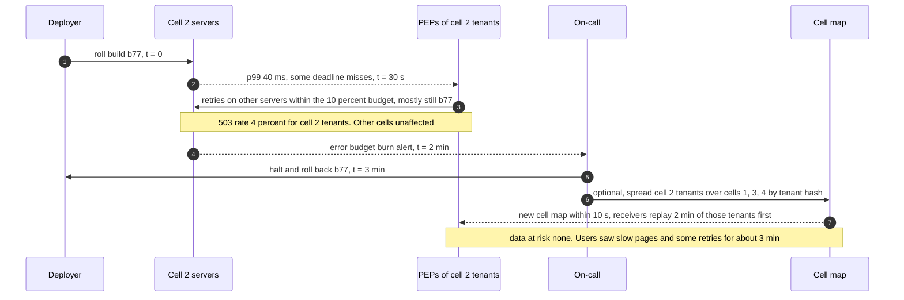

**A region's Kafka cluster stalls for 10 minutes.**

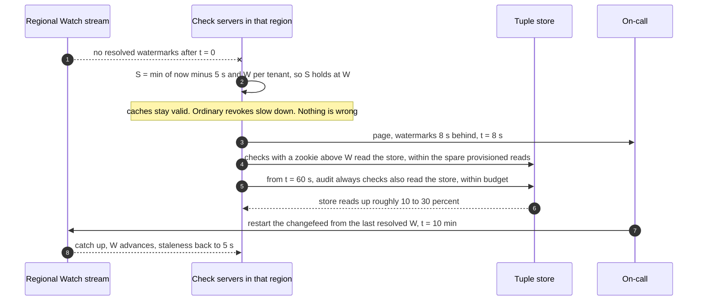

The accepted cost: for permissions that are not `audit: always`, a revoke made during the stall reaches that region's default checks only when the stream recovers. Suspensions do not wait, and neither do salaries or payouts.

**A region is lost.** Raft keeps quorum with the 3 surviving voters, and every commit then needs all three, so writes pay the transatlantic round trip until the region returns or replicas are re-placed. Ranges whose leaseholder was there move their leases in ~10 s [estimate], so writes and fresh reads for those tenants stall ~10 s. Their per-tenant watermarks pause for the same ~10 s, and nothing else's does. Products shift users to another region over ~15 minutes, and its check cells warm as the traffic arrives.

### 10.5 Exactly-once and idempotency end to end

- **Client writes.** A required `Idempotency-Key` plus request hash stored in the same transaction as the tuples, 24 h. A retry with the same key returns the original zookie. The same key with a different body is a 409. Without required keys, a lost acknowledgement retried after another admin's revoke would quietly re-grant.
- **Preconditions.** "Must not exist" makes create-if-absent races safe ("only one owner"). Tenant admin edits carry `If-Match` on the edited object's version.
- **Mirror connectors.** Upsert only if `source_version = (epoch, LSN)` is higher than the stored one. Replaying the CDC stream from any point converges. Deletes become tombstones carrying the version, kept until a reconciliation sets a "reconciled through" floor, so a replayed older insert cannot resurrect a deleted row. An epoch change (a promoted primary) triggers a re-snapshot and sweep, the procedure in [`../cdc-pipeline/`](../cdc-pipeline/).
- **Dynamic groups.** Membership tuples carry `(rule_version, epoch, LSN)` and are upserted only if newer, from both the incremental path and recomputes. Rule edits are blue/green. A nightly reconcile compares each group with its rule.
- **Watch consumers.** Every derived index stores the revision it has applied per tenant and ignores anything at or below it.
- **Suspensions.** Applied in `status_seq` order. Cleanup batches are fenced on it.
- **Decision log.** At least once into Kafka, deduplicated downstream by a decision id (`check_server, sequence`).

### 10.6 Consistency model per edge

| Edge | Model |
|---|---|
| Write API to tuple store | Linearizable, externally consistent timestamps |
| Check server to store, default | Snapshot at ~5 s staleness, capped at the tenant's watermark, one snapshot per check |
| Check server to store, with zookie | Causal: at least as fresh as the write or content-change check that produced the zookie |
| Relation cache | Snapshot-correct, guarded by the per-tenant resolved watermark and expiries |
| Result cache | Exact: tenant, version and snapshot in the key, caveats evaluated per request |
| Group index, search ACL index | Eventual, watermarked. Index used for a check only when its watermark covers S. Search results always post-checked |
| Suspension overlay | Eventual, 2 s bound enforced in-process, monotonic by `status_seq`. Backstop: the status leaf at the check's snapshot |
| Mirror connector | Eventual (~1 to 2 s), ordered per source by `(epoch, LSN)`, fenced by `after_source` where it matters |
| Schema | One version per check, chosen by the cohort's activation rows at S |
| Decision log | At least once, async |

### 10.7 Alternatives rejected

| Alternative | Why it looked attractive | Why we rejected it |
|---|---|---|
| OPA sidecars with data bundles | Local evaluation, no network hop, mature policy language | Bundles are for policy and small data. A 3 GB tenant graph that changes several times a second does not fit in a bundle. Fine for the gateway's coarse checks |
| Cedar or Amazon Verified Permissions | Analyzable policies, forbid overrides permit, managed | Still needs the entities (the graph) handed in per request. AVP's default quota is ~200 IsAuthorized calls/s per region [search snippet], four orders below our need |
| Per-tenant snapshot embedded in each service | Zero network, like flags | Big tenants are GBs and change constantly. Every service's memory and every revoke's propagation become our problem |
| Permissions in JWT claims | No call at all | Token size explodes past a few roles, and a revoke waits for the token to expire. Fine for coarse scopes (Stripe's restricted keys look like this), not for objects |
| Graph database | It is a graph | No snapshot reads at a timestamp, no zookies, weak multi-region. The graph is shallow and tenant-partitioned (§5.3) |
| Redis as the primary store | Fast | Durability and snapshot semantics are the requirements. The relation cache already lives in the check servers |
| Postgres row-level security in each product | The database enforces it | Every product reimplements the model, nothing answers "who can see this" across products, and termination is again 400 places |
| Ory Keto | Open source Zanzibar | Its snaptoken (zookie) field was documented as not implemented [unverified, search snippet]. That is the property we need most |
| Bypass the cache when the stream stalls | Keeps revokes fast | With one global watermark it sent every check to the store at ~4 reads each: a 4x overload, fleet-wide, at the worst moment |
| Push suspensions through Kafka | Lowest latency | Shares a failure with the Watch stream, and the backstop depends on that stream too. A 500 ms poll of one small table is enough for a 2 s bound |
| Readiness probes to enforce the 2 s bound | Standard tooling | Probe period plus endpoint removal kept a frozen server allowing for p99 4.7 s. The in-process gate: 1.7 s |

### 10.8 How the big companies do it

- **Google Zanzibar (2019).** Over 2 trillion tuples, over 10 M client queries/s (Check peaks ~4.2 M/s, Read ~8.2 M/s, Write ~25k/s), more than 10,000 servers in several dozen clusters, more than 1,500 namespaces, availability above 99.999% over 3 years. Spanner underneath with 5 voting replicas in 3 metro areas. Zookies, quantized snapshots, consistent-hash delegation with caller and callee caches, a lock table, Leopard for nested groups, hedged Spanner reads. Its own conclusion: hot spots were "the most critical frontier".
- **Airbnb Himeji (2021).** Zanzibar-inspired, Aurora underneath, a sharded and replicated in-memory cache invalidated from change events (SpinalTap and Kafka). Reported 99.999% availability, p99 12 ms, and 850k **entities**/s by March 2021 (not checks/s; do not mix them).
- **Uber Charter and authfx (2023).** ABAC: Charter manages policies centrally and distributes them, a library in each service evaluates them, with attributes fetched from attribute stores. CEL evaluation takes "only a few microseconds". 70 services adopted it. The library-evaluates design is what you get when the facts are attributes, not a graph.
- **Figma (permissions DSL).** One policy language, one evaluator ported across platforms so client and server agree. Permission checks had been ~20% of database load. Lazy loading of facts "more than halved" evaluation time. Migration was gated on "hundreds of tests written over many years".
- **AWS IAM.** Union of allows across identity and resource policies, "an explicit deny in either of these policies overrides the allow", and permission boundaries as an intersection. The same set algebra as the schema's `+ & -`.

### 10.9 Operational runbook

- **Dashboards (the 5 metrics).** Check p50 and p99 by cell, error rate by cell (503 and deadline), store reads per check and leaf hit rate, watermark lag per tenant (worst 10), suspension poll freshness per server.
- **Alerts.** Error budget burn per cell (page). Any tenant's watermark over 8 s behind (page). A cell's median suspension poll stale (page). Verifier mismatch (page). Group index lag over 3 s (page: every chain DENY is back on recursion, 12.3 to 20.4 ms). Mirror lag over 60 s (ticket, page at 5 min). Warm leaf hit rate below 85% for 15 minutes (ticket: something is restarting cold).
- **Rollout.** Builds go cell by cell with warm restarts, one region first, one hour bake each. Schema versions go cohort by cohort with dual evaluation in the canary.
- **Rollback.** Builds: redeploy the previous image per cell. Schema: a new activation row for the previous version, after a reverse replay. Nothing to backfill: tuples are untouched by either.

### 10.10 Security and abuse

- **The subject is never from the request body.** The PEP takes it from the verified session or token. A service calling on behalf of a user passes the user's identity through token exchange, and the check is made for the user. The calling service's own identity is checked separately ("can service X act for users on object type Y"), which closes the confused deputy.
- **Who may call and write what.** A service may call Check only for the object types it is registered to protect, within a per-service quota, and may write only the `(object type, relation)` pairs it owns. Otherwise any service could map the whole permission graph or plant a grant.
- **Tenant isolation.** Every tuple carries `tenant_id`, and wildcards mean "every user of this tenant". A tuple linking two tenants is refused unless the schema declares a cross-tenant relation (an accountant firm's staff, a Connect platform), and those relations are listed in every access review.
- **Admins cannot escalate.** Every edit that can widen access (binding a role, editing a role's definition, adding a member to a group that holds bindings, widening a dynamic group rule) runs the access-preview diff and is refused if it grants anything the editor does not hold over that scope. Stripe's own docs warn that a compromised user who can invite "can invite additional users under their control". HR attribute edits that feed scopes (department, location) are permissions in the HR product with `- self`, so nobody moves themselves into an admin's scope. Grants of `audit: always` permissions over more than 100k (principal, object) pairs per admin per 24 h, or to one principal over more than ~10% of a tenant's objects of that type, need a second admin.
- **Caveat context.** `request_ip` is filled by the PEP from the connection, or from `X-Forwarded-For` only as set by our own trusted proxies. Tuple parameters win over request context.
- **Zookies.** Signed with an HMAC. One more than 1 s ahead of the store's clock is rejected, so a forged future token cannot pin reads to the leaseholder.
- **Enumeration.** LookupSubjects and explain are restricted to admins of the resource's tenant and to auditors. Check answers are ALLOW or DENY with a reason id. The reason text is only in the audit trail.
- **Internal staff.** Support access to a customer account is a time-boxed tuple with an expiry, created through a just-in-time flow with a ticket id, always logged, and visible to the customer in an access log.
- **Cycles and depth as abuse.** A tenant admin could write a dense web of nested groups. Cycles are refused at write time, and every check has a 1,000 sub-problem budget.

### 10.11 Evolution

- **10x checks.** More cells. The warm store load scales with misses, so the relation cache and warm restarts are the levers. At ~10 M checks/s, consider dedicated read replicas for the hottest tenants' ranges.
- **Data residency.** Home EU tenants' ranges only in EU regions (all voters). They lose survival of a full EU outage unless a second EU region exists. The seam is the tenant's placement policy, already the leading key.
- **Customer-facing policies.** If customers need IAM-style policies, compile them into tuples plus caveats in a tenant-scoped namespace, never into the global schema.
- **AI agents acting for users.** An agent principal with a delegation tuple and a caveat: its effective permission is the **intersection** of what the user can do and what the delegation allows (`user_perm & delegation`). The intersection operator already exists.
- **GDPR delete of a user.** Suspend, then DeleteRelationships by subject, then wait out the MVCC window (24 h), the Kafka retention (7 days) and the changelog archive in the lake (rewrite or crypto-shred its partitions) before saying "erased". Decision logs keep only a pseudonymous id.
- **A new product.** It adds object types to the schema (reviewed), a mirror connector, and adopts the PEP. No new service.

---

## 11. Follow-up questions to expect

Ranked by how likely an interviewer is to ask them.

1. "Why not roles in a table and a cache?" Role explosion, relationships, TTL as revocation delay. §1, §5.1.
2. "Model managers, HR admins by department, and time-boxed support access." §3.3 schema, [`deep-dives/data-model-and-evaluation.md`](deep-dives/data-model-and-evaluation.md).
3. "Alice removes Bob, then new content is added." Which example needs zookies, the content-change check, mirrored tuples. §5.2.
4. "How do you invalidate the cache when a role changes?" You do not need to be on time: the watermark rule. And why the per-decision cache is the wrong unit. §5.1.
5. "An employee is fired. How fast, and how do you prove it?" Suspension overlay, the in-process gate, the backstop. §5.2.
6. "List page for 50k visible employees." The plan, keyset paging, the post-check with zookies. §5.5.
7. "You are down. What do callers do?" 503 not 403, cells, opt-in degrade. §5.4.
8. "Deep groups and hot tenants." Group index, caller-side cache, cells. §5.3.
9. "Migrate 400 services." Mirror, shadow, gate counted in checks, enforce, reverse shadow. §5.6.
10. "How would a schema change go wrong, and how do you stop it?" Replay plus data diff, cohort activation, one-step rollback. §5.6.

---

## 12. Running it in a 60-minute round

### If the prompt is Stripe's ("redesign an internal authorization system across services")

The same model, with Stripe's objects. Stripe's public docs give the shapes:
- **Dashboard roles.** 26 built-in roles, and "if you assign a user multiple roles, they're assigned all the permissions of each individual role": a union. Built-in roles are role objects in a system tenant. A binding ties a user to a role on an `account`.
- **Restricted API keys.** Per resource, "None", "Read", or "Write", and "write permissions imply read permissions". An `api_key` principal bound to a key-specific role. In the schema: `permission read_charges = binding->read_charges + binding->write_charges`.
- **Connect.** A platform acting on a connected account: `account:acct_c#platform@account:acct_p`, and connected-account permissions are `platform->...` arrows, intersected with the key's own grants. A declared cross-tenant relation (§10.10).
- **Support staff.** Time-boxed tuples with an expiry and a ticket id, all logged.
- **The "across services" part** is §5.6: mirror, shadow, a mismatch gate counted in checks, enforce per endpoint. Lead with it. It is what "redesign" means.

### If the prompt is Rippling's ("permissions engine")

- **Permission profiles.** Rippling describes a profile as scope (a reporting line or a department), access (a data type such as payroll) and actions (view, edit, approve). That is exactly a role binding with a scope.
- **Supergroups.** "Dynamic membership lists built using attributes like level or location": the dynamic group service, with blue/green rule edits.
- **"As an employee's attributes change, their permissions update."** Mirror connector plus group recompute, versioned by LSN. Name the cost: permissions now depend on HR data quality.
- **Preview before a change.** The access preview in §4.4, which also powers the escalation check.
- **Termination.** The suspension overlay. Rippling sells instant offboarding, so say the number (2 s) and how it is enforced (an in-process gate, not a readiness probe).

### Minute by minute

| Minutes | What to do | What it signals |
|---|---|---|
| 0 to 5 | Clarify: who calls it, scale, revocation speed, fail open or closed, listing needed. Write "1 M checks/s, 1k writes/s, 3 B tuples" | You size before you draw |
| 5 to 15 | The model: tuples, schema, custom roles as data, caveats, dynamic groups. Write the `view_comp` line | Correctness and expressiveness first |
| 15 to 27 | §4.1 and §4.2: one check walked end to end, owned vs mirrored tuples, zookies on writes | A working MVP with no magic boxes |
| 27 to 40 | §5.2 new enemy (Example B), then §5.1 caches with the Zanzibar hit-rate numbers and the watermark rule | Consistency and the cost lever, with evidence |
| 40 to 50 | Interviewer's pick: listing (§5.5), hot spots (§5.3), or failure (§5.4) | Depth on demand |
| 50 to 60 | Migration of 400 services, operability, cost, what was refused | Staff scope |

Before the round, practise one sentence of justification per component. Stripe's reported design feedback in 2026 included "justification for the technology choices wasn't strong enough". For this design: consensus SQL because of timestamps and follower reads, Kafka because derived indexes need ordered changes with resolved watermarks, CEL because caveats must be bounded and fast, consistent hashing because identical sub-problems must meet on one server, a polled table for suspensions because the termination path must not share a failure with the change stream.
