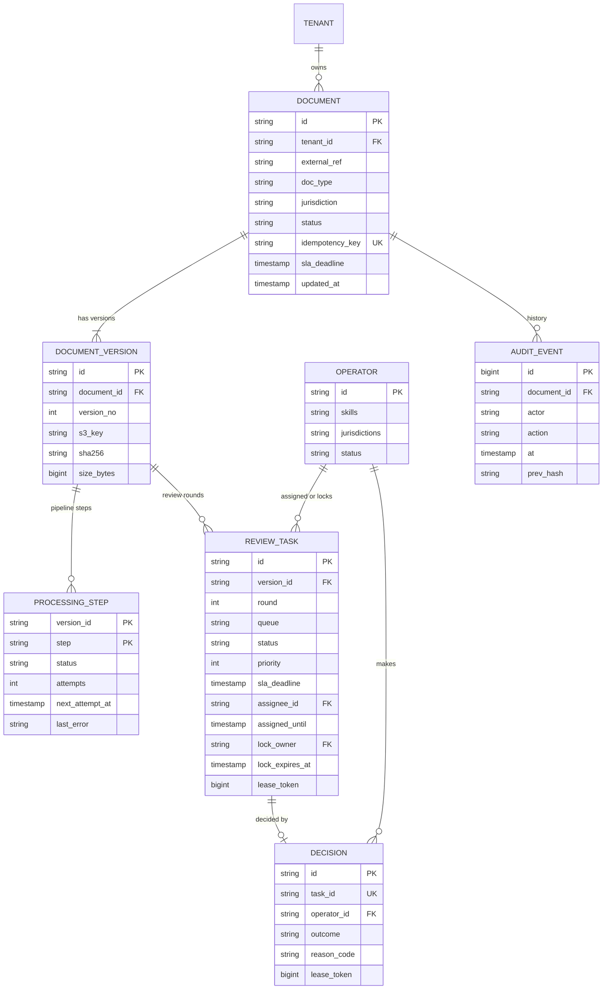
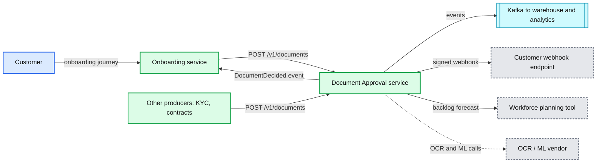
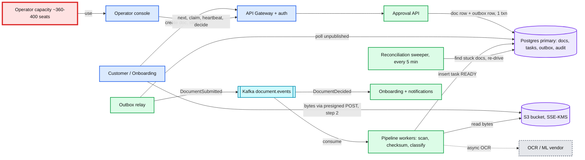
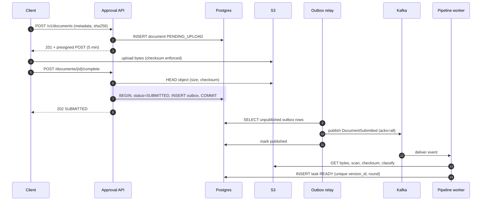
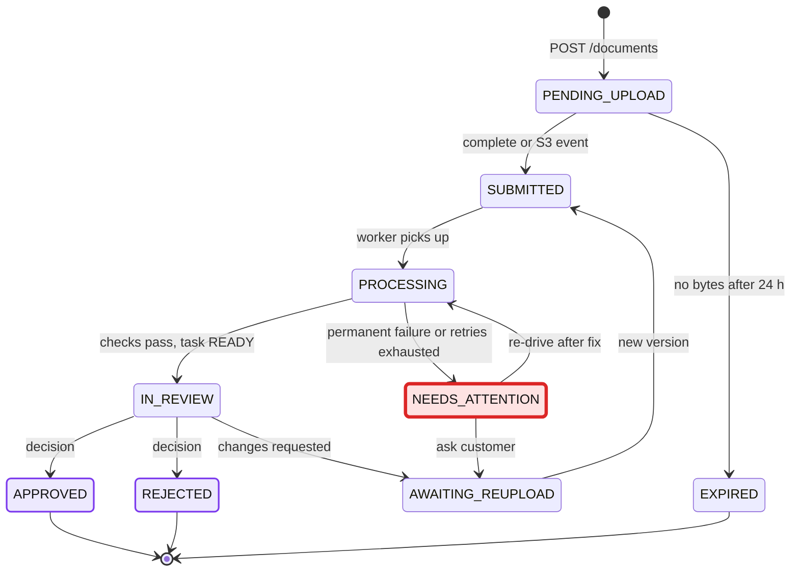
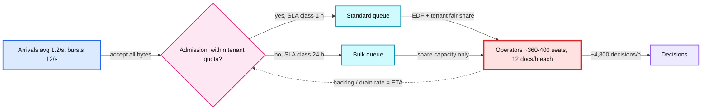
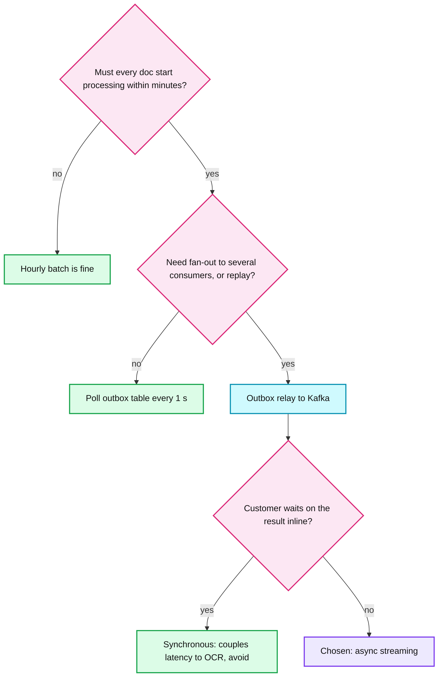
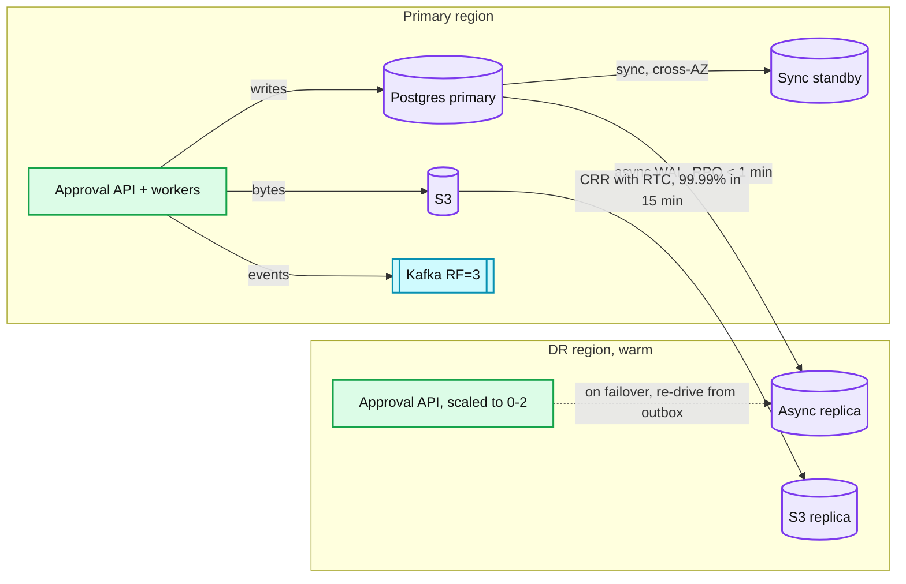
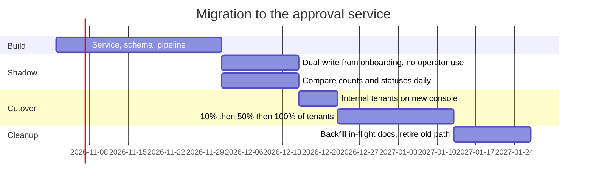

# HLD: Document Approval System

> One-line answer: Build a standalone review service. Customers upload straight to S3. A transactional outbox streams each document through Kafka into automated checks. Each document then becomes a task row in Postgres, and operators claim it with a fenced lease. A reconciliation sweeper guarantees nothing is dropped. The pipeline is the easy part. The hard part is having enough operator minutes to meet the 1 hour SLA.

**Deep dives**

| File | Covers |
|---|---|
| [no-doc-missed.md](deep-dives/no-doc-missed.md) | Outbox, S3 event backstop, sweeper, end-to-end idempotency |
| [poison-documents-and-retries.md](deep-dives/poison-documents-and-retries.md) | Error classes, backoff, retry topics, quarantine, systemic vs per-doc failure |
| [assignment-and-locking.md](deep-dives/assignment-and-locking.md) | Push vs pull, SKIP LOCKED, lease, heartbeat, fencing token, reassignment |
| [operator-capacity-and-sla.md](deep-dives/operator-capacity-and-sla.md) | Little's law, Erlang C, backlog budget, SLA classes, backpressure |

---

## 1. Requirements

### 1.0 Clarifying questions (ask these first)

| Question | Why it changes the design | Assumption I design for |
|---|---|---|
| Is review human, automated (OCR / ML checks), or both? | Automated only is a pipeline problem. Human is a capacity problem. | **Both.** Automated pre-checks, then human review. |
| "Queue latency < 1 h" means upload to pickup, or upload to decision? | Decision adds review time and rework rounds. | **Upload to operator pickup, p99 < 60 min.** Track upload to decision separately (target p95 < 75 min). |
| Are uploads spread 24x7, or business hours with bulk drops? | Peak hour staffing can be 2-3x the average. | Mixed. Bulk uploads get their own SLA class. |
| How long does one review take? | Sets operator headcount. | Median 5 min, long tail to 30 min. |
| One approver, or maker/checker (four-eyes)? | Number of review rounds per document. | Support N rounds. Default 1. |
| Retention and regulatory rules? | WORM storage, audit, data residency. | 7 years, immutable audit, single home region per tenant. |

### 1.1 Functional
- Customer (directly or through onboarding) submits a legal document and can track its status.
- Every document passes automated checks (malware scan, checksum, classification, OCR) and becomes a review task.
- A task goes to a **specific operator** by rule (push), or to the next free eligible operator (pull).
- An operator **locks** a task while working on it. Decision is approve, reject, or request re-upload.
- Decisions flow back to onboarding and the customer as events.

### 1.2 Non-functional

| Dimension | Target |
|---|---|
| Scale | 100k docs/day. ~1.2 docs/s avg, ~12 docs/s peak. ~2 MB per doc. |
| Queue latency (SLA) | Upload to operator pickup **p99 < 60 min** |
| Propagation | Upload complete to task READY: p50 < 5 s, **p99 < 30 s** (OCR kept off the critical path) |
| API latency | p99 < 200 ms for control-plane calls. No file bytes pass through our API. |
| Availability | Intake 99.95%. Operator console 99.9%. |
| Consistency | **Strong** for tasks, locks, decisions (single Postgres primary). **Read-your-writes** for customer status. **Eventual** (seconds) for downstream events. |
| Durability | Zero lost documents. RPO 0 in region, RPO < 1 min cross region. |
| Missed documents | **0.** Every document ends in a visible terminal or attention state. |

**Out of scope:** the legal review rules themselves, e-signature, building our own OCR / ML models (buy them), operator workforce scheduling (we feed it data), customer upload UI beyond the API.

---

## 2. Back-of-envelope

```
Docs/day          = 100,000
Avg rate          = 100,000 / 86,400           = ~1.2 docs/s
Peak rate         = ~10x avg (bulk uploads)     = ~12 docs/s
Doc size          = ~2 MB
Bytes/day         = 100k x 2 MB                 = ~200 GB/day
Bytes/year        = 200 GB x 365                = ~73 TB/yr in S3
Ingest bandwidth  = 12/s x 2 MB                 = ~24 MB/s (~200 Mbps) peak, straight to S3

Metadata rows/yr
  documents       = 100k x 365                  = ~36.5M
  review tasks    = ~1.2 per doc (rework)       = ~44M
  audit events    = ~10 per doc                 = ~365M   <- the big table
Postgres size/yr  = 36.5M x 1 KB + 44M x 0.5 KB + 365M x 0.5 KB = ~240 GB/yr
Postgres writes   = ~15 rows per doc lifecycle  = ~20 writes/s avg, ~200/s peak
Console reads     = 400 consoles, poll every 10 s = ~40 QPS

Human capacity (the real constraint)
  Review time S   = 5 min
  Work/day        = 100k x 5 min                = ~8,300 operator-hours/day
  Busy operators  = 8,300 h / 24 h              = ~347 busy at every moment (flat 24x7)
  Seats needed    = ~360-400 (utilization 87-96%), more at peak hour
  Headcount       = seats x 4.2 (24x7 cover) x 1.3 (leave, training) = ~2,000-2,200 FTE
  Human cost      = 8,300 h/day x $20/h (assumed)  = ~$60M/yr
  Infra cost      = Postgres + Kafka + S3 + workers + bought OCR = ~$0.5M/yr
```

What the numbers say:
- **1.2 docs/s is tiny.** One Postgres primary runs this at < 5% of its capacity. Do not shard. Do not go active-active.
- **Humans cost ~100x the infrastructure.** One minute cut from average review time saves ~1,670 operator-hours/day (~70 seats, ~$12M/yr). Engineering effort should go there.
- **Steady state is easy. Bursts break the SLA.** Erlang C says ~360 seats give a near-zero chance of a 60 min wait under smooth arrivals. A single 20k bulk upload breaches by hours. See [operator-capacity-and-sla.md](deep-dives/operator-capacity-and-sla.md).

**Propagation budget** (upload complete to task READY):

| Step | p50 | p99 |
|---|---|---|
| `complete` call commits doc + outbox row | 20 ms | 100 ms |
| Outbox relay poll, publish to Kafka | 0.5 s | 2 s |
| Malware scan + checksum | 1 s | 5 s |
| Lightweight classification (first page, metadata) | 2 s | 10 s |
| Task row inserted, visible to operators | 50 ms | 200 ms |
| **Total** | **~4 s** | **~20 s** |
| Full OCR (async, enriches the task later) | 15 s | 2-5 min |

The 30 s target holds only because full OCR is not on the critical path. The 60 min budget belongs to humans, not to the pipeline.

---

## 3. API

Three resources: **Document** (what the customer submitted, with versions), **Task** (one review round of one version), **Decision** (the outcome of a task).

| Method | Path | Body / Params | Returns |
|---|---|---|---|
| POST | `/v1/documents` | metadata, size, sha256. `Idempotency-Key` header. | 201, doc id + presigned upload (5 min TTL) |
| POST | `/v1/documents/{id}/complete` | none | 202, status `SUBMITTED` |
| GET | `/v1/documents/{id}` | none | status, current task, `expected_review_by` |
| GET | `/v1/tasks` | `assignee=me&status=READY&queue=&cursor=&limit=` | page of tasks + `next_cursor` |
| POST | `/v1/tasks/next` | none (queues come from operator profile) | 200 task + lease, or 204 nothing eligible |
| POST | `/v1/tasks/{id}/claim` | none | 200 lease, or 409 held by someone else |
| POST | `/v1/tasks/{id}/heartbeat` | `If-Match: <lease_token>` | 200 new expiry, or 409 lease lost |
| POST | `/v1/tasks/{id}/release` | `If-Match: <lease_token>` | 204 |
| POST | `/v1/tasks/{id}/decisions` | outcome, reason. `Idempotency-Key`, `If-Match`. | 201, or 412 stale lease, or 409 already decided |
| PUT | `/v1/tasks/{id}/assignee` | operator id (supervisor only) | 200 |

**Example: create a document**

```http
POST /v1/documents
Authorization: Bearer <tenant-scoped token>
Idempotency-Key: 4f9c2a1e-7d1b-4c55-9b0e-2a7c1d9e6f10
Content-Type: application/json

{
  "external_ref": "onboarding-case-8812",
  "doc_type": "INCORPORATION_CERTIFICATE",
  "jurisdiction": "UK",
  "filename": "cert.pdf",
  "content_type": "application/pdf",
  "size_bytes": 2097152,
  "sha256": "9f86d081884c7d659a2feaa0c55ad015a3bf4f1b2b0b822cd15d6c15b0f00a08"
}
```

```http
201 Created
Location: /v1/documents/doc_01J9ZQ4M7T

{
  "id": "doc_01J9ZQ4M7T",
  "status": "PENDING_UPLOAD",
  "upload": {
    "method": "POST",
    "url": "https://docs-eu-west-1.s3.amazonaws.com/",
    "fields": { "key": "t/acme/d/doc_01J9ZQ4M7T/v1", "policy": "...", "x-amz-signature": "..." },
    "expires_at": "2026-10-21T10:05:00Z"
  }
}
```

**Example: submit a decision**

```http
POST /v1/tasks/tsk_88213/decisions
Idempotency-Key: 0b7e...e21
If-Match: "42"

{ "outcome": "REJECTED", "reason_code": "SIGNATURE_MISSING", "notes": "Page 3 unsigned" }
```

```http
412 Precondition Failed
{ "error": "LEASE_LOST", "message": "Task was re-claimed by another operator at 10:31:07Z" }
```

**Why the API looks like this**
- **Resources and HTTP verbs (REST).** Non-CRUD actions (`claim`, `complete`, `heartbeat`) are POST sub-resources. Readable, and they map 1:1 to state transitions.
- **Document and Task are separate.** One document can go through many review rounds (re-upload, four-eyes). Folding them together breaks on round two.
- **`POST /tasks/next` is a POST, not a GET.** It changes state (claims). GET must stay safe to retry and cache.
- **Presigned POST, not PUT.** A POST policy can enforce `content-length-range` and content type. A presigned PUT cannot cap size.
- **`Idempotency-Key` on every create.** Clients and gateways retry. Retries must not create a second document or a second decision.
- **`If-Match` carries the fencing token.** 409 means "someone else holds it". 412 means "you held it once, but not any more". The UI handles these differently.
- **Cursor pagination.** Stable while new tasks arrive every second. Offset pagination skips or repeats rows.
- **Events, not polling, for systems.** Onboarding consumes `DocumentDecided` from Kafka. External customers get a signed webhook.

---

## 4. Data model

**SQL or NoSQL? Postgres.**
- Claim, decision, outbox and audit must commit **together** in one ACID transaction.
- The work queue is a **query** (`READY`, my skills, by deadline) with secondary indexes. Postgres gives `FOR UPDATE SKIP LOCKED` for free.
- ~20 writes/s and ~240 GB/yr fit one node for years.
- DynamoDB could do the lock (conditional writes). But "next task by deadline, filtered by skill and jurisdiction" needs a GSI per filter and has no SKIP LOCKED. We would rebuild a queue by hand. I would only switch at ~100x scale or for true multi-region writes.
- File bytes and OCR text live in **S3**, never in the database.



Plus an `OUTBOX` table (`id, aggregate_id, event_type, payload, created_at, published_at`), left off the diagram.

**Access patterns and the index that serves each**

| # | Access pattern | Index |
|---|---|---|
| 1 | Operator "next task": READY, my queues, by priority then deadline | partial `(queue, priority, sla_deadline) WHERE status='READY'` |
| 2 | "My tasks" list | `(assignee_id, status)` |
| 3 | Customer status by document id | PK, plus `(version_id, round)` on tasks |
| 4 | Sweeper: non-terminal docs older than N min | partial `(status, updated_at) WHERE status NOT IN terminal` |
| 5 | SLA at risk: open tasks by deadline | partial `(sla_deadline) WHERE status IN ('READY','IN_REVIEW')` |
| 6 | Audit trail for a document | `(document_id, at)` |
| 7 | Outbox relay: unpublished rows | partial `(id) WHERE published_at IS NULL` |

**Uniqueness that gives idempotency for free:** `UNIQUE(tenant_id, idempotency_key)` on documents, `UNIQUE(version_id, round)` on tasks, `UNIQUE(task_id)` on decisions.

**Partitioning:** no sharding. `audit_event` is range-partitioned by month and archived to S3 Object Lock after 13 months. Every row carries `tenant_id` for row-level security.

---

## 5. Architecture

### 5.1 Zoom-out: where this fits in the ecosystem



**Why a separate service, not part of onboarding**
- Different SLA (1 h human queue vs seconds-level onboarding UX).
- Different users (operators and supervisors, not customers), different UI, different scaling unit (seats, not pods).
- Reusable: KYC, contracts and future document types plug in through the same API.
- Blast radius: an approval outage must not stop new sign-ups. Onboarding can keep accepting customers and show "documents under review".
- **One owner of the submission record.** Approval owns the document row and its outbox. Onboarding calls the API and consumes `DocumentDecided`. If onboarding emitted `DocumentSubmitted` instead, the "no doc missed" guarantee would span two teams' databases.

### 5.2 Zoom-in: the approval service



- **Bytes never touch our API.** The API only signs URLs and writes rows.
- **The task table is the work queue.** There is no second "approval queue". One source of truth.
- **Kafka is a transport, not a source of truth.** Postgres is. If Kafka lost everything, the sweeper would re-drive from Postgres.
- **Red node is people.** Everything else is at < 10% of its capacity.

**Consistency model by component**

| Component | Model | Why |
|---|---|---|
| Task claim, lease, decision | Strong (single primary, conditional UPDATE) | Two operators must never both hold a task |
| Customer `GET /documents/{id}` | Read-your-writes (reads after own write go to primary) | Customer must see their own upload |
| Supervisor dashboards | Eventual, < 5 s (read replica) | Fine to lag |
| `DocumentDecided` to onboarding | Eventual, at-least-once, seconds | Consumers dedupe by event id |
| Cross-region replica | Async, RPO < 1 min | Sync cross-region costs ~70 ms per commit for little gain |

---

## 6. Deep dive

### 6.1 Ingestion: why streaming, and what it looks like



- **Why streaming:** each document starts processing within seconds of arrival. Batch would only start the clock late.
- **Alternatives:** hourly batch fails the SLA outright (a doc can wait 59 min before batch even starts). DB polling of the outbox every 1 s also meets the SLA at 1.2 docs/s. **Kafka earns its place through fan-out (onboarding, analytics, notifications) and replay, not throughput.** Synchronous processing inside `complete` couples customer latency to OCR and the vendor's uptime.
- **Backstop:** an S3 `ObjectCreated` event also triggers `complete`, in case the client uploads but never calls it. See [no-doc-missed.md](deep-dives/no-doc-missed.md).

### 6.2 Document lifecycle



### 6.3 Assignment and locking (summary)

- **Assignment** (`assignee_id`, `assigned_until`) = who *should* do it. Set by rules at task creation. Falls back to the pool after `assigned_until`, so an absent operator never silently burns the SLA.
- **Lease** (`lock_owner`, `lock_expires_at`, `lease_token`) = who *is* doing it. Claimed by a conditional UPDATE. 3 min lease, heartbeat every 60 s.
- **Fencing:** `lease_token` increments on every claim. Decisions carry it in `If-Match`. A stale holder gets 412.
- **Pull** uses `SELECT ... FOR UPDATE SKIP LOCKED ORDER BY priority, sla_deadline LIMIT 1`.
- Full SQL, sequence diagrams and edge cases: [assignment-and-locking.md](deep-dives/assignment-and-locking.md).

---

## 7. Bottlenecks and scaling



| # | Bottleneck | Symptom | Fix |
|---|---|---|---|
| 1 | **Operator capacity** (red) | Oldest READY task ages past 45 min | Hourly staffing to forecast. Backlog alert at 8 x seats. SLA classes. ML pre-fill to cut review minutes. |
| 2 | One tenant's bulk upload (20k docs) | Everyone else's SLA breaches | Per-tenant hourly quota for the 1 h class. Overflow goes to the 24 h bulk class. Customer told at upload time. |
| 3 | Skill fragmentation (400 seats split into 10 skill queues) | Small queues breach while others idle | Cross-train. Overflow routing to a "general" pool when slack < 20 min. |
| 4 | OCR throughput at peak (12/s x 20 s = 240 concurrent) | Enrichment lags | Off the critical path. Autoscale workers on consumer lag. Respect vendor rate limits. |
| 5 | Postgres primary failover | 30-60 s of write errors | Multi-AZ sync standby. Clients retry with idempotency keys. Not a throughput issue at 20 writes/s. |
| 6 | Audit table growth (365M rows/yr) | Slow audit queries, bloat | Monthly partitions. Archive to S3 Object Lock. |
| 7 | Kafka partition skew | One consumer lags | Key by `document_id`, not `tenant_id`. 12 partitions is plenty. |

---

## 8. Trade-offs

| Decision | Option A | Option B | Chose | Why |
|---|---|---|---|---|
| Ingestion | Streaming (outbox to Kafka) | Hourly batch / DB polling / synchronous | **Streaming** | Batch fails the 1 h SLA. Polling works at 1.2/s, but Kafka adds fan-out and replay. Sync couples customer latency to OCR. |
| Database | Postgres | DynamoDB / Mongo | **Postgres** | Multi-row ACID for claim + decision + outbox + audit. SKIP LOCKED queue. Tiny scale. |
| Service boundary | Separate approval service | Module inside onboarding | **Separate** | Different SLA, users, scaling unit. Reusable. Smaller blast radius. Costs one more service to run. |
| Assignment | Push (rules pick an operator) | Pull (operator asks for next) | **Both** | Push for "specific operator" rules. Pull for throughput. Push always has a timeout back to the pool. |
| Lock | Lease on the task row in Postgres | Redis `SET NX PX` / ZooKeeper | **DB lease** | Lock and data in one row, so fencing is one conditional UPDATE. Redis failover can grant two holders. ZK is another cluster. |
| Delivery | At-least-once + idempotency | Exactly-once (Kafka EOS) | **At-least-once** | Kafka EOS covers Kafka to Kafka only. Our side effects hit Postgres, S3 and vendors. Idempotent consumers are simpler and actually correct. |
| Regions | Single region + warm DR | Active-active multi-region | **Single + DR** | 1 doc/s does not need it. Locks need one linearizable writer. Active-active doubles cost and adds conflict handling. |
| Upload path | Presigned direct to S3 | Proxy bytes through API | **Presigned** | API stays light. No 2 MB bodies in app memory. S3 scales the bytes. |
| OCR placement | Async enrichment | On the critical path | **Async** | Keeps p99 propagation < 30 s. Route on cheap checks. |
| Scheduling | EDF within SLA class + tenant fair share | Plain FIFO | **EDF + fair share** | FIFO ignores deadlines. Plain EDF lets one bulk tenant starve others. |



---

## 9. Staff-level notes

### 9.1 Failure modes and blast radius

| Failure | Blast radius | Detection | Mitigation |
|---|---|---|---|
| Client uploads, never calls `complete` | One doc stuck | Sweeper: `PENDING_UPLOAD` > 15 min with object present | S3 event backstop calls `complete` |
| Pipeline bug drops events silently | Every doc after the deploy | Sweeper re-drive count > 0 | Re-drive from Postgres. Rollback deploy. |
| Poison document | One doc | Retries exhausted | Quarantine, `NEEDS_ATTENTION`, ticket, re-upload request |
| OCR vendor down | All docs lose enrichment | Circuit breaker opens | Degrade: create task with "OCR unavailable" flag. Do not quarantine. |
| Malware scanner down | Intake pauses | Consumer lag + breaker | Pause consumption (backpressure). Never show unscanned bytes. Page on-call. |
| Postgres primary dies | Writes fail 30-60 s | Health checks | Multi-AZ sync standby promotes. RPO 0. |
| Kafka cluster lost | Events delayed | Relay errors | RF=3, `acks=all`, `min.insync.replicas=2`. Worst case, rebuild and re-drive from outbox. |
| Operator tab crashes mid-review | One task, up to 3 min | Missed heartbeats | Lease expires. Task returns to pool. |
| Region lost | Everything, ~30-60 min | Regional health | Promote DR replica. Sweeper re-drives in-flight docs. **This is the one case we may breach SLA; say so.** |
| Sweeper itself dies | The guarantee, silently | Dead man's switch: no heartbeat metric for 15 min | Page. Run on two hosts with an advisory lock. |

### 9.2 Disaster recovery



- **RPO/RTO:** in-region RPO 0, RTO ~1 min. Cross-region RPO < 1 min, RTO 30-60 min (manual promote, runbook, game-day twice a year).
- **Kafka is not replicated to DR.** It holds nothing Postgres does not. DR starts with an empty Kafka and the relay re-publishes unpublished outbox rows. The sweeper catches the rest.
- **Active-active is overkill:** 1 doc/s, and the lock needs a single linearizable writer. Active-active means either a global consensus database (cross-region latency on every claim) or tenant home regions (which is just two single-region systems). It roughly doubles cost to save a 30-60 min RTO that happens maybe once in years.

### 9.3 Security
- **Per-tenant KMS keys** (SSE-KMS with S3 Bucket Keys to keep KMS cost down). Revoking a key crypto-shreds a tenant.
- **Short-TTL presigned POST** (5 min), size and type enforced, key fixed by the server. The client never picks the S3 key.
- **Malware scan before any human sees bytes.** Infected files move to a quarantine bucket with no operator access.
- **RBAC + row-level security:** operators see only tasks in their queues, tenants and jurisdictions.
- **View-only viewer:** pages rendered server-side as images, watermarked with operator id and time. No raw download. Every view is audited.
- **Append-only audit:** DB role with INSERT only, hash chain (`prev_hash`), monthly export to S3 Object Lock (WORM).
- **Webhooks signed** (HMAC + timestamp) to prevent spoofing and replay.

### 9.4 Frontend UX
- **Operator console:** SLA countdown per task, live lock badge ("locked by op_77, 4 min"), side-by-side document and ML-extracted fields, keyboard shortcuts, one-click reason codes. Each minute saved here is ~70 seats.
- **Lease UX:** heartbeat runs while the tab is open. Idle 15 min shows "still working?". Tab close sends `release` via `navigator.sendBeacon`. Lost lease turns the form read-only with a clear message.
- **Supervisor views:** backlog by queue and SLA class, projected breach time, at-risk list, drag-to-reassign, bulk priority bump, operators online vs plan.
- **Customer status page:** Uploaded, Checking, In review, Decided, with `expected_review_by`. Instant feedback for automated rejects (blank page, wrong type) so re-upload happens in minutes, not after a human round.

### 9.5 Operability

| SLO | Target | Pages someone at 3am when |
|---|---|---|
| Upload to pickup | p99 < 60 min | Oldest READY task > 45 min, or projected breach (backlog / drain rate > time left) |
| Upload to task READY | p99 < 30 s | p99 > 2 min for 10 min |
| No doc missed | 0 | Sweeper re-drove anything, or sweeper heartbeat missing |
| Attention queue | Oldest `NEEDS_ATTENTION` < 4 h | Oldest > 1 h with no owner |
| Intake API | 99.95% | Error budget burn rate > 10x over 1 h |

### 9.6 Migration from today (zero downtime, rollback per tenant)

Assume today reviews happen inside onboarding (or a spreadsheet and email).



- **Per-tenant flag decides which system is authoritative for decisions.** Never both. That avoids two decisions on one document.
- **Rollback:** flip the tenant's flag back. The old path kept receiving dual-writes, so nothing is lost.
- **In-flight documents** at cutover finish on the system that started them.

### 9.7 Cost
- Humans ~$60M/yr vs infra ~$0.5M/yr (assumed $20/h fully loaded operator, per-page OCR pricing). **The design's main cost lever is review minutes, not servers.**
- S3: ~73 TB at year end, ~$1.7k/month on Standard. Move to Glacier Instant Retrieval after 90 days.
- Eng time: one team of ~5 engineers to build in ~3 months. No sharding, no multi-region, no custom queue saves months.

### 9.8 Team boundaries
- **Approval team** owns the service, schema, pipeline, sweeper, console.
- **Onboarding team** owns the customer journey. Contract: `POST /v1/documents` + `DocumentDecided` event schema (versioned in a schema registry).
- **Ops / workforce team** owns staffing. We give them a backlog forecast feed and SLA dashboards.
- **Compliance** owns reason codes, retention and four-eyes rules. We make them config, not code.

---

## 10. Follow-up questions to expect

- *"What if volume grows 100x to 10M docs/day?"* ~120 docs/s. Postgres still fine for tasks (~2k writes/s). Partition `review_task` by queue or tenant. The real problem is 35,000 seats, so automation becomes mandatory.
- *"Why not just use SQS with visibility timeout as the lock?"* The visibility timeout is a lease with no fencing and no query by skill or deadline. It also creates a second source of truth next to the DB.
- *"An operator holds a task for 2 hours. What happens?"* Heartbeats keep the lease alive, so it is legal. At 45 min the supervisor gets an alert. Supervisor can force-release, which bumps the token and makes the operator's next write fail with 412.
- *"How do you prove no document was missed to an auditor?"* Daily reconciliation report: S3 inventory vs document table vs decisions, with zero unexplained rows, plus the hash-chained audit log.
- *"What if the OCR vendor changes its output and every doc fails classification?"* Breaker opens on failure rate, not per doc. Route to the general queue with a flag. Do not quarantine 100k docs.
- *"How is the SLA deadline set for a re-uploaded doc?"* New round, new deadline from the re-upload time. The customer's wait is tracked separately.

---

## 11. Anti-patterns in the reference design

| Anti-pattern | Why it is a mistake | What we do instead |
|---|---|---|
| File bytes uploaded through the API | 2 MB bodies in app memory, API autoscales on bandwidth, timeouts on slow links, bigger attack surface | Presigned POST direct to S3 |
| Separate "Approval Queue" plus "Approval DB" | Two sources of truth. A crash between them leaves a task in one but not the other. Which one wins on conflict? | The task table is the queue (SKIP LOCKED) |
| No reconciliation sweeper | Outbox and retries prevent *known* failures. Bugs cause *unknown* ones. Nothing would notice a silently dropped doc. | Sweeper every 5 min with a dead man's switch |
| Lock with no fencing | A paused client (laptop sleep, GC) wakes after its lease expired and overwrites the new holder's decision | `lease_token` checked in the same UPDATE as the decision |
| DLQ as a terminal state | "Sent to DLQ" means "missed, but quietly". Violates "no document can be missed". | `NEEDS_ATTENTION` with owner, ticket, age alert, re-drive tool |
| Active-active multi-region at 1 doc/s | 2x cost, conflict resolution for locks, harder to reason about. Buys a better RTO for a rare event. | Single region + warm DR |
| No operator capacity math | Designs the cheap part (pipeline) and ignores the part that breaks the SLA and costs $60M/yr | Staffing model, backlog budget, SLA classes |

---

## 12. Where I pushed back on the settled positions

Confirmed: the traffic and storage math, Postgres + S3, outbox to Kafka, separate service, retries with full jitter, DLQ never terminal, sweeper as the guarantee, DB lease over Redis/ZK, single region + DR.

Refined:
1. **~350 operators is the floor, not the plan.** Erlang C says ~360 seats meet the SLA in steady state with huge margin. The SLA breaks on bursts, daily peaks, long-tail reviews and skill fragmentation. The useful rule is **max safe backlog ≈ 12 x seats** (each seat clears 12 docs/h).
2. **36M rows/yr is documents only.** Audit events are ~10x that (~365M/yr). Still fine for Postgres, but partition it from day one.
3. **15 min lease is too long.** A crashed tab blocks a doc for 15 min, a quarter of the SLA. With a 60 s heartbeat, a 3 min lease already tolerates two missed beats. Handle "operator is reading slowly" with heartbeats, not a long TTL.
4. **Do not use `version` as the fencing token.** If heartbeats or admin edits bump it, the operator's token goes stale for the wrong reason. Use a `lease_token` that only increments on claim.
5. **p99 < 30 s propagation needs OCR off the critical path.** Route on cheap checks. Let OCR enrich the task later.
6. **Onboarding should not emit `DocumentSubmitted`.** One service owns the submission record and its outbox. Otherwise the "no doc missed" guarantee spans two databases.
7. **The API needed two more endpoints:** `POST /v1/tasks/next` (atomic pull + claim) and `POST /v1/tasks/{id}/release`.
8. **Push assignment needs a timeout.** A task pushed to an absent operator must fall back to the pool after `assigned_until`.
9. **Retry only transient errors.** A corrupt or encrypted PDF fails the same way every time. Send it straight to `NEEDS_ATTENTION`. Also, separate "this doc is bad" from "a dependency is down". The second needs a circuit breaker and a pause, not 100k quarantines.

**Concept notes worth extracting next** (not written yet): `concepts/transactional-outbox.md`, `concepts/leases-and-fencing-tokens.md`, `concepts/idempotency.md`, `concepts/queueing-theory-littles-law.md`.
