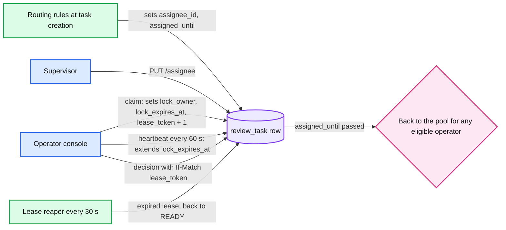
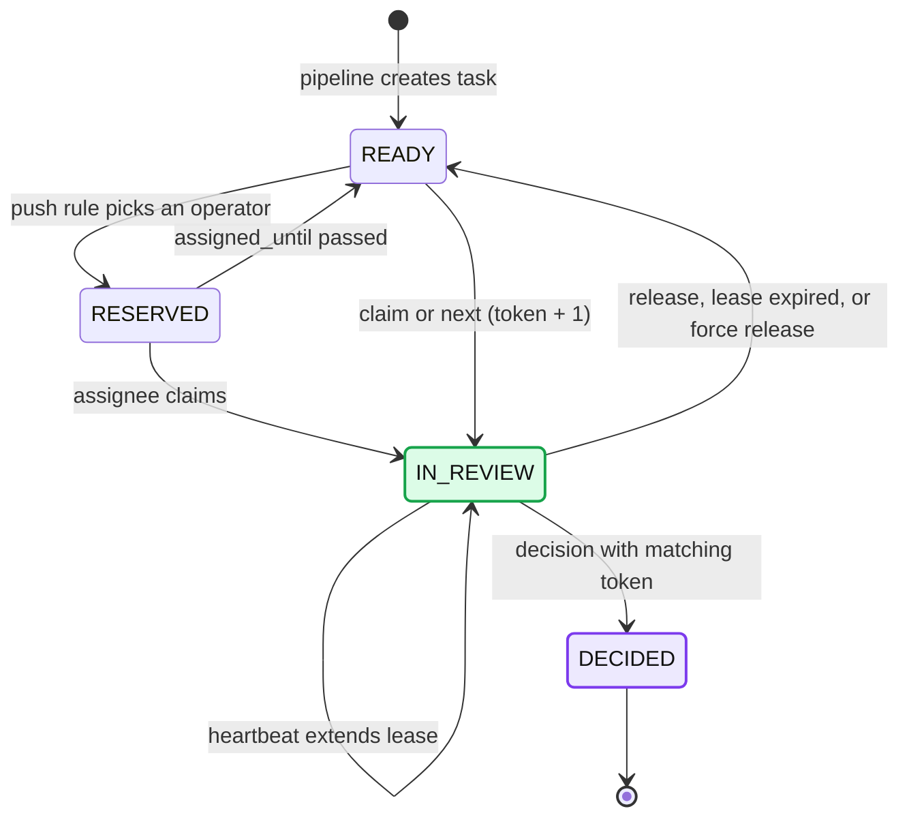
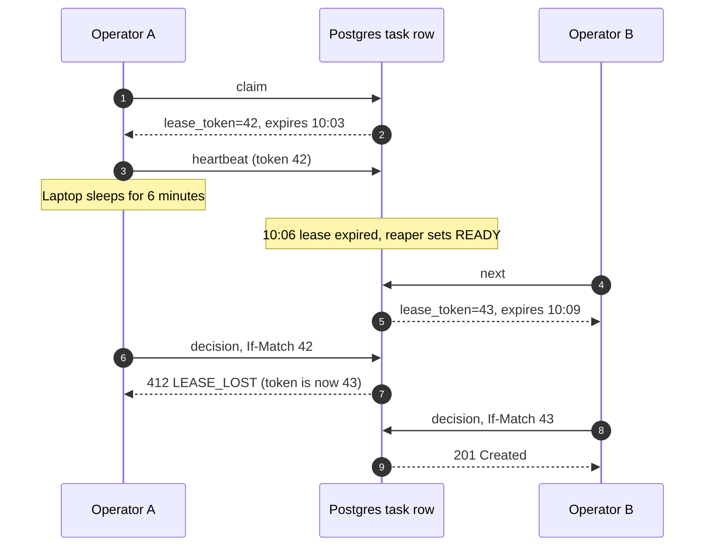

# Deep dive: Assignment and locking

> One-line answer: **Assignment** says who *should* review a task. The **lease** says who *is* reviewing it right now. Both are columns on the task row in Postgres, changed only by conditional UPDATEs. Every decision carries a `lease_token` that increments on each claim, so a stale holder can never write.

Back to the [main HLD](../README.md).

## 1. Two separate concepts



| | Assignment | Lease (lock) |
|---|---|---|
| Columns | `assignee_id`, `assigned_until` | `lock_owner`, `lock_expires_at`, `lease_token` |
| Means | "This is yours to pick up" | "You are working on it now, nobody else can" |
| Set by | Routing rules, supervisor | The operator's claim |
| Lifetime | Until claimed or `assigned_until` (~20 min) | 3 min, renewed by heartbeat |
| Exclusive? | No. A supervisor can see and move it. | Yes. One holder. |

Mixing them is a classic bug: "assigned to Bob" gets read as "Bob is working on it", and a task assigned to an absent Bob sits for an hour.

## 2. Task lifecycle



`RESERVED` is just `READY` with a non-null `assignee_id` and `assigned_until > now()`. Shown separately for clarity.

## 3. Pull: "give me the next task"

`POST /v1/tasks/next`. One statement finds and claims atomically.

```sql
WITH next AS (
    SELECT id
    FROM review_task
    WHERE status = 'READY'
      AND queue = ANY(:my_queues)
      AND (assignee_id IS NULL OR assignee_id = :me OR assigned_until < now())
      AND NOT EXISTS (            -- four-eyes: not the person who decided the previous round
            SELECT 1 FROM decision d
            JOIN review_task p ON p.id = d.task_id
            WHERE p.version_id = review_task.version_id AND d.operator_id = :me)
    ORDER BY priority, sla_deadline
    LIMIT 1
    FOR UPDATE SKIP LOCKED
)
UPDATE review_task t
SET status          = 'IN_REVIEW',
    lock_owner      = :me,
    lock_expires_at = now() + interval '3 minutes',
    lease_token     = t.lease_token + 1,
    updated_at      = now()
FROM next
WHERE t.id = next.id
RETURNING t.id, t.lease_token, t.lock_expires_at;
-- 0 rows -> 204 No Content (nothing eligible)
```

- **`SKIP LOCKED`:** 400 operators pressing "next" at once each get a different row. No one waits on another's row lock. Without it they would queue behind the same top row.
- **Load:** ~1.2 claims/s average. Index `(queue, priority, sla_deadline) WHERE status='READY'` makes each claim a few ms.
- **Order:** priority class first, then earliest deadline (EDF). Tenant fair share is covered in [operator-capacity-and-sla.md](operator-capacity-and-sla.md).

## 4. Claim a specific task, heartbeat, release

```sql
-- POST /v1/tasks/{id}/claim
UPDATE review_task
SET status = 'IN_REVIEW', lock_owner = :me,
    lock_expires_at = now() + interval '3 minutes',
    lease_token = lease_token + 1
WHERE id = :id
  AND (status = 'READY' OR (status = 'IN_REVIEW' AND lock_expires_at < now()))
  AND (assignee_id IS NULL OR assignee_id = :me OR assigned_until < now())
RETURNING lease_token, lock_expires_at;
-- 0 rows -> 409 TASK_LOCKED with current holder and expiry

-- POST /v1/tasks/{id}/heartbeat   (If-Match: lease_token)
UPDATE review_task
SET lock_expires_at = now() + interval '3 minutes'
WHERE id = :id AND lock_owner = :me AND lease_token = :token AND status = 'IN_REVIEW';
-- 0 rows -> 409 LEASE_LOST, UI turns read-only

-- POST /v1/tasks/{id}/release   (sent by navigator.sendBeacon on tab close)
UPDATE review_task
SET status = 'READY', lock_owner = NULL, lock_expires_at = NULL
WHERE id = :id AND lock_owner = :me AND lease_token = :token;
```

The claim accepts an expired `IN_REVIEW` row directly (lazy expiry). So correctness does not depend on the reaper. The reaper only returns expired rows to `READY` so the `next` query sees them.

## 5. Fencing: why the token matters



Without the token, A's late write would either create a second decision or overwrite B's. A lease alone is not enough, because the holder cannot know its lease expired while it was paused.

The decision transaction:

```sql
BEGIN;
UPDATE review_task
SET status = 'DECIDED', lock_owner = NULL, lock_expires_at = NULL
WHERE id = :id
  AND lease_token = :token                  -- fencing check
  AND lock_owner = :me                      -- reaper leaves lock_owner in place; only a claim overwrites it
  AND status IN ('IN_REVIEW', 'READY');     -- READY: lease lapsed but nobody re-claimed
-- 0 rows -> ROLLBACK, 412
INSERT INTO decision (task_id, operator_id, outcome, reason_code, lease_token, idempotency_key)
VALUES (:id, :me, :outcome, :reason, :token, :idem);   -- UNIQUE(task_id): second decision impossible
INSERT INTO outbox (event_type, aggregate_id, payload) VALUES ('DocumentDecided', :doc_id, :payload);
INSERT INTO audit_event (document_id, actor, action) VALUES (:doc_id, :me, 'DECIDED');
COMMIT;
```

- **Rule:** anything that takes ownership away bumps `lease_token` (a new claim, a supervisor force-release). A plain lease expiry does not. So if A's lease lapsed but nobody claimed, A can still submit. Friendlier, and still safe.
- **Why not `version` as the token?** If heartbeats or admin edits bump `version`, the operator's token goes stale for reasons that have nothing to do with ownership.

## 6. Lease timings

| Setting | Value | Why |
|---|---|---|
| Heartbeat | every 60 s while the tab is open | Cheap: 400 operators = ~7 writes/s |
| Lease TTL | 3 min | Tolerates 2 missed beats. Worst-case stall after a crash is 3 min, 5% of the SLA. |
| Idle prompt | 15 min with no input | "Still working?" then release. Stops a forgotten open tab holding a doc. |
| Max hold alert | 45 min | Supervisor alert, not auto-release. Some legal docs are genuinely long. |
| Release on close | `sendBeacon` | Most stalls end in seconds, not 3 min |

A 15 min TTL would mean a crashed tab blocks a document for a quarter of the SLA. The heartbeat already covers "operator is reading slowly".

## 7. Push assignment: "this document goes to this operator"

Rules run at task creation, in order:
1. **Four-eyes:** round 2 must go to someone other than the round 1 decider.
2. **Continuity:** a re-upload goes back to the operator who requested it, if online.
3. **Dedicated pods:** VIP tenant or sensitive matter goes to a named group.
4. **Skill and jurisdiction** pick the queue.
5. **Load:** among online eligible operators, the one with the fewest reserved + in-review tasks.

Safety valves:
- `assigned_until = now() + min(20 min, slack / 2)`. After that, anyone in the queue can take it.
- **Presence:** the console sends a session heartbeat. Offline > 5 min, and that operator's reservations go back to the pool.
- Cap reserved tasks per operator (e.g., 3) so push cannot build a private backlog.

**Supervisor reassignment** (`PUT /v1/tasks/{id}/assignee`):
- No active lease: change `assignee_id`, reset `assigned_until`, audit it.
- Active lease: either wait, or **force release**, which bumps `lease_token`. The current holder's next heartbeat gets 409 and the UI says "reassigned by supervisor".

## 8. Trade-offs

| Decision | Option A | Option B | Chose | Why |
|---|---|---|---|---|
| Lock store | Lease on the Postgres task row | Redis `SET NX PX` | **Postgres** | Lock and data in one row. Fencing check sits in the same UPDATE as the decision. Redis async replication can lose a lock on failover and grant two holders. |
| Lock store | Postgres | ZooKeeper / etcd lease | **Postgres** | ZK can fence (zxid), but the resource must still check the token, and it is another cluster to run for ~1 claim/s |
| Assignment | Push | Pull | **Both** | Push meets "specific operator" rules. Pull maximizes throughput and is self-balancing. |
| Lock acquisition | Pessimistic lease | Optimistic (no lock, check version at submit) | **Lease** | Optimistic lets two people spend 5 min on the same doc, then one loses their work. Human time is the expensive resource. |
| Expiry | Lazy (checked at claim) + reaper | Reaper only | **Lazy + reaper** | Correctness does not depend on a background job |

When would I move off Postgres for locks? Claim rates above ~5k/s, or locks that guard resources outside this database. Neither applies here.

## 9. Interview soundbite

> "Assignment and locking are different columns. The lock is a 3 minute lease kept alive by a 60 second heartbeat, and every claim bumps a fencing token. The decision is a conditional UPDATE on that token in the same transaction as the outbox write, so a stale holder gets a 412 and can never overwrite the new owner."
