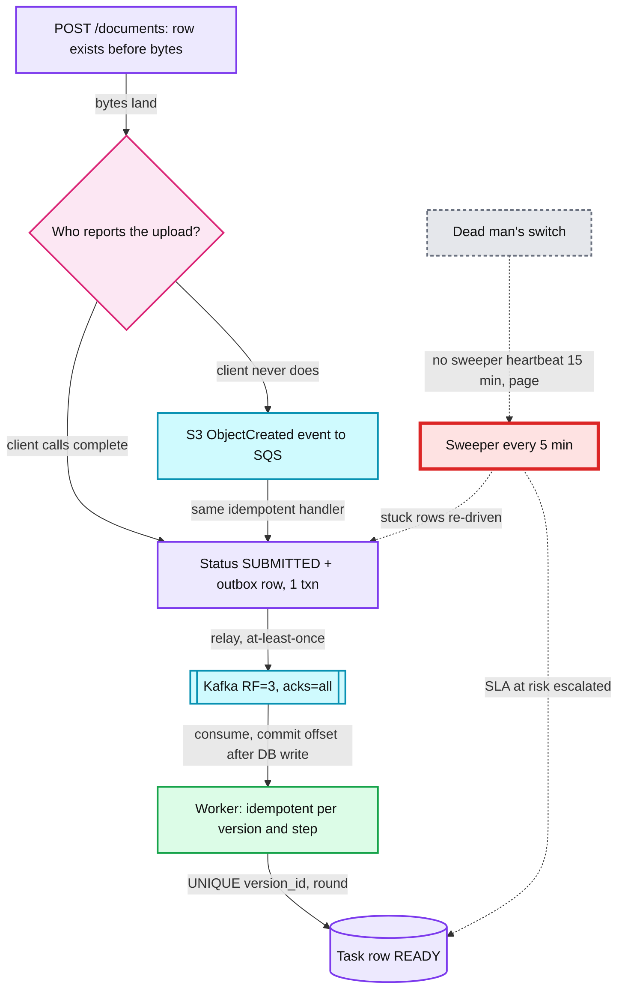
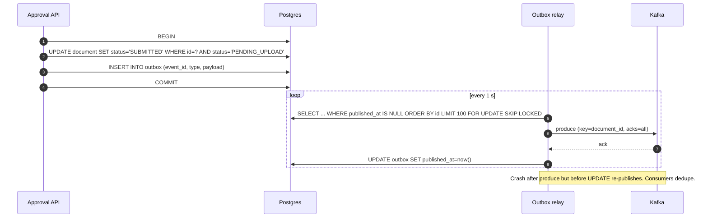

# Deep dive: No document missed

> One-line answer: A document cannot be missed if it gets one durable row the moment it exists, every hop after that is retried and idempotent, and an independent sweeper checks that every row reached its next state on time. Prevention handles known failures. The sweeper catches the unknown ones. **The sweeper is the guarantee.**

Back to the [main HLD](../README.md).

## 1. The layers of the guarantee



The sweeper is red because it is the single component the "zero missed" promise rests on. If it dies quietly, the promise dies quietly. Hence the dead man's switch.

## 2. Every gap where a document can get lost

| # | Gap | How the doc gets lost | Closed by |
|---|---|---|---|
| 1 | Client uploads bytes but never calls `complete` | Row stuck in `PENDING_UPLOAD` | S3 `ObjectCreated` event calls the same handler. Sweeper HEADs S3 for `PENDING_UPLOAD` rows older than 15 min. |
| 2 | API writes the row, crashes before publishing | Classic dual-write | **Outbox row in the same transaction** as the status change |
| 3 | Relay publishes, crashes before marking `published_at` | Duplicate event | Consumers are idempotent. Duplicates are harmless. |
| 4 | Kafka loses a broker | Message lost | RF=3, `acks=all`, `min.insync.replicas=2`, idempotent producer |
| 5 | Consumer commits offset before its DB write | Message skipped forever | Commit offsets **after** the DB write |
| 6 | Worker bug swallows an exception | Row stuck in `PROCESSING` | Sweeper: non-terminal status older than 10 min |
| 7 | Task created but no eligible operator exists | Stuck in `READY` | Sweeper: queue has READY tasks and 0 online eligible operators. Overflow to general pool. |
| 8 | Lock holder vanishes | Stuck in `IN_REVIEW` | Lease expiry (3 min). See [assignment-and-locking.md](assignment-and-locking.md). |
| 9 | Decision made, `DocumentDecided` never reaches onboarding | Customer never told | Outbox again. Daily cross-system reconciliation report. |
| 10 | Poison document | Retries forever, or dropped in a DLQ | `NEEDS_ATTENTION` with owner. See [poison-documents-and-retries.md](poison-documents-and-retries.md). |
| 11 | Region lost | In-flight work | Async replica + sweeper re-drives on the DR side |
| 12 | Sweeper dies | Guarantee gone silently | Heartbeat metric, page if absent 15 min |

## 3. The outbox, step by step



- **Why a polling relay, not CDC (Debezium)?** At ~1.2 events/s a 1 s poll costs nothing and adds ≤ 1 s latency. Debezium means running Kafka Connect and managing replication slots. Switch to CDC if the poll gets expensive (it will not at this scale).
- `FOR UPDATE SKIP LOCKED` lets two relay instances run safely for availability.
- Delete published outbox rows after 7 days. They are a buffer, not an archive.

## 4. The sweeper

Runs every 5 min. Holds a Postgres advisory lock, so two instances can run for high availability but only one works at a time. Every action is idempotent, so a double run is harmless anyway.

| Check | Query (shape) | Action |
|---|---|---|
| Upload never completed | `PENDING_UPLOAD` and age > 15 min | HEAD S3. Object exists: call `complete`. Missing after 24 h: `EXPIRED`, notify customer. |
| Stuck before a task exists | `SUBMITTED / PROCESSING`, age > 10 min, no task | Insert a fresh outbox row (re-drive). `redrive_count += 1`. Alert. |
| Re-driven too often | `redrive_count >= 3` | `NEEDS_ATTENTION`, ticket |
| Relay broken | oldest unpublished outbox row > 1 min | Page |
| SLA at risk | READY task, `sla_deadline - now() < 15 min` | Bump priority, notify supervisor |
| Orphan queue | READY tasks in a queue with 0 eligible operators online | Overflow route, page supervisor |
| Lease expired | `IN_REVIEW`, `lock_expires_at < now()` | Return to READY. Lease token unchanged (see locking deep dive). |

```sql
-- Documents that should have a task by now, and do not
SELECT d.id
FROM document d
WHERE d.status IN ('SUBMITTED', 'PROCESSING')
  AND d.updated_at < now() - interval '10 minutes'
  AND NOT EXISTS (
        SELECT 1 FROM review_task t
        JOIN document_version v ON v.id = t.version_id
        WHERE v.document_id = d.id AND t.status <> 'CANCELLED');
```

Served by the partial index `(status, updated_at) WHERE status NOT IN ('APPROVED','REJECTED','EXPIRED')`. The scan touches only in-flight rows (a few thousand), not 36M.

**A re-drive is a bug signal.** In a healthy system the sweeper finds nothing. Any re-drive raises an alert so we fix the cause, not just the symptom.

**Daily reconciliation** (the auditor's answer):
- S3 Inventory vs `document_version`: every object has a row and every row has an object.
- `DECIDED` documents vs onboarding's acknowledgements: zero unexplained differences.

## 5. End-to-end idempotency

At-least-once delivery means every step will sometimes run twice. Each one must be safe to repeat.

| Step | Idempotency key | Mechanism |
|---|---|---|
| Create document | `Idempotency-Key` header | `UNIQUE(tenant_id, idempotency_key)`. Replay returns the original 201. |
| Upload bytes | Deterministic S3 key `t/{tenant}/d/{doc}/v{n}` + sha256 | Re-upload overwrites the same key with the same bytes |
| `complete` | Status transition | `UPDATE ... WHERE status='PENDING_UPLOAD'`. 0 rows means already done, return 202. |
| Outbox publish | `event_id` | Consumers keep a processed-events set or check state |
| Each pipeline step | `(version_id, step)` | PK on `processing_step`. Skip if `SUCCEEDED`. |
| Create task | `(version_id, round)` | `UNIQUE` + `ON CONFLICT DO NOTHING` |
| Decision | `task_id` + `Idempotency-Key` | `UNIQUE(task_id)` on decision. Same key returns the stored 201. |
| `DocumentDecided` to onboarding | `event_id` | Onboarding dedupes |

## 6. Trade-offs

| Choice | Gain | Cost |
|---|---|---|
| Outbox | No dual-write loss | ~1 s added latency. One more table and process. |
| Sweeper | Catches unknown failures | Periodic scan (cheap with partial index). Re-drives can duplicate work (safe because idempotent). |
| S3 event backstop | Catches "uploaded but never told us" | Two code paths into `complete`. Must be idempotent. |
| At-least-once everywhere | Simple, correct with idempotency | Every consumer must be written to tolerate duplicates |

## 7. Interview soundbite

> "Every hop is at-least-once and idempotent, so nothing is lost in transit. But the real guarantee is a sweeper that independently asks 'is any document older than 10 minutes without a task?' every 5 minutes, and pages if it ever finds one or if it stops reporting."
