# Deep dive: Operator capacity and the SLA

> One-line answer: The 1 hour SLA is met by staffing seats to the hourly arrival forecast, keeping the backlog under ~12 x seats, ordering work by deadline inside SLA classes with tenant fair share, and telling customers the truth before the backlog breaches, not after. Steady state is easy. Bursts are the enemy.

Back to the [main HLD](../README.md).

## 1. The control loop

```mermaid
%% Capacity control loop: admission, scheduling, people, and the feedback that keeps the promise honest
flowchart LR
    A[Arrivals: avg 1.2/s, bursts 12/s] -->|every upload accepted| ADM{Tenant within its 1 h quota?}
    ADM -->|yes| STD[[Standard class, deadline 1 h]]
    ADM -->|no| BLK[[Bulk class, deadline 24 h]]
    STD -->|priority, then EDF, tenant fair share| OPS[Operators: 360-500 seats, 12 docs/h each]
    BLK -->|idle capacity only| OPS
    OPS -->|decisions| D[(Decisions)]
    M[Metrics: backlog, drain rate, AHT] -->|ETA = backlog / drain| ADM
    M -->|forecast vs seats online| WFM[Workforce planning]
    WFM -->|shifts, overtime, cross-trained reserve| OPS
    OPS -->|decisions/min| M

    class A client
    class ADM decision
    class STD,BLK queue
    class OPS critical
    class D store
    class M service
    class WFM external

    classDef client   fill:#dbeafe,stroke:#2563eb,stroke-width:2px,color:#111
    classDef service  fill:#dcfce7,stroke:#16a34a,stroke-width:2px,color:#111
    classDef store    fill:#ede9fe,stroke:#7c3aed,stroke-width:2px,color:#111
    classDef cache    fill:#fef3c7,stroke:#d97706,stroke-width:2px,color:#111
    classDef queue    fill:#cffafe,stroke:#0891b2,stroke-width:2px,color:#111
    classDef critical fill:#fee2e2,stroke:#dc2626,stroke-width:4px,color:#111
    classDef external fill:#e5e7eb,stroke:#6b7280,stroke-width:2px,color:#111,stroke-dasharray:4 3
    classDef decision fill:#fce7f3,stroke:#db2777,stroke-width:2px,color:#111
```



## 2. Little's law: three numbers to say out loud

Little's law: **L = λ x W** (items in a system = arrival rate x time each spends there).

| Question | Math | Answer |
|---|---|---|
| How many operators are busy at any moment? | 1.16 docs/s x 300 s review | **~347 busy** |
| If average queue wait is 20 min, how many docs are waiting? | 1.16 docs/s x 1,200 s | **~1,390 waiting** |
| How big can the backlog get before the newest doc breaches? | drain rate x 60 min = (seats / 5 min) x 60 | **~12 x seats** (4,800 at 400 seats) |

The third one is the operational rule. **Max safe backlog ≈ 12 x seated operators.** Alert at 8 x seats (that is a ~40 min wait for the newest doc).

## 3. Steady state: Erlang C says it is easy

Erlang C models a queue with c servers, random (Poisson) arrivals and random service times (the classic call-center model). Flat 24x7, λ = 100k/day, S = 5 min, offered load a = 347 Erlangs:

| Seats | Utilization | P(any wait) | Mean wait | P(wait > 15 min) | P(wait > 60 min) |
|---|---|---|---|---|---|
| 350 | 99.2% | 83% | 1.5 min | 2 x 10^-4 | ~0 |
| 360 | 96.5% | 39% | 9 s | ~0 | ~0 |
| 380 | 91.4% | 5% | < 1 s | ~0 | ~0 |
| 400 | 86.8% | 0.3% | ~0 | ~0 | ~0 |

Lesson: **large pools are very efficient.** Under smooth arrivals, ~360 seats meets a 1 hour SLA with enormous margin. So if the SLA breaks in production, it is never "average load". It is one of these:

1. **Non-smooth arrivals:** daily peaks, Monday mornings, bulk uploads.
2. **Service time tail:** a 40-page merger agreement takes 30 min, not 5. Erlang C assumes a well-behaved distribution.
3. **Shrinkage:** scheduled seats are not seated seats (breaks, meetings, training, sick leave).
4. **Skill fragmentation:** 400 seats are really 10 queues of 40.
5. **Rework:** 1.2 rounds per document means 20% more work than the headline number.

## 4. Skill fragmentation kills the economy of scale

Same utilization, one big pool vs one of ten skill queues (each 1/10 of the volume, a = 34.7):

| Pool | Seats | Utilization | Mean wait | P(wait > 15 min) |
|---|---|---|---|---|
| One pooled queue | 360 | 96.5% | 9 s | ~0 |
| One of 10 skill queues | 36 | 96.5% | 3 min | **1.7%** |
| One of 10 skill queues | 38 | 91.4% | 45 s | 0.003% |

Splitting by skill costs ~5-10% more seats for the same SLA. Fixes:
- **Cross-train** so most operators hold 2-3 skills. The `next` query already takes a list of queues.
- **Overflow routing:** when a task's slack drops below 20 min, widen eligibility to a general pool.
- Keep the number of distinct queues small. Every new jurisdiction rule is a capacity decision, not just a config change.

## 5. Daily peaks: spend the SLA as a buffer

Suppose business hours concentrate 10% of daily volume into the peak hour: 10,000 docs in 60 min (2.8/s).

| Strategy | Seats in peak hour | Wait for the last doc of the hour |
|---|---|---|
| No queue at all | ~880 | ~0 |
| Let the backlog absorb it | ~500 (6,000/h) | backlog 4,000 / 6,000 per h = **~40 min** |
| Too lean | ~420 (5,040/h) | ~59 min, zero margin |

The 1 hour SLA is a buffer you can deliberately spend. ~500 seats plus backlog beats ~880 seats with no queue, as long as the following hours are lighter and drain it.

## 6. Bursts: why admission control is mandatory

A tenant uploads **20,000 docs at 09:00**. 400 seats clear 4,800/h. Background arrivals are ~4,170/h.

- Net drain = 4,800 - 4,170 = **630 docs/h.** The burst takes ~30 h to clear.
- Even pausing all other work: 20,000 / 4,800 = **~4.2 h.**
- With plain EDF, all 20k get a 10:00 deadline and starve every other tenant's 09:05 upload.

No staffing plan survives that. So:
- **Accept every upload.** S3 absorbs bytes for free. Never drop a legal document.
- **Change the promise, not the acceptance.** Each tenant has an hourly quota for the 1 h class (from their contract). Docs beyond it go to the **bulk class with a 24 h deadline** and fill idle capacity (nights, troughs).
- **Tell them at upload time.** `POST /documents` returns `sla_class` and `expected_review_by`. The customer sees an honest ETA, not a broken promise an hour later.
- Bulk API clients can also get `Retry-After` hints to spread uploads.

## 7. Scheduling order

1. **Priority class:** P0 (regulatory deadline today), P1 standard 1 h, P2 bulk 24 h.
2. **EDF** (earliest deadline first) inside a class.
3. **Tenant fair share** among tasks with near-equal deadlines (round-robin by tenant within a 5 min deadline bucket), so one tenant cannot monopolize a burst.
4. **Aging:** a P2 task within 2 h of its 24 h deadline is promoted to P1 so it does not starve.

**Under overload, plain EDF collapses.** It keeps working on tasks that are already late, so every task ends up late (the domino effect). When projected breach is detected:
- Protect P1 for in-quota tenants first.
- Defer P2 explicitly.
- Escalate staffing: overtime, a cross-trained reserve pool, borrow from lighter queues.
- Send `sla_at_risk` webhooks and update the status page. Then breach honestly rather than silently.

## 8. ETA and projected breach

```
drain_rate(queue)        = decisions per minute over the last 15 min
backlog_ahead(doc)       = READY tasks in the same queue with an earlier slot (class, deadline)
expected_review_by(doc)  = now + backlog_ahead / drain_rate
projected_breach(queue)  = backlog(queue) / drain_rate(queue) > min remaining slack
```

`projected_breach` is the page-worthy alert. "Oldest READY > 45 min" fires too late to fix anything. The projection fires as soon as the trend is wrong.

## 9. Cut demand on humans: the cheapest capacity

Base: 100k docs x 5 min = ~8,300 operator-hours/day. Seats saved = hours saved / 24.

| Lever | Assumption | Hours/day saved | Seats saved |
|---|---|---|---|
| ML pre-filled fields + checklist in the console | 5 min to 4 min | ~1,670 | **~70** |
| Risk-based fast lane | 40% of docs are low-risk, 2 min instead of 5 | ~2,000 | **~83** |
| Auto-reject obvious failures before a human (blank, wrong type, expired) | 10% of volume | ~830 | ~35 |
| Better client-side validation, fewer rework rounds | 1.2 to 1.1 rounds | ~830 | ~35 |
| Auto-approve low-risk (only if compliance allows) | each 10% of volume | ~830 | ~35 |

At an assumed $20/h fully loaded, ~70 seats is ~$12M/yr. That is ~25x the whole infrastructure bill. **This table is the Staff-level answer to "how do you improve the system".**

## 10. What to put on the dashboard

| Metric | Healthy | Pages when |
|---|---|---|
| Backlog per queue vs 12 x seats line | < 4 x seats | > 8 x seats |
| Oldest READY age | < 15 min | > 45 min |
| Projected breach | none | any queue projected to breach |
| Seats online vs plan | ≥ 95% of plan | < 85% of plan for 15 min |
| Average handle time (AHT) p50 / p90 | 5 / 12 min | p50 up 20% day over day |
| Utilization | 85-92% | > 97% sustained (no slack for bursts) |
| Arrivals vs forecast | within 15% | > 30% over forecast |

## 11. Trade-offs

| Choice | Gain | Cost |
|---|---|---|
| SLA classes + quotas | The 1 h promise stays true for in-quota work | Contract and product complexity. Bulk customers get a slower promise. |
| Spend the SLA as buffer | ~40% fewer peak seats | Less margin for a surprise burst on top of the peak |
| EDF + fair share | Deadlines respected, no tenant starvation | More complex ordering than FIFO |
| High utilization (~90%) | Cheaper | Less burst absorption. Fragile with many small queues. |
| Cross-training | Restores pooling efficiency | Training cost, broader access needs (security review) |

## 12. Interview soundbite

> "Erlang C says 360 seats meet the SLA in steady state, so averages are not the risk. Bursts are. I keep the backlog under 12 times seated operators, put over-quota bulk uploads in a 24 hour class, show customers an honest ETA at upload, and alert on projected breach rather than on breach. And the biggest lever is cutting review minutes: one minute saved is about 70 seats."
