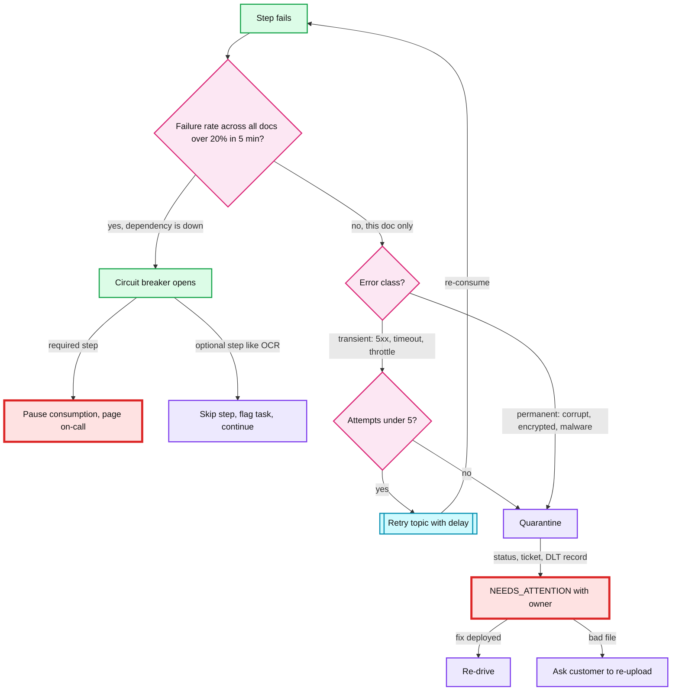
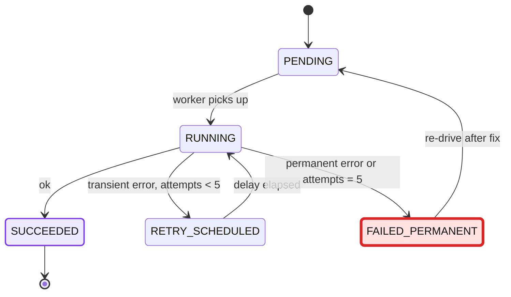

# Deep dive: Poison documents and retries

> One-line answer: Classify every failure as transient or permanent. Retry transient ones with capped, jittered backoff, off the main partition, inside a ~10 min budget. Send permanent failures and exhausted retries to `NEEDS_ATTENTION`, which always ends with a human or customer action. Treat "a dependency is down" as a different problem from "this document is bad".

Back to the [main HLD](../README.md).

## 1. What happens when a step fails

Red nodes: a paused pipeline and an unowned attention queue are where the SLA dies. Both page.

## 2. Classify the error first

| Error | Class | Action | Retry? |
|---|---|---|---|
| S3 503 / SlowDown | Transient | Backoff | Yes |
| OCR vendor 429 / 5xx / timeout | Transient | Backoff. Breaker on systemic rate. | Yes |
| DB connection lost, serialization failure | Transient | Backoff | Yes |
| Malware detected | Permanent, security | Move to quarantine bucket. Security alert. Tell customer. | **Never** |
| Checksum mismatch vs declared sha256 | Permanent for this upload | Ask for re-upload | No |
| Corrupt or unparseable PDF | Permanent | Ask for re-upload | No |
| Password-protected PDF | Permanent | Ask for an unlocked copy | No |
| Unsupported format | Permanent | Reject with a clear reason | No |
| OCR returns empty text, file renders fine | Degraded | Create the task with "OCR unavailable". A human can still read it. | No |
| Unknown exception | Assume transient | Retry up to 5, then quarantine | Yes, capped |

**Required vs optional steps.** Malware scan and checksum are required: no task without them. Classification is required for routing but falls back to a "general" queue. OCR is optional enrichment. **Degrade, do not block,** whenever a human can still do the review.

## 3. Retry schedule and the time budget

Full jitter: `sleep = random(0, min(cap, base * 2^attempt))`. Spreads retries so 1,000 docs failing at once do not retry in lockstep against a recovering vendor.

| Attempt | Where | Delay (full jitter, up to) | Cumulative worst case |
|---|---|---|---|
| 1 | In-process | 0.2 s | 0.2 s |
| 2 | In-process | 0.8 s | ~1 s |
| 3 | `retry-30s` topic | 30 s | ~31 s |
| 4 | `retry-2m` topic | 2 min | ~2.5 min |
| 5 | `retry-5m` topic | 5 min | **~8 min** |
| then | Quarantine | | |

- **Budget rule:** retries may spend at most ~10 min of the 60 min SLA. That leaves ~50 min for a human to act on `NEEDS_ATTENTION` or for the customer to re-upload.
- **Why retry topics, not retry in place:** Kafka has no per-message delay. Sleeping on the main partition blocks every document behind the poison one (head-of-line blocking). Retry topics with fixed delay tiers keep the main topic flowing.
- **Attempt count lives in Postgres** (`processing_step.attempts`), not only in a message header. Postgres is the source of truth. A re-drive from the sweeper sees the true count.

## 4. Per-document failure vs systemic failure

This is the distinction most designs miss.

| | Poison document | Dependency outage |
|---|---|---|
| Signal | One doc fails repeatedly. Others pass. | Failure rate jumps across all docs |
| Wrong response | Pause the pipeline | Quarantine 100% of docs, flood the attention queue |
| Right response | Quarantine that doc | Open the breaker. Pause (required step) or degrade (optional step). Page. |
| Recovery | Fix or re-upload one doc | Breaker half-opens, probes, closes. Backlog drains automatically. |

If the malware scanner is down for 30 min, intake keeps accepting uploads (S3 absorbs bytes) and consumer lag grows. When the scanner returns, workers drain at peak rate. That spends 30 min of SLA, so the breaker pages immediately.

## 5. Quarantine is not a terminal state

What "quarantine" writes, in one transaction:
- `document.status = NEEDS_ATTENTION`, `attention_reason`, `attention_owner` (on-call queue).
- A `dead_letter` row with error, stack, attempt history.
- An outbox event for the dead-letter topic (for tooling and analytics) and for the customer notification.
- An ops ticket with the attention SLA (owner within 1 h, resolved within 4 h).

Exits from `NEEDS_ATTENTION`:
- **Re-drive** after a fix is deployed. Batch tool, idempotent, rate-limited so it cannot flood operators.
- **Request re-upload.** Creates a new `document_version` and a new review round. Old version kept for audit.
- **Manual review on raw bytes** by a privileged operator (not for malware).
- **Reject** with a reason code.

Alerts: attention queue depth, and age of the oldest unowned item (page at > 1 h).

## 6. Trade-offs

| Choice | Gain | Cost |
|---|---|---|
| Error classification | No wasted retries on corrupt files. Faster customer feedback. | Must maintain the classifier. Misclassify a transient error as permanent and you bother a customer. |
| Retry topics | No head-of-line blocking | More topics. Delay is per tier, not exact. |
| Breaker on failure rate | Outages do not become 100k quarantines | Threshold tuning. A genuine bad batch could open it. |
| Degrade optional steps | Humans keep working when OCR is down | Reviews are slower without pre-filled fields |
| 10 min retry budget | Leaves most of the SLA for humans | Some flaky-but-recoverable docs get quarantined early |

## 7. Interview soundbite

> "I retry only what can succeed on retry, off the main partition, within a 10 minute budget. A corrupt file goes straight to NEEDS_ATTENTION with an owner and a re-upload request. And if many documents fail at once, that is not a poison document, that is an outage, so a breaker pauses or degrades instead of quarantining everything."
