# Deep dive: cart and pricing

> One-line answer: the cart is one versioned document per buyer that never holds stock or locks a price; it is hydrated with current prices and stock buckets on every read. The price the buyer pays is set by a **quote**: `POST /checkouts` prices every line at its `price_version`, holds nothing, and is honored for 10 minutes, during which the buyer pays the **lower** of the quote total and the current total. After 10 minutes a higher total needs the buyer's yes. Coupons are checked at the quote, held at place order, and used at confirm; a deal line pays the price bound to its claim token. In a seeded run of 200k checkouts, "409 on any change" bounced 9.3% of buyers at the last step, silent re-pricing charged 3.9% more than they saw, and the quote bounced 0.9% at a cost to sellers of ~KRW 36 an order.

Zoom-in on [`../solution.md`](../solution.md) §3.2, §4.3 and §5.5. Reusable blocks: [`../../../concepts/crdt.md`](../../../concepts/crdt.md) (why a multi-writer cart needs merge rules), [`../../../concepts/caching-patterns.md`](../../../concepts/caching-patterns.md). Siblings: [`checkout-saga-and-payment-idempotency.md`](checkout-saga-and-payment-idempotency.md) (the quote's total is the amount authorized), [`flash-sale-and-hot-sku.md`](flash-sale-and-hot-sku.md) (the deal price rides on the token), [`catalog-search-and-read-scaling.md`](catalog-search-and-read-scaling.md) (the documents the cart hydrates from).

Acronyms: KV (key-value store), SKU (stock keeping unit), PSP (payment service provider), TTL (time to live), KRW (Korean won).

---

## 1. The cart

- **One document per buyer** in a KV store, keyed by `buyer_id`: up to 100 lines, each `(offer_id, qty, price_seen, added_at)`, plus a `version`.
- **Writes are conditional** (`if version = v`). On a conflict the service re-reads and **re-applies the one operation** (set line `o4` to 1) to the current document. It never unions two documents: a union brings back a line the other device just removed (section 4).
- **Reads are strongly consistent** on the buyer's key, so the laptop sees the phone's write (read-your-writes). Then each line is hydrated from the product document cache: current price ("dropped from 4,500 to 4,200"), stock bucket, and "no longer sold" for a deleted offer.
- **Nothing is reserved.** ~20M adds a day [estimate] would otherwise hold stock for days, and a deal SKU would sell out to carts. The Dynamo paper's "writes are never rejected" rule stops at the cart's edge.

## 2. What the buyer pays

```mermaid
%% Where a price lives on its way to the PSP. The cart only shows prices; the quote fixes a total for 10 minutes; place order charges the lower of quote and current. The coupon budget counter is red: a "first 1,000 buyers" coupon is a hot counter, like a flash deal's stock row.
flowchart LR
    SEL[Seller price change] -->|"price_version + 1,<br/>drops over 50% held 10 min"| OFF[(Offer in listing DB)]
    OFF -->|"CDC, about 1 s"| DOC[/Product docs/]
    DOC -->|"hydrate on read"| CART[Cart document<br/>price_seen per line]
    CART -->|"open checkout"| Q[Quote, 10 min<br/>lines, coupon, shipping, total]
    Q -->|"place order"| PO{Quote younger<br/>than 10 min?}
    PO -->|"yes: lower of quote<br/>and current total"| AMT[Amount on the order row]
    PO -->|"no: re-quote, higher<br/>total asks the buyer"| Q
    AMT -->|"COUPON_HOLD row + one unit,<br/>one transaction"| CB[Coupon budget sub-counters<br/>and hold rows, pricing shard]
    AMT -->|"authorize this amount"| PSP[PSP]
    TOK[Deal claim token] -->|"deal price"| AMT

    class SEL client
    class CART,Q,AMT service
    class OFF store
    class DOC cache
    class PO decision
    class CB critical
    class PSP external
    class TOK service

    classDef client   fill:#dbeafe,stroke:#2563eb,stroke-width:2px,color:#111
    classDef service  fill:#dcfce7,stroke:#16a34a,stroke-width:2px,color:#111
    classDef store    fill:#ede9fe,stroke:#7c3aed,stroke-width:2px,color:#111
    classDef cache    fill:#fef3c7,stroke:#d97706,stroke-width:2px,color:#111
    classDef critical fill:#fee2e2,stroke:#dc2626,stroke-width:4px,color:#111
    classDef external fill:#e5e7eb,stroke:#6b7280,stroke-width:2px,color:#111,stroke-dasharray:4 3
    classDef decision fill:#fce7f3,stroke:#db2777,stroke-width:2px,color:#111
```



- **The quote** stores each line's `price_version`, the coupon, shipping and the total, with `expires_at = now + 10 min`, the same as the reservation TTL. The client sends `checkout_id` and `quote_id`, never a price.
- **Inside 10 minutes**, place order re-reads current prices and charges `min(quote total, current total)`, comparing whole totals with coupons re-evaluated. Example: quote KRW 35,500 with "KRW 3,000 off over 35,000" is 32,500. A price drop takes the subtotal to 34,500, under the coupon's floor, so the current total is 34,500. The buyer pays 32,500: the lower total wins, and the drop cannot cost them the coupon.
- **After 10 minutes**, a new quote; same or lower proceeds, higher returns `409 QUOTE_CHANGED` and the order waits in `AWAITING_BUYER` with its reservations held until their TTL.
- **Deals.** The claim token carries the deal price; a buyer who claimed at 10:29 pays it at 10:31.
- **Typos.** A drop over 50% waits 10 minutes in review before quotes can use it, so one mistake does not become thousands of honored quotes.

## 3. Simulation: three answers to "the price changed"

Seeded. 200k checkouts of 1 to 5 lines. One line in five is on a seller's repricing tool (~4 changes an hour [estimate]); the rest change about once a day; each change is −10% to +8%. The buyer spends a lognormal time on the checkout page: median 90 s, about 1 in 15 over 10 minutes.

```python
import random

N, TTL = 200_000, 600

def price_at(base, t, rnd):
    rate = 4 / 3_600 if rnd.random() < 0.2 else 1 / 86_400       # 20% of lines are on a repricing tool
    p, s = base, rnd.expovariate(rate)
    while s < t:
        p, s = round(p * (1 + rnd.uniform(-0.10, 0.08)) / 10) * 10, s + rnd.expovariate(rate)
    return p

def sim(seed=67):
    rnd = random.Random(seed)
    out = {k: 0 for k in ("changed", "higher", "lower", "bounce_great", "after_ttl")}
    seller_gave = buyer_saved = 0
    for _ in range(N):
        lines = [rnd.choice([3_900, 4_500, 12_900, 31_000, 89_000]) for _ in range(rnd.randint(1, 5))]
        wait = rnd.lognormvariate(4.5, 1.25)                      # seconds on the checkout page
        quote, now = sum(lines), sum(price_at(p, wait, rnd) for p in lines)
        out["changed"] += now != quote
        out["higher"] += now > quote
        out["lower"] += now < quote
        if wait <= TTL:                                           # Great: lower of the two totals
            seller_gave += max(0, now - quote)
            buyer_saved += max(0, quote - now)
        else:
            out["after_ttl"] += 1
            out["bounce_great"] += now > quote                    # re-quote; only a higher total asks
    pct = lambda k: out[k] / N
    print(f"checkouts {N:,}; quote older than 10 min at place order: {pct('after_ttl'):.1%}")
    print(f"total changed while the buyer was on the page: {pct('changed'):.1%}"
          f" (up {pct('higher'):.1%}, down {pct('lower'):.1%})")
    print(f"Bad, re-price silently: buyer pays more than shown on {pct('higher'):.1%} of orders")
    print(f"Good, 409 on any change: bounced at the last step {pct('changed'):.1%}")
    print(f"Great, 10-min quote, lower total wins: bounced {pct('bounce_great'):.2%},"
          f" sellers honour KRW {seller_gave / N:,.0f} an order, buyers save KRW {buyer_saved / N:,.0f} an order")

sim()
```

```text
checkouts 200,000; quote older than 10 min at place order: 6.5%
total changed while the buyer was on the page: 9.3% (up 3.9%, down 5.3%)
Bad, re-price silently: buyer pays more than shown on 3.9% of orders
Good, 409 on any change: bounced at the last step 9.3%
Great, 10-min quote, lower total wins: bounced 0.92%, sellers honour KRW 36 an order, buyers save KRW 61 an order
```

- **"409 on any change" is correct and costly**: roughly one buyer in eleven is sent back at the last tap.
- **The quote bounces only the slow buyers who would pay more**, under 1%. The bill is small: sellers honour ~KRW 36 an order on rising prices, and buyers keep ~KRW 61 an order from falling ones.
- **The knob is the TTL.** A longer quote bounces fewer buyers and costs sellers more; 10 minutes matches the reservation TTL, so the quote and the stock hold expire together.

## 4. Coupons, cart conflicts and rounding

- **Coupon life.** Checked at the quote (valid, eligible, budget left). **Held** at place order with a durable `COUPON_HOLD(checkout_id, coupon_id, buyer_id, counter_shard, state)` row: one transaction on the coupon's pricing shard inserts the row and takes one unit from that sub-counter (`remaining − 1 WHERE remaining >= 1`). A unique index on `(coupon_id, buyer_id)` over holds that are not `RELEASED` keeps one per buyer. Transitions are idempotent, keyed by `checkout_id`: `HELD → USED` at confirm, `HELD → RELEASED` with the unit returned in the same transaction, by the saga's compensation or by a sweeper that releases any `HELD` row whose checkout has reached a terminal state. A coupon whose end time passes while the quote is valid is honored.
- **A "first 1,000 at 10:00" coupon is a flash deal in disguise.** Its budget counter is the hot row (red above). The budget is split into 8 sub-counter rows (`counter_shard` 0 to 7) on the coupon's pricing shard, so the row locks spread while the hold row and the decrement stay one local transaction; a hold picks one at random and tries the next on zero [our choice]. A coupon hotter than that uses the deal gate's buckets.
- **The cart and the money both need exact merges.** Below: two devices conflicting on one cart, and a coupon discount spread over lines in whole won so a short pick or partial cancel refunds the right amount.

```python
import random

def cart_conflicts(policy, n=100_000, seed=69):     # two devices write the same cart version at once
    rnd, bad = random.Random(seed), 0
    for _ in range(n):
        base = {o: rnd.randint(1, 3) for o in rnd.sample(range(8), rnd.randint(1, 5))}
        ops = [(rnd.randrange(8), rnd.choice([0, 0, 1, 2])) for _ in range(2)]   # qty 0 removes
        apply = lambda doc, op: {**{k: v for k, v in doc.items() if k != op[0]}, **({op[0]: op[1]} if op[1] else {})}
        first = apply(base, ops[0])                               # the first write wins the conditional put
        if policy == "merge the two documents":
            mine = apply(base, ops[1])                            # union; the line I touched is mine
            doc = {**first, **{k: v for k, v in mine.items() if k == ops[1][0] or k not in first}}
            if ops[1][1] == 0:
                doc.pop(ops[1][0], None)
        else:
            doc = apply(first, ops[1])
        bad += doc != apply(apply(base, ops[0]), ops[1])          # what the buyer did, in commit order
    return bad / n

for p in ["merge the two documents", "re-apply the operation"]:
    print(f"A. {p:26} conflicting edits that differ from what the buyer did: {cart_conflicts(p):.2%}")

def spread(lines, discount, exact):                 # a coupon's discount over the lines, whole KRW
    raw = [discount * x / sum(lines) for x in lines]
    if not exact:
        return [round(r) for r in raw]
    base = [int(r) for r in raw]
    for i in sorted(range(len(lines)), key=lambda i: raw[i] - base[i], reverse=True)[:discount - sum(base)]:
        base[i] += 1                                              # largest remainder gets the leftover won
    return base

rnd, off = random.Random(70), {False: 0, True: 0}
for _ in range(100_000):
    lines = [rnd.choice([3_900, 4_500, 12_900, 31_000, 89_000]) for _ in range(rnd.randint(2, 6))]
    discount = min(5_000, sum(lines) // 10)                       # 10% off, capped at KRW 5,000
    for exact in (False, True):
        off[exact] += sum(spread(lines, discount, exact)) != discount
print(f"B. orders whose line discounts miss the coupon total: round each line {off[False] / 1e5:.1%},"
      f" largest remainder {off[True] / 1e5:.1%}")
lines = [4_500, 4_500, 12_900, 31_000]
d = spread(lines, 5_000, True)
print(f"   example: lines {lines}, coupon 5,000 -> line discounts {d}; line 3 short: capture"
      f" {sum(lines) - 5_000 - (lines[2] - d[2]):,} of {sum(lines) - 5_000:,}")
```

```text
A. merge the two documents    conflicting edits that differ from what the buyer did: 16.44%
A. re-apply the operation     conflicting edits that differ from what the buyer did: 0.00%
B. orders whose line discounts miss the coupon total: round each line 35.2%, largest remainder 0.0%
   example: lines [4500, 4500, 12900, 31000], coupon 5,000 -> line discounts [426, 425, 1219, 2930]; line 3 short: capture 36,219 of 47,900
```

- **Re-apply, never union.** About one conflicting edit in six brings back a line the other device removed when the service unions documents. Re-applying the operation to the current version is exact. (A multi-region, always-writable cart would need tombstones per line; one region does not.)
- **Spread a coupon by largest remainder.** Rounding each line misses the coupon total by a won or two on about a third of orders, and then refunds and settlement disagree with the order. The exact spread is stored on the order lines at confirm, so a short pick refunds or skips exactly that line's net amount.

## 5. What an interviewer pushes on

1. **"Lock the price in the cart."** Carts live for weeks; buyers would farm old prices and a deal's price would leak into every cart that touched it.
2. **"Re-price at place order and charge the new total."** The buyer pays a number they never saw on ~4% of orders: disputes.
3. **"Lower of the two costs sellers money."** ~KRW 36 an order in the run, written into the seller agreement as "quotes are honored for 10 minutes".
4. **"The coupon's budget ran out between quote and place order."** `409 QUOTE_CHANGED` with the new total; the buyer decides.
5. **"Two devices edit the cart."** Conditional write on `version`, re-apply the operation on conflict.
6. **"Why not reserve at add to cart?"** Hoarding, millions of TTLs, and a flash SKU sold out to carts that never check out.

## 6. Trade-offs

| Decision | Chose | Gave up |
|---|---|---|
| Cart store | KV document per buyer, conditional writes | Joins with orders; a separate store to run |
| Conflict | Re-apply the operation | A second round trip on conflict |
| Price contract | 10-minute quote, lower total wins | ~KRW 36 an order of seller margin, one price read per line at place order |
| After the quote | Re-quote, ask only if higher | A 0.9% bounce for slow buyers |
| Coupon | Durable `COUPON_HOLD` at place order, budget sub-counter rows, a sweeper | A unit stays held by a checkout that later fails until the sweeper sees it end: seconds normally, up to the 30-minute payment ceiling |
| Rounding | Largest remainder, stored per line | One more column per order line |

## 7. Numbers to say out loud

- Quote TTL 10 minutes, equal to the reservation TTL. Price drops over 50% held 10 minutes.
- 200k checkouts: 9.3% saw a change; Good bounces 9.3%, Bad overcharges 3.9%, Great bounces 0.9%.
- Sellers honour ~KRW 36 an order; buyers save ~KRW 61.
- Cart: 100 lines max, ~2.3k writes a second at peak, read-your-writes.
- Coupon spread: rounding each line misses on ~35% of orders; largest remainder never.
