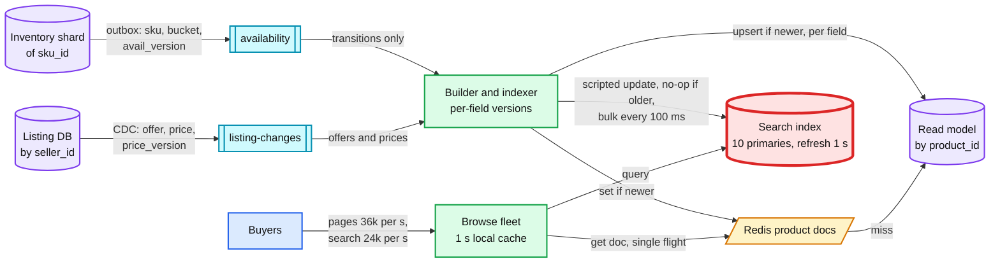

# Deep dive: catalog, search and read scaling

> One-line answer: browse is a read model and a search index built from change events, ~60k requests a second at peak, and allowed to be 1 to 3 s stale because the only stock check that counts is the conditional update at reserve. Three details decide whether "1 to 3 s stale" stays true. Availability must be versioned **per SKU**, not by the stock row that changed: in a seeded day of 300 three-pool SKUs, versioning by the changing row's version left search wrong 34.5% of the time; a per-SKU version, 0.007%. Each field of a document carries its own version, because listing changes and stock transitions come from two sources. And the cache must never be refilled with a document older than the one it holds: plain delete-on-update left a hot product stale for minutes 16 times an hour, a versioned set never did. The read side's limit is search: data nodes run at ~80% at peak.

Zoom-in on [`../solution.md`](../solution.md) §4.1, §5.4, §10.1, §10.3 and Flow 5. Reusable blocks: [`../../../concepts/caching-patterns.md`](../../../concepts/caching-patterns.md), [`../../../concepts/stream-processing.md`](../../../concepts/stream-processing.md), [`../../../concepts/sharding.md`](../../../concepts/sharding.md). Siblings: [`inventory-registration-and-stock-model.md`](inventory-registration-and-stock-model.md) (where transitions come from), [`flash-sale-and-hot-sku.md`](flash-sale-and-hot-sku.md) (the deal flag bypasses all of this), [`cart-and-pricing.md`](cart-and-pricing.md) (the cart hydrates from the same documents).

Acronyms: SKU (stock keeping unit), FC (fulfillment center), CDC (change data capture), CDN (content delivery network), KV (key-value store), p99 (99th percentile).

---

## 1. The read path and where versions live



Freshness from a stock commit to the buyer (solution §5.4): product page ~0.1 s p50, ~1.8 s p99; search ~0.7 s p50, ~2.3 s p99. The 1 s local cache is the only cache not invalidated by an event.

## 2. Transitions, buckets, and one version per SKU

- **Buckets, not counts.** The read side carries `IN_STOCK`, `LOW` (1 to 5) or `OUT`, and the delivery promise. A flash sale's 10k decrements become one `IN_STOCK → OUT`. Scrapers cannot read exact stock.
- **The transition is computed per SKU, on the SKU's shard.** All pools of a SKU (FC A, FC B, sellers) live on one shard, so the inventory service can recompute the SKU's bucket in the same transaction as the change.
- **Decision: one `avail_version` per SKU,** bumped in that transaction and carried on the event. A stock row's own `version` cannot order a SKU's events: each pool's row counts its own changes, and the busy FC row's version runs thousands ahead of a seller row's. An `OUT` stamped with FC A's version 90,005 makes the index reject FC B's later `IN_STOCK` at version 301.
- **Per-field versions in one document.** A product document mixes offers and prices from `listing-changes` (`price_version` per offer) with availability (`avail_version` per SKU). The builder keeps both in the document and applies a field only if its incoming version is newer. A whole-document version cannot do this: two independent sources do not share a counter.
- **Search writes are conditional scripts.** Elasticsearch's update API does not take an external version (only `if_seq_no` and `if_primary_term`) [check against current docs]. So the indexer sends a scripted update that becomes a no-op when the stored field version is newer, or reindexes the whole document from the read model with the builder's version. Either way, an older event cannot undo a newer one.

## 3. Simulation: which version orders the index

Seeded, standard library. 300 SKUs for a day, three pools each. A pool flips between in stock and out about every 40 minutes; its row version also climbs with reservations, the FC rows far faster. The document shows one flag: in stock if any pool is. Events go through two indexer workers; 3% of bulk requests fail and are retried 1 to 20 s later, so a later event can land first.

```python
import random

DAY, SKUS = 86_400, 300

def sim(version_rule, seed=65):
    rnd, wrong, stuck = random.Random(seed), 0.0, 0
    for _ in range(SKUS):
        rows = {p: [rnd.random() < 0.5, rnd.randint(1, 10 ** r)] for p, r in (("A", 6), ("B", 4), ("S", 2))}
        flips = sorted((rnd.uniform(0, DAY), p) for p in rows for _ in range(rnd.randint(20, 50)))
        sku_ver, truth, events = 0, [], []
        state = any(r[0] for r in rows.values())
        for t, p in flips:
            rows[p][0] = not rows[p][0]
            rows[p][1] += rnd.randint(1, 10 ** (3 if p == "A" else 1))      # reservations bump it too
            new = any(r[0] for r in rows.values())
            if new != state:                                # a SKU-level transition is emitted
                state, sku_ver = new, sku_ver + 1
                ver = {"none (last write wins)": 0, "row version of the pool that changed": rows[p][1],
                       "per-SKU availability version": sku_ver}[version_rule]
                lag = rnd.uniform(0.1, 0.6) + (rnd.uniform(1, 20) if rnd.random() < 0.03 else 0)
                events.append((t + lag, ver, new))
                truth.append((t, new))
        doc_ver, applied = -1, []
        for t, ver, new in sorted(events):                  # the index, in arrival order
            if version_rule.startswith("none") or ver > doc_ver:
                doc_ver = ver
                applied.append((t, new))
        marks = sorted({t for t, _ in truth} | {t for t, _ in applied} | {DAY})
        ti = ai = 0
        cur_t = cur_d = since = None
        for m in marks:                                     # walk both timelines, measure disagreement
            while ti < len(truth) and truth[ti][0] <= m:
                cur_t = truth[ti][1]; ti += 1
            while ai < len(applied) and applied[ai][0] <= m:
                cur_d = applied[ai][1]; ai += 1
            if cur_t is not None and cur_d is not None and cur_t != cur_d:
                since = m if since is None else since
            elif since is not None:
                wrong += max(0, m - since - 3)              # beyond the 3 s freshness budget
                stuck += m - since > 60
                since = None
    return wrong / (SKUS * DAY), stuck

print(f"{'external version on the index write':38} {'wrong beyond 3 s':>16} {'wrong for over 60 s':>19}")
for rule in ["none (last write wins)", "row version of the pool that changed", "per-SKU availability version"]:
    share, stuck = sim(rule)
    print(f"{rule:38} {share:16.3%} {stuck:19}")
```

```text
external version on the index write    wrong beyond 3 s wrong for over 60 s
none (last write wins)                           0.028%                   2
row version of the pool that changed            34.541%                2442
per-SKU availability version                     0.007%                   0
```

- **The row version is worse than no version.** Once the busy FC row's version is ahead, every event from the other pools is rejected, and the flag sticks until FC A changes again: wrong a third of the time, 2,442 episodes over a minute.
- **No version** is mostly fine, but each late retry overwrites a newer state until the next transition, which can be hours on a slow SKU.
- **A per-SKU version** is wrong only while the newest event itself is in a retry.

## 4. The cache: never refill with an older document

The product page path is a 1 s local cache, then Redis, then the read model. The textbook invalidation is "builder upserts the read model, then deletes the Redis key; readers refill on a miss". The race: a reader's miss fetches the old document, the builder upserts and deletes, then the reader writes the old document back with a 60 s TTL.

```python
import heapq, random

# One hot product for one hour. 60 browse nodes keep it 1 s in memory, then read Redis; a miss
# fetches the read model (median 3 ms, tail to ~60 ms) and writes what it read back, TTL 60 s.
# Changes come in pairs (a price event and a stock transition 5 to 50 ms apart).
HOUR, NODES, TTL = 3_600.0, 60, 60.0

def sim(changes_per_min, rule, seed=66):
    rnd, q, t = random.Random(seed), [], 0.0
    while t < HOUR:
        t += rnd.expovariate(changes_per_min / 60)
        heapq.heappush(q, (t, "upsert", None))
        heapq.heappush(q, (t + rnd.uniform(0.005, 0.05), "upsert", None))
    for n in range(NODES):
        for k in range(int(HOUR)):
            heapq.heappush(q, (k + n / NODES, "read", n))
    model, redis, stale_since, stale, windows = 0, None, None, 0.0, 0
    while q:
        t, kind, arg = heapq.heappop(q)
        if redis and t >= redis[1]:
            redis = None
        if kind == "upsert":
            model += 1
            heapq.heappush(q, (t + 0.002, "invalidate" if rule.startswith("delete") else "set", model))
        elif kind == "invalidate":
            redis = None
        elif kind == "read" and redis is None:
            heapq.heappush(q, (t + rnd.lognormvariate(-5.8, 0.9), "set", model))   # what it read, written later
        elif kind == "set":
            if rule.startswith("delete") or redis is None or arg > redis[0]:
                redis = (arg, t + TTL)
        behind = redis is not None and redis[0] < model
        if behind and stale_since is None:
            stale_since = t
        elif not behind and stale_since is not None:
            stale += max(0.0, t - stale_since - 1.0)
            windows += t - stale_since > 3
            stale_since = None
    return stale / HOUR, windows

print(f"{'changes':>9} {'rule':42} {'stale beyond 1 s':>16} {'windows over 3 s':>16}")
for cpm in (1, 10, 60):
    for rule in ["delete, then readers set what they read", "builder sets the new doc, set-if-newer"]:
        share, w = sim(cpm, rule)
        print(f"{cpm:>4}/min  {rule:42} {share:16.3%} {w:16}")
```

```text
  changes rule                                       stale beyond 1 s windows over 3 s
   1/min  delete, then readers set what they read              1.199%                1
   1/min  builder sets the new doc, set-if-newer               0.000%                0
  10/min  delete, then readers set what they read              3.556%               16
  10/min  builder sets the new doc, set-if-newer               0.000%                0
  60/min  delete, then readers set what they read              1.720%                8
  60/min  builder sets the new doc, set-if-newer               0.000%                0
```

- With delete-on-update, a hot product is stale beyond the 1 s budget 1% to 4% of the hour, in windows that last until the TTL or the next change. That breaks the "~1.8 s p99" freshness claim for exactly the products buyers watch.
- **Decision:** the builder writes the new document into Redis itself, and every write (the builder's and a reader's refill) is a compare-and-set on the document version, in one small script on the Redis key. An older document can never replace a newer one. Readers still single-flight one fetch per key per node.

## 5. Scale, per tier

| Tier | Load at peak | Unit | Headroom |
|---|---|---|---|
| Product page service | 36k/s, ~95% hits in local cache or Redis | ~2k pages/s per node [estimate] | Fine; ~60 nodes with search |
| Redis product docs | ~18k reads/s past local caches | ~100k ops/s per shard [estimate] | Fine; hot keys are absorbed by the 1 s local cache |
| Read model | ~1k reads/s on misses | partitioned by `product_id` | Fine |
| Search | 24k queries/s, 40% from the 30 s result cache, 10 primaries over 60 data nodes | ~3k shard queries/s per node [estimate] | `14.4k × 10 ÷ 60 = 2.4k/s`: **~80%**. Add replicas before a sale |
| Indexer | transitions only, ~1% of ~9k stock writes/s, plus listing changes | bulk every 100 ms | Fine; a full reindex runs at `refresh_interval` 30 s into a new index, then an alias swap |

- **Rebuilds.** A new document shape is built into a new index from a read-model snapshot, then the topics are replayed from the snapshot's offsets, then the alias moves. Per-field versions make the replay overlap harmless.
- **Degraded search.** If the cluster is slow, category pages fall back to the read model's precomputed lists and the result cache serves stale results; product pages and checkout do not touch search.

## 6. What an interviewer pushes on

1. **"Search said in stock, checkout said no."** Expected now and then: search is a hint 1 to 3 s old. The checkout page's soft check catches most; the reserve is the truth, and its "no" offers another seller, another FC or "notify me".
2. **"Make search consistent: `refresh=wait_for` on every stock write."** It slows every stock write by up to a second and still loses the race between seeing and tapping.
3. **"Why not show the exact count?"** Exact numbers on a document 2 s old are wrong when they matter, cost an index write per sale, and hand scrapers our stock.
4. **"How do you know the gap is small?"** The reserve call carries what the buyer last saw; the metric is reserve failures for SKUs shown in stock in the last 5 s, target under 0.5% outside deals [estimate].
5. **"A flash-sale product page gets 1M refreshes."** Its document is in every node's 1 s local cache; the deal state comes from the gateway's flag, not from the document.

## 7. Trade-offs

| Decision | Chose | Gave up |
|---|---|---|
| Availability on the read side | Transitions and buckets, per-SKU version | Exact counts, ever, on a browse page |
| Document versions | One per field source | A slightly bigger document and a scripted update |
| Cache refresh | Builder writes, compare-and-set on version | A Redis script on every write instead of a plain `DEL` |
| Search freshness | 1 s refresh, ~2.3 s p99 | A buyer can tap a unit that sold 2 s ago |
| Search capacity | 6 copies of 10 primaries, 80% at peak | Pre-sale replica adds, ~$60k a month |

## 8. Numbers to say out loud

- 60k reads a second at peak: 36k product pages, 24k searches. Pages p99 under 200 ms.
- Freshness p99: pages ~1.8 s, search ~2.3 s. Refresh 1 s.
- Row-version ordering: wrong 34.5% of the time. Per-SKU version: 0.007%.
- Delete-on-update cache: stale beyond budget 1% to 4% of the hour on a hot product. Compare-and-set: 0.
- Search data nodes ~80% at peak: `14.4k × 10 ÷ 60 = 2.4k` shard queries a second against ~3k.
