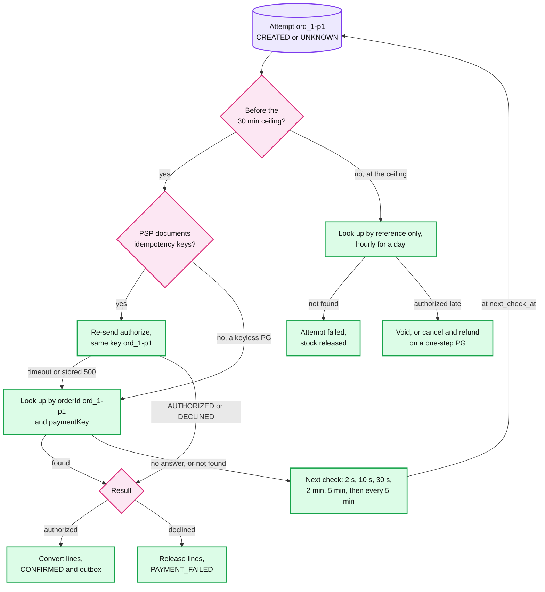

# Deep dive: checkout saga and payment idempotency

> One-line answer: checkout is a saga whose state lives in the order row, and every step's key is derived from one key, the `checkout_id`. Each step is an idempotent conditional write; a re-driver resumes any order idle for 30 s; the payment attempt row is written before the PSP hears of it; and a PSP timeout is `UNKNOWN`, owned by a resolver, while the stock stays held up to a 30-minute ceiling. The retry contract is per provider: a PSP with documented idempotency keys is re-sent the same key, then read by reference; a PG without keys (Toss's confirm) is never re-sent, only looked up by `orderId` and `paymentKey`. Past the ceiling the stock is released, the resolver only reads, and a late approval is voided, or cancelled and refunded. Run against 210 seeded scenarios with a keyed PSP and 180 with a keyless PG (a crash after each write, every PSP behaviour, a second tap or none), this design ends with no double order, no double authorization, no live authorization without an order, no unit sold twice and nothing stuck. The naive design double-authorizes in 36 of each; the "retry the same key" design sells a unit twice in 36 and, against a keyless PG, also double-charges in 36; re-sending to a keyless PG from the Great design would double-charge in 30.

Zoom-in on [`../solution.md`](../solution.md) §4.4, §5.2, §5.6, Flow 3 and §10.5. Reusable blocks: [`../../../concepts/distributed-transactions.md`](../../../concepts/distributed-transactions.md), [`../../../concepts/exactly-once.md`](../../../concepts/exactly-once.md), [`../../../concepts/temporal-durable-execution.md`](../../../concepts/temporal-durable-execution.md). Related: [`../../payments-ledger/deep-dives/rails-timeouts-and-unknown-outcome.md`](../../payments-ledger/deep-dives/rails-timeouts-and-unknown-outcome.md), [`../../payments-ledger/deep-dives/idempotency-keys.md`](../../payments-ledger/deep-dives/idempotency-keys.md). Siblings: [`flash-sale-and-hot-sku.md`](flash-sale-and-hot-sku.md) (a deal token is a line's reservation), [`cart-and-pricing.md`](cart-and-pricing.md) (the quote), [`inventory-registration-and-stock-model.md`](inventory-registration-and-stock-model.md) (the sweeper).

Acronyms: PSP (payment service provider), PG (payment gateway, the Korean term for a PSP), TTL (time to live), FC (fulfillment center), WMS (warehouse management system), 3DS (3-D Secure), CIT (customer-initiated transaction), KRW (Korean won).

---

## 1. One key, derived everywhere

| Id | Derived from | Unique where | Stops |
|---|---|---|---|
| `checkout_id` (`co_1`) | created by `POST /checkouts`, kept by the app across restarts | `(buyer_id, checkout_id)` on `ORDER` | A double tap making two orders |
| `order_id` (`ord_1`) | one per checkout | order DB | |
| `reservation_id` | `hash(order_id, line_no)` | inventory shard of the SKU | A retried reserve holding twice |
| `attempt_id` (`ord_1-p1`) | `order_id` + `-p<n>`, `n` bumps only after a definite decline | one live attempt per order (partial unique index) | A second authorization while the first is unknown |
| PSP idempotency key | `= attempt_id` | the PSP, ~24 h at Stripe v1 | A re-sent authorize charging twice |
| `fulfillment_id` (`ord_1-1`) | `order_id` + `-<n>` per send to an FC | WMS intake | A re-sourced line read as a duplicate |
| Re-source of a short line | (source `fulfillment_id`, line), written only if the order is not `CANCEL_REQUESTED` | order DB | A duplicate short making `ord_1-3`; a re-source after a cancel |
| Capture and void keys | `capture-ord_1-p1`, `void-ord_1-p1` | the PSP | A retried capture or void |

A retry at any hop is the same request at every hop below it. The only long-lived key is ours: the attempt row outlives the PSP's 24-hour key memory.

## 2. The writes, in order, and what a crash after each leaves

| After write | On disk | Who finishes it |
|---|---|---|
| 1, 2: reservation per line | `HELD` rows, order `RESERVING` | Re-driver re-runs reserve; the ids make it a no-op |
| 3: order `PAYING` (coupon held) | no attempt row | Re-driver creates attempt `p1` |
| 4: attempt `CREATED` | the PSP never heard | Re-driver sees `CREATED` older than 10 s: `UNKNOWN`. A keyed PSP: the resolver's re-send is the first call. A keyless PG: lookups say not found, and at the ceiling the attempt fails and the stock is released |
| 5: the PSP call itself | the PSP acted, we never heard | Same as 4; a keyed re-send returns the PSP's saved result, a keyless lookup by `orderId` finds the payment |
| 6: attempt `AUTHORIZED`, `DECLINED` or `UNKNOWN` | the outcome, not yet acted on | Re-driver converts, releases, or re-applies `extend_until` |
| 7, 8: convert per line (or extend per line) | some lines `CONVERTED` | Re-driver converts the rest; `WHERE state = 'HELD'` |
| 9: `CONFIRMED` + outbox row, one transaction | done | The relay publishes `order_confirmed` |

Three rules came out of walking this table with the simulation below:
- **The resolver scans the attempts table** (`state IN (CREATED older than 10 s, UNKNOWN)`, by `next_check_at`), never an in-memory timer, so a crash right after write 6 still gets resolved.
- **The re-driver re-applies `extend_until`** for a `PAYING` order whose attempt is `UNKNOWN`. A crash between the `UNKNOWN` write and the extension would otherwise leave the 10-minute TTL in charge.
- **A partial convert is undone before the outbox row exists.** Lines convert on different shards. If line 2 was released (TTL, seller count, carve), line 1 goes `CONVERTED → RELEASED` (`sold − q`), the authorization is voided, and the buyer hears "sold out, not charged". After the outbox row, a cancel through the WMS is the only way back.

## 3. The attempt without an answer



- **The retry contract is per provider.** A PSP that documents idempotency keys (Stripe style) may be re-sent the same key: it returns the saved result. A PG without one is never re-sent after an unknown outcome. Toss's confirm API documents no idempotency header (only its cancel API does, per the facts survey), so a second confirm could be a second charge. The resolver only looks it up, by the attempt id (`orderId = ord_1-p1`) and the PG's `paymentKey`, and "not found" is final only at the 30-minute ceiling: then the attempt is marked failed and the stock released, and an approval that turns up later is cancelled and refunded.
- **After the ceiling, read only, for every provider.** If the first call never reached the PSP, a re-send at minute 40 would be the first call and create a fresh authorization for an order we already told the buyer is not confirmed.
- **One PSP per attempt.** An unknown attempt is resolved where it was sent. A second PSP takes new attempts only.
- **The PSP's reference is the attempt id** (`ord_1-p1`), not the order id. Toss requires `orderId` to identify one payment (6 to 64 characters); whether a declined `orderId` can be reused is not in the survey, so we never reuse one.

## 4. Simulation: every crash point, every PSP behaviour

Seeded, deterministic, standard library. Two lines, stock for two orders. A released unit goes to another buyer at once, so converting a released line sells it twice. PSP behaviours: answers; declines; processes but answers after our 3 s timeout; never hears the first call; stores a 500 for the key (Stripe v1 style, keyed PSP only); a 40-minute outage after processing the first call; the same outage before hearing it. Two provider types: a PSP with idempotency keys, and a keyless PG where every request it hears is a new charge. The buyer taps again at +1 s, at +6 min, or not at all. Bad: no key, a timeout is a decline. Good: a key on `POST /orders`, the same PSP request retried until it answers, no `UNKNOWN`, no re-driver. Great: this design, which never re-sends to a keyless PG. "Great, re-sends" is the same design if it re-sent to a keyless PG as it may to a keyed PSP.

```python
import heapq, itertools
from collections import Counter

TTL, CEIL, END = 600, 1_800, 90_000                     # seconds: reservation TTL, unknown ceiling, 25 h
ASKS = [2, 10, 30, 120, 300, 600, 900, 1_200, 1_500]    # resolver re-sends after the first call
MODES = ["ok", "decline", "slow_processed", "lost", "stored_500", "outage_processed", "outage_lost"]
NOKEY_MODES = [m for m in MODES if m != "stored_500"]             # a PG with no idempotency key

class Crash(Exception):
    pass

class PSP:                       # keyed: keeps each key's first result; outage modes: no answers for 40 min
    def __init__(s, mode, keyed=True):
        s.mode, s.keyed, s.saved, s.live, s.made = mode, keyed, {}, Counter(), 0
    def call(s, key, t, first):
        down = s.mode.startswith("outage") and t < 2_400
        heard = not (first and s.mode in ("lost", "outage_lost")) and not (down and not first)
        if heard and (key not in s.saved or not s.keyed):   # without a key, a re-send is a new charge
            ok = s.mode != "decline" and not (first and s.mode == "stored_500")
            s.saved[key] = "AUTHORIZED" if ok else ("ERR500" if s.mode == "stored_500" else "DECLINED")
            s.made += ok
            s.live[key] += ok
        return None if down or (first and s.mode in ("slow_processed", "lost")) else s.saved.get(key)
    def lookup(s, key, t):                              # query by our own reference
        return None if s.mode.startswith("outage") and t < 2_400 else s.saved.get(key, "NONE")

def run(policy, crash_at, mode, retap, keyed=True):
    great, psp, q, seq, orders = policy.startswith("great"), PSP(mode, keyed), [], itertools.count(), []
    st = dict(res=0, writes=0, first=False, held=0, late_void=0, twice=0)
    at = lambda t, f, o=None: heapq.heappush(q, (t, next(seq), f, o))
    def write():
        st["writes"] += 1
        if st["first"] and st["writes"] == crash_at:
            st["first"] = False
            raise Crash
    def end(o, t, state, due_only=False):               # a released unit goes to another buyer at once
        o["state"] = o["state"] if due_only else state
        for r in o["rsv"]:
            if r[0] == "HELD" and (not due_only or t >= max(r[1], r[2])):
                r[0], st["res"], st["held"] = "RELEASED", st["res"] - 1, max(st["held"], t - o["t0"])
    def finish(o, t):
        if great and any(r[0] != "HELD" for r in o["rsv"]):
            psp.live.pop(o["key"], None)                    # void: the stock is gone
            return end(o, t, "SOLD_OUT_VOIDED")
        for r in o["rsv"]:                                  # bad and good convert without the HELD check
            if r[0] != "CONVERTED":
                st["twice"] += r[0] == "RELEASED"
                st["res"] -= r[0] == "HELD"
                r[0] = "CONVERTED"; write()
        o["state"] = "CONFIRMED"; write()
    def on_result(o, res, t):
        if res == "AUTHORIZED":
            o["auth"] = "AUTHORIZED"; write(); finish(o, t)
        elif res == "DECLINED" or (policy == "bad" and res in (None, "ERR500")):
            o["auth"] = "FAILED"; write(); end(o, t, "FAILED")
        elif policy == "good":                              # same key again until the PSP answers
            o["auth"] = "RETRYING"; write()
            for d in ASKS + [CEIL + 3_600 * h for h in range(24)]:
                at(t + d, ask, o)
        else:                                               # UNKNOWN; next_check_at on the row drives the resolver
            o["auth"] = "UNKNOWN"
            for d in ASKS + [o["t0"] + CEIL - t] + [o["t0"] + CEIL + 3_600 * h - t for h in range(1, 25)]:
                at(t + d, ask, o)
            write(); extend(o)
    def extend(o):
        for r in o["rsv"]:
            if r[0] == "HELD" and not r[2]:
                r[2] = o["t0"] + CEIL; write()
    def drive(o, t):                                        # idempotent: resumes from the stored state
        if o["state"] == "RESERVING":
            for r in o["rsv"]:
                if r[0] is None:
                    r[0] = "HELD"; st["res"] += 1; write()
            o["state"] = "PAYING"; write()
        if o["state"] != "PAYING":
            return
        if o["auth"] is None:
            o["auth"] = "CREATED"; write()
            res = psp.call(o["key"], t, True); write()      # a crash here: the PSP acted, we never heard
            on_result(o, res, t)
        elif great and o["auth"] in ("CREATED", "UNKNOWN", "FAILED"):
            {"CREATED": lambda: on_result(o, None, t), "UNKNOWN": lambda: extend(o),
             "FAILED": lambda: end(o, t, "FAILED")}[o["auth"]]()
        elif o["auth"] == "AUTHORIZED":
            finish(o, t)
    def ask(o, t):
        if o["auth"] == "RETRYING":
            res = psp.call(o["key"], t, False)
            return on_result(o, res, t) if res in ("AUTHORIZED", "DECLINED") else None
        if o["auth"] not in ("UNKNOWN", "UNRESOLVED"):
            return
        late = t >= o["t0"] + CEIL                          # after the ceiling: read only, never re-send
        read_only = late or (not psp.keyed and policy == "great")   # a PG without a key is never re-sent
        res = psp.lookup(o["key"], t) if read_only else psp.call(o["key"], t, False)
        res = psp.lookup(o["key"], t) if res in (None, "ERR500") and not read_only else res
        if res == "AUTHORIZED" and o["auth"] == "UNKNOWN":
            on_result(o, res, t)
        elif res == "AUTHORIZED":
            psp.live.pop(o["key"], None); o["auth"] = "VOIDED"; st["late_void"] = 1
        elif res == "NONE" and not psp.keyed and not late:
            pass                                            # without a key, "not found" is final only at the ceiling
        elif res in ("DECLINED", "NONE", "ERR500"):
            o["auth"] = "FAILED"; end(o, t, "FAILED" if o["state"] == "PAYING" else o["state"])
        elif late and o["auth"] == "UNKNOWN":
            o["auth"] = "UNRESOLVED"; end(o, t, "UNRESOLVED")
    def tap(t, new):
        if new:
            o = dict(t0=t, state="RESERVING", auth=None, key=f"ord_{len(orders) + 1}-p1",
                     rsv=[[None, t + TTL, 0] for _ in "ab"])
            orders.append(o)
            for k in range(1, 2_881 if great else 1):       # the re-driver, every 30 s
                at(t + 30 * k, lambda o, t: drive(o, t) if o["state"] in ("RESERVING", "PAYING") else None, o)
            for d in (TTL, CEIL):                           # the sweeper
                at(t + d, lambda o, t: end(o, t, None, True) if o["state"] in ("RESERVING", "PAYING") else None, o)
        st["first"] = new and len(orders) == 1
        try:
            drive(orders[-1], t)
        except Crash:
            pass
        st["first"] = False
    at(0, lambda o, t: tap(t, True))
    if retap:                          # bad has no key: a new order. good: a new checkout after "failed"
        at(retap, lambda o, t: tap(t, policy == "bad" or (policy == "good" and orders[-1]["state"] == "FAILED")))
    while q and q[0][0] <= END:
        t, _, f, o = heapq.heappop(q)
        f(o, t)
    live_no_order = any(psp.live[o["key"]] > 0 and o["state"] != "CONFIRMED" for o in orders)
    stuck = st["res"] != 0 or any(o["state"] in ("RESERVING", "PAYING") for o in orders)
    return Counter({"two orders confirmed": sum(o["state"] == "CONFIRMED" for o in orders) > 1,
                    "two authorizations": psp.made > 1, "two live at the end": sum(psp.live.values()) > 1,
                    "live auth, no order": live_no_order, "unit sold twice": st["twice"] > 0,
                    "stuck order or stock": stuck, "unit held over 30 min": st["held"] > CEIL,
                    "late approval voided": st["late_void"]})

for keyed, modes, name in ((True, MODES, "PSP with idempotency keys (Stripe style)"),
                           (False, NOKEY_MODES, "PG without an idempotency key (Toss confirm style)")):
    pols = ("bad", "good", "great") + (() if keyed else ("great_resend",))
    scen = [(c, m, r) for c in range(10) for m in modes for r in (0, 1, 360)]
    res = {p: sum((run(p, *sc, keyed=keyed) for sc in scen), Counter()) for p in pols}
    print(f"{name}: {len(scen)} scenarios = crash after write 1 to 9 or none x {len(modes)} PSP behaviours x tap again (no, +1 s, +6 min)")
    head = f"{'scenarios with':24} {'Bad':>5} {'Good':>5} {'Great':>6}" + ("" if keyed else f" {'Great, re-sends':>16}")
    print(head)
    for k in run("great", 0, "ok", 0):
        row = f"{k:24} {res['bad'][k]:>5} {res['good'][k]:>5} {res['great'][k]:>6}"
        print(row + ("" if keyed else f" {res['great_resend'][k]:>16}"))
    print()
```

```text
PSP with idempotency keys (Stripe style): 210 scenarios = crash after write 1 to 9 or none x 7 PSP behaviours x tap again (no, +1 s, +6 min)
scenarios with             Bad  Good  Great
two orders confirmed         4     0      0
two authorizations          36     0      0
two live at the end         36     0      0
live auth, no order         64    18      0
unit sold twice              0    36      0
stuck order or stock       132   102      0
unit held over 30 min        0     0      0
late approval voided         0     0     27

PG without an idempotency key (Toss confirm style): 180 scenarios = crash after write 1 to 9 or none x 6 PSP behaviours x tap again (no, +1 s, +6 min)
scenarios with             Bad  Good  Great  Great, re-sends
two orders confirmed         4     0      0                0
two authorizations          36    36      0               30
two live at the end         36    36      0               30
live auth, no order         64    18      0                0
unit sold twice              0    36      0                0
stuck order or stock       114    72      0                0
unit held over 30 min        0     0      0                0
late approval voided         0     0     27               27
```

What it shows:
- **Bad** double-charges whenever the PSP was slow and the buyer tapped again (no key: a new order, a new PSP key), leaves live authorizations behind orders it marked failed, and strands every crash.
- **Good** never double-charges, but it is the design that sells a unit twice: the reservation's TTL expired under a slow PSP, another buyer took the unit, and the late "yes" converted anyway. Without a re-driver every crash is a stuck order, and a stored 500 never resolves.
- **Against a keyless PG**, Good's "retry until it answers" double-charges in 36 scenarios, and so would Great if it re-sent: 30. Great as designed only looks up, so it has none, at the price of holding the stock up to 30 minutes when the PG never heard the call and failing the attempt at the ceiling.
- **Great** has no violation in any scenario. Its cost shows in the last row: when the PSP processed the call and then went dark for 40 minutes, the approval arrived after the ceiling, the stock had been released, and the authorization was voided. That is the trade-off we chose: at most 30 minutes of held stock, then a void instead of an oversell.
- No unit is held past 30 minutes in any design that holds at all.

## 5. Money paths: void, refund, capture

| Moment | Two-step card PSP (Stripe style) | One-step Korean PG (Toss style) |
|---|---|---|
| Place order | Authorize (`requires_capture`) | Confirm within 10 min of the buyer's authentication: the money moves |
| Cancel of every line before shipment | Void the authorization | Cancel API, a refund, with its own idempotency key |
| Cancel of some lines before shipment | Smaller capture at the first shipment | Partial cancel (refund) |
| Short pick, line cancelled | Smaller capture | Partial cancel (refund) |
| Unknown outcome | Re-send the same key, then look up | Never re-send; look up by `orderId` and `paymentKey` |
| Late approval after the ceiling | Void | Cancel (refund) |
| Shipment | Capture | Nothing |

- **Decision: capture once per order, at its first shipment**, for the order total minus lines already known to be short or cancelled. A later short or cancel is a partial refund. A two-line order with an FC line and a seller line ships twice, and a card authorization is usually captured once; where the PSP supports several partial captures on one authorization, capture per shipment instead [check per PSP].
- **The 7-day window** (online CIT holds for most brands, Visa MIT 5 days): an order with nothing shipped by day 6 is captured in full and refunded per line later. Pre-orders charge at order (solution §10.11).
- **Settlement match.** Every day, every authorization or charge in the PSP's report must map to a `CONFIRMED` order or a void or refund we sent. Anything else is voided or refunded and counted.

## 6. What an interviewer pushes on

1. **"Why not 2PC?"** The PSP cannot join, and holding the stock row's lock through a ~400 ms call cuts the hot row to ~2.5 updates a second.
2. **"The idempotency key makes payment exactly-once."** It makes a retry safe for ~24 h, and only where the PSP documents one; a keyless PG gets lookups, never a re-send. It cannot tell you the outcome of a call that never answered. That is the resolver's job.
3. **"Why hold the stock while unknown? Release it and void later."** Then a "yes" at minute 2 finds its unit sold: a void and an angry buyer, or, without the `HELD` check on convert, the Good column's 36 units sold twice.
4. **"Why 30 minutes?"** Long enough that almost every unknown resolves (most are seconds); short enough that a PSP outage does not freeze a hot SKU. It is a dial: a hot deal can use 10.
5. **"The buyer taps again during `UNKNOWN`."** Same `checkout_id`, same order, `202 PAYMENT_PENDING`, no new attempt: the partial unique index refuses one anyway.
6. **"Temporal instead of a re-driver?"** Fine if the company runs it. At ~350 orders a second, a state column and a scan are less to operate.

## 7. Trade-offs

| Decision | Chose | Gave up |
|---|---|---|
| Coordination | Saga in the order row, idempotent steps, re-driver every 30 s | A 30 s worst-case pause after a crash |
| Timeout meaning | `UNKNOWN`, resolver, stock held | Up to 30 min of a unit nobody can buy |
| Retry contract | Re-send only to PSPs with documented keys; lookups only for keyless PGs | A keyless PG that never heard the call holds the unit 30 minutes before the attempt fails |
| After the ceiling | Release, read-only resolver, void or refund a late yes | A buyer who paid late gets "not confirmed" and a voided hold or a refund |
| Second PSP | New attempts only | Unknowns wait for the first PSP to recover |
| Capture | Once, at the first shipment | Later shorts are refunds, not smaller captures |

## 8. Numbers to say out loud

- One call, 3 s timeout. Resolver at +2 s, +10 s, +30 s, +2 min, +5 min, then every 5 min to 30 min: about 10 asks, rate-limited to 200 a second per PSP. Re-sends to keyed PSPs only; keyless PGs get lookups.
- 30-minute ceiling, then hourly read-only lookups for 24 h. Stripe v1 keeps keys ≥ 24 h; Toss expires an unconfirmed payment 10 min after authentication.
- Re-driver: orders idle 30 s. Attempts `CREATED` for 10 s count as unknown.
- 210 keyed scenarios: Bad has 36 with two authorizations and 132 stuck; Good has 36 with a unit sold twice and 102 stuck; Great has none, and voids 27 late approvals.
- 180 keyless scenarios: Good double-charges in 36; Great has none; Great re-sending would double-charge in 30.
