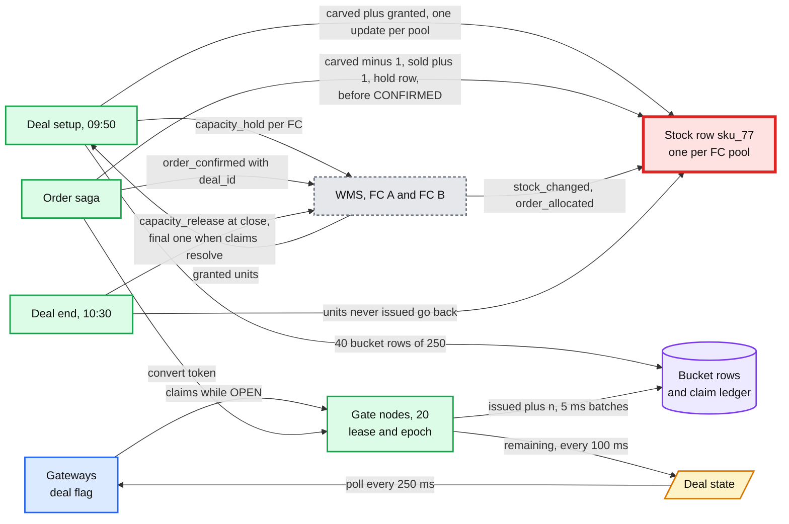

# Deep dive: flash sale and the hot SKU

> One-line answer: a flash sale is a **rejection** problem on **one row**. The deal's stock row can take a few hundred to ~1,000 conditional updates a second, and the sale brings ~100k taps a second, 99% of them for units that do not exist. So setup books FC capacity and carves the units into 40 buckets of 250, each owned by one gate node under a fenced lease. Gate nodes issue units from memory and commit them in 5 ms batches that the database bounds (`issued + n <= units`), and gateways answer "sold out" from a polled flag. In a seeded run of 1M taps with a node crash and a 8 s GC pause mid-batch, nothing oversells and 517 units sit paused until the successor takes over. The traps are at the edges: claims keyed by device instead of buyer, a won claim hidden by the sold-out flag, a WMS hold written after the WMS has already allocated, and units handed back at deal end while a payment is still unknown.

Zoom-in on [`../solution.md`](../solution.md) §5.1, Flow 2, §10.1 (the deal gate) and §10.4. Reusable blocks: [`../../../concepts/leases-fencing-clocks.md`](../../../concepts/leases-fencing-clocks.md), [`../../../concepts/rate-limiting-and-load-shedding.md`](../../../concepts/rate-limiting-and-load-shedding.md), [`../../../concepts/sharding.md`](../../../concepts/sharding.md). Siblings: [`checkout-saga-and-payment-idempotency.md`](checkout-saga-and-payment-idempotency.md) (the token is the line's reservation), [`inventory-registration-and-stock-model.md`](inventory-registration-and-stock-model.md) (the stock row and the WMS hold rule). Related: [`../../ticket-booking/deep-dives/last-room-and-inventory-locking.md`](../../ticket-booking/deep-dives/last-room-and-inventory-locking.md), [`../../payments-ledger/deep-dives/hot-accounts-and-contention.md`](../../payments-ledger/deep-dives/hot-accounts-and-contention.md).

Acronyms: SKU (stock keeping unit), FC (fulfillment center), WMS (warehouse management system, problem 62), AZ (availability zone), GC (garbage collection), PSP (payment service provider), TTL (time to live), KRW (Korean won).

---

## 1. Why one row caps out

A conditional `UPDATE` holds the row's lock from the statement until the commit is durable. With semi-synchronous replication in `AFTER_SYNC` mode, that includes one round trip to a replica in another AZ. Every number here is `[estimate]`.

| Part of the lock window | Time |
|---|---|
| Statement: re-check `sellable >= q` under the lock | ~0.05 to 0.1 ms |
| Redo and binlog flush, group commit fsync | ~0.1 to 0.5 ms |
| Replica acknowledgment from another AZ | ~0.5 to 2 ms |
| **Lock held** | **~1 to 3 ms, so ~330 to 1,000 updates a second on one row** |

- Group commit does not help one row: the next transaction cannot run its `UPDATE` until the lock is released. Alibaba's framing: queued same-row updates at best approach `1 s / trxrt`.
- 1M taps in 10 s is 100k a second, 100x to 300x over, and 99% of them lose. The goal is not "write faster". It is "never let the 99% reach the row".

## 2. The deal around the row



- **Setup.** `capacity_hold(D, fc, date, cutoff, units)` per FC first; carve at most `granted_units` (`carved + g WHERE sellable >= g`). Then 40 bucket rows spread by `hash(deal_id, bucket_no)` over all 16 shards.
- **Ownership.** Each bucket has one writer at a time: a lease on the bucket row with an `epoch`. Every batch carries `AND epoch = e`. **Decision:** during a live deal the lease is 2 s, renewed every 500 ms, with a 1 s takeover margin [our choice]. Renewals are 80 row writes a second in all.
- **Bound.** `issued = issued + n WHERE ... AND epoch = e AND issued + n <= units`. Memory decides who wins; the row decides how many exist.

## 3. The rules that keep the gate honest

- **1 per buyer is keyed by `(deal_id, buyer_id)`, not by the `Idempotency-Key` header.** Two phones send two headers. Gateways route by `hash(buyer_id)`, so both land on one node; the second request joins the first claim's batch and gets the same token.
- **A successor takes the dead node's whole buyer range**, not only its buckets, and rebuilds "who already won" from the `HELD` ledger rows of those buckets.
- **A won claim is never hidden.** A claim can commit while its answer is lost (the node died mid-batch). **Decision:** the client retries an unanswered claim with `resume: true`, and gateways forward resumed claims even when the flag says `SOLD_OUT`. The owner answers with the existing token.
- **Expiry is per ledger row.** The owner's timer wheel runs `HELD → RELEASED WHERE state = 'HELD'` on the rows it expires, then `issued − (rows changed)`, fenced by epoch. A zombie owner or a duplicate expiry cannot return a unit twice.
- **An unknown payment pauses the clock.** The saga's `extend_until` is sent to the bucket owner, and the timer wheel skips a claim until then (30-minute ceiling). Otherwise a 5-minute claim behind a PSP timeout returns to the bucket and is sold again while the first buyer's money is still in flight.

## 4. Simulation: 1M taps, a crash and a GC pause mid-batch

Seeded, standard library. 950k buyers, 50k of them on two devices, taps spread over 10 s. Node 7 dies at 0.061 s with a batch in flight (it commits, nobody hears). Node 12 freezes from 0.053 s to 8 s with claims in memory, then flushes them with its old epoch. Clients retry after a reset (0.5 to 1.5 s) or a 1 s timeout.

```python
import random
from collections import defaultdict

UNITS, NODES, BATCH, COMMIT, PUBLISH, POLL, GWS = 250, 20, 5, 2, 100, 250, 40   # times in ms
BUYERS, TWO_DEV, WINDOW, TIMEOUT = 950_000, 50_000, 10_000, 1_000               # 1M taps in 10 s
CRASH, CRASH_AT = 7, 61               # dies while its .060 batch is in flight (it commits, unanswered)
PAUSE, PAUSE_AT, WAKE = 12, 53, 8_000                                 # GC pause, claims in memory
SUCC = {CRASH: 9, PAUSE: 14}

def run(lease, margin, key_by_buyer=True, rebuild=True, resume=False, fail=True, seed=61):
    rnd, takeover = random.Random(seed), lease + margin      # last lease renewal at 10:00:00.000
    owned = {n: [2 * n - 1, 2 * n] for n in range(1, NODES + 1)}
    epoch = {n: {b: 1 for b in owned[n]} for n in owned}      # each node's view of its leases
    row = {b: [0, 1] for b in range(1, 41)}                   # the database: issued, epoch
    mem, pub, ledger = {b: UNITS for b in row}, {b: UNITS for b in row}, defaultdict(list)
    seen, pending, commits, taps = {n: {} for n in owned}, defaultdict(list), defaultdict(list), defaultdict(list)
    flag, dead, frozen, units, done, lost, o = {}, set(), set(), defaultdict(int), set(), set(), defaultdict(int)
    two = set(rnd.sample(range(BUYERS), TWO_DEV))
    for b in range(BUYERS):
        t = rnd.randrange(WINDOW)
        taps[t].append((b, 0, False))
        if b in two:
            taps[t + rnd.randrange(30)].append((b, 1, False))
    retry = lambda t, c, wait: taps[t + wait].append((c[0], c[1], True))
    for t in range(13_000):
        if t == CRASH_AT and fail:                           # clients see a reset
            dead.add(CRASH); o["paused"] += sum(mem[b] for b in owned[CRASH])
            for b in owned[CRASH]:
                for c in pending[CRASH, b] + [c for x in commits[t + 1] if x[0] == CRASH for c in x[2]]:
                    retry(t, c, rnd.randint(500, 1500))
                pending[CRASH, b] = []
        if t == PAUSE_AT and fail:
            frozen.add(PAUSE); o["paused"] += sum(mem[b] for b in owned[PAUSE])
            for b in owned[PAUSE]:
                for c in pending[PAUSE, b]:
                    retry(t, c, TIMEOUT)
        if t == takeover and fail:                           # successor: epoch + 1, issued read from the row
            for old, new in SUCC.items():
                for b in owned[old]:
                    row[b][1] += 1
                    epoch[new][b], mem[b] = row[b][1], UNITS - row[b][0]
                    owned[new].append(b)
                    for buyer in (ledger[b] if rebuild else []):
                        seen[new][buyer] = True
            owned[CRASH] = []
        if t == WAKE and fail:                               # the zombie flushes with its old epoch
            frozen.discard(PAUSE)
            for b in owned[PAUSE]:
                commits[t + COMMIT].append((PAUSE, b, pending[PAUSE, b], epoch[PAUSE][b]))
            owned[PAUSE] = []
        for node, b, claims, ep in commits.pop(t, []):
            if ep != row[b][1] or row[b][0] + len(claims) > UNITS:
                o["fenced"] += len(claims)                    # 0 rows changed: "try again"
                continue
            row[b][0] += len(claims)
            for c in claims:
                ledger[b].append(c[0])
                units[c[0]] += 1
                (lost.add(c[0]) if node in dead else done.add(c[:2]))
            if row[b][0] == UNITS:
                o["last_unit_ms"] = max(o["last_unit_ms"], t)
        for n in owned:
            if n in dead or n in frozen:
                continue
            for b in owned[n]:
                if t % BATCH == 0 and pending[n, b]:
                    commits[t + COMMIT].append((n, b, pending[n, b], epoch[n][b]))
                    pending[n, b] = []
                if t % PUBLISH == 0:
                    pub[b] = mem[b]
        if t % PUBLISH == 0 and sum(pub.values()) == 0:
            flag.setdefault("sold_out", t)
        for buyer, dev, is_retry in taps.pop(t, []):
            if (buyer, dev) in done:
                continue
            g = (buyer * 7 + dev) % GWS
            last = t - (t - g * POLL // GWS) % POLL           # this gateway's last poll
            if "sold_out" in flag and last >= flag["sold_out"] and not (resume and is_retry):
                o["gateway"] += 1; done.add((buyer, dev))
                continue
            o["gate"] += 1
            n = 1 + (buyer * 2654435761 >> 7) % NODES
            n = SUCC.get(n, n) if t >= takeover else n
            if n in dead or n in frozen:
                retry(t, (buyer, dev), rnd.randint(500, 1500) if n in dead else TIMEOUT)
                continue
            k = buyer if key_by_buyer else (buyer, dev)
            if k in seen[n]:                                  # joins its pending claim, or gets its token back
                o["token_back"] += buyer in lost
                lost.discard(buyer)
                done.add((buyer, dev))
                continue
            free = [b for b in owned[n] if mem[b] > 0]
            if not free:
                done.add((buyer, dev))
                continue
            b = max(free, key=mem.get); mem[b] -= 1
            pending[n, b].append((buyer, dev, is_retry))
            seen[n][k] = True
    o["issued"], o["two_units"], o["still_lost"] = sum(r[0] for r in row.values()), sum(v > 1 for v in units.values()), len(lost)
    return o

print(f"{'variant':34} {'issued':>6} {'over':>4} {'2-unit':>6} {'at gateway':>10} {'at gate':>9}"
      f" {'paused':>6} {'last unit':>9} {'fenced':>6} {'token back':>10} {'held 5 min':>10}")
for name, args in [("no failure", (5_000, 2_000, True, True, False, False)),
                   ("lease 5 s + 2 s, key = buyer", (5_000, 2_000)),
                   ("lease 2 s + 1 s, key = buyer", (2_000, 1_000)),
                   ("lease 5 s, key = device header", (5_000, 2_000, False)),
                   ("lease 5 s, successor skips ledger", (5_000, 2_000, True, False)),
                   ("lease 5 s, resumed skip the flag", (5_000, 2_000, True, True, True))]:
    o = run(*args)
    print(f"{name:34} {o['issued']:>6,} {max(0, o['issued'] - 10_000):>4} {o['two_units']:>6}"
          f" {o['gateway']:>10,} {o['gate']:>9,} {o['paused']:>6} {o['last_unit_ms'] / 1000:>8.2f}s"
          f" {o['fenced']:>6} {o['token_back']:>10} {o['still_lost']:>10}")
```

```text
variant                            issued over 2-unit at gateway   at gate paused last unit fenced token back held 5 min
no failure                         10,000    0      0    967,949    32,051      0     0.12s      0          0          0
lease 5 s + 2 s, key = buyer       10,000    0      0    332,459   946,044    517     7.01s     17          9         21
lease 2 s + 1 s, key = buyer       10,000    0      0    700,771   358,691    517     3.02s     17         10         20
lease 5 s, key = device header     10,000    0    398    332,405   946,109    501     7.01s     17          0         31
lease 5 s, successor skips ledger  10,000    0      1    332,459   946,044    517     7.01s     17          0         30
lease 5 s, resumed skip the flag   10,000    0      0    277,430 1,001,073    517     7.01s     17         30          0
```

What it shows:
- **No oversell in any variant.** The database bound holds through a crash mid-batch and a zombie: the frozen node's 17 claims came back with the old epoch and changed 0 rows.
- **The happy path matches the estimate.** The last unit is issued at 0.12 s, and only ~32k of 1M taps reach a gate node.
- **A dead owner keeps the deal OPEN.** Its buckets still publish their last remaining count, so the flag cannot say `SOLD_OUT`. ~946k taps reach gate nodes instead of ~32k (in memory, ~7k a second per node, fine), and 517 units wait until 7.01 s. A 2 s lease halves that: units back at 3.02 s, ~359k taps at the gate.
- **Key by buyer.** Keyed by the device's header, 398 two-device buyers won two units each.
- **Rebuild from the ledger.** A successor that skips the ledger let one buyer win twice. **Never hide a won claim.** 30 claims committed while their node died. With the plain flag only 9 buyers got their token back before the flag flipped to `SOLD_OUT`; 21 units sat held for 5 minutes while their buyers were told "sold out". Resumed claims that skip the flag: all 30 back.

## 5. Convert and the WMS hold

The WMS allocates an order in its next 1 s lane batch and sends `stock_changed vN` and `order_allocated vN` back (problem 62). Commerce drops a hold only when it sees that allocation (the shared hold rule). So the hold row must exist **before** the WMS can see the order.

```python
import math, random

# 10k deal orders confirm over 3 minutes; each needs a WMS hold row (sold + 1). If the WMS's
# order_allocated is applied before the hold row exists, the hold stays OPEN and hides the unit.
def lag(rnd, median, p99):
    return rnd.lognormvariate(math.log(median), math.log(p99 / median) / 2.326)

def sim(hold_written, seed=68):
    rnd, stuck = random.Random(seed), 0
    phase = [rnd.random() for _ in range(40)]                  # each bucket's once-a-second flush
    for _ in range(10_000):
        t, b = rnd.uniform(0, 180), rnd.randrange(40)          # order CONFIRMED, outbox row written
        if hold_written == "by the bucket owner, once a second":
            hold_at = t + (phase[b] - t) % 1.0
        else:
            hold_at = t - 0.001                                # in the convert, before CONFIRMED
        intake = t + lag(rnd, 0.06, 0.7)                       # CDC relay and Kafka to WMS intake
        allocated = math.ceil(intake)                          # the SKU's allocation lane, every 1 s
        applied = allocated + 0.01 + lag(rnd, 0.05, 1.5)       # WMS outbox back to the inventory consumer
        stuck += applied < hold_at
    return stuck

for how in ["by the bucket owner, once a second", "in the convert, before the order is CONFIRMED"]:
    s = sim(how)
    print(f"hold row written {how:46} stuck holds {s:5,} ({s / 10_000:.1%} of deal units hidden)")
```

```text
hold row written by the bucket owner, once a second             stuck holds 2,976 (29.8% of deal units hidden)
hold row written in the convert, before the order is CONFIRMED  stuck holds     0 (0.0% of deal units hidden)
```

- Batching the stock-row moves to once a second per bucket hides ~30% of the deal's units after the sale: the allocation went by before the hold existed, so `sold` keeps them forever.
- **Decision:** the convert of a deal unit is one transaction on the stock row's shard (`carved − 1`, `sold + 1`, insert the hold keyed by `(fulfillment_id, sku_id, fc_id)`), run after the ledger row turns `CONVERTED` and before the order is `CONFIRMED`. The checkout wave is ~55 confirms a second: the row stays far under its ceiling. A crash between the two writes is re-driven; the hold insert is idempotent.

## 6. Deal end, unknown payments, and stock that shrinks

- **Deal end.** Return `units − issued` plus released claims, nothing else. A claim behind an unknown payment stays carved until it converts or its owner releases it. Example: a PSP brownout puts 2% of 10k winners (200) behind `UNKNOWN` [estimate]. Handing those 200 back at 10:30 and seeing 70% authorize later sells 140 units twice. Kept carved, each is either converted or returned one by one.
- **The WMS count drops under the carve.** FC A carved 6,000 of 6,000; at 09:58 the WMS reports 12 damaged. Sellable is now −12. **Decision:** the inventory service asks the deal coordinator to shrink unissued buckets by the deficit (`units − k WHERE units − k >= issued`, applied by each owner in its next batch). The deal sells 5,988 from FC A, and nobody gets a short pick at 01:40. The convert re-check also counts the carve: `on_hand − sold − carved >= q`, so regular orders cannot eat a deal's units either.
- **Capacity.** Deal fulfillments carry `deal_id` and draw on the deal's capacity hold. At 10:30 `capacity_release` returns only `granted − drawn − (issued claims not yet terminal)`, so every claim that may still convert keeps its capacity. A second, final `capacity_release` goes out when the last claim resolves, at most 30 minutes later (the payment ceiling). Only a deal fulfillment that reaches the WMS after that final release counts against regular capacity, which commerce's subtraction of its open holds and live reservations at that FC already includes.

## 7. What an interviewer pushes on

1. **"Just use Redis `DECR`."** One key is one thread, and an asynchronous replica can come back with decrements missing. The bucket row gives the same speed through batching and a durable bound.
2. **"Your ~1,000 a second is a guess."** It is the lock window: statement, fsync, one AZ round trip. 1 to 3 ms gives 330 to 1,000. Either way the gate takes the row off the claim path.
3. **"A gate node dies mid-batch."** Units issued are in the row; units in memory were never issued. The successor waits out the lease, bumps the epoch, reads `issued`, rebuilds the buyer set, and hands back tokens to resumed claims.
4. **"A GC pause gives you two owners."** The old one's batch carries the old epoch and changes 0 rows (17 fenced in the run).
5. **"Same buyer, two phones."** Same hash, same node, one key per `(deal_id, buyer_id)`; a unique `(buyer_id, deal_id)` row at confirm is the backstop. **"Why not a waiting room?"** The sale is decided in 0.12 s; a queue only makes 990k losers wait to hear "no".

## 8. Trade-offs

| Decision | Chose | Gave up |
|---|---|---|
| Where units are counted | 40 bucket rows, one writer each | A deal setup step, leases, a coordinator for rebalancing |
| Who answers losers | Gateways from a polled flag | Up to ~0.5 s of losers reaching gate nodes; OPEN while a bucket is paused |
| Lease during a deal | 2 s, renewed every 500 ms, 1 s margin | 80 renewal writes a second; a 2 s GC pause loses the lease |
| 1 per buyer | `(deal_id, buyer_id)` in memory, a unique row at confirm | A buyer whose first order failed needs a new claim the gate may refuse |
| Hold row for deal units | Written in the convert | ~55 stock-row writes a second in the checkout wave, not ~40 |
| Deal end | Return only never-issued and released units | Up to 30 minutes of carve held behind unknown payments |
| Count drops under the carve | Shrink unissued buckets | A deal can end with fewer units than announced |

## 9. Numbers to say out loud

- 100k taps a second, 10k units, 1% win rate. One row: ~330 to 1,000 updates a second.
- 40 buckets × 250, 20 nodes, 5 ms batches: ≤ 200 transactions a second per bucket row. Seeded run, 1M taps: last unit at 0.12 s, ~32k taps reach a gate node, 0 oversold.
- A dead node: 517 units paused for 7 s with a 5 s lease, 3 s with a 2 s lease. 30 claims committed as their node died: 21 hidden by the flag unless resumed claims skip it.
- Hold row written once a second: ~30% of deal units stuck. Written in the convert: 0.
