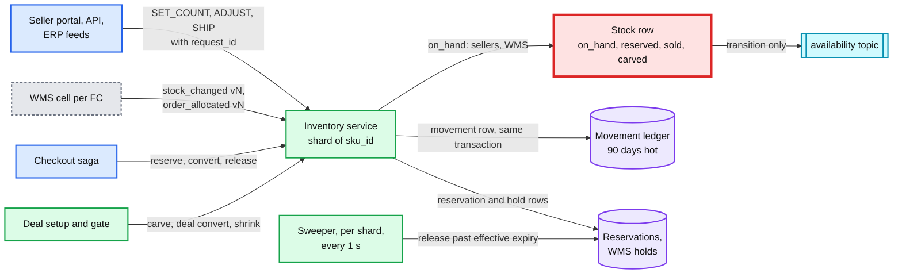

# Deep dive: inventory registration and the stock model

> One-line answer: one stock row per (SKU, pool) with four columns, `on_hand`, `reserved`, `sold` and `carved`, each owned by one kind of writer and changed by one conditional statement, so a seller's count never erases a buyer's reservation. Sellers send typed, idempotent operations. A count means "this many on my shelf at `counted_at`" and is applied as the count plus every shipment and adjustment recorded after `counted_at`; a count older than the last one applied is ignored. In a seeded 30-day run on one busy SKU, a plain "set the number" oversold 83 units, "minus shipments since" lost 88 sales, and the full rule landed at 17 oversold (the floor from unrecorded loss is 14) with 11 lost sales. FC pools take the WMS's versioned snapshot and keep a hold per fulfillment until a snapshot that excludes it is applied. Reservations expire on an indexed effective time; a sweeper that skips extended rows instead stalls for 20 minutes behind a PSP brownout.

Zoom-in on [`../solution.md`](../solution.md) §3.3, §4.2, §5.3, Flow 4 and Flow 6. Reusable blocks: [`../../../concepts/mvcc-and-isolation.md`](../../../concepts/mvcc-and-isolation.md), [`../../../concepts/exactly-once.md`](../../../concepts/exactly-once.md). The other side of the contract: [`../../warehouse-management/solution.md`](../../warehouse-management/solution.md) (problem 62). Siblings: [`flash-sale-and-hot-sku.md`](flash-sale-and-hot-sku.md) (the carve), [`checkout-saga-and-payment-idempotency.md`](checkout-saga-and-payment-idempotency.md) (convert and `extend_until`).

Acronyms: SKU (stock keeping unit), FC (fulfillment center), WMS (warehouse management system), ERP (a seller's enterprise resource planning system), PSP (payment service provider), TTL (time to live), ORM (object-relational mapper).

---

## 1. One row, four columns, one writer per column

| Column | Means | Raised by | Lowered by |
|---|---|---|---|
| `on_hand` | Units on the shelf not yet shipped (seller pool), or the WMS's `available_qty` (FC pool) | `ADJUST +`, `SET_COUNT`, a WMS snapshot | `SHIP`, `ADJUST −`, `SET_COUNT`, a WMS snapshot |
| `reserved` | Held by open checkouts | reserve | convert, release, expiry |
| `sold` | Confirmed, still inside `on_hand` (seller: not shipped; FC: a hold the WMS snapshot does not exclude yet) | convert | `SHIP` (seller), hold drop (FC), cancel |
| `carved` | Set aside for a flash deal | deal setup | deal convert, deal end, shrink |

**Sellable = `on_hand − sold − reserved − carved`.** Every statement is `UPDATE ... SET col = col ± q WHERE <guard>`, one per change, in one local transaction with its movement, reservation or hold row. No writer reads a value into memory and writes it back; an ORM that saves the whole row would write `reserved` back to an old value.



## 2. Seller operations: typed, idempotent, and honest about time

- **`ADJUST(delta, reason, request_id)`**: received, damaged, found. Commutes with everything.
- **`SHIP(order, q)`**: `on_hand − q`, `sold − q` together, with the ship time on the movement row.
- **`SET_COUNT(qty, counted_at, request_id)`**: "this many on my shelf at `counted_at`". **Decision:** applied as `on_hand = qty + sum(every SHIP and ADJUST recorded after counted_at)`, not only the shipments: a receipt after the count would be lost (under-count) and a damage write-off after the count would come back (over-count). A count whose `counted_at` is not newer than the last applied count's is acknowledged and ignored: a feed stuck for 4 hours must not roll the shelf back. `counted_at` in the future (beyond our clock plus 1 minute) or older than 24 h is rejected.
- **Idempotency.** Every operation carries `request_id`, unique on the movement table for 90 days. A retried feed line returns the first result.
- **Humans get `count_version`.** It changes only when `on_hand` does, so a portal `If-Match` is not broken by buyer reservations every few seconds.
- **Feeds.** A 100k-line file is split by shard and applied in transactions of 500 lines, so one feed never queues on one shard's locks (~5k lines a second in a burst across 16 shards).
- **A count below `sold`.** The shelf is the truth: accepted, sellable goes negative, the SKU goes out, and the seller gets a 24-hour task to restock or cancel the deficit, counted as seller-caused oversell.

## 3. Simulation: which count rule

Seeded, one seller pool, 30 days, ~90 orders a day against ~75 units received a day, shipments 1 to 6 h after the order. Three recorded damages and three unrecorded losses a day. The seller counts every 3 hours; 90% of counts arrive within 10 minutes, 10% sit in a feed for up to 4 hours, and the seller's clock is off by −2 to +3 minutes. A buyer is told yes when our sellable is at least 1. "Floor" is an exact count applied the instant it is taken: what unrecorded loss alone costs.

```python
import heapq, random

DAY = 86_400

def sim(rule, seed=64):
    rnd, ev = random.Random(seed), []                        # (time, kind, qty, counted_at)
    for d in range(30):
        ev += [(d * DAY + rnd.randrange(DAY), "order", 1, 0) for _ in range(90)]
        ev += [(d * DAY + h * 3_600 + rnd.randrange(3_600), "receive", 25, 0) for h in (0, 8, 16)]
        ev += [(d * DAY + rnd.randrange(DAY), k, 1, 0) for k in ("damage", "loss") for _ in range(3)]
        for h in range(0, 24, 3):
            tc = d * DAY + h * 3_600 + rnd.randrange(600)
            ev.append((tc, "count", 0, tc + rnd.randint(-120, 180)))   # counted_at by the seller's clock
    heapq.heapify(ev)
    shelf, on_hand, sold, oversold, lost, phantom, last_t, last_count, moves = 40, 40, 0, 0, 0, 0.0, 0, -1, []
    while ev:
        t, kind, qty, counted_at = heapq.heappop(ev)
        if kind == "order":
            lost += on_hand - sold < 1 <= shelf - sold              # we said no, the shelf had one
            if on_hand - sold >= 1:
                oversold += shelf - sold < 1                         # we said yes, the shelf had none
                sold += 1
                heapq.heappush(ev, (t + rnd.randint(3_600, 6 * 3_600), "ship", 1, 0))
        elif kind == "ship":
            if shelf > 0:
                shelf, on_hand, sold = shelf - 1, on_hand - 1, sold - 1
                moves.append((t, -1, "ship"))
            else:
                sold -= 1                                            # nothing to ship: the line is cancelled
        elif kind in ("receive", "damage"):                          # recorded ADJUSTs
            delta = qty if kind == "receive" else -qty
            shelf, on_hand = shelf + delta, on_hand + delta
            moves.append((t, delta, kind))
        elif kind == "loss":
            shelf = max(0, shelf - 1)                                # nobody tells us
        elif kind == "count":                                        # taken now, arrives later
            delay = 0 if rule == "floor" else rnd.randint(0, 600) if rnd.random() < 0.9 else rnd.randint(0, 4 * 3_600)
            heapq.heappush(ev, (t + delay, "count_arrives", shelf, t if rule == "floor" else counted_at))
        elif kind == "count_arrives":
            if rule in ("floor", "set the number"):
                on_hand = qty
            elif rule == "minus ships since":
                on_hand = qty + sum(d for m, d, k in moves if m > counted_at and k == "ship")
            elif counted_at > last_count:                            # replay every move since, newest count wins
                last_count = counted_at
                on_hand = qty + sum(d for m, d, k in moves if m > counted_at)
        phantom += max(0, on_hand - shelf) * (t - last_t) / 3_600
        last_t = t
    return oversold, lost, phantom

print(f"{'rule (30 days, ~2,700 orders)':42} {'oversold':>8} {'lost sales':>10} {'phantom unit-h':>14}")
for rule in ["floor", "set the number", "minus ships since", "replay all moves since, newest count wins"]:
    o, l, p = sim(rule)
    print(f"{rule:42} {o:8} {l:10} {p:14.0f}")
```

```text
rule (30 days, ~2,700 orders)              oversold lost sales phantom unit-h
floor                                            14          0            158
set the number                                   83         45            624
minus ships since                                22         88            205
replay all moves since, newest count wins        17         11            188
```

What it shows:
- **"Set the number" is the probe-3 bug in slow motion.** Every count applied after a shipment puts that unit back on sale.
- **"Minus shipments since" is safe but wasteful.** It ignores receipts after the count, so it hides stock it has: 88 lost sales a month on one busy SKU, 8x the full rule.
- **The full rule sits near the floor.** What is left is unrecorded loss between counts and the seller's clock skew. Counting more often lowers the floor; the clock bound (`counted_at` not in our future) caps the skew.

## 4. Convert, the carve, and a count that drops

- **Convert re-checks the shelf, carve included:** `reserved − q, sold + q WHERE state = 'HELD' AND on_hand − sold − carved >= q`. Without `carved`, regular orders can convert units a flash deal has promised, and the deal oversells.
- **A drop under the carve shrinks the deal.** If a WMS snapshot or a seller count makes sellable negative on a row with `carved > 0`, the deficit is taken first from units the gate has not issued (shrink, see the flash deep dive), then from converts that fail the check above. No buyer who was told yes loses a unit that still exists.

## 5. FC pools: the snapshot and the hold

- **Snapshot.** `on_hand = available_qty WHERE wms_stock_version < vN`. `stock_version = (epoch << 31) | counter` with `epoch = max(db_epoch + 1, promotion unix seconds)`, so even a DR replica that missed an in-region failover never re-issues an epoch commerce has applied, and "newer" stays true.
- **Hold per `(fulfillment_id, sku_id, fc_id)`,** counted in `sold`. `OPEN` at convert, `ALLOCATED(vN)` when `order_allocated vN` arrives, dropped once the row has applied a snapshot at or above vN. The WMS writes `stock_changed vN` before `order_allocated vN` in one transaction, on the SKU's partition.
- **The hold must exist before the WMS can see the order.** It is written in the convert, before the outbox row. Written later, a fast allocation goes by first and the hold never drops (~30% of a deal's units in the flash deep dive's run).
- **Short at intake.** The WMS had no stock when the fulfillment arrived. **Decision:** `order_line_short` carries the `stock_version` it was decided at, and is written after any `stock_changed` in the same transaction; commerce drops the `OPEN` hold once a snapshot at or above that version is applied, the same rule as allocation.
- **Cancel result.** `order_cancel_result(cancelled)` arrives on another topic, in any order with the stock events. Dropping an `OPEN` hold on it is safe either way: if the WMS had allocated, its release snapshot adds the units back; if not, they were never subtracted.
- **Re-source.** A `no_stock` short is re-sourced as `ord_5-2`, keyed on (source `fulfillment_id`, line) so a duplicate short never makes `-3`, and written only in a transaction that checks the order is not `CANCEL_REQUESTED`. A `missed_cutoff` line moves to another FC only after a line-level cancel for it returns `cancelled`; otherwise both FCs ship.
- **Capacity.** Pool pick subtracts our open holds **and live reservations** at that FC and cut-off from `remaining_outbound_units` (deal holds excluded), keeps a hold subtracted until an `fc_capacity` covers its `capacity_version`, and treats an `fc_capacity` silent for 2 minutes in the last hour before a cut-off as 0.
- **Silence.** Heartbeats every 5 s on every partition, carrying `floor_contact_age` (seconds since the building's edge last reached its cell). After 30 s without one, that FC's pool sells only beyond `max(2, 5% of on_hand)` [estimate]; a growing `floor_contact_age` stops dawn promises from that building.

## 6. Reservations: the sweeper must not starve

A reservation behind an unknown payment gets `extend_until`. If the sweeper reads "500 `HELD` rows whose `expires_at` has passed" and skips the extended ones, a PSP brownout fills every page with rows it skips.

```python
import random

# One inventory shard. ~70 reserves a second, 30% never confirm and must expire at 10 min. For 20 s
# (until the PSP breaker opens) ~55 reservations a second go behind an UNKNOWN payment and are
# extended to 30 min. The sweeper reads up to 500 due rows per pass, once a second, oldest first.
TTL, CEIL, PAGE, END = 600, 1_800, 500, 2_400

def sim(effective_expiry, seed=62):
    rnd, rows = random.Random(seed), []                      # [expires_at, extend_until, released_at]
    for t in range(END):
        rows += [[t + TTL, 0, None] for _ in range(70) if rnd.random() < 0.3]
        if 60 <= t < 80:
            rows += [[t + TTL, t + CEIL, None] for _ in range(55)]
    if effective_expiry:                                     # the extension rewrites the indexed column
        rows = [[max(e, x), 0, r] for e, x, r in rows]
    rows.sort(key=lambda r: r[0])                            # the (state, expires_at) index order
    worst, peak, start = 0, 0, 0
    for t in range(END):
        while start < len(rows) and rows[start][2] is not None:
            start += 1
        page, i = [], start
        while len(page) < PAGE and i < len(rows) and rows[i][0] <= t:
            if rows[i][2] is None:
                page.append(rows[i])
            i += 1
        for r in page:
            if r[1] > t:
                continue                                     # payment unknown: skip until the next pass
            r[2], worst = t, max(worst, t - r[0])
        if t % 30 == 0:
            peak = max(peak, sum(1 for r in rows[start:] if r[2] is None and max(r[0], r[1]) < t))
    return worst, peak

for name, eff in [("skip rows with a future extend_until", False), ("extension rewrites expires_at", True)]:
    worst, peak = sim(eff)
    print(f"{name:38} longest overdue hold {worst / 60:5.1f} min, peak overdue rows {peak:,}")
```

```text
skip rows with a future extend_until   longest overdue hold  20.0 min, peak overdue rows 24,999
extension rewrites expires_at          longest overdue hold   0.0 min, peak overdue rows 0
```

- ~1,100 extended rows per shard sit at the head of the index from minute 10 to minute 30. Every page is full of them, so genuine expiries behind them wait 20 minutes: ~25k units per shard look reserved while nobody holds them. A brownout becomes a sell-out.
- **Decision:** the extension writes `expires_at = max(expires_at, extend_until)`, the one indexed column the sweeper reads. Overdue holds: none. The invariant check (`sum(HELD) = reserved` per row) stays, plus an alert on the oldest overdue `HELD` row.

## 7. What an interviewer pushes on

1. **"A seller sets 50 while three checkouts reserve."** Different columns, one statement each, the row lock orders them. Nothing is lost in any order.
2. **"Why not optimistic locking on the row?"** Every reservation bumps the version, so a hot SKU turns contention into a retry storm. We keep `count_version` for humans only.
3. **"The seller's count was taken before a shipment."** `counted_at` plus the movement ledger: the count plus everything recorded after it.
4. **"Two feeds deliver counts out of order."** Newest `counted_at` wins; the older one is acknowledged and ignored.
5. **"The WMS says 118 but you have 2 units confirmed for FC A."** They are a hold in `sold` until a snapshot at or after their allocation version is applied. Under-count for milliseconds, never over.

## 8. Trade-offs

| Decision | Chose | Gave up |
|---|---|---|
| Row shape | Four columns, one writer each | One more concept (`sold`) to explain |
| Seller count | Count plus every move since, newest wins | A ledger read per count (indexed by `(sku, pool, time)`) |
| Count below sold | Accept, deficit task | A seller can make us cancel orders |
| FC holds | Drop at allocation and a covering snapshot | ~2 s of under-count after each allocation |
| Reservation expiry | Extension rewrites `expires_at` | The original expiry is kept only in the movement history |

## 9. Numbers to say out loud

- Sellable = `on_hand − sold − reserved − carved`. Movements: ~50M a day, 90 days hot.
- 30-day run, one busy SKU: set the number 83 oversold; minus ships since 88 lost sales; full rule 17 oversold and 11 lost sales; floor 14.
- Counts older than 24 h rejected; `counted_at` at most 1 minute in our future.
- Feed: 100k lines, 500 per transaction, ~5k lines a second per feed burst.
- Sweeper: every 1 s per shard, 500 rows a pass. Skipping extended rows: 20-minute stall, ~25k overdue rows per shard.
