# Diagrams: E-commerce marketplace (catalog, cart, checkout, no overselling)

> One-line answer: twelve views of one design. A read side (CDN and gateway, browse fleet, a read model and search index fed by CDC and stock transition events) serves ~60k requests a second and may be 1 to 3 s stale. A money side (order saga, inventory service on 16 shards keyed by `sku_id`, payment service with attempt rows and a resolver) changes stock only by conditional updates in one local transaction with the reservation row. A deal gate carves a flash sale into 40 single-owner buckets so the hot SKU's stock row sees ~55 writes a second instead of 100k. The WMS (problem 62) is the truth for physical stock and talks to us through versioned events. The flash-sale SKU's stock row is the one red box.

The D1 to D12 set from `hld/CLAUDE.md` §4, each with a one-line caption. A diagram already in [`solution.md`](solution.md) gets a heading, a caption and a link, never a second copy. Acronyms: SKU (stock keeping unit), FC (fulfillment center), WMS (warehouse management system), PSP (payment service provider), CDC (change data capture), CDN (content delivery network), TTL (time to live), KV (key-value store), AZ (availability zone), RF (replication factor), 3DS (3-D Secure).

| # | Diagram | Where it lives |
|---|---|---|
| D1 | Context | below |
| D2 | Data flow | below |
| D3 | Component architecture (final design) | [solution §6](solution.md#6-final-design-and-the-six-core-flows). Zoom-in for order status and cancel: below |
| D4 | Happy path per FR | FR1 product page: [solution §4.1](solution.md#41-buyers-search-and-open-a-product-page-with-offers-price-and-availability). FR2 seller count and WMS snapshot: [solution §4.2](solution.md#42-sellers-register-listings-and-stock-and-warehouse-events-adjust-platform-held-stock). FR3 cart on two devices: [solution §4.3](solution.md#43-buyers-add-update-and-remove-cart-items-and-see-current-price-and-availability). FR4 normal order: [solution §4.4](solution.md#44-placing-an-order-reserves-stock-prices-it-authorizes-payment-and-confirms-it-safe-to-retry). FR4 flash deal setup with capacity holds, and a flash claim to a confirmed order: below. FR5 cancel: [solution §4.5](solution.md#45-buyers-see-order-status-and-history-and-cancel-before-shipment). FR5 short pick and re-source: below |
| D5 | Failure paths | PSP timeout and a second tap: [solution §5.2](solution.md#52-the-payment-call-times-out-and-the-buyer-taps-again-how-do-you-avoid-a-double-charge-a-double-order-or-stock-stuck-in-a-reservation). Inventory shard failover: [solution §10.4](solution.md#104-failure-timeline). Out-of-order WMS events, gate node crash, late authorization, PSP brownout: below |
| D6 | Decision flows | Truth at reserve: [solution §5.4](solution.md#54-search-shows-in-stock-but-checkout-says-sold-out-how-fresh-is-availability-and-where-is-the-truth-checked). What the buyer pays: [solution §5.5](solution.md#55-the-price-or-a-coupon-changes-between-the-cart-and-checkout-what-does-the-buyer-see-and-pay). Pool pick, gate claim, sweeper, PSP call path: below |
| D7 | Entity relationship | [solution §3.3](solution.md#33-data-model) |
| D8 | State machines | Order, reservation then WMS hold, payment attempt: below |
| D9 | Deployment / topology | below |
| D10 | Scaling / partitioning | below. The flash-sale path: [solution §5.1](solution.md#51-flash-sale-10k-units-1m-buyers-at-100000-how-do-you-avoid-both-overselling-and-melting-the-database-on-one-hot-row) |
| D11 | Failure mode map | below, two trees |
| D12 | Rollout / migration | below |

## D1. Context (zoom-out)

The marketplace as one box: buyers and sellers in, the warehouse and the payment providers out. The WMS and the PSPs are outside our trust boundary.

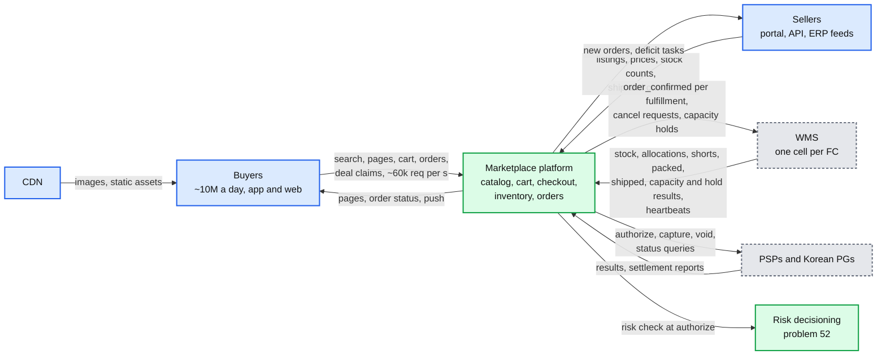

## D2. Data flow (DFD)

Inputs to outputs with format, size and rate at peak, from solution §2. Stores are cylinders, processes are rounded.

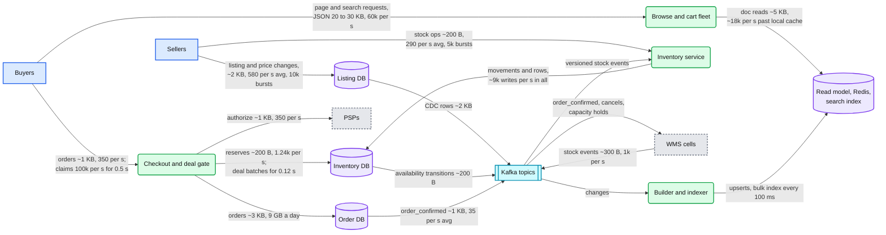

## D3. Component architecture

The final design, 15 nodes, the inventory DB in red for its hot SKU row: [solution §6](solution.md#6-final-design-and-the-six-core-flows). The cart is two boxes (a service and a KV store) and is drawn in [solution §4.3](solution.md#43-buyers-add-update-and-remove-cart-items-and-see-current-price-and-availability). Below, the order status and cancel path (FR5) that the final design folds into single boxes: status comes from the owners of the physical units, and so does released stock.

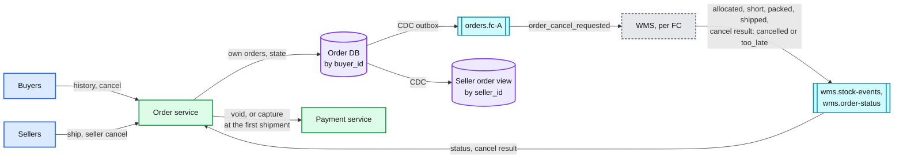


## D4. Happy paths, one per FR

**FR1, product page:** [solution §4.1](solution.md#41-buyers-search-and-open-a-product-page-with-offers-price-and-availability).

**FR2, seller count and WMS snapshot:** [solution §4.2](solution.md#42-sellers-register-listings-and-stock-and-warehouse-events-adjust-platform-held-stock).

**FR3, cart on two devices:** [solution §4.3](solution.md#43-buyers-add-update-and-remove-cart-items-and-see-current-price-and-availability).

**FR4, normal order:** [solution §4.4](solution.md#44-placing-an-order-reserves-stock-prices-it-authorizes-payment-and-confirms-it-safe-to-retry).

**FR4, flash deal setup (Flow 2, steps 1 and 6).** Capacity is booked with each FC before a unit is carved, so a deal never sells more than its FCs can ship that night. At close only capacity no claim can still use goes back; the rest follows when the last claim resolves.

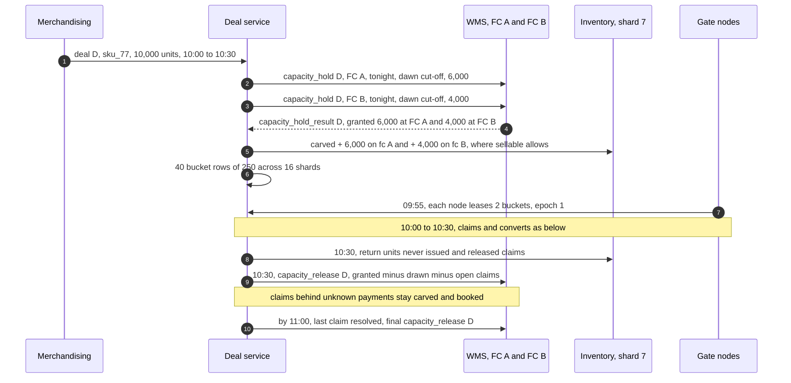

**FR4, a flash-sale claim to a confirmed order (Flow 2).** The claim is the reservation; the rest is the normal saga with the deal price bound to the token.

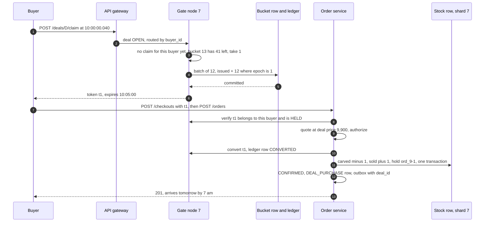

**FR5, cancel before shipment:** [solution §4.5](solution.md#45-buyers-see-order-status-and-history-and-cancel-before-shipment).

**FR5, a short pick and a re-source (Flow 6).** The WMS reports the short; commerce decides.

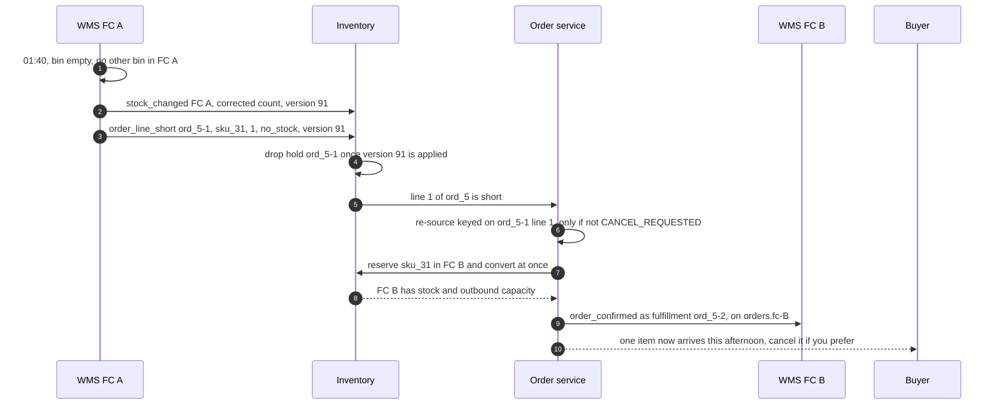

## D5. Failure paths

**PSP timeout and a second tap:** [solution §5.2](solution.md#52-the-payment-call-times-out-and-the-buyer-taps-again-how-do-you-avoid-a-double-charge-a-double-order-or-stock-stuck-in-a-reservation). **Inventory shard primary dies:** [solution §10.4](solution.md#104-failure-timeline).

**WMS events: the normal order, a replay, a duplicate.** The WMS writes `stock_changed vN` and `order_allocated vN` in one transaction, stock first. A hold leaves `sold` only once a snapshot at or after its allocation version is applied, so even a reversed pair could not over-count (solution §5.3).

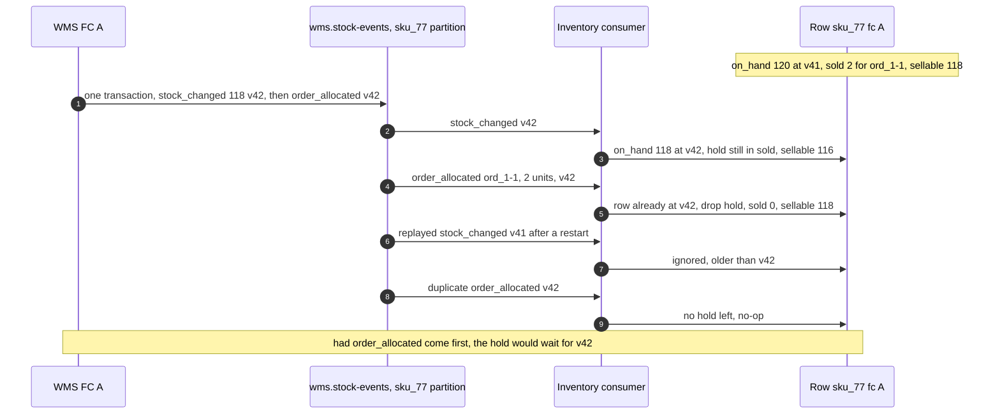

**A gate node dies mid-sale.** Its buckets pause for the 2 s lease plus a 1 s margin. Nothing it had not committed was ever issued, and nothing it committed is lost: the successor rebuilds the winners and hands back their tokens.

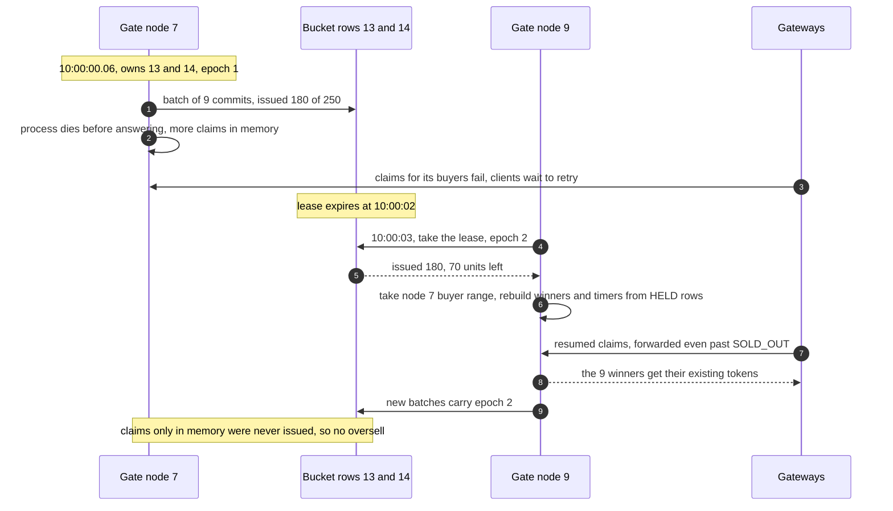

**A late authorization after the stock was released.** The 30-minute ceiling releases the stock; after it the resolver only reads by reference, and a later "yes" is voided (two-step card) or cancelled and refunded (one-step PG), never confirmed.

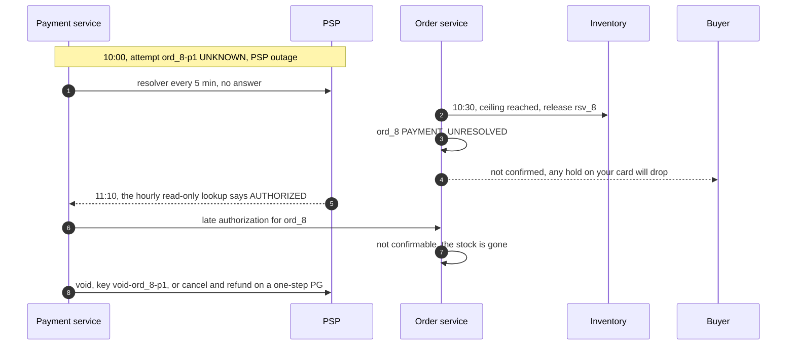

**The PSP slows to 10 s for 15 minutes.** Calls are cut at 3 s and become unknown, the breaker moves new orders, the resolver drains the unknowns at a capped rate.

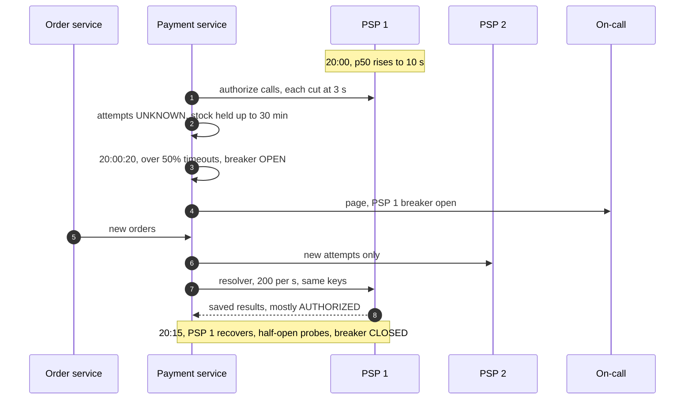


## D6. Activity / decision flow

**Truth at reserve:** [solution §5.4](solution.md#54-search-shows-in-stock-but-checkout-says-sold-out-how-fresh-is-availability-and-where-is-the-truth-checked). **What the buyer pays:** [solution §5.5](solution.md#55-the-price-or-a-coupon-changes-between-the-cart-and-checkout-what-does-the-buyer-see-and-pay).

**Pool pick at reserve.** Commerce picks the FC at reservation, per the shared contract. Capacity admission is a soft counter: each reservation takes a capacity token by a conditional, idempotent decrement on one of 8 tally shards for that FC and cut-off, keyed by its reservation id, and returns it with the reservation; a recount from live reservation and hold rows every 60 s repairs any crash drift. The worst overshoot is the reserves that race inside one decrement, tens of units, far under the FC's ~2% planning reserve. It skips an FC whose feed has been silent for over 30 s, or whose `fc_capacity` for the cut-off that meets the promise (dawn or next day), minus its open holds that carry no `deal_id` and its live reservations at that FC and cut-off, is under a 2% margin. Holds alone are not enough: in a 1,000-night simulation 151 nights missed the truck, because ~1.7k units sit in reservations at 12.5 units a second; with live reservations subtracted, none did. A hold's units keep counting until a capacity report at or above its `capacity_version` is applied; deal holds are covered by the deal's capacity hold. Capacity silent for 2 minutes in the last hour before a cut-off counts as 0, and a building whose heartbeat reports `floor_contact_age` over 2 minutes gets no dawn promises.

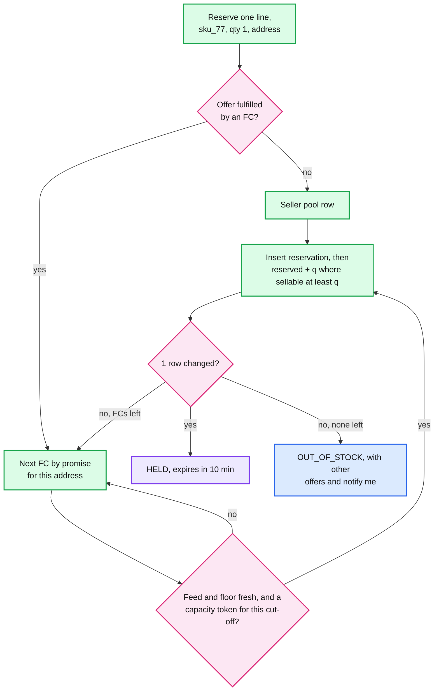

**A claim inside one gate node.** Claims are taken in memory, flushed every 5 ms as one fenced transaction, and answered only after it commits.

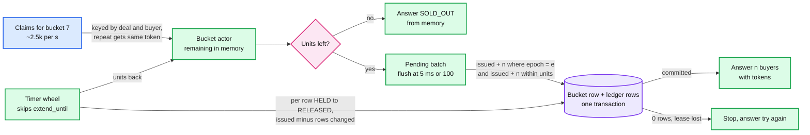


**The reservation sweeper.** Releases expired holds and loses races to confirm gracefully. A payment extension rewrites the indexed `expires_at`, so the sweeper never pages through extended rows; the alert is on the oldest overdue `HELD` row.

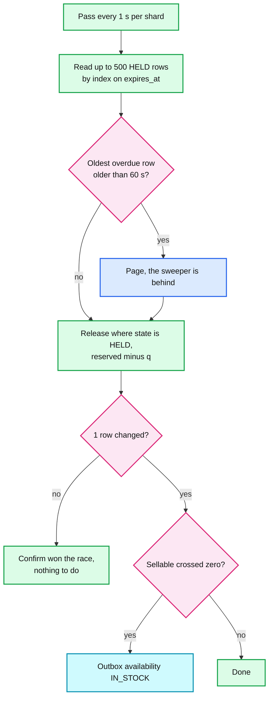

**The PSP call path (solution §5.6).** Browse reads only the read side. Checkout's PSP calls go through a capped pool with a breaker. The pool is red: it is what a slow PSP fills first, and its cap keeps it from filling anything else.

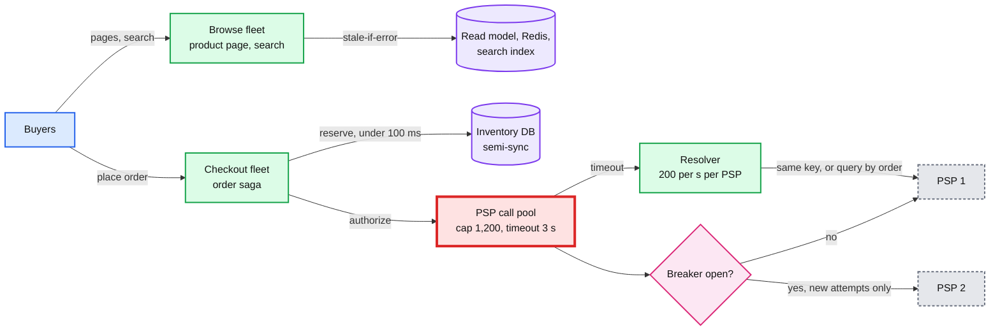


## D7. Entity relationship

Money-path entities with keys and TTLs, and the catalog and checkout entities around them: [solution §3.3](solution.md#33-data-model).

## D8. State machines

**Order.** The checkout states are one composite. After `CONFIRMED`, cancellation and shipment state are tracked per line and per fulfillment (an order can have one line packed at FC A while a re-sourced line is allocated at FC B), and the physical owner's events move them. The order is `CANCELLED` only when every line is; otherwise `PARTIALLY_CANCELLED`, and the first capture is smaller.

```mermaid
%% D8 order lifecycle. Checkout is the saga. After CONFIRMED, states are per line and fulfillment, moved by WMS or seller events. CANCELLED needs every line cancelled. A cancel is a request that the owner of the unit can refuse.
stateDiagram-v2
    direction LR
    [*] --> Checkout : POST /orders
    state Checkout {
        direction LR
        RESERVING --> PRICING : lines held
        PRICING --> AWAITING_BUYER : total went up
        AWAITING_BUYER --> PRICING : buyer accepts
        PRICING --> PAYING : coupon held
        PAYING --> PAYING : declined, new card
    }
    Checkout --> CONFIRMED : authorized, converted
    Checkout --> FAILED : stock, decline, expiry
    CONFIRMED --> ALLOCATED : order_allocated
    ALLOCATED --> PACKED : order_packed
    PACKED --> SHIPPED : order_shipped
    SHIPPED --> DELIVERED : carrier scan
    CONFIRMED --> CANCEL_REQUESTED : buyer cancels
    ALLOCATED --> CANCEL_REQUESTED : buyer cancels
    CANCEL_REQUESTED --> CANCELLED : every line, voided
    CANCEL_REQUESTED --> PARTIALLY_CANCELLED : some lines cancelled
    PARTIALLY_CANCELLED --> SHIPPED : rest ships, less captured
    CANCEL_REQUESTED --> PACKED : too_late, packed
    CANCEL_REQUESTED --> SHIPPED : too_late, shipped
    DELIVERED --> [*]
    CANCELLED --> [*]
    FAILED --> [*]
```

**Reservation, then WMS hold.** A reservation lives at most 10 minutes (5 for deals) unless a payment is unknown. A converted FC line becomes a hold per fulfillment, SKU and FC, counted in `sold` until the WMS's snapshot covers it.

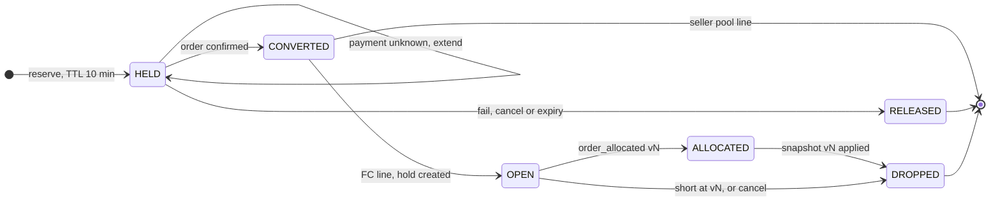

**Payment attempt.** `UNKNOWN` is a real state with an owner (the resolver), not a failure.

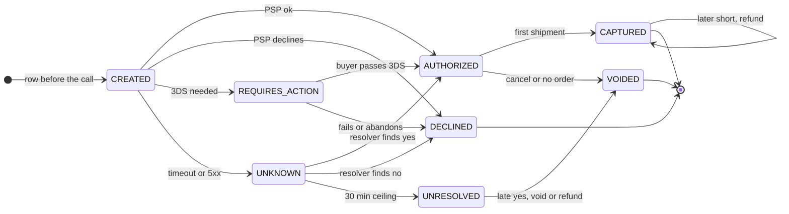

## D9. Deployment / topology

One region, three AZs. Each inventory and order shard has its primary in one AZ and semi-synchronous replicas in the other two; primaries are spread so one AZ holds about a third. FCs run their own WMS cells on site and reach Kafka over private links.

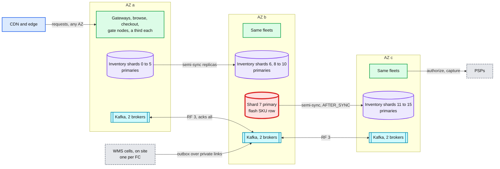

What crosses an AZ boundary: semi-sync replication (about one in-region round trip inside every commit, which is part of the ~1 ms lock window), Kafka replication, and requests to a shard primary in another AZ. Order DB shards, the read model, Redis and the search cluster are spread the same way and left out to stay under 15 nodes. Losing one AZ promotes a replica for about a third of the shards (~10 to 30 s each) and leaves two thirds of every fleet, which is sized N+1 per AZ.

## D10. Scaling / partitioning

16 inventory shards by `hash(sku_id)`, ~31M stock rows each, ~560 writes a second each at peak. The problem is one row, not one shard: a deal SKU without the gate asks one row for 100x to 300x what it can do.

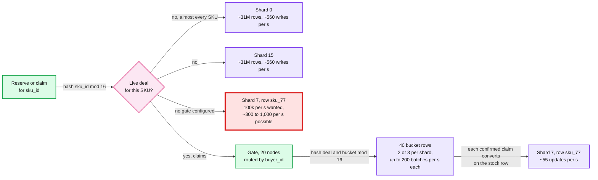

- Without the gate: `100k ÷ 300 to 1,000 = 100x to 300x` over on one row, and the shard's connection pool (64 per inventory node) fills with waiters, so a sixteenth of the catalog fails with it; the same-SKU batching guard (5 ms batches, at most 16 connections for one SKU) keeps the rest of shard 7 alive. With the gate: 40 bucket rows, each written by one owner at most 200 times a second.
- Why not shard finer to fix it: more shards spread SKUs, not one SKU. A single row is the unit of contention whatever the shard count.

## D11. Failure mode map

Component, what fails, blast radius, mitigation. Two trees to stay under 15 nodes. Matches solution §8.

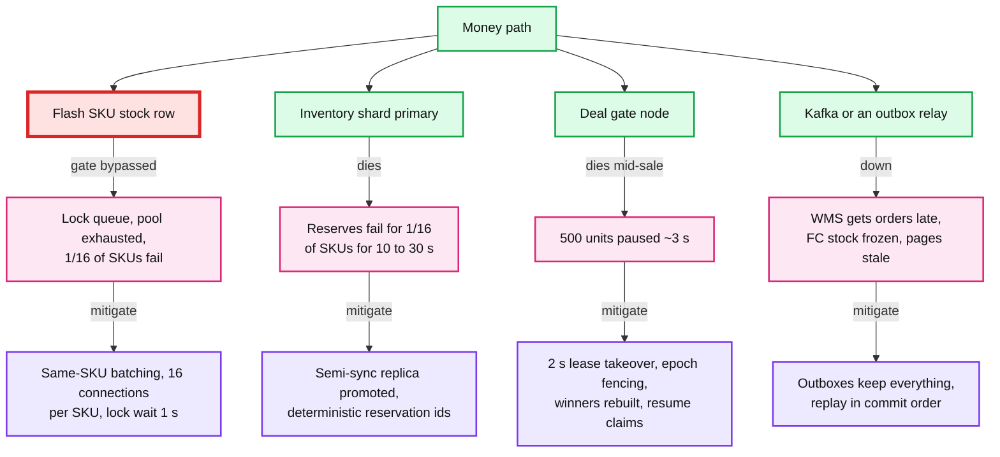

```mermaid
%% D11 tree 2: dependencies and our own deploys. The bad inventory deploy has the biggest blast radius: every SKU can oversell at once.
flowchart TD
    ROOT[Dependencies and change] --> PSP[PSP]
    ROOT --> WMS[WMS cell or its feed]
    ROOT --> SRCH[Search cluster]
    ROOT --> DEP[Inventory deploy]
    PSP -->|"10 s calls"| PSPB[Checkouts pending,<br/>browse untouched]
    PSPB -->|"mitigate"| PSPM[3 s timeout, UNKNOWN,<br/>breaker, second PSP]
    WMS -->|"no heartbeat for 30 s"| WMSB[FC stock frozen,<br/>short picks could rise]
    WMSB -->|"mitigate"| WMSM[Pool sells only beyond a margin,<br/>holds keep sold units out,<br/>reconcile per SKU and FC]
    SRCH -->|"degraded"| SRCHB[Search slow or partial,<br/>pages and checkout fine]
    SRCHB -->|"mitigate"| SRCHM[Result cache, category<br/>pages from the read model]
    DEP -->|"sellable computed wrong"| DEPB[Every SKU can oversell]
    DEPB -->|"mitigate"| DEPM[Canary by SKU hash,<br/>invariant checks, auto rollback]

    class ROOT,PSP,WMS,SRCH,DEP service
    class PSPB,WMSB,SRCHB,DEPB decision
    class PSPM,WMSM,SRCHM,DEPM store

    classDef service  fill:#dcfce7,stroke:#16a34a,stroke-width:2px,color:#111
    classDef store    fill:#ede9fe,stroke:#7c3aed,stroke-width:2px,color:#111
    classDef decision fill:#fce7f3,stroke:#db2777,stroke-width:2px,color:#111
```

## D12. Rollout / migration

From a monolith whose order transaction decrements `products.stock`, calls the PG inline and feeds search from a nightly batch. Each SKU has an owner flag with an `effective_from` a minute ahead, so every reservation has exactly one owner. Rollback at any inventory step is the flag; the movement ledger rebuilds the old column.

```mermaid
%% D12: migration phases with a rollback point after each. The read side moves first because it cannot oversell anything.
gantt
    title Monolith stock column to inventory service, saga and deal gate
    dateFormat YYYY-MM-DD
    axisFormat %b %d
    section Read side
    CDC into read model and search index           :a1, 2026-12-01, 21d
    Rollback point, pages back to the monolith     :milestone, m1, after a1, 0d
    section Inventory
    Inventory service in shadow, compare per minute :a2, after a1, 14d
    Owner flag on 1 percent of SKUs                :a3, after a2, 4d
    10 percent                                     :a4, after a3, 4d
    50 percent                                     :a5, after a4, 5d
    100 percent                                    :a6, after a5, 5d
    Rollback point per step, flag and ledger       :milestone, m2, after a6, 0d
    section Checkout
    Saga, attempts and keys for new orders only    :a7, after a6, 14d
    Rollback point, new orders to the old path     :milestone, m3, after a7, 0d
    section Deals and WMS
    Deal gate for new deals only                   :a8, after a7, 10d
    WMS contract, reconciliation, drop the column  :a9, after a8, 21d
```

Gates between steps: the shadow comparison shows zero sellable mismatches per SKU for 3 days, the invariant checker is clean, the reserve error rate is within 0.1 points of the monolith's, and no deal is scheduled during a switch.
