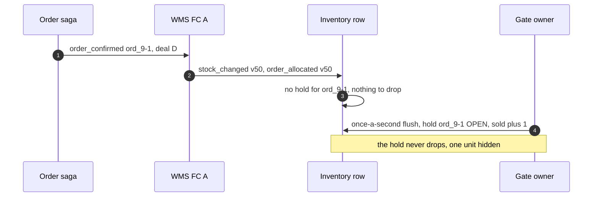

# Edge cases: E-commerce marketplace (catalog, cart, checkout, no overselling)

Every entry answerable in under 60 seconds out loud. Categories: failure, consistency, scale, data, operations, security / abuse. Design reference: [`solution.md`](solution.md). An answer bullet that starts with **Decision:** goes past what solution.md states or changes it; the deep dives carry the numbers and the simulations: [flash sale](deep-dives/flash-sale-and-hot-sku.md), [checkout saga](deep-dives/checkout-saga-and-payment-idempotency.md), [stock model](deep-dives/inventory-registration-and-stock-model.md), [catalog and search](deep-dives/catalog-search-and-read-scaling.md), [cart and pricing](deep-dives/cart-and-pricing.md). Acronyms: SKU (stock keeping unit), FC (fulfillment center), WMS (warehouse management system, problem 62), PSP (payment service provider), PG (payment gateway, the Korean term for a PSP), TTL (time to live), CDC (change data capture), AZ (availability zone), GC (garbage collection), ERP (a seller's enterprise resource planning system), SLO (service level objective), GDPR (EU General Data Protection Regulation), PII (personally identifiable information), KRW (Korean won).

---

## Failure

## Edge case: an inventory shard primary dies at the evening peak
- **Trigger:** host loss on shard 7's primary; ~40 reserves in flight; 1/16 of SKUs live there.
- **Symptom:** reserves for those SKUs fail with a retryable error for ~10 to 30 s; a failover event on the dashboard.
- **Answer:**
  - Semi-synchronous replication in `AFTER_SYNC` mode: every acknowledged reservation is on the promoted replica. Nothing acknowledged is lost.
  - The saga's re-driver retries the reserve with the same `reservation_id = hash(order_id, line)`. A duplicate-key error means it committed before the crash, and the existing row is returned.
  - Browse never reads the inventory primary, so pages and search do not notice. Pages only if the failover takes over 60 s.
- **Confidence:** [ ] shaky  [ ] ok  [ ] confident

## Edge case: a gate node dies mid-batch during a flash sale
- **Trigger:** gate node 7 crashes at 10:00:00.061 with one 5 ms batch committed but unanswered and another still in memory.
- **Symptom:** its buyers get connection resets; its 2 buckets stop issuing; the deal flag stays `OPEN`.
- **Answer:**
  - Nothing oversells: the bucket row enforces `issued + n <= units`; units in memory were never issued. In the seeded run, 517 units across the two failed nodes waited until the successor took over at 7.01 s.
  - The successor bumps `epoch`, reads `issued`, and rebuilds who won from the `HELD` ledger rows. It takes the dead node's whole buyer range, so nobody wins twice.
  - **Decision:** a client whose claim got no answer retries with `resume: true`, which gateways forward even past `SOLD_OUT`, and the owner hands back the existing token. Without it, 21 of 30 committed claims stayed hidden for 5 minutes.
  - **Decision:** during a live deal the lease is 2 s, renewed every 500 ms, 1 s margin: the pause drops from ~7 s to ~3 s.
- **Confidence:** [ ] shaky  [ ] ok  [ ] confident

## Edge case: a gate node freezes in a GC pause and wakes after losing its lease
- **Trigger:** an 8 s stop-the-world pause on gate node 12 with claims in memory.
- **Symptom:** two processes think they own buckets 23 and 24.
- **Answer:**
  - The old owner's batch carries the old `epoch`; the conditional update changes 0 rows and it answers "try again" (17 claims fenced in the seeded run).
  - Expiries are per ledger row (`HELD → RELEASED WHERE state = 'HELD'`, then `issued − rows changed`), also fenced, so a zombie cannot return a unit the successor converted.
  - Safety does not depend on clocks; only the takeover time does.
- **Confidence:** [ ] shaky  [ ] ok  [ ] confident

## Edge case: the PSP slows to 10 s for 15 minutes
- **Trigger:** the PSP's authorize p50 jumps from ~400 ms to 10 s at 20:00.
- **Symptom:** checkouts on that PSP show "confirming your payment"; `UNKNOWN` attempts climb.
- **Answer:**
  - One call, 3 s timeout: at 350 orders a second at most ~1,050 are in flight, under the 1,200 bulkhead. A timeout is `UNKNOWN`, never a quick retry; stock is held up to 30 minutes.
  - The breaker opens at over 50% timeouts in 20 s; new orders go to a second PSP as new attempts. Unknown attempts stay with the first PSP.
  - The resolver drains at 200 calls a second per PSP; browse never calls the money side, so pages do not slow.
  - **Decision:** a reservation's extension rewrites its indexed `expires_at`; otherwise ~1,100 extended rows per shard fill every sweeper page and real expiries wait 20 minutes.
- **Confidence:** [ ] shaky  [ ] ok  [ ] confident

## Edge case: the PSP processed the call, then went dark for 40 minutes
- **Trigger:** an outage on the PSP's answer path that outlasts the 30-minute ceiling.
- **Symptom:** at 10:30 the order becomes `PAYMENT_UNRESOLVED`; at 10:40 the PSP reports `AUTHORIZED`.
- **Answer:**
  - At the ceiling the stock is released and the buyer is told "not confirmed; any hold on your card will drop".
  - Before the ceiling the contract is per provider: a PSP with documented idempotency keys is re-sent the same key; a keyless PG (Toss's confirm) is never re-sent, only looked up by `orderId = ord_1-p1` and its `paymentKey`, and "not found" at the ceiling marks the attempt failed and releases the stock.
  - After the ceiling the resolver only **reads** by reference, hourly for 24 h. It never re-sends authorize: if the first call never arrived, a re-send would create a new charge.
  - A late approval is voided (two-step card) or cancelled and refunded (one-step Korean PG). The daily settlement match catches anything left.
  - In the seeded runs this happened in 27 of 210 keyed scenarios and 27 of 180 keyless ones, each ending voided or refunded, none confirmed against released stock. Re-sending to the keyless PG instead would have double-charged in 30.
- **Confidence:** [ ] shaky  [ ] ok  [ ] confident

## Edge case: the order service crashes between authorize and confirm
- **Trigger:** a process dies after the attempt row says `AUTHORIZED` and before the order is `CONFIRMED`.
- **Symptom:** an order stuck in `PAYING` with a live authorization.
- **Answer:**
  - The re-driver scans for non-terminal orders idle 30 s and runs the next step: convert (`WHERE state = 'HELD'`), then `CONFIRMED` plus the outbox row in one transaction.
  - A crash between the `CREATED` attempt row and the PSP call is treated as `UNKNOWN`. With a keyed PSP the resolver's re-send is then the first call; a keyless PG is only looked up, and the attempt fails at the 30-minute ceiling if the PG never heard it. The resolver scans the attempts table, not in-memory timers.
  - If a line was released meanwhile, the converted lines are undone and the authorization is voided before any outbox row exists.
- **Confidence:** [ ] shaky  [ ] ok  [ ] confident

## Edge case: Kafka or the order outbox relay stalls for 20 minutes
- **Trigger:** a stuck relay or a broker incident.
- **Symptom:** the WMS gets new orders late; WMS stock events stop; pages go stale.
- **Answer:**
  - Confirmed orders sit in the order DB's outbox and are published in commit order on recovery; the WMS is idempotent on `fulfillment_id`.
  - FC stock in commerce freezes. Heartbeats stop too, so after 30 s each FC pool sells only beyond `max(2, 5% of on_hand)` [estimate].
  - Pages at 30 s of consumer lag. The dawn cut-off is the real clock: orders that reach the WMS late can come back as `missed_cutoff`.
- **Confidence:** [ ] shaky  [ ] ok  [ ] confident

## Edge case: one FC's WMS feed goes silent
- **Trigger:** an FC's private link or WMS outbox fails; other FCs are fine.
- **Symptom:** no `stock_changed` and no heartbeat from FC A on any partition.
- **Answer:**
  - Each consumer judges staleness per (partition, FC). After 30 s, FC A's pools sell only beyond the safety margin; pool pick prefers other FCs.
  - Holds for orders already sent stay in `sold`, so confirmed units are never counted twice.
  - The heartbeat carries `floor_contact_age`, the seconds since the building's edge last reached its cloud cell. A building cut off from its cell can still look alive from the cloud, so commerce stops promising dawn from it once that age grows past a few minutes [estimate].
  - Pages at 60 s stale. On recovery, the versioned snapshot replaces `on_hand` and the reconciliation job compares at a version.
- **Confidence:** [ ] shaky  [ ] ok  [ ] confident

## Edge case: the search cluster is degraded during a sale
- **Trigger:** search data nodes near 100% CPU (they run at ~80% at a normal peak).
- **Symptom:** search p99 climbs; some queries time out.
- **Answer:**
  - The 30 s result cache serves head queries; category pages fall back to the read model's precomputed lists.
  - Product pages, cart and checkout do not depend on search.
  - The fix is capacity, before the sale: add replicas (read throughput scales with copies).
- **Confidence:** [ ] shaky  [ ] ok  [ ] confident

---

## Consistency

## Edge case: a seller sets stock to 50 while three checkouts reserve
- **Trigger:** README probe 3. Row `(sku_77, seller:s9)`: 40 on hand, 5 sold.
- **Symptom:** none, if the row is designed right.
- **Answer:**
  - The seller writes `on_hand`; checkouts write `reserved` and `sold`. Each is one conditional statement; the row lock orders them; no writer reads then writes back.
  - Result: 50 on hand, 5 sold, 3 reserved, sellable 42, whatever the order of the four statements.
  - Portal edits use `count_version`, which reservations do not bump, so no spurious `412`.
- **Confidence:** [ ] shaky  [ ] ok  [ ] confident

## Edge case: a seller's count was taken before a shipment and arrives after it
- **Trigger:** ERP counts 50 at 09:58, ships 2 at 09:59, receives 25 at 10:02, and the feed lands at 10:05. Another count from 06:00 arrives at 10:06.
- **Symptom:** a plain "set 50" puts the 2 shipped units back on sale and drops the 25 received.
- **Answer:**
  - **Decision:** `on_hand = qty + every SHIP and ADJUST recorded after counted_at` = 50 − 2 + 25 = 73. Not just "minus shipments": that hides receipts.
  - **Decision:** a count older than the last applied one is acknowledged and ignored; `counted_at` in our future (over 1 minute) or older than 24 h is rejected.
  - Seeded 30 days on one busy SKU: plain set 83 oversold; minus shipments 88 lost sales; full rule 17 oversold (floor 14 from unrecorded loss) and 11 lost sales.
- **Confidence:** [ ] shaky  [ ] ok  [ ] confident

## Edge case: `order_allocated` arrives before its `stock_changed`, or twice
- **Trigger:** a consumer replays an old offset, or a topic migration reorders a pair the WMS wrote stock first.
- **Symptom:** without care, the hold is dropped while `on_hand` still counts the allocated units: 2 oversellable.
- **Answer:**
  - Holds are per `(fulfillment_id, sku_id, fc_id)`. A hold leaves `sold` only when `order_allocated vN` has arrived **and** the row has applied a snapshot at or above vN.
  - A replayed older `stock_changed` is ignored by version; a duplicate `order_allocated` finds no hold.
  - Under-count for milliseconds is the accepted side; over-count never.
- **Confidence:** [ ] shaky  [ ] ok  [ ] confident

## Edge case: a deal order's hold row is written after the WMS already allocated it
- **Trigger:** deal converts move counts to the stock row once a second per bucket, while the WMS allocates within its next 1 s lane batch.
- **Symptom:** `order_allocated` finds no hold, the hold created later never drops, and the unit stays out of sale.
- **Answer:**
  - Seeded run of 10k deal orders: ~30% of units hidden after the sale.
  - **Decision:** the convert writes `carved − 1`, `sold + 1` and the hold row in one transaction on the stock row's shard, before the order is `CONFIRMED`. ~55 writes a second at the checkout wave, far under the row's ceiling.
  - Alert on holds `OPEN` for over 10 minutes; the reconciliation job lists them.
- **Diagram:**

- **Confidence:** [ ] shaky  [ ] ok  [ ] confident

## Edge case: the buyer cancels while FC A is picking
- **Trigger:** `POST /orders/ord_1/cancel` at 01:20; the unit is in a tote.
- **Symptom:** a cancel request and a pick race in the WMS.
- **Answer:**
  - Commerce never releases an FC unit itself: it sends `order_cancel_requested` and waits for `order_cancel_result`.
  - `cancelled`: the WMS's release snapshot returns the unit; commerce drops the hold if still `OPEN`, safe in any order against the stock events. Then void, but only if every line of the order is now cancelled; otherwise the order is `PARTIALLY_CANCELLED` and the first capture is smaller (after a capture, a partial refund; on a one-step PG, a partial cancel).
  - `too_late` (packed or shipped): the order stays live; the buyer is offered a return.
  - **Decision:** cancels are per fulfillment and per line (`order_cancel_requested(order_id, fulfillment_id, lines)`), so declining one late line does not cancel the whole fulfillment.
- **Confidence:** [ ] shaky  [ ] ok  [ ] confident

## Edge case: a short pick at FC A, then a missed cut-off
- **Trigger:** 01:40, the bin is empty and no other bin in FC A has the SKU.
- **Symptom:** `order_line_short(ord_5, ord_5-1, sku_31, FC A, 1, no_stock)`.
- **Answer:**
  - Commerce re-sources with a normal reserve and convert in FC B (stock and capacity left) and sends fulfillment `ord_5-2`; the buyer gets the new promise and may cancel the line.
  - No FC has it: cancel the line; the rest ships; the money is a smaller capture or a refund (see the split-shipment entry below).
  - `missed_cutoff`: the WMS keeps the allocation for the next cut-off and commerce moves the promise. If another FC must keep the original promise, commerce first sends a line-level cancel to FC A and sends `ord_5-2` only after `order_cancel_result(cancelled)` for that line; otherwise both FCs ship.
  - **Decision:** `order_line_short` carries the `stock_version` it was decided at, written after any `stock_changed` in the same transaction; an `OPEN` hold drops only once that snapshot is applied.
- **Confidence:** [ ] shaky  [ ] ok  [ ] confident

## Edge case: the buyer cancels while commerce is re-sourcing a short line
- **Trigger:** 01:41, `order_line_short` for `ord_5-1` arrives; in the same second the buyer taps cancel on `ord_5`, and commerce is about to send `ord_5-2` to FC B.
- **Symptom:** without care, FC B ships a re-sourced line of a cancelled order, or the cancel reaches FC B before `ord_5-2` and finds nothing to cancel.
- **Answer:**
  - The re-source is written only in a transaction that checks the order is not `CANCEL_REQUESTED`: the conditional order update and the `ord_5-2` outbox row commit together. Cancel first: no `-2` is ever written. Re-source first: the cancel names `ord_5-2` as well.
  - Both rows leave through the same outbox, in commit order, keyed by `order_id`. As a backstop, the WMS keeps a 7-day tombstone when a cancel names a fulfillment it has not seen, and refuses that fulfillment if it arrives later.
  - The void or refund waits for an `order_cancel_result` from every fulfillment the cancel named.
- **Confidence:** [ ] shaky  [ ] ok  [ ] confident

## Edge case: the same short arrives twice
- **Trigger:** the WMS outbox relay restarts and re-publishes `order_line_short(ord_5, ord_5-1, sku_31, FC A, 1, no_stock, v91)`.
- **Symptom:** a naive handler re-sources again and FC B gets `ord_5-3`: two units ship for one line.
- **Answer:**
  - A re-source is keyed on (source `fulfillment_id`, line): `(ord_5-1, line 1)` maps to exactly one new fulfillment, `ord_5-2`, by a unique index on the order's shard. The duplicate finds it and is a no-op.
  - The hold side is idempotent too: the hold left `sold` once v91 was applied, so the duplicate finds nothing to drop.
  - FC B's intake is idempotent on `fulfillment_id`, so even a re-sent `ord_5-2` is one fulfillment.
- **Confidence:** [ ] shaky  [ ] ok  [ ] confident

## Edge case: the buyer taps "Place order" again while the payment is unknown
- **Trigger:** a 3 s timeout, `202 PAYMENT_PENDING`, and an impatient thumb.
- **Symptom:** a second `POST /orders` with the same `Idempotency-Key: co_1`.
- **Answer:**
  - The unique `(buyer_id, checkout_id)` returns `ord_1`; the attempt `ord_1-p1` is live, so no attempt `p2` is created (a partial unique index would refuse it anyway).
  - The app restores the open `checkout_id` after a restart, so a crash does not mint a new key.
  - **Decision:** `POST /checkouts` returns the buyer's open checkout for the same cart version instead of a new one, so two devices do not create two orders by accident.
- **Confidence:** [ ] shaky  [ ] ok  [ ] confident

## Edge case: one buyer, two phones, one flash deal
- **Trigger:** both devices tap within 30 ms; each sends its own `Idempotency-Key`.
- **Symptom:** two claims for a "1 per buyer" deal.
- **Answer:**
  - Gateways route by `hash(buyer_id)`, so both reach one gate node, which keys claims by `(deal_id, buyer_id)`; the second joins the first and gets the same token.
  - Keyed by the header instead, 398 two-device buyers won two units in the seeded run.
  - The durable backstop is a unique `(buyer_id, deal_id)` row written at confirm; a second claim can never confirm and expires in 5 minutes.
- **Confidence:** [ ] shaky  [ ] ok  [ ] confident

## Edge case: search shows "in stock", the reserve says no
- **Trigger:** the last unit sold 0.5 s before the buyer tapped a search result.
- **Symptom:** `409 OUT_OF_STOCK` at place order, or a flagged line on the checkout page.
- **Answer:**
  - Search is a hint ~2.3 s p99 behind; the checkout page's soft check on replicas catches most; the reserve on the primary is the truth.
  - The "no" offers another seller's offer for the same SKU, another FC with a later promise, or "notify me".
  - Measured: reserve failures for SKUs shown in stock in the last 5 s, target under 0.5% outside deals [estimate].
- **Confidence:** [ ] shaky  [ ] ok  [ ] confident

## Edge case: index writes for one SKU land out of order
- **Trigger:** a bulk request fails and is retried 15 s later, after a newer transition for the same SKU.
- **Symptom:** search says `IN_STOCK` for a SKU that is out, until the next change.
- **Answer:**
  - **Decision:** transitions are computed per SKU across its pools and carry a per-SKU `avail_version`. Ordering by the changed stock row's version is worse than nothing: wrong 34.5% of the time in the seeded run, versus 0.007%.
  - Each document field keeps its own version (prices from listing changes, stock from availability); the index applies a scripted update that is a no-op for an older version.
- **Confidence:** [ ] shaky  [ ] ok  [ ] confident

## Edge case: the cache is refilled with an older product document
- **Trigger:** a reader's miss fetches the old document, the builder upserts and deletes the key, then the reader writes the old document back with a 60 s TTL.
- **Symptom:** a hot product shows an old price or stock bucket for up to a minute.
- **Answer:**
  - Seeded hour on a hot product: stale beyond 1 s for 1% to 4% of the hour with delete-on-update.
  - **Decision:** the builder writes the new document itself, and every Redis write is a compare-and-set on the document version. Stale time: 0.
- **Confidence:** [ ] shaky  [ ] ok  [ ] confident

## Edge case: the price or a coupon changes between cart and checkout
- **Trigger:** a seller's repricing tool changes a line while the buyer is on the checkout page.
- **Symptom:** the current total differs from the quote.
- **Answer:**
  - Inside the 10-minute quote, the buyer pays the lower of the two totals, coupons re-evaluated. After it, a higher total returns `409 QUOTE_CHANGED`; the order waits with stock held.
  - Coupon budget gone at place order: `409` with the new total. A deal line pays the price on its token.
  - Seeded 200k checkouts: 9.3% bounce with "409 on any change", 0.9% with the quote; sellers honour ~KRW 36 an order.
- **Confidence:** [ ] shaky  [ ] ok  [ ] confident

## Edge case: a multi-line order where one line was released during payment
- **Trigger:** line 2's reservation expired, or a seller count cut it, while the PSP was answering.
- **Symptom:** line 1 converts, line 2's convert finds `RELEASED`.
- **Answer:**
  - All lines or none: line 1 goes `CONVERTED → RELEASED` (`sold − q`), the authorization is voided, and the buyer hears "sold out, not charged".
  - This happens before the outbox row, so the WMS never sees the order.
  - Convert re-checks the shelf with the carve included: `on_hand − sold − carved >= q`.
- **Confidence:** [ ] shaky  [ ] ok  [ ] confident

## Edge case: two-step card versus one-step Korean PG on a split shipment
- **Trigger:** a two-line order: one line from FC A ships at dawn, one from seller `s9` ships two days later.
- **Symptom:** "capture at shipment" means two captures on one authorization; on a one-step PG the money already moved at approval.
- **Answer:**
  - **Decision:** capture once, at the first shipment, for the order total minus lines already short or cancelled; later shorts and cancels are partial refunds. Capture per shipment only where the PSP supports several partial captures [check per PSP].
  - One-step PG: every later change is a partial cancel (refund) with the PG's cancel idempotency key.
  - Coupons are spread over lines by largest remainder, so a refunded line's amount is exact (rounding each line misses the total on ~35% of orders).
- **Confidence:** [ ] shaky  [ ] ok  [ ] confident

---

## Scale

## Edge case: the 10:00 flash sale, 1M buyers, 10k units
- **Trigger:** ~100k taps a second on one SKU.
- **Symptom:** without the gate, one stock row at 100x to 300x its ~330 to 1,000 updates a second, and a sixteenth of the catalog timing out with it.
- **Answer:**
  - 40 buckets of 250 on 20 gate nodes, 5 ms batches, `issued + n <= units` in the database, losers answered by gateways from a polled flag.
  - Seeded run: last unit at 0.12 s, ~32k of 1M taps reach a gate node, 0 oversold.
  - The stock row sees 2 writes at setup and ~55 a second at the checkout wave.
  - The product page refreshed by every waiting buyer is one hot Redis key; the 1 s local cache absorbs it (one read per browse node a second, single flight), and the deal's state comes from the gateway's flag, not from the document.
- **Confidence:** [ ] shaky  [ ] ok  [ ] confident

## Edge case: a SKU goes viral without a deal
- **Trigger:** a TV mention sends 5k reserves a second to one regular SKU.
- **Symptom:** lock waits on one row; shard 7's connection pool fills.
- **Answer:**
  - Same-SKU batching kicks in: one inventory node per hot SKU, 5 ms windows (200 transactions a second, under the row's ~300 to 1,000 ceiling), one transaction per batch (`min(n, sellable)` granted in order), per-SKU queue cap 2,000, at most 16 connections per SKU.
  - `innodb_lock_wait_timeout` 1 s, so waiters fail fast instead of pinning connections for 50 s.
  - If it lasts, operations turn it into a deal (carve and gate) for the next restock.
- **Confidence:** [ ] shaky  [ ] ok  [ ] confident

## Edge case: 10x traffic next year
- **Trigger:** 30M orders a day, 600k reads a second, 100k-unit deals.
- **Symptom:** search and the PSP contract rate run out first.
- **Answer:**
  - Inventory shards 16 to 64 (same key); deals 400 buckets over 64 shards; gate nodes scale with buckets.
  - Search and the read model scale horizontally; search needs ~10x the copies.
  - The PSP becomes the constraint: two PSPs active, routed by card brand.
- **Confidence:** [ ] shaky  [ ] ok  [ ] confident

## Edge case: a 100k-line ERP feed lands at 09:00
- **Trigger:** hourly stock feeds from large sellers, ~5k lines a second in a burst.
- **Symptom:** inventory write rate jumps on every shard.
- **Answer:**
  - The feed is split by shard and applied in transactions of 500 lines, so it never queues on one shard's locks (~1.5k a second on a shard at most).
  - Each line is idempotent by `request_id`; a re-uploaded feed returns the first results.
  - Feed lines never touch `reserved` or `sold`, so buyers are not blocked.
- **Confidence:** [ ] shaky  [ ] ok  [ ] confident

## Edge case: the resolver itself becomes a storm after an outage
- **Trigger:** thousands of `UNKNOWN` attempts, each with ~10 asks in 30 minutes.
- **Symptom:** status calls could hit the recovering PSP at thousands a second.
- **Answer:**
  - The resolver is capped at 200 calls a second per PSP and backs off while the breaker is open.
  - The bulkhead bounds how many unknowns exist: at most ~350 a second for the ~20 s before the breaker opens, ~7k. At 200 a second the first pass takes ~35 s.
  - Where the PSP has a batch report, one file replaces thousands of lookups.
- **Confidence:** [ ] shaky  [ ] ok  [ ] confident

---

## Data

## Edge case: the product document needs a new field
- **Trigger:** a new delivery-promise field for every product page.
- **Symptom:** 200M documents to rebuild and a 750 GB index to reindex.
- **Answer:**
  - Build a new read model and index from a snapshot, then replay `listing-changes` and `availability` from the snapshot's offsets, then swap the alias.
  - Per-field versions make the replay overlap harmless.
  - Bulk at `refresh_interval` 30 s during the rebuild; pages keep serving the old index.
- **Confidence:** [ ] shaky  [ ] ok  [ ] confident

## Edge case: the WMS database fails over and loses its last versions
- **Trigger:** a promoted WMS replica, in region or in the DR region, missed the last few `stock_version`s.
- **Symptom:** it could re-issue version 43 with a different `available_qty`.
- **Answer:**
  - `stock_version = (epoch << 31) | counter`, with `epoch = max(db_epoch + 1, promotion unix seconds)`. A promoted replica, even a DR replica that missed an earlier in-region failover, starts above every epoch commerce has applied. An alert fires when the DR replica's timeline differs from the primary's.
  - Commerce applies a snapshot only if newer, so the new epoch's first snapshot replaces whatever came before.
  - The reconciliation job compares at a version per (SKU, FC) and alerts on drift over 0.5% of pairs.
- **Confidence:** [ ] shaky  [ ] ok  [ ] confident

## Edge case: reconciliation finds commerce and the WMS disagree
- **Trigger:** the periodic job finds `(sku_31, FC A)` 3 units apart at the same version.
- **Symptom:** drift on the dashboard; possibly short picks or hidden stock.
- **Answer:**
  - The WMS is the truth for physical stock: commerce takes its snapshot; holds are re-derived from open fulfillments.
  - The cause is classified. A stuck hold or a lost event is a system fault: system-caused oversell has a target of 0 and any occurrence pages. Count drift (damage, miscount) goes to its own budget, owned with the WMS team.
  - Holds `OPEN` for over 10 minutes are their own alert: they hide stock silently.
- **Confidence:** [ ] shaky  [ ] ok  [ ] confident

## Edge case: a buyer asks for their data to be deleted
- **Trigger:** a deletion request under Korean privacy law or GDPR.
- **Symptom:** orders are financial records with a legal retention period.
- **Answer:**
  - Personal fields (name, address, phone) are tokenized in the order DB; deleting the token vault entry erases them and keeps amounts and items.
  - The cart document and search history are deleted outright.
  - Logs and the movement ledger carry ids only, never PII.
- **Confidence:** [ ] shaky  [ ] ok  [ ] confident

## Edge case: three years of orders and stock movements
- **Trigger:** 3.3 TB of orders a year, ~50M movement rows a day.
- **Symptom:** hot tables grow without bound.
- **Answer:**
  - Movements: 90 days hot, then archived to object storage, partitioned by day. Reservations: 7 days hot.
  - Orders: 2 years hot on 8 shards (~10 TB with replicas), then archived; history reads for old orders go to the archive.
  - The `request_id` dedup window is 90 days, matching the movement retention.
- **Confidence:** [ ] shaky  [ ] ok  [ ] confident

---

## Operations

## Edge case: what pages at 3 am
- **Trigger:** any of the alerts below.
- **Symptom:** a page to the owning on-call.
- **Answer:**
  - Inventory: any system-caused oversell (target 0); reserve errors other than out of stock over 1% for 5 minutes; any invariant violation (`sellable < 0` without a seller deficit, `sum(HELD) ≠ reserved`); holds `OPEN` over 10 minutes; a gate lease lost during a live deal.
  - Payments: `UNKNOWN` attempts over 500, or any older than 10 minutes; a PSP breaker open.
  - Orders and catalog: outbox or `wms.stock-events` lag over 30 s; any FC heartbeat stale for 60 s; reconciliation drift over 0.5% of (SKU, FC) pairs.
  - Not a page: one seller's deficit, one SKU selling out.
- **Confidence:** [ ] shaky  [ ] ok  [ ] confident

## Edge case: an inventory deploy computes sellable wrong
- **Trigger:** a release forgets `carved` in one code path.
- **Symptom:** every SKU can oversell at once: the biggest blast radius in the system.
- **Answer:**
  - Canary by SKU hash (1%), gated on the invariant checker staying clean for 30 minutes, then 10%, 50%, all. Never during a scheduled deal.
  - Any invariant failure rolls back automatically.
  - Repair: the movement ledger and reservation rows rebuild `on_hand`, `reserved` and `sold`; FC pools re-sync from the WMS's latest snapshot.
- **Confidence:** [ ] shaky  [ ] ok  [ ] confident

## Edge case: migrating from a monolith's `products.stock` column
- **Trigger:** today the order transaction decrements a column and calls the PG inline.
- **Symptom:** two writers of truth during the move.
- **Answer:**
  - Read side first (CDC into the read model and index), then the inventory service in shadow with a per-minute comparison.
  - An owner flag per SKU with `effective_from` a minute ahead moves SKUs 1% → 10% → 50% → 100%; each reservation has exactly one owner. Rollback is the flag; the ledger rebuilds the old column.
  - Then the saga for new orders only, the deal gate for new deals only, then the WMS contract.
- **Confidence:** [ ] shaky  [ ] ok  [ ] confident

## Edge case: a deal ends while some winners' payments are unknown
- **Trigger:** deal end at 10:30; 200 claims sit behind `UNKNOWN` payments [estimate].
- **Symptom:** handing those units back to the regular pool means a late approval has nothing to convert.
- **Answer:**
  - **Decision:** deal end returns only units never issued plus released claims; claims behind an unknown payment stay carved until they convert or are released, one by one.
  - The saga's `extend_until` reaches the bucket owner, whose timer wheel skips the claim until then. Otherwise 140 of those 200 would be sold twice if 70% authorize late.
  - The capacity hold follows the same rule: `capacity_release` at 10:30 returns only `granted − drawn − (issued claims not yet terminal)`, so the 200 open claims keep their capacity. A second, final `capacity_release` goes out when the last of them resolves, by 11:00 at the latest. Only after that final release does a late deal fulfillment count against regular capacity.
- **Confidence:** [ ] shaky  [ ] ok  [ ] confident

## Edge case: FC A runs out of dawn capacity at 23:30
- **Trigger:** `remaining_outbound_units` for the dawn cut-off approaches zero.
- **Symptom:** orders accepted for dawn that the FC cannot ship by the truck.
- **Answer:**
  - Pool pick takes `remaining_outbound_units` for the promise's cut-off and subtracts our open holds **and our live reservations** at that FC and cut-off (deal holds excluded: the grant covers them). An order picks its FC at reservation and confirms minutes later, so at ~12.5 units a second ~1.7k units are in flight; a 2% margin does not cover that. Problem 62's 1,000-night run: holds only, 151 nights miss the truck; with live reservations, none ([cut-off and capacity](../warehouse-management/deep-dives/cutoff-and-capacity.md)).
  - A hold stays subtracted until an `fc_capacity` whose version covers its allocation (the `capacity_version` on `order_allocated`), closing the up-to-60 s publish gap.
  - Stale counts as full: an `fc_capacity` with no update for 2 minutes inside the last hour before a cut-off is treated as 0 for that cut-off.
  - The WMS's backstop is `missed_cutoff`: the allocation is kept for the next cut-off and the buyer gets the new date.
- **Confidence:** [ ] shaky  [ ] ok  [ ] confident

---

## Security / abuse

## Edge case: bots in a flash sale
- **Trigger:** scripted accounts tapping `claim` at 10:00:00.000.
- **Symptom:** units go to resellers; gate traffic spikes.
- **Answer:**
  - A claim needs an account older than 7 days with a verified phone [our policy], at most 5 claim calls a second per account and per device at the gateway, and 1 unit per buyer durably.
  - Unpaid claims count against the buyer's next deals; an optional challenge on the claim endpoint for the first 10 s.
  - Bots cannot oversell: the bucket rows bound the units whatever the traffic.
- **Confidence:** [ ] shaky  [ ] ok  [ ] confident

## Edge case: a client sends its own price
- **Trigger:** a tampered app adds `amount` to `POST /orders`.
- **Symptom:** an attempt to pay less than the quote.
- **Answer:**
  - The client sends `checkout_id` and `quote_id`, never an amount. The authorized amount is the server-side quote snapshot on the order row.
  - The PSP call carries that amount and our reference; a mismatch at settlement is an alert.
- **Confidence:** [ ] shaky  [ ] ok  [ ] confident

## Edge case: hoarding reservations and farming coupons
- **Trigger:** one person opens many checkouts, or many accounts, to hold stock or reuse a coupon.
- **Symptom:** stock locked by checkouts that never pay; a coupon budget drained.
- **Answer:**
  - At most 5 open reservations per buyer [our policy], 10-minute TTLs, 5 for deals.
  - A durable `COUPON_HOLD` row per checkout, unique on `(coupon_id, buyer_id)` while not `RELEASED`, written with the budget decrement in one transaction on the coupon's pricing shard; a sweeper releases holds whose checkout has ended. Device and payment-instrument linking against multi-accounting.
- **Confidence:** [ ] shaky  [ ] ok  [ ] confident

## Edge case: a seller writes another seller's stock, or sends a hostile feed
- **Trigger:** a compromised seller token; a feed with negative counts or `counted_at` far in the future.
- **Symptom:** another seller's pool changes, or a count that can never be overridden.
- **Answer:**
  - OAuth client credentials are scoped to the seller's offers; the inventory service checks the pool's owner on every operation.
  - Counts must be non-negative, `counted_at` no more than 1 minute in our future and no older than 24 h. A future `counted_at` would otherwise win "newest count" forever.
  - Price drops over 50% wait 10 minutes in review.
- **Confidence:** [ ] shaky  [ ] ok  [ ] confident

## Edge case: scrapers read stock levels
- **Trigger:** a competitor polls product pages to track sales velocity.
- **Symptom:** exact inventory leaks.
- **Answer:**
  - The read side carries buckets (`IN_STOCK`, `LOW` 1 to 5, `OUT`), never counts.
  - Search and pages are rate-limited per client and per IP range; the CDN absorbs anonymous load.
- **Confidence:** [ ] shaky  [ ] ok  [ ] confident
