# HLD: E-commerce marketplace (catalog, cart, checkout, no overselling)

> One-line answer: split the read world from the money world. Catalog, search and product pages are a **read model** built from change events, cached hard and allowed to be 1 to 3 seconds stale. The truth about stock lives in one place: an **inventory service** that keeps `on_hand`, `reserved`, `sold` and `carved` per SKU (stock keeping unit) per **stock pool** (a seller, or a fulfillment center), sharded by `sku_id`, and changes them only with conditional single-row updates in the same local transaction as the reservation row. Checkout is a **saga** keyed by one idempotency key per order attempt (`checkout_id`): reserve with a 10-minute TTL (time to live), honor the buyer's 10-minute price **quote**, write the payment attempt row before calling the PSP (payment service provider), authorize, then convert the reservation and confirm the order with an outbox event to the warehouse. A PSP timeout is an **unknown outcome**, not a failure: the stock stays held while a resolver asks again with the same key. A flash sale (10k units, ~100k taps a second) is a **rejection** problem, not a write problem: the deal's units are carved into 40 buckets of 250, each owned by one gate node that issues units from memory and commits them in 5 ms batches, and once the buckets are empty the API gateway answers "sold out" without touching any database. Search availability is a hint; the only check that counts is the conditional update at reserve. The thing that breaks first is the **flash-sale SKU's stock row**: one row takes ~300 to 1,000 conditional updates a second, and the sale brings 100k.

Sources: the problem statement and requirements in [`README.md`](README.md) (reported at Coupang, Hello Interview community board); the agent survey [`research/facts-survey.md`](research/facts-survey.md). Primary pages behind the numbers that carry the design: Coupang's [Q4 2025 earnings release](https://s206.q4cdn.com/919117365/files/doc_financials/2025/q4/2025-Q4_Earnings-Release_Final.pdf) and its 2022 engineering post [Our backend strategy to handle massive traffic](https://medium.com/coupang-engineering/our-backend-strategy-to-handle-massive-traffic-d30cd6cc4fb2); Alibaba Cloud's [How to process hot spot data in e-commerce scenarios](https://www.alibabacloud.com/blog/how-to-process-hot-spot-data-in-e-commerce-scenarios_596491) and [Flash sales optimization on PostgreSQL](https://www.alibabacloud.com/blog/double-eleven-technology-series-flash-sales-optimization-on-postgresql_594096); AWS [DynamoDB partition key design](https://docs.aws.amazon.com/amazondynamodb/latest/developerguide/bp-partition-key-design.html); Stripe's [idempotent requests](https://docs.stripe.com/api/idempotent_requests), [PaymentIntents](https://docs.stripe.com/payments/payment-intents) and [place a hold on a payment method](https://docs.stripe.com/payments/place-a-hold-on-a-payment-method); the [Toss Payments API reference](https://docs.tosspayments.com/reference); Elasticsearch [index settings](https://www.elastic.co/guide/en/elasticsearch/reference/current/index-modules.html); the [Dynamo paper](https://www.allthingsdistributed.com/files/amazon-dynamo-sosp2007.pdf); Shopify's [BFCM readiness 2025](https://shopify.engineering/bfcm-readiness-2025). Coupang publishes no order count, listing count or checkout design, so those numbers are `[estimate]`. Reusable blocks: [`../../concepts/distributed-transactions.md`](../../concepts/distributed-transactions.md), [`../../concepts/exactly-once.md`](../../concepts/exactly-once.md), [`../../concepts/caching-patterns.md`](../../concepts/caching-patterns.md), [`../../concepts/sharding.md`](../../concepts/sharding.md), [`../../concepts/leases-fencing-clocks.md`](../../concepts/leases-fencing-clocks.md), [`../../concepts/rate-limiting-and-load-shedding.md`](../../concepts/rate-limiting-and-load-shedding.md), [`../../concepts/mvcc-and-isolation.md`](../../concepts/mvcc-and-isolation.md), [`../../concepts/stream-processing.md`](../../concepts/stream-processing.md). Related problems: [`../ticket-booking/`](../ticket-booking/) (the last-room conditional update), [`../payments-ledger/`](../payments-ledger/) (attempt ids, unknown outcomes), [`../payments-risk-decisioning/`](../payments-risk-decisioning/) (inline risk at authorize), [`../warehouse-management/`](../warehouse-management/) (problem 62, physical stock), [`../webhook-delivery/`](../webhook-delivery/) (seller order notifications), [`../cdc-pipeline/`](../cdc-pipeline/) (the outbox relay).

Written flow-first: §4 builds one diagram one functional requirement at a time, §5 breaks and mutates it one non-functional requirement or probe at a time, §6 shows the final design and the six flows to rehearse.

Acronyms used throughout: SKU (stock keeping unit, one sellable variant), FC (fulfillment center), WMS (warehouse management system, problem 62), PSP (payment service provider), PG (payment gateway, the Korean term for a PSP), TTL (time to live), CDC (change data capture), CDN (content delivery network), KV (key-value store), 3DS (3-D Secure, the bank's buyer check), CIT (customer-initiated transaction), DAU (daily active users), QPS (queries per second), AZ (availability zone), RF (replication factor), ISR (in-sync replicas), OCC (optimistic concurrency control), 2PC (two-phase commit), ERP (a seller's enterprise resource planning system), SLO (service level objective), KRW (Korean won), ORM (object-relational mapper), XA (the X/Open standard for distributed transactions), TLS (Transport Layer Security), ACL (access control list), BFCM (Black Friday and Cyber Monday).

---

## 1. Understanding the problem

**Scoping first.** These are the README's questions plus the ones that change the design. Ask them in the first five minutes and say the answer you will assume.

| Question | Answer we assume | Why it changes the design |
|---|---|---|
| Marketplace or first party? | Both. Third-party sellers list offers and ship from their own stock (a **seller pool**). The platform also sells stock held in its FCs (an **FC pool**), counted by the WMS | Two truth owners. Commerce owns sellable stock and reservations. The WMS owns physical stock per bin |
| Is "zero oversell" the goal? | Zero for counted stock at the moment of reservation. Physical loss (damage, miscount) shows up later as a short pick: re-source from another FC, or cancel the line and capture less. An FC pool sells only what the WMS reports in pickable bins; units received but not put away are not sellable | We need one strong check at reserve, not strong reads everywhere |
| Flash sales? | Yes. A deal opens at 10:00 with 10k units, 1 per buyer, and ~1M buyers tap in the first 10 s | One SKU gets ~100k attempts a second |
| Does FC capacity matter? | Yes. An FC that hit its daily outbound capacity "cannot take any new customer orders" (Coupang engineering post). Commerce picks the FC at reservation and skips full ones | Availability is units and capacity, not units alone |
| When is the card charged? | Authorize at place order; capture once, at the first shipment, for the total minus lines already short or cancelled. Online card holds last 7 days for most brands (Stripe docs). Later shorts and cancels are partial refunds. With a one-step Korean PG, the approval is the charge and every later change is a partial cancel | A short pick or a cancel before the first shipment is a smaller capture or a void, not a refund |
| Regions? | One region (Korea), three AZs. Taiwan is a separate deployment | No cross-region stock problem |
| Guest checkout, currencies, returns? | No guest checkout, KRW only, returns below the line | Keeps the order state machine small |

**Three facts shape every decision. Say all three in the first minute.**

1. **Two worlds, two consistency models.** ~60k reads a second (product pages and search) can be seconds stale. ~1.24k reserves a second at peak must be exact. Making reads strongly consistent costs 60k primary reads a second for a check we redo at reserve anyway.
2. **The hot spot is one row, not total throughput.** All inventory writes together peak near 9k a second over 16 shards. A flash sale puts ~100k a second on **one** SKU. One row takes ~300 to 1,000 conditional updates a second [estimate]: its lock is held from the statement until the commit is durable, and with semi-synchronous replication that includes one round trip to a replica in another AZ, ~1 to 3 ms. Alibaba says queued updates to one row reach a throughput that "approaches 1s / trxrt" ([Alibaba Cloud](https://www.alibabacloud.com/blog/how-to-process-hot-spot-data-in-e-commerce-scenarios_596491)). DynamoDB's partition is "designed to deliver" 1,000 write units a second ([AWS](https://docs.aws.amazon.com/amazondynamodb/latest/developerguide/bp-partition-key-design.html)), a throughput target rather than a lock bound, but the same order. That is 100x to 300x short. And 99% of those taps must be told no.
3. **Payment is a call outside our system that can end in "I don't know".** A timeout is not a decline. Treat it as a failure and release the stock, and we may have charged a buyer for a unit we sold to someone else. Retry with a new key, and we may charge twice.

### 1.1 Functional requirements

Core (from the README):
1. **Browse and search.** Buyers search and filter products and open a product page with offers, price and availability.
2. **Register inventory.** Sellers create listings (product, variant, offer, price) and set or adjust stock. Warehouse events adjust stock for platform-held inventory.
3. **Cart.** Buyers add, update and remove items, and see current price and availability.
4. **Checkout.** Placing an order reserves stock, prices the order (coupons, shipping, tax), authorizes payment and confirms the order, all safe to retry. Flash sales use the same path.
5. **Orders.** Buyers see order status and history and can cancel before shipment, which releases stock and voids or refunds the payment.

Below the line (say it out loud):
- **Recommendations, reviews, ads, returns logistics, seller payouts and settlement, guest checkout, multi-currency.**
- **Fraud scoring** plugs in at the authorize step as one synchronous call (problem 52, [`../payments-risk-decisioning/`](../payments-risk-decisioning/)). **Fulfillment and delivery** are problem 62's; we own the order handoff and the stock events contract. **Catalog matching quality** and **multi-FC split optimization** are seams (§10.11).

### 1.2 Non-functional requirements

Ask for scale first: daily active buyers, read QPS, orders a day, the biggest flash sale, how many FCs and how stock moves between them. Then:

| Dimension | Target | Why it matters |
|---|---|---|
| Read scale | 24.6M Product Commerce active customers (Coupang, Q4 2025), ~10M a day [estimate]. ~60k product page and search requests a second at peak | A caching and read-model problem |
| Write scale | ~3M orders a day, ~35 a second on average, ~350 at a sale peak [estimate]. ~1.24k line reservations a second at peak | Modest. Correctness, not throughput, is the design |
| Flash sale | One deal, 10k units, opens at 10:00. Up to 1M buyers tap within 10 s: ~100k attempts a second on one SKU | Fact 2 |
| Latency | Product page p99 under 200 ms. Add to cart p99 under 300 ms. Place order p99 under 2 s, not counting the buyer's time in a 3DS or bank app step | Every hop on the order path is budgeted (§5.6) |
| Inventory correctness | Never reserve more than counted sellable stock. A reservation expires (10 min by default, 5 min for flash deals) and returns to stock if the order is not confirmed. It is not released while a payment outcome is unknown, up to a 30-minute ceiling | Oversell costs a cancel, a coupon and a support contact. Leaked reservations cost sales |
| Payment correctness | One charge per order, whatever the retries. No confirmed order without an authorized payment. No captured payment without an order | Fact 3 |
| Consistency | Strong per SKU at reserve. Read-your-writes for the cart and for a buyer's own orders. Search and product-page availability eventual, p99 ~3 s. FC stock follows the WMS within 2 s p99 (problem 62's target) | Stated per edge in §10.6 |
| Availability | Browse 99.99% (Coupang's own serving-layer target: "high availability of 99.99%"). Checkout 99.95%. A slow PSP must not take browsing down | Separate fleets and stores for browse and checkout (§5.6) |
| Durability | A confirmed order and an acknowledged reservation survive the loss of a database primary | Semi-synchronous replication on the inventory and order databases |

Below the line for NFRs: active-active stock across regions, and "exactly-once" delivery to the PSP. We get at most one successful charge per order from idempotency keys plus a resolver, which is what the buyer cares about.

---

## 2. Back-of-envelope

Only the numbers that change the design. Inputs marked `[estimate]` are assumptions to say out loud.

**Reads.** ~10M buyers a day [estimate] × ~50 product page and search requests each [estimate] = 500M a day. `500M ÷ 86,400 s = 5,787/s`, ~5.8k/s average. Peak at 10x is ~58k/s, so **~60k/s**: ~36k/s product pages and ~24k/s searches [estimate split 60/40]. Response bodies ~20 KB for a product page and ~30 KB for a search page [estimate]: `36k × 20 KB + 24k × 30 KB = 1.44 GB/s`, ~11.5 Gbps before compression and ~2.3 Gbps after gzip. Images come from the CDN and are not counted.

**Orders and reservations.** 3M orders a day [estimate; Coupang publishes no order count] is `3M ÷ 86,400 = 35/s`, 350/s at a sale peak. ~2.5 lines per order [estimate] gives ~870 line reservations a second at peak. ~30% of checkout attempts reserve and never confirm (declines, abandons) [estimate], so `870 ÷ 0.7 ≈` **~1.24k reserves/s**, and each later converts or releases: ~2.5k reservation writes a second. Payment: 350 authorizations a second at peak, PSP p50 ~400 ms, p99 ~1.5 s [estimate], so by Little's law `350 × 0.4 s = 140` calls in flight, and `350 × 3 s = 1,050` with a 3 s timeout and a stalled PSP. That number sizes the payment bulkhead (§5.6).

**Other inventory writes.** Seller stock operations ~25M a day [estimate], 290/s average, with hourly ERP feed bursts of ~5k/s. WMS stock events ~10M a day [estimate], ~1k/s at peak. Total inventory writes at peak: `2.5k + 5k + 1k ≈ 8.5k/s`, call it **~9k/s** with hold rows, over 16 shards: **~560/s per shard**. A small transaction on a MySQL primary costs well under a millisecond of CPU, so a shard does several thousand a second [estimate]. Not the limit.

**The flash sale.** `1M taps ÷ 10 s = 100k/s` on one SKU for 10k units: a 1% win rate. One row does ~300 to 1,000 conditional updates a second (fact 2). If every tap reached the row, it would be 100x to 300x over, and over for the whole 10 s, even though with the gate the stock is gone in the first ~0.12 s.

**Storage.**
- Read side: listings ~500M offers [estimate] × 2 KB = 1 TB; read model ~200M product docs [estimate] × 5 KB = 1 TB; search index 500M docs × 1.5 KB = ~750 GB of primaries; carts ~50M × 2 KB = 100 GB.
- Stock: ~500M (SKU, pool) rows × 200 B = ~100 GB, small enough for memory across 16 shards. Movement ledger ~50M rows a day × 150 B = 7.5 GB a day, 90 days hot. Reservations ~1 GB a day, 7 days hot.
- Orders: `3M × ~3 KB` (order, lines, payment attempts, status history) = 9 GB a day, **3.3 TB a year**, ~10 TB with 3 replicas. Two years hot, then archive.

**What the numbers tell us.** Bandwidth, storage, Kafka traffic (a few MB a second) and total write rates are ordinary. Reads are a caching problem. The money path is small (350 orders a second) and must be exact. The one number that breaks a naive design is **100k/s on one row**, and the one event that can corrupt a naive design is **a payment call that never answers**.

---

## 3. The set-up

Product-style.

### 3.1 Core entities

- **Product, SKU, offer**: a product is what the buyer thinks of ("Shin Ramyun, 5-pack"); an SKU is one sellable variant and the unit of stock; an offer is one seller's price for one SKU, with a `price_version` and a fulfillment type (`SELLER` or `FC`).
- **Stock pool**: where units are. `seller:s9` for seller-fulfilled stock, `fc:A` for platform-held stock in FC A.
- **Stock row**: one per (SKU, pool). `on_hand` (units not yet shipped), `reserved` (held by open checkouts), `sold` (confirmed but still inside `on_hand`: not shipped, or not yet allocated by the WMS), `carved` (set aside for a flash deal). **Sellable = `on_hand − sold − reserved − carved`.**
- **Stock movement**: an append-only ledger entry: `SET_COUNT`, `ADJUST`, `SHIP`, `WMS_SNAPSHOT`, each with an idempotency key.
- **Reservation**: `qty` of one SKU from one pool for one order line, `HELD` until it is `CONVERTED` (order confirmed) or `RELEASED` (failed, cancelled, expired).
- **Fulfillment**: the lines of one order sent to one FC, id `<order_id>-<n>` (`ord_1-1` first, `ord_5-2` after a re-source). The WMS is idempotent on it.
- **WMS hold**: the units of one fulfillment for one SKU in one FC, kept per `(fulfillment_id, sku_id, fc_id)` and counted in `sold` until the WMS has allocated them and commerce has applied a stock snapshot that already excludes them.
- **Deal and deal bucket**: a flash deal's units, carved from the stock row and split into buckets, each owned by one gate node.
- **Cart**: one document per buyer, lines point at offers, holds nothing. **Checkout and quote**: one checkout per order attempt (`checkout_id`, the idempotency key); the quote pins lines, `price_version`s, coupon, shipping and total for 10 minutes.
- **Order and order line**: the order's saga state, the quote snapshot, the pool chosen per line.
- **Payment attempt**: one PSP authorization try for an order. At most one live attempt per order.
- **Coupon hold**: a durable `COUPON_HOLD(checkout_id, coupon_id, buyer_id, counter_shard, state)` row on the coupon's pricing shard, `HELD` at place order, then `USED` at confirm or `RELEASED`, each transition idempotent. **Deal purchase**: one row per (buyer, deal), inserted in the confirm transaction; it is what makes "1 per buyer" durable.

### 3.2 API

Buyer-facing (REST, buyer from the session token):

| Call | Request | Response | Notes |
|---|---|---|---|
| `GET /search` | `q`, filters, sort, `cursor` | 40 results: offer, price, availability flag, delivery promise | Eventual, ~1 to 3 s behind stock |
| `GET /products/{product_id}` | none | product, SKUs, offers, availability bucket per SKU, promise | Read model. A live deal's state comes from the gateway flag |
| `PUT /cart/lines/{offer_id}` | `qty` (0 removes), `if_version` | cart, `version` | Read-your-writes |
| `GET /cart` | none | lines with current price, "price changed" notes, availability | Hydrated on read |
| `POST /checkouts` | `address_id`, cart or `buy_now` lines, optional deal `reservation_token` | `checkout_id`, quote (`quote_id`, lines with `price_version`, coupon, shipping, total, `expires_at`), stock warnings | One `checkout_id` per order attempt. Returns the buyer's open checkout for the same cart version instead of a new one |
| `POST /checkouts/{id}/coupon` | `code` | new quote | Validates. Does not redeem |
| `POST /orders` | `checkout_id`, `quote_id`, `payment_method_id`, header `Idempotency-Key: <checkout_id>` | `201 CONFIRMED`, `202 PAYMENT_PENDING`, `200 requires_action` (3DS redirect), `409 QUOTE_CHANGED` (new quote), `409 OUT_OF_STOCK` (lines) | Same key, same order, whatever the retries. A replay resumes an order that waits for the buyer (a new quote accepted, or a new card after a decline) |
| `GET /orders/{id}`, `GET /orders` | `cursor` | order, status, promise, history | Read-your-writes for the buyer |
| `POST /orders/{id}/cancel` | optional `lines`, header `Idempotency-Key` | `202 CANCEL_REQUESTED`, later `CANCELLED` or `TOO_LATE` | Before shipment only |
| `POST /deals/{deal_id}/claim` | `qty` up to the limit, optional `resume: true` after an unanswered claim | `200 {reservation_token, expires_at}` or `410 SOLD_OUT` | The gate path (§5.1). Idempotent per `(deal_id, buyer_id)`: a repeat returns the same token |

Seller-facing (OAuth client credentials, scoped to the seller):

| Call | Request | Response | Notes |
|---|---|---|---|
| `POST /seller/listings` | product match or new product, SKU options, price, fulfillment type | `offer_id` | Listing DB, then CDC to the read side |
| `PATCH /seller/offers/{id}` | `price`, `If-Match` | new `price_version` | Quotes already issued are honored for their 10 minutes |
| `PUT /seller/offers/{id}/stock` | `on_hand`, `counted_at`, `request_id`, optional `If-Match: <count_version>` | `on_hand`, `sellable`, `count_version` | `SET_COUNT`. Means "units on my shelf not yet shipped, as counted at `counted_at`" |
| `POST /seller/offers/{id}/stock/adjustments` | `delta`, `reason`, `request_id` | same | `ADJUST`. Commutes with everything else |
| `POST /seller/stock-feeds` | file, up to 100k lines, each with `request_id` | `feed_id`, later per-line results | Async, grouped by shard |
| `POST /seller/orders/{id}/ship` | `tracking` | 200 | `SHIP`: `on_hand − q`, `sold − q`, then capture |

Internal topics (Kafka, replication 3):

| Topic | From, to | Key | Carries |
|---|---|---|---|
| `listing-changes` | listing DB CDC to read model builder and indexer | `product_id` | offer, price, `price_version` |
| `availability` | inventory outbox to builder and indexer | `sku_id` | transitions only: in stock flips, low-stock bucket changes, promise changes |
| `order-events` | order outbox to seller notifier and seller order view (commerce-internal) | `order_id` | order state changes |
| `orders.fc-<fc>` | order outbox to that FC's WMS intake | `order_id` (`deal_id` for capacity holds) | `order_confirmed(order_id, fulfillment_id, lines, fc, promised_by, deal_id?)` (intake is idempotent on `fulfillment_id`), `order_cancel_requested(order_id, fulfillment_id, lines?)`, `capacity_hold`, `capacity_release` |
| `wms.stock-events` | WMS outbox to inventory | `sku_id`, with `stock_version` per (SKU, FC), monotonic across WMS failovers and DR promotions (clock-based epoch in the high bits) | `stock_changed`, `order_allocated` (same transaction, stock first, carrying `stock_version` and the FC's `capacity_version`), `order_line_short(..., reason, stock_version)` written after the `stock_changed` it causes, each FC's 5 s heartbeat on every partition, carrying `floor_contact_age`. Order events carry `order_id` and `fulfillment_id` |
| `wms.order-status` | WMS outbox to order service | `order_id` | `order_packed`, `order_shipped(tracking)`, `order_cancel_result(order_id, fulfillment_id, lines, cancelled or too_late)`. No stock effect |
| `wms.fc-capacity` | WMS to inventory | `fc` (the FC id) | `fc_capacity(fc, date, cutoff, remaining_outbound_units, version)`, one per cut-off (dawn, next day), counting only fulfillments the WMS has acknowledged; `capacity_hold_result(deal_id, granted_units)` |

### 3.3 Data model

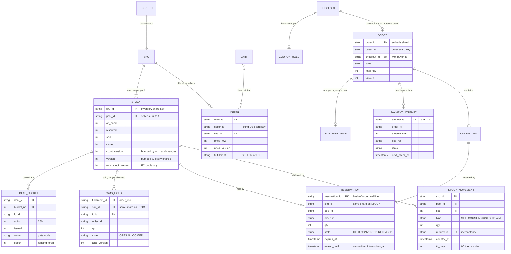

Access patterns and the key that serves each:

| Access pattern | Rate at peak | Store and key |
|---|---|---|
| Product page document | 36k/s, ~95% cache hits | Read model by `product_id`, behind Redis and a 1 s local cache |
| Search | 24k/s | Search index, offer docs, ~40% served from a query result cache [estimate] |
| Cart read and write | ~10k reads/s, 2.3k writes/s | Cart KV by `buyer_id`, conditional write on `version` |
| Reserve a line | ~1.24k/s | Inventory shard of `sku_id`: insert `RESERVATION`, conditional update of `STOCK`, one local transaction |
| Claim a deal unit | ~100k/s for ~1 s, 10k wins | Gate node memory, then `DEAL_BUCKET` row and ledger rows in 5 ms batches |
| Expire reservations | up to ~1k/s | `RESERVATION` index `(state, expires_at)`, per shard |
| Apply a WMS event | ~1k/s | `STOCK` by `(sku_id, pool_id)` and `WMS_HOLD` by `(fulfillment_id, sku_id, fc_id)`, same shard |
| Seller stock operation | 5k/s in feed bursts | `STOCK` and `STOCK_MOVEMENT` by `sku_id`, a feed grouped by shard |
| Place order or its replay | 350/s | `ORDER` unique `(buyer_id, checkout_id)`, on the buyer's shard |
| Order history | ~2k/s [estimate] | `ORDER` by `(buyer_id, created desc)` |
| A seller's orders | ~500/s [estimate] | Seller order view by `seller_id`, fed by CDC from the order DB |
| Resolve unknown payments | per unknown attempt | `PAYMENT_ATTEMPT` index `(state, next_check_at)` |

**Why `sku_id` is the inventory shard key.** Every pool of one SKU lives on one shard, so a reserve can try FC A, then FC B, then the seller pool inside one shard. The reservation row, the hold row and the movement row sit next to the stock row, so every change is one local transaction, no distributed commit. The cost: a hot SKU is a hot shard. That is §5.1.

---

## 4. High-level design

One subsection per functional requirement. Each traces one request, climbs a Bad, Good, Great ladder, adds boxes to the picture, and ends with what is still missing. §5 then breaks it.

### 4.1 Buyers search and open a product page with offers, price and availability

**Flow: a buyer searches "ramyun 5 pack" and opens product `p1`.**

1. The API gateway sends the search to the search service, which queries the search index (text match, filters, sort) and returns 40 offers, each with its price, an availability flag and a delivery promise taken from the indexed document. Head queries are served from a 30 s query result cache.
2. The product page service checks a 1 s in-process cache, then Redis, then the read model store (a NoSQL document per `product_id`). The document holds the product, its SKUs, every offer with `price_version`, an availability bucket per SKU (`IN_STOCK`, `LOW` for 1 to 5 sellable, `OUT`) and the best delivery promise.
3. Writes reach the read side as events. The listing DB (sharded by `seller_id`) is tailed by CDC onto `listing-changes`. The inventory service publishes `availability` events, **only on transitions**. Each availability event carries a per-SKU `avail_version`, bumped in the same transaction as any change to that SKU's pool rows (all on one shard). A read model builder and an indexer apply both: per-field versions in the document (prices by `price_version`, stock by `avail_version`), a scripted update in the search index that is a no-op for an older version, and the new document written into Redis by the builder itself as a compare-and-set on the document version.

**Bad: query the listing DB and the inventory DB per page view.** 36k product pages a second, each a scatter across seller shards (one product has offers from many sellers) plus a stock read per offer. The seller write path and the buyer read path now share fate: a bulk price feed slows product pages, and a product page spike slows checkouts.

**Good: read replicas plus a Redis cache-aside with a 60 s TTL.** Works for most pages. Costs: price and stock can be 60 s stale; a hot product's key expiring during a sale sends a stampede to the replicas; search still needs an index, and an index fed by a nightly batch is a day stale.

**Great: a read model and a search index built from change events, with versioned writes all the way to the cache.** Pages read one document. The builder writes each new document into Redis itself, as a compare-and-set on its version, so a reader that fetched the old document on a miss can never write it back over the new one (delete-on-update left a hot product stale for 1% to 4% of an hour in a seeded run). The TTL is a backstop only. Availability travels as transitions, so a flash sale's 10k decrements become one `IN_STOCK → OUT` event. This is the shape Coupang described for its own serving layer: each service "sends the updated data to the queue and saves it to the common storage, a NoSQL database", with a cache in front that served "ten times higher throughput and three times less latency", and a faster path for data that "needs to be updated in a matter of seconds. One example is stock information" ([Coupang engineering](https://medium.com/coupang-engineering/our-backend-strategy-to-handle-massive-traffic-d30cd6cc4fb2)). **Challenges:** the read side is 1 to 3 s behind (the search index refreshes every 1 s by default), so it can show "in stock" for a unit that just sold (§5.4). A hot product document during a sale needs request coalescing (one fetch per key per node). A schema change to the document needs a rebuild from a snapshot plus the topic.

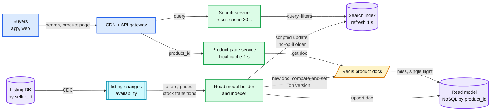

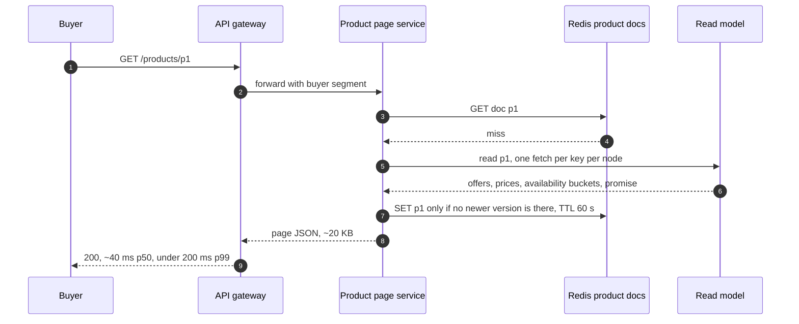

**What is still missing:** nothing writes stock yet. §4.2.

### 4.2 Sellers register listings and stock, and warehouse events adjust platform-held stock

**Flow: seller `s9` lists "Shin Ramyun 5-pack" at KRW 4,500 with 40 units on its own shelf. The same SKU is also stocked in FC A, counted by the WMS.**

1. `POST /seller/listings`. The catalog service matches the listing to product `p1`, creates SKU `sku_77` if new, and writes offer `o9` in the listing DB. CDC carries it to the read side.
2. `PUT /seller/offers/o9/stock {on_hand: 40, counted_at: 09:58, request_id: r1}`. The inventory service, on the shard of `sku_77`, inserts movement `r1` (`SET_COUNT`) and updates row `(sku_77, seller:s9)` in one transaction. If `r1` already exists, it returns the earlier result; a count whose `counted_at` is not newer than the last applied one is acknowledged and ignored.
3. The WMS publishes `stock_changed(sku_77, FC A, available_qty 118, stock_version 42)` on `wms.stock-events`, keyed by `sku_id`. The inventory consumer sets `on_hand = 118` on row `(sku_77, fc:A)` **only if 42 is newer** than the row's `wms_stock_version`.
4. If sellable crossed zero or changed bucket, the inventory outbox emits `availability(sku_77, IN_STOCK)`.

**Bad: one `available` counter.** Sellers `PUT` an absolute value, checkouts decrement it. A seller's "set 50" written over three in-flight decrements erases them, and three units are oversold. It is the README's probe 3, and the commonest bug in real systems.

**Good: separate columns, plus `If-Match` on seller writes.** The seller writes `on_hand`, checkouts write `reserved`. Each is a single-statement update, so neither erases the other. Costs: a seller UI that sends `If-Match` on the row's version gets `412` every time a buyer reserves (noise); an ERP feed that cannot send versions has no protection against its own stale count; and a count taken at 09:58 and applied at 10:05 ignores the units shipped in between.

**Great: stock as a ledger of typed, idempotent operations.**
- `SET_COUNT(qty, counted_at)`: "this many on my shelf, not yet shipped, at `counted_at`". Applied as `on_hand = qty +` the net of every `SHIP` and `ADJUST` recorded after `counted_at` (shipments negative, receipts positive), from the movement ledger. A count not newer than the last applied one is ignored; `counted_at` more than 1 minute in our future or older than 24 h is rejected.
- `ADJUST(delta, reason)`: received, damaged, found. Commutes with everything.
- `SHIP(order, qty)`: `on_hand − q`, `sold − q` together.
- `WMS_SNAPSHOT(available_qty, stock_version)` for FC pools: applied only if the version is newer.
- Every operation has an idempotency key (`request_id`, or the WMS version), and bumps `version`. Only operations that change `on_hand` bump `count_version`, which is what a seller UI uses for `If-Match`, so buyer reservations never cause a `412`.

**Challenges:** a count below what is already sold and reserved (the seller lost stock) makes sellable negative; we accept the seller's truth, stop selling, and open a seller task for the deficit (§5.3). The ledger grows ~50M rows a day: 90 days hot, then archived. A 100k-line feed is sorted by shard and applied in batches of 500, so it never sits on one shard's lock queue.

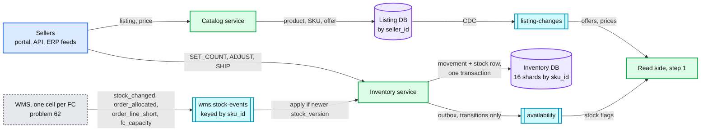

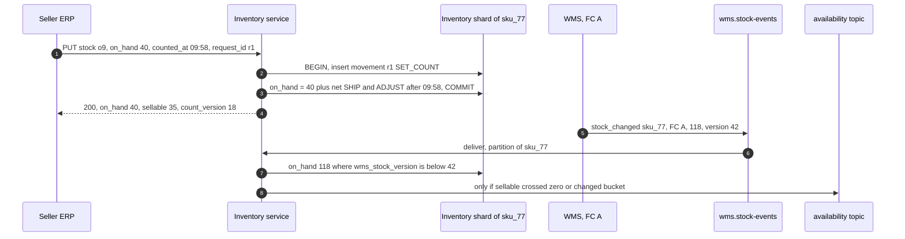

**What is still missing:** buyers cannot collect items. §4.3.

### 4.3 Buyers add, update and remove cart items, and see current price and availability

**Flow: a buyer adds 2 units of offer `o9` on a phone, then opens the cart on a laptop.**

1. `PUT /cart/lines/o9 {qty: 2, if_version: 7}`. The cart service writes the buyer's cart document in the cart KV with a condition on `version = 7`, and stores `price_seen = 4,500`. On a version conflict (the laptop wrote first) it re-reads the current version, re-applies this operation to it (set `o9` to 2), and writes again with the new condition.
2. `GET /cart` on the laptop. A strongly consistent read of the document, so the phone's write is there (read-your-writes).
3. Each line is hydrated from the product docs cache: current price (`price_seen` 4,500, now 4,200: "price dropped") and availability bucket.
4. Nothing is reserved. The cart is a wish list with prices attached.

**Bad: reserve stock at add-to-cart.** ~20M adds a day would hold stock for days. Window shoppers starve buyers, and a flash-sale SKU sells out to carts that never check out. Every cart becomes a TTL to manage.

**Good: cart rows in the order DB.** Transactions, joins, familiar. Costs: cart traffic (2.3k writes a second, five times that in reads) now shares the order DB's primaries with checkouts, and the cart becomes unavailable whenever the order DB is.

**Great: one versioned document per buyer in a KV store, hydrated on read, never holding stock.** Amazon's Dynamo paper describes the cart as the canonical always-writable object: customers must be able to add and remove items "even amidst network and server failures", so "writes are never rejected" and conflicting versions are merged ([Dynamo paper](https://www.allthingsdistributed.com/files/amazon-dynamo-sosp2007.pdf)). We get the same "never lose an add" property more simply: a conflict re-applies the operation to the current version, so a remove is never resurrected by a merge. We keep the always-writable rule for the cart and **only** for the cart: stock and payment are never always-accept. **Challenges:** the cart shows the read side's view, so a line can show "in stock" that the reserve will refuse (§5.4); lines can point at deleted offers (shown as unavailable); the document is capped at 100 lines. The cart adds one service (the cart service) and one store (the cart KV) to the picture.

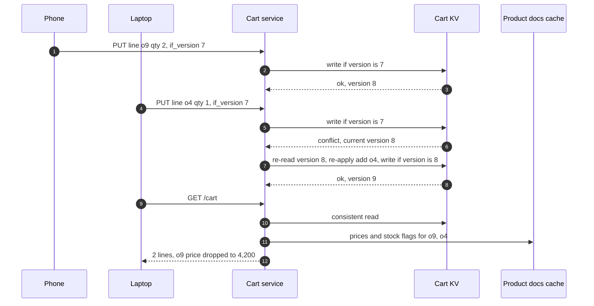

**What is still missing:** nothing turns a cart into an order. §4.4.

### 4.4 Placing an order reserves stock, prices it, authorizes payment and confirms it, safe to retry

**Flow: a buyer places an order for 2 lines at 10:00.**

1. When the checkout page opens, `POST /checkouts` creates `co_1` with quote `q1`: lines with `price_version`s, coupon `C10` checked (not redeemed), shipping, total KRW 31,400, `expires_at` 10:10. It also does a soft stock check from replicas, so a sold-out line is flagged before the buyer pays.
2. `POST /orders {checkout_id: co_1, quote_id: q1, payment_method}` with `Idempotency-Key: co_1`. The order service inserts `ord_1` in state `RESERVING`. The unique index on `(buyer_id, checkout_id)` makes a replay return the existing order instead of a new one.
3. **Reserve.** The inventory service, per line: pick the pool (the seller's pool, or the FC whose feed is fresh, with stock, with outbound capacity left for the promise's cut-off after subtracting our open non-deal holds **and live reservations** at that FC and cut-off (a soft counter: each reservation takes a capacity token by a conditional, idempotent decrement on one of 8 tally shards per FC and cut-off, keyed by the reservation id, and gives it back with the reservation; a recount job rebuilds the tally from live reservation and hold rows every 60 s, which repairs any drift a crash left. The worst overshoot is the reserves that race inside one decrement, tens of units, far under the FC's ~2% planning reserve), and with the best promise for the address), then in one transaction on the SKU's shard: insert reservation `rsv = hash(ord_1, line)` and run `UPDATE stock SET reserved = reserved + q WHERE sellable >= q`. Zero rows updated means try the next pool, then fail the line. All lines or none: a failed line releases the others.
4. **Price.** The quote is valid until 10:10, so its prices stand. Coupon `C10` is held: one transaction on the coupon's pricing shard inserts `COUPON_HOLD(co_1, C10, buyer, counter_shard 3, HELD)` and takes one unit from budget sub-counter 3.
5. **Pay.** The payment service inserts attempt `ord_1-p1` (`CREATED`; at most one live attempt per order), then calls the PSP's authorize with idempotency key and PSP order reference both `ord_1-p1`, and the quote's total. The PSP's own reference for the payment (a `paymentKey` at a Korean PG) is stored on the attempt row when it answers.
6. **Confirm.** Inventory converts the reservations (`reserved − q`, `sold + q`, plus a WMS hold row for FC lines, re-checking `on_hand − sold − carved >= q`). If any line fails to convert, the converted ones are released and the authorization voided, before any outbox row. The coupon hold becomes `USED`, with the coupon's discount spread over the lines and stored per line. The order becomes `CONFIRMED` and, in the same local transaction, an `order_confirmed` row goes into the order DB's outbox. CDC publishes it to `orders.fc-A`. The WMS intake for FC A takes it as fulfillment `ord_1-1` (idempotent on `fulfillment_id`), and the seller's notifier picks it up.
7. `201 CONFIRMED`, "arrives tomorrow by 7 am" (dawn delivery: order by midnight, at the door by 7 am).

**Bad: one distributed transaction across inventory, order and payment (2PC).** The PSP is not a transaction participant, so 2PC cannot include the step that matters. Worse, it holds the stock row lock across the PSP's ~400 ms: the hot row's ceiling drops from ~300 to 1,000 updates a second to `1 ÷ 0.4 s = 2.5`.

**Bad, again: call the steps in order, with no key, and treat a timeout as a failure.** A double tap creates two orders and two charges. A PSP timeout followed by "release the stock" can leave a buyer charged for a unit sold to someone else.

**Good: an idempotency key on `POST /orders`, reserve before pay, a reservation TTL, all inline.** Fixes double taps and hoarding. Costs: a crash between steps leaves `ord_1` stuck in `PAYING` with nobody to finish it; the TTL then frees the stock while an authorization may exist; and a PSP timeout still has no defined meaning.

**Great: a saga orchestrated by the order service, one key per order attempt that derives every step's key, intent rows before external calls, an outbox, a re-driver and a payment resolver.**
- **One key, derived everywhere.** `checkout_id` → `order_id` → `reservation_id = hash(order_id, line)`, `attempt_id = <order_id>-p<n>`, PSP idempotency key `= attempt_id`. A retry at any hop is the same request at every hop below it.
- **State lives in the order row.** Each step is idempotent and moves the state with a conditional update (`WHERE state = expected`). A re-driver scans each shard for orders in a non-terminal state not updated for 30 s and runs the next step again, including re-applying the stock extension for a `PAYING` order whose attempt is `UNKNOWN`.
- **The resolver scans the attempts table** (`CREATED` older than 10 s, or `UNKNOWN`), never in-memory timers. It re-sends only to a PSP that documents idempotency keys; a PG without them is only looked up, by `ord_1-p1` and its `paymentKey`. After the 30-minute ceiling it only reads by reference (§5.2).
- **Intent before the call.** The payment attempt row exists before the PSP hears of it, so a crash mid-call leaves a row the resolver finds.
- **Order of steps.** Reserve (ours, cheap, reversible) before pay (theirs, expensive). Confirm only after `AUTHORIZED` and every line converted; a partial convert is undone (`CONVERTED → RELEASED`, void) before the outbox row. Capture once, at the first shipment.
- **Compensation is also idempotent.** Release is `WHERE state = 'HELD'`; void uses key `void-ord_1-p1`.

**Challenges:** the TTL can expire while the PSP has not answered (fixed in §5.2 by extending the hold while the outcome is unknown); an authorization that arrives after the stock was released must be voided; the re-driver must not run a step concurrently with the live request (the conditional state update makes the second runner a no-op). [`../../concepts/distributed-transactions.md`](../../concepts/distributed-transactions.md).

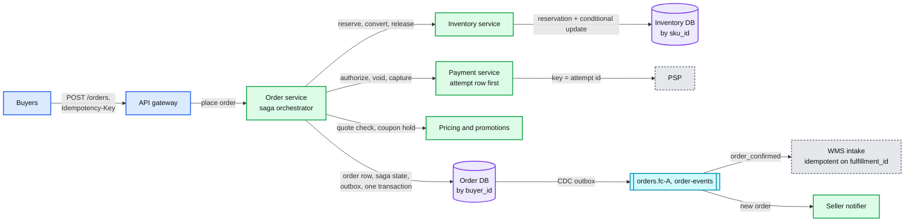

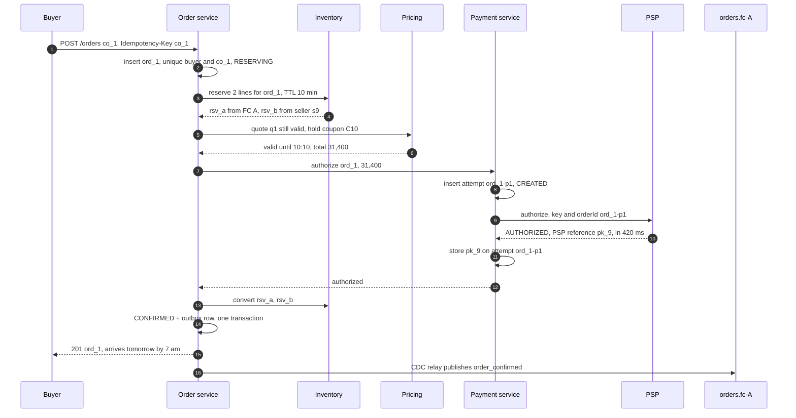

**What is still missing:** the buyer cannot see or cancel the order, and the warehouse's answers do not come back. §4.5.

### 4.5 Buyers see order status and history, and cancel before shipment

**Flow: the buyer opens "My orders", then cancels `ord_1` at 10:20, before FC A has shipped it.**

1. `GET /orders` reads the buyer's shard. For 5 s after the buyer's own write, reads go to the primary; otherwise to a replica (read-your-writes).
2. Status arrives as events: `order_allocated` and `order_line_short` (on `wms.stock-events`), `order_packed` and `order_shipped` (on `wms.order-status`), and the seller's ship call for seller-fulfilled lines. Each moves the order's state machine with a conditional update.
3. `POST /orders/ord_1/cancel`. The order moves `CONFIRMED → CANCEL_REQUESTED` (conditional). For the seller-fulfilled line: not shipped, so cancelled at once (`sold − 1` on the seller pool). For the FC line: an `order_cancel_requested(ord_1, ord_1-1)` outbox row goes to `orders.fc-A`. With no `lines` it cancels the whole fulfillment; a buyer who cancels one line sends just that line.
4. FC A has not picked it. It releases its allocation, answers `order_cancel_result(ord_1, ord_1-1, lines, cancelled)`, and publishes `stock_changed` with the unit back. Commerce drops the WMS hold if it is still open.
5. Every line is now cancelled, so the order is `CANCELLED` and the payment service voids the authorization (key `void-ord_1-p1`); the buyer is told "cancelled, not charged".
6. **Partial cancel.** Cancellation and shipment state are kept per line and per fulfillment. Had the buyer cancelled only the FC line, the order would be `PARTIALLY_CANCELLED`, not `CANCELLED`, and there would be no void: before the first capture the capture amount just shrinks; after it, the cancelled line is a partial refund; on a one-step PG, a partial cancel. The order is `CANCELLED` only when every line is.
7. Had FC A already packed or shipped it: `order_cancel_result(too_late)`. The line stays live, and the buyer is offered a return after delivery (returns are below the line).

**Bad: read status live from the WMS and sellers on every page view.** Couples "My orders" (~2k reads a second) to 100+ FC cells and thousands of seller systems, and a WMS cell outage shows as a broken orders page.

**Good: an order state column updated by events; cancel sets `CANCELLED` and releases stock at once.** Status is fine. The cancel is wrong: if the WMS has already allocated or picked the unit, commerce counts it as sellable again while it is in a tote, and the next buyer gets a short pick.

**Great: cancel is a request to the owner of the physical unit, and stock comes back only through that owner's event.** Commerce never "releases" an FC unit on its own; the WMS's `stock_changed` does. Payment is voided only when every line is cancelled; a partial cancel shrinks the capture or refunds a line. **Challenges:** a cancel racing a ship (the WMS answers `too_late`, and the order stays live); a partial cancel of one line (`order_cancel_requested` with `lines`; the first shipment then captures less); and partial shipment: the WMS ships what it has and reports the rest with `order_line_short`, and the policy for the rest is ours (Flow 6). The status and cancel paths add one topic and one read view: [orders zoom-in in diagrams.md](diagrams.md#d3-component-architecture).

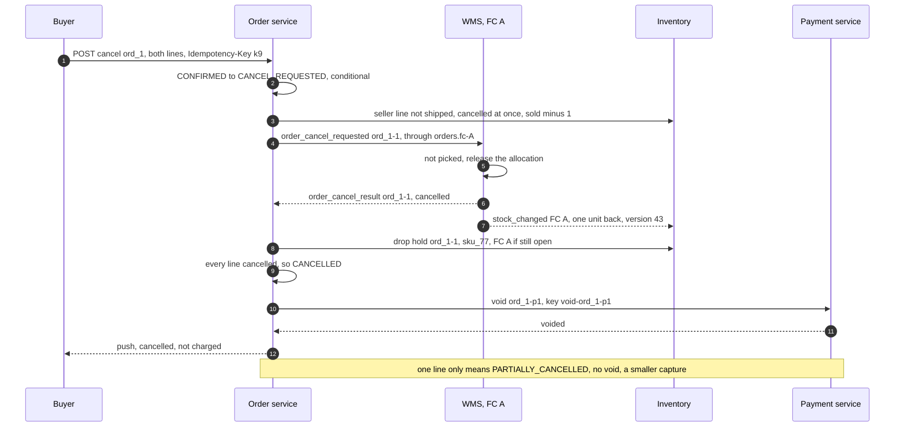

**What is still missing:** the §4 design works at 350 orders a second. It has not met a flash sale, a PSP that never answers, a seller racing a checkout, a stale search result, or a price change mid-checkout. §5.

---

## 5. Deep dives

One per non-functional requirement or reported probe, phrased as the interviewer's question. Each names what breaks in the §4 design with a number, climbs the ladder, and lists what changed.

### 5.1 "Flash sale: 10k units, 1M buyers at 10:00:00. How do you avoid both overselling and melting the database on one hot row?"

**What breaks in the current design.** Walk one tap through §4.4.
1. **The row.** Every tap becomes `UPDATE stock SET reserved = reserved + 1 WHERE sellable >= 1` on row `(sku_77, fc:A)`. One row does ~300 to 1,000 of these a second (fact 2). At 100k/s the lock queue grows by ~99k a second. Alibaba's own framing of the same row: "When one customer is updating this record, the other 999,999 customers are waiting" ([Alibaba Cloud](https://www.alibabacloud.com/blog/double-eleven-technology-series-flash-sales-optimization-on-postgresql_594096)).
2. **The shard.** Each inventory node has ~64 connections to shard 7 [estimate]. All of them wait on `sku_77`. The other SKUs on shard 7, a sixteenth of the catalog, time out. With InnoDB's default lock wait of 50 s, a waiting transaction holds its connection for up to 50 s.
3. **The losers.** 99% of taps are for units that do not exist. At ~300 to 1,000 a second the 10k units take 10 to 30 s to sell, so for the whole window every loser waits in the same queue as the winners, and keeps waiting after the stock is gone.
4. **The read side.** The product page and its availability are refreshed by 1M buyers, and 10k decrements would be 10k index updates on one document (fixed already: transitions only, §4.1).

The conditional update itself is right: it can never oversell. What fails is throughput and blast radius.

**Bad: one conditional `UPDATE` per tap on the stock row.** As above: correct, 100x to 300x short, and it takes a sixteenth of the catalog down with it.

**Bad, the textbook fix: Redis `DECR` as the stock.** One key lives on one Redis shard, served by one thread. Redis's own benchmark page shows ~180k unpipelined `SET`s a second on unnamed hardware, an example and not a spec, so one key sits near its ceiling for the whole sale. Worse, Redis replicates asynchronously: a failover can promote a replica that missed the last decrements, the counter goes back up, and units sell twice. And "Redis is the stock, the DB is the record" is a dual write.

**Good: batch same-SKU reserves in the inventory service.** Route every reserve for `sku_77` to one inventory node (consistent hash on `sku_id`), collect requests for 5 ms, and run one transaction per batch: lock the row once, grant `min(n, sellable)` in arrival order, insert the reservation rows, commit. At 100k/s that is ~500 requests per batch and 200 transactions a second, under the row's ceiling even at its low end. It is Alibaba's queueing idea moved up a tier: queued same-row updates reach a throughput that "approaches 1s / trxrt" instead of collapsing. Costs: every tap still travels to one process on one node (100k/s, a single point of failure for the SKU); losers still cost a hop and a batch slot after the units are gone; and the 10k reservation inserts all land on shard 7 in a fraction of a second.

**Great: carve the deal into single-owner buckets, issue units from memory, and answer "sold out" at the gateway.**
- **Setup at 09:50.** Deal `D`: `sku_77`, 10,000 units at KRW 9,900, 1 per buyer, 10:00 to 10:30, 6,000 from FC A and 4,000 from FC B. First it books outbound capacity: `capacity_hold(D, FC A, date, dawn cut-off, 6000)` and the same for FC B. The WMS subtracts each hold from `remaining_outbound_units` and answers `capacity_hold_result(D, granted_units)`. Setup carves at most the granted units per FC: if FC A grants only 4,500, the other 1,500 go to another FC with stock and capacity, or the deal shrinks. Then one conditional update per pool row: `carved = carved + 6000 WHERE sellable >= 6000`, and 40 bucket rows of 250 units (24 for FC A, 16 for FC B), placed by `hash(deal_id, bucket_no)` across all 16 shards. A deal can never sell more than its FCs can ship that night.
- **Ownership at 09:55.** 20 gate nodes each lease 2 buckets, with `epoch` as the fencing token. During a live deal the lease is 2 s, renewed every 500 ms, with a 1 s takeover margin (80 renewal writes a second in all). One bucket, one writer. Its remaining count lives in that node's memory.
- **Routing.** The gateway routes claims by `hash(buyer_id)` to a gate node, so a buyer always lands on the same node.
- **Claim.** Claims are keyed by `(deal_id, buyer_id)`, not by the request's `Idempotency-Key`: a second claim from the same buyer (a double tap, a second phone) joins the first and gets the same token. A new buyer takes a unit from one of the node's buckets in memory, queued for that bucket's next batch. Every 5 ms, per bucket, one transaction: `UPDATE deal_bucket SET issued = issued + n WHERE deal = D AND bucket = b AND epoch = e AND issued + n <= units`, plus n ledger rows (deal claims, `HELD`, expiring in 5 minutes). Commit, then answer all n buyers with a `reservation_token`. Zero rows updated means the node lost its lease: it stops and answers "try again".
- **Sold out at the edge.** Each node publishes its buckets' remaining counts to a small deal-state key every 100 ms. Gateways poll it every 250 ms; once it says `SOLD_OUT`, the gateway answers claims itself, and the product page shows the same flag. A gateway that misses polls for 1 s sends claims through to the gate, which is always correct. A claim whose answer never came (its node died mid-batch) is retried with `resume: true`; gateways forward resumed claims even past `SOLD_OUT`, and the owner hands back the existing token, so a won unit is never hidden.
- **Unpaid claims come back fast.** The owner expires its own claims from a timer wheel, per ledger row: `HELD → RELEASED WHERE state = 'HELD'`, then `issued −` the rows changed, fenced by epoch, so a zombie owner or a duplicate expiry cannot return a unit twice. The deal flips back to `OPEN` until they are claimed. A claim behind an unknown payment is not expired: the saga sends `extend_until` to the bucket owner, and the timer wheel skips that claim until then (30-minute ceiling, §5.2).
- **Confirm.** The checkout saga uses the token as that line's reservation, with the deal price bound to it (§5.5). Confirm sends `convert` to the bucket's owner, which marks the ledger row `CONVERTED`. Then one transaction on the stock row's shard: `carved − 1`, `sold + 1`, and the WMS hold row keyed by `(fulfillment_id, sku_id, fc_id)`. Only then is the order `CONFIRMED` with its outbox row; `order_confirmed` carries `deal_id`, so the WMS counts the fulfillment against the deal's capacity hold, and commerce leaves that hold out of its own capacity subtraction. The stock row sees ~55 updates a second during the checkout wave (10k confirms over ~3 minutes). Writing the hold row later, in a once-a-second batch, loses a race with the WMS's allocation: in the seeded simulation 2,976 of 10,000 holds were stuck, hiding those units after the sale; written in the convert, none were.
- **1 per buyer, durably.** The gate's check is in memory. The durable rule is a `DEAL_PURCHASE(buyer_id, deal_id)` row on the buyer's shard, inserted in the confirm transaction. A buyer can end up holding two claims after a failover, but only one order can confirm; the other expires and returns to its bucket.
- **Deal end at 10:30.** Owners return only units never issued (`units − issued` per bucket) and claims released after that, one by one. A claim behind an unknown payment stays carved until it converts or is released: handing it back at 10:30 would sell it twice if the payment then succeeds. The capacity hold follows the same rule: `capacity_release(D)` at 10:30 returns only `granted − drawn − (issued claims not yet terminal)` per FC, so capacity stays booked for every claim that may still convert. A second, final `capacity_release(D)` goes out when the last claim resolves, at most 30 minutes later (the payment ceiling). Only after that final release does a late deal fulfillment count against regular capacity.
- **Stock that shrinks under the carve.** If a WMS snapshot or a seller count makes sellable negative on a row with `carved > 0` (12 units damaged at 09:58), the inventory service asks each bucket owner to shrink its unissued units by the deficit (`units − k WHERE units − k >= issued`) in its next batch. The deal sells 12 fewer, and nobody gets a short pick at 01:40.

**The numbers.**
- In the seeded simulation of 1M taps the last unit goes at ~0.12 s, and ~32k taps reach a gate node before every gateway shows `SOLD_OUT`; the gateways answer the other ~97%.
- Per gate node `100k ÷ 20 = 5k` claims a second, in memory. Per bucket, 250 units at ~2.5k claims a second last ~0.1 s, ~20 batches. Per bucket row, at most `1 s ÷ 5 ms = 200` transactions a second from one writer: no lock waits, under the row's ~300 to 1,000 ceiling.
- Stock row: 2 updates at setup, ~55 a second during checkout, a handful at deal end. Ledger: 10k inserts over 16 shards.

**Why it cannot oversell.** The database enforces `issued ≤ units` on every batch of every bucket, and `sum(units) = carved ≤ sellable` at setup. Memory decides **who** gets a unit; the database decides **how many** exist. A node that dies after taking a unit in memory but before its batch commits loses nothing: those buyers got no answer, and the units were never issued.

**Challenges.** A node crash pauses its 2 buckets (500 units) for the 2 s lease plus the 1 s margin, ~3 s. The successor bumps the epoch, reads `issued`, takes the dead node's whole buyer range, and rebuilds who already won from the `HELD` ledger rows, so nobody wins twice. A paused (garbage-collecting) old owner cannot write after that, because its batch carries the old epoch. At the very end, node A can be empty while node B has 3 units left; at 5k claims a second per node that lasts milliseconds, and for slow deals a coordinator rebalances units between buckets every 10 s. Bots are an abuse problem, not an inventory one (§10.10).

**Push back on the textbook answer.** "Put a virtual waiting room in front." A waiting room limits how fast people enter. It does not decide who gets units and it does not prevent oversell; the inventory write still needs its condition. Here the sale is decided in ~0.12 s and the gateway's `SOLD_OUT` flag answers everyone after that for free, so a queue would add minutes of waiting to a sale that is over in a fraction of a second. We would add one only if the 10k winners' checkouts outran the PSP, and they do not: ~10k authorizations over ~3 minutes is ~55 a second, against a normal peak of 350.

**What changed.** New: deal setup with a capacity hold per FC, gate nodes, bucket rows and their ledger, the deal-state flag in the gateway, `resume` claims, the hold row written in the convert, the `DEAL_PURCHASE` row. The Good rung stays on as a guard: the inventory service batches reserves for any SKU that gets hot without a deal. The red node stays the stock row, because it is what melts the moment the gate is bypassed.

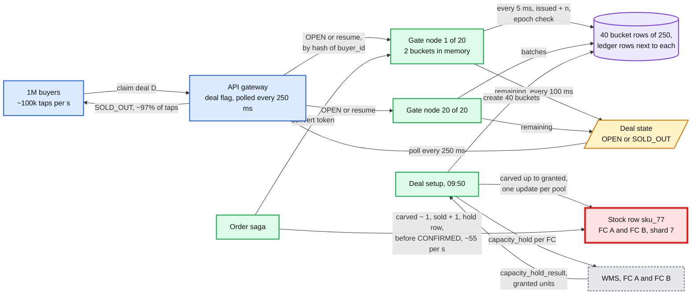

Claim decision flow: [D6 in diagrams.md](diagrams.md#d6-activity--decision-flow). Gate node crash mid-sale: [D5](diagrams.md#d5-failure-paths). Hot shard picture: [D10](diagrams.md#d10-scaling--partitioning). Deep dive: [`deep-dives/flash-sale-and-hot-sku.md`](deep-dives/flash-sale-and-hot-sku.md). Related: [`../ticket-booking/deep-dives/last-room-and-inventory-locking.md`](../ticket-booking/deep-dives/last-room-and-inventory-locking.md), [`../payments-ledger/deep-dives/hot-accounts-and-contention.md`](../payments-ledger/deep-dives/hot-accounts-and-contention.md), [`../../concepts/leases-fencing-clocks.md`](../../concepts/leases-fencing-clocks.md).

### 5.2 "The payment call times out and the buyer taps again. How do you avoid a double charge, a double order, or stock stuck in a reservation?"

**What breaks in the current design.** §4.4 has a key and a saga. The holes:
1. **The PSP does not answer in 3 s.** Did it authorize? Nobody knows. Marking the order failed and releasing the stock can leave a live authorization on the buyer's card for a unit sold to someone else.
2. **The buyer taps "Place order" again.** With the same `checkout_id`, the unique index returns `ord_1`. Fine. But if the saga treats the tap as "try payment again", it starts attempt 2 while attempt 1 is unknown: two authorizations.
3. **The TTL runs out.** The resolver is still asking at minute 10 and the sweeper releases the reservation. A success at minute 11 has no stock behind it.
4. **The PSP's memory is finite and literal.** Stripe v1 "saves the status code and body of the first request ... Retries with the same key return the saved response, including 500 errors", and keys can be pruned after "at least 24 hours", after which a reused key is a new request ([Stripe](https://docs.stripe.com/api/idempotent_requests)). So "retry with the same key" can return a stored 500 forever, and a retry on day 2 can charge again.

**Bad: a timeout is a decline, and the buyer may retry with a new attempt.** Two authorizations when the first one actually succeeded. With capture at the first shipment the second is voided eventually, but the buyer sees two holds and calls support.

**Good: retry the same authorize with the same key until the PSP answers.** No double charge inside the PSP's key window. Costs: the buyer's request hangs for many seconds; a stored 500 never resolves; the reservation TTL still runs out under it.

**Great: `UNKNOWN` is a first-class attempt state, a resolver owns it, and stock is held while it lasts.**
- **The attempt row comes first.** `ord_1-p1` is inserted `CREATED` before the call; `n` in `-p<n>` bumps only after a definite decline. A partial unique index allows one live attempt per order (states other than `DECLINED`, `VOIDED`, `FAILED`). A second tap cannot start attempt 2 while attempt 1 is unknown.
- **One call, 3 s timeout.** A timeout or a 5xx makes the attempt `UNKNOWN`. The buyer gets `202 PAYMENT_PENDING`, "confirming your payment", not an error. The app polls `GET /orders/ord_1` and gets a push when it resolves.
- **Hold the stock.** The order service rewrites each reservation's indexed `expires_at` to `max(expires_at, now + 30 min)` (and records `extend_until`), so the sweeper's "overdue" page never fills with extended rows; the alert is on the oldest overdue `HELD` row. For a deal line, `extend_until` goes to the bucket owner, whose timer wheel skips that claim until then.
- **The resolver scans the attempts table**, never an in-memory timer: attempts `CREATED` for over 10 s, or `UNKNOWN`, by `next_check_at`. So a crash anywhere between the attempt row and the answer still gets resolved. It asks at +2 s, +10 s, +30 s, +2 min, +5 min, then every 5 minutes up to 30 minutes, about 10 asks per unknown.
- **The retry contract is per provider.** A PSP that documents idempotency keys (Stripe style) is first re-sent the same authorize with the same key, which returns its saved result if the first call landed; if that returns a stored error, or the key may have been pruned, the resolver **looks up by reference**. A PG without an idempotency key is **never re-sent** after an unknown outcome (Toss's confirm API documents no idempotency header; only its cancel does, per the facts survey): the resolver only looks up, by the attempt id (`orderId = ord_1-p1`) and the PG's `paymentKey`. Without a key, "not found" is final only at the 30-minute ceiling: then the attempt is marked failed and the stock released, and a later approval is cancelled and refunded. The PSP order reference is always the attempt id, never reused (at Stripe, the PaymentIntent created for that attempt).
- **The re-driver re-applies the extension** for a `PAYING` order whose attempt is `UNKNOWN`, so a crash between writing `UNKNOWN` and extending the reservations cannot leave the 10-minute TTL in charge.
- **Outcomes.** `AUTHORIZED`: convert every line. If one line's convert fails (released by its TTL, a seller count or a carve), the lines already converted go `CONVERTED → RELEASED` and the authorization is voided, all before any outbox row: "sold out, not charged". `DECLINED`: release the reservations, order `PAYMENT_FAILED`; the buyer may try another card on the same order within the quote TTL (attempt `ord_1-p2`). Still unknown at 30 minutes: release the stock, order `PAYMENT_UNRESOLVED`, buyer told "not confirmed; any hold on your card will drop".
- **After the ceiling, read only.** The resolver keeps looking the attempt up by reference every hour for a day, and never re-sends authorize: if the first call never arrived, a re-send at minute 40 would be a new charge for an order the buyer was told is not confirmed. A late approval is voided (two-step card), or cancelled and refunded (one-step PG), never confirmed. A daily match against the PSP's settlement report catches anything left.
- **Never move an unknown attempt to another PSP.** Failover to a second PSP is for new attempts only. An unknown attempt is resolved where it was sent.
- **3DS.** An attempt in `REQUIRES_ACTION` (the buyer is in the bank app) is not unknown; the normal 10-minute TTL covers it (the same size as Toss's 10-minute window from authentication to the confirm call). If the buyer returns after the hold expired, the saga tries to re-reserve; if the unit is gone, the authorization is voided (cancelled on a one-step PG) and the buyer is told "sold out, not charged".

**Checked by simulation.** Every crash point against every PSP behaviour (checkout saga deep dive). Against a PSP with idempotency keys, 210 scenarios: the Bad rung ends with two authorizations in 36 and stuck orders in 132; the Good rung sells a unit twice in 36 and leaves 102 stuck; the Great rung has neither, and voids 27 late approvals. Against a PG without a key, 180 scenarios: Good, which re-sends the same request, double-charges in 36; the Great rung has no violation and cancels 27 late approvals; the same Great rung re-sending as it may to a keyed PSP would double-charge in 30.

**The three promises, checked.**
- **No double order:** `ORDER` is unique on `(buyer_id, checkout_id)`. `POST /checkouts` returns the buyer's open checkout for the same cart version, and the app restores it after a restart, so a crash or a second device does not mint a new key.
- **No double charge:** one live attempt per order, one PSP key and reference per attempt, a resolver instead of new attempts, no re-send to a PG without idempotency keys, read-only lookups after the ceiling, and one capture at the first shipment of a confirmed order.
- **No stuck stock:** every reservation has an indexed `expires_at`, extended at most to 30 minutes; the sweeper runs every second per shard; the oldest overdue `HELD` row is alerted on; an hourly invariant check proves `sum(HELD reservations) = reserved` per row.

**Push back on the textbook answer.** "An idempotency key makes the payment exactly-once." The key makes a retry safe. It does not tell you the outcome of a call that never answered, and the PSP forgets it after a day. The durable key is our own attempt row, the answer comes from a resolver that asks, and the stock decision waits for that answer, up to a ceiling we chose.

**What changed.** New: `UNKNOWN` and a resolver that scans the attempts table, a retry contract per provider, extensions written into `expires_at`, the one-live-attempt index, read-only lookups after the ceiling, undo of a partial convert, settlement matching. Capture moved to the first shipment.

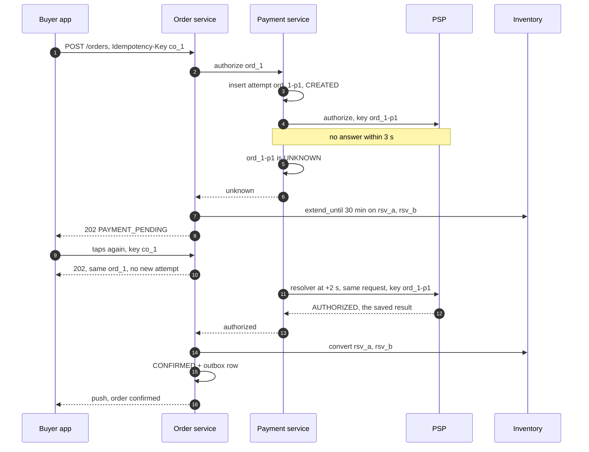

Late success after release: [D5 in diagrams.md](diagrams.md#d5-failure-paths). Attempt states: [D8](diagrams.md#d8-state-machines). Deep dive: [`deep-dives/checkout-saga-and-payment-idempotency.md`](deep-dives/checkout-saga-and-payment-idempotency.md). Related: [`../payments-ledger/deep-dives/rails-timeouts-and-unknown-outcome.md`](../payments-ledger/deep-dives/rails-timeouts-and-unknown-outcome.md), [`../payments-ledger/deep-dives/idempotency-keys.md`](../payments-ledger/deep-dives/idempotency-keys.md), [`../../concepts/exactly-once.md`](../../concepts/exactly-once.md).

### 5.3 "A seller sets stock to 50 while three checkouts are reserving the same SKU. How is no update lost?"

**Three writers share one row.** The seller writes `on_hand`. Checkouts write `reserved` and `sold`. For FC pools the WMS writes `on_hand` and acknowledges holds. The rule: **each writer changes only its own columns, with one conditional statement, and the row lock orders them.** No writer reads a value into application memory and writes it back.

**The probe, with numbers.** Row `(sku_77, seller:s9)`: `on_hand` 40, `sold` 5 (confirmed, not yet shipped), `reserved` 0. Sellable 35.

| Time | Writer | Statement | Row after | Sellable |
|---|---|---|---|---|
| 10:00:00.010 | Checkout A | `reserved + 1 WHERE sellable >= 1` | 40, 5, 1 | 34 |
| 10:00:00.020 | Checkout B | same | 40, 5, 2 | 33 |
| 10:00:00.025 | Seller ERP | `SET_COUNT(50, counted_at 09:58, r1)`: `on_hand = 50 +` net movements after 09:58 (none) | 50, 5, 2 | 43 |
| 10:00:00.030 | Checkout C | `reserved + 1 WHERE sellable >= 1` | 50, 5, 3 | 42 |
| 10:01 | A confirms, B declines, C expires | convert, release, release | 50, 6, 0 | 44 |

The order of the four statements does not matter: the seller's statement never touches `reserved`, and the checkouts never touch `on_hand`. Nothing is lost.

**What "50" means is part of the answer.** The seller counted units on the shelf. The 5 sold-but-unshipped units are on that shelf, so they are inside the 50. That is why `on_hand` includes `sold`, and why sellable subtracts it.

**The race that does lose units: a count applied after other movements.** The seller's ERP counts 50 at 09:58, including 2 units for order `O7`. The seller ships `O7` at 09:59 and receives 25 units at 10:02; the feed arrives at 10:05. A plain "set 50" puts the 2 shipped units back on sale and drops the 25 received; "minus shipments since" fixes the first and still hides the receipt. `SET_COUNT` applies the count plus the net of every `SHIP` and `ADJUST` recorded after `counted_at`: `50 − 2 + 25 = 73`. A count taken at 06:00 that arrives at 10:06 is older than the last applied one and is ignored. Seeded 30 days on one busy SKU: a plain set oversold 83 units, minus-shipments lost 88 sales, the full rule oversold 17 (a floor of 14 from loss nobody recorded) and lost 11.

**Bad: one `available` counter, or read-modify-write.** The seller's "set 50" on a single counter erases the three decrements. An ORM that reads the row, changes `on_hand`, and saves the whole row writes `reserved` back to 0. Either way, three units are oversold.

**Good: per-column updates, plus `If-Match` on the row's version.** Correct for the probe. Costs: the version changes on every reservation, so a seller editing stock in the portal gets a `412` every few seconds on a busy SKU, and feeds cannot send versions at all.

**Great: typed, idempotent ledger operations, `counted_at`, and a `count_version` for humans.** As in §4.2: `SET_COUNT` adds the net of movements after `counted_at` and ignores older counts; `ADJUST` commutes; every operation is deduplicated by `request_id`; the portal's `If-Match` uses `count_version`, which only `on_hand` changes bump.

**Two more conditions close the gaps.**
- **Convert re-checks, carve included.** Converting a reservation is `reserved − q, sold + q WHERE on_hand − sold − carved >= q`, not only `WHERE state = 'HELD'`, so a regular order cannot eat a deal's carved units. If the seller lowered the count below what is sold while a buyer was paying, the convert fails, the authorization is voided, and the buyer hears "sold out, not charged" before an order exists. Cancelling a confirmed order later is worse.
- **A count below `sold`** (the seller lost stock already promised) is accepted, because the shelf is the truth. Sellable goes negative, the SKU goes `OUT`, and the seller gets a task: restock or cancel the deficit within 24 h. It is recorded as seller-caused oversell on the seller's scorecard. If the row has `carved > 0`, the deal's unissued buckets shrink by the deficit first (§5.1).

**The FC pool: same rule, plus versions.** The WMS writes `stock_changed(available_qty, vN)` and `order_allocated(order, qty, vN)` in one transaction, stock first, onto the SKU's partition. `on_hand` takes `available_qty` only if the version is newer; versions stay monotonic across a WMS database failover: the high bits hold an epoch set to `max(db_epoch + 1, promotion unix seconds)`, so even a DR replica that missed an earlier in-region failover cannot re-issue a version commerce has applied, and "newer" stays true after any promotion. A hold, kept per `(fulfillment_id, sku_id, fc_id)` and counted in `sold`, is dropped only when `order_allocated` has arrived **and** the row has applied a `stock_changed` at or above that version, because only that snapshot excludes the allocated units. A short works the same way: `order_line_short` carries the `stock_version` of the `stock_changed` it caused (written after it, in the same transaction), and an `OPEN` hold drops on a short only once that version is applied. For capacity, a hold's units keep counting against its FC's capacity until commerce has applied an `fc_capacity` at or above the `capacity_version` carried on `order_allocated`, which closes the up-to-60 s gap between a hold dropping and the next capacity report.

| Arrival (row at v41: `on_hand` 120, `sold` 2 for fulfillment `ord_1-1`) | Without the rules | With them |
|---|---|---|
| `stock_changed` v42 (118), then `order_allocated` v42: the normal order | correct; 2 under for the milliseconds between them | same: under-counting is the safe side |
| `order_allocated` v42 first (a replay from an old offset, a topic migration) | `on_hand` still 120 and the hold gone: **2 oversellable** | hold kept until v42 is applied: never over |
| `stock_changed` v41 replayed after v42 | `on_hand` back to 120: **2 over** | ignored, 41 is older |
| `order_allocated` delivered twice | `sold − 2` twice: **2 over** | hold already dropped, a no-op |

**Push back on the textbook answer.** "Use optimistic locking with a version on every write." On a row that three checkouts and a seller touch within 30 ms, optimistic concurrency turns contention into retries, and on a hot SKU it turns ~300 to 1,000 updates a second into a retry storm. Single-statement conditional updates on separate columns need no version at all. We keep `count_version` only for humans editing in a portal.

**What changed.** `SET_COUNT` as count plus later movements, `count_version`, the convert re-check with the carve, the seller deficit task, and the hold-drop rules (stock version for allocations and shorts, capacity version for capacity).

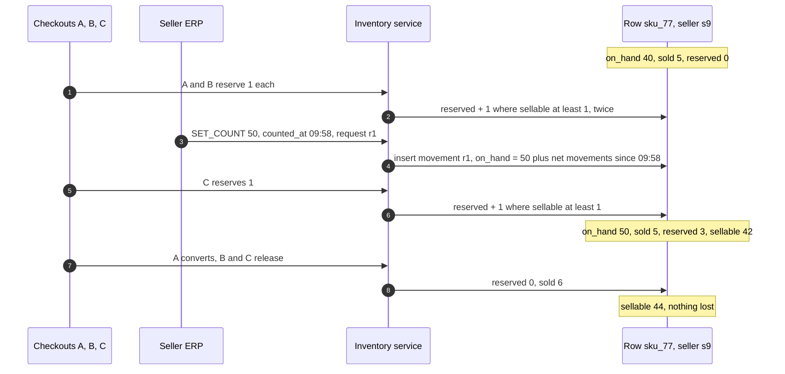

Out-of-order WMS events as a sequence: [D5 in diagrams.md](diagrams.md#d5-failure-paths). Deep dive: [`deep-dives/inventory-registration-and-stock-model.md`](deep-dives/inventory-registration-and-stock-model.md). [`../../concepts/mvcc-and-isolation.md`](../../concepts/mvcc-and-isolation.md).

### 5.4 "Search shows in stock, but checkout says sold out. How fresh is availability, and where is the truth checked?"

**The answer in one line.** Every screen before "Place order" shows a hint that is 1 to 3 s old. The truth is checked exactly once, by the conditional update at reserve, on the primary of the SKU's shard. We make the hint fresh enough that the mismatch is rare, and we make the mismatch cheap when it happens.

**The freshness budget** (a stock change on the primary to what a buyer sees):

| Hop | p50 | p99 | What sets it |
|---|---|---|---|
| Inventory commit to outbox read by CDC | 50 ms | 500 ms | binlog read, relay batch |
| `availability` topic to builder and indexer | 20 ms | 200 ms | consumer lag |
| Read model upsert, Redis doc replaced by compare-and-set | 10 ms | 100 ms | |
| Product page local cache | 0 | 1 s | 1 s TTL, the only cache the builder does not write |
| Indexer bulk request to the search index | 100 ms | 500 ms | bulk every 100 ms |
| Search refresh | 500 ms | 1 s | `refresh_interval` 1 s, the default ([Elastic](https://www.elastic.co/guide/en/elasticsearch/reference/current/index-modules.html)) |
| **Product page** | **~0.1 s** | **~1.8 s** | |
| **Search** | **~0.7 s** | **~2.3 s** | |

For FC pools, add the WMS's own hop: a physical change reaches the stock row within 2 s p99 (problem 62's target). Silence is ambiguous (no change, or a dead feed), so each FC heartbeats every 5 s; after 30 s without one, that FC's pool sells only beyond a safety margin of `max(2, 5% of on_hand)` [estimate] until the feed is back. Capacity has the same problem: an `fc_capacity` with no update for 2 minutes inside the last hour before a cut-off counts as 0 for that cut-off, and an FC whose heartbeat reports `floor_contact_age` over 2 minutes [estimate] (the building's edge has lost the cloud) stops being offered for dawn promises. A managed search service can be slower by construction: Elastic's Serverless default and minimum refresh is 5 s.

**What breaks in the current design.**
1. **Doc thrash.** Indexing every stock change is ~9k updates a second at peak, and a flash sale is 10k updates of one document in ~0.12 s. Fixed in §4.1 by sending transitions only (`IN_STOCK`, `LOW` 1 to 5, `OUT`, promise changes): ~1% of changes [estimate].
2. **Out-of-order index writes.** A bulk request fails and is retried 15 s later, after a newer transition for the same SKU. The document says "in stock" until the next change, which may be hours. Ordering by the changed stock row's own version does not fix it, because a SKU's availability depends on all its pools: in a seeded run that rule was wrong 34.5% of the time. Fix: a per-SKU `avail_version`, bumped in the same transaction as any change to that SKU's pool rows (all on one shard), carried on every availability event; per-field versions in the document; and a scripted update in the index that is a no-op for an older version (0.007% wrong in the same run, from retries beyond the window). Elasticsearch's external versioning applies to whole-document index requests, not partial updates, so it is not used here.

**Bad: read the inventory primary for every search result.** 24k searches a second × 40 results is ~1M stock reads a second on the money database, to show a flag that is stale by the time the buyer taps.

**Good: index every stock change and refresh every second.** Fresh to ~2 s. Costs: ~9k document updates a second, a flash-sale document rewritten 10k times, and the indexer becomes the thing that lags during a sale.

**Great: transitions with per-SKU versions, compare-and-set cache writes, a soft check at the checkout page, the strong check at reserve, and a useful "no".**
- The read side carries **buckets, not counts**: "only 3 left" comes from `LOW`, never from an exact number on a stale document.
- **The checkout page** (`POST /checkouts`) reads sellable for each line from inventory replicas (lag under 1 s) and flags lines that are out, before the buyer enters payment.
- **Reserve** is the only strong check. A failure returns alternatives in the same response: another seller's offer for the same SKU, another FC with a later promise, or "notify me".
- **We measure the gap.** The reserve call carries what the client last saw (`seen_as = IN_STOCK, seen_at`). The metric is reserve failures for SKUs shown in stock in the last 5 s, as a share of reserves. Target under 0.5% outside flash deals [estimate].
- **Flash deals** bypass all of this: the gateway's deal flag is at most ~0.35 s behind the gate.

**Push back on the textbook answer.** "Make search consistent with inventory: `refresh=wait_for` on every stock write." It delays every stock write by up to the refresh interval, makes the indexer the bottleneck of the money path, and still does not help: the buyer races other buyers between seeing and tapping. Consistency at read time buys nothing that the reserve does not already buy. Coupang's own serving layer accepts a cache that is "99.99% identical on a minutes-basis", with a seconds-level stream only for data like stock.

**What changed.** A per-SKU `avail_version` with no-op scripted updates, compare-and-set cache writes by the builder, a 1 s local cache, the soft check at checkout, alternatives on a failed reserve, the mismatch metric.

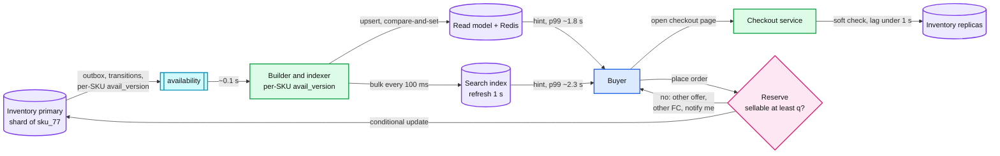

Deep dive: [`deep-dives/catalog-search-and-read-scaling.md`](deep-dives/catalog-search-and-read-scaling.md). [`../../concepts/caching-patterns.md`](../../concepts/caching-patterns.md).

### 5.5 "The price or a coupon changes between the cart and checkout. What does the buyer see and pay?"

**The rule in one line.** The cart never locks a price. The checkout page issues a **quote** that is honored for 10 minutes. Inside those 10 minutes the buyer pays the lower of the quote and the current price; after them, a higher total needs the buyer's yes.

**What breaks in the current design.**
1. **Sellers reprice often.** Repricing tools on competitive items change prices several times an hour [estimate]. A buyer who spends 3 minutes on the checkout page is likely to hit one.
2. **Coupons are limited resources.** "10% off, first 1,000 buyers, 1 per account" is a counter that runs out, like stock.
3. **Deals end.** A buyer who claimed a KRW 9,900 unit at 10:29 is in 3DS at 10:31, after the deal ended.

**Bad: re-price silently at place order and charge the new total.** The buyer pays an amount they never saw. Disputes and support contacts follow.

**Bad, again: lock the price at add-to-cart.** Carts live for weeks. Buyers farm old low prices, and a deal's price leaks into every cart that touched it.

**Good: re-price at place order and fail with `409` if anything changed.** Correct and honest. Costs: given point 1, a meaningful share of checkouts bounce at the last step, at the worst moment.

**Great: a quote with a TTL, the lower of two prices, coupons held at place order, the deal price bound to the claim.**
- **Quote.** `POST /checkouts` prices every line at its current `price_version`, applies the coupon if valid, adds shipping, and stores the total with `expires_at = now + 10 min`, the same as the reservation TTL.
- **Within the TTL.** Place order re-reads current prices. If the current total is lower, the buyer pays that and is told. If higher, the quote stands. The seller agreement says quotes are honored for 10 minutes.
- **After the TTL.** A new quote. Same or lower: proceed. Higher: `409 QUOTE_CHANGED` with the new quote. The order waits in `AWAITING_BUYER` with its reservations held until their TTL; the buyer accepts, the client re-sends `POST /orders` with the same key, and the saga resumes at the pay step.
- **Coupons.** Checked at quote time, **held** at place order with a durable `COUPON_HOLD(checkout_id, coupon_id, buyer_id, counter_shard, state)` row. The hold row and the budget decrement on its sub-counter (`remaining − 1 WHERE remaining >= 1` on one of 8 sub-counter rows) are one transaction on the coupon's pricing shard, and a unique index on `(coupon_id, buyer_id)` over holds that are not `RELEASED` keeps one per buyer. Transitions are idempotent: `HELD → USED` at confirm, `HELD → RELEASED` (budget + 1 in the same transaction) by compensation, and a sweeper releases any `HELD` row whose checkout has reached a terminal state. Budget gone: `409 QUOTE_CHANGED` without the coupon. Coupon end time passed while the quote is valid: honored. At confirm the discount is spread over the lines by largest remainder in whole KRW and stored per line, so a refunded or cancelled line's amount is exact (rounding each line separately misses the order total on ~35% of orders). A "first 1,000 at 10:00" coupon is a flash deal in disguise and uses the same bucket design.
- **Deals.** The claim token carries the deal price. A buyer who claimed before 10:30 pays KRW 9,900, whenever the deal ends.
- **The amount** sent to the PSP is the server-side quote snapshot on the order. The client sends `checkout_id`, never a price.
- **Seller price errors.** A drop of more than 50% goes into a 10-minute review hold before quotes can use it [our choice], so a typo does not become thousands of honored quotes.

**Challenges.** "Lower of the two" costs the sellers a little margin on falling prices and costs us one price read per line at place order. A quote held for 10 minutes means the seller's price change takes up to 10 minutes to reach buyers who were already checking out.

**What changed.** New: the quote, `AWAITING_BUYER`, coupon holds, the deal price on the token, the price-drop review.

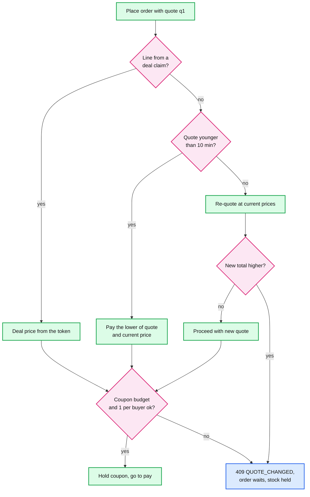

Deep dive: [`deep-dives/cart-and-pricing.md`](deep-dives/cart-and-pricing.md).

### 5.6 "Place order p99 under 2 s, browse at 99.99%, and the PSP slows to 10 s. What keeps each promise?"

**The place-order budget.**

| Step | p50 | p99 | Notes |
|---|---|---|---|
| Gateway, session | 5 ms | 20 ms | |
| Create order, unique check | 5 ms | 30 ms | buyer's shard |
| Reserve, ~2.5 lines in parallel on 1 to 3 shards | 10 ms | 60 ms | one local transaction per line |
| Quote check, coupon hold | 10 ms | 50 ms | |
| Risk check (problem 52) | 20 ms | 100 ms | |
| PSP authorize | 400 ms | 1,500 ms | [estimate] |
| Convert, confirm, outbox | 15 ms | 60 ms | |
| **Sum** | **~0.5 s** | **~1.8 s** ceiling (p99s do not add) | |

The PSP is ~80% of it. Our own steps must stay under ~300 ms at p99, and the 2 s target is "the PSP's p99 plus ours".

**What breaks in the current design.**
1. **Shared pools.** If product pages and checkouts run on the same nodes with one thread pool, a slow PSP fills it, and browsing slows. Coupang's target for its serving layer is 99.99%; browse must not inherit checkout's dependencies.
2. **Little's law on a slow PSP.** At 350 orders a second and 10 s per call, `350 × 10 = 3,500` calls in flight.
3. **Retries.** A client retry, a gateway retry and a service retry turn one slow call into three.
4. **The resolver itself.** 350 new unknowns a second, each asked about 10 times in 30 minutes, is ~3,500 status calls a second to a PSP that is already struggling.

**Bad: one fleet, generous timeouts, retry three times.** Every symptom above at once.

**Good: a bulkhead per dependency and tight timeouts.** Separate connection pools for the PSP, inventory and the read model, each with its own cap. Costs: browse and checkout still share nodes, deploys and noisy neighbors; a timeout still looks like a failure.

**Great: separate fleets, one PSP call with a 3 s timeout, a breaker, and the unknown path.**
- **Browse never calls the money side.** Product page and search run on their own fleet and read only the read model, Redis and the search index. They need no order DB, no inventory primary, no PSP. Redis and the read model serve stale on error (`stale-if-error`), so a read model hiccup shows slightly old pages, not errors.
- **PSP client.** Timeout 3 s, so in flight is at most `350 × 3 = 1,050`; the bulkhead caps it at 1,200 per region. A timeout goes to `UNKNOWN` (§5.2), never to a quick retry.
- **Breaker per PSP.** Opens when over 50% of calls time out in 20 s. While open, new orders on that PSP get "this payment method is slow, try another", or go to a second PSP as **new** attempts. Checkout degrades for those buyers; browse does not notice.
- **The resolver is rate limited** to 200 calls a second per PSP, backs off while the breaker is open, and uses the PSP's batch report when it has one.
- **Inventory failover** returns a retryable error in under 100 ms; the saga's re-driver retries the reserve. Acknowledged reservations survive because the shard commits with semi-synchronous replication.

**Push back on the textbook answer.** "Retry the PSP so the buyer gets an answer faster." Retrying a slow dependency multiplies its load exactly when it is slowest, and at Stripe v1 a retry with the same key may only replay a stored error. One call, a 3 s timeout, then an asynchronous answer while the buyer sees "processing", is faster for the buyer and kinder to the PSP.

**What changed.** Browse and checkout fleets split. PSP timeout, bulkhead, breaker, resolver rate limit. Semi-synchronous replication on the inventory and order databases.

The bulkhead picture, with the PSP call pool in red (it is what a slow PSP fills first, and its cap is what keeps it from filling anything else): [PSP call path in diagrams.md](diagrams.md#d6-activity--decision-flow). PSP brownout timeline: [D5](diagrams.md#d5-failure-paths). [`../../concepts/rate-limiting-and-load-shedding.md`](../../concepts/rate-limiting-and-load-shedding.md).

---

## 6. Final design and the six core flows

Everything from §5 composed. 15 nodes; zoom-ins in [`diagrams.md`](diagrams.md).

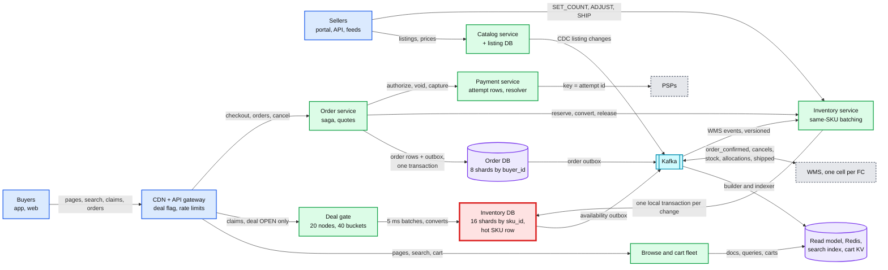

The six flows below are the ones to say from memory. Each is the final design, not the §4 version.

### Flow 1: a normal two-line order, tap to confirmed in ~0.6 s

1. 09:59: the checkout page opens. `POST /checkouts` returns `co_1` and quote `q1` (KRW 31,400, valid to 10:09), and a soft stock check from replicas says both lines are in.
2. 10:00:00.000: `POST /orders`, key `co_1`. `ord_1` is inserted on the buyer's shard, unique on `(buyer_id, co_1)`.
3. ~0.02 s: reserve. Line 1 (`sku_77`) from FC A: FC A has stock, outbound capacity left and the dawn promise for this address. Line 2 from seller `s9`'s pool. Each is one transaction on its SKU's shard: insert the reservation, conditional `reserved + q`.
4. ~0.04 s: the quote is valid and current prices are not lower; coupon `C10` held. ~0.05 s: attempt `ord_1-p1` inserted, authorize sent with key `ord_1-p1`. ~0.47 s: `AUTHORIZED`.
5. ~0.5 s: convert both reservations (`reserved − 1`, `sold + 1`, a WMS hold for line 1). `ord_1` `CONFIRMED` and its outbox row in one transaction. `201`, "arrives tomorrow by 7 am".
6. ~0.7 s: CDC publishes `order_confirmed` with fulfillment `ord_1-1` for line 1. FC A's WMS intake takes it (idempotent on `fulfillment_id`); seller `s9` is notified. Picture: [FR4 sequence](#44-placing-an-order-reserves-stock-prices-it-authorizes-payment-and-confirms-it-safe-to-retry).

### Flow 2: the flash sale at 10:00:00

1. 09:50: deal setup sends `capacity_hold` for 6,000 units to FC A and 4,000 to FC B for tonight's dawn cut-off; both are granted in full. It carves 6,000 units from `(sku_77, fc:A)` and 4,000 from `(sku_77, fc:B)`, and writes 40 bucket rows of 250 across 16 shards.
2. 09:55: 20 gate nodes lease 2 buckets each (epoch 1).
3. 10:00:00.000 to .120: ~12k claims reach gate nodes. A buyer's second claim gets the same token. 10k units are issued in 5 ms batches per bucket; buyers get tokens with a 5-minute expiry, p99 ~30 ms.
4. ~.2 s: the deal state says `SOLD_OUT`. Until ~.5 s, when every gateway has polled it, ~20k more claims reach gate nodes and are refused from memory (~32k in all in the seeded run). The remaining ~968k taps in the 10 s window are answered by gateways.
5. 10:00 to 10:05: winners check out. ~10k authorizations over ~3 minutes, ~55 a second. Each convert marks the claim `CONVERTED` with its owner, then writes `carved − 1`, `sold + 1` and the WMS hold row in one transaction on the stock row's shard, before the order is `CONFIRMED`: ~55 stock-row writes a second.
6. 10:05: ~1,500 unpaid claims expire [estimate, 15% abandon]. Their owners release them row by row and return the units to their buckets; the deal flips to `OPEN` for a few seconds, and late tappers get them. Claims behind an unknown payment are not expired: their `extend_until` holds them up to 30 minutes. 10:30: owners return units never issued and claims released since; claims still behind an unknown payment stay carved until they resolve. `capacity_release(D)` returns the hold minus what is drawn and what open claims may still draw; a final `capacity_release(D)` follows when the last claim resolves, by 11:00 at the latest. Picture: [§5.1](#51-flash-sale-10k-units-1m-buyers-at-100000-how-do-you-avoid-both-overselling-and-melting-the-database-on-one-hot-row).

### Flow 3: the PSP times out and the buyer taps again

1. 10:00:00: `ord_1` reserved, attempt `ord_1-p1` sent.
2. 10:00:03: no answer. `ord_1-p1` is `UNKNOWN`. The reservations get `extend_until` 10:30. The buyer sees "confirming your payment" (`202`).
3. 10:00:04: the buyer taps again with key `co_1`. Same order, same `202`, no new attempt: the one-live-attempt index would refuse it anyway.
4. 10:00:05: the PSP documents idempotency keys, so the resolver re-sends the same authorize with key `ord_1-p1`; the PSP returns its saved result, `AUTHORIZED`. (Against a keyless PG it would look up `ord_1-p1` and its `paymentKey` instead.) Convert, confirm, outbox, push. One order, one authorization, the units held throughout.
5. Had the PSP stayed silent until 10:30: release the stock, `PAYMENT_UNRESOLVED`, and void any authorization that turns up later. Picture: [§5.2](#52-the-payment-call-times-out-and-the-buyer-taps-again-how-do-you-avoid-a-double-charge-a-double-order-or-stock-stuck-in-a-reservation).

### Flow 4: a seller's count races three checkouts, and the WMS acknowledges an allocation

1. Seller pool row `(sku_77, seller:s9)`: 40 on hand, 5 sold. Checkouts A and B reserve 1 each; the seller's ERP sends `SET_COUNT(50, counted_at 09:58)`; checkout C reserves 1. Each statement touches its own columns: 50 on hand, 5 sold, 3 reserved, sellable 42. Nothing lost.
2. FC pool row `(sku_77, fc:A)`: the WMS allocates 2 units for fulfillment `ord_1-1` and, in one transaction, writes `stock_changed` (118, version 42) then `order_allocated` (version 42). Commerce applies the snapshot (2 under for a few milliseconds, the safe side), then drops the hold because the row is already at version 42. Had they arrived the other way round, the hold would wait for version 42. Sellable never over-counts.
3. A replayed `stock_changed` version 41 arrives after a consumer restart: ignored. Picture: [§5.3](#53-a-seller-sets-stock-to-50-while-three-checkouts-are-reserving-the-same-sku-how-is-no-update-lost).

### Flow 5: search said "in stock", the reserve says no

1. 10:00:00.0: the last unit of `sku_31` is reserved by another buyer.
2. ~10:00:00.1: `availability(sku_31, OUT)` is in the read model and Redis. ~10:00:00.7 (p99 ~2.3 s): search shows it out.
3. Meanwhile our buyer tapped from a search page loaded at 09:59:59 and reached `POST /checkouts` at 10:00:00.3. The soft check on a replica already says `OUT`: the line is flagged before payment, with another seller's offer for the same SKU.
4. Had the buyer been faster, the reserve would have returned `409 OUT_OF_STOCK` with the same alternatives. The metric counts it as a "shown in stock within 5 s" miss. Picture: [§5.4](#54-search-shows-in-stock-but-checkout-says-sold-out-how-fresh-is-availability-and-where-is-the-truth-checked).

### Flow 6: a short pick at FC A

1. 23:10: `ord_5` confirmed, one unit of `sku_31` from FC A as fulfillment `ord_5-1`, hold `OPEN`. 23:12: `order_allocated` and the matching `stock_changed`; the hold drops.
2. 01:40: the picker finds the bin empty. The WMS tries another bin in FC A, finds none, publishes a `stock_changed` with the corrected count (version 91) and, after it in the same transaction, `order_line_short(ord_5, ord_5-1, sku_31, FC A, 1, no_stock, v91)`, and flags the bin for a cycle count. Commerce drops the line's hold only once version 91 is applied.
3. Commerce marks the line `SHORT` and tries to re-source: a normal reserve in FC B, which has stock and capacity. The re-source is keyed on the source fulfillment and line (`ord_5-1`, line 1), so a duplicate short after a relay restart never creates `ord_5-3`, and it is written only in a transaction that checks the order is not `CANCEL_REQUESTED` (the WMS also keeps a 7-day tombstone for a cancelled fulfillment it has not yet seen). FC B's cut-off for dawn delivery has passed, so the promise slips to the afternoon; the buyer is told and may cancel the line. FC B receives the line as fulfillment `ord_5-2`; a new id, so FC intake never mistakes it for a replay of `ord_5-1`.
4. If no FC has stock: the line is cancelled, and the rest of the order ships (the WMS ships what it has; the partial-shipment policy is ours). Nothing has shipped yet, so the first shipment captures the order total minus that line, using the per-line coupon split stored at confirm: no refund to issue. Had another line already shipped and been captured, the short line would be a partial refund; on a one-step Korean PG, a partial cancel.
5. Had the reason been `missed_cutoff` (stock exists, the truck has left), the WMS keeps the allocation and plans the units into the next cut-off's waves. Commerce tells the buyer the new date, and if the buyer declines it cancels just that line (`order_cancel_requested` with `lines`). To have another FC keep the original promise instead, commerce first cancels the line at FC A and sends `ord_5-2` only after `order_cancel_result(cancelled)` for it; otherwise both FCs ship.
6. The count-drift counter goes up by 1: physical drift, against its own budget, not a system-caused oversell (which has a target of 0 and pages). [D4 in diagrams.md](diagrams.md#d4-happy-paths-one-per-fr).

---

## 7. Trade-offs

| Decision | Option A | Option B | Chose | Why |
|---|---|---|---|---|
| Read path | Query the listing and inventory DBs, cache with TTL | Read model and index fed by CDC and transition events | Event-fed read model | Browse never touches a money database. Costs 1 to 3 s of staleness, checked away at reserve |
| Where stock truth lives | Redis counter | Conditional updates in a sharded relational DB, one local transaction with the reservation row | Relational | Async Redis replication can un-decrement on failover. The DB gives `issued ≤ units` and the reservation row atomically |
| Shape of a stock row | One `available` counter | `on_hand`, `reserved`, `sold`, `carved`, written by separate owners | Separate columns | Probe 3: no writer can erase another's change. Costs one more column to explain |
| Seller writes | Absolute set with `If-Match` on the row | Typed ledger ops, `counted_at`, `count_version` for humans | Ledger ops | Handles counts applied after shipments or receipts, stale counts, and feeds that cannot do versions |
| When to reserve | At add to cart | At place order (deals: at claim) | Place order | Carts would hoard stock for days |
| Reservation lifetime | 30 min flat | 10 min (5 for deals), extended only while a payment is unknown, 30 min ceiling | Short with extension | Short holds return unsold stock fast. The extension stops a timeout from becoming an oversell |
| Flash sale | Batch same-SKU reserves on one node | Carved buckets, single-owner gate nodes, gateway flag | Buckets, with batching kept as a guard | No single node, losers answered at the gateway. Costs a deal setup step (capacity hold, carve, buckets) and leases |
| Waiting room | On for every deal | Off, the gateway flag answers losers | Off | The sale is decided in ~0.12 s. A queue adds minutes and prevents nothing |
| Checkout coordination | 2PC across services | Saga, state in the order row, idempotent steps, re-driver | Saga | The PSP cannot join a 2PC, and 2PC would hold the stock row lock for the PSP's 400 ms |
| Saga engine | Temporal | Order row plus a re-driver | Order row | At 350 orders a second, one table and a scan are enough. Temporal is right if the company already runs it ([`../../concepts/temporal-durable-execution.md`](../../concepts/temporal-durable-execution.md)) |
| Payment timing | Capture at order | Authorize at order, capture once at the first shipment | Capture at the first shipment, for the total minus lines already short or cancelled | Shorts and cancels before it are a smaller capture or a void; after it, partial refunds. Per-shipment capture only where the PSP supports several partial captures [check per PSP]. Bounded by the 7-day hold for most online cards |
| Meaning of a PSP timeout | Decline | `UNKNOWN`, resolver, stock held | Unknown | A decline guess can charge for a unit we no longer hold |
| Price between cart and order | Lock at cart, or re-price and bounce | 10-minute quote, lower price wins | Quote | Buyers pay what they saw. Sellers lose a little margin on falling prices |
| Search availability | Index every change, `refresh=wait_for` | Transitions only, 1 s refresh, strong check at reserve | Transitions | ~1% of the index writes, and read-time consistency buys nothing |
| FC choice | WMS picks at allocation | Commerce picks at reservation, skipping FCs without capacity | Commerce | The shared contract, and the promise shown at checkout must be the FC's promise |
| Refused to build | Exact live counts on search pages, reservation at add to cart, 2PC, a default waiting room, lottery deals, active-active stock across regions, guest checkout, our own multi-FC split optimizer | | | Each costs more than it returns at this scale, or is a product decision rather than a design one |

**Consistency model, stated once.** Reserve, convert and release: strong per SKU, one local transaction on the primary of the SKU's shard, committed with semi-synchronous replication. Deal claims: strong per bucket (the database enforces `issued ≤ units`), decided in memory first. Seller stock operations: strong per row, idempotent by `request_id`. WMS to commerce: at-least-once, ordered per SKU, versioned, about 2 s behind the floor. Order state: strong per order (conditional updates on the buyer's shard); a buyer reads their own writes from the primary for 5 s. Order to WMS and sellers: at-least-once through the outbox, idempotent at the receiver, under a second. Cart: read-your-writes for its buyer. Product pages and search: eventual, ~0.1 to 0.7 s typical, ~2.3 s p99. Payment: at most one successful authorization per order, by attempt rows, PSP keys and the resolver. **The consistency changes at the reserve call**: everything a buyer sees before it is a hint, and everything after it is exact.

---

## 8. Staff-level notes

- **Simplest thing that meets the requirement.** A read model fed by events, one sharded relational inventory store with conditional updates, a saga whose state is a row, an outbox, and one special component, the deal gate, used only for deals. We refused a Redis stock counter, 2PC, a waiting room, exact counts on search pages and a workflow engine, and can say why for each (§7).
- **Failure modes and blast radius.**
  - **An inventory shard primary dies.** Semi-synchronous replication means acknowledged reservations are on a replica. Failover takes ~10 to 30 s [estimate]. Reserves for a sixteenth of SKUs fail fast with a retryable error; the saga's re-driver retries. Browse is unaffected.
  - **A gate node dies mid-sale.** Its 2 buckets (500 units) pause for ~3 s (2 s lease plus 1 s margin), then another node takes them with a higher epoch, along with the dead node's buyer range. No oversell; buyers whose claims went unanswered retry with `resume` and get their existing tokens.
  - **Kafka is down, or one FC's feed stalls.** Confirmed orders wait in the order DB's outbox; the WMS gets them late. WMS stock events wait too: FC stock in commerce freezes. Receipts are not sellable yet (undersell); damage is not yet subtracted (a few short picks). After 30 s without an FC's heartbeat, its pool sells only beyond a safety margin, which bounds that exposure; capacity silent for 2 minutes in the last hour before a cut-off counts as 0, and an FC with `floor_contact_age` over 2 minutes gets no new dawn promises. Browse goes stale but stays up.
  - **The PSP is slow or down.** Checkouts on that PSP move to `PAYMENT_PENDING`, then to a second PSP for new attempts. Browse is untouched (§5.6).
  - **An order DB shard, the search cluster, or the cart store is down.** Buyers on that order shard (1/8) cannot check out; search slows or returns partial results while pages and checkout work; "buy now" works while the cart page does not.
  - **Biggest blast radius: a bad inventory deploy** that computes sellable wrong (say, forgets `carved`). It oversells every SKU at once. Hence an invariant check on every write path in the canary (`sellable ≥ 0` unless a seller deficit is flagged, `sum(HELD) = reserved`), a canary by SKU hash, and an automatic rollback on any invariant failure.
- **Migration from an existing system** (say, a monolith whose order transaction decrements `products.stock`, calls the PG inline, and feeds search from a nightly batch):
  1. Read side first: CDC from the monolith's DB into the read model and index. No risk to orders.
  2. Inventory service in shadow: it consumes the monolith's stock changes, keeps the new columns, and a job compares sellable per SKU every minute.
  3. Ownership by SKU hash, 1% to 10% to 50% to 100%: for owned SKUs the monolith's order transaction calls the inventory service instead of decrementing its column. Each SKU has an owner flag with an `effective_from` a minute ahead, so each reservation has exactly one owner. Rollback is the flag; the movement ledger lets us rebuild the old column.
  4. The checkout saga, payment attempts and idempotency keys, for new orders only. Old in-flight orders finish in the monolith.
  5. The deal gate, for new deals only.
  6. The WMS contract with problem 62, the reconciliation job, then remove `products.stock`. [D12](diagrams.md#d12-rollout--migration).
- **Operability.** SLOs over 28 days:
  - product page availability 99.99%, p99 under 200 ms;
  - place order: 99.95% of attempts end in a buyer-caused outcome (decline, out of stock, quote change) or `CONFIRMED`, p99 under 2 s excluding 3DS;
  - system-caused oversell (a bug, a lost or misapplied event, a race in our code): target 0, and any occurrence pages;
  - physical count drift (damage or miscount found at pick) tracked separately against its own budget, under 0.05% of confirmed FC lines a day [estimate], owned with the WMS team; seller deficits go on the seller's scorecard;
  - zero double charges, and zero authorizations without an order after 24 h (settlement match);
  - reservation leak zero: `sum(HELD) = reserved` on every row, hourly.

  Pages at 3 am: any system-caused oversell; reserve errors other than out of stock over 1% for 5 minutes; any inventory invariant violation; `UNKNOWN` attempts over 500, or any older than 10 minutes; a PSP breaker open; outbox or `wms.stock-events` consumer lag over 30 s; an overdue `HELD` reservation older than 60 s (the sweeper is stalled); any FC's heartbeat stale for 60 s; reconciliation drift with the WMS over 0.5% of (SKU, FC) pairs; a gate lease lost during a live deal.

  Not a page: one seller's deficit (a seller task) or one SKU's reserve failures (normal sell-out).
- **Cost** [estimate, list prices, per month]: search cluster, ~60 data nodes, ~$60k; inventory DB, 16 shards × 3, ~$55k; read model store and Redis ~$35k; order DB, 8 shards × 3, ~$30k; browse and cart fleet, ~60 nodes, ~$18k; gateways sized for 100k claims a second on top of browse, ~40 nodes, ~$12k; checkout, inventory and payment services ~$12k; Kafka ~$8k; cart KV ~$8k; deal gate, 20 nodes, ~$6k. About $245k a month, **~$3M a year**, excluding the CDN and images. For scale: oversell at 0.1% of 3M orders a day, at ~$10 a case (cancel, apology coupon, support contact) [estimate], is ~$11M a year. Correctness work pays for the whole platform several times over. Card fees on $34.5B of revenue (Coupang FY2025) dwarf both, which is why "one charge per order" is a business number, not a nicety.
- **Team boundaries.**
  - Catalog and search (listing DB, read model, index; contract: `listing-changes` and `availability`). Inventory (stock rows, reservations, deal gate, WMS consumer; contract: reserve, convert, release). Checkout and orders (saga, quotes, order DB, cancel; contract: `order-events`).
  - Payments (attempts, PSPs, resolver, settlement match, [`../payments-ledger/`](../payments-ledger/)). Pricing and promotions (prices, coupons, deal setup). Seller platform (APIs, feeds, scorecards, notifications, [`../webhook-delivery/`](../webhook-delivery/)).
  - WMS team (problem 62): physical stock and the shared contract on four topics (`orders.fc-<fc>`, `wms.stock-events`, `wms.fc-capacity`, `wms.order-status`): versioned stock and allocation events (stock first, failover-safe versions, a `capacity_version` on allocations), fulfillment ids on every order event, `deal_id` on deal fulfillments, shorts with a reason and a stock version, capacity per cut-off counting only acknowledged fulfillments, capacity holds for deals, per-FC heartbeats on every partition, `order_packed` and `order_shipped`, and line-level cancels.
- **Explicit trade-off.** We accept 1 to 3 s stale availability on every screen before checkout, a 10-minute window in which a seller's new price does not reach buyers already checking out, and up to 30 minutes of held stock behind an unknown payment. In return: no counted unit is sold twice, no buyer is charged twice, and a flash sale costs the database 40 rows.

---

## 9. What is expected at each level

**Mid (80/20 breadth/depth).** Services for catalog, cart, order, inventory and payment. A product DB with a stock column decremented in the order transaction, maybe with `SELECT ... FOR UPDATE`. A cache for product pages and a search index. Reserve stock at checkout with a timeout. An idempotency key on the payment call. May reserve at add to cart, may call the PSP inside the stock transaction, and usually does not notice that a flash sale is one row.

**Senior (60/40).** Separates the read model from the write path with CDC. A conditional update (`WHERE stock >= q`) and a reservation with a TTL. A saga with compensations, reserve before pay. Idempotency keys end to end. For flash sales, a Redis counter or a queue in front, plus a sold-out flag. Mentions eventual consistency of search. Goes deep on one of flash sale, saga or caching.

**Staff+ (40/60).** Everything above, plus:
- says in the first minute that the hot spot is one row and that the flash sale is a rejection problem, with the ~300 to 1,000 versus 100k arithmetic;
- carves the deal into single-owner buckets with a database-enforced bound, answers losers at the gateway, and pushes back on Redis-as-truth and on waiting rooms;
- treats a PSP timeout as unknown, holds stock while it is unknown, resolves with the same key or a query by reference, and knows the PSP forgets keys after a day;
- separates `on_hand`, `reserved` and `sold`, answers probe 3 with "each writer owns its columns", and applies a count as the count plus the movements recorded after it;
- states the hold-drop rule for WMS events with versions;
- prices with a quote and says what the buyer pays and when;
- names the consistency change at the reserve call, the 3 am pages, the migration with an owner flag, and the WMS contract gaps.

---

## 10. Nitty-gritty (past interview scope)

### 10.1 Internals of each chosen technology

**The reserve transaction on InnoDB (MySQL).** The stock row is a record in the table's clustered index. Under `READ COMMITTED`, the `UPDATE ... WHERE on_hand − sold − reserved − carved >= q` reads the latest committed version, takes an exclusive record lock, re-evaluates the condition under the lock, and changes the row only if it still holds. Zero rows changed means "not enough", with no exception and no retry loop. The lock is held until commit. Commit writes the redo log and the binlog with group commit (one fsync for many transactions), and with semi-synchronous replication in `AFTER_SYNC` mode the primary waits for one replica to acknowledge the binlog events **before** the transaction becomes visible and its locks are released. So the lock window is roughly the statement, the fsync and one round trip to a replica in another AZ: ~1 to 3 ms [estimate], which is where the ~300 to 1,000 updates a second per row comes from. Group commit does not help one row: the next transaction cannot run its `UPDATE` until the lock is released. Two consequences: insert the reservation row **before** the update, so the stock row's lock is held for one statement, not two (Alibaba's advice is the same: cut statements and round trips inside the locked section); and set `innodb_lock_wait_timeout` to 1 s instead of the default 50 s, so a queue on a hot row fails fast instead of pinning connections.

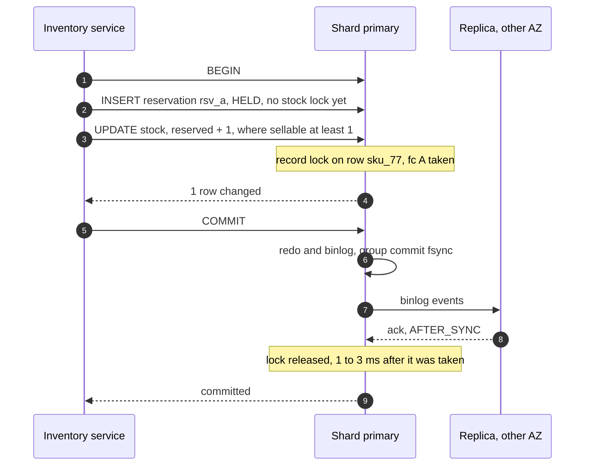

**Kafka, as this design uses it.** `wms.stock-events` has 64 partitions keyed by `sku_id`, so every event for one SKU, from every FC, is in one partition in the order each FC's outbox wrote it. Replication 3 across AZs, `acks=all`, `min.insync.replicas=2`, `unclean.leader.election.enable=false`: an acknowledged event survives one broker loss. The inventory consumer applies a batch in one transaction per shard and commits the Kafka offset **after** the database commit. A crash re-delivers the batch; the version checks and hold states make the second apply a no-op. The WMS writes each FC's 5 s heartbeat to **every** partition (~100 FCs × 64 partitions every 5 s, ~1.3k tiny records a second), so each consumer judges staleness per (partition, FC) on its own. Outboxes (order DB, inventory DB) are read from the binlog by a CDC relay, in commit order, so there is no polling gap ([`../cdc-pipeline/`](../cdc-pipeline/)).

**The search index.** Lucene writes new documents into in-memory segments; a **refresh** (every 1 s) makes them searchable; an update is a delete plus a re-index of the whole document. Availability changes are applied as scripted partial updates that compare the event's per-SKU `avail_version` with the field's stored version and do nothing for an older one, so a delayed `IN_STOCK` cannot overwrite a newer `OUT`. Elasticsearch's `version_type=external` would only work on whole-document index requests, and the document has fields from two sources with two versions. Read throughput scales with replicas (each query runs on one copy of each shard); size and indexing rate scale with primaries.

**The deal gate.** Each bucket is a single-threaded actor on its owner node: a remaining count, a pending batch, a timer wheel of claim expiries, and the lease (`owner`, `epoch`, `lease_until`): during a live deal a 2 s lease renewed every 500 ms, with a 1 s takeover margin. A batch is flushed every 5 ms or at 100 claims, whichever is first. The fencing check rides inside the batch's own `UPDATE` (`AND epoch = e`), so there is no separate "am I still the owner" read to race. On takeover, the new owner bumps the epoch, reads `issued`, takes the dead node's whole buyer range, and rebuilds both the timer wheel and "who already won" from the `HELD` ledger rows; a resumed claim from one of those buyers gets the existing token. Expiry is per ledger row (`HELD → RELEASED WHERE state = 'HELD'`, then `issued −` rows changed), and skips claims whose `extend_until` is in the future. Picture: [claim flow inside a gate node, D6](diagrams.md#d6-activity--decision-flow).

### 10.2 Configuration knobs that matter

| Component | Knob | Value | Why |
|---|---|---|---|
| Inventory DB | `innodb_lock_wait_timeout` | 1 s (default 50 s) | A queue on a hot row fails fast instead of pinning connections for 50 s |
| Inventory DB | `transaction_isolation` | `READ COMMITTED` | The conditional update re-checks the latest row under its lock; no gap locks on the reservation index |
| Inventory DB | semi-sync wait point, replicas to wait for | `AFTER_SYNC`, 1 | An acknowledged reservation is on a replica before any reader sees it |
| Inventory service | same-SKU batching | 5 ms window, up to 500 per batch (200 transactions a second), per-SKU queue cap 2,000 then "try again" | Alibaba's queueing at the app tier; under the row's ~300 to 1,000 ceiling; bounded memory |
| Inventory service | connections per node per shard | 64, at most 16 for any one SKU | One hot SKU cannot take a whole shard's pool |
| Reservations | TTL, extension ceiling | 10 min (5 for deals), 30 min while payment is unknown | §5.2 |
| Deal gate | buckets, batch window, lease | 40 × 250, 5 ms or 100 claims, live-deal lease 2 s renewed every 500 ms, 1 s margin | 200 transactions a second per bucket row; ~3 s pause on failover; 80 renewal writes a second |
| Gateway | deal-state poll, stale limit | 250 ms, fall through to the gate after 1 s without a poll | Losers answered within ~0.5 s of sell-out; a broken poll fails toward the always-correct gate |
| Search | `refresh_interval` | 1 s; 30 s during a full reindex | Default freshness; cheaper bulk rebuilds |
| Search | versioning | per-SKU `avail_version` and per-field versions, scripted no-op update for older versions | Late or retried writes cannot undo newer ones |
| Kafka | `acks`, `min.insync.replicas`, unclean election | `all`, 2, false | No acknowledged loss on one broker failure |
| Kafka | `wms.stock-events` partitions | 64, keyed by `sku_id` | Per-SKU order; ~16 events a second per partition at peak |
| Inventory consumer | FC feed stale rule | heartbeat every 5 s; stale after 30 s; then sell only beyond `max(2, 5% of on_hand)` [estimate] | Bounds what a dead feed can oversell without stopping the FC |
| Pool pick | capacity and floor rules | a capacity token per reservation from an 8-shard tally per FC and cut-off (conditional, idempotent by reservation id, returned with the reservation), the tally rebuilt from reservation and hold rows every 60 s; open non-deal holds and live reservations both count; capacity silent 2 min in the last hour before a cut-off = 0; `floor_contact_age` over 2 min [estimate] = no dawn promise | Holds alone let 151 of 1,000 simulated nights miss the truck; with live reservations, 0. Overshoot is tens of units, under the FC's ~2% reserve |
| Payment | PSP timeout, bulkhead, breaker | 3 s; 1,200 in flight; open at 50% timeouts in 20 s | §5.6 |

### 10.3 Capacity math per component

| Component | Per unit | Load at peak | Closest to its limit? |
|---|---|---|---|
| **Flash SKU stock row, no gate** | ~300 to 1,000 conditional updates/s [estimate] | 100k/s | **Yes, 100x to 300x over. The red node** |
| Deal bucket row | ~300 to 1,000 txn/s, single writer | ≤ 200 batches/s | No, single writer, no lock waits |
| Gate node | ~50k in-memory claims/s [estimate] | `100k ÷ 20 = 5k/s` for ~0.5 s | No |
| API gateway | ~20k req/s per node [estimate] | 100k claims/s + 60k browse/s over ~40 nodes = 4k/s each | No, sized for deals |
| Inventory shard primary | several thousand small txn/s [estimate] | ~560/s average at peak, ~1.5k/s in a feed burst | No |
| PSP | contract rate, ~1,000 auth/s [estimate] | 350/s, ~400/s with a deal's checkout wave | Watch during deals |
| Search data node | ~3k shard queries/s [estimate] | 24k queries/s, 40% from the result cache, 10 primaries, 60 nodes: `14.4k × 10 ÷ 60 = 2.4k/s` | **Yes, ~80% at peak.** Add replicas before a big sale |

### 10.4 Failure timeline

**(1) An inventory shard primary dies at the evening peak.**

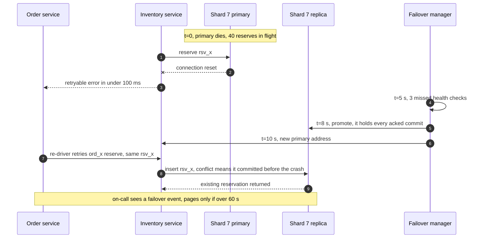

Detection ~5 s. Failover ~10 to 30 s. Data at risk: none acknowledged (`AFTER_SYNC`). A reservation that committed on the old primary but whose reply was lost is found by its deterministic id. Buyers see "try again" or a slower checkout for a sixteenth of SKUs. On-call sees a failover event.

**(2) A gate node dies mid-sale.** [D5 in diagrams.md](diagrams.md#d5-failure-paths). Detection by lease expiry, 2 s plus a 1 s margin. 500 units paused ~3 s, none oversold; unanswered winners recover their tokens with `resume`.

**(3) The PSP slows to 10 s for 15 minutes.** Second-by-second in [D5 in diagrams.md](diagrams.md#d5-failure-paths). Detection ~20 s. Data at risk: none; every unknown is resolved or voided. Buyers see "confirming your payment" for seconds to minutes. Browse sees nothing.

### 10.5 Exactly-once and idempotency end to end

| Hop | Duplicates can enter? | Removed where | Key | Lives |
|---|---|---|---|---|
| Buyer to `POST /orders` | Yes: double tap, app retry, gateway retry | Order DB | unique `(buyer_id, checkout_id)` | forever (it is the order) |
| Order service to reserve | Yes: saga retry, re-driver | Inventory shard | `reservation_id = hash(order_id, line_no)` | 7 days hot |
| Convert and release | Yes, and they race each other | Inventory shard | `WHERE state = 'HELD'`: exactly one wins | |
| Deal claim | Yes: double tap, failover re-route | Gate memory, then the order DB | claims keyed by `(deal_id, buyer_id)` in memory, rebuilt from `HELD` rows on failover; a `DEAL_PURCHASE(buyer_id, deal_id)` row inserted at confirm | deal life; forever |
| Payment service to PSP | Yes: resolver re-sends (keyed PSPs only), timeouts | PSP, and our attempt row | PSP key `= attempt_id` where the PSP has keys, lookups by `orderId` and `paymentKey` where it has none; one live attempt per order | PSP: ~24 h at Stripe v1; ours: forever |
| Capture and void | Yes: retries | PSP, attempt state | `capture-<attempt_id>`, `void-<attempt_id>` | |
| Order outbox to WMS | Yes: relay restart, consumer replay | WMS intake | `fulfillment_id = <order_id>-<n>`; a re-source gets the next `n` | WMS side |
| Deal setup to WMS capacity hold | Yes: setup retries | WMS | `(deal_id, fc, date, cutoff)` | deal life |
| Short pick to re-source | Yes: a duplicate `order_line_short` after a relay restart | Order DB | `(source fulfillment_id, line)`: one re-source, never a `-3`; written only if the order is not `CANCEL_REQUESTED` | order life |
| WMS events to inventory | Yes: redelivery, replay | Inventory shard | `stock_version` per (SKU, FC); hold state | |
| Seller stock operations | Yes: API retries, feed re-uploads | Inventory shard | `request_id` unique on movements | 90 days |

The rule for every new hop: **derive its key from the order attempt's key, and write the intent row before the side effect.**

### 10.6 Consistency model per edge

| Edge (final design) | Model | Notes |
|---|---|---|
| Gateway to browse fleet to read model, index, cart KV | Eventual for pages and search (p99 ~1.8 to 2.3 s); read-your-writes for the cart | The cart is the only read-side store a buyer writes |
| Gateway to deal gate | Strong per bucket on issue, decided in memory | `issued ≤ units` enforced by the bucket row |
| Order service to order DB | Strong per order; read-your-writes for 5 s after a buyer's write | Conditional state updates |
| Order service to inventory to inventory DB | Strong per SKU | One local transaction, semi-sync commit. **The consistency boundary of the system** |
| Sellers to inventory | Strong per row, idempotent | `request_id`, `counted_at` |
| Order service to payment service to PSP | At most one successful authorization per order | Attempt rows, PSP keys, resolver, settlement match |
| Inventory DB and order DB outboxes to Kafka | At-least-once, commit order | CDC from the binlog |
| Kafka to read model and index | Eventual, versioned | Transitions only, per-SKU `avail_version`, compare-and-set into Redis |
| `orders.fc-<fc>` to WMS (`order_confirmed`, cancels, capacity holds) | At-least-once, idempotent on `fulfillment_id` | Under 1 s |
| WMS to `wms.stock-events` and `wms.fc-capacity` to inventory | At-least-once, ordered per SKU, versioned; ~2 s behind the floor | Hold-drop rules: stock version for allocations and shorts, capacity version for capacity (§5.3) |

### 10.7 Alternatives rejected

| Alternative | Why it looked attractive | Why rejected |
|---|---|---|
| Redis `DECR` (or a Lua script) as the stock truth | Fast, simple, the flash-sale folklore answer | Async replication can lose decrements on failover and oversell. One key is one thread. Dual write with the DB |
| `SELECT ... FOR UPDATE` then `UPDATE` | Familiar | Two round trips inside the lock, half the hot row's throughput. The conditional update does the same in one |
| Optimistic version check with retries | No locks held | On a hot row, conflicts become a retry storm (§5.3 push back) |
| `SKIP LOCKED` for stock | Avoids lock waits | Postgres's own docs: skipping locked rows "provides an inconsistent view of the data". A buyer would see "sold out" while stock exists. Fine for a job queue, wrong for stock |
| Event-sourced inventory in a stream processor, one partition per SKU group | Single writer per partition, replayable | Reserve needs an answer in ~20 ms; request-reply over a log adds latency and a correlation layer, and the hot SKU is still one hot partition |
| DynamoDB with `TransactWriteItems` | Managed, conditional writes | Viable. Same per-partition ceiling ("designed to deliver" 1,000 write units a second), transactions cost double. Chose relational for multi-statement local transactions; the bucket design works on either |
| 2PC or XA across order, inventory and payment | "Atomic checkout" | The PSP cannot participate; locks held across a 400 ms call ([`../../concepts/distributed-transactions.md`](../../concepts/distributed-transactions.md)) |
| Temporal for the saga | Timers, retries and history built in | Right if already run. At 350 orders a second, a state column and a re-driver are less to operate |
| Reserve at add to cart | "Never sold out at checkout" | Hoarding, millions of TTLs, flash stock sold to carts |
| A virtual waiting room for every deal | Smooths the spike | §5.1 push back. Kept as an option for checkout overload only |

### 10.8 How the big companies do it

- **Alibaba, Singles' Day.** The hot-row problem is theirs by name. Their database team queues transactions that update the same row ("throughput approaches 1s / trxrt"), shortens the locked section (a hot transaction of "five SQL statements and nine network sessions" is the thing to cut), and built a hot-update path with group commit into their MySQL fork. Their PostgreSQL article uses the same guarded update we use (`... where id=pk and upd_cnt+1<=5`). Peak order creation was reported at 583,000 orders a second in 2020, 26 seconds after midnight (secondary source, a search summary of Alibaba's release).
- **Amazon, the Dynamo cart.** The cart is always writable, conflicts merge on read, and the paper notes the cart service handled "well over 3 million checkouts in a single day" in 2007. Our cart keeps the "never reject a write" rule, resolves a conflict by re-applying the operation to the current version instead of merging, and stops the rule at the cart's edge.
- **Shopify, BFCM 2025 readiness.** Load tests reached 146M requests a minute and "80,000+ checkouts per minute"; the 2024 production edge peak was 284M requests a minute. They measure capacity in checkouts per minute, which is the right unit for the money path.
- **Coupang, 2022 serving layer.** Services publish changes to a queue and a shared NoSQL store; a cache serves "ten times higher throughput"; the target is 99.99%; stock is the example of data that needs seconds, not minutes; and an FC at its outbound capacity takes no new orders. Our read model and the capacity-aware FC pick follow that shape.
- **Stripe, payment idempotency.** Keys up to 255 characters, saved results replayed including 500s, pruning after at least 24 h, and the advice to reuse the same PaymentIntent when an interrupted checkout resumes. Our attempt row is the long-lived key the PSP's window cannot be.

### 10.9 Operational runbook

**Dashboards, the 5 metrics.**
1. Reserve outcomes per second by reason (granted, out of stock, lock timeout, shard unavailable), p99 latency, and the top 10 SKUs by lock wait.
2. The place-order funnel: created, reserved, authorized, confirmed; plus `PAYMENT_PENDING` and `UNKNOWN` counts by age.
3. System-caused oversell (target 0, any occurrence pages) and physical count drift per day, on separate lines, plus the reconciliation drift with the WMS per (SKU, FC).
4. Freshness: outbox lag, `availability` consumer lag, `wms.stock-events` lag, search refresh lag, and the "shown in stock, refused at reserve" rate.
5. The deal board, live during a sale: claims a second, issued per bucket, gateway `SOLD_OUT` share, gate lease health, converts.

**Alerts.** As in §8. Owners: inventory on-call for reserve, invariants and gate; payments on-call for the PSP and resolver; orders on-call for the saga and outbox; catalog on-call for freshness.

**Rollout.** Inventory service: canary by SKU hash (1%), gated on the invariant checker staying clean for 30 minutes and on reserve error rates, then 10%, 50%, all. Never during a scheduled deal. Deal gate: a synthetic deal (1,000 units, internal buyers) before each release, with a load test at 2x the next deal's expected rate. Saga changes: new orders only; in-flight orders finish on the version that started them (the state machine is versioned per order).

**Rollback.** Stateless services: redeploy. A bad inventory release that wrote wrong counts: the movement ledger and the reservation rows rebuild `on_hand`, `reserved` and `sold` per row; FC pools re-sync from the WMS's latest snapshot. A bad deal: end it early, return `carved` units, honor every issued token.

### 10.10 Security and abuse

- **Auth boundary.** Buyers by session token; sellers by OAuth client credentials scoped to their own offers and orders; the WMS by mutual TLS on Kafka with ACLs per topic. A seller can never write another seller's stock: the inventory service checks the pool's owner on every operation.
- **Bots in flash sales.** A claim needs a logged-in account older than 7 days with a verified phone [our policy], at most 5 claim calls a second per account and per device at the gateway, claims keyed by buyer, and 1 unit per buyer made durable by the `DEAL_PURCHASE` row at confirm. Optional proof-of-work or a challenge on the claim endpoint for the first 10 s of a deal.
- **Hoarding and coupon abuse.** At most 5 open reservations per buyer [our policy], 10-minute TTLs, 5 for deals; unpaid deal claims count against the buyer's next deals. One coupon per `(coupon_id, buyer_id)` by unique index, budgets as conditional counters, device and payment-instrument linking against multi-accounting.
- **Price tampering.** The client never sends a price. The amount is the server-side quote snapshot.
- **PII.** Order and address data are the most sensitive store: the Q4 2025 incident at Coupang involved a former employee and data from "over 33 million user accounts" (names, emails, phones, addresses, limited order histories). Access to the order DB is by service identity only, human access is just-in-time and audited, and bulk exports need two approvals.
- **Scraping and seller mistakes.** Search and product pages are rate limited per client and per IP range; availability is shown as buckets, so scrapers cannot read exact stock. Price drops over 50% are held for review and counts older than 24 h are rejected, so a seller's typo is not an abuse vector.

### 10.11 Evolution

- **10x (30M orders a day, 600k reads a second, deals of 100k units).** Inventory shards 16 to 64 (the shard key does not change; the bucket count per deal scales with units). Search replicas and the read model scale horizontally. The PSP's contract rate becomes the constraint: two PSPs active, routed by card brand. Deals: 400 buckets over 64 shards.
- **Multi-region.** Each country is its own cell with its own stock (Korea and Taiwan already are). Within a country, a standby region with asynchronous replicas; on failover, open reservations older than the replication lag are treated as unknown and re-checked against the order DB. Active-active stock is refused: it needs a cross-region conditional write on every reserve.
- **Multi-FC order splitting.** Commerce picks the FC per line today. A smarter split (fewest packages, cheapest route) is an optimizer behind the "pick pool" step; Coupang has written about optimization-based allocation (secondary). The seam is the pool-selection function, which already sees stock, capacity and promise.
- **Pre-orders.** A 7-day authorization window does not cover a 3-week pre-order. Charge at order and refund on cancel, or re-authorize near shipment. The seam is the capture policy per offer.
- **Inbound stock.** Units received but not yet put away (`inbound_available`) are not sellable today. Selling them for later promises is a seam at the pool: a second FC pool state with its own promise date.
- **Owner-level FC stock.** FC pools here are per (SKU, FC). Seller stock held in our FCs (fulfillment by the platform) needs (SKU, FC, owner) so one seller's units are not sold as another's. The seam is `pool_id`.
- **Deletion requests.** Orders are financial records with a legal retention period; personal fields (name, address, phone) are tokenized in the order DB and erased from the token vault on request, leaving the order and its amounts.

---

## 11. Follow-up questions to expect

Ranked by how likely an interviewer asks them. Answers in [`edge-cases.md`](edge-cases.md) and the deep dives: [`deep-dives/flash-sale-and-hot-sku.md`](deep-dives/flash-sale-and-hot-sku.md), [`deep-dives/checkout-saga-and-payment-idempotency.md`](deep-dives/checkout-saga-and-payment-idempotency.md), [`deep-dives/inventory-registration-and-stock-model.md`](deep-dives/inventory-registration-and-stock-model.md), [`deep-dives/catalog-search-and-read-scaling.md`](deep-dives/catalog-search-and-read-scaling.md), [`deep-dives/cart-and-pricing.md`](deep-dives/cart-and-pricing.md).

1. **Flash sale: 10k units, 1M buyers. Oversell and the hot row?** §5.1, Flow 2, [D10](diagrams.md#d10-scaling--partitioning), [flash sale and hot SKU](deep-dives/flash-sale-and-hot-sku.md), [edge case](edge-cases.md#edge-case-the-1000-flash-sale-1m-buyers-10k-units).
2. **The PSP times out and the buyer taps again.** §5.2, Flow 3, [D5](diagrams.md#d5-failure-paths), [checkout saga and payment idempotency](deep-dives/checkout-saga-and-payment-idempotency.md), edge cases [tap again while unknown](edge-cases.md#edge-case-the-buyer-taps-place-order-again-while-the-payment-is-unknown) and [PSP dark for 40 minutes](edge-cases.md#edge-case-the-psp-processed-the-call-then-went-dark-for-40-minutes).
3. **A seller sets stock to 50 during three reservations.** §5.3, Flow 4, [inventory registration and stock model](deep-dives/inventory-registration-and-stock-model.md), [edge case](edge-cases.md#edge-case-a-seller-sets-stock-to-50-while-three-checkouts-reserve).
4. **Search said in stock, checkout says sold out.** §5.4, Flow 5, [catalog, search and read scaling](deep-dives/catalog-search-and-read-scaling.md), [edge case](edge-cases.md#edge-case-search-shows-in-stock-the-reserve-says-no).
5. **The price or coupon changed between cart and checkout.** §5.5, [cart and pricing](deep-dives/cart-and-pricing.md), [edge case](edge-cases.md#edge-case-the-price-or-a-coupon-changes-between-cart-and-checkout).
6. **Why not Redis for the stock counter?** §5.1 Bad rung, §10.7.
7. **How do WMS events and your reservations stay consistent?** §5.3 (hold-drop rules), Flow 6, §8 team boundaries, [edge case](edge-cases.md#edge-case-order_allocated-arrives-before-its-stock_changed-or-twice).
8. **What if the gate node dies mid-sale?** §10.4, [D5](diagrams.md#d5-failure-paths), [edge case](edge-cases.md#edge-case-a-gate-node-dies-mid-batch-during-a-flash-sale).
9. **When is the card charged, and what happens on a short pick?** §1 scoping, Flow 6, §7, edge cases [split shipment](edge-cases.md#edge-case-two-step-card-versus-one-step-korean-pg-on-a-split-shipment) and [short pick then missed cut-off](edge-cases.md#edge-case-a-short-pick-at-fc-a-then-a-missed-cut-off).
10. **How do you prove stock is right, stop bots, and migrate from a monolith?** §8 (invariants, migration), §10.10, [D12](diagrams.md#d12-rollout--migration), edge cases [bots](edge-cases.md#edge-case-bots-in-a-flash-sale), [migration](edge-cases.md#edge-case-migrating-from-a-monoliths-productsstock-column), [bad inventory deploy](edge-cases.md#edge-case-an-inventory-deploy-computes-sellable-wrong).
