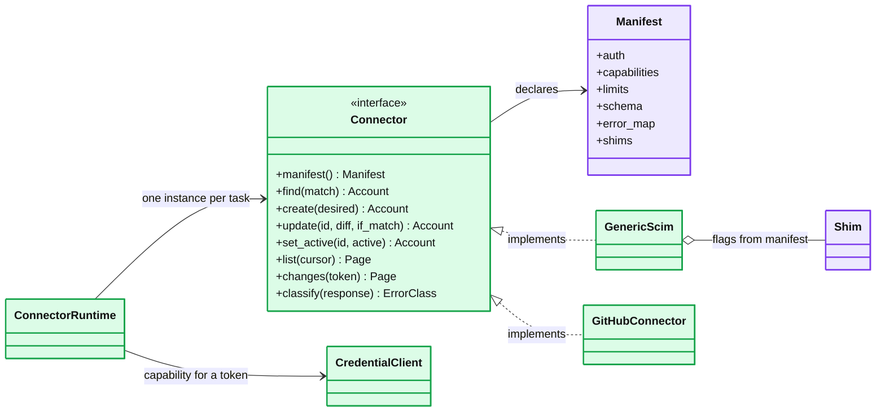
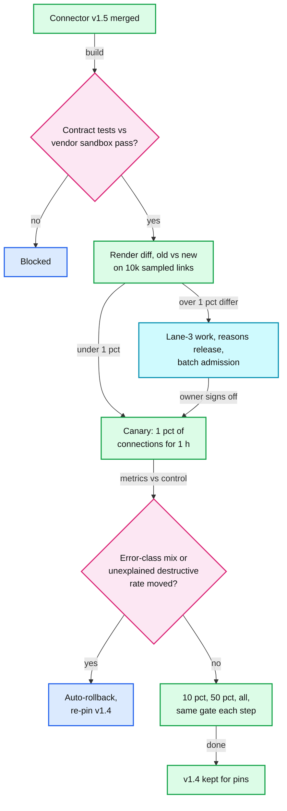
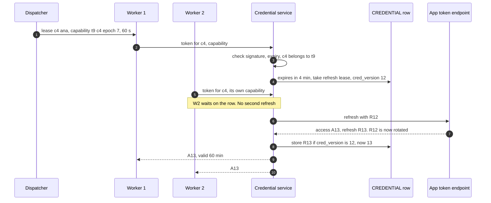

# Deep dive: connectors, credentials and webhooks

> One-line answer: a connector is a **manifest plus code** behind one interface, so the engine never knows which app it is talking to. Most apps are the generic SCIM (System for Cross-domain Identity Management) connector with per-app compatibility flags. Connectors are versioned, pinned per connection and released by canary. Credentials live only in a **credential service**: envelope-encrypted per tenant, handed out as short-lived access tokens against a signed capability, and refreshed single-flight with a compare-and-set (CAS) so refresh-token rotation never revokes our own grant. Webhooks in are verified, deduplicated in an inbox and only trigger a re-read. Events out are thin and signed per Standard Webhooks.

Zoom-in on [`../solution.md`](../solution.md) §3.2, §5.6, §5.7, §10.1 and §10.10. Reusable blocks: [`../../../concepts/oauth.md`](../../../concepts/oauth.md) (grants, refresh, rotation), [`../../../concepts/leases-fencing-clocks.md`](../../../concepts/leases-fencing-clocks.md) (the refresh lease). Outbound delivery is [`../../webhook-delivery/`](../../webhook-delivery/) (#58). Siblings: [`drift-reconciliation-and-mass-change-guard.md`](drift-reconciliation-and-mass-change-guard.md) (what a webhook's re-read feeds), [`failures-retries-and-circuit-breakers.md`](failures-retries-and-circuit-breakers.md) (`classify` and `NEEDS_REAUTH`). Facts: [`../research/facts-survey.md`](../research/facts-survey.md).

## 1. The connector contract



Each capability changes what the engine does, not just what the connector does:

| Capability | If true | If false |
|---|---|---|
| `patch` | `PATCH` with only the changed attributes. `active` travels only in `set_active` | `PUT` of the whole resource, which carries `active`. The zombie defence "updates never carry `active`" is gone, so check-then-call, `If-Match` and the +5 min verify read carry it |
| `etag` | `If-Match` on every write. `412` means re-read and re-diff | Last writer wins. The lease is the only single-writer guarantee |
| `filter_external_id` | Find by `externalId` (ours) on a create retry | Find by `userName`, which a rename can change |
| `deltas` | 15-minute incremental reads | Daily full list only |
| `limits` | `[{scope, key, rate, window}]`. The key is the **vendor's scope key**: Slack org id, Zoom account id, GitHub installation id, Google project plus admin user. Two of our connections on one Slack org share one bucket. Generic SCIM is keyed by target host | The dispatcher builds buckets only from this |

## 2. Generic SCIM and compatibility shims

- **Discover, then pin.** At connect, the generic connector reads `/ServiceProviderConfig` ("Clients may discover service provider support for PATCH by querying the service provider configuration", RFC 7644). The result is stored with the connection. It is re-read only on a connector release, never per call.
- **Shims are manifest flags, never sniffing.** A sniffed quirk changes silently the day the vendor fixes it. A flag changes through a release and a canary. The cost: using a vendor's fix needs a release.

| Shim flag | What it does | Real case |
|---|---|---|
| `patch_op_case` | Sends `"op": "Replace"` instead of `"replace"` | Entra itself sends `"Replace"` by default ([survey §1](../research/facts-survey.md)) |
| `bool_as_string` | Reads and writes `active` as `"False"` | Entra's default `"False"` string |
| `members_value_filter` | Removes a member with `members[value eq "id"]`, not an array | Entra with its compliance flag |
| `no_patch_put` | Full `PUT`, read first with `If-Match` if possible | `PATCH` is "an OPTIONAL server function" |
| `total_results_unreliable` | Skips the `totalResults` check. The other three list-trust checks still apply | Servers that report the page size as the total |

The generic connector covers a share of the catalog with no code. It is also the one connector where a tenant admin types a URL, so it is the SSRF door (§7).

## 3. Connector versions and canary



- **A render change is a bulk write.** First draft: let it trickle in. If v1.5 renders `displayName` differently, every link's hash differs and every account gets a write the next time its task runs, mixed into unrelated edits: ~4 M writes on 20,000 Slack connections of ~200 accounts [estimate], none of them counted as one change. Design: the release renders a sample of links with old and new code. Over 1% changed, the change ships as lane-3 work with reason `release`, through batch admission, so a release that would remove groups is held whole like a rule edit.
- **Pinned per connection.** A task leased under v1.4 finishes under v1.4. Rollback is a re-pin, and level-triggered sync converges either way.
- **The canary gate.** First draft: the error-class mix and the guard-hold rate. A release that wrongly deactivates 1 account per connection-hour moves neither. Design: the canary is compared with control on the error-class mix **and** the unexplained destructive rate. The drift deep dive's simulation trips that gate in ~2.5 min on 1% of connections.

## 4. The credential service

- **Envelope encryption.** Each tenant has a data encryption key (DEK). The regional key management service (KMS) key wraps it, and `CREDENTIAL` holds `wrapped_dek` plus the ciphertext of the tokens. Only the credential service can unwrap. It caches unwrapped DEKs for a few minutes [estimate], so KMS sees one call per active tenant per few minutes, not one per token.
- **Capabilities.** At lease time the dispatcher signs `{tenant, connection, task, epoch, expires in 60 s}`. The credential service checks the signature, the expiry, and `connection.tenant_id == capability.tenant`. Dispatchers sign with a private key. The credential service holds only the public key, so nothing else can mint a capability. The reconciler, plan job and pre-flight get capabilities with their dispatcher grants.
- **What it does not do.** It does not fence a zombie that already holds a cached access token. Those live up to ~1 h. The zombie defences are in [`desired-state-sync-and-ordering.md`](desired-state-sync-and-ordering.md).



## 5. Refresh races under rotation

RFC 9700 §4.14.2: with rotation, "the authorization server issues a new refresh token with every access token refresh response", and a token presented twice "will inform the authorization server of the breach". The server may then revoke the grant, "forcing the legitimate client to obtain a fresh authorization grant". For us that is a self-inflicted `NEEDS_REAUTH` and an admin email. The simulator models one access-token expiry on one connection with 1 to 4 workers needing a token, a token endpoint with a slow tail, and a provider that rotates with reuse detection.

```python
import math, random

random.seed(9700)
N, PER_DAY, TIMEOUT = 200_000, 1_500_000, 20.0   # refresh moments, refreshes a day, token-call timeout

def rtt():                                       # token endpoint round trip [estimate]
    return 0.15 * math.exp(random.gauss(0, 1.1))  # median 150 ms, p99 about 2 s

def revoked(presented, grace):
    """Rotation with reuse detection (RFC 9700 4.14.2): the first presentation of the token
    rotates it. Any later presentation of the same token revokes the grant, unless the
    provider allows the previous token for `grace` seconds after rotation."""
    p = sorted(presented)
    return any(t - p[0] > grace for t in p[1:])

def normal(mode, lease):
    """One access-token expiry on one connection, 1 to 4 workers needing a token in 2 s."""
    k = random.choices((1, 2, 3, 4), (70, 15, 8, 7))[0]
    asks, presented = sorted(random.uniform(0, 2) for _ in range(k)), []
    if mode == "per worker":                     # each worker refreshes unless one already stored
        stored = math.inf
        for a in asks:
            if a < stored:
                r = rtt()
                presented.append(a + min(r, TIMEOUT) / 2)
                stored = min(stored, a + r + 0.005)
    else:                                        # single flight with a fixed lease, then CAS
        t = asks[0]
        for _ in range(3):
            r = rtt()
            presented.append(t + min(r, TIMEOUT) / 2)
            if r < min(lease, TIMEOUT):
                break                            # stored inside the lease
            t += min(lease, TIMEOUT)             # lease expired or timed out: next holder retries
    return revoked(presented, 0), len(presented)

print(f"Normal operation, {N:,} refresh moments, strict rotation (no grace)")
for mode, lease in (("per worker", None), ("single flight", 1), ("single flight", 60)):
    runs = [normal(mode, lease) for _ in range(N)]
    lost = sum(r for r, _ in runs)
    name = mode + (f", lease {lease} s" if lease else "")
    print(f"  {name:<25} revoked {lost / N:7.3%}, ~{lost / N * PER_DAY:>7,.0f} grants a day")

def forced(fault, grace, heartbeat):
    """The holder got the rotated token back, then crashes or pauses 20 s before the CAS
    write. Fixed lease 60 s, or a 5 s lease renewed every 1 s while the process runs."""
    up = rtt() / 2
    takeover = (5 - random.uniform(0, 1)) if heartbeat else 60
    pause = math.inf if fault == "crash" else 20
    if pause < takeover:
        return False                             # the holder stores it before anyone takes over
    return revoked([up, rtt() + up + takeover], grace)   # a waiter presents the old token

print("Holder fails right after the provider rotated (10,000 runs each)")
for fault in ("crash", "pause 20 s"):
    for grace in (0, 30):
        cells = [sum(forced(fault, grace, hb) for _ in range(10_000)) / 10_000 for hb in (False, True)]
        print(f"  {fault:<10} grace {grace:>2} s: revoked with lease 60 s {cells[0]:5.0%}, "
              f"with 5 s heartbeat lease {cells[1]:5.0%}")
```

```text
Normal operation, 200,000 refresh moments, strict rotation (no grace)
  per worker                revoked  8.121%, ~121,822 grants a day
  single flight, lease 1 s  revoked  4.234%, ~ 63,510 grants a day
  single flight, lease 60 s revoked  0.001%, ~      8 grants a day
Holder fails right after the provider rotated (10,000 runs each)
  crash      grace  0 s: revoked with lease 60 s  100%, with 5 s heartbeat lease  100%
  crash      grace 30 s: revoked with lease 60 s  100%, with 5 s heartbeat lease    0%
  pause 20 s grace  0 s: revoked with lease 60 s    0%, with 5 s heartbeat lease  100%
  pause 20 s grace 30 s: revoked with lease 60 s    0%, with 5 s heartbeat lease    0%
```

- **Per-worker refresh revokes ~8% of grants** at each expiry, on the [estimate] mix of 1 to 4 busy workers. That is the default bug: each worker sees an expired token and refreshes.
- **First draft: "a short lease on the credential row".** A 1 s lease is overtaken whenever the call takes longer than 1 s, and the second holder presents the rotated token: 4.2% revoked. **Design: the lease outlives the call,** 60 s against a 20 s token-call timeout, or a short lease renewed while the call runs. What remains (0.001%) is a call slower than the timeout: its outcome is unknown, so the retry presents the old token.
- **After rotation, the right lease depends on the provider.** With strict rotation, a takeover always revokes, so waiting longer is the only help: a fixed 60 s lease lets a holder that paused 20 s still store its token. With a grace window, a fast takeover is safe: Okta's "Grace period for token rotation" defaults to 30 s and can be 0 to 60 s ([Okta](https://developer.okta.com/docs/guides/refresh-tokens/main/)). So the manifest carries `refresh_rotation: none | strict | grace(s)` and the lease follows it.
- **The residual is a crash after the provider rotated** and before the CAS write. At ~17 refreshes/s over 3 replicas and a ~150 ms window, a hard crash of one replica costs about one grant [estimate]. That connection goes to `NEEDS_REAUTH`, and the pre-flight check finds it before any termination needs it.

## 6. Provider quirks that become rules

- **Google: 100 refresh tokens per account per client.** "creating a new refresh token automatically invalidates the oldest refresh token without warning." Every code exchange mints one. So: the OAuth `state` is single-use and the code is exchanged once. Staging and dev use their own client IDs. A re-authorize revokes the old token after the new one is stored. Tokens minted per Google account per client are counted, with an alert at 50 [estimate]. When a Google connection hits `invalid_grant`, the console checks whether that admin account minted a token elsewhere recently.
- **Google: expiry after six months unused.** The daily reconcile refreshes every live connection. A `PAUSED` connection gets a refresh every 30 days [estimate], so a pause does not silently end the grant.
- **GitHub App installation tokens** are minted lazily and cached for their life. GitHub limits "OAuth access token requests" to 2,000 an hour (whether installation tokens count is unverified), so never one token per task.

## 7. Egress and SSRF (server-side request forgery)

All connector traffic leaves through an egress proxy (3 per availability zone) with fixed IPs per region, which customers allowlist. Both regions' IPs are published from day one, so a failover does not break anyone's allowlist. A connection may only reach its manifest's hosts plus the tenant's own subdomain. The generic SCIM base URL is the exception: an admin types it, so it is checked like hostile input, on save and at the proxy.

```python
import ipaddress, socket
from urllib.parse import urlsplit

DNS = {"scim.acme-hr.com": [["52.94.10.20"]], "mixed.example.net": [["52.1.2.4", "127.0.0.1"]],
       "rebind.example.net": [["52.1.2.3"], ["10.0.0.5"]]}   # TTL 0: a new answer each time

def resolve(host):                               # stand-in for getaddrinfo: all answers
    try:
        return [socket.inet_ntoa(socket.inet_aton(host))]   # 2130706433, 0x7f.1, 127.1
    except OSError:
        answers = DNS.get(host, [[host]])
        return answers.pop(0) if len(answers) > 1 else answers[0]

def check(url):
    u = urlsplit(url)
    if u.scheme != "https" or (u.port or 443) != 443 or u.username:
        return "refuse: https on 443 only, no credentials in the URL"
    ips = resolve(u.hostname)
    for ip in map(ipaddress.ip_address, ips):
        ip = getattr(ip, "ipv4_mapped", None) or ip         # ::ffff:10.0.0.7 is 10.0.0.7
        if not ip.is_global:                     # private, loopback, link-local, 100.64/10
            return f"refuse: resolves to {ip}"
    return f"allow, pin {ips[0]}, no redirects"

for url in ["https://scim.acme-hr.com/scim/v2", "http://scim.acme-hr.com/scim/v2",
            "https://scim.acme-hr.com:8443/scim", "https://admin:pw@scim.acme-hr.com/scim",
            "https://169.254.169.254/latest/meta-data", "https://2130706433/scim",
            "https://[::ffff:10.0.0.7]/scim", "https://100.64.3.9/scim",
            "https://mixed.example.net/scim", "https://rebind.example.net/scim"]:
    print(f"  {url:<42} {check(url)}")
print(f"  {'same host, lookup again at connect time':<42} {resolve('rebind.example.net')}: "
      "only the pin keeps the call on 52.1.2.3")
```

```text
  https://scim.acme-hr.com/scim/v2           allow, pin 52.94.10.20, no redirects
  http://scim.acme-hr.com/scim/v2            refuse: https on 443 only, no credentials in the URL
  https://scim.acme-hr.com:8443/scim         refuse: https on 443 only, no credentials in the URL
  https://admin:pw@scim.acme-hr.com/scim     refuse: https on 443 only, no credentials in the URL
  https://169.254.169.254/latest/meta-data   refuse: resolves to 169.254.169.254
  https://2130706433/scim                    refuse: resolves to 127.0.0.1
  https://[::ffff:10.0.0.7]/scim             refuse: resolves to 10.0.0.7
  https://100.64.3.9/scim                    refuse: resolves to 100.64.3.9
  https://mixed.example.net/scim             refuse: resolves to 127.0.0.1
  https://rebind.example.net/scim            allow, pin 52.1.2.3, no redirects
  same host, lookup again at connect time    ['10.0.0.5']: only the pin keeps the call on 52.1.2.3
```

- **Resolve, then check every answer.** String checks miss `2130706433` (decimal for `127.0.0.1`) and `::ffff:10.0.0.7`. One private answer among several refuses the whole host.
- **Pin, and re-check on a timer.** The proxy connects to the IP it checked, so a DNS answer that flips to `10.0.0.5` a second later is never used. The pin is refreshed hourly [estimate] through the same check, so a vendor that moves is followed.
- **No redirects.** A `3xx` is classified `PERMANENT` with the target shown to the admin. Port 443 only, no credentials in the URL. Response bodies are size-capped and schema-validated before parsing.

## 8. Webhooks in: verify, inbox, re-read

| App | How a delivery proves itself | Delivery promise (survey) |
|---|---|---|
| Slack Events | `X-Slack-Signature`: `v0=` plus a hex HMAC over `v0:timestamp:body`. Slack's example rejects timestamps over 5 minutes off ([Slack](https://docs.slack.dev/authentication/verifying-requests-from-slack)) | Ack "within three seconds", up to 3 retries |
| GitHub | `X-Hub-Signature-256`: `sha256=` plus a hex HMAC ([GitHub](https://docs.github.com/en/webhooks/using-webhooks/validating-webhook-deliveries)) | Ack within 10 s. "does not automatically redeliver failed deliveries" |
| Google Directory push | `X-Goog-Channel-Token` we set at `watch`, `X-Goog-Channel-ID` ([Google](https://developers.google.com/workspace/admin/directory/v1/guides/push)) | Channels need renewal by us. Treat as best effort |
| Okta event hooks | Per hook configuration | "at least once", 3 s timeout, "at most one retry" |

- **Verify the raw bytes,** before any JSON parsing. Then store and ack. Nothing slow runs before the `200`.
- **The inbox key is `(connector, delivery id)`.** Retries and duplicates stop there.
- **A flood is bounded.** Observe tasks coalesce per `(connection, subject)` and ride lane 2, which cannot touch lane 0's 20% reserve. A compromised app sending signed junk slows that tenant's updates, never its terminations. An unknown account id only queues a one-account reconcile.

## 9. Events out: thin and signed

The event says what changed, never the values: `{id, type, tenant_id, employee_id, version, changed_fields, occurred_at}`. The partner reads current fields with its own scoped token ([`../solution.md`](../solution.md) §5.7). Signing follows the Standard Webhooks spec ([spec](https://github.com/standard-webhooks/standard-webhooks/blob/main/spec/standard-webhooks.md)): headers `webhook-id`, `webhook-timestamp`, `webhook-signature`. The signature is "v1, followed by a comma (`,`), followed by the base64 encoded signature", an HMAC-SHA256 over `msg_id.timestamp.payload`. Secrets are "base64 encoded, prefixed with `whsec_`", "Between 24 bytes (192 bits) and 64 bytes (512 bits)". The header is a space-delimited list, which is how a 24-hour secret rotation works: sign with both. "Use the `webhook-id` header as an idempotency key". The 5-minute tolerance is Stripe's library default. The spec says only "some allowable tolerance".

```python
import base64, hashlib, hmac, json, random

random.seed(58)
TOLERANCE = 300                                  # 5 min: Stripe's default, the spec says "some"

def new_secret():                                # spec: 24 to 64 random bytes, base64, whsec_
    return "whsec_" + base64.b64encode(random.randbytes(32)).decode()

def sign(secret, msg_id, ts, body):
    key = base64.b64decode(secret.removeprefix("whsec_"))
    mac = hmac.new(key, f"{msg_id}.{ts}.".encode() + body, hashlib.sha256).digest()
    return "v1," + base64.b64encode(mac).decode()

def send(secrets, msg_id, ts, event):            # during rotation: one signature per secret
    body = json.dumps(event, separators=(",", ":")).encode()
    sig = " ".join(sign(s, msg_id, ts, body) for s in secrets)
    return {"webhook-id": msg_id, "webhook-timestamp": str(ts), "webhook-signature": sig}, body

class Receiver:
    def __init__(self, secrets):
        self.secrets, self.seen, self.version = secrets, set(), {}
    def handle(self, headers, raw, now):
        ts = int(headers["webhook-timestamp"])
        if abs(now - ts) > TOLERANCE:            # both ways: replay, or a clock far ahead
            return f"400 timestamp off by {now - ts} s"
        want = {sign(s, headers["webhook-id"], ts, raw) for s in self.secrets}
        got = [g for g in headers["webhook-signature"].split(" ") if g.startswith("v1,")]
        if not any(hmac.compare_digest(g, w) for g in got for w in want):
            return "401 no valid v1 signature"
        if headers["webhook-id"] in self.seen:   # spec: webhook-id is the idempotency key
            return "200 duplicate, skipped"
        self.seen.add(headers["webhook-id"])
        ev = json.loads(raw)
        if ev["version"] <= self.version.get(ev["employee_id"], 0):
            return f"200 stale v{ev['version']}, kept v{self.version[ev['employee_id']]}"
        self.version[ev["employee_id"]] = ev["version"]
        return f"200 applied v{ev['version']}, now GET /v1/employees/{ev['employee_id']}"

old, new, T = new_secret(), new_secret(), 1_792_224_000
event = lambda v: {"id": f"evt_{v}", "type": "employee.updated", "tenant_id": "t_9",
                   "employee_id": "emp_42", "version": v, "changed_fields": ["title"],
                   "occurred_at": T}
fresh = lambda mid, v, keys=(new,): send(list(keys), mid, T, event(v))
h, b = fresh("msg_2Kx1", 42)
print("headers:", h)
print("body:   ", b.decode())
h3, b3 = fresh("msg_3", 43)
h6, b6 = fresh("msg_6", 43)
tests = [
    ("1 valid", h, b, T + 2),
    ("2 same id again", h, b, T + 60),
    ("3 body edited", h3, b3.replace(b"title", b"salary"), T + 2),
    ("4 replay, 6 min late", *fresh("msg_4", 43), T + 360),
    ("5 clock 6 min ahead", *fresh("msg_5", 43), T - 360),
    ("6 re-serialized JSON", h6, json.dumps(json.loads(b6), indent=1).encode(), T + 2),
    ("7 older v41, late", *fresh("msg_7", 41), T + 5),
    ("8 rotation, old+new", *fresh("msg_8", 44, (old, new)), T + 2),
]
r = Receiver([new])
for name, hh, bb, now in tests:
    print(f"  {name:<22} {r.handle(hh, bb, now)}")
r_old = Receiver([old])                          # a receiver that has not rotated yet
print(f"  {'9 rotation, old only':<22} {r_old.handle(*fresh('msg_9', 45, (old, new)), T + 2)}")
print(f"  {'10 wrong secret':<22} {r_old.handle(*fresh('msg_10', 46, (new_secret(),)), T + 2)}")
```

```text
headers: {'webhook-id': 'msg_2Kx1', 'webhook-timestamp': '1792224000', 'webhook-signature': 'v1,ZdkKoNGpSJ0MtXJ11hSa/BGidrqdeOQKSXIJmMjwynM='}
body:    {"id":"evt_42","type":"employee.updated","tenant_id":"t_9","employee_id":"emp_42","version":42,"changed_fields":["title"],"occurred_at":1792224000}
  1 valid                200 applied v42, now GET /v1/employees/emp_42
  2 same id again        200 duplicate, skipped
  3 body edited          401 no valid v1 signature
  4 replay, 6 min late   400 timestamp off by 360 s
  5 clock 6 min ahead    400 timestamp off by -360 s
  6 re-serialized JSON   401 no valid v1 signature
  7 older v41, late      200 stale v41, kept v42
  8 rotation, old+new    200 applied v44, now GET /v1/employees/emp_42
  9 rotation, old only   200 applied v45, now GET /v1/employees/emp_42
  10 wrong secret        401 no valid v1 signature
```

- **Test 6 is the classic bug.** A framework that parses JSON and re-serializes it before verification changes the bytes, so every signature fails. Verify the raw body.
- **Tests 4 and 5:** the tolerance is checked both ways. A receiver whose clock runs 6 minutes fast rejects good events, which is why 5 minutes is generous. **Test 7:** delivery is unordered, and `version` keeps v42 when v41 arrives late.
- **Tests 8 and 9:** during rotation every delivery carries both signatures, so receivers that have and have not switched both verify.

## 10. Trade-offs

| Decision | Chose | Gave up |
|---|---|---|
| Connector shape | Manifest plus code behind one interface | Each odd app needs a shim flag or code. No customer code |
| Render changes | A bulk lane-3 rollout with the guard | A cosmetic mapping change takes hours to reach every account |
| Credentials | A service, signed capabilities, workers never see refresh tokens | One more hop per token. 3 replicas to run |
| Refresh | Single flight, CAS, lease by provider rotation type | A crash after rotation still costs one grant per crash |
| Inbound webhooks | Hints that trigger a re-read | One `GET` per webhook, ~0.3 M a day |
| Outbound events | Thin, signed, unordered, versioned | One partner `GET` per event, ~1.4 M a day |

## 11. Numbers to say out loud

- Capability: `{tenant, connection, task, epoch}`, 60 s. Access tokens cached until 5 min before expiry. ~1.5 M refreshes a day, ~17/s.
- Rotation: per-worker refresh revokes ~8% of grants on busy connections. Refresh lease 60 s against a 20 s token-call timeout, CAS on `cred_version`, `refresh_rotation` in the manifest. Okta grace 30 s by default, 0 to 60 s.
- Google: 100 refresh tokens per account per client, oldest silently invalidated. Six months unused and it expires.
- Webhooks in: Slack ack in 3 s, Okta 1 retry, GitHub no redelivery. Inbox keyed by delivery id.
- Webhooks out: `v1,` base64 HMAC-SHA256 over `id.timestamp.body`, `whsec_` secrets of 24 to 64 bytes, 5 min tolerance, both secrets for 24 h on rotation.
