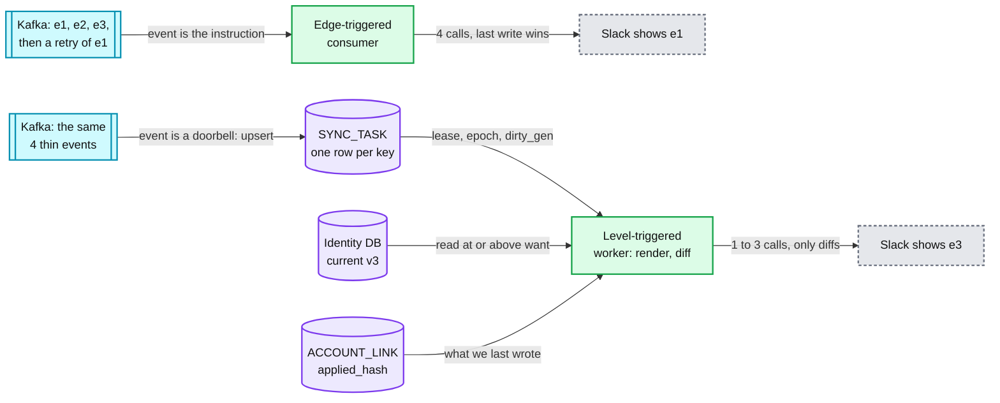
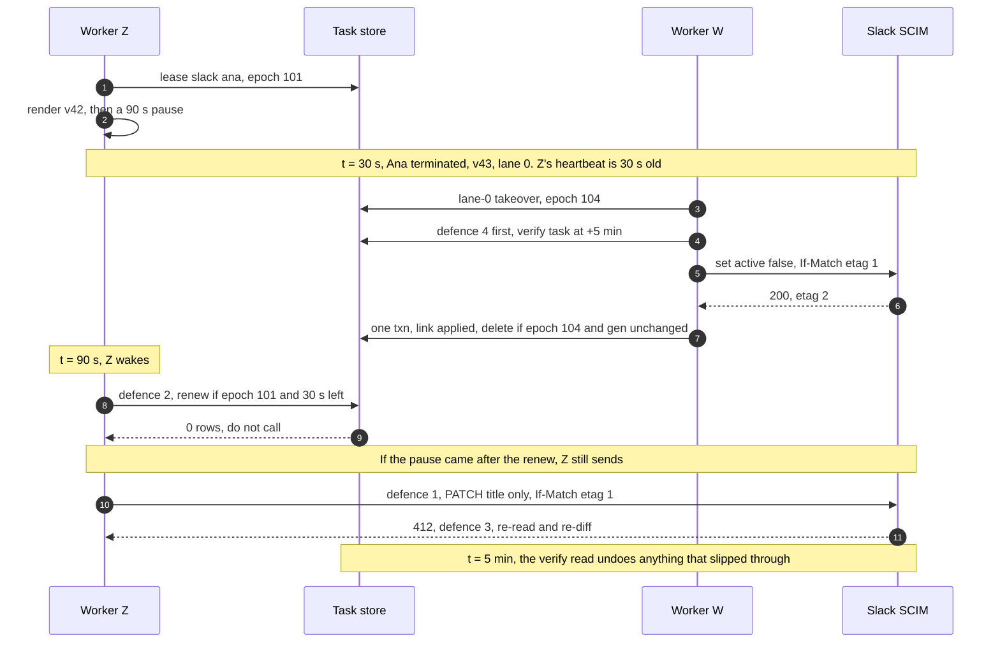

# Deep dive: desired-state sync and ordering

> One-line answer: a change never carries a payload to the app. It only marks one `SYNC_TASK` row per `(connection, subject)` dirty, and later changes merge into that row (`GREATEST` version, `LEAST` lane, union of `reasons`, and a fresh `dirty_gen` from the shard's sequence every time). A worker leases the row, reads the employee's **current** record, renders the account, diffs it and sends only the difference. One transaction writes the link and deletes the row only if `lease_epoch` and `dirty_gen` are still the leased ones. Otherwise the row runs again, or the worker was fenced. So order, duplicates and replays stop mattering, and a backlog costs one call per key: a 10,000-person import plus a typo fix is **10,894 calls instead of 20,000**. The simulator runs each rule the design rejected next to the rule it chose. A late retry cannot win. A mid-run rule edit or 17:00 termination is never swallowed. A zombie is fenced, or undone within 240 s. A moved start date still gets its lead time.

Zoom-in on [`../solution.md`](../solution.md) §3.3, §4.2 and §5.1. Concepts: [`leases-fencing-clocks.md`](../../../concepts/leases-fencing-clocks.md) (lease, epoch, fencing) and [`exactly-once.md`](../../../concepts/exactly-once.md) (apply a state, not an event). Siblings: [`idempotent-creates-and-account-matching.md`](idempotent-creates-and-account-matching.md) owns the create path. [`rate-limits-priority-and-fairness.md`](rate-limits-priority-and-fairness.md) owns which row gets the next token.

## 1. Level-triggered, not edge-triggered



- **Edge-triggered** means "do something per event". Lose an event and the app drifts. Retry one late and it overwrites newer data. A stale event still costs a call.
- **Level-triggered** means "make the app match the record". The controller pattern: "Each controller tries to move the current cluster state closer to the desired state" ([research §4e](../research/facts-survey.md)). Replays, duplicates and reordering are harmless. A bug fix or a new mapping is a re-derivation (mark rows dirty), not a replay of history. Events stay thin: ids, `version`, field names.
- **What it costs.** One identity read per run (a primary-key read, ~1 ms [estimate]) and a stored `applied_hash` per link. And it cannot say intent that is not state: "send the welcome email once" belongs to the hire workflow (Temporal, solution §4.1).

## 2. The task row and its SQL

| Column | On upsert | Why |
|---|---|---|
| `want_version` | `GREATEST(old, new)` | A late duplicate of v40 cannot lower a row that wants v42. The worker reads at or above it |
| `dirty_gen` | `nextval(shard_seq)`, always | **Every** dirtying (edit, rule, webhook, admin, drift) moves it, so none is lost to a run in flight |
| `lane`, `risk` | `LEAST(old, new)` | 0 security, 1 onboarding, 2 updates, 3 bulk. A termination upgrades a waiting edit |
| `reasons` | `old ∪ new` | `hire, edit, termination, rule, release, drift, webhook, verify, delete_timer, admin`. Labels only. `drift`, `webhook`, `verify` mean "GET first" |
| `ready_at` | `now()` if the lane went up, else `LEAST` while `attempts = 0`, else kept | Settle (lane 2, 2 s), effective time, re-arm, or backoff (30 s base, x2, cap 1 h, full jitter, give up at 72 h) |

```sql
-- Mark dirty: planner, reconciler, webhook receiver, console. $ready is now() + 2 s settle in lane 2.
INSERT INTO sync_task AS t (tenant_id, connection_id, subject, want_version, dirty_gen, lane, risk, reasons, ready_at)
VALUES ($tenant, $conn, $subject, $version, nextval('shard_seq'), $lane, $risk, ARRAY[$reason], $ready)
ON CONFLICT (tenant_id, connection_id, subject) DO UPDATE SET
  want_version = GREATEST(t.want_version, EXCLUDED.want_version), dirty_gen = EXCLUDED.dirty_gen,
  lane = LEAST(t.lane, EXCLUDED.lane), risk = LEAST(t.risk, EXCLUDED.risk),
  reasons = ARRAY(SELECT DISTINCT unnest(t.reasons || EXCLUDED.reasons)),
  ready_at = CASE WHEN EXCLUDED.lane < t.lane THEN now()
                  WHEN t.attempts = 0 THEN LEAST(t.ready_at, EXCLUDED.ready_at) ELSE t.ready_at END;

-- Lease. Lane 0 may take over a lease whose last heartbeat is over 20 s old (lease_until < now() + 40 s).
UPDATE sync_task SET lease_owner = $w, lease_epoch = nextval('shard_seq'), lease_until = now() + '60 s'
 WHERE pk = ($tenant, $conn, $subject) AND ready_at <= now()
   AND (lease_until IS NULL OR lease_until < now() OR (lane = 0 AND lease_until < now() + '40 s'))
RETURNING lease_epoch, dirty_gen, want_version, lane, reasons;

-- Renew: every 10 s, and right before every external call. 0 rows: do not call.
UPDATE sync_task SET lease_until = now() + '60 s'
 WHERE pk = ($tenant, $conn, $subject) AND lease_epoch = $epoch AND lease_until > now() + '30 s';

-- Complete: ONE transaction with the ACCOUNT_LINK write (same shard). pk is shorthand.
DELETE FROM sync_task WHERE pk = ($tenant, $conn, $subject) AND lease_epoch = $epoch AND dirty_gen = $leased_gen;
-- 0 rows, epoch still mine: dirtied during the run. Release it to run again now.
-- 0 rows, epoch gone: fenced. Do not write applied_hash: set it NULL and upsert an observe task.
```

- **One clock.** Every comparison and every render's `as_of` uses the database's `now()`, never the worker's. Clock skew cannot stretch a lease or fire a termination early. Each dispatcher partition has one owner (solution §10.1), so there is no `SKIP LOCKED`. The row's whole life is [`diagrams.md`](../diagrams.md) D8.
- **Fenced means "unknown".** A fenced worker still appends its `ATTEMPT` row, but its link write does not commit. It sets `applied_hash = NULL`, so the next run cannot skip the call, and marks an observe task that reads the account back.
- **Both numbers come from one shard sequence.** A per-row `epoch + 1` restarts at 0 when completion deletes the row, so it repeats (output E). The sequence never repeats, and it survives failover to the synchronous standby.

## 3. Coalescing, in numbers

A row absorbs every change that lands before its lease. A change that lands during the call costs one rerun. So:
- **Idle queue:** edits further apart than settle plus call (~2.3 s) each cost a call, and nothing needs saving. **Busy queue with delay D:** k edits inside D cost **one** call.
- **Backlog:** N keys, a second edit to all of them after T seconds, rate r: calls ≈ `N + min(N, r x T)`.

The simulator is one connection: the design's task row and one token every `1/rate` seconds. Blocks 2 and 3 continue the same script.

```python
import heapq, itertools
from collections import deque

LEASE, CALL = 60.0, 0.3                 # lease 60 s; a call takes ~300 ms [estimate]

class SyncTask:
    """SYNC_TASK rows of one connection. Defaults are the design. The switches bring back
    rejected rules: epochs="row", fence="want" or "reasons", merge="keep", takeover=False."""
    def __init__(self, settle=2.0, epochs="sequence", fence="gen", merge="least", takeover=True):
        self.rows, self.settle, self.epochs, self.fence = {}, settle, epochs, fence
        self.merge, self.takeover, self.seq = merge, takeover, itertools.count(100)

    def upsert(self, key, want, lane, reason, now, ready=None):
        ready = now + (self.settle if lane == 2 else 0) if ready is None else ready
        r = self.rows.setdefault(key, dict(want=want, lane=lane, reasons=set(), epoch=0,
                                           until=-1.0, ready=ready, attempts=0))
        r["want"] = max(r["want"], want)                 # GREATEST
        r["reasons"].add(reason)                         # old union new
        r["gen"] = next(self.seq)                        # dirty_gen on every upsert
        if lane < r["lane"]:
            r["lane"], r["ready"] = lane, now            # LEAST lane resets ready_at
        elif self.merge == "least" and r["attempts"] == 0:
            r["ready"] = min(r["ready"], ready)          # a timer, not a backoff

    def dispatchable(self, key, now):                    # lane 0 takes over a stale lease
        r = self.rows.get(key)
        stale = self.takeover and r["lane"] == 0 and now - (r["until"] - LEASE) > 20
        return r["ready"] <= now and (r["until"] < now or stale)

    def lease(self, key, now):                           # the worker keeps this ticket
        r = self.rows[key]
        r["epoch"] = next(self.seq) if self.epochs == "sequence" else r["epoch"] + 1
        r["until"] = now + LEASE
        return r["epoch"], r["want"], r["gen"], set(r["reasons"])

    def renew(self, key, ticket, now):                   # before every call: 30 s left
        r = self.rows.get(key)
        ok = r is not None and r["epoch"] == ticket[0] and r["until"] > now + 30
        if ok:
            r["until"] = now + LEASE
        return ok

    def complete(self, key, ticket, now, rearm=None):    # one txn with the link write
        r = self.rows.get(key)
        epoch, want, gen, reasons = ticket
        if r is None or r["epoch"] != epoch:
            return "fenced"                              # applied_hash = NULL, observe task
        same = {"gen": r["gen"] == gen, "want": r["want"] == want,
                "reasons": r["want"] == want and r["reasons"] == reasons}[self.fence]
        if same and rearm is None:
            del self.rows[key]
            return "done"
        r["until"], r["ready"] = -1.0, rearm if same else now
        return "re-armed" if same else "rerun"           # rerun: dirtied during the run

def run(edits, rate, settle=2.0):
    """One connection, lane 2, a token every 1/rate s. edits: (t, key, version)."""
    tasks, ident, applied, ready, n = SyncTask(settle), {}, {}, deque(), itertools.count()
    ev = [(t, next(n), "edit", k, v) for t, k, v in edits]
    heapq.heapify(ev)
    calls, token_at, armed, end = 0, 0.0, False, 0.0
    while ev:
        now, _, kind, key, x = heapq.heappop(ev)
        if kind == "edit":                               # planner upsert
            ident[key] = max(ident.get(key, 0), x)       # a replayed event changes nothing here
            tasks.upsert(key, x, 2, "edit", now)
            heapq.heappush(ev, (tasks.rows[key]["ready"], next(n), "due", key, None))
        elif kind == "due":
            ready.append(key)
        elif kind == "done":
            ticket, ver = x
            applied[key], end = ver, now
            if tasks.complete(key, ticket, now) == "rerun":
                ready.append(key)
        else:
            armed = False                                # a token came due
        while ready and token_at <= now:                 # dispatcher
            key = ready.popleft()
            if key not in tasks.rows or not tasks.dispatchable(key, now):
                continue                                 # gone, leased, or not due yet
            ticket = tasks.lease(key, now)
            if applied.get(key) == ident[key]:           # rendered hash equals applied_hash
                tasks.complete(key, ticket, now)
                continue
            calls, token_at = calls + 1, max(token_at, now) + 1 / rate
            heapq.heappush(ev, (now + CALL, next(n), "done", key, (ticket, ident[key])))
        if ready and not armed:
            heapq.heappush(ev, (token_at, next(n), "token", None, None))
            armed = True
    return calls, sum(applied.get(k) != v for k, v in ident.items()), end, applied

print("A. Ana's title edited 3 times in a minute, then a retry of edit 1 arrives last")
probe = [(0.0, "ana", 1), (20.0, "ana", 2), (40.0, "ana", 3), (50.0, "ana", 1)]
print(f"  rejected, one call per event       : calls 4, Slack shows edit {probe[-1][2]}")
c, s, _, ap = run(probe, rate=3)
print(f"  design, idle connection            : calls {c}, Slack shows edit {ap['ana']}")
c, s, _, ap = run([(0.0, f"e{i}", 1) for i in range(150)] +
                  [(t + 0.5, k, v) for t, k, v in probe], rate=3)
print(f"  design, 150 rows ahead (50 s queue): calls for Ana {c - 150}, Slack shows edit {ap['ana']}")
print("B. A form saves 4 fields 300 ms apart")
for name, settle in (("rejected, no settle", 0.0), ("design, settle 2 s", 2.0)):
    c, s, _, _ = run([(0.3 * i, "ana", i + 1) for i in range(4)], rate=3, settle=settle)
    print(f"  {name:<20}: calls {c}, stale keys {s}")
print("C. HR import sets 10,000 titles, then fixes a typo in all of them 5 minutes later")
imp = [(0.0, f"e{i}", 1) for i in range(10_000)] + [(300.0, f"e{i}", 2) for i in range(10_000)]
c, s, end, _ = run(imp, rate=3)                     # Slack SCIM ~180 user writes a minute
print(f"  rejected, one call per event : calls 20,000, drained in {20_000 / 3 / 60:.0f} min")
print(f"  design                       : calls {c:,}, drained in {end / 60:.0f} min, stale keys {s}")
```

```text
A. Ana's title edited 3 times in a minute, then a retry of edit 1 arrives last
  rejected, one call per event       : calls 4, Slack shows edit 1
  design, idle connection            : calls 3, Slack shows edit 3
  design, 150 rows ahead (50 s queue): calls for Ana 1, Slack shows edit 3
B. A form saves 4 fields 300 ms apart
  rejected, no settle : calls 4, stale keys 0
  design, settle 2 s  : calls 1, stale keys 0
C. HR import sets 10,000 titles, then fixes a typo in all of them 5 minutes later
  rejected, one call per event : calls 20,000, drained in 111 min
  design                       : calls 10,894, drained in 61 min, stale keys 0
```

- **A.** One call per event spends 4 calls and leaves the oldest title. The design spends 3 when idle (edits 20 s apart are separate states) and lands on edit 3. Behind 50 s of queue, Ana costs 1 call. The late retry costs 0: it renders v3, the hash is equal.
- **B.** The 2 s settle is a fixed window from the first insert, never a debounce. A debounce restarts on every edit, so a script that edits one person every second would never run.
- **C.** `10,000 + 3/s x 300 s ≈ 10,900`, matching 10,894. The 900 rows written before the fix pay twice. At Slack's ~180 SCIM user writes a minute that is 61 min instead of 111.

## 4. The version guard and the diff base

- **Three hops, one rule: never older over newer.** The upsert keeps `GREATEST(want_version)`. The worker renders only from a record at or above it (a lagging replica sends the read to the primary). The fenced `DELETE` matches only the leased `dirty_gen`.
- **Diff against the freshest known state.** For an edit, that is `applied_hash`, what we last wrote: a duplicate event renders the same state and costs nothing. A row whose `reasons` include `drift`, `webhook` or `verify` means the app may have changed under us, so `applied_hash` proves nothing. Those runs `GET` the account first and diff against what came back, writing `observed_hash` and `observed_at`.
- **A daily render-only sweep** re-renders every link and compares with `applied_hash`, with no API calls (~1,160 renders/s at ~50 µs each [estimate], under 0.1 CPU core). Anything a bug lost is re-dirtied within 24 h at zero vendor quota.

## 5. References to other employees

- **A reference is a dependency on another key.** Google and Okta store the manager as an account id in that app, so the render reads the manager's `ACCOUNT_LINK`. `PRESENT` gives the id. A manager not in scope for this app is left empty, with no wait.
- **A new hire is created without the manager** and patched once the manager's link exists: one extra call, never a delayed create. For an existing account whose manager is still being created, the task re-queues every 30 s, up to 10 times, then writes the rest and sets `pending_reference`. When a link turns `PRESENT`, the worker marks dirty every report with `pending_reference`. So even a data-error cycle (A manages B, B manages A) resolves.
- **Referenced entities fan out.** A department rename or a manager's email change is an entity event. The planner marks every referencing employee dirty in lane 3. 5,000 people in one department [estimate] at ~180 Slack writes a minute is ~28 min.

## 6. The zombie writer and its four defences

The app is the resource, and it cannot check our epoch. The [fencing concept](../../../concepts/leases-fencing-clocks.md) says the resource must reject the old holder, so four substitutes stand in.



1. **Attribute updates never carry `active`** on apps that take `PATCH`. On a `PUT`-only app (SCIM makes `PATCH` optional) the body must carry `active`, so the worker sets it from the employee status re-read at call time.
2. **Conditional renew before every call:** epoch still mine **and** at least 30 s of lease left. A pause can still land between the renew and the send, so this narrows the window. It does not close it.
3. **`If-Match`** where the app has ETags (optional in SCIM). A stale write gets `412`, "Failed to update. Resource has changed on the server" (RFC 7644 §3.12).
4. **Verify after every deprovision.** The +5 min observe task is written **before** the deactivation call, so even a crash right after the call leaves the check scheduled.

```python
# Block 2 continues block 1 (same script): the zombie writer and the epoch.
def zombie(write, renew=True, etags=False, after_renew=False, dies=True, verify=True):
    """t=0 Z leases (slack, ana) at v42, renders, pauses 90 s. t=30 Ana is terminated (v43).
    W takes the row as soon as it may, writes the +5 min verify task, sets active=false,
    completes. t=90 Z wakes and sends what it rendered."""
    tasks, app = SyncTask(), dict(active=True, etag=1)
    tasks.upsert("ana", 42, 2, "edit", -2.0)
    z = tasks.lease("ana", 0.0)
    passed = after_renew and tasks.renew("ana", z, 0.0)    # the pause came after it
    tasks.upsert("ana", 43, 0, "termination", 30.0)
    t_w = next(t for t in range(30, 61) if tasks.dispatchable("ana", t))
    w = tasks.lease("ana", t_w)                            # takeover: Z's heartbeat is stale
    app.update(active=False, etag=2)                       # W's write lands 0.3 s later
    tasks.complete("ana", w, t_w + 0.3)
    if renew and not passed and not tasks.renew("ana", z, 90.0):
        return "blocked: the renew finds another epoch"
    if etags:                                              # Z holds etag 1
        return "blocked: 412, re-read and re-diff"
    if write == "PUT, active re-read at call time":
        return "no reactivation: the re-read says terminated"
    app["active"] = app["active"] or write in ("PUT title+active", "set_active(true)")
    if not app["active"]:
        return "no reactivation"
    if not dies:                                           # Z reaches its fenced DELETE
        assert tasks.complete("ana", z, 90.3) == "fenced"
        return "reactivated, fixed in ~1 s by the fenced worker's observe task"
    if verify:
        return f"reactivated for {t_w + 300.3 - 90:.0f} s, until W's verify read at +5 min"
    return "reactivated until the daily reconcile, up to 24 h"

print("D. The zombie writer (Z pauses 90 s, a 60 s lease, Ana terminated meanwhile)")
after = {"after_renew": True}
for name, w, kw in [
        ("rejected: PUT, no renew, no verify", "PUT title+active", {"renew": False, "verify": False}),
        ("design, Z was reactivating", "set_active(true)", {}),
        ("design, pause after renew, PATCH app", "PATCH title", after),
        ("design, pause after renew, PUT-only", "PUT, active re-read at call time", after),
        ("design, pause after renew, ETags", "set_active(true)", {**after, "etags": True}),
        ("design, pause after renew, no ETags", "set_active(true)", after),
        ("same, but Z lives to its DELETE", "set_active(true)", {**after, "dies": False})]:
    print(f"  {name:<36}: {zombie(w, **kw)}")

print("E. The epoch after a delete and re-insert (a later task V for the same key)")
for name, epochs in (("rejected, per-row + 1", "row"), ("design, shard sequence", "sequence")):
    tasks = SyncTask(epochs=epochs)
    tasks.upsert("ana", 43, 2, "drift", 0.0)
    z = tasks.lease("ana", 0.0)                      # Z pauses before its renew
    tasks.complete("ana", tasks.lease("ana", 60.0), 60.3)   # W takes over, row deleted
    tasks.upsert("ana", 43, 2, "webhook", 300.0)     # a later row for the same key
    v = tasks.lease("ana", 300.0)                    # V holds it now
    print(f"  {name:<23}: Z epoch {z[0]}, V epoch {v[0]}, Z's renew passes "
          f"{tasks.renew('ana', z, 301.0)}, Z's completion: {tasks.complete('ana', z, 301.3)}")
```

```text
D. The zombie writer (Z pauses 90 s, a 60 s lease, Ana terminated meanwhile)
  rejected: PUT, no renew, no verify  : reactivated until the daily reconcile, up to 24 h
  design, Z was reactivating          : blocked: the renew finds another epoch
  design, pause after renew, PATCH app: no reactivation
  design, pause after renew, PUT-only : no reactivation: the re-read says terminated
  design, pause after renew, ETags    : blocked: 412, re-read and re-diff
  design, pause after renew, no ETags : reactivated for 240 s, until W's verify read at +5 min
  same, but Z lives to its DELETE     : reactivated, fixed in ~1 s by the fenced worker's observe task
E. The epoch after a delete and re-insert (a later task V for the same key)
  rejected, per-row + 1  : Z epoch 1, V epoch 1, Z's renew passes True, Z's completion: rerun
  design, shard sequence : Z epoch 101, V epoch 104, Z's renew passes False, Z's completion: fenced
```

- **D.** The renew stops every pause that starts before it, including a zombie that was itself doing a lifecycle write. After the renew, defence 1 stops attribute writes and the `PUT` re-read stops a stale `active`. A stale `set_active(true)` is stopped only by `If-Match`, or undone by W's verify read after 240 s. Without the renew and the verify read, it stays active until the daily reconcile.
- **E.** With a per-row counter, Z (epoch 1) passes its renew against V's lease (epoch 1), so its stale write goes out. Its completion then releases V's lease while V is mid-call. The sequence fences Z on both.

## 7. Nothing dirties a row without bumping it

```python
# Block 3 continues blocks 1 and 2: what moves a row, effective dates, lane-0 takeover.
print("F. A lane-2 task for (google, ana) is in flight when something else dirties the row")
for name, fence, before, during in [
        ("rejected: timer re-emits v43, want fence", "want", [], (43, 0, "termination")),
        ("rejected: rule edit, want fence", "want", [], (43, 3, "rule")),
        ("rejected: 2nd rule edit, reasons fence", "reasons", ["rule"], (43, 3, "rule")),
        ("design: timer commits v44, gen fence", "gen", [], (44, 0, "termination")),
        ("design: 2nd rule edit, gen fence", "gen", ["rule"], (43, 3, "rule"))]:
    tasks = SyncTask(fence=fence)
    for why in ["drift"] + before:
        tasks.upsert("ana", 43, 2, why, -10.0)
    ticket = tasks.lease("ana", -0.2)                # rendered as of 16:59:59.8
    tasks.upsert("ana", *during, 0.0)
    res, r = tasks.complete("ana", ticket, 0.1), tasks.rows.get("ana")
    print(f"  {name:<41}: {res}, " + ("row gone, change lost" if r is None else
          f"runs again now in lane {r['lane']}"))

def hire(design, new_start, lead=3):
    """Day 0: hire for day 14. Day 2: HR moves the start. Returns the Google create day."""
    tasks, start = SyncTask(merge="least" if design else "keep"), 14
    for day in range(40):
        if day in (0, 2):                            # the hire, then the moved start date
            start = 14 if day == 0 else new_start
            tasks.upsert("new", 50 + day, 1, "edit", day, ready=day if design else start - lead)
        if day == start and "new" not in tasks.rows:
            tasks.upsert("new", 60, 1, "edit", day)  # the start-date version commits
        if "new" in tasks.rows and tasks.dispatchable("new", day):
            if day >= start - lead:
                return day                           # due: create now
            ticket = tasks.lease("new", day)         # not due: design re-arms, draft deletes
            tasks.complete("new", ticket, day, rearm=start - lead if design else None)

print("G. Google lead 3 days. Hire on day 0 for day 14. On day 2 HR moves the start")
for new_start in (14, 10, 21):
    got = [hire(d, new_start) for d in (False, True)]
    print(f"  start day {new_start:>2}, want the account on day {new_start - 3:>2}: "
          f"rejected rules create it on day {got[0]:>2}, the design on day {got[1]:>2}")

print("H. A termination lands at t = 5 s on a row another worker leased at t = 0")
for name, takeover, live in [("rejected, dead holder, wait for expiry", False, False),
                             ("design, dead holder, 20 s takeover", True, False),
                             ("design, live holder, call ends at 25 s", True, True)]:
    tasks = SyncTask(takeover=takeover)
    tasks.upsert("ana", 43, 2, "edit", -3.0)
    holder = tasks.lease("ana", 0.0)
    tasks.upsert("ana", 44, 0, "termination", 5.0)
    for t in range(1, 61):
        if live and t in (10, 20):
            tasks.renew("ana", holder, t)            # heartbeats every 10 s
        if live and t == 25:
            tasks.complete("ana", holder, t)         # dirty_gen moved: rerun at once
        if tasks.dispatchable("ana", t):
            break
    print(f"  {name:<38}: lane 0 dispatched at t = {t} s")
```

```text
F. A lane-2 task for (google, ana) is in flight when something else dirties the row
  rejected: timer re-emits v43, want fence : done, row gone, change lost
  rejected: rule edit, want fence          : done, row gone, change lost
  rejected: 2nd rule edit, reasons fence   : done, row gone, change lost
  design: timer commits v44, gen fence     : rerun, runs again now in lane 0
  design: 2nd rule edit, gen fence         : rerun, runs again now in lane 2
G. Google lead 3 days. Hire on day 0 for day 14. On day 2 HR moves the start
  start day 14, want the account on day 11: rejected rules create it on day 11, the design on day 11
  start day 10, want the account on day  7: rejected rules create it on day 11, the design on day  7
  start day 21, want the account on day 18: rejected rules create it on day 21, the design on day 18
H. A termination lands at t = 5 s on a row another worker leased at t = 0
  rejected, dead holder, wait for expiry: lane 0 dispatched at t = 60 s
  design, dead holder, 20 s takeover    : lane 0 dispatched at t = 21 s
  design, live holder, call ends at 25 s: lane 0 dispatched at t = 25 s
```

- **F.** Fencing on `want_version` loses any dirtying that does not bump the employee: a rule edit, a webhook, an admin retry, and a 17:00 timer that only re-sends the old version. Comparing `reasons` catches a new reason but not a second `rule` edit. The design does two things. The identity service commits a **new version** at every effective instant, and every upsert takes a fresh `dirty_gen`. Both cases run again at once.
- **G** is in §8. **H.** Waiting for a dead holder's lease costs the termination 60 s, past the 10 s dispatch target. The takeover makes it ~20 s. A live holder delays lane 0 by at most one call timeout (30 s), and the fresh `dirty_gen` makes the row run again the moment that call ends.

## 8. Effective dating and `provision_lead`

| Instant | What commits | Task |
|---|---|---|
| Mon 19 Oct, offer signed, start Mon 2 Nov | Employee v50, `start_date` | Lane 1. The render is "not due": `ready_at` re-armed to start minus lead |
| Fri 30 Oct (Google lead 3 days) | Nothing new | Google row comes due: create with `suspended: true`, no manager yet |
| Mon 2 Nov, start of day local | The start-date version | Slack create (lead 0). Google `set_active(true)` |
| Fri 17:00 local, then +30 days | The termination version, at 17:00 | Lane 0 everywhere, verify task first. Delete task at +30 days |

- **Identity owns "what is true now".** Every effective instant commits a version. "17:00 local" is stored as a local time plus the work location's time zone, and turned into an instant on every commit, so a move or a time-zone change recomputes it.
- **Provisioning owns "how early each app needs it".** `provision_lead` is per connection, so it lives in the task's `ready_at`. `render` returns the desired state and the next instant its output changes, and a run that is "not due" re-arms the row there instead of deleting it.
- **G.** Keeping the old `ready_at` and deleting not-due rows gets both moves wrong. Moved earlier: created on day 11, a day after the new start. Moved later: created on the start day, with no lead. `LEAST` while `attempts = 0`, plus the re-arm, gives day 7 and day 18. `attempts > 0` keeps the backoff, so edits cannot hammer a failing app. A rescinded offer makes `desired.exists = false`: the suspended, never-used account is deleted.

## 9. Groups and membership batching

- **The group is the subject.** Its task renders the members the rule wants, keeps those that have an account id, and diffs against the applied member set (300 M managed memberships). A hire without an id yet is skipped. When its link turns `PRESENT`, its groups are marked dirty, so 20 hires in a burst become one `PATCH` per group. A 500-person reorg marks 500 user rows (attributes) and only 2 group rows.
- **Batching here saves quota, not just round trips.** One SCIM `PATCH` with 100 member operations is one request, and SCIM `PATCH` is atomic. Graph's `$batch` is the opposite: 20 requests, each "evaluated individually" ([research §10.3](../research/facts-survey.md)). The reorg is 1,000 per-user membership calls (5.6 min at 180 a minute) or 10 group `PATCH` calls. Chunk size is a manifest value, 100 [estimate].
- **Never `replace` the member list.** A partial render (a lagging read, a rule bug) would remove everyone in one call. Only `add` and `remove` operations. Net removals go through the mass-change guard. "All employees" in a 50k tenant renders 50k members per run, so settle and coalescing keep it to about one run per burst, in lane 3. Removing an admin role is lane 0.

## 10. Trade-offs

| Decision | Rejected | Chosen | Why, from the simulator |
|---|---|---|---|
| Sync model | Apply each event | Render the current state, diff, apply | A late retry cannot win. 10,894 calls instead of 20,000 (C) |
| Completion fence | `want_version` or `reasons` | `dirty_gen` from a shard sequence | A rule edit or a timer mid-run is never lost (F) |
| Epoch | Per-row `+ 1` | Shard sequence | A deleted and re-inserted row must not reissue an epoch (E) |
| `ready_at` merge | Keep the old one | `LEAST` while `attempts = 0`, plus re-arm | Moved start dates keep their lead (G) |
| Lane 0 on a held row | Wait for lease expiry | Take over after a 20 s stale heartbeat | 60 s becomes ~20 s (H) |
| Lane-2 settle | None | 2 s fixed window | A form is 1 call, not 4 (B) |
| Membership owner | The user's row | The group's row | Batched `PATCH`, one diff per group. Costs a member-set table |

**Refused:** ordering guarantees per employee, payload-carrying tasks, a debounce that can starve a hot key, `replace` on group members, and any claim of exactly-once against an external app.
