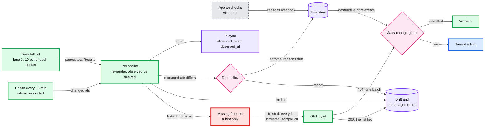
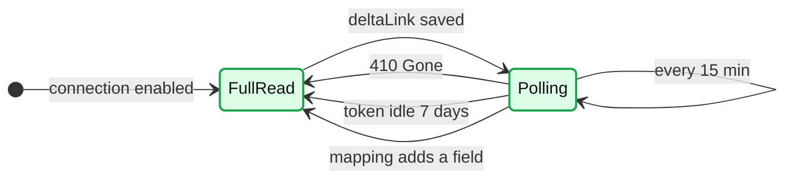
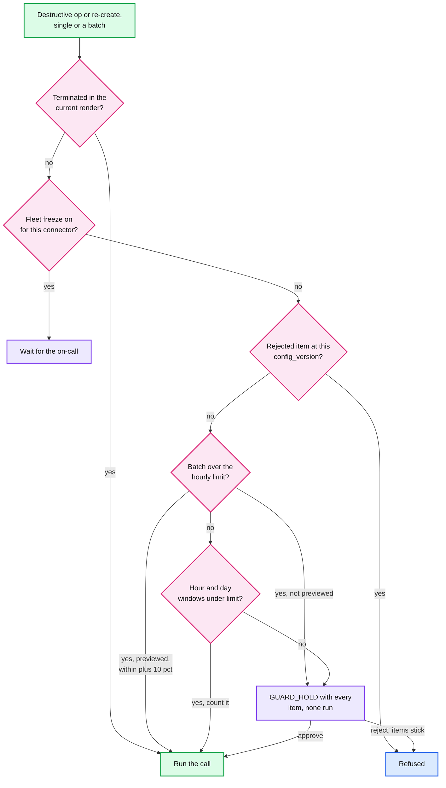
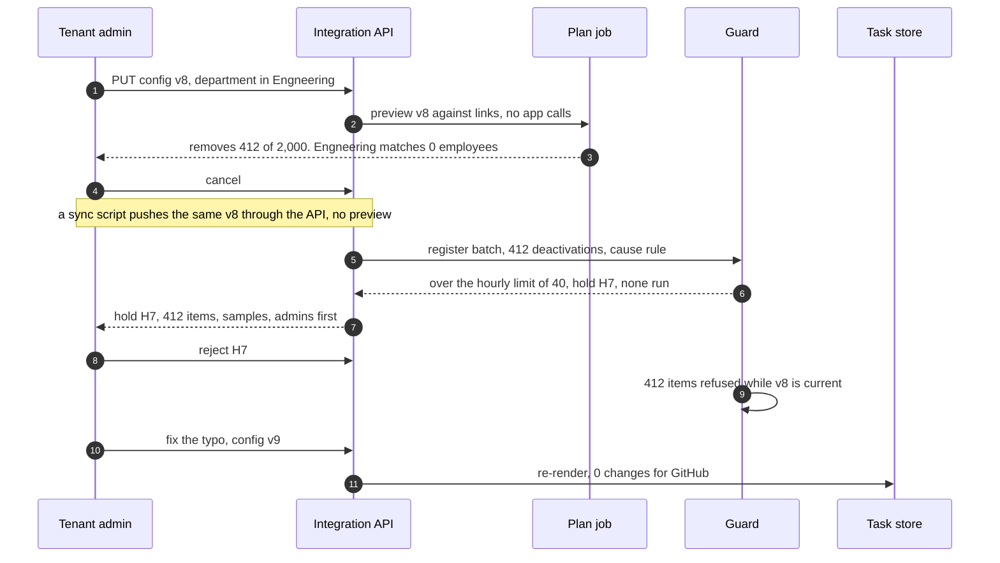

# Deep dive: drift, reconciliation and the mass-change guard

> One-line answer: a daily full read of every app (deltas and webhooks add freshness) is compared with a **fresh render** of what each account should be, so drift, lost tasks and changes with no employee event are all corrected or reported. Absence from a list concludes nothing until the list passes four checks and a `GET` by id returns `404`. Every destructive operation on someone the identity record does not show as terminated passes a **mass-change guard**: batches are admitted whole or held whole, single operations are held past `max(3, 2%)` an hour or `max(10, 5%)` a day, and a rejection sticks. Two fleet-wide detectors catch the bug that is ours. Terminations are never held.

Zoom-in on [`../solution.md`](../solution.md) §4.3, §5.5 and §10.2. Reusable blocks: [`../../../concepts/rate-limiting-and-load-shedding.md`](../../../concepts/rate-limiting-and-load-shedding.md) (the budget a reconcile spends), [`../../../concepts/exactly-once.md`](../../../concepts/exactly-once.md) (why re-creates are the risky write). Siblings: [`desired-state-sync-and-ordering.md`](desired-state-sync-and-ordering.md) (the task row, `reasons`, `dirty_gen`), [`idempotent-creates-and-account-matching.md`](idempotent-creates-and-account-matching.md) (adopting what a reconcile finds), [`failures-retries-and-circuit-breakers.md`](failures-retries-and-circuit-breakers.md) (quarantine when every read fails). Upstream control for mass terminations: [`../../employee-ops-bundle/`](../../employee-ops-bundle/) (#46). Facts: [`../research/facts-survey.md`](../research/facts-survey.md).

## 1. What the change path cannot see

Six things change an app behind our back: an admin edits or re-enables an account in the app's console, someone creates an account by hand, an account is deleted in the app, a webhook is lost (GitHub "does not automatically redeliver failed deliveries"), a zombie write lands after its lease, or the app normalizes our values. Two more come from our side: a task that gave up after 72 h, and a rule that depends on time ("employees with tenure over 90 days") with no event when it flips.



- **First draft: compare observed with applied.** That only asks "did the app keep what we wrote?". A task that gave up, or a rule that flipped with no event, leaves applied and observed equal and both wrong. **Design: re-render the desired state for every link** and compare it with what the app holds. A difference marks the row dirty with reason `drift`.
- **Drift tasks read first.** A task whose `reasons` include `drift`, `webhook` or `verify` `GET`s the account and diffs the desired state against what the app returned, not against `applied_hash`. Every read-back writes `observed_hash` and `observed_at`.
- **Entities get events too.** A department rename, a group mapping change or a manager's new email emits an entity event. The planner fans out to everyone who references it in lane 3, through batch admission if anything destructive follows.

## 2. Three ways to read an app back

| Path | Freshness | Fleet cost a day | How it fails | Backstop |
|---|---|---|---|---|
| Daily full list, staggered by `hash(connection_id)` | 24 h | ~3 M list calls. At most 10% of **every** bucket on the path, app-wide ones included | Lies: short, empty, scoped, offset shifts (§3) | List trust, confirm-by-GET, the guard |
| Deltas every 15 min | 15 min | ~1 M: 96 polls a day on ~10k Microsoft connections | Graph tokens for directory objects last "seven days". `410 Gone` means "restart with a full synchronization". Replays happen | The full list |
| App webhooks | Seconds | ~0.3 M re-reads | Slack retries up to 3 times, Okta "at most one retry", Google channels have "no automatic way to renew", GitHub never redelivers | Deltas, then the full list |



- **A new token after a mapping change or a long outage.** "Only properties included in `$select` are tracked for changes", so adding `manager` to a mapping means a full read. So does a breaker or quarantine longer than 7 days.
- **First draft: 10% of the connection's quota. Design: 10% of every bucket.** Jira gives our app "a single 65,000 point hourly quota across all tenants". Ten percent of each tenant's own quota, summed over thousands of tenants, would spend that pool.

**Cost per app** (one connection, one daily full read). Page sizes, group counts and the Jira fleet size are [estimate].

| App | Binding limit (survey) | 2,000 accounts | 50,000 accounts | Note |
|---|---|---|---|---|
| Google Directory | 2,400 queries/min per user per project | ~4 pages of 500 + ~20 group calls | ~1,100 calls: ~5 min at 10% | Under 0.1% of a day's quota |
| GitHub App | 5,000 requests/h per installation | ~70 calls: ~9 min at 10% | ~1,500 calls: ~3 h at 10% | ~1.3% of the day's quota, the costliest |
| Slack SCIM | ~300 reads/min on Users, 1,000/min org-wide, shared with every SCIM app in the org | ~5 calls | ~60 calls | Tiny, but the rate is learned |
| Jira Cloud | 65,000 points/h app-wide | ~40 calls | ~1,000 calls | Fleet: ~5,000 connections x ~10 calls is ~3% of the app-wide hour |

## 3. When is a list trusted?

**First draft:** every page fetched, and the count equals `totalResults` **or** is within 10% of the last complete run. An admin who narrows our app's scope gets an honest answer: `200`, zero rows, `totalResults: 0`. The count matches, so the first draft trusts it ("scoped, first draft" below: 3,000 `GET`s, then 60 re-creates before a hold).

**Design**, in firing order:
1. Every page succeeded, and the read used one credential grant (refreshes are fine, a re-authorization is not).
2. The count equals `totalResults` **and** is within 10% of the last complete count, adjusted for our own creates and deletes since.
3. Trusted: each linked account not in the list gets a `GET` by id. Only a `404` counts, and the `404`s go to the guard as **one batch**.
4. Untrusted: `GET` a sample of 20 missing accounts. If they exist, the list lied: tell the admin ("our app can no longer see your users") and conclude nothing. If they return `404`, the drop is real, and it goes to the guard as one batch.

Why confirm even a trusted list: SCIM pages by `startIndex` (1-based offsets). A deletion between page 1 and page 2 shifts every later row left by one, so one live account is skipped and looks missing ("offset shift" below).

## 4. Drift policy, enforce loops and reactivation

| Attribute class | Policy | Why |
|---|---|---|
| Identity: `userName`, emails, name | `enforce` | Matching and login depend on them |
| Org: title, department, manager, location | `enforce` | Rippling is the system of record |
| `active = false` for a terminated employee | `enforce`, always, never held | A re-enabled ex-employee is a security incident |
| App-owned: photo, Slack status | `report` | The app is the source of truth |

- **Reactivation is never automatic.** Deactivated to active happens only because of an identity change newer than the deactivation: a rehire or a cancelled termination. Drift and reconcile never turn an account back on.
- **The enforce loop.** An app stores `+14155550100` when we send `+1 415 555 0100`. Every read sees drift, and we rewrite. With 15-minute deltas that is 96 writes a day per account, ~192k a day on a 2,000-person connection [estimate]. After 3 drift-backs in 24 h (~45 min with deltas) the attribute switches to `report` for that connection and the connector team gets a ticket. The fix: render in the app's canonical form, so the hashes match.

## 5. Unmanaged accounts

An account in the app with no link. One case is ours by construction. The rest are **never acted on automatically**.

| Looks like | Evidence | What happens |
|---|---|---|
| Our create that landed after a crash | `externalId` is one of this tenant's employee ids | Re-linked automatically. If the account is inactive: `CONFLICT`, never adopted |
| An employee we failed to match | `userName` or primary email equals an employee's, normalized | "Link?" One click adopts it under the create deep dive's rules |
| A former employee missed at offboarding | Email matches a terminated employee | "Not active in Rippling. Deactivate?" Top of the list |
| A service account, bot or guest | Manifest bot types, or a domain outside the tenant's | Shown, hidden by default |

## 6. The mass-change guard

| Rule | First draft | Design | Why the first draft failed (sim below) |
|---|---|---|---|
| What is explained | Task `reasons` include `termination` | The identity record shows the employee terminated **in the current render** | 80 fired people re-enabled in the app: 40 kept access until an admin clicked |
| What counts | Deactivate, delete, group removal, re-create | Adds admin-role removal. Group removal only when **net** (fewer managed groups in the end) | A reorg that swaps groups is not a removal |
| Shape | Streaming count | **Batch admission:** a rule edit, reconcile run, bulk import or release registers its whole count first. Above the hourly limit it is held whole, unless the admin approved that count in the preview (actual at most previewed + 10%) | A typo removed 40 people before the hold opened |
| Limits | `max(10, 2%)` an hour | More than `max(3, 2%)` an hour or `max(10, 5%)` a day, per connection [estimate] | A 12-person tenant lost 10. A drip of 39 an hour never tripped |
| Reject | Undefined | The hold stores `config_version` and its items (`GUARD_HOLD_ITEM`). The same op on the same subject is refused while that version is current | Tomorrow's reconcile reopened the same hold |

**Terminations are never held.** Mass terminations are controlled **upstream**: the identity service requires a second HR approver for any change that terminates more than `max(3, 5%)` of a tenant in an hour, on every path (UI, CSV, API), and stamps the approval as a `bulk_action_id`. If provisioning sees more new terminations than that without one, it pages the identity team. It alerts. It never holds a security action.



- **Approve re-renders.** Approval marks the held subjects dirty with the hold id as an allowance. They render at that moment, so a rule fixed in the meantime turns them into no-ops.
- **Delete timers count again.** A delete 30 days after a `rule` deactivation is counted. Deletes are the one thing we cannot undo. Deactivations are not, which is why deletes wait 30 days.

The simulator runs the reconciler against seven lists, then the guard against nine bursts, with first-draft and design rules side by side.

```python
import random
from collections import deque

random.seed(32)
HOUR, DAY = 3600, 86400

class App:
    """A fake SCIM app with 3,000 accounts. The fault decides how its list lies."""
    def __init__(self, fault=None, page=1000):
        first = 300 if fault == "deleted" else 0   # an app admin really deleted 300 accounts
        self.acct = {f"a{i:05d}": "Eng" for i in range(first, 3000)}
        self.page, self.fault, self.gets = page, fault, 0
    def list(self, start):                       # SCIM startIndex is 1-based
        if self.fault == "scoped":               # admin narrowed our scope: honest, and empty
            return [], 0
        if self.fault == "empty" or (self.fault == "short" and start > 2 * self.page):
            return [], len(self.acct)            # 200 OK, no rows, totalResults unchanged
        if self.fault == "shift" and start > 1:  # someone deletes a00010 between pages
            self.acct.pop("a00010", None)
        ids = sorted(self.acct)[start - 1:start - 1 + self.page]
        return [(i, self.acct[i]) for i in ids], len(self.acct)
    def get(self, aid):                          # None means 404, hidden or gone
        self.gets += 1
        return None if self.fault == "scoped" else self.acct.get(aid)

class Guard:
    """design: current render, hour and day windows, whole-batch admission, sticky rejection.
    first draft: reasons, max(10, 2%) an hour, streaming."""
    def __init__(self, managed, design=True):
        self.design, self.cfg, self.rejected, self.win, self.hold = design, 8, set(), deque(), None
        self.hour = max(3 if design else 10, managed * 2 // 100)
        self.day = max(10, managed * 5 // 100) if design else 10**9
        self.ran = self.held = self.free = self.refused = 0
    def explained(self, op):                     # op: (subject, terminated in render, reasons)
        return op[1] if self.design else "termination" in op[2]
    def one(self, t, op):
        if self.explained(op):
            self.free += 1
            return True
        while self.win and self.win[0] <= t - DAY:
            self.win.popleft()
        full = sum(x > t - HOUR for x in self.win) >= self.hour or len(self.win) >= self.day
        if self.hold is None and full:
            self.hold = {"at": t, "items": []}
        if self.hold:
            self.hold["items"].append(op[0])
            self.held += 1
            return False
        self.win.append(t)
        self.ran += 1
        return True
    def batch(self, t, ops, previewed=0):
        fresh = [o for o in ops if (o[0], self.cfg) not in self.rejected]
        self.refused += len(ops) - len(fresh)    # rejection sticks while config v8 is current
        counted = [o for o in fresh if not self.explained(o)]
        if not self.design or len(counted) <= self.hour:
            return [self.one(t, o) for o in fresh]
        self.free += len(fresh) - len(counted)
        if previewed and len(counted) <= previewed * 1.1:
            self.ran += len(counted)             # the admin approved this count in the preview
        else:                                    # held whole: none of it runs
            self.hold, self.held = {"at": t, "items": [o[0] for o in counted]}, self.held + len(counted)
    def reject(self):
        self.rejected |= {(s, self.cfg) for s in self.hold["items"]}
        self.hold = None

def reconcile(app, links, design=True, last=3000):
    seen, start = {}, 1
    while True:
        rows, total = app.list(start)
        seen.update(rows)
        if not rows or start + len(rows) > total:
            break
        start += len(rows)
    near = abs(len(seen) - last) <= last // 10   # last complete count, adjusted for our own writes
    trusted = (len(seen) == total and near) if design else (len(seen) == total or near)
    hints = [a for a in links if a not in seen]
    if trusted or not design:
        gone = [a for a in hints if app.get(a) is None] if trusted else []
        verdict = f"{len(gone)} gone"
    else:                                        # untrusted: GET a sample of 20 to learn why
        sample = [a for a in hints[:20] if app.get(a) is None]
        gone = hints if sample and len(sample) == len(hints[:20]) else []
        verdict = "drop looks real" if gone else "list lied, admin alerted"
    g = Guard(len(links), design)
    g.batch(0, [(a, False, {"drift"}) for a in gone])   # each is a re-create
    return (f"{len(seen):>4} of {total:>4} {'trusted' if trusted else 'UNTRUSTED'}, GETs {app.gets:>4}, "
            f"{verdict}: re-creates run {g.ran:>2}, held {g.held:>4}")

print("Reconcile: 3,000-account Slack connection, last complete count 3,000, hourly limit 60")
for name, fault, design in [("healthy day", None, True), ("empty page", "empty", True),
                            ("short page", "short", True), ("offset shift", "shift", True),
                            ("scoped, first draft", "scoped", False), ("scoped, design", "scoped", True),
                            ("300 really deleted", "deleted", True)]:
    app, links = App(fault), dict(App().acct)
    if fault is None:                            # 2 accounts deleted by hand in the app
        del app.acct["a00400"], app.acct["a00500"]
    print(f"  {name:<20} {reconcile(app, links, design)}")

def run(ops, managed=2000, design=True, previewed=0, single=False):
    g = Guard(managed, design)
    _ = [g.one(t, op) for t, op in ops] if single else g.batch(0, ops, previewed)  # single: (time, op)
    return g

def show(name, *variants):
    print(f"  {name:<24} " + " | ".join(f"{v}: run {g.ran + g.free:>3}, held {g.held:>3}" for v, g in variants))

ops = lambda n, p, terminated, why: [(f"{p}{i}", terminated, {why}) for i in range(n)]
typo, loa, fired, layoff = ops(412, "e", False, "rule"), ops(500, "e", False, "edit"), \
    ops(80, "x", True, "drift"), ops(600, "t", True, "termination")
drip = [(k * HOUR / 39, (f"d{k}", False, {"edit"})) for k in range(39 * 24)]   # 39 an hour, 24 h
print("\nGuard, 2,000-account GitHub connection. Design: hold above 40 an hour or 100 a day")
show("rule typo, 412, API", ("first draft", run(typo, design=False)), ("design", run(typo)))
show("typo, preview said 412", ("design, 412 arrive", run(typo, previewed=412)),
     ("design, 460 arrive", run(typo + typo[:48], previewed=412)))
show("bulk import, 500 LOA", ("first draft", run(loa, design=False)), ("design", run(loa)))
show("80 fired, re-enabled", ("first draft", run(fired, design=False)), ("design", run(fired)))
show("real layoff, 600", ("first draft", run(layoff, design=False)), ("design", run(layoff)))
gd = run(drip, single=True)
show("drip, 39 an hour, 24 h", ("first draft", run(drip, design=False, single=True)), ("design", gd))
print(f"  {'':<24} design hold opens at {gd.hold['at'] / HOUR:.1f} h, on the daily window")
show("12-person tenant, 10 out", ("first draft", run(typo[:10], 12, design=False)), ("design", run(typo[:10], 12)))
g = run(typo)
g.reject()
g.batch(DAY, typo)                               # tomorrow's reconcile proposes the same 412
late = g.one(DAY + 60, ("ana", True, {"termination"}))
print(f"  {'rejected, next day':<24} design: same 412 at v8 refused {g.refused}, new hold {g.hold is not None}, "
      f"a termination still runs {late}")
```

```text
Reconcile: 3,000-account Slack connection, last complete count 3,000, hourly limit 60
  healthy day          2998 of 2998 trusted, GETs    2, 2 gone: re-creates run  2, held    0
  empty page              0 of 3000 UNTRUSTED, GETs   20, list lied, admin alerted: re-creates run  0, held    0
  short page           2000 of 3000 UNTRUSTED, GETs   20, list lied, admin alerted: re-creates run  0, held    0
  offset shift         2999 of 2999 trusted, GETs    1, 0 gone: re-creates run  0, held    0
  scoped, first draft     0 of    0 trusted, GETs 3000, 3000 gone: re-creates run 60, held 2940
  scoped, design          0 of    0 UNTRUSTED, GETs   20, drop looks real: re-creates run  0, held 3000
  300 really deleted   2700 of 2700 trusted, GETs  300, 300 gone: re-creates run  0, held  300

Guard, 2,000-account GitHub connection. Design: hold above 40 an hour or 100 a day
  rule typo, 412, API      first draft: run  40, held 372 | design: run   0, held 412
  typo, preview said 412   design, 412 arrive: run 412, held   0 | design, 460 arrive: run   0, held 460
  bulk import, 500 LOA     first draft: run  40, held 460 | design: run   0, held 500
  80 fired, re-enabled     first draft: run  40, held  40 | design: run  80, held   0
  real layoff, 600         first draft: run 600, held   0 | design: run 600, held   0
  drip, 39 an hour, 24 h   first draft: run 936, held   0 | design: run 100, held 836
                           design hold opens at 2.6 h, on the daily window
  12-person tenant, 10 out first draft: run  10, held   0 | design: run   0, held  10
  rejected, next day       design: same 412 at v8 refused 412, new hold False, a termination still runs True
```

- **Lists.** Empty and short pages, and a scope change on an app that still answers `GET`s, cost 20 `GET`s and an admin alert. A scope change on an app that hides out-of-scope users behind `404` (GitHub uses "a `404 Not Found` response instead of a `403 Forbidden` response to avoid confirming the existence", [docs](https://docs.github.com/en/rest/using-the-rest-api/troubleshooting-the-rest-api)) looks like a real drop. The batch of 3,000 is held whole, and nothing runs. A real deletion of 300 in the app is trusted, confirmed and held as one batch for the admin.
- **Batches.** The typo and the bad import are held whole. A count the admin saw and approved runs. A count that grew past previewed + 10% is held again.
- **Windows.** The daily window stops the drip at 100, 2.6 h in. The floor of 3 holds a 12-person tenant before it loses anyone.
- **Terminations** run in every row, held hold or not. The upstream approver is where a bad CSV stops.

## 7. The fleet view: when it is our bug

**First draft:** more than 20 **connections** opening holds within 10 min pages and freezes lane-3 destructive operations. **Design:** two detectors. (a) Holds from more than 20 **distinct tenants** in 10 min. (b) Per connector, unexplained counted operations per hour, fleet-wide, above 3x that connector's baseline, and canary against control during a release. Either one pages and freezes every guard-counted operation, **in every lane**, for the affected connectors. Terminations still run.

```python
import random
from bisect import bisect_left

random.seed(58)

# 1. A connector release that wrongly deactivates 1 account per connection-hour, 20,000 Slack
#    connections of ~200 accounts, one per tenant [estimate]. Baseline: ~900 unexplained a day.
CONNS, HOURS, BASE = 20_000, 3, 900 / 24
drip = sorted((random.uniform(0, 3600 * HOURS), random.randrange(CONNS)) for _ in range(CONNS * HOURS))
def first_hold(hour_limit, day_limit):          # when each connection's own guard opens a hold
    seen, opened = {}, []
    for t, c in drip:
        ts = seen.setdefault(c, [])
        if ts is not None:
            if sum(x > t - 3600 for x in ts) >= hour_limit or len(ts) >= day_limit:
                opened.append(t)
                seen[c] = None                    # held: the rest of this connection's ops wait
            else:
                ts.append(t)
    return opened

def fires(times, limit, window):                  # first time more than `limit` fall in `window`
    return next((t for i, t in enumerate(times) if i - bisect_left(times, t - window) + 1 > limit), None)

bad = [t for t, _ in drip]
legit = sorted(random.uniform(0, 3600 * HOURS) for _ in range(int(BASE * HOURS)))
print(f"Drip: {CONNS:,} connections, 1 wrong deactivation per connection-hour, {HOURS} h")
for name, h, d in (("first draft, 10 an hour", 10, 10**9), ("design, 4 an hour, 10 a day", 4, 10)):
    holds = first_hold(h, d)
    a = fires(holds, 20, 600)                     # (a) holds from more than 20 tenants in 10 min
    print(f"  {name:<28} holds {len(holds):>6,}, distinct-tenant detector "
          + (f"fires at {a:5.0f} s" if a else "never fires"))
b = fires(sorted(bad + legit), 3 * BASE, 3600)    # (b) unexplained per hour above 3x baseline
print(f"  design rate detector, over {3 * BASE:.0f} an hour: fires at {b:.0f} s, after "
      f"{bisect_left(bad, b)} wrong deactivations, then all lanes freeze for Slack")
canary = sorted(random.uniform(0, 3600) for _ in range(CONNS // 100))
print(f"  1% canary for 1 h: {len(canary)} unexplained vs {BASE / 100:.1f} expected from control, "
      f"a gate at 10 trips at {canary[9]:.0f} s")

# 2. Legitimate holds over a business year: does a fleet-wide count fire falsely?
DAYS, WINDOW, LIMIT = 250, 600, 20
def year(per_day, fan_share):                     # [estimate] hold-opening events, 80% in 10 h
    holds = []                                    # (time s, tenant)
    for d in range(DAYS):
        for _ in range(int(per_day * 0.8)):
            t, tenant = d * 86400 + random.uniform(0, 36000), random.randrange(50_000)
            k = random.randint(5, 15) if random.random() < fan_share else 1
            holds += [(t + random.uniform(0, 60), tenant) for _ in range(k)]
    return sorted(holds)

def episodes(holds, by_tenant):
    times, fired, last = [h[0] for h in holds], 0, -1e9
    for i, (t, _) in enumerate(holds):
        j = bisect_left(times, t - WINDOW)
        n = len({h[1] for h in holds[j:i + 1]}) if by_tenant else i - j + 1
        if n > LIMIT and t - last > WINDOW:
            fired, last = fired + 1, t
    return fired

for per_day, share in ((60, 0.05), (170, 0.10)):
    h = year(per_day, share)
    print(f"Year, {per_day} hold events a day, {share:.0%} fan out to 5-15 apps: {len(h):,} holds, "
          f"freezes: first draft (connections) {episodes(h, False)}, design (tenants) {episodes(h, True)}")
bug = sorted((random.uniform(0, 600), random.randrange(50_000)) for _ in range(1_000))
print(f"Planner release bug, 1,000 holds from ~1,000 tenants in 10 min: first draft fires "
      f"{episodes(bug, False)}, design fires {episodes(bug, True)}")
```

```text
Drip: 20,000 connections, 1 wrong deactivation per connection-hour, 3 h
  first draft, 10 an hour      holds      0, distinct-tenant detector never fires
  design, 4 an hour, 10 a day  holds    554, distinct-tenant detector fires at  3124 s
  design rate detector, over 112 an hour: fires at 18 s, after 111 wrong deactivations, then all lanes freeze for Slack
  1% canary for 1 h: 200 unexplained vs 0.4 expected from control, a gate at 10 trips at 149 s
Year, 60 hold events a day, 5% fan out to 5-15 apps: 17,315 holds, freezes: first draft (connections) 10, design (tenants) 0
Year, 170 hold events a day, 10% fan out to 5-15 apps: 65,259 holds, freezes: first draft (connections) 454, design (tenants) 0
Planner release bug, 1,000 holds from ~1,000 tenants in 10 min: first draft fires 1, design fires 1
```

- **A thin drip goes under every hold in the first draft.** 1 wrong deactivation per connection-hour never reaches 10 an hour anywhere. With the design limits, 554 connections hold on their own and detector (a) fires after ~52 min. Detector (b) fires in 18 s, after 111 wrong deactivations. The canary gate trips in ~2.5 min on 1% of connections.
- **Counting connections fires falsely.** One tenant editing a group mapped into 15 apps opens 15 holds in a minute. Counting distinct tenants never fired falsely in either year, and still catches a real release bug.
- **Every lane.** A connector bug rides lane 2, and a planner bug's scope-outs can ride lane 0. A lane-3-only freeze would miss both.

## 8. Rule-edit preview

A rule edit's plan needs no app call. It is a pure function of employees, old rules, new rules and links: who enters scope, who leaves, which groups change. It runs on every save, under a second for 50,000 employees [estimate], and the admin's confirmation is the pre-approval for that count.



- **Warnings and samples carry the preview.** A rule value no employee has, or a rule that matches 0 people, is flagged above the count. Samples list admins first: "Removes 412" is easy to click past, "Removes Priya (org owner)" is not.

## 9. Trade-offs

| Decision | Chose | Gave up |
|---|---|---|
| Source of correctness | Daily full list against a fresh render, deltas and webhooks as hints | ~3 M list calls a day, ~30% of all external calls |
| List trust | Four checks, then a `GET` per missing id, or a sample of 20 | An app that hides accounts as `404` makes a scope change look like a real drop. The guard holds it |
| Guard input | The current render | The guard needs the employee's status at render time. It has it |
| Guard shape | Whole-batch admission, preview as pre-approval, hour and day windows | A big intended change needs the preview or an admin click |
| Terminations | Never held. A second HR approver upstream | Provisioning trusts the identity service's control |
| Fleet rule | Distinct tenants, plus a per-connector rate against baseline | A baseline per connector to learn. A freeze also stops legitimate admin work on that connector |
| Unmanaged accounts | Report only, except our own `externalId` | An ex-employee's hand-made account stays until an admin clicks |

## 10. Numbers to say out loud

- Reconcile: daily, staggered by hash, at most 10% of every bucket, ~3 M list calls a day. Deltas every 15 min, ~1 M a day. Graph tokens last 7 days.
- Trust: every page, one grant, count equals `totalResults` **and** within 10% of the adjusted last count. Else a sample of 20 `GET`s.
- Guard: more than `max(3, 2%)` an hour or `max(10, 5%)` a day per connection. 40 and 100 on a 2,000-account GitHub. Batches admitted whole, preview + 10%.
- Upstream: a second HR approver above `max(3, 5%)` terminations an hour. Fleet: 20 distinct tenants in 10 min, or 3x a connector's baseline.
- Enforce loop: 3 drift-backs in 24 h switches to `report`. Delete: 30 days after deactivate.
