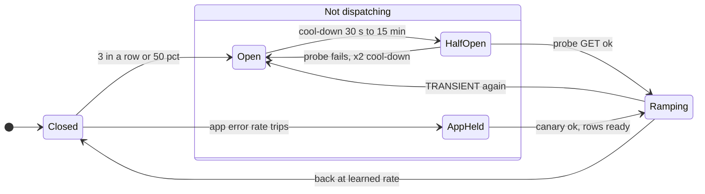
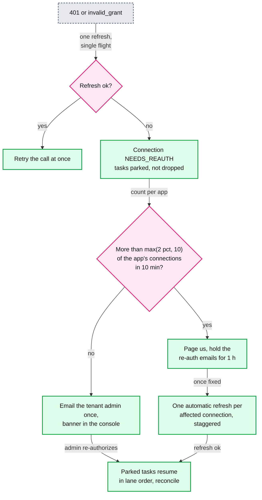
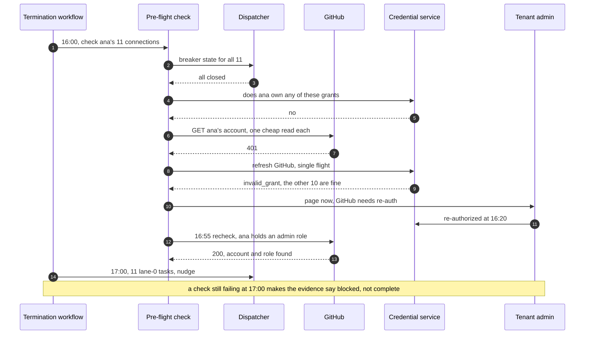

# Deep dive: failures, retries and circuit breakers

> One-line answer: every response goes through the connector's `classify`, and the class decides everything else. `TRANSIENT` retries with full-jitter backoff (30 s base, x2, cap 1 h, give up at 72 h) inside a per-connection budget of `max(2, 20% of first attempts)` a minute. `THROTTLED` pauses the bucket and never trips a breaker. `AUTH` parks one connection. `PERMANENT` waits for a human or a new input. Breakers match the blast radius: the **app** breaker trips on the app-wide error rate (50% `TRANSIENT` of at least 200 calls in 2 min), and a **connection** breaker trips on its own last 3 calls. While the app breaker is open, 5 canaries probe at most once a minute and tasks keep their attempts. On close every waiting row is ready at once: lane 0 goes first, the rest ramp from 2x to 10x the normal rate. A 2-hour Google outage then costs ~7k calls instead of 8.4 M, terminations land seconds after Google is back, and ~71k rows drain in ~16 minutes.

Zoom-in on [`../solution.md`](../solution.md) §5.4, §5.8 and §10.4 B. Reusable blocks: [`../../../concepts/rate-limiting-and-load-shedding.md`](../../../concepts/rate-limiting-and-load-shedding.md) §7 (retries multiply load), [`../../../concepts/fan-out-fan-in.md`](../../../concepts/fan-out-fan-in.md) §5 (isolation and breakers), [`../../../concepts/oauth.md`](../../../concepts/oauth.md) (refresh and revocation). Siblings: [`rate-limits-priority-and-fairness.md`](rate-limits-priority-and-fairness.md) (what `THROTTLED` feeds), [`idempotent-creates-and-account-matching.md`](idempotent-creates-and-account-matching.md) (a timed-out create), [`drift-reconciliation-and-mass-change-guard.md`](drift-reconciliation-and-mass-change-guard.md) (a list that lies). The termination itself: [`../../employee-ops-bundle/`](../../employee-ops-bundle/).

---

## 1. Classify first: the cases that are easy to get wrong

The base table is in [`../solution.md`](../solution.md) §5.4. These are the responses where a wrong class does damage.

| Response | Class | What happens, and why |
|---|---|---|
| Timeout after the request was sent | `TRANSIENT`, outcome unknown | Safe to resend for `PATCH replace`, `set_active` and member removal: the same state twice. A create is not, so its link says `CREATING` and the retry looks before it posts |
| `429`, or GitHub `403` with `x-ratelimit-remaining: 0` or `retry-after` | `THROTTLED` | The bucket pauses until `Retry-After`. Attempts do not move. Never a breaker vote: a quota is not an outage |
| GitHub `403` without those headers | `PERMANENT` (missing permission) | Retrying a permission error for 72 h spends quota on nothing. The admin is told which scope is missing |
| `401`, then `invalid_grant` on the one refresh | `AUTH` | Connection `NEEDS_REAUTH`, tasks parked (§6). Never a breaker vote |
| `404` on a deactivate or a member removal | `NOT_FOUND`, which here means done | No account means no access. Logged as drift. The +5 min verify read still runs |
| `404` on an update | `NOT_FOUND` | Someone deleted it in the app. Re-create if in scope, through the mass-change guard |
| `412` | `STALE` | Re-read, re-diff, retry at once. Three in a row become `TRANSIENT` [estimate], so a fight with another writer backs off |
| `400` validation, "no licences left" | `PERMANENT` | Link `ERROR` in plain words. Retried when the input changes, an admin clicks retry, or the daily re-render still finds a difference |
| `405` or `501` on `PATCH` | `PERMANENT`, connector bug | The manifest claims `patch` and the app disagrees. The error-class mix alarm files it to the connector team |
| `200` whose body fails the schema (an HTML maintenance page, a list with no `totalResults`) | `TRANSIENT` | Never parsed as truth. Counts toward breakers. A list read becomes "not trusted" and nothing is concluded from it |

---

## 2. Backoff with full jitter, and when to give up

`delay = random(0, min(1 h, 30 s x 2^(attempts - 1)))`. The timer is the task row itself: `attempts` and `ready_at` in `SYNC_TASK`, so it survives any crash.

| Attempt | 1 | 2 | 3 | 4 | 5 | 6 | 7 | 8 and on |
|---|---|---|---|---|---|---|---|---|
| Delay drawn from | 0 to 30 s | 0 to 1 min | 0 to 2 min | 0 to 4 min | 0 to 8 min | 0 to 16 min | 0 to 32 min | 0 to 1 h |

- **Why full jitter.** Tasks that failed in the same second would otherwise retry in the same second, forever.
- **What 72 h costs.** The first 7 attempts take ~32 minutes on average, then one every ~30 minutes: ~150 attempts over 72 h for a task whose app stays broken and whose breaker never opens. With a breaker open, attempts stop moving.
- **Giving up is visible, not final.** At 72 h the link shows "gave up after 72 h" and the task is deleted. The daily re-render marks it dirty again if the desired state still differs.
- **A timer is never the reason to wait after recovery.** First draft: rows kept their backoff timers when the app came back, up to an hour each. Design: when a breaker closes, the app's rows in transient backoff get `ready_at = now`, and the ramp (§6) paces them instead.
- **A new edit does not reset backoff.** It only raises `want_version`: the app is still the one failing. A **higher lane** does reset `ready_at`.

---

## 3. The retry budget, and why it has a floor

- **The rule.** Per connection, retries may be at most `max(2, 20% of first attempts)` in a minute. A busy connection's traffic grows by at most 1.2x from retries, however bad the app gets. Over budget, a retry moves to the next minute with jitter.
- **Why the floor.** First draft: 20% of first attempts, no floor. The average connection makes ~13 calls a day (10 M over 750k), so in almost every minute it makes no first attempt, 20% of zero is zero, and a quiet connection would never retry at all. Envoy's retry budget has a minimum for the same reason.
- **One layer only.** Workers do not retry inside a call. The task row is the only retry loop, so 3 layers of 3 retries never become 27 calls.

---

## 4. Breakers, scoped to the failure



- **First draft, and why it fails.** Connection breaker at 50% of at least 20 calls in 2 min, app breaker when 30% of an app's active connections have open breakers. A median connection makes ~0.04 calls in 2 minutes. In the §5 simulation **no** connection reaches 20 calls during a 2-hour outage, so the app breaker never opens, load stays at up to 22x normal for 2 hours, and terminations land up to 44 minutes after recovery.
- **App breaker, on the app-wide error rate.** It opens when at least 50% of at least 200 calls to the app in 2 min are `TRANSIENT` [estimate]. At Google's ~10 tasks/s that is ~1,200 calls in 2 min, so it trips within a minute of a real outage, and one tenant's failures are too few calls to trip it. While open: 5 canary connections probe with a cool-down capped at 60 s, nothing else is dispatched, tasks keep their attempts, the status page says "Google provisioning delayed", and the connector on-call is paged.
- **Connection breaker,** for failures that belong to one tenant: a customer's own SCIM server is down. It opens when the connection's last 3 calls were all `TRANSIENT`, or at least 50% of at least 20 calls in 2 min. Cool-down 30 s, doubling to 15 min. Half-open sends one probe, a cheap `GET` of a known account.
- **Suspect egress.** If more than 3 apps' breakers open within 2 min, the common cause is on our side, usually the egress proxy (3 per availability zone). Page the platform team, not 3 connector teams.
- **Blast radius.** One tenant's broken server opens one connection breaker. A vendor outage opens one app breaker. A revoked grant opens neither.

---

## 5. Simulation: Google is down for 2 hours

2,000 connections, one tenth of the ~20,000 Google connections, at ~1 task/s, one tenth of Google's ~10 change tasks/s in the daytime [estimate]. Rates per connection are real, so breakers see real volume. Totals are multiplied back by 10, and the 200-call minimum scales to 20. Each edit picks one of a connection's ~200 employees, so independent edits barely coalesce. ~300 terminations in 2 hours [estimate]. Every call fails fast during the outage. As it recovers, Google serves up to 20x our normal rate and fails the rest [estimate]. Four policies: **naive** (one row per event, retry every 30 s, no breakers), **count vote** (backoff and budget, with the first draft's breakers), the **design** (§2 to §4: error-rate app breaker, last-3 connection breaker, 60 s canaries, `ready_at = now` on close, lane 0 at once, the rest ramping 2x to 10x and re-opening over 10 min by hash), and the design with lane 0 **staggered** like everyone else.

```python
import heapq, random
from collections import defaultdict, deque

N, SCALE, RATE, EMP = 2_000, 10, 1, 200  # 1/10 of ~20,000 Google connections and ~10 tasks/s
A, B, END = 1_800, 9_000, 16_200     # healthy for 30 min, down for 2 h, then 2 h more
P0, CAPACITY = 300 / 72_000, 20      # ~300 terminations in 2 h; recovering app takes 20x normal

def run(policy, seed=3):
    rng = random.Random(seed)
    naive, design, exempt = policy == "naive", policy.startswith("design"), policy == "design"
    rows, cal, pool, parked = {}, defaultdict(list), [], []
    win, until, cool, half, fails, seen = defaultdict(list), {}, {}, set(), defaultdict(int), {}
    budget, canaries, reopen, recent = defaultdict(lambda: [0, 0]), [], {}, deque()
    opened = closed = None
    sent, failed, l0, drained, upserts, backlog, trips = [0] * END, 0, [], 0, 0, 0, 0
    arr = rng.expovariate(RATE)

    def call(t, key, r, ok):
        nonlocal trips
        c = key[0]
        seen[c], fails[c] = t, 0 if ok else fails[c] + 1
        recent.append((t, ok))
        if not naive:                    # connection breaker
            w = win[c] = [x for x in win[c] if x[0] > t - 120] + [(t, ok)]
            volume = len(w) >= 20 and 2 * sum(not o for _, o in w) >= len(w)
            if c in half or volume or (design and fails[c] >= 3):   # design: or last 3 TRANSIENT
                half.discard(c)
                cool[c] = 15 if ok else min(900, 2 * cool.get(c, 15))   # 30 s doubling to 15 min
                if not ok:
                    until[c], win[c], trips = t + cool[c], [], trips + 1
        if ok:
            del rows[key]
            if r[4] is not None and A <= r[4] < B:
                l0.append(t - B)         # a termination that waited out the outage
            return
        r[1] += 1                        # backoff: 30 s base, x2, cap 1 h, full jitter
        delay = 30 if naive else rng.uniform(0, min(3_600, 30 * 2 ** (r[1] - 1)))
        cal[t + 1 + int(delay)].append((key, r[3]))

    for t in range(END):
        if t % 60 == 0:
            budget.clear()
        while arr < t + 1:               # the planner upserts tasks
            upserts += A <= arr < B
            c, lane = rng.randrange(N), 0 if rng.random() < P0 else 2
            key = (c, rng.randrange(EMP), arr) if naive else (c, rng.randrange(EMP))
            r = rows.get(key)
            if r is None:                # naive: one row per event. Else coalesce per key
                rows[key] = [lane, 0, t, 0, t if lane == 0 else None]
                cal[t + 2 * (lane == 2)].append((key, 0))   # lane 2 settles 2 s
            elif lane < r[0]:            # higher lane: ready now
                r[0], r[3], r[4] = lane, r[3] + 1, t
                cal[t].append((key, r[3]))
            arr += rng.expovariate(RATE)
        backlog = len(rows) if t == B else backlog
        for key, ver in cal.pop(t, ()):
            if key in rows and rows[key][3] == ver:
                heapq.heappush(pool, (rows[key][0], t, rng.random(), key, ver))
        served = 0
        if opened is not None and closed is None:     # app breaker open: 5 canaries probe
            for cn in canaries:
                if cn[0] <= t and closed is None:
                    sent[t] += 1
                    if t >= B:
                        served, closed = 1, t
                    else:                # design caps the cool-down at 60 s, the draft at 15 min
                        cn[1] = min(60 if design else 900, cn[1] * 2)
                        cn[0] = t + cn[1] * rng.uniform(0.8, 1.2)
            if closed is not None:       # every row ready now. Lane 0 at once, the rest by hash
                reopen = {c: t + (c * 2_654_435_761) % 600 for c in range(N)}
                until.clear(), half.clear(), fails.clear()
                for key, r in rows.items():
                    r[3] += 1
                    lane0 = exempt and r[0] == 0
                    cal[t + 1 if lane0 else max(t + 1, reopen[key[0]])].append((key, r[3]))
        top = limit = 10 ** 9            # after close: lanes 1 to 3 ramp 2x normal, doubling every
        if closed is not None:           # 2 min to 10x. Lane 0 skips the ramp, not the 10x top
            top, limit = 10 * RATE, RATE * min(10, 2 * 2 ** ((t - closed) // 120))
        bulk = 0
        while pool and sent[t] < top and (bulk < limit or pool[0][0] == 0):
            lane, _, _, key, ver = heapq.heappop(pool)
            r, c = rows.get(key), key[0]
            if not r or r[3] != ver:
                continue
            if opened is not None and closed is None:
                parked.append(key)       # blocked: attempts do not move
                continue
            wait = max(0 if exempt and lane == 0 else reopen.get(c, 0), until.get(c, 0))
            if wait > t:
                cal[wait].append((key, ver))
                continue
            if until.pop(c, None) is not None:
                half.add(c)              # this call is the half-open probe
            b = budget[c]                # retries: max(2, 20% of first attempts) per minute
            if not naive and r[1] and b[1] >= max(2, 0.2 * b[0]):
                cal[(t // 60 + 1) * 60 + rng.randrange(60)].append((key, ver))
                continue
            b[1 if r[1] else 0] += 1
            sent[t], bulk = sent[t] + 1, bulk + (lane > 0)
            ok = not A <= t < B and served < CAPACITY * RATE
            served += ok
            failed += t >= B and not ok
            drained = t if ok and A <= r[2] < B else drained
            call(t, key, r, ok)
        while recent and recent[0][0] <= t - 120:
            recent.popleft()
        if not naive and opened is None and t % 10 == 0:
            if design:                   # app-wide error rate: 50% of at least 200 calls in 2 min
                bad = len(recent) >= 200 // SCALE and 2 * sum(not o for _, o in recent) >= len(recent)
            else:                        # first draft: 30% of active connections have open breakers
                active = [c for c, lt in seen.items() if lt >= t - 300]
                bad = len(active) >= 20 and sum(until.get(c, -1) > t for c in active) >= 0.3 * len(active)
            if bad:
                opened, canaries = t, [[t + 30 * rng.uniform(0.8, 1.2), 30] for _ in range(5)]
    return dict(normal=sum(sent[:A]) * SCALE / A, peak=max(sent[A:B]) * SCALE,
                total=sum(sent[A:B]) * SCALE, after=max(sent[B:]) * SCALE, failed=failed * SCALE,
                opened=opened and opened - A, noticed=closed and closed - B, l0=sorted(l0),
                drained=drained - B, left=sum(A <= r[2] < B for r in rows.values()),
                upserts=upserts * SCALE, backlog=backlog * SCALE, trips=trips)

m = lambda s: "-" if s is None else f"{s / 60:.0f} min" if s >= 60 else f"{s} s"
print(f"{'policy':24}{'peak/s':>7}{'calls in outage':>16}{'trips':>6}{'app opens':>10}{'noticed':>8}"
      f"{'peak/s after':>13}{'failed after':>13}{'lane 0 p50, max':>17}{'drained':>8}")
for p in ("naive", "count vote", "design", "design, lane 0 staggered"):
    x = run(p)
    l0 = f"{m(x['l0'][len(x['l0']) // 2])}, {m(x['l0'][-1])}"
    print(f"{p:24}{x['peak']:>7,}{x['total']:>16,}{x['trips']:>6}{m(x['opened']):>10}{m(x['noticed']):>8}"
          f"{x['after']:>13,}{x['failed']:>13,}{l0:>17}{m(x['drained']):>8}")
print(f"normal {x['normal']:.0f} calls/s. In the outage {x['upserts']:,} upserts became {x['backlog']:,}"
      f" rows, {len(x['l0']) * SCALE} of them terminations. Rows left undrained: {x['left']}")
```

Output (columns: peak calls/s and total calls during the outage, connection breaker trips, when the app breaker opened, how long after recovery it noticed, peak calls/s and failed calls after recovery, when waiting terminations were applied after recovery, when the outage's rows were drained):

```text
policy                   peak/s calls in outage trips app opens noticed peak/s after failed after  lane 0 p50, max drained
naive                     2,810       8,439,680     0         -       -        2,830      419,340       14 s, 29 s   8 min
count vote                  220         603,360     0         -       -          170            0    9 min, 44 min  59 min
design                       70           6,970    12      50 s     9 s          100            0       11 s, 13 s  16 min
design, lane 0 staggered     70           6,970    12      50 s     9 s          100            0    4 min, 10 min  16 min
normal 10 calls/s. In the outage 71,900 upserts became 71,140 rows, 350 of them terminations. Rows left undrained: 0
```

What it shows:
- **Naive is the storm.** 2,810 calls/s at the end of the outage, ~280x the normal 10/s ([`../solution.md`](../solution.md) §5.4 says ~2,400 on average, 240x). 8.4 M calls in 2 hours. On recovery it fires 2,830/s at an app that can take ~200/s: 419k failed calls. It drains fast only because the model lets Google keep serving under that load. A real app may fall over again, or throttle our OAuth client for every tenant.
- **The first draft's breakers never trip** (0 trips). Calls drop to 603k, but after recovery the rows sit on timers of up to an hour: terminations land 9 minutes (median) to 44 minutes late, and the backlog takes an hour.
- **The design** opens 50 s into the outage. The whole outage costs 6,970 calls, most of them in that first minute, then 5 canaries. Recovery is noticed 9 s after Google is back (across 20 seeds, 1 to 24 s, mean ~10 s, because the canary cool-down is capped at 60 s). Every waiting termination is applied 2 to 4 s after that. No call fails after recovery, and the outage's rows are drained in 16 minutes (15.8 to 16.5 across 20 seeds).
- **Lane 0 must skip the stagger.** If it re-opens by hash like everyone else, terminations wait 4 minutes (median) to 10 (worst).
- **Lane 0 skips the ramp, not the 10x top.** Sent all at once with no cap, ~350 terminations overshoot a vendor that recovers at 20x normal, and about half fail and retry. Under the 10x top they take ~4 s and none fail.

---

## 6. Draining after the outage

```mermaid
%% Recovery timeline for the design run in section 5, in minutes and seconds from the start of the outage. The ramp bars are the ceiling for lanes 1 to 3.
gantt
    title Two-hour Google outage, design policy
    dateFormat HH:mm:ss
    axisFormat %H:%M
    todayMarker off
    section Outage
    Every call fails                     :o1, 00:00:00, 120m
    Errors pass 50 pct of 200 calls      :o2, 00:00:00, 50s
    App breaker open, 5 canaries         :o3, after o2, 7150s
    section Recovery
    Canary probe succeeds                :milestone, r1, 02:00:09, 0s
    Lane 0 terminations sent             :r2, 02:00:09, 4s
    Ramp at 2x then 4x then 8x normal    :r3, 02:00:09, 6m
    Ramp at 10x normal, about 100 per s  :r4, after r3, 10m
    Connections re-open by hash          :r5, 02:00:09, 10m
```



- **Every row is ready at once.** On close, the app's rows in transient backoff get `ready_at = now`. Lane 0 goes in the first seconds. Lanes 1 to 3 re-open over 10 minutes by `hash(connection_id)` under an aggregate ceiling of 2x normal, doubling every 2 minutes up to 10x (~100/s for Google).
- **The arithmetic.** 2 min at 20/s, 2 at 40, 2 at 80, then 100/s: ~17k rows in the first 6 minutes and the other ~54k in 9 more. ~16 minutes, as simulated. Changes keep arriving at ~10/s and queue behind the backlog, so the table is back to normal a couple of minutes later.
- **Why a ceiling at all.** Our recovery must not be the app's next incident. Google could probably take 71k calls in seconds. A small vendor's SCIM endpoint could not, and the same machinery has to serve both.
- **Longer outages.** Graph delta tokens for directory objects last 7 days. An outage longer than that ends with `410 Gone` and a full resync per connection, in lane 3, under the same ceiling.

---

## 7. AUTH: one tenant's revoked grant, or our own bug



- **Why that many means us.** Google has ~20,000 of our connections, so 2% is 400 in 10 minutes. If ~0.1% of connections lose their grant on a normal day [estimate], that is ~20 a day, or 0.14 in any 10 minutes. 400 is thousands of times normal: a rotated client secret, a suspended app, a scope the vendor withdrew, or our own refresh race under RFC 9700 rotation ([`connectors-credentials-and-webhooks.md`](connectors-credentials-and-webhooks.md)).
- **Why the floor of 10.** First draft: 2% alone. On an app with 100 connections that pages on 2 revocations.
- **Why hold the emails.** If the fault is ours, 20,000 admins clicking "re-authorize" is a support incident, and it can make things worse: every Google re-consent mints a refresh token, and past 100 for an account the oldest is silently invalidated. Once the cause is fixed, each affected connection gets one automatic refresh, staggered, so admins only hear about the ones that are really revoked.
- **Parked, not dropped.** Lane order is kept. On re-authorize, tasks resume and a reconcile runs, because the app may have changed while we were locked out.

---

## 8. Quarantine: a connection failing for a day

- **When.** A connection's breaker has been open, or its calls have all failed `TRANSIENT`, for 24 h. Status `QUARANTINED`.
- **Then.** Probe at 6 h, 12 h and 24 h, then daily. Disable at 28 days with notice to the tenant. This is Entra's schedule. Entra quarantines a job when "more than 40% of provisioning events fail, or there are more than 40,000 failures", with 5,000 failures the minimum to start evaluating ([`../research/facts-survey.md`](../research/facts-survey.md) §4a).
- **A termination on a quarantined connection** gets one probe at once, not at the next scheduled one. If it fails, the termination's evidence says "Zoom: blocked, connection quarantined", and the tenant admin is paged.
- **Out.** Any successful probe returns the connection to `ACTIVE`, runs a reconcile and resumes parked tasks.

---

## 9. Pre-flight before a scheduled termination



- **Cost.** One breaker read and one cheap authenticated `GET` of the employee's own account per connection, ~10 per termination: ~68k calls a day for ~6,800 terminations, under 1% of our ~10 M. The read also confirms the account id and any admin role, which sets the lane-0 `risk`.
- **The grant owner.** If the leaver owns one of our OAuth grants, deactivating them can revoke it. The check pages the admin to re-authorize with another admin first, and lane 0 puts the grant owner last on that connection.
- **The insider.** A departing admin can revoke our grant after the 16:00 check to keep their own access. So people with an admin role in the app get a second check at T minus 5 min, SSO is cut first anyway, and a grant revoked by the person being terminated is a security event, not a support ticket.
- **Immediate terminations** (for cause, effective now) have no pre-flight. Lane 0 still goes in seconds, and a failure shows in the evidence at once.

---

## 10. Trade-offs

| Decision | First draft | Design | What it costs |
|---|---|---|---|
| Retry timer | In memory per worker | `ready_at` on the task row, full jitter | One row write per failure |
| Give up | Dead-letter queue | 72 h, then visible. The daily re-render retries | A link can sit in `ERROR` for up to a day after the app recovers |
| Retry budget | 20% of first attempts | `max(2, 20%)` a minute | A quiet connection retries ~2 a minute against a dead app until a breaker opens |
| App breaker | 30% of connections with open breakers | 50% `TRANSIENT` of at least 200 app-wide calls in 2 min | An app with under ~100 calls a minute needs a lower minimum |
| Connection breaker | 50% of at least 20 calls | Last 3 `TRANSIENT`, or 50% of at least 20 | 3 unlucky calls pause one connection for 30 s |
| Canaries | Cool-down up to 15 min | Capped at 60 s | 5 `GET`s a minute per app in outage |
| Recovery | Rows keep their timers, 3x ceiling | `ready_at = now`, lane 0 first, 2x to 10x ramp, 10-min stagger | ~16 min to drain what a strong vendor could take in seconds |
| AUTH anomaly | 2% of connections | `max(2%, 10)`, emails held 1 h, auto refresh after | A real mass revocation waits an hour for its emails |
| Pre-flight | None | 1 h before, again at 5 min for app admins, grant owner flagged | ~68k cheap reads a day, under 1% of calls |

---

## 11. Numbers to say out loud

- Backoff 30 s, x2, cap 1 h, full jitter, give up at 72 h (~150 attempts if nothing stops it).
- Retry budget `max(2, 20% of first attempts)` a minute. A connection averages 13 calls a day, ~0.04 in 2 minutes.
- App breaker 50% `TRANSIENT` of at least 200 calls in 2 min, 5 canaries at most once a minute. Connection breaker on its last 3 calls. Suspect egress at more than 3 apps in 2 min.
- 2-hour Google outage: naive 2,800 calls/s and 8.4 M calls. Design 6,970 calls, noticed in ~10 s, terminations seconds later, ~71k rows drained in ~16 min under a 2x to 10x ramp.
- Auth anomaly `max(2%, 10)` connections in 10 min, emails held 1 h. Quarantine probes at 6, 12, 24 h, then daily, disable at 28 days.
- Pre-flight 1 h before every scheduled termination, and at T minus 5 min for app admins.
