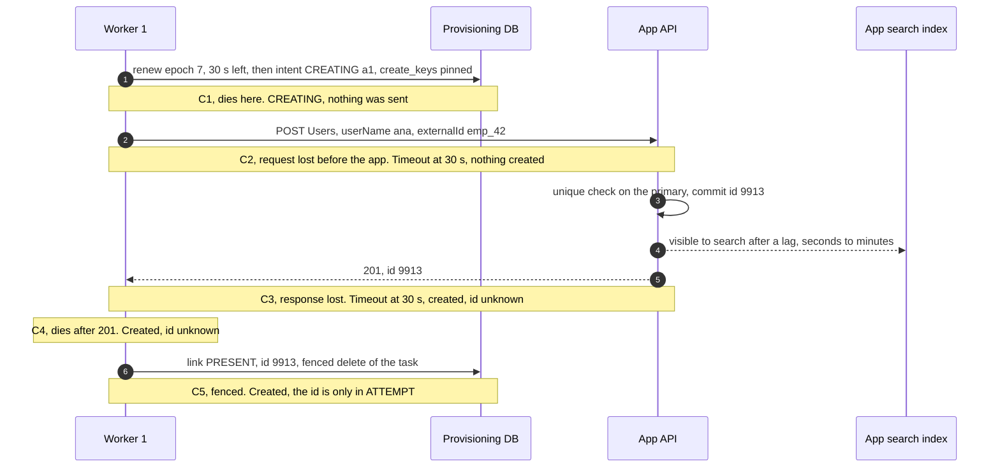
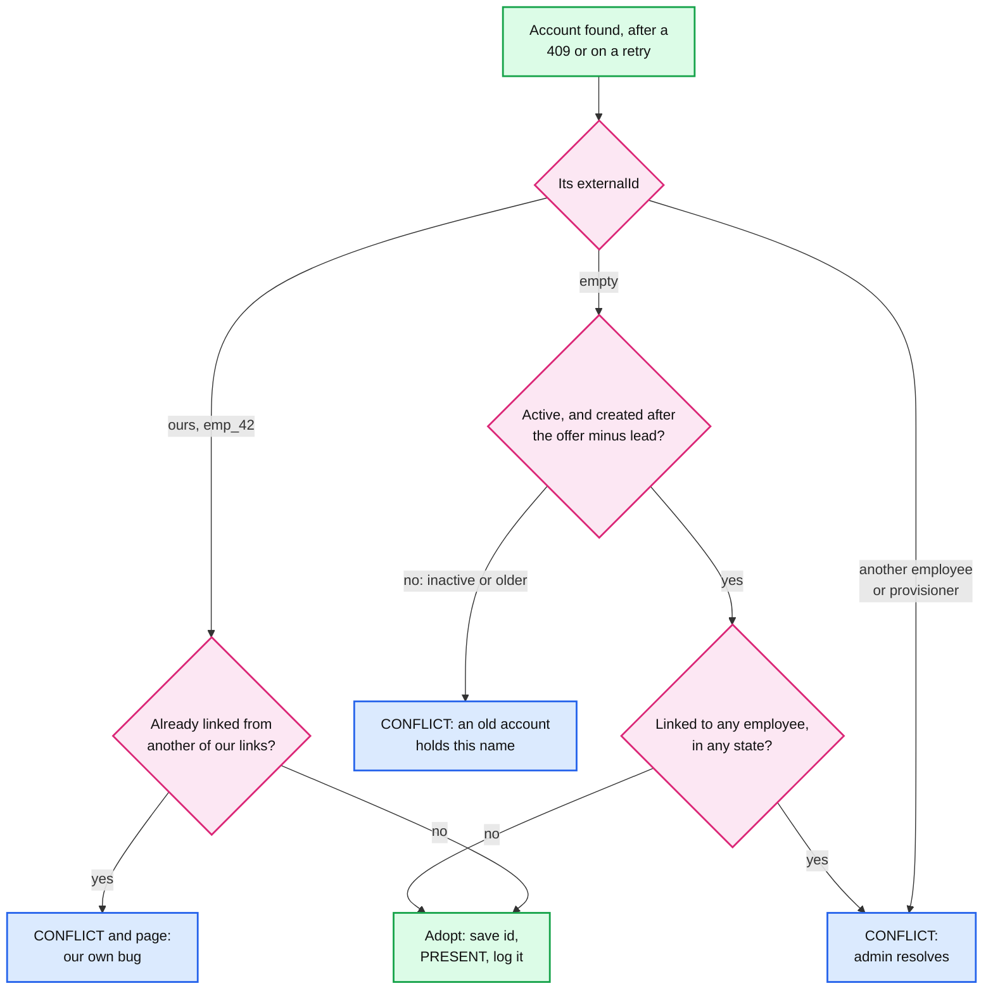
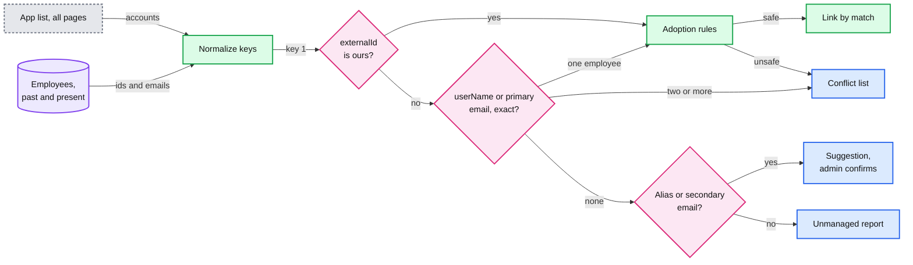
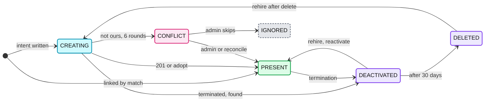

# Deep dive: idempotent creates and account matching

> One-line answer: SCIM (System for Cross-domain Identity Management) has no idempotency key, so a create is made safe by four things together. An **intent row** (`CREATING`) is committed before the `POST`, so a crash always leaves a note that a create may have happened. The create carries a **natural unique key** (`userName` = work email) and our `externalId`, so the app's own `409` catches a second create. A retry **looks first with the keys the intent pinned** (`create_keys`), waits out the app's search lag (`search_settle`), and gives up to `CONFLICT` after 6 rounds. And **adoption is strict**: an account is ours by our `externalId`, or empty, active and created after the offer. A simulator runs each rejected rule next to the chosen one over 20,000 random crash points: **0 duplicates on apps with a unique key**, against 49% when the retry uses the current email. On an app with no unique key, a 15-minute settle gives 0.02% instead of 0.47%. A termination that races a create finds and deactivates it: 9 accounts left live in 20,000, against 9,905. Matching on first connect uses the same rules at scale, and never deactivates.

Zoom-in on [`../solution.md`](../solution.md) §5.2, §10.4 A and §10.5. Concepts: [`exactly-once.md`](../../../concepts/exactly-once.md) §5 (when the downstream cannot be made idempotent). The same problem for one termination's non-idempotent steps: [`../../employee-ops-bundle/deep-dives/non-idempotent-steps-and-completeness.md`](../../employee-ops-bundle/deep-dives/non-idempotent-steps-and-completeness.md). Siblings: [`desired-state-sync-and-ordering.md`](desired-state-sync-and-ordering.md) (the lease and the fenced delete this path runs inside), [`drift-reconciliation-and-mass-change-guard.md`](drift-reconciliation-and-mass-change-guard.md) (the reconcile that counts duplicates).

## 1. The crash window



| Point | The app has | Next worker finds | What it does |
|---|---|---|---|
| C1, C2 | Nothing | `CREATING`, a1 | Find: nothing. Wait until a1 + `search_settle`. `POST` with the pinned keys. `201` |
| C3, C4 | The account, maybe not searchable yet | `CREATING`, a1 | Find: found, adopt. Not found: wait, `POST`, `409`, find again, adopt |
| C5 | The account | The new lease holder's state | Same as C3. The fenced worker sets `applied_hash = NULL`, marks an observe task, and its `ATTEMPT` row holds the id |

The retry cannot tell C1 from C4. That is the point of the intent: it does not need to. Every path ends in one linked account or a `CONFLICT` a human resolves. A termination that arrives while the link is `CREATING` runs the same find-and-wait, then deactivates what it finds. Its +5 min verify task searches the pinned keys too.

## 2. Intent rows

```sql
-- Renew first (epoch mine, at least 30 s left), then commit the intent. 0 rows: do not POST.
INSERT INTO account_link AS l (tenant_id, connection_id, employee_id, state,
                               create_attempt_id, create_started_at, create_keys)
VALUES ($tenant, $conn, $emp, 'CREATING', $attempt, now(), $keys)  -- userName, externalId
ON CONFLICT (tenant_id, connection_id, employee_id) DO UPDATE
   SET state = 'CREATING', create_attempt_id = $attempt, create_started_at = now(),
       create_keys = COALESCE(l.create_keys, EXCLUDED.create_keys);   -- pinned once per episode
```

- **The intent pins the keys.** `create_keys` holds the `userName` and `externalId` rendered from the attempt's version. Every find and every `POST` of one `CREATING` episode uses them. The episode ends at `PRESENT` or `CONFLICT`.
- **Why pin.** If HR fixes `anna@` to `ana@` between the crash and the retry, a retry with the new name finds nothing and creates a second account. The app's unique check cannot help, because the two names differ: 49% duplicates in §4. Pinned: 0. The worker adopts, then renames with an ordinary update. One extra call.
- **`search_settle` is measured from `create_started_at`,** the last `POST`. 60 s on apps with a unique key, 15 min [estimate] without. After a crash, the 60 s lease already covers the short one. After a timeout, full-jitter backoff can retry within a second, and the settle stops that retry from racing the search index.
- **A `409` is not an error.** It means "it exists", so the worker goes back to find. Rounds are spaced 30 s and doubling. After 6 rounds with nothing found (~16 min) the link becomes `CONFLICT`: "name taken by an account we cannot see" (an org unit outside our scope, a deleted user's reserved name). If the account later becomes visible, the reconcile adopts it.
- **A new hire is created without the manager reference.** It is patched once the manager's link exists, so a create never waits on another employee ([sibling §5](desired-state-sync-and-ordering.md)).

## 3. Natural keys and search lag

| Key | Who issues it | What the RFC says | What we use it for |
|---|---|---|---|
| `id` | The app | "always issued by the service provider and MUST NOT be specified by the client" | Every later `PATCH`, `GET` and deactivate |
| `userName` | Us, the work email | "MUST be unique across the service provider's entire set of Users", case insensitive | The dedup: the app's `409` |
| `externalId` | Us, `employee_id` | "always issued by the provisioning client", "scoped to the provisioning domain" | The precise find, immune to email changes |

Quotes are RFC 7643 §3.1 and §4.1.1 ([research §1](../research/facts-survey.md)). The manifest records three things per app:
- **`unique_key`: `user_name`, `email` or `none`.** The schema's `uniqueness: server` keyword only says "SHOULD", and some REST apps enforce nothing. `none` is rare [estimate], and it sets `search_settle` to 15 min.
- **`filter_external_id`.** Many apps store `externalId` but cannot search on it, or do not store it at all [estimate]. Then find falls back to `userName`.

**Search lag is the reason for `search_settle`.** Google says "A mutate call right after creation may fail with a propagation-related error" and Graph warns of "replication delays for users that were recently created" ([research §2a and §3a](../research/facts-survey.md)). Neither gives a number. The model below assumes 90% visible within 5 s, 9% within 30 s, 0.9% within 5 min and 0.1% within 30 min [estimate]. The unique check reads the primary, so a `409` has no lag. A search miss means "not there" **or** "not visible yet".

## 4. The create-crash simulator

Each row runs 20,000 creates and names the rule it tests: a rejected one, or the design. The first attempt at t = 0 hits one random fault from C1 to C4. Crashes retry at lease expiry (60 s), timeouts after 30 s plus 0 to 30 s of jitter. "Email fixed" rows change the email at 10 s in every scenario. "Zombie" rows pause the first worker after its renew, so its `POST` lands 61 to 300 s late. "Hidden" means the name is held by an account our token cannot see. "Termination" rows terminate Ana before the retry runs. "Live unlinked" counts our accounts left active with no link pointing at them.

```python
import random

LEASE, TIMEOUT, EXT, HORIZON = 60.0, 30.0, "emp_42", 3 * 3600.0

def lag(rng):
    """Seconds until a new account is visible to search [estimate]."""
    u = rng.random()
    if u < 0.90: return rng.uniform(0, 5)
    if u < 0.99: return rng.uniform(5, 30)
    if u < 0.999: return rng.uniform(30, 300)
    return rng.uniform(300, 1800)

class App:
    def __init__(self, rng, unique, by_ext, hidden=False):
        self.rng, self.unique, self.by_ext, self.accts, self.calls = rng, unique, by_ext, [], 0
        if hidden:                     # the name is held by an account our token cannot see
            self.accts.append(dict(user="ana@acme.com", ext=None, seen=float("inf")))
    def land(self, t, user):           # an account the first POST created before the fault
        self.accts.append(dict(user=user, ext=EXT, seen=t + lag(self.rng)))
    def post(self, t, user):
        self.calls += 1
        if self.unique and any(a["user"] == user for a in self.accts):
            return 409                 # the uniqueness check reads the primary, no lag
        self.land(t, user)
        return 201
    def find(self, t, user):
        self.calls += 1
        for a in self.accts:
            if a["seen"] <= t and (a["ext"] == EXT if self.by_ext else a["user"] == user):
                return a
        return None

FAULTS = ["dies before POST", "request lost", "created, response lost", "created, dies"]

def scenario(rng, policy, unique, by_ext, keys="pinned", settle=60.0, cap=6,
             email_fix=False, zombie=False, hidden=False, terminate=None):
    """First attempt at t=0: intent committed, POST sent, then one fault. Returns
    (our accounts in the app, outcome, seconds to a final state, calls, live unlinked)."""
    app, old, new = App(rng, unique, by_ext, hidden), "ana@acme.com", "ana.l@acme.com"
    current = lambda t: new if email_fix and t > 10 else old    # HR fixes the email at 10 s
    fault = "zombie" if zombie else "first POST 409" if hidden else rng.choice(FAULTS)
    if fault.startswith("created"):
        app.land(0.15, old)
    if fault == "zombie":                   # paused after its check, sends late, is fenced
        t_z, sent = rng.uniform(61, 300), False
    first = 2 if policy == "search first" else 1      # calls in the first attempt
    t = LEASE if fault in ("dies before POST", "created, dies", "zombie") else 30.0 \
        if hidden else TIMEOUT + rng.uniform(0, 30)   # crash: lease expiry. Timeout: backoff
    started, n409 = 0.0, 1 if hidden else 0
    if terminate:                           # Ana is terminated before the retry runs
        ours = sum(a["ext"] == EXT for a in app.accts)
        if terminate == "skip":             # rejected: no account id, nothing to deactivate
            return ours, "present", t, app.calls + first, ours
        t0 = t
        while not app.find(t, old) and t < started + settle:
            t = started + settle            # design: the same find-and-wait, then deactivate
        if not app.find(t, old):
            t = t0 + 300                    # the +5 min verify task searches the pinned keys
        return ours, "present", t, app.calls + first, ours - (app.find(t, old) is not None)
    while t < HORIZON:
        if fault == "zombie" and not sent and t >= t_z:
            app.post(t_z, old); sent = True
        user = old if keys == "pinned" else current(t)
        if policy == "naive":
            code = app.post(t, user)
            ours = sum(a["ext"] == EXT for a in app.accts)
            return ours, "present" if code == 201 else "ERROR: 409 not understood", \
                t, app.calls + first, ours - (code == 201)
        if policy == "design" or policy == "search first":
            if app.find(t, user):
                break                       # adopt it: externalId ours, not linked elsewhere
            if policy == "design" and t < started + settle:
                t = started + settle        # search_settle: search may lag the create
                continue
        started = t
        if app.post(t, user) == 201:
            break
        n409 += 1                           # taken: go back to find-and-adopt
        if cap and n409 >= cap:             # 6 rounds, ~16 min: then a human looks
            ours = sum(a["ext"] == EXT for a in app.accts)  # reconcile re-links it later
            return ours, "CONFLICT: name taken, account not visible", t, app.calls + first, ours
        t += min(3600.0, 30.0 * 2 ** (n409 - 1))
    if fault == "zombie" and not sent:
        app.post(t_z, old)                  # its late POST still lands
    ours = sum(a["ext"] == EXT for a in app.accts)
    rename = 1 if email_fix and keys == "pinned" else 0   # adopt, then rename
    return ours, "present" if t < HORIZON else "stuck", t, app.calls + first + rename, ours - 1

ROWS = [
    ("rejected: POST again", "naive", True, True, {}),
    ("rejected: POST again", "naive", False, False, {}),
    ("rejected: search before every create", "search first", False, False, {}),
    ("design", "design", True, True, {}),
    ("design", "design", True, False, {}),
    ("rejected: email fixed, current name", "design", True, False,
     {"email_fix": True, "keys": "current"}),
    ("design: email fixed, pinned keys", "design", True, False, {"email_fix": True}),
    ("rejected: no key, settle 60 s", "design", False, False, {}),
    ("design: no key, settle 15 min", "design", False, False, {"settle": 900.0}),
    ("design: zombie after its renew", "design", True, False, {"zombie": True}),
    ("rejected: no key, zombie, 60 s", "design", False, False, {"zombie": True}),
    ("design: no key, zombie, 15 min", "design", False, False, {"zombie": True, "settle": 900.0}),
    ("rejected: hidden name, no cap", "design", True, False, {"hidden": True, "cap": None}),
    ("design: hidden name, 6 rounds", "design", True, False, {"hidden": True}),
    ("rejected: termination skips CREATING", "design", True, False, {"terminate": "skip"}),
    ("design: termination finds and waits", "design", True, False, {"terminate": "find"}),
]
N = 20_000
print(f"{'policy':<38}{'app':<12}{'dups':>6}{'dup %':>7}{'errors':>7}{'stuck':>6}"
      f"{'live unlinked':>14}{'calls':>6}{'p99 s':>7}")
for name, policy, unique, by_ext, kw in ROWS:
    rng = random.Random(7)
    res = [scenario(rng, policy, unique, by_ext, **kw) for _ in range(N)]
    dups = sum(r[0] > 1 for r in res)
    err = sum(r[1].startswith(("ERROR", "CONFLICT")) for r in res)
    stuck = sum(r[1] == "stuck" for r in res)
    ts = sorted(r[2] for r in res)
    app = ("unique" if unique else "no key") + (", ext" if by_ext else "")
    print(f"{name:<38}{app:<12}{dups:>6}{100 * dups / N:>7.2f}{err:>7}{stuck:>6}"
          f"{sum(r[4] > 0 for r in res):>14}{sum(r[3] for r in res) / N:>6.1f}"
          f"{ts[int(N * .99)]:>7.0f}")
```

```text
policy                                app           dups  dup % errors stuck live unlinked calls  p99 s
rejected: POST again                  unique, ext      0   0.00   9907     0          9907   2.0     60
rejected: POST again                  no key        9865  49.33      0     0          9865   2.0     60
rejected: search before every create  no key          94   0.47      0     0            94   3.5     60
design                                unique, ext      0   0.00      3     0             3   2.8     60
design                                unique           0   0.00      3     0             3   2.8     60
rejected: email fixed, current name   unique        9865  49.33      0     0          9865   3.5     60
design: email fixed, pinned keys      unique           0   0.00      3     0             3   3.8     60
rejected: no key, settle 60 s         no key          94   0.47      0     0            94   2.8     60
design: no key, settle 15 min         no key           4   0.02      0     0             4   3.0    900
design: zombie after its renew        unique           0   0.00      0     0             0   4.0     60
rejected: no key, zombie, 60 s        no key       20000 100.00      0     0         20000   4.0     60
design: no key, zombie, 15 min        no key          16   0.08      0     0            16   4.0    900
rejected: hidden name, no cap         unique           0   0.00      0 20000             0  18.0  11040
design: hidden name, 6 rounds         unique           0   0.00  20000     0             0  12.0    960
rejected: termination skips CREATING  unique           0   0.00      0     0          9905   1.0     60
design: termination finds and waits   unique           0   0.00      0     0             9   3.3    360
```

- **Rejected: `POST` again.** It never duplicates on a unique-key app, but half the creates end in a `409` the code does not understand: an account the admin links by hand. On an app with no key, every create that landed is duplicated.
- **Design, unique key: 0 duplicates,** with or without an `externalId` filter, and across seeds 1 to 8. It costs 2.8 calls per faulted create, and 1 on the happy path (search-first costs 2). The 3 errors are search lag beyond the 6 rounds (2 to 10 across seeds, under 0.05%). Those accounts are live and unlinked until the reconcile sees our `externalId` and re-links them.
- **Pinned keys.** Searching by the current email turns a typo fix into 49% duplicates even on a unique-key app. The pinned keys give 0, at 1 extra rename call.
- **No unique key: `search_settle` is the only defence.** 60 s gives 0.47% (90 to 107 per 20,000 over seeds 1 to 8). 15 min gives 0.02% (2 to 12), and those creates take 15 min when they fault.
- **A zombie past its renew** is harmless with a key: its late `POST` gets `409`. Without a key it is a duplicate every time at 60 s, 0.08% at 15 min. Its fenced `ATTEMPT` row still names the account, so the reconcile can find it.
- **The 6-round cap.** Without it, a hidden name loops forever and nobody is told. With it, the admin sees a `CONFLICT` after ~16 min and 12 calls.
- **Terminations race creates.** Skipping a link with no account id leaves every create that landed live: 9,905 of 20,000. Find-and-wait, plus the +5 min verify on the pinned keys, leaves 9 (search lag over 5 min). The reconcile re-links our `externalId`, and the ordinary path then deactivates them.
- **Per day.** ~100k creates a day and ~0.1% unknown outcomes [estimate] is ~100 faulted creates. Zero duplicates on unique-key apps. If 5% of creates hit no-key apps [estimate], that is about one duplicate every 1.5 years at 15 min, against one every ~40 days at 60 s.

## 5. Adoption rules: when a found account is ours



- **Ours by `externalId`:** adopt. This is the common crash path (C3, C4). The reconciler does the same for any unmanaged account carrying one of this tenant's employee ids: it is ours by construction.
- **Another employee's or another provisioner's `externalId`:** never adopt. A tenant moving from another identity provider brings accounts stamped with its ids. The first-connect plan shows "1,840 accounts carry another provisioner's externalId: take over?", and only the admin's approval overwrites them.
- **Empty `externalId`:** adopt only an **active** account, created (SCIM `meta.created`) after the employee's offer date minus `provision_lead`, and linked to nobody in any state. An inactive (suspended or deactivated) or older account with this email belonged to someone else, for example a former employee from before Rippling. It is `CONFLICT`, never adopted. Where the app reports no creation time, the active and unlinked checks still apply.
- **A `409` on a rename is never an adoption.** It means the new name belongs to another account. The link stays on its old name and shows the error.

## 6. First-connect matching and normalization



- **Normalize the same way on both sides.** Lowercase (`userName` is case insensitive), trim, Unicode NFC so a composed and a decomposed "é" match. Never strip `+tags` or dots: outside Gmail they are different mailboxes.
- **Domain aliases** (`acme.io` and `acme.com`) match only if the tenant declared them. Otherwise they are suggestions.
- **Past employees are in the index.** An account that matches a terminated employee links as `DEACTIVATED`, not as a match for whoever holds the email now.
- **Ambiguity is a conflict, not a guess.** Two accounts for one employee (`ana@` and `ana.lopez@`). One account for two employee records (an employee and a contractor record for one person). solution.md §4.1's example plan has 3 such conflicts in a 2,000-person tenant.
- **Service accounts** (`ci-bot@`, `admin@`) stay in the unmanaged report and are never offered for deactivation in bulk.
- **One connection per app tenant.** Two connections to one Google customer or one Slack org would be two writers per account. Connect refuses the second, keyed by the app's tenant id.
- **First connect never deactivates.** Unmatched accounts are reported. Flow 7 in solution.md is 11,000 links by email, 9,000 creates and 4 conflicts for a 20,000-person GitHub tenant.

## 7. Rehires, reused emails and name changes



- **Rehire, same `employee_id`.** The link is `DEACTIVATED` with the old account id. `set_active(true)` and re-apply attributes: their files and history come back. After the 30-day delete it is a new create through the intent. Some apps keep a deleted user's name reserved [estimate], which shows up as the hidden-name `CONFLICT` above.
- **Rehire as a new `employee_id`** (some HR flows open a new record). From the app's side this looks exactly like a reused email: the account carries the old record's `externalId`. So it is a `CONFLICT`, resolved by an admin saying "same person" in the identity service, and the link moves over. Never automatic.
- **Reused email** (a new `john.smith@`). The old account is linked to the former John, or carries his `externalId`, or is inactive and older than the new John's offer. All three are `CONFLICT`: "rename the old account, then create". Adopting it would hand one person's files and messages to another. The upstream fix is HR not reusing an email inside the apps' retention window.
- **Name change** (Ana Lopez becomes Ana Ruiz). `PATCH userName` on the existing account by `id`, never a delete plus create. Replays are safe: the same name twice is the same state. Apps where the login cannot change are a manifest flag: update `emails` only, and the `id` is the key from then on.

## 8. Duplicates found by reconcile

| What the reconcile sees | Likely cause | Action |
|---|---|---|
| Two accounts carry our `externalId` for one employee | A create ran twice: a no-key app, or a zombie | Keep the linked one. Page (the SLO is 0). Propose deactivating the other through the guard |
| Our `externalId` on an account no link points to, and that employee has no linked account | Search lag outlasted the 6 rounds, or a termination's find-and-wait | Re-link it (ours by construction). The ordinary path then applies the current state, a deactivation included. No page |
| Our `externalId` on an unlinked account, and that employee already has one | A zombie's fenced create | A duplicate: same as the first row. Its `ATTEMPT` row names the attempt that made it |
| An unlinked account whose email is a linked employee's alias | Someone made it by hand | Unmanaged report, with a suggestion |
| One account linked from two employees | A matching bug | Page. Freeze both links until an admin resolves it |

A duplicate is never deleted automatically. It may hold a week of someone's work.

## 9. Trade-offs

| Decision | Rejected | Chosen | Why, from the simulator |
|---|---|---|---|
| Create safety | Retry the `POST`, or search before every create | Intent, natural key, search only on retry | 0 duplicates on unique-key apps in 20,000 crash points. 1 call on the happy path |
| Retry keys | Render the current email | Pinned `create_keys`, then rename | A typo fix between crash and retry is 49% duplicates otherwise |
| `search_settle` | 60 s everywhere | 60 s with a unique key, 15 min without | No-key apps: 0.02% instead of 0.47%, for 15 min of delay on ~0.1% of their creates |
| `409` rounds | Until found | 6 doubling rounds, then `CONFLICT` | A hidden name is visible in ~16 min instead of looping silently |
| Termination on `CREATING` | Nothing to deactivate | Find-and-wait, verify on the pinned keys | 9 live accounts left in 20,000 races, not 9,905 |
| Adoption | Email match | Our `externalId`, or empty plus active, newer and unlinked | A reused email must never hand over another person's data |
| Rehire under a new id | Merge by email | `CONFLICT`, admin says "same person" | Identical to a reused email from the app's side |

**Refused:** deleting duplicates automatically, matching on display names, normalizing away `+tags` and dots, trusting `externalId` for dedup at create time, and claiming exactly-once against any app.
