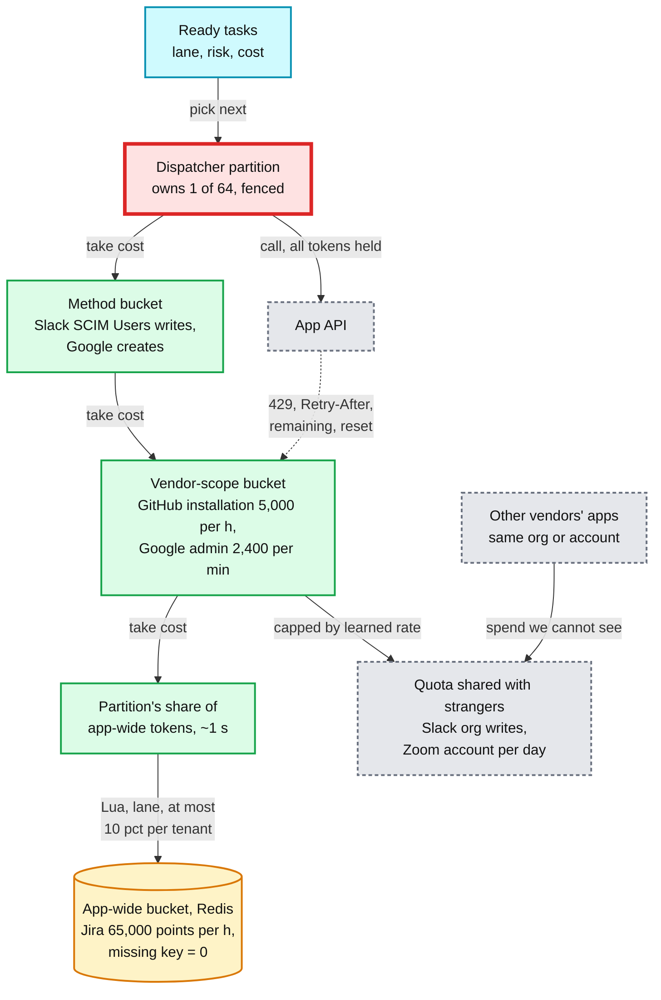
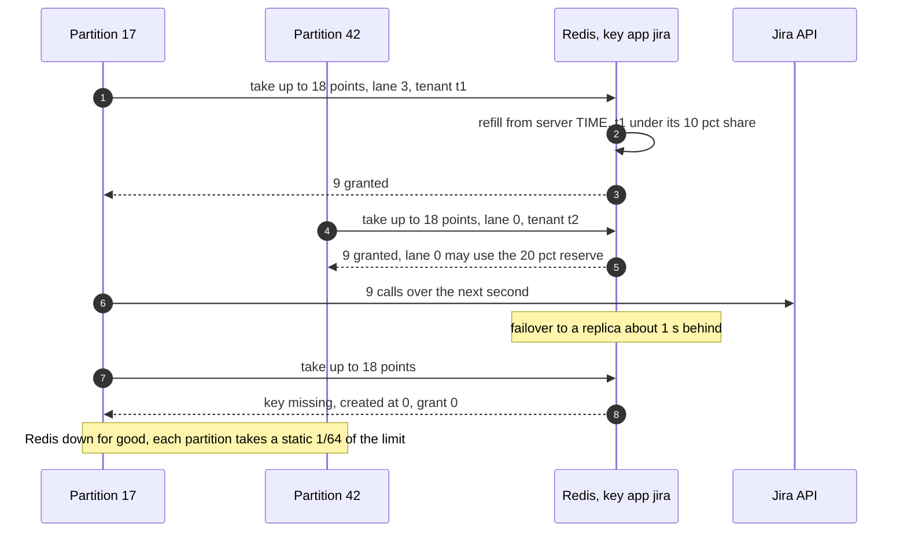
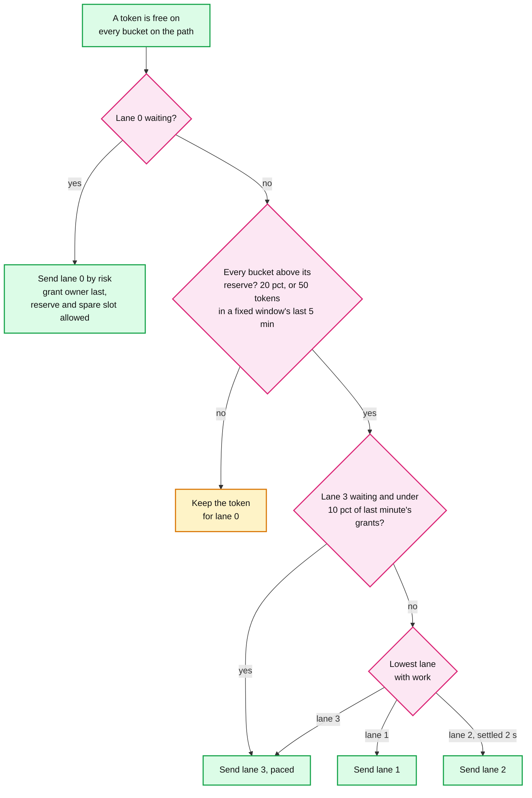

# Deep dive: rate limits, priority and fairness

> One-line answer: a call takes tokens from **every bucket the vendor scopes**, keyed by the vendor's own id (installation, org, account, project plus admin), not by our connection. Fixed windows (GitHub's hour, Zoom's day) are tracked from the vendor's headers and paced to the reset. One dispatcher partition owns each bucket, so the queue and the bucket sit in one process and the choice of **which** waiting call gets the next token is exact. Only app-wide quotas live in Redis, where a missing key starts at 0. Limits are learned from headers first and from `429`s second (AIMD: halve, then +10% of the manifest rate per clean minute). Four strict lanes, a 20% lane-0 reserve on every bucket (released in the last 5 minutes of a fixed window), a spare lane-0 slot and a `risk` order keep a termination at ~0 s during a 20,000-create import that still finishes in ~4 h. Slot caps per app, per tenant and per host keep one tenant or one slow app from holding the fleet. No scheduler beats a vendor's quota: a 5,000-person layoff on one GitHub installation still takes up to an hour (34 minutes in §5), so SSO is cut first.

Zoom-in on [`../solution.md`](../solution.md) §5.3, §10.2 and §10.3. Reusable blocks: [`../../../concepts/rate-limiting-and-load-shedding.md`](../../../concepts/rate-limiting-and-load-shedding.md) (token buckets, AIMD), [`../../../concepts/leases-fencing-clocks.md`](../../../concepts/leases-fencing-clocks.md) (fenced partition ownership), [`../../../concepts/sharding.md`](../../../concepts/sharding.md) (hashing scopes onto partitions). Sibling: [`failures-retries-and-circuit-breakers.md`](failures-retries-and-circuit-breakers.md) (when calls fail rather than get throttled). Vendor facts: [`../research/facts-survey.md`](../research/facts-survey.md) §2 and §10.

---

## 1. The quota is a hierarchy, and the vendor picks the scopes and the keys

| App | Buckets one call takes from, and their key | Window | What tells us we are close |
|---|---|---|---|
| Google Directory | 2,400 queries/min per admin user per project (key: project plus admin user). At most 10 user creates per domain per second | Per minute, per second | Errors only. A batch of n counts as n |
| GitHub App | 5,000 req/h per installation (+50 per repo over 20, cap 12,500; 15,000 on Enterprise Cloud) (key: installation id). Secondary: 900 points/min, 100 concurrent | Fixed hour | `x-ratelimit-remaining`, `x-ratelimit-reset`. `403` or `429` at 0 |
| Slack SCIM | ~180 writes and ~300 reads a minute on Users, inside 600 writes and 1,000 reads a minute for the org (key: org id), which "apply to all SCIM apps in an org, not on a per-app basis" | Per minute | `429` with `Retry-After` |
| Zoom | Daily per account by API category (key: account id), "shared by users for all apps installed on the account" | Fixed day | `429` |
| Jira Cloud | **App-wide:** 65,000 points/h "across all tenants". Per tenant: by edition, capped at 500,000 points/h | Fixed hour | `429`, `Retry-After`, `X-RateLimit-NearLimit` under 20% left |
| Microsoft Graph | Our app in one tenant, and **app-wide** our app across all tenants. `$batch` holds 20 requests, each throttled on its own | Not published | `429` with `Retry-After` |
| Generic SCIM | Whatever the customer's server allows (key: target host) | Learned | `429`, timeouts |



- **Keyed by the vendor's scope, not our connection.** First draft: one bucket per `connection_id`. It breaks when two of our connections sit on one Slack org (two subsidiaries, or a sandbox and production): each believes it has 600 writes a minute, and together they get `429`s. One managed-service admin across several Google tenants shares one per-user quota the same way. So the manifest names the key: installation id, Slack org id, Zoom account id, Google project plus admin user, or the target host for generic SCIM.
- **All or nothing.** A call takes its cost from every bucket on its path or from none. A partial take leaks tokens that nothing will spend.
- **Cost is not always 1.** Jira and GitHub's secondary limit count points. A Google batch of n counts as n ("A set of n requests batched together counts toward your usage limit as n requests").
- **Strangers' share is invisible.** Slack's org bucket and Zoom's account bucket are spent by other vendors' apps. We cap our side at a learned rate and let §3 find it.
- **The bucket follows the vendor's window.** First draft: a refilling token bucket for every vendor. On GitHub, a full bucket lets a bulk job spend the hour's 5,000 in ~13 minutes, and then every call, terminations included, is refused until the reset (§5: up to 44 minutes). So fixed windows are tracked from `remaining` and `reset` and paced: bulk spends `(remaining - reserve) / time to the release point`. Per-minute limits use a refilling bucket, where the next token is never more than a second away.

---

## 2. One owner per bucket. Redis only for app-wide quotas

- **Ownership.** `partition = hash(vendor scope key) mod 64`. Each partition is leased by one of ~16 engine processes with a fenced partition epoch, and a task lease needs the current epoch, so a deposed owner cannot dispatch. The owner holds its buckets in memory: exact, no network hop. A new owner starts with an empty bucket at half the learned rate, because it cannot know what the old owner spent in its last second. The first `remaining` header puts it right.
- **App-wide buckets.** One Redis key per app and scope. A Lua script refills from `(now - last) x rate` using Redis `TIME`, so dispatcher clock skew does not matter. A partition asks for about 1 s of its demand and tells the script the lane. Lanes 1 to 3 are refused below 20% of the pool, and one tenant may take at most 10% of it [estimate], so one import cannot spend every Jira tenant's hour. Jira's 65,000 points an hour is ~18 points/s for **all** our Jira tenants: the scarcest bucket we hold.
- **Load is tiny.** About one grant per partition per app per second: under 100 Redis ops/s ([`../solution.md`](../solution.md) §10.3).



| Redis failure | First draft | Design | Bound |
|---|---|---|---|
| Key lost (eviction, failover) | A missing key starts full, like a fresh token bucket. It grants Jira's whole hour at once, and Jira denies "All requests ... until the next hourly reset" for every tenant | A missing key starts at **0** | One refill period of under-grant |
| Failover to a lagging replica | Same | Same | ~1 s of tokens counted twice. The learned rate and `429` handling absorb it |
| Redis down | `limit / partitions with demand`. But the demand count lives in Redis | A static 1/64 of the limit per partition | Jira at 1/64 is ~0.3 points/s per partition: slow, never over |
| A partition dies holding tokens | Same | Same | ~1 s of tokens never spent. Under-grant is safe |

---

## 3. Learned limits: headers first, AIMD when blind

- **Read the headers on every response.** GitHub `x-ratelimit-remaining` ("the authoritative source"), Okta `X-Rate-Limit-Remaining` and `-Reset` (UTC epoch seconds), Jira `X-RateLimit-NearLimit`. Set local tokens to `min(local, remaining - calls in flight)`, because the vendor has not counted our in-flight calls yet. With headers we track the real quota, strangers' spend included, with almost no `429`s.
- **Compute times on the vendor's clock.** A reset in epoch seconds, or `Retry-After` as an HTTP-date (RFC 9110 §10.2.3: "either an HTTP-date or a number of seconds"), becomes a delay using the response's own `Date` header. A dispatcher 40 s fast would otherwise resume 40 s early and eat a `429`.
- **Without headers, AIMD.** A `429` pauses the bucket until `Retry-After` and halves the learned rate. Each clean minute adds 10% of the **manifest** rate, up to the manifest maximum. First draft: "+10% per clean minute", read as 10% of the current rate. That is multiplicative increase, and against another vendor's SCIM app on Slack's org bucket it does not converge to a fair share. Additive increase with multiplicative decrease does.
- **What AIMD costs.** The rate saws between half the available share and all of it: ~75% of the share on average. With a stranger using 450 of Slack's 600 org writes a minute, our share is 150 and we average ~110.
- **`classify` decides what is a throttle.** GitHub returns `403` for a spent quota and for a missing permission. `x-ratelimit-remaining: 0` or a `retry-after` header makes it `THROTTLED`, anything else `PERMANENT` or `AUTH`.
- **Learned rates persist** in `CONNECTION.learned_rate`. One below 50% of the manifest rate for a day files a ticket to the connector team.

---

## 4. Lanes, the reserve, the lane-3 floor and risk order

| Lane | What | Rule |
|---|---|---|
| 0 security | Deactivate, remove an admin role | Never waits for a lower lane, a settle delay, pacing or the reserve. A lane-0 upsert sends a nudge, seen in ~200 ms |
| 1 onboarding | Creates for hires | Spends only above the reserve |
| 2 updates | Attribute and group edits | Waits 2 s to settle, then as lane 1 |
| 3 bulk | Connect, rule change, reconcile, release | At least 10% of the last minute's grants when it has work, taken from lanes 1 and 2, never from lane 0 |



- **The reserve is on every bucket.** First draft: only on the connection bucket. Then a lane-3 import on one Jira tenant can drain the app-wide hour, and another tenant's termination waits for Jira's reset.
- **The reserve is released near a fixed window's reset.** First draft: always held. On GitHub that leaves 1,000 of every hour's 5,000 unspent while bulk runs, so a 20,000-create import takes 5 h. In the last 5 minutes the window is about to refill anyway, so the reserve drops to 50 tokens. §5 shows ~0 s waits and ~4 h either way.
- **Risk order inside lane 0.** `SYNC_TASK.risk` is set by the planner. The dispatch query orders by `lane, risk, ready_at`: admins first, then production access, then the rest. The one exception goes **last**: the employee who owns that connection's OAuth grant. Deactivating them first can revoke the grant and park the rest of a layoff under `NEEDS_REAUTH`. The pre-flight check flags it, and grants not tied to a person (a GitHub App installation, a Google service account) avoid it.
- **A higher lane clears backoff.** The upsert keeps `LEAST(lane)` and resets `ready_at` to now when the lane drops.
- **A spare slot.** Lane 0 may run one call above the connection's in-flight cap, so four hung bulk calls cannot hold a termination for 30 s.

---

## 5. Simulation: a termination during a 20,000-create import

One GitHub installation, 5,000 calls an hour in GitHub's fixed hourly window. 20,000 lane-3 creates are queued at t = 0, one call each. 30 terminations arrive at random in the first 3 hours. 4 calls in flight. Latency p50 0.3 s, p99 ~5 s, timeout 30 s [estimate]. Three first-draft rules: one FIFO queue, strict lanes on a bucket that starts full, and lanes with a reserve that is never released. Then the **design**: lanes, bulk paced to the window's reset, the 20% reserve released down to 50 tokens in the last 5 minutes, and the spare lane-0 slot. The last row is a per-minute vendor, modelled as a refilling bucket of the same size. Run B adds a 5,000-person layoff at 2.5 h.

```python
import heapq, math, random
from collections import deque

QUOTA, HOUR = 5_000, 3_600.0             # GitHub installation: 5,000 requests an hour
RESERVE, KEEP, TAIL = 1_000, 50, 300     # 20% for lane 0, released down to 50 in the last 5 min
CAP = 4                                  # calls in flight per connection (the adaptive cap's start)

def run(policy, window, terms, seed=7):
    """One installation. 20,000 lane-3 creates queued at t = 0, terminations (lane 0) at `terms`.
    window "fixed": the vendor resets the count every hour. "refill": it refills continuously.
    Returns the import's finish time, each termination's wait from arrival to dispatch, and the
    tokens still unspent at each reset while the import had work."""
    rng = random.Random(seed)
    lat = lambda: min(30.0, 0.3 * math.exp(1.21 * rng.gauss(0, 1)))  # p50 0.3 s, p99 ~5 s
    ev = [(t, 1, "arrive") for t in terms]
    if window == "fixed":
        ev += [(h * HOUR, 0, "reset") for h in range(1, 12)]
        ev += [(h * HOUR - TAIL, 0, "tail") for h in range(1, 12)]
    heapq.heapify(ev)
    tokens, last, imports, lane0, inflight = float(QUOTA), 0.0, 20_000, deque(), 0
    done, waits, unspent, todo, wake, nxt = 0.0, [], 0, len(terms), [0.0], [0.0]
    reserve = policy in ("reserve", "design")

    def floor(now):                      # lanes 1 to 3 may spend only above this
        if not reserve:
            return 0
        tail = window == "fixed" and HOUR - now % HOUR <= TAIL
        return KEEP if tail and policy == "design" else RESERVE

    def timer(now, at):                  # one pending wake-up, not one per event
        if wake[0] <= now or at < wake[0]:
            wake[0] = at
            heapq.heappush(ev, (at, 2, "wake"))

    def dispatch(now):
        nonlocal tokens, last, imports, inflight
        if window == "refill":
            tokens, last = min(QUOTA, tokens + (now - last) * QUOTA / HOUR), now
        while imports or lane0:
            l0 = bool(lane0) and (policy != "fifo" or imports == 0)   # FIFO: behind the import
            spare = 1 if l0 and reserve else 0                          # a slot only lane 0 may use
            need = 1 if l0 else floor(now) + 1
            if inflight >= CAP + spare or tokens < need:
                if window == "refill" and tokens < need:
                    timer(now, now + (need - tokens) * HOUR / QUOTA + 1e-3)
                return
            if not l0 and policy == "design" and now < nxt[0]:
                timer(now, nxt[0])       # paced: remaining over the time to the next release point
                return
            tokens -= 1
            inflight += 1
            if l0:
                waits.append(now - lane0.popleft())
                heapq.heappush(ev, (now + lat(), 1, "done0"))
            else:
                imports -= 1
                heapq.heappush(ev, (now + lat(), 1, "done3"))
                end = (now // HOUR + 1) * HOUR
                target = end - TAIL if end - now > TAIL else end
                nxt[0] = now + (target - now) / max(1.0, tokens - floor(now))

    while ev:
        now, _, kind = heapq.heappop(ev)
        if kind == "arrive":
            lane0.append(now)
            todo -= 1
        elif kind == "reset":            # in production: x-ratelimit-reset says when
            unspent += int(tokens) if imports else 0
            tokens = float(QUOTA)
        elif kind in ("done0", "done3"):
            inflight -= 1
            done = now if kind == "done3" else done
        if kind in ("reset", "tail"):
            nxt[0] = now                 # re-pace at a reset or a release point
        dispatch(now)
        if not (imports or lane0 or inflight or todo):
            break
    return done, sorted(waits), unspent

def fmt(s):
    return f"{s:.1f} s" if s < 90 else f"{s / 60:.0f} min" if s < 7_200 else f"{s / 3_600:.1f} h"

rng = random.Random(42)
singles = sorted(rng.uniform(0, 3 * HOUR) for _ in range(30))   # 30 terminations in 3 h
print("A: 20,000 creates, 30 single terminations during the import")
print(f"{'window':7} {'policy':8} {'import done':>11} {'wait p50':>9} {'wait max':>9} {'unspent':>8}")
for window, policy in [("fixed", "fifo"), ("fixed", "lanes"), ("fixed", "reserve"),
                       ("fixed", "design"), ("refill", "lanes")]:
    done, w, waste = run(policy, window, singles)
    print(f"{window:7} {policy:8} {fmt(done):>11} {fmt(w[len(w) // 2]):>9} {fmt(w[-1]):>9}"
          f" {waste if window == 'fixed' else '-':>8}")
print("B: a 5,000-person layoff at 2.5 h, fixed window")
for policy in ("fifo", "lanes", "design"):
    done, w, _ = run(policy, "fixed", [2.5 * HOUR] * 5_000)
    print(f"{policy:8} first 1,000 sent after {fmt(w[999]):>7}, all 5,000 after {fmt(w[-1]):>7}")
```

Output:

```text
A: 20,000 creates, 30 single terminations during the import
window  policy   import done  wait p50  wait max  unspent
fixed   fifo           3.2 h     3.0 h     4.0 h        0
fixed   lanes          4.0 h    19 min    44 min        0
fixed   reserve        5.0 h     0.0 s     0.0 s     4978
fixed   design         4.1 h     0.0 s     0.0 s      205
refill  lanes          3.0 h     0.3 s     0.7 s        -
B: a 5,000-person layoff at 2.5 h, fixed window
fifo     first 1,000 sent after 101 min, all 5,000 after   2.6 h
lanes    first 1,000 sent after  33 min, all 5,000 after  43 min
design   first 1,000 sent after   2 min, all 5,000 after  34 min
```

What it shows:
- **FIFO is hours.** A termination waits for the import, then for the next window: 3 h median, 4 h worst.
- **Lanes alone fail on a fixed window.** The full bucket spends each hour's 5,000 in ~13 minutes. A termination in the other 47 minutes waits for the reset: 19 min median, 44 min worst.
- **A reserve that is never released** makes every wait 0 s, but leaves ~1,000 tokens unspent per hour: the import takes 5.0 h.
- **The design** keeps every wait at 0 s and the import at ~4.1 h, with ~50 tokens an hour unspent. Pacing never lets bulk get ahead of the window, the reserve covers the hour, and the release spends it when the reset is minutes away. A burst of more than 50 terminations in a window's last 5 minutes waits at most 5 minutes.
- **On a refilling bucket, lanes alone are enough:** under 1 s, because the next token is never far. That is why per-minute vendors need no pacing.
- **Run B, the layoff:** the design sends the first 1,000 (risk order, grant owner last) within 2 minutes, then everything the window holds, and the rest at the 3:00 reset: 34 minutes in all. The quota, not the scheduler, sets that number.

---

## 6. Fair share of slots: DRR, in-flight caps, slow apps

- **Slots are local.** Each engine process has ~500 async slots and runs ~4 partitions. Its dispatcher hands out slots by **deficit round robin (DRR)** over connections with ready work and tokens. DRR rather than plain round robin, because costs differ: a Jira call can cost several points, a Google batch costs n.
- **The in-flight cap is adaptive.** `ceil(learned_rate x latency)`, minimum 2, starting at 4, plus the spare lane-0 slot. It shrinks on concurrency errors (GitHub allows 100 concurrent). Little's law sets throughput: calls per second = calls in flight / latency. With 4 in flight and a ~0.6 s mean latency, one connection sends ~6.4 calls/s: plenty for GitHub's 1.4/s. Google's 40/s needs ~25 in flight. The latency in the formula must be the **mean**. The p50 here is 0.3 s, and 12 slots at a 0.6 s mean carry only ~19/s.
- **Slot caps by blast radius.** Per app 25% of fleet slots: an app whose calls hang to the 30 s timeout holds 125 of a process's 500 and gets ~4 calls/s per process, ~67/s across 16. Per tenant 2% [estimate]: a 50,000-person tenant's bulk job cannot crowd out small tenants on the same process. Per target host for generic SCIM: 500 customers' SCIM servers are not one app, and one slow server must not use that "app's" 25%. And 5% of fleet slots are kept for lane 0.
- **The breaker frees the slots.** A hanging app's connection breakers open within minutes ([`failures-retries-and-circuit-breakers.md`](failures-retries-and-circuit-breakers.md)).

---

## 7. The layoff math, and why batching saves round trips, not quota

- **5,000 terminations on a 5,000-an-hour installation take up to an hour.** Run B: what the current window holds now (at least the 1,000 reserve), then a full window at the reset. So between ~10 minutes (a fresh window, bounded by slots and the 900 points/min secondary limit) and ~1 hour, 34 minutes in the run.
- **SSO first.** The identity service cuts SSO in milliseconds before any app call ([`../../employee-ops-bundle/`](../../employee-ops-bundle/) §4.5). The minutes cover existing sessions and API tokens only.
- **Risk order.** The first 1,000 are admins and people with production access. Grant owners go last.
- **Batching:** Graph takes 20 requests per `$batch`, Google 1,000 calls per batch, SCIM Bulk is optional. Graph evaluates "Requests in a batch ... individually against the applicable throttling limits". Google counts a batch of n "as n requests". So 5,000 Graph deactivations are 250 round trips instead of 5,000, and the same 5,000 tokens. Batching lifts the in-flight bound of §6, never the quota. The dispatcher charges a batch its full n, and splits it if the buckets hold fewer.
- **Ask the vendor.** For a planned layoff, request a raise ahead of time. GitHub's limit also grows with repositories, up to 12,500 an hour.

---

## 8. Trade-offs

| Decision | First draft | Design | What it costs |
|---|---|---|---|
| Bucket key | `connection_id` | The vendor's scope id, per host for generic SCIM | Two connections on one Slack org share 600 writes a minute, as they must |
| Window | A refilling bucket for every vendor | Fixed windows from headers, paced to the reset | Bulk never bursts, so a short import takes longer than its quota allows |
| Who counts | A central Redis limiter | One owner per scope in memory. Redis only for app-wide pools | A takeover starts empty at half rate and relearns |
| Missing Redis key | Starts full | Starts at 0. Redis down: static 1/64 | Under-grant for a moment, slow app-wide apps while Redis is down |
| AIMD increase | +10% of the current rate | +10% of the manifest rate | ~25% of a shared quota left unused by the sawtooth |
| Reserve | On the connection bucket, never released | 20% on every bucket, released to 50 in a fixed window's last 5 min | A burst of over 50 terminations in those minutes waits up to 5 min |
| Lane-0 order | Arrival order | `risk`, grant owner last | A planner field to keep right |
| Slots | 4 in flight, 25% per app | Adaptive cap plus a lane-0 spare, 25% per app, 2% per tenant, per host, 5% for lane 0 | A healthy app's burst can wait for a slot |
| Batching | Saves quota | Saves round trips. Charge n tokens | Nothing on quota |

---

## 9. Numbers to say out loud

- GitHub 5,000/h is 1.4/s. 20,000 creates: ~4.1 h in the design, 5.0 h with a reserve never released. A termination during it: 0 s, or up to 44 min with lanes alone.
- Reserve 20% of every bucket, released to 50 tokens in a fixed window's last 5 min. Lane-3 floor 10% from lanes 1 and 2. Lane-2 settle 2 s. Lane-0 nudge ~200 ms.
- AIMD: halve on `429`, +10% of the manifest rate per clean minute, ~75% of a shared quota used.
- 64 partitions, fenced. App-wide grants ~1 s at a time, under 100 Redis ops/s, at most 10% per tenant. A missing key starts at 0. Redis down: 1/64 each.
- Little's law with the mean latency: Google's 40/s needs ~25 in flight. Slots: 25% per app, 2% per tenant, 5% kept for lane 0.
- A layoff of 5,000 on GitHub: 10 min to 1 h, 34 min in the run. Batching: same quota, 20x fewer round trips on Graph.
