# Diagrams: employee identity + integration platform

The D1 to D12 set from `hld/CLAUDE.md` §4. Diagrams already in [`solution.md`](solution.md) are listed with a pointer, not pasted twice. Every diagram below adds a zoom-in or a path that `solution.md` does not draw. Numbers match `solution.md` and [`research/facts-survey.md`](research/facts-survey.md). New numbers are marked [estimate].

| # | Diagram | Where |
|---|---|---|
| D1 | Context | below |
| D2 | Data flow | below |
| D3 | Component architecture | Zoom-out: `solution.md` §6 (dispatcher in red). Growth steps: §4.1 to §4.4. One call through the buckets: §5.3. Zoom-ins below: D3a control plane, D3b one engine process, D3c credential path |
| D4 | Happy path per FR | In `solution.md`: FR2 title change §4.2, FR3 reconcile §4.3. FR1 connect: D3a. Below: D4a FR2 hire, D4b FR2 termination, D4c FR4 event out, D4d FR4 webhook in, D4e FR5 retry and re-authorize |
| D5 | Failure paths | In `solution.md`: crash after create §10.4 A, 2-hour app outage §10.4 B. Below: D5a zombie worker, D5b revoked grant, D5c partition takeover, D5d empty list |
| D6 | Decision flow | Create decision: §5.2. Below: D6a render, diff, apply, D6b `classify`, D6c the guard |
| D7 | Entity relationship | Hot tables: §3.3. Below: the full set, with partner subscriptions and the inbox |
| D8 | State machines | Below: D8a link state, D8b connection status, D8c task lifecycle, D8d guard hold |
| D9 | Deployment / topology | below |
| D10 | Scaling / partitioning | below |
| D11 | Failure mode map | Table: §5.8. Tree below |
| D12 | Rollout / migration | below |

## D1. Context (zoom-out)

The platform as one box. Traffic is small, about 115 calls a second. What binds is the quota on the right, which other companies own.

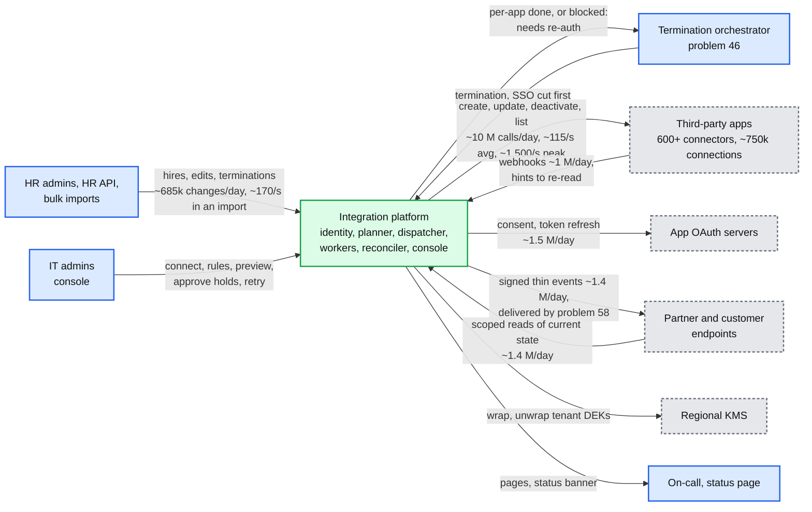

## D2. Data flow (DFD)

Inputs to outputs, with format, size and rate. Rounded boxes are processes, cylinders are stores.

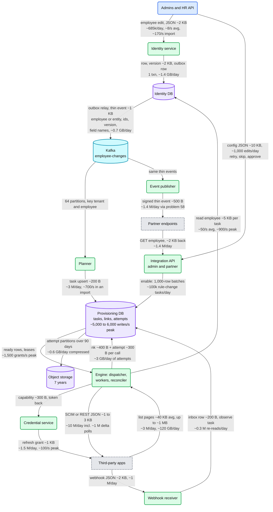

Reconcile is ~30% of calls but most of the bytes: ~120 GB a day of list pages against ~20 GB of change calls [estimate, ~40 objects of ~1 KB per page]. The task row carries no employee values. Peak reads: ~1,500 calls/s at ~1.6 calls per task is ~900 tasks/s [estimate].

## D3. Component architecture

The zoom-out is the final design in `solution.md` §6, with the dispatcher in red. Three zoom-ins follow.

### D3a. Control plane: connect, plan, enable

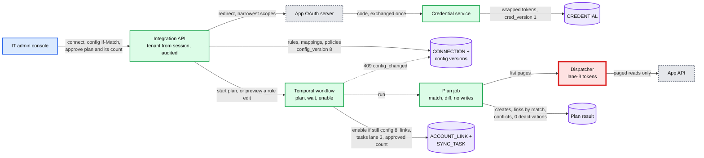

The plan is a preview, not a script: tasks re-render when they run, and a first connect never deactivates. The count the admin approves is what batch admission (D6c) later allows, plus 10%. §4.1 draws the plan job calling the app directly. Here it goes through lane 3: on GitHub a 20,000-person plan is ~110 list pages of the 5,000-an-hour window.

### D3b. One engine process

16 processes. Each holds 4 of the 64 dispatcher partitions and a 500-slot async worker pool.

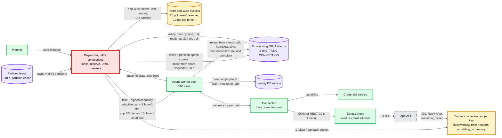

- `750k / 64 ≈ 11.7k` connections per partition, ~47k per process. Fleet caps per process: 25% per app is 125 slots, 2% per tenant is 10, and 5% reserved for lane 0 is 25.
- The per-connection in-flight cap is `ceil(learned_rate x mean latency)`, minimum 2, starting at 4, plus 1 spare slot only lane 0 may use. Little's law uses the mean: Google's ~40/s at ~0.6 s needs ~25 in flight. A p50-based cap (~0.3 s) would give 12 and run Google at about half its quota.
- A missing Redis key starts at 0, never full. Without Redis, each partition takes a static 1/64 of an app-wide limit.

### D3c. Credential path

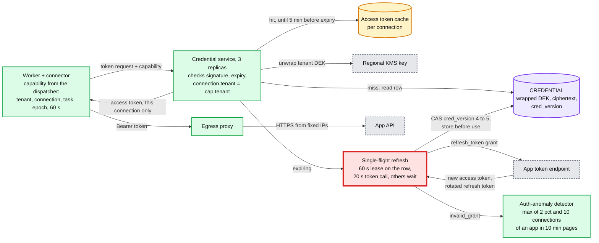

No API returns a refresh token. Google keeps 100 refresh tokens per account per client and silently drops the oldest, so the code exchange runs once per connection, never per worker. The manifest says `refresh_rotation: none | strict | grace(seconds)`. Residual risk on `strict`: a crash after the token endpoint answers but before the CAS write loses the rotated token. That is one `NEEDS_REAUTH`, counted as its own metric.

## D4. Happy paths, one per FR

### D4a. FR2: a hire starting Monday, provisioned on Friday

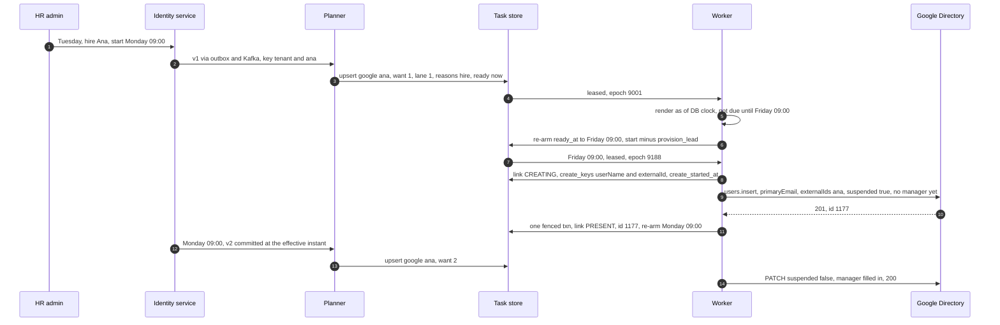

Group tasks for `eng` and `all-staff` add Ana once her link exists. Google allows at most 10 user creates per domain per second, so a 5,000-person hiring wave takes at least 8.3 min there.

### D4b. FR2: a termination at 17:00

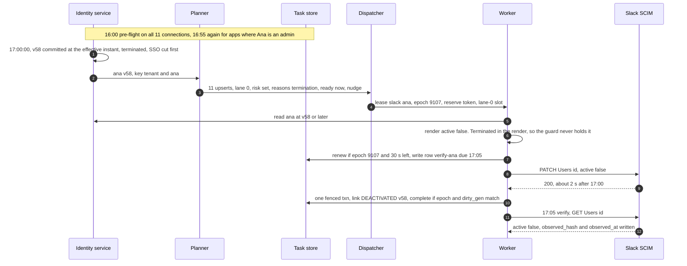

- The other 10 apps run the same path in parallel. On each connection the employee who owns its OAuth grant goes last, after admins and production access.
- The verify task has its own key, subject `verify:<employee_id>`. On the deactivation's own row it would bump `dirty_gen`, fence the completion, and the `LEAST` rule would make it due at once: replayed in SQLite, that version ran the verify at ~17:00, not 17:05.

### D4c. FR4: an event out to a partner

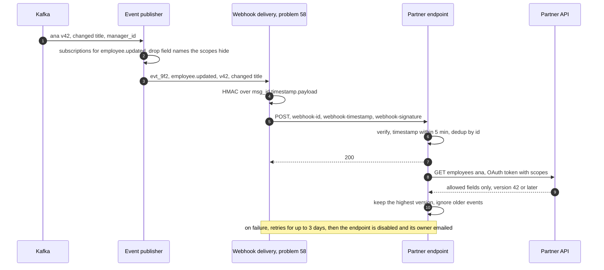

### D4d. FR4: a webhook in from an app

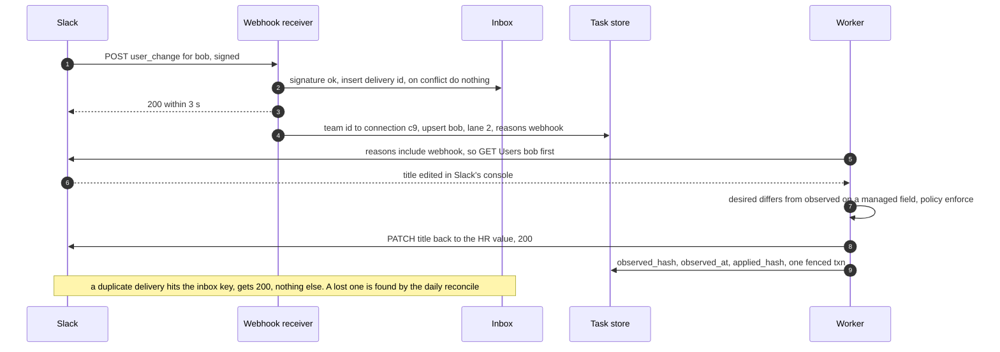

### D4e. FR5: retry after a permanent error, then re-authorize

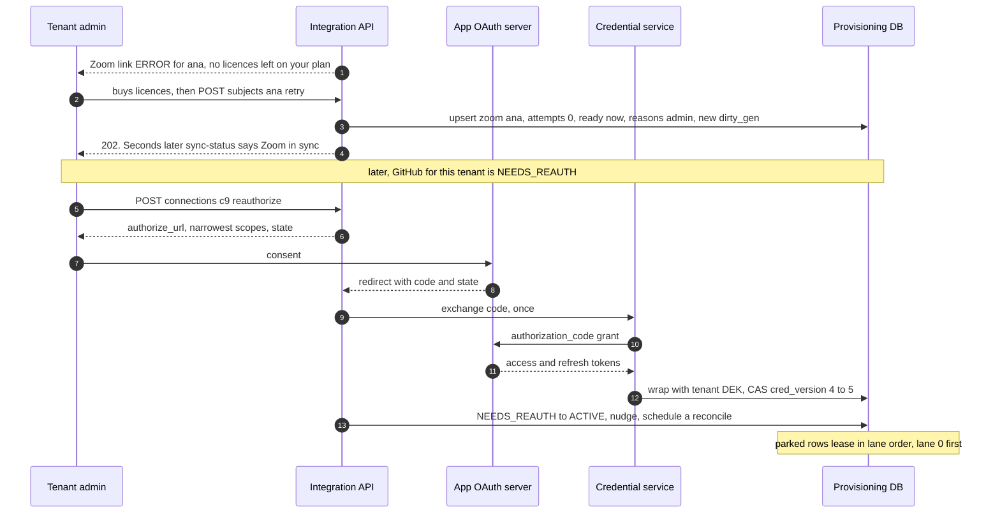

## D5. Failure paths

### D5a. A zombie worker, past the renew, caught by the fence and the verify read

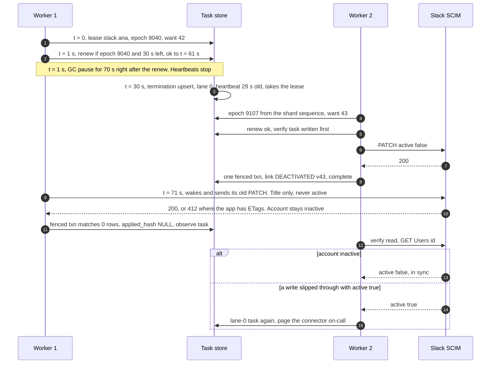

A worker 1 that pauses *before* its renew is stopped by it: the renew matches 0 rows and no call goes out. The renew only narrows the window, so the verify read stays. The verify runs at +5 min on its own key (D4b).

### D5b. A revoked grant, with parked tasks and a termination due

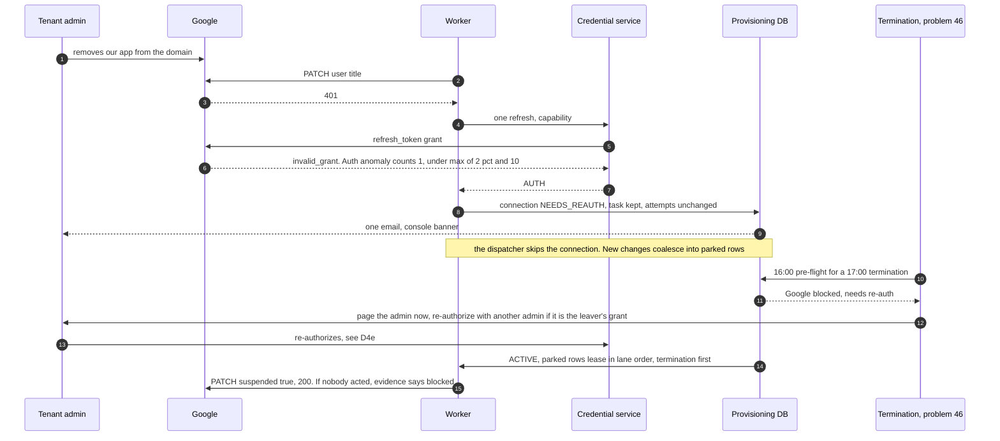

### D5c. A dispatcher partition changes owner

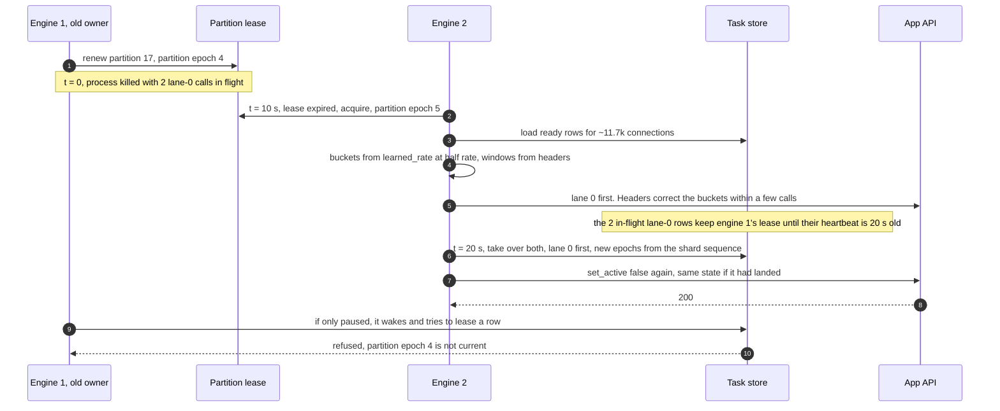

An unowned partition pages at 30 s. The two terminations land at ~21 s, inside the 60 s target, because the new owner re-leases rows whose heartbeat is older than 20 s, lane 0 first. Waiting for the full 60 s task lease would land them at ~61 s.

### D5d. An empty list, caught by list trust and the batch guard

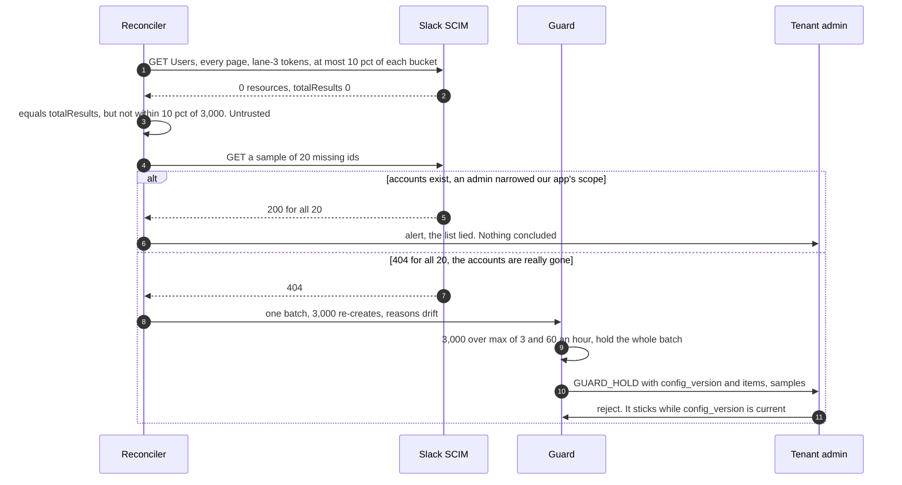

## D6. Decision flows

### D6a. The worker's render, diff, apply loop

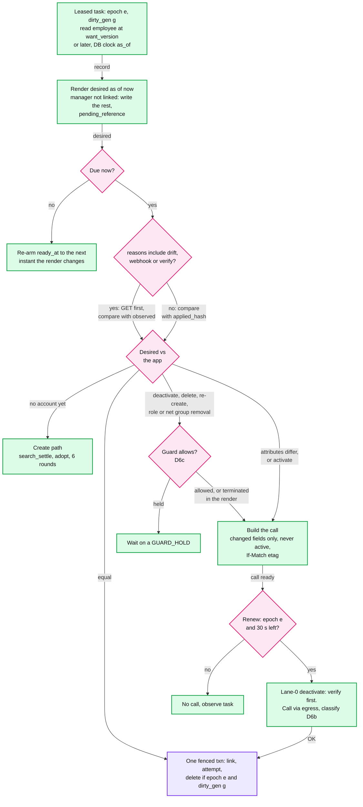

A fenced txn that matches 0 rows has two meanings. `dirty_gen` moved: run again at once. The epoch moved: write `applied_hash = NULL` and an observe task. For PUT-only apps, `active` comes from the status re-read at call time.

### D6b. `classify`, and what each class does

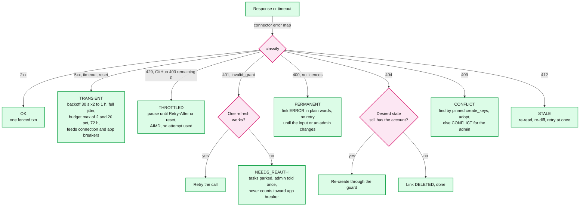

The app breaker trips on the app-wide rate: 50% `TRANSIENT` over at least 200 calls in 2 min. A connection breaker opens on 3 `TRANSIENT` in a row, or 50% of at least 20 in 2 min. A `404` on a deactivate or delete means the account is already gone.

### D6c. The mass-change guard

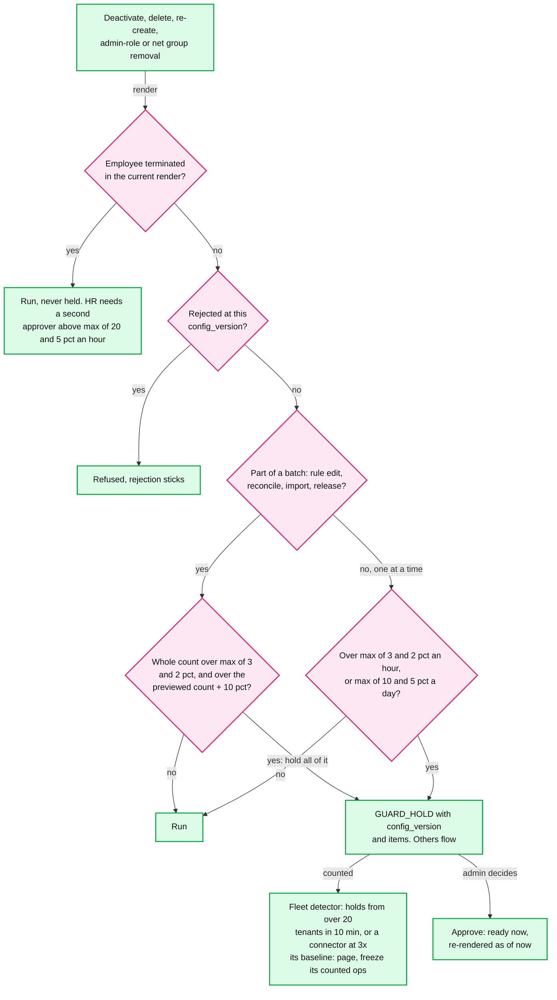

`reasons` only labels a hold's cause. Reactivation is never caused by drift or reconcile, only by an identity change newer than the deactivation. Provisioning pages the identity team if it sees more new terminations than the HR threshold without a `bulk_action_id`.

## D7. Entity relationship

`solution.md` §3.3 has the hot tables. This is the full set, including partner subscriptions and the inbox. Columns already in §3.3 are not repeated, except keys and the task row. Keys lead with `tenant_id`. `CONNECTOR`, `CONNECTION_CONFIG`, `GROUP_MEMBER`, `OUTBOX`, `EVENT_SUBSCRIPTION` and `INBOX` are new here.

```mermaid
%% D7: full schema. EMPLOYEE and OUTBOX live in the Identity DB. The rest is in the Provisioning DB, sharded by hash of tenant_id over 4 shards. ATTEMPT is partitioned by day.
erDiagram
    CONNECTOR ||--o{ CONNECTION : "installed as"
    CONNECTION ||--o{ CONNECTION_CONFIG : "versions"
    CONNECTION ||--|| CREDENTIAL : "authenticates with"
    CONNECTION ||--o{ ACCOUNT_LINK : "owns"
    EMPLOYEE ||--o{ ACCOUNT_LINK : "has accounts"
    CONNECTION ||--o{ GROUP_MEMBER : "memberships we added"
    CONNECTION ||--o{ SYNC_TASK : "pending work"
    CONNECTION ||--o{ GUARD_HOLD : "may pause"
    GUARD_HOLD ||--o{ GUARD_HOLD_ITEM : "holds"
    ACCOUNT_LINK ||--o{ ATTEMPT : "audited by"
    EMPLOYEE ||--o{ OUTBOX : "one row per commit"
    OUTBOX }o--o{ EVENT_SUBSCRIPTION : "fans out to, same tenant"
    CONNECTION ||--o{ INBOX : "app deliveries for"
    CONNECTOR {
        string connector_id PK "slack, google, github"
        int version PK "manifest: limits, scope keys, refresh_rotation, search_settle"
    }
    CONNECTION {
        uuid tenant_id PK
        uuid connection_id PK
        string status "DRAFT, ACTIVE, PAUSED, NEEDS_REAUTH, QUARANTINED, DISABLED"
        int connector_version "canary pin"
        string owner "v1 or v2 during migration"
    }
    CONNECTION_CONFIG {
        uuid tenant_id PK
        uuid connection_id PK
        int config_version PK "If-Match on edit"
        json rules_mappings_policies "enforce or report per attribute, provision_lead"
    }
    ACCOUNT_LINK {
        uuid tenant_id PK
        uuid connection_id PK
        uuid employee_id PK
        string state "CREATING, PRESENT, SUSPENDED, DEACTIVATED, DELETED, CONFLICT, IGNORED, ERROR"
        bool pending_reference
        json create_keys "userName, externalId pinned by the intent"
        timestamp create_started_at
        timestamp observed_at "with observed_hash"
    }
    GROUP_MEMBER {
        uuid tenant_id PK
        uuid connection_id PK
        uuid group_id PK
        uuid employee_id PK "about 300 M rows of about 100 B"
    }
    SYNC_TASK {
        uuid tenant_id PK
        uuid connection_id PK
        string subject PK "employee or group id"
        bigint want_version "GREATEST on upsert"
        smallint lane "0 to 3, LEAST on upsert"
        smallint risk "admin, production access, grant owner last"
        string reasons "hire, edit, termination, rule, release, drift, webhook, verify, delete_timer, admin"
        bigint dirty_gen "shard sequence, every upsert"
        timestamp ready_at
        int attempts
        string lease_owner
        bigint lease_epoch "shard sequence"
        timestamp lease_until
    }
    GUARD_HOLD {
        uuid tenant_id PK
        uuid hold_id PK
        int config_version "a rejection sticks while current"
        string cause "rule, release, reconcile, import, unexplained"
        string status "OPEN, APPROVED, REJECTED"
    }
    GUARD_HOLD_ITEM {
        uuid hold_id PK
        string subject PK
        string op PK "deactivate, delete, recreate, remove_group, remove_admin"
    }
    EMPLOYEE {
        uuid tenant_id PK
        uuid employee_id PK
        bigint version "new version at every effective instant"
    }
    OUTBOX {
        bigint outbox_id PK
        string kafka_key "tenant_id and employee_id"
        string changed_fields "names, no values, purged after 7 days"
    }
    EVENT_SUBSCRIPTION {
        uuid tenant_id PK
        uuid endpoint_id PK
        uuid client_id "partner OAuth client, its scopes filter field names"
        string secret_ref "old secret valid 24 h on rotation"
        string status "ACTIVE, DISABLED after 3 days failing"
    }
    INBOX {
        string source PK "slack, okta, google, github"
        string delivery_id PK "the app's own id, TTL 7 days"
    }
```

- A membership an app admin added by hand is not in `GROUP_MEMBER`, so we never remove it.
- `CREDENTIAL` sits in its own schema that only the credential service's role can read. Event and delivery rows belong to #58.
- The 7-day outbox purge and inbox TTL are [estimate]. They only need to outlast the senders' retries (Slack 3, Okta at most 1) and Kafka's 7-day retention.

## D8. State machines

### D8a. `ACCOUNT_LINK.state`

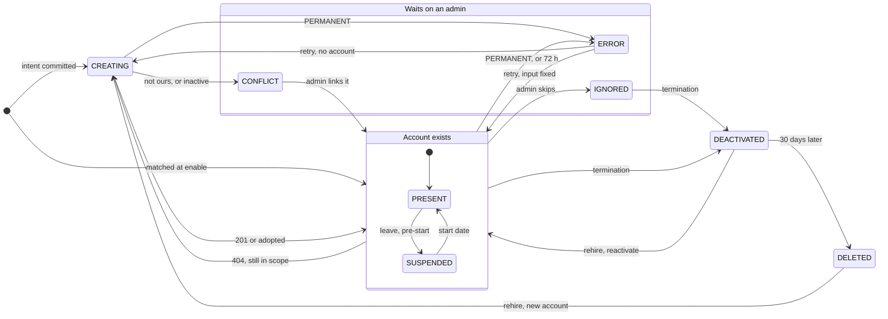

- An `IGNORED` link skips updates but is still deprovisioned. A termination on a `CREATING` link runs the same find-and-wait first.
- A rehire reuses the old account if the app still has it. A *new* employee with a reused email never adopts it, and no inactive account is ever auto-adopted: `CONFLICT`.

### D8b. `CONNECTION.status`, with the connection breaker inside `ACTIVE`

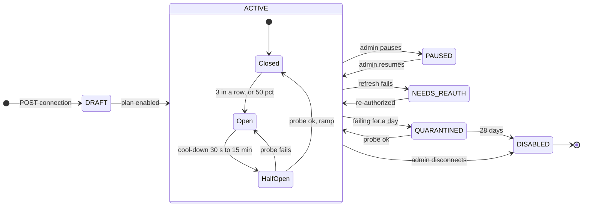

- `PAUSED` stops lanes 1 to 3. Lane 0 still runs.
- The app breaker sits above this, on the app-wide error rate (D6b). On close, the app's rows in transient backoff become due, lane 0 first (skipping the ramp, not the 10x ceiling) and lanes 1 to 3 on a ramp. More than 3 apps' breakers opening within 2 min pages the platform team: suspect our egress.

### D8c. The task lifecycle

```mermaid
%% D8c: one SYNC_TASK row. Waiting, Ready, Leased, Parked and Held are derived from ready_at, lease columns and connection status, not stored.
stateDiagram-v2
    direction LR
    [*] --> Waiting: upsert, due later
    [*] --> Ready: upsert, due now
    Waiting --> Ready: due, or higher lane
    Ready --> Parked: breaker, AUTH, 429
    Parked --> Ready: closed, re-auth, tokens
    Ready --> Leased: epoch from shard seq
    Leased --> Leased: lane-0 takeover
    Leased --> Done: fenced txn, same gen
    Leased --> Ready: dirtied again
    Leased --> Waiting: backoff, or re-arm
    Leased --> Held: guard
    Held --> Ready: admin approves
    Held --> Done: admin rejects
    Leased --> Done: PERMANENT, 72 h
    Done --> [*]
```

Every upsert takes a new `dirty_gen`, so a second dirtying during a run is never swallowed. A same-lane upsert with `attempts = 0` takes the earlier `ready_at`. A lane-0 upsert may take over a lease whose heartbeat is older than 20 s. Given-up rows leave the link in `ERROR`, and the daily re-render brings them back.

### D8d. `GUARD_HOLD.status`

```mermaid
%% D8d: a hold never approves itself. A rejection sticks until the connection's config_version changes. The fleet freeze is global and not a hold state.
stateDiagram-v2
    direction LR
    [*] --> OPEN: batch or window over
    OPEN --> OPEN: more ops join
    OPEN --> APPROVED: admin approves
    OPEN --> REJECTED: admin rejects
    APPROVED --> [*]: tasks re-rendered
    REJECTED --> [*]: config_version changes
```

## D9. Deployment / topology

Each region is a full cell for its tenants. Only database replication crosses a region boundary.

```mermaid
%% D9: one home region over 3 AZs plus its paired DR region. 16 engines split 6, 5, 5. Each Postgres shard has two standbys in other AZs with quorum commit (ANY 1), so losing one standby never stalls commits.
flowchart LR
    subgraph RA[Home region, one full cell]
        subgraph Z1[AZ 1]
            E1[Engine x6, 24 partitions<br/>3,000 slots, credential svc]
            D1[(PG primaries, shards 1 and 2<br/>Kafka broker, Redis primary)]
            X1[Egress proxy x3<br/>fixed IPs]
        end
        subgraph Z2[AZ 2]
            E2[Engine x5, 20 partitions<br/>2,500 slots, credential svc]
            D2[(PG primaries, shards 3 and 4<br/>standbys 1 and 2, Kafka broker)]
            X2[Egress proxy x3<br/>fixed IPs]
        end
        subgraph Z3[AZ 3]
            E3[Engine x5, 20 partitions<br/>2,500 slots, credential svc]
            D3[(PG standbys 3 and 4<br/>Kafka broker, Redis replica)]
            X3[Egress proxy x3<br/>fixed IPs]
        end
    end
    KMS[Regional KMS key]
    APPS[Third-party apps<br/>allowlist both regions' IPs]
    DR[(Paired DR region<br/>async replicas, own KMS key,<br/>own egress IPs, cold engines)]
    D1 -->|"sync replication"| D2
    D2 -->|"sync replication"| D3
    E1 -->|"tasks, leases on any shard"| D2
    E1 -->|"calls"| X1
    E2 -->|"calls"| X2
    E3 -->|"calls"| X3
    X1 & X2 & X3 -->|"HTTPS"| APPS
    E3 -->|"unwrap DEKs"| KMS
    D2 -.->|"async, Identity and Provisioning DB,<br/>RPO seconds, crosses the region"| DR
    class E1,E2,E3,X1,X2,X3 service
    class D1,D2,D3,DR store
    class KMS,APPS external
    classDef service  fill:#dcfce7,stroke:#16a34a,stroke-width:2px,color:#111
    classDef store    fill:#ede9fe,stroke:#7c3aed,stroke-width:2px,color:#111
    classDef external fill:#e5e7eb,stroke:#6b7280,stroke-width:2px,color:#111,stroke-dasharray:4 3
```

- **AZ loss.** Losing AZ 1 takes 6 engines and 2 shard primaries. Partitions move in ~10 s, standbys promote in ~30 s. 10 engines leave 5,000 slots, 4.5x the ~1,100 in flight at peak. Kafka keeps writing on 2 of 3 replicas.
- **Region loss.** The new primary's identity version is the truth: tasks reset `want_version` to it. A change that would reactivate an account whose `applied_version` is newer than the identity version is held for HR review. Terminations from the last 24 h get lane-0 tasks again, and every connection reconciles within 6 h. Both regions' egress IPs are published from day one. Kafka and Redis are rebuilt, not replicated.
- The 6, 5, 5 split is [estimate]. Each DEK is wrapped twice, under the home region's KMS key and the DR region's, because a DEK wrapped only at home cannot be unwrapped in DR. DR drills decrypt from the second region.

## D10. Scaling / partitioning

Tenant for data, employee for change events, the vendor's scope for dispatch, and one shared key per app for app-wide quota.

```mermaid
%% D10: partition keys. Red = the app-wide bucket: the one piece of dispatcher state that cannot be partitioned. One Redis key per app serves every partition.
flowchart LR
    TD[Tenant directory<br/>hash of tenant_id,<br/>overrides for the largest] -->|"tenant to shard"| SH[(4 Postgres shards<br/>~1,500 writes/s each at peak)]
    BIG[Largest tenant<br/>50k employees, ~0.5 M links] -->|"pinned"| SH
    KF[(Kafka, 64 partitions<br/>key tenant and employee)] -->|"a 50k import spreads<br/>over all 64"| PLN[Planner, 16-way per<br/>partition, page on lag over 10 s]
    PLN -->|"upserts"| SH
    CN[750k connections] -->|"hash of vendor_scope_key mod 64"| DP[64 dispatcher partitions<br/>~11.7k connections each]
    DP -->|"4 per process"| EN[16 engine processes]
    DP -->|"ready rows from all 4 shards"| SH
    DP -->|"~1 s batches, lane passed"| AB[App-wide bucket, Jira<br/>65,000 points/h for all tenants,<br/>20 pct lane-0 reserve]
    IMP[One tenant's Jira import] -->|"at most 10 pct: ~1.8/s"| AB
    VS[Two connections on one Slack org,<br/>or many on one SCIM host] -->|"same scope key,<br/>same partition, one bucket"| DP
    class TD,PLN,DP,EN service
    class SH,KF store
    class CN,BIG,IMP,VS client
    class AB critical
    classDef client   fill:#dbeafe,stroke:#2563eb,stroke-width:2px,color:#111
    classDef service  fill:#dcfce7,stroke:#16a34a,stroke-width:2px,color:#111
    classDef store    fill:#ede9fe,stroke:#7c3aed,stroke-width:2px,color:#111
    classDef critical fill:#fee2e2,stroke:#dc2626,stroke-width:4px,color:#111
```

- **Shards by tenant.** Every query is tenant-scoped. The largest tenant is ~0.5% of links, so pinning is for burst isolation (a 50k connect), not size. A partition reads all 4 shards, so a shard failover pauses ~1/4 of every partition.
- **Kafka by tenant and employee.** One tenant's import no longer queues ahead of ~780 other tenants' terminations. Per-employee order still holds.
- **The app-wide bucket.** `65,000 / 3,600 ≈ 18` points/s for every Jira tenant together. The 10% tenant share makes a 20,000-create Jira import ~3 h [estimate, 1 point per call].
- **Partitions by vendor scope.** `vendor_scope_key` (installation, org or account id, or the target host for generic SCIM) picks the partition. Connections that share one vendor quota share one owner and one exact in-memory bucket. A tenant's 15 connections still spread over ~15 partitions.

## D11. Failure mode map

One tree. Each leaf is a failure and its mitigation. The blast radius is on the arrow.

```mermaid
%% D11: red = a dispatcher bug, the one failure that reaches every tenant on an app at once. The other global failures are caught by detectors that look across tenants.
flowchart LR
    ROOT[Platform] -->|"every tenant on an app:<br/>429s, ban risk, lane 0 stuck"| F1[Dispatcher bug in lanes or buckets<br/>slot caps, learned rates, page at 5 pct 429s]
    ROOT -->|"4 partitions ~10 s,<br/>in-flight rows ~20 s"| F2[Engine process dies<br/>partition epoch, takeover at half rate]
    ROOT -->|"~1/4 of tenants, ~30 s"| F3[DB shard loses primary<br/>sync standby, planner retries]
    ROOT -->|"new changes wait"| F4[Kafka down<br/>outbox keeps them, relay catches up]
    ROOT -->|"app-wide quota apps slower"| F5[Redis down<br/>static 1/64 per partition]
    ROOT -->|"after cached tokens expire"| F6[Credential service down<br/>3 replicas, tokens last ~55 min]
    ROOT -->|"tasks wait"| F13[Identity DB down<br/>no renders, replicas drain]
    ROOT -->|"one app, all tenants"| F7[App outage<br/>app breaker, ramp 2x to 10x, ~17 min drain]
    ROOT -->|"one connection"| F8[Grant revoked<br/>NEEDS_REAUTH, parked, pre-flight]
    ROOT -->|"every tenant on that app"| F9[Our client secret or app suspended<br/>auth anomaly, page, hold emails 1 h]
    ROOT -->|"one connection"| F10[A list lies or is garbage<br/>AND trust rule, sample of 20 GETs]
    ROOT -->|"one connection, or a fleet"| F11[Rule typo or bad release<br/>batch admission, sticky reject, fleet freeze]
    ROOT -->|"several apps at once"| F12[Our egress fails<br/>over 3 app breakers in 2 min pages]
    class ROOT service
    class F2,F3,F4,F5,F6,F7,F8,F9,F10,F11,F12,F13 decision
    class F1 critical
    classDef service  fill:#dcfce7,stroke:#16a34a,stroke-width:2px,color:#111
    classDef critical fill:#fee2e2,stroke:#dc2626,stroke-width:4px,color:#111
    classDef decision fill:#fce7f3,stroke:#db2777,stroke-width:2px,color:#111
```

Region loss is in D9. The outage drain is ~70k rows under a ceiling that starts at 2x normal and doubles every 2 min up to 10x, with ~10/s of new work still arriving.

## D12. Rollout / migration

From per-connector code in the monolith (v1) to this engine (v2), as in `solution.md` §8. Ownership is a column on `CONNECTION`, so a connection never has two writers. Durations are [estimate], except the two-week shadow.

```mermaid
%% D12: four phases. Each milestone is a rollback point. Cut-over and rollback are per connection, by flag (problem 56).
gantt
    title Migration from v1 connectors to the v2 engine
    dateFormat YYYY-MM-DD
    axisFormat %b %d
    section Phase 1 backfill
    Links from v1 stored external ids            :p1a, 2026-11-02, 14d
    Read-only reconcile fills observed_hash      :p1b, after p1a, 7d
    Rollback point, v2 has written nothing       :milestone, m1, after p1b, 0d
    section Phase 2 shadow
    v2 renders and diffs, connectors in dry run  :p2a, after m1, 14d
    Compare with v1 calls, ticket each mismatch  :p2b, after m1, 21d
    Rollback point, switch shadow off            :milestone, m2, after p2b, 0d
    section Phase 3 cut over
    Generic SCIM apps on small tenants           :p3a, after m2, 21d
    Top 20 connectors                            :p3b, after p3a, 42d
    Google, Microsoft and Slack last             :p3c, after p3b, 28d
    Rollback point per connection, owner flips back :milestone, m3, after p3a, 0d
    section Phase 4 retire
    v1 read-only, owner flips still possible     :p4a, after p3c, 30d
    v1 code deleted                              :milestone, m4, after p4a, 0d
```

Rollback is flipping `CONNECTION.owner` back. v2 records only what it applied, and v1 resumes from its own state. A reconcile after the flip closes any gap. Each shadow mismatch is a v1 bug, a v2 bug or a mapping difference, and each class gets a ticket. Cut-over order follows blast radius: small tenants first, the three biggest apps last.
