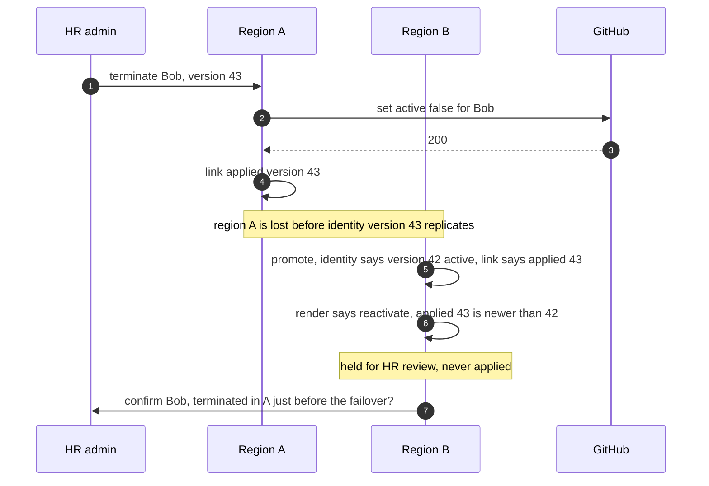
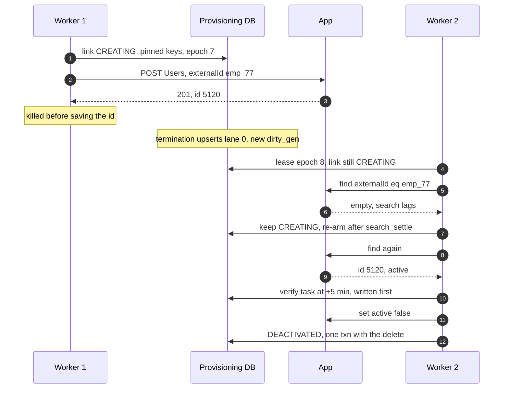
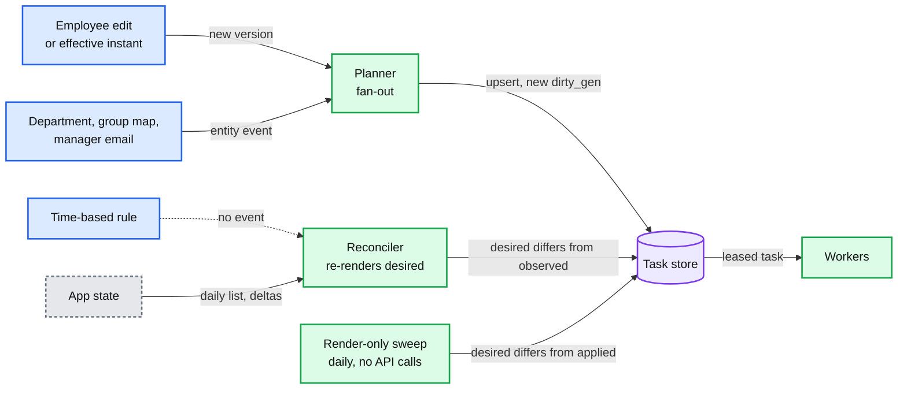

# Edge cases: employee identity + integration platform

Every entry is answerable in under 60 seconds out loud. Categories: failure, consistency, scale, data, operations, security. Design reference: [`solution.md`](solution.md). Diagrams: [`diagrams.md`](diagrams.md). Facts and URLs: [`research/facts-survey.md`](research/facts-survey.md).

Numbers tagged **[sim]** come from small seeded simulations run for this file. The model is stated in the entry. Treat them like estimates. Where the design has a rule because a simpler first draft failed, the entry gives the first draft's number too: that number is the reason for the rule.

Acronyms: SCIM (System for Cross-domain Identity Management), SSO (single sign-on), HR (human resources), AIMD (additive increase, multiplicative decrease), DRR (deficit round robin), SSRF (server-side request forgery), RPO (recovery point objective), GC (garbage collection), DST (daylight saving time), MSP (managed service provider), ETag (entity tag), HMAC (hash-based message authentication code), SLO (service level objective), DNS (domain name system), GDPR (General Data Protection Regulation), RLS (row-level security), CAS (compare-and-set), MDM (mobile device management), AZ (availability zone).

## Index

| # | Category | Edge case | Detail |
|---|---|---|---|
| 1 | Failure | [an app is down for 2 hours, then comes back](#edge-case-an-app-is-down-for-2-hours-then-comes-back) | §5.4, §10.4 B, Flow 5; [failures and breakers](deep-dives/failures-retries-and-circuit-breakers.md) |
| 2 | Failure | [one tenant revokes our grant in Google](#edge-case-one-tenant-revokes-our-grant-in-google) | §5.4 |
| 3 | Failure | [a worker process dies holding 500 leases](#edge-case-a-worker-process-dies-holding-500-leases) | §10.2 |
| 4 | Failure | [a dispatcher dies, or pauses past its partition lease](#edge-case-a-dispatcher-dies-or-pauses-past-its-partition-lease) | §5.3, §5.8; [rate limits](deep-dives/rate-limits-priority-and-fairness.md) |
| 5 | Failure | [a Provisioning DB shard loses its primary](#edge-case-a-provisioning-db-shard-loses-its-primary) | §3.3, §10.4 C |
| 6 | Failure | [the identity DB, the outbox relay or Kafka is down](#edge-case-the-identity-db-the-outbox-relay-or-kafka-is-down) | §5.8, §10.1 |
| 7 | Failure | [Redis, which holds the app-wide buckets, is down or fails over](#edge-case-redis-which-holds-the-app-wide-buckets-is-down-or-fails-over) | §5.3, §10.1 |
| 8 | Failure | [the credential service or the egress proxy is down](#edge-case-the-credential-service-or-the-egress-proxy-is-down) | §5.4, §5.6, §5.8 |
| 9 | Failure | [the region fails over to its pair](#edge-case-the-region-fails-over-to-its-pair) | §10.11, §5.8 |
| 10 | Consistency | [three edits in a minute, a late retry, and an edit mid-call](#edge-case-three-edits-in-a-minute-a-late-retry-and-an-edit-mid-call) | §5.1; [sync and ordering](deep-dives/desired-state-sync-and-ordering.md) |
| 11 | Consistency | [a rule edit or a scheduled termination lands while the row is mid-run](#edge-case-a-rule-edit-or-a-scheduled-termination-lands-while-the-row-is-mid-run) | §3.3, §5.1; [sync and ordering](deep-dives/desired-state-sync-and-ordering.md) |
| 12 | Consistency | [a zombie worker wakes after its lease with an old render](#edge-case-a-zombie-worker-wakes-after-its-lease-with-an-old-render) | §5.1 |
| 13 | Consistency | [a crash between any two steps of an update](#edge-case-a-crash-between-any-two-steps-of-an-update) | §3.3, §5.1, §10.5 |
| 14 | Consistency | [the worker crashed after POST /Users returned 201](#edge-case-the-worker-crashed-after-post-users-returned-201) | §5.2, Flow 4, §10.4 A; [creates and matching](deep-dives/idempotent-creates-and-account-matching.md) |
| 15 | Consistency | [the employee is terminated while their create is in flight](#edge-case-the-employee-is-terminated-while-their-create-is-in-flight) | §4.2, §5.2, §4.3; [creates and matching](deep-dives/idempotent-creates-and-account-matching.md) |
| 16 | Consistency | [a rehire](#edge-case-a-rehire) | §5.2, §5.5; [creates and matching](deep-dives/idempotent-creates-and-account-matching.md) |
| 17 | Consistency | [a reused email, or a name change that collides](#edge-case-a-reused-email-or-a-name-change-that-collides) | §5.2 |
| 18 | Consistency | [the manager's account does not exist yet](#edge-case-the-managers-account-does-not-exist-yet) | §5.1, Flow 2; [sync and ordering](deep-dives/desired-state-sync-and-ordering.md) |
| 19 | Consistency | [a termination at 17:00 local meets the clocks](#edge-case-a-termination-at-1700-local-meets-the-clocks) | §5.1 |
| 20 | Consistency | [an admin edits the account in the app, or another tool fights us](#edge-case-an-admin-edits-the-account-in-the-app-or-another-tool-fights-us) | §4.3, §5.1, §5.5; [drift and guard](deep-dives/drift-reconciliation-and-mass-change-guard.md) |
| 21 | Consistency | [an app admin re-enables 80 people we deactivated](#edge-case-an-app-admin-re-enables-80-people-we-deactivated) | §5.5 |
| 22 | Consistency | [a department is renamed, or a manager's email changes](#edge-case-a-department-is-renamed-or-a-managers-email-changes) | §4.3, §5.1, §5.5; [sync and ordering](deep-dives/desired-state-sync-and-ordering.md) |
| 23 | Scale | [a 20,000-person GitHub connect, then someone is fired](#edge-case-a-20000-person-github-connect-then-someone-is-fired) | §5.3, Flow 7; [rate limits](deep-dives/rate-limits-priority-and-fairness.md) |
| 24 | Scale | [a 5,000-person layoff on a 5,000-an-hour installation](#edge-case-a-5000-person-layoff-on-a-5000-an-hour-installation) | §5.3 |
| 25 | Scale | [a 50,000-person import lands on the change topic](#edge-case-a-50000-person-import-lands-on-the-change-topic) | §4.2, §10.1, §10.3 |
| 26 | Scale | [one tenant's import spends Jira's app-wide quota](#edge-case-one-tenants-import-spends-jiras-app-wide-quota) | §5.3; [rate limits](deep-dives/rate-limits-priority-and-fairness.md) |
| 27 | Scale | [a quota shared with strangers, or with ourselves](#edge-case-a-quota-shared-with-strangers-or-with-ourselves) | §5.3 |
| 28 | Scale | [an app whose calls hang for 30 s](#edge-case-an-app-whose-calls-hang-for-30-s) | §5.3, §10.2, §10.11 |
| 29 | Scale | [thousands of hires start on Monday](#edge-case-thousands-of-hires-start-on-monday) | §5.1, Flow 2 |
| 30 | Scale | [10x tenants tomorrow](#edge-case-10x-tenants-tomorrow) | §10.11 |
| 31 | Data | [the nightly list is empty or short](#edge-case-the-nightly-list-is-empty-or-short) | §5.5, Flow 6; [drift and guard](deep-dives/drift-reconciliation-and-mass-change-guard.md) |
| 32 | Data | [a rule typo, or a connector bug that drips](#edge-case-a-rule-typo-or-a-connector-bug-that-drips) | §5.5; [drift and guard](deep-dives/drift-reconciliation-and-mass-change-guard.md) |
| 33 | Data | [a bad HR import marks 3,000 people terminated](#edge-case-a-bad-hr-import-marks-3000-people-terminated) | §5.5 |
| 34 | Data | [a connector release, a rollback, or a Kafka replay re-renders everyone](#edge-case-a-connector-release-a-rollback-or-a-kafka-replay-re-renders-everyone) | §5.5, §10.1, §10.9 |
| 35 | Data | [a Graph delta token expires, or a push channel lapses](#edge-case-a-graph-delta-token-expires-or-a-push-channel-lapses) | §5.5, §10.1 |
| 36 | Data | [GDPR erasure of a former employee](#edge-case-gdpr-erasure-of-a-former-employee) | §10.11 |
| 37 | Data | [three years of growth](#edge-case-three-years-of-growth) | §2, §10.3 |
| 38 | Data | [a vendor returns garbage](#edge-case-a-vendor-returns-garbage) | §5.4, §10.9, §10.10 |
| 39 | Operations | [what pages at 3 am, and what does not](#edge-case-what-pages-at-3-am-and-what-does-not) | §8, §10.9 |
| 40 | Operations | [a termination meets a re-auth, a paused connection or a skipped employee](#edge-case-a-termination-meets-a-re-auth-a-paused-connection-or-a-skipped-employee) | §4.2, §4.5, §5.4 |
| 41 | Operations | [an admin approves or rejects a guard hold](#edge-case-an-admin-approves-or-rejects-a-guard-hold) | §5.5 |
| 42 | Operations | [our own client-secret rotation breaks 20,000 connections](#edge-case-our-own-client-secret-rotation-breaks-20000-connections) | §5.4, §10.10 |
| 43 | Operations | [migrating from v1 with no double writes](#edge-case-migrating-from-v1-with-no-double-writes) | §8 |
| 44 | Security | [a tenant admin points generic SCIM at our metadata endpoint](#edge-case-a-tenant-admin-points-generic-scim-at-our-metadata-endpoint) | §5.6; [connectors and credentials](deep-dives/connectors-credentials-and-webhooks.md) |
| 45 | Security | [a worker bug mixes up tenant A's and tenant B's ids](#edge-case-a-worker-bug-mixes-up-tenant-as-and-tenant-bs-ids) | §3.3, §5.6 |
| 46 | Security | [two refreshes race under rotation, or Google's 100-token limit](#edge-case-two-refreshes-race-under-rotation-or-googles-100-token-limit) | §5.6; [connectors and credentials](deep-dives/connectors-credentials-and-webhooks.md) |
| 47 | Security | [forged, replayed or flooding inbound webhooks](#edge-case-forged-replayed-or-flooding-inbound-webhooks) | §4.4; [connectors and credentials](deep-dives/connectors-credentials-and-webhooks.md) |
| 48 | Security | [a compromised partner](#edge-case-a-compromised-partner) | §5.7 |
| 49 | Security | [a malicious tenant opens 500 slow connections, or connects another company's org](#edge-case-a-malicious-tenant-opens-500-slow-connections-or-connects-another-companys-org) | §5.3, §10.10 |
| 50 | Security | [the admin whose grant we use is in the layoff](#edge-case-the-admin-whose-grant-we-use-is-in-the-layoff) | §5.3, §5.4, §5.6 |

---

## Failure

## Edge case: an app is down for 2 hours, then comes back
- **Trigger:** Google's Directory API times out for every tenant from 10:00 to 12:00.
- **Symptom:** ~72k Google tasks arrive during the outage (~10 tasks/s daytime x 7,200 s). Naive 30 s retries would reach ~2,400 calls/s, 240x normal.
- **Answer:**
  - The app breaker trips on the **app-wide** error rate: at least 50% `TRANSIENT` over at least 200 calls in 2 min. **[sim]** at 10 tasks/s it trips in ~20 s. Then only 5 canaries probe, cool-down capped at 60 s, and tasks keep their attempt counts.
  - On close, every `TRANSIENT` row of the app gets `ready_at = now`. Lane 0 (~300 terminations) goes at once and skips the re-open stagger: **[sim]** p50 30 s, all within ~61 s of recovery. Lanes 1 to 3 ramp from 2x normal, doubling every 2 min to 10x (~100/s), while new work arrives at 10/s: **[sim]** ~17 min to drain ~71k rows.
  - Why not count connections with open breakers: the median connection makes ~0.04 calls in 2 min. **[sim]** (20,000 connections, lognormal sizes, median 40, mean 200) that rule saw 1.4% of active connections open by minute 5 and 2% by minute 30, against a 30% trigger. Terminations then waited on their own backoff timers: p50 14 min, p99 54 min.
  - Independent edits barely coalesce in 2 h: **[sim]** 72k tasks become ~71k rows. Bulk re-edits do: ~61k when 30% of tasks touch the same people twice.
  - Detail: solution §5.4, §10.4 B, Flow 5. [`deep-dives/failures-retries-and-circuit-breakers.md`](deep-dives/failures-retries-and-circuit-breakers.md).
- **Confidence:** [ ] shaky  [ ] ok  [ ] confident

## Edge case: one tenant revokes our grant in Google
- **Trigger:** tenant T's admin removes our app from Google Workspace at 14:00.
- **Symptom:** T's next call gets `401`. The other ~20,000 Google tenants see nothing.
- **Answer:**
  - The worker asks the credential service for one refresh. It returns `invalid_grant`, and the connection goes `NEEDS_REAUTH`. Its tasks are parked, not dropped, and keep coalescing.
  - `AUTH` never counts toward the app breaker. The admin gets one email and a banner. On re-authorize, parked tasks resume in lane order and a reconcile runs.
  - A scheduled termination for T: the pre-flight check 1 h before finds the broken grant and pages T's admin. A second check at T minus 5 min covers app admins who might revoke us on the way out. The #46 evidence says "Google: blocked, needs re-auth", not "complete".
  - Detail: solution §5.4. [`../employee-ops-bundle/`](../employee-ops-bundle/) (#46).
- **Confidence:** [ ] shaky  [ ] ok  [ ] confident

## Edge case: a worker process dies holding 500 leases
- **Trigger:** an out-of-memory kill or node loss on one of the 16 engine processes.
- **Symptom:** ~500 tasks stop mid-flight. Some calls landed at the app, some never left.
- **Answer:**
  - Leases lapse 60 s after the last heartbeat. Lane 0 does not wait that long: a lane-0 row whose heartbeat is older than 20 s is taken over, so a termination in the dead process still lands inside its 60 s target.
  - The new lease takes `lease_epoch` from a shard-wide sequence, so it never matches an old one, even after the row was deleted and re-created.
  - Updates and deactivations are safe to repeat: render, diff, at most one idempotent call. Creates take the careful path (below).
  - Detail: solution §10.2. [`../../concepts/leases-fencing-clocks.md`](../../concepts/leases-fencing-clocks.md).
- **Confidence:** [ ] shaky  [ ] ok  [ ] confident

## Edge case: a dispatcher dies, or pauses past its partition lease
- **Trigger:** the process that owns dispatcher partitions 12 to 15 dies. Or it freezes for 20 s during a virtual machine migration.
- **Symptom:** those partitions stop dispatching for ~10 s. In the freeze case, the old owner wakes up still holding in-memory buckets.
- **Answer:**
  - Death: another process takes the partition lease (~10 s), rebuilds buckets from the manifest and the last response headers, and starts at half the learned rate. Paged only if a partition is unowned for 30 s.
  - Freeze: partition leases carry an epoch, and a task lease requires the current partition epoch. The old owner's grants fail at the database, so two owners never spend one vendor quota twice.
  - Detail: solution §5.3, §5.8. [`deep-dives/rate-limits-priority-and-fairness.md`](deep-dives/rate-limits-priority-and-fairness.md).
- **Confidence:** [ ] shaky  [ ] ok  [ ] confident

## Edge case: a Provisioning DB shard loses its primary
- **Trigger:** the primary of shard 2 dies.
- **Symptom:** ~1/4 of tenants stop dispatching for ~30 s. Planner upserts for those tenants fail.
- **Answer:**
  - A quorum standby is promoted in ~30 s. The planner stops committing Kafka offsets while upserts fail, then resumes from the last committed offset. Upserts are idempotent (`GREATEST`, a union of `reasons`, a fresh `dirty_gen`), so redelivery only re-runs a render.
  - A task and its link live on the same shard, so completion is one local transaction: it either happened or it did not. In-flight calls that finish during the gap find their row intact or fenced. A fenced worker sets `applied_hash = NULL` and marks an observe task.
  - The shard key is `tenant_id`, the dispatcher key is the vendor scope, so every partition loses a quarter of its connections and none loses everything.
  - Detail: solution §3.3, §10.4 C. [`../../concepts/replication-and-quorums.md`](../../concepts/replication-and-quorums.md).
- **Confidence:** [ ] shaky  [ ] ok  [ ] confident

## Edge case: the identity DB, the outbox relay or Kafka is down
- **Trigger:** the identity DB primary fails over, or the Kafka cluster is unavailable, in business hours.
- **Symptom:** HR edits fail (identity DB) or wait (Kafka). Provisioning goes quiet.
- **Answer:**
  - Kafka or the relay down: changes wait in the outbox, committed with the edit. The relay catches up in commit order. Nothing is lost.
  - Identity primary down: no new changes. Every task renders from the employee's **current** record, so workers keep draining from replicas while those serve reads at or above `want_version`. Fully down: tasks wait and coalesce.
  - Afterwards, planner lag over 10 s pages, because every lane-0 target starts there.
  - Detail: solution §5.8, §10.1.
- **Confidence:** [ ] shaky  [ ] ok  [ ] confident

## Edge case: Redis, which holds the app-wide buckets, is down or fails over
- **Trigger:** the Redis primary dies, or a key is evicted.
- **Symptom:** apps with app-wide quotas (Jira, Microsoft Graph across tenants) could be over-granted, or under-used for a moment.
- **Answer:**
  - A missing key starts at **0**, never full. A reset to full could grant Jira's whole 65,000-point hour at once, and a Jira `429` means "All requests are denied until the next hourly reset" (survey §2g) for every tenant.
  - Redis down: each of the 64 partitions takes a static 1/64 of the app-wide limit. Under-use, never a ban.
  - The Lua script is told the lane and refuses lanes 1 to 3 below 20% of the pool, so the app-wide reserve survives too.
  - Detail: solution §5.3, §10.1.
- **Confidence:** [ ] shaky  [ ] ok  [ ] confident

## Edge case: the credential service or the egress proxy is down
- **Trigger:** a bad credential-service deploy. Or the egress proxy in one AZ loses its network gateway.
- **Symptom:** no new tokens, or every external call fails at once, which looks like 600 apps going down together.
- **Answer:**
  - Credential service: workers keep cached access tokens for their lifetime (~55 min for 1 h tokens). Only tasks that need a refresh wait. It runs 3 replicas, so a full outage is a bad deploy, rolled back.
  - Egress: 3 proxies per AZ. If more than 3 apps' breakers open within 2 min, the common cause is ours: "suspect egress" pages the platform team, not 3 connector teams.
  - Tasks parked by an open breaker keep their attempt counts, so our own outage pushes nothing toward the 72 h give-up.
  - Detail: solution §5.4, §5.6, §5.8.
- **Confidence:** [ ] shaky  [ ] ok  [ ] confident

## Edge case: the region fails over to its pair
- **Trigger:** region A is lost. Its tenants fail over to region B, which holds async replicas of the identity DB and the Provisioning DB.
- **Symptom:** seconds of edits are lost. A termination may be among them. Our egress IPs change.
- **Answer:**
  - The new primary's version is the truth: tasks reset `want_version` to the current version, so no worker waits forever for a version that was lost.
  - Every employee terminated in the last 24 h gets a lane-0 task again, and every connection reconciles within 6 h. Level-triggered sync makes that a re-render, not a replay.
  - A change that would **reactivate** an account whose `applied_version` is newer than the identity record is held for HR review, never applied. That is the signature of a termination the failover lost. If the link lost version 43 too, the reconcile sees drift, and drift never reactivates.
  - Both regions' egress IPs are published from day one, so customer allowlists survive.
  - Detail: solution §10.11, §5.8. [`diagrams.md`](diagrams.md) D9.
- **Diagram:** what B sees after the failover.

- **Confidence:** [ ] shaky  [ ] ok  [ ] confident

## Consistency

## Edge case: three edits in a minute, a late retry, and an edit mid-call
- **Trigger:** Ana's title changes at 10:00:00, :20 and :40. A retried copy of the first event arrives at 10:01. A fourth edit lands while the `PATCH` for the third is in flight.
- **Symptom:** none. Slack ends with the latest title.
- **Answer:**
  - Events only mark `(slack, ana)` dirty. `want_version = GREATEST(old, new)`, so a late copy of version 40 cannot lower a row that wants 42.
  - The worker renders the **current** record, never the event. A replica below `want_version` sends it to the primary. A replay renders the same hash and costs nothing.
  - Mid-call edit: the upsert takes a fresh `dirty_gen`. The completion, `DELETE ... WHERE lease_epoch = mine AND dirty_gen = leased`, matches zero rows, so the row runs again at once. k edits cost one call, or two if one lands mid-call.
  - When quota-bound, coalescing pays: a 10,000-person import with a typo fix 5 min later costs 10,894 calls instead of 20,000 (deep dive simulation).
  - Detail: solution §5.1. [`deep-dives/desired-state-sync-and-ordering.md`](deep-dives/desired-state-sync-and-ordering.md).
- **Confidence:** [ ] shaky  [ ] ok  [ ] confident

## Edge case: a rule edit or a scheduled termination lands while the row is mid-run
- **Trigger:** a worker is mid-call on `(slack, ana)` for a title change at version 42. At that moment an admin's rule edit removes Ana from Slack. Or her termination becomes effective at 17:00.
- **Symptom:** a rule edit does not move `want_version`. A completion fenced on `want_version` alone would delete the row and swallow the rule change.
- **Answer:**
  - Every upsert, whatever its cause (rule, webhook, admin retry, drift), takes a new `dirty_gen` from a shard-wide sequence. The completion checks `dirty_gen`, matches zero rows, and the row runs again with the new rule. The deep dive's simulation lost rule changes this way without it.
  - A scheduled change is a **new version**: the identity service commits one at every effective instant, so the 17:00 termination moves `want_version` like any edit.
  - A render that is not due yet returns the next instant its output changes, and the worker re-arms `ready_at` to it. A start date moved earlier wins too: with `attempts = 0`, the upsert takes `ready_at = LEAST(old, new)`.
  - Backstop: a daily render-only sweep of every link against `applied_hash` (~1,160 renders/s, zero vendor quota) re-dirties anything a bug lost.
  - Detail: solution §3.3, §5.1. [`deep-dives/desired-state-sync-and-ordering.md`](deep-dives/desired-state-sync-and-ordering.md).
- **Confidence:** [ ] shaky  [ ] ok  [ ] confident

## Edge case: a zombie worker wakes after its lease with an old render
- **Trigger:** worker W1 renders Ana (active, old title), then freezes 90 s in a GC pause. Ana is terminated. W2 leases, deactivates, completes. W1 wakes.
- **Symptom:** W1 is about to send a write built from a state that no longer exists.
- **Answer:**
  - Defence 1: a `PATCH` never carries `active`. On a `PUT`-only app the body must, so the worker sets it from the status re-read at call time.
  - Defence 2: a conditional renew before every call: `UPDATE ... WHERE lease_epoch = mine AND lease_until > now() + 30 s`. Zero rows: do not call. Defence 3: `If-Match` gets `412` where the app has ETags. Defence 4: each lane-0 deactivation writes its +5 min verify read **before** the call.
  - **[sim]** (16 freezes a day of 1 to 300 s, 500 tasks each): no check ~250 unsafe sends a day, an epoch read ~130 (it passes when the lease lapsed but nobody re-leased yet), the conditional renew ~11. A pause can still land after the renew, which is why the verify read stays.
  - A fenced-out W1 does not write `applied_hash`. It sets it to `NULL`, so the next run cannot skip the call, and marks an observe task.
  - Detail: solution §5.1. [`diagrams.md`](diagrams.md) D5. [`../../concepts/leases-fencing-clocks.md`](../../concepts/leases-fencing-clocks.md).
- **Confidence:** [ ] shaky  [ ] ok  [ ] confident

## Edge case: a crash between any two steps of an update
- **Trigger:** the process dies (a) after the lease, (b) after the `PATCH` landed, (c) while committing the link and the delete, (d) right after a deactivation call.
- **Symptom:** a task that looks half done.
- **Answer:**
  - (a) and (b): the lease lapses. The next worker renders, diffs and re-sends at most one idempotent call.
  - (c): the link write and the fenced delete are **one** transaction on the tenant's shard. Either both happened, or the next run sees the old `applied_hash` and re-sends one idempotent call.
  - (d): the verify read was written before the call, so the check still runs at +5 min.
  - Detail: solution §3.3, §5.1, §10.5. [`../../concepts/exactly-once.md`](../../concepts/exactly-once.md).
- **Confidence:** [ ] shaky  [ ] ok  [ ] confident

## Edge case: the worker crashed after POST /Users returned 201
- **Trigger:** `201, id 9913` arrives, then the process is killed before it saves the id.
- **Symptom:** the app has the account. Our link says `CREATING`.
- **Answer:**
  - The intent was committed first, with `create_keys`: the `userName` and `externalId` this attempt sent. The next worker sees `CREATING` and looks before it creates.
  - Find by `externalId`, else by the **pinned** `userName`. Searching by the current email misses the account if HR fixed a typo in between: the deep dive measured 49% duplicates that way. Found: adopt, then rename if the keys changed.
  - Not found and younger than the manifest's `search_settle` (60 s with a unique `userName`, 15 min without): wait. Then create again. A `409 uniqueness` means go back to find-and-adopt. After 6 doubling rounds (~16 min) the link goes to `CONFLICT`.
  - Detail: solution §5.2, Flow 4, §10.4 A. [`deep-dives/idempotent-creates-and-account-matching.md`](deep-dives/idempotent-creates-and-account-matching.md).
- **Confidence:** [ ] shaky  [ ] ok  [ ] confident

## Edge case: the employee is terminated while their create is in flight
- **Trigger:** a contractor's hire is cancelled the same hour. The create's `201` landed, then the worker died. The lane-0 task runs before the app's search shows the account.
- **Symptom:** the link says `CREATING` with no account id. Desired state is "does not exist".
- **Answer:**
  - A termination on a `CREATING` link runs the same find-and-wait as a retried create, with the pinned keys and `search_settle`. Then it deactivates whatever it finds and writes the +5 min verify first.
  - Belt and braces: the reconciler re-links any unmanaged account whose `externalId` is one of this tenant's employee ids. It is ours by construction, so the terminated person's account is found and deactivated even if every worker died.
  - Detail: solution §4.2, §5.2, §4.3. [`deep-dives/idempotent-creates-and-account-matching.md`](deep-dives/idempotent-creates-and-account-matching.md).
- **Diagram:** the race, with the find repeated after the settle time.

- **Confidence:** [ ] shaky  [ ] ok  [ ] confident

## Edge case: a rehire
- **Trigger:** Raj leaves in March and returns in May. HR either reactivates his old record (same `employee_id`) or creates a new one.
- **Symptom:** the app may still hold his deactivated account, with his files.
- **Answer:**
  - Same `employee_id`: the link is `DEACTIVATED` with the old account id. The rehire is an identity change newer than the deactivation, the only thing allowed to reactivate. We reactivate that account and create only if it was deleted.
  - The 30-day delete timer is a re-render, not a "delete account X" command. If Raj is back on day 20, the render says "exists" and nothing is deleted.
  - New `employee_id`: the create hits `409`, and find returns an account whose `externalId` is the *old* employee id. The adopt rules refuse it: `CONFLICT`, "a rehire? merge the records".
  - Detail: solution §5.2, §5.5. [`deep-dives/idempotent-creates-and-account-matching.md`](deep-dives/idempotent-creates-and-account-matching.md).
- **Confidence:** [ ] shaky  [ ] ok  [ ] confident

## Edge case: a reused email, or a name change that collides
- **Trigger:** new hire John Smith gets `john.smith@`, which a former John Smith had. Or Ana Lopez becomes Ana Ruiz, and `ana.ruiz@` belongs to a deactivated account.
- **Symptom:** the create or the rename gets `409 uniqueness`.
- **Answer:**
  - Adopt only if the account is not linked to another employee, and its `externalId` is ours, or empty **and** the account is active **and** (where the app says) created after the offer date minus the lead.
  - The former John's account fails on every count: `CONFLICT`, "rename the old account, then create". So does an inactive account made by hand before we connected, on an app with no `externalId`. Adopting either would hand one person's messages to another.
  - A rename is a `PATCH` of `userName` on the existing account, found by its id, never delete plus create. A `409` on it puts the link in `CONFLICT` with the other account named. Upstream fix: HR does not reuse an email inside the apps' retention window.
  - Detail: solution §5.2.
- **Confidence:** [ ] shaky  [ ] ok  [ ] confident

## Edge case: the manager's account does not exist yet
- **Trigger:** a new manager and 8 reports are hired the same day. Google's `manager` field needs the manager's Google account.
- **Symptom:** the reports' renders cannot fill `manager`.
- **Answer:**
  - A new hire is created **without** the manager reference and patched once the manager's link exists. One extra call, never a delayed create.
  - An existing account whose new manager is still being created re-queues after 30 s, up to 10 times, then writes everything else and marks the link `pending_reference`.
  - A manager who is not in scope for that app is left empty and never causes a wait.
  - Detail: solution §5.1, Flow 2. [`deep-dives/desired-state-sync-and-ordering.md`](deep-dives/desired-state-sync-and-ordering.md).
- **Confidence:** [ ] shaky  [ ] ok  [ ] confident

## Edge case: a termination at 17:00 local meets the clocks
- **Trigger:** Bob's termination is effective Friday 17:00 in Lisbon. The timer host is 2 s fast, a worker's clock is 3 s slow, or it is the night the clocks change.
- **Symptom:** a render at 16:59:58 local would still say "active".
- **Answer:**
  - At the effective instant the identity service **commits a new version** with status terminated. The worker reads version 43, which says terminated, whatever its own clock says.
  - Renders take `as_of` from the database clock in the read, never a worker's. Leases and `ready_at` use `now()` in SQL.
  - The instant is computed once from the work location's zone, so DST is handled at one place.
  - Vendor clocks: `Retry-After` is seconds or an HTTP-date, and Okta's reset time is compared with the response's `Date` header, not ours.
  - Detail: solution §5.1. [`../../concepts/leases-fencing-clocks.md`](../../concepts/leases-fencing-clocks.md).
- **Confidence:** [ ] shaky  [ ] ok  [ ] confident

## Edge case: an admin edits the account in the app, or another tool fights us
- **Trigger:** a Slack admin changes Ana's title by hand. Or the customer also runs Okta provisioning into the same Slack org. Or the app bumps its ETag on every login.
- **Symptom:** drift on a managed attribute, a title that flips every cycle, or `412` on most updates.
- **Answer:**
  - The reconciler re-renders the desired state and compares it with what it observed. Drift on an `enforce` attribute marks the row dirty with reason `drift`. A `drift`, `webhook` or `verify` task `GET`s the account first and diffs against what came back, because `applied_hash` cannot see a change made in the app.
  - Two writers: an attribute that drifts back 3 times in 24 h after we enforced it switches to `report` for that connection, with a ticket. Both tools also share Slack's org-wide SCIM quota, so AIMD learns the smaller share.
  - `STALE` (`412`) means re-read, re-diff, retry at once. Three in a row become `TRANSIENT`, so a 412 loop cannot burn quota.
  - Detail: solution §4.3, §5.1, §5.5. [`deep-dives/drift-reconciliation-and-mass-change-guard.md`](deep-dives/drift-reconciliation-and-mass-change-guard.md).
- **Confidence:** [ ] shaky  [ ] ok  [ ] confident

## Edge case: an app admin re-enables 80 people we deactivated
- **Trigger:** a Slack admin bulk re-enables 80 accounts of people terminated last month.
- **Symptom:** the next reconcile finds 80 accounts active that should be off.
- **Answer:**
  - The guard reads the current render, not `reasons`. All 80 employees are terminated in the identity record, so the re-deactivations are explained and **never held**: they run at once.
  - A guard that counted by `reasons` would see 80 `drift` deactivations, open a hold and make a security action wait for an admin click. And because `reasons` is a sticky union, a stale `termination` could excuse an op that is not one.
  - Reactivation only ever comes from an identity change newer than the deactivation (a rehire, a cancelled termination). Drift and reconcile never turn an account back on.
  - Detail: solution §5.5.
- **Confidence:** [ ] shaky  [ ] ok  [ ] confident

## Edge case: a department is renamed, or a manager's email changes
- **Trigger:** "Eng" becomes "Engineering" for 4,000 people. Or a manager's email changes, and 12 reports map `manager = manager.work_email`.
- **Symptom:** no employee changed, yet 4,012 rendered accounts did.
- **Answer:**
  - A department rename, a group mapping change or a manager's email change emits an **entity event**. The planner fans out to everyone who references it, in lane 3, through batch admission if anything destructive follows.
  - Time-based rules ("tenure over 90 days gets the paid seat") have no event. The daily reconcile re-renders desired state for every link and catches them, and also any task given up after 72 h.
  - The render-only sweep is the last net: every link, every day, against `applied_hash`, at zero quota.
  - Detail: solution §4.3, §5.1, §5.5. [`deep-dives/desired-state-sync-and-ordering.md`](deep-dives/desired-state-sync-and-ordering.md).
- **Diagram:** every way desired state moves, and the path that turns it into a task.

- **Confidence:** [ ] shaky  [ ] ok  [ ] confident

## Scale

## Edge case: a 20,000-person GitHub connect, then someone is fired
- **Trigger:** a tenant connects GitHub (5,000 requests an hour per installation). 9,000 creates queue in lane 3. At 11:00 someone is terminated.
- **Symptom:** none for the termination. The import shows an ETA.
- **Answer:**
  - GitHub counts a fixed hourly window, so the dispatcher tracks that window from the headers (`remaining`, `reset`) and paces lanes 1 to 3 at `remaining / time to reset`. 20% of the window is held for lane 0 and released down to 50 tokens in the last 5 min. Lane 0 also has one spare in-flight slot, so no hung create is in its way.
  - **[sim]** (20,000 creates, one termination at a random time): a refilling bucket that starts full, or unpaced lanes, spend the hour early, and every call is then refused until the reset. The termination waited p50 19 to 25 min, up to ~54 min. Design: ~1 s, import ~4.0 h. 9,000 creates take ~2 h.
  - Pacing alone already gives one termination a token within a second. The reserve is for bursts: **[sim]** 300 terminations at once finish in p50 24 s, at most ~1 min with it, up to ~3.7 min without.
  - Detail: solution §5.3, Flow 7. [`deep-dives/rate-limits-priority-and-fairness.md`](deep-dives/rate-limits-priority-and-fairness.md).
- **Confidence:** [ ] shaky  [ ] ok  [ ] confident

## Edge case: a 5,000-person layoff on a 5,000-an-hour installation
- **Trigger:** 5,000 terminations effective at 17:00 on one GitHub installation.
- **Symptom:** lane 0 itself is the backlog.
- **Answer:**
  - No scheduler beats the vendor: 5,000 calls at 1.4/s is about an hour. Say it.
  - SSO is cut first, in milliseconds (#46). The hour covers existing sessions and tokens only. Lane 0 is ordered by `risk`: admins, then production access, and the grant owner last.
  - Nothing else eats the hour: the lane-3 floor is taken from lanes 1 and 2, never from lane 0. The +5 min verify reads ride outside lane 0, or they would double it.
  - Batching saves round trips, not quota. Ask the vendor for a raise before a planned layoff. GitHub's limit also grows with repositories, up to 12,500 an hour.
  - Detail: solution §5.3. [`../employee-ops-bundle/`](../employee-ops-bundle/).
- **Confidence:** [ ] shaky  [ ] ok  [ ] confident

## Edge case: a 50,000-person import lands on the change topic
- **Trigger:** the largest tenant commits a 50,000-row HR import in one transaction, or renames its email domain.
- **Symptom:** 50,000 events at once, next to other tenants' terminations.
- **Answer:**
  - `employee-changes` is keyed by `(tenant_id, employee_id)`, so the burst spreads over all 64 partitions, and the planner works each partition 16 ways, ordered per key. **[sim]** at ~3.5 ms per event [estimate], the burst is planned in ~0.2 s and other tenants wait under that.
  - The first draft keyed by `tenant_id` with one consumer per partition: **[sim]** the burst took ~175 s to plan and a small tenant's termination on that partition waited ~170 s, against a 10 s dispatch target.
  - Correctness never needed per-tenant order, only per-employee. Planner lag over 10 s pages.
  - Detail: solution §4.2, §10.1, §10.3. [`../../concepts/sharding.md`](../../concepts/sharding.md).
- **Confidence:** [ ] shaky  [ ] ok  [ ] confident

## Edge case: one tenant's import spends Jira's app-wide quota
- **Trigger:** a big tenant connects Jira. Our app shares "a single 65,000 point hourly quota across all tenants", plus per-tenant quotas (survey §2g).
- **Symptom:** without a rule, other Jira tenants slow down, and at worst all of them are refused until the hourly reset.
- **Answer:**
  - A call takes a token from every bucket on its path, and the app-wide one lives in Redis.
  - That pool keeps the same 20% lane-0 reserve as any bucket, and one tenant may take at most 10% of it [estimate]. Reconcile spends at most 10% of **every** bucket on its path, app-wide ones included.
  - A missing key starts at 0, and `X-RateLimit-NearLimit` feeds the learned rate, so we stay off Jira's hour-long `429`.
  - Detail: solution §5.3. [`deep-dives/rate-limits-priority-and-fairness.md`](deep-dives/rate-limits-priority-and-fairness.md).
- **Confidence:** [ ] shaky  [ ] ok  [ ] confident

## Edge case: a quota shared with strangers, or with ourselves
- **Trigger:** the customer's MDM runs a big SCIM job into the same Slack org. Another app drains the Zoom account's daily quota. One MSP admin authorizes us for 40 client Google domains.
- **Symptom:** our `429`s rise while our own count says we are under the limit.
- **Answer:**
  - Slack's SCIM limits "apply to all SCIM apps in an org, not on a per-app basis". Zoom's are "shared by users for all apps installed on the account" (survey §2f, §10.1). We see the stranger only as `429`s and headers.
  - AIMD: halve on `429`, add 10% of the **manifest** rate per clean minute. Additive steps converge to a fair share. Adding 10% of the current rate would be multiplicative and would not.
  - Buckets are keyed by the vendor's scope, not our connection id: Slack org id, Zoom account id, Google project plus admin user. The MSP's 40 domains share one bucket because they share one quota.
  - Our reserve does not exist at the vendor, so a stranger can delay a termination. That is why SSO is cut first, and why the console says "delayed by rate limits", not "done".
  - Detail: solution §5.3.
- **Confidence:** [ ] shaky  [ ] ok  [ ] confident

## Edge case: an app whose calls hang for 30 s
- **Trigger:** a vendor degrades: calls run to the 30 s timeout, but the error rate stays under the breaker's 50%.
- **Symptom:** worker slots fill with waiting calls.
- **Answer:**
  - Little's law: call rate times 30 s is slot use. The in-flight cap per connection is `ceil(learned_rate x mean latency)`, minimum 2, so it shrinks as the rate is halved. Each app gets at most 25% of fleet slots (~2,000 of ~8,000), each tenant 2%.
  - Lane 0 keeps one spare slot per connection and 5% of fleet slots, so a termination never waits behind 4 hung bulk calls.
  - Four slow apps at once (a cloud network incident) would fill the fleet. The 10x seam: the top 5 apps get their own pools.
  - Detail: solution §5.3, §10.2, §10.11.
- **Confidence:** [ ] shaky  [ ] ok  [ ] confident

## Edge case: thousands of hires start on Monday
- **Trigger:** ~6,800 hires a day on average, but most start on a Monday. The identity service commits a start-date version at 00:00 local for each.
- **Symptom:** a herd of tens of thousands of versions per time zone in one second [estimate].
- **Answer:**
  - The planner absorbs it: 64 partitions x 16 ways at ~3.5 ms per event is ~290k events/s [estimate].
  - Accounts were created days earlier by `provision_lead` (Google: created suspended). Monday's work is one activation per account, in lane 1, bounded by each tenant's own quota. Hires spread over thousands of tenants, so no single quota binds.
  - Google's create limit (10 per domain per second) binds only a tenant with hundreds of starts: 500 in ~50 s.
  - Detail: solution §5.1, Flow 2.
- **Confidence:** [ ] shaky  [ ] ok  [ ] confident

## Edge case: 10x tenants tomorrow
- **Trigger:** 500k tenants, 7.5 M connections, ~100 M calls a day.
- **Symptom:** the first thing to break is not ours.
- **Answer:**
  - Ours scales by hash: more dispatcher partitions, DB shards and Kafka partitions, ~160 engine processes for ~11,000 calls in flight. No redesign.
  - App-wide quotas do not grow with us. Jira's 65,000 points an hour across all tenants gets 10x thinner per tenant, and the 10% per-tenant cap gets smaller in absolute terms. Negotiate a partner tier, or add app registrations where the vendor allows it. Say this first: it is the real 10x wall.
  - Detail: solution §10.11. [`../../concepts/sharding.md`](../../concepts/sharding.md).
- **Confidence:** [ ] shaky  [ ] ok  [ ] confident

## Data

## Edge case: the nightly list is empty or short
- **Trigger:** an admin narrows our Slack app's scope. The list returns 0 accounts with `totalResults: 0`, for a connection whose last complete count was 3,000.
- **Symptom:** every account looks deleted.
- **Answer:**
  - A list is trusted only if every page succeeded, the count equals `totalResults`, **and** it is within 10% of the last complete count (adjusted for our own creates and deletes since), and the read used one grant (refreshes are fine).
  - "Equals `totalResults`" alone would trust this list: an honest empty answer after a scope change matches its own total.
  - Untrusted: `GET` a sample of 20 missing accounts. They exist, so the list lied. The admin is told "our app can no longer see your users", and nothing is concluded. Had they returned `404`, the drop would go through the guard as one batch.
  - Detail: solution §5.5, Flow 6. [`deep-dives/drift-reconciliation-and-mass-change-guard.md`](deep-dives/drift-reconciliation-and-mass-change-guard.md).
- **Confidence:** [ ] shaky  [ ] ok  [ ] confident

## Edge case: a rule typo, or a connector bug that drips
- **Trigger:** an admin edits the Slack rule to `department in [Engneering]`. Or a connector bug deactivates 59 wrong accounts an hour.
- **Symptom:** a batch that would remove everyone, or a slow loss nobody notices.
- **Answer:**
  - Batch admission: a rule edit, a reconcile run, a bulk import or a release registers its whole count **before** anything is enqueued. Above the hourly threshold the whole batch is held unless the admin approved that count in the preview (actual at most previewed + 10%). **[sim]** 0 accounts lost at every tenant size. A streaming count let 60 of 3,000 go first, all 10 of a 10-person tenant.
  - Ops one at a time hit two windows: more than `max(3, 2%)` an hour or `max(10, 5%)` a day. **[sim]** the 59-an-hour drip stops at 150 (5%) of a 3,000-person tenant, not the 47% an hourly-only rule allowed. A 10-person tenant is held at its 4th op.
  - A bug that takes one account per connection per hour opens no hold anywhere. The fleet-wide detector sees it: a connector's unexplained destructive ops at 3x its baseline page and freeze guard-counted ops for that connector. Terminations still run.
  - Detail: solution §5.5. [`deep-dives/drift-reconciliation-and-mass-change-guard.md`](deep-dives/drift-reconciliation-and-mass-change-guard.md).
- **Confidence:** [ ] shaky  [ ] ok  [ ] confident

## Edge case: a bad HR import marks 3,000 people terminated
- **Trigger:** a CSV import maps the wrong column into employment status.
- **Symptom:** it would become 3,000 lane-0 deactivations, which the guard never holds.
- **Answer:**
  - It is stopped upstream. The identity service requires a second HR approver for any change that terminates more than `max(3, 5%)` of a tenant in an hour, on every path (UI, CSV, API). Approval stamps a `bulk_action_id`. A bad CSV never becomes a termination.
  - Provisioning never holds a security action. If it sees more new terminations than that bar without a `bulk_action_id`, it pages the identity team.
  - **[sim]** the first draft (a guard that exempted terminations, no upstream approver) lost 100% at every size. With a `max(20, 5%)` bar, tenants of 20 or fewer would still lose everyone to one CSV, so the bar is `max(3, 5%)`: a CSV that terminates more than 3 people in a small company needs the second approver.
  - Detail: solution §5.5. [`../employee-ops-bundle/`](../employee-ops-bundle/).
- **Confidence:** [ ] shaky  [ ] ok  [ ] confident

## Edge case: a connector release, a rollback, or a Kafka replay re-renders everyone
- **Trigger:** Slack connector v42 changes how `phone` renders and how groups sync. Or a planner bug fix replays 7 days of `employee-changes` (~4.8 M events).
- **Symptom:** every account's desired hash could change at once.
- **Answer:**
  - Release gate: render a sample of links with old and new code. If more than 1% change, the change ships as lane-3 work with reason `release`, through batch admission. Then canary on 1% of connections for 1 h against control, with auto-rollback if the error-class mix or the unexplained destructive rate moves.
  - Rollback is a version pin per connection. The level-triggered engine re-renders with the old code. Nothing to replay.
  - A replay is cheap: tasks render, hash and compare, and equal hashes make no call. Replayed events enter lane 3, never their original lane 0.
  - Detail: solution §5.5, §10.1, §10.9.
- **Confidence:** [ ] shaky  [ ] ok  [ ] confident

## Edge case: a Graph delta token expires, or a push channel lapses
- **Trigger:** a connection is paused for 8 days and Graph returns `410 Gone`. Google's watch channel expired at 03:00. Our receiver was down for 10 min.
- **Symptom:** incremental reads stop, or restart from zero.
- **Answer:**
  - Graph tokens for directory objects last 7 days. `410 Gone` means the app "must restart with a full synchronization". The reconciler runs a full list in lane 3, then saves a new token.
  - Google push channels have "no automatic way to renew", so a timer re-watches before expiry. A lapsed channel costs freshness, not correctness.
  - Lost webhooks: Slack retries up to 3 times, Okta "at most one retry", GitHub "does not automatically redeliver failed deliveries". The daily full list is the guarantee.
  - Detail: solution §5.5, §10.1. Survey §3, §10.4, §10.9.
- **Confidence:** [ ] shaky  [ ] ok  [ ] confident

## Edge case: GDPR erasure of a former employee
- **Trigger:** a former employee asks to be erased. Their accounts still exist, deactivated, in 9 apps.
- **Symptom:** data about them sits in links, attempts, apps and partners' copies.
- **Answer:**
  - The identity service emits `employee.erased`. Tasks delete the accounts per policy, with reason `admin`. A batch of erasures goes through batch admission, which is fine.
  - Links and attempts hold ids and hashes, not values. Delete the links. Attempts are audit for 7 years: keep them with the employee id tokenized, and drop the token map.
  - A plain hash of an email can be reversed by guessing. Use an HMAC with a per-tenant key, so erasure can shred the key.
  - Partners get the event and must delete their copies.
  - Detail: solution §10.11.
- **Confidence:** [ ] shaky  [ ] ok  [ ] confident

## Edge case: three years of growth
- **Trigger:** 25% turnover leaves ~25 M dead links a year (2.5 M leavers x ~10 apps) [estimate].
- **Symptom:** `ACCOUNT_LINK` grows from 100 M to ~175 M rows. The attempt log reaches ~3.3 TB raw.
- **Answer:**
  - Links in `DELETED` are archived: the account is gone. Links in `DEACTIVATED` stay while the account exists, because the adopt rules refuse an account "linked to another employee".
  - Attempts are partitioned by day, 90 days hot (~270 GB), then object storage for 7 years. The inbox keeps delivery ids for ~7 days [estimate], longer than any vendor's retries.
  - Detail: solution §2, §10.3.
- **Confidence:** [ ] shaky  [ ] ok  [ ] confident

## Edge case: a vendor returns garbage
- **Trigger:** Slack's Web API answers `200` with `{"ok": false}`. A list page is 400 MB. A vendor bug lists another customer's users. A new error code appears.
- **Symptom:** a write we think worked, a reconcile that chokes, or strangers in the unmanaged report.
- **Answer:**
  - `classify` reads the body, not only the status. A `200` with an error body is not `OK`, or `applied_hash` would record a write that never happened.
  - Responses are size-capped and schema-validated. A page over the cap fails the run, so the list is untrusted and nothing is concluded.
  - Unmanaged accounts outside the tenant's verified domains are flagged as a vendor anomaly, not listed by name.
  - A new error code maps to `TRANSIENT` and tickets the connector team. A throttle misread as `PERMANENT` would park tasks "until the input changes", which is forever.
  - Detail: solution §5.4, §10.9, §10.10.
- **Confidence:** [ ] shaky  [ ] ok  [ ] confident

## Operations

## Edge case: what pages at 3 am, and what does not
- **Trigger:** on-call asks what can wake them.
- **Symptom:** a page should mean "a tenant's security or our client is at risk now".
- **Answer:**
  - Pages: a lane-0 task older than 5 min on an app whose breaker is closed. An app's `429` rate over 5% for 5 min. A fleet-wide guard anomaly. A dispatcher partition unowned for 30 s, or planner lag over 10 s. A refresh-failure spike for one app, or suspect egress. New terminations over the bulk bar with no `bulk_action_id` (the identity team).
  - Not paged: one app's outage (a banner and the connector team's queue). One tenant's `NEEDS_REAUTH` (the tenant is told).
  - SLOs behind them: lane-0 dispatch p99 under 10 s, applied p99 under 60 s per healthy app, lane-2 freshness p99 under 5 min, links in error under 0.5%, duplicate `externalId`s 0.
  - Detail: solution §8, §10.9.
- **Confidence:** [ ] shaky  [ ] ok  [ ] confident

## Edge case: a termination meets a re-auth, a paused connection or a skipped employee
- **Trigger:** Bob is fired. His GitHub connection is `NEEDS_REAUTH` since Tuesday, Zoom is `PAUSED` for a migration, and an admin once clicked "skip" for Bob in Jira.
- **Symptom:** three places where a choice someone made could leave Bob with access.
- **Answer:**
  - `PAUSED` pauses lanes 1 to 3. Lane 0 still runs. A skip marks the link `IGNORED`: updates stop, deprovisioning still runs. So neither can be used to exempt a departing admin.
  - `NEEDS_REAUTH` cannot run anything. The task is parked, the pre-flight checks (1 h before, and 5 min before for app admins) page the admin, and the #46 evidence lists "GitHub: blocked, needs re-auth".
  - Detail: solution §4.2, §4.5, §5.4. [`../employee-ops-bundle/`](../employee-ops-bundle/).
- **Confidence:** [ ] shaky  [ ] ok  [ ] confident

## Edge case: an admin approves or rejects a guard hold
- **Trigger:** a hold of 412 deactivations opens at 09:00 from a rule edit. The admin opens it at 11:00.
- **Symptom:** what does "approve" release, and does "reject" stick?
- **Answer:**
  - The hold shows the count, the cause and samples, and stores its items (`GUARD_HOLD_ITEM`). Approve releases those items. Anything new opens a new hold.
  - Reject sticks: the hold stores its `config_version`, and the same op on the same subject is refused while that version is current. Without that, tomorrow's reconcile would re-derive the ops and reopen the hold. The links show "held: rejected by admin".
  - Fixing the rule changes the config version, and the next render decides afresh.
  - Detail: solution §5.5. [`diagrams.md`](diagrams.md) D8.
- **Confidence:** [ ] shaky  [ ] ok  [ ] confident

## Edge case: our own client-secret rotation breaks 20,000 connections
- **Trigger:** we rotate the Google OAuth client secret and the new one is wrong. Every refresh fails.
- **Symptom:** connections move to `NEEDS_REAUTH` as they make calls, far more than 2% within minutes.
- **Answer:**
  - The auth-anomaly detector fires at `max(2% of the app's connections, 10)` in `NEEDS_REAUTH` within 10 min. It pages us and holds the "please re-authorize" emails for an hour, so our bug does not ask 20,000 admins to click.
  - When it is fixed, every connection that entered `NEEDS_REAUTH` during the anomaly gets one automatic refresh, staggered, and parked tasks resume in lane order.
  - Rotation uses a dual-secret window, so a bad new secret is rolled back while the old one still works.
  - Detail: solution §5.4, §10.10. [`../../concepts/oauth.md`](../../concepts/oauth.md).
- **Confidence:** [ ] shaky  [ ] ok  [ ] confident

## Edge case: migrating from v1 with no double writes
- **Trigger:** v1 is per-connector code in the monolith, fired by model-save hooks, with retries in a job system.
- **Symptom:** during cutover, two systems could write one account.
- **Answer:**
  - Backfill links from v1's stored ids, run a read-only reconcile for `observed_hash`, then shadow for two weeks: v2 logs the calls it would make, and each mismatch with v1 gets a ticket.
  - Cut over per connection with an owner column both systems read. The trap is v1's job queue: a retry enqueued before the flip runs after it, so v1 checks the owner when a job runs, not when it was queued.
  - Rollback flips the owner back, and a reconcile closes any gap. v1 does not know the accounts v2 created, so keep v2's new account ids where v1 can read them during the migration.
  - Detail: solution §8. [`diagrams.md`](diagrams.md) D12.
- **Confidence:** [ ] shaky  [ ] ok  [ ] confident

## Security

## Edge case: a tenant admin points generic SCIM at our metadata endpoint
- **Trigger:** base URL `http://169.254.169.254/latest/`, or a hostname that resolves to a public IP at check time and to `10.0.0.5` a second later.
- **Symptom:** SSRF into our network.
- **Answer:**
  - HTTPS only. The egress proxy resolves DNS and refuses private, loopback, link-local and our own ranges. It pins the resolved IP for the connection, which stops DNS rebinding, and follows no redirects.
  - Each connection reaches only its manifest's hosts, plus the tenant's own subdomain where the app has one.
  - Generic SCIM is slot-capped per target host, so a hostile server only wastes its own share.
  - Detail: solution §5.6. [`deep-dives/connectors-credentials-and-webhooks.md`](deep-dives/connectors-credentials-and-webhooks.md).
- **Confidence:** [ ] shaky  [ ] ok  [ ] confident

## Edge case: a worker bug mixes up tenant A's and tenant B's ids
- **Trigger:** a refactor passes the wrong `connection_id` to the token call.
- **Symptom:** a worker asks for B's token while doing A's task.
- **Answer:**
  - The credential service needs a capability the dispatcher signed at lease time: `{tenant, connection, task, epoch, expires in 60 s}`. It refuses unless `connection.tenant_id == capability.tenant`.
  - Worker token caches are keyed by `(tenant, connection)`. A cache hit must check the same capability fields, or the cache is a way around the check.
  - The identity read is the second check: workers read employees under RLS with the tenant from the capability, so A's employee is not found under B. `tenant_id` leads every key.
  - Detail: solution §3.3, §5.6.
- **Confidence:** [ ] shaky  [ ] ok  [ ] confident

## Edge case: two refreshes race under rotation, or Google's 100-token limit
- **Trigger:** two workers both see an expired token at 10:00:00. Or one MSP admin account authorizes us for 120 client tenants.
- **Symptom:** under rotation, a second refresh presents a token that was already rotated. With Google, tenant 1's connection silently breaks when tenant 101 connects.
- **Answer:**
  - Single flight per connection. The refresh lease **outlives the token call** (60 s against a 20 s call timeout), and the new tokens are written with a CAS on `cred_version` before anyone uses them. RFC 9700 §4.14.2: a rotated token presented again can make the server revoke the grant.
  - A lease shorter than the call revoked 4.2% of grants in the deep dive's simulation. The manifest records `refresh_rotation: none | strict | grace(seconds)`. Under `grace`, a short heartbeated lease also works.
  - Google allows 100 refresh tokens per account per client: "creating a new refresh token automatically invalidates the oldest refresh token without warning". The code exchange runs once per connection. Warn MSPs as they near 100.
  - Detail: solution §5.6. [`deep-dives/connectors-credentials-and-webhooks.md`](deep-dives/connectors-credentials-and-webhooks.md).
- **Confidence:** [ ] shaky  [ ] ok  [ ] confident

## Edge case: forged, replayed or flooding inbound webhooks
- **Trigger:** someone posts fake Okta events naming tenant B's org, replays a captured Slack delivery, or sends 50,000 deliveries naming different accounts.
- **Symptom:** observe tasks for tenant B.
- **Answer:**
  - Verify the app's signature first. Customer-registered hooks (Okta) get a secret per connection, and the receiver maps a delivery to a connection by that secret, not by an org id in the payload.
  - Replays: the timestamp must be inside the tolerance, and the inbox drops a delivery id it has seen.
  - A payload is never applied as truth. The worst a valid flood does is spend B's read quota: observe tasks coalesce per account, ride lane 2, and stay inside B's buckets and its 2% slot share.
  - Detail: solution §4.4. [`deep-dives/connectors-credentials-and-webhooks.md`](deep-dives/connectors-credentials-and-webhooks.md).
- **Confidence:** [ ] shaky  [ ] ok  [ ] confident

## Edge case: a compromised partner
- **Trigger:** a partner's OAuth client credentials leak.
- **Symptom:** someone reads employee data through our partner API.
- **Answer:**
  - Only the token's scopes, rate limited per token: the read API filters fields. Events are thin, and the publisher drops changed-field *names* the partner cannot see. Revoking the app's tokens cuts reads and subscriptions.
  - Its webhook endpoint goes through the #58 delivery service, with SSRF-safe egress and a secret per endpoint.
  - An `employee.terminated` event says who was fired, which is sensitive even with no fields. Event types need scopes too.
  - Detail: solution §5.7. [`../webhook-delivery/`](../webhook-delivery/) (#58).
- **Confidence:** [ ] shaky  [ ] ok  [ ] confident

## Edge case: a malicious tenant opens 500 slow connections, or connects another company's org
- **Trigger:** a hostile tenant creates 500 generic SCIM connections to a server that answers after 29 s. Or it connects a Slack org another tenant already manages.
- **Symptom:** slots held across the fleet, or two tenants writing one org.
- **Answer:**
  - 500 x 4 in flight would be 2,000 slots, all of generic SCIM's 25% app cap. So generic SCIM is capped per target host, and each tenant at 2% of fleet slots (~160).
  - A connection records the vendor scope key (Slack org, Google customer). A second tenant on the same org shares that bucket, and we refuse the connect until both admins confirm, or they enforce against each other.
  - Admin API calls are rate limited per tenant, so plan and enable loops cannot churn the task store.
  - Detail: solution §5.3, §10.10.
- **Confidence:** [ ] shaky  [ ] ok  [ ] confident

## Edge case: the admin whose grant we use is in the layoff
- **Trigger:** the IT admin who connected Google is among 300 people terminated at 17:00. Lane 0 puts admins first.
- **Symptom:** suspending the grant's owner first would make every later call `401` and park the other 299 under `NEEDS_REAUTH`.
- **Answer:**
  - `SYNC_TASK.risk` orders lane 0: admins and production access first, but the employee who **owns the connection's grant goes last** on that connection.
  - The pre-flight check flags it 1 h before: "this Google connection authenticates as someone being terminated. Re-authorize as another admin."
  - Prefer grants not tied to a person: a GitHub App installation, or a Google service account with domain-wide delegation.
  - Detail: solution §5.3, §5.4, §5.6.
- **Confidence:** [ ] shaky  [ ] ok  [ ] confident
