# HLD: Employee identity + integration platform (SCIM, connectors, webhooks)

> One-line answer: the traffic is small, about **10 M external calls a day (~115/s)**. What binds is other companies' quotas and the fact that every call is a side effect we cannot take back. So the platform is a **control loop**, not a message pipe. An employee change only marks a row `(connection, employee)` dirty in a task table, and repeated changes **coalesce** into that one row. A worker leases the row, reads the employee's *current* record, renders what the account in that app should look like, compares it with what it last applied, and sends only the difference. Retries, reorders and replays become harmless, and a burst of edits costs one call. Creates are the one non-idempotent step, so they write an intent row first and search for the account before any retry, and the app's own unique `userName` is the last line of dedup. A **dispatcher** owns each connection's token bucket (plus a shared bucket for app-wide quotas), with strict priority lanes and a reserve, so a termination is never stuck behind a 20,000-person import. Errors are classified, and breakers are scoped per connection and per app, so one tenant's revoked token never pauses the other 20,000 tenants on that app. A daily reconcile reads every app back to catch drift, and a **mass-change guard** holds any burst of deactivations that no termination explains until an admin approves it.

Sources: no candidate post names this prompt. Rippling guides list it as "employee identity system" and "app provisioning" (see [`README.md`](README.md)). Mechanics come from RFC 7643 and RFC 7644 (SCIM 2.0), vendor limit pages (Google Directory API, Microsoft Graph, GitHub, Jira Cloud, Zoom, Slack), the Microsoft Entra provisioning docs (cycles, quarantine, accidental-deletion prevention), Kubernetes controllers and the client-go work queue, RFC 9700, Standard Webhooks and Stripe's webhook docs. Facts and URLs are in [`research/facts-survey.md`](research/facts-survey.md). Closest solved problems: [`../employee-ops-bundle/`](../employee-ops-bundle/) §4.5 (one termination workflow over these connectors) and [`../webhook-delivery/`](../webhook-delivery/) (#58, outbound webhooks). Written flow-first: §4 grows one diagram one functional requirement at a time, §5 breaks and mutates it one non-functional requirement at a time, §6 is the final design plus the core flows.

---

## 1. Understanding the problem

An integration platform **keeps hundreds of other companies' databases in line with ours, through doors they control.** Say three facts in the first minute. They decide the design before any box is drawn:

1. **Small traffic, scarce quota.** About 10 M calls a day is ~115 a second. Our own side could do 100 times that. The limits that bind belong to the apps, and each one is scoped differently. Google counts 2,400 queries a minute per user per Google Cloud project. Slack counts per method per workspace. Zoom counts per customer account, shared with every other vendor's app installed there. Jira describes an hourly quota our app shares across all tenants ([research §2](research/facts-survey.md)). So the core component is the one that decides **who spends which quota, when**.
2. **Every call is a side effect we cannot take back, and the protocol does not help.** SCIM defines no idempotency key. A create returns `201` once. There are no transactions across apps. At 10 M calls a day, crashes between "the app did it" and "we wrote it down" happen every day. Correctness has to come from the shape of the work: **compute the desired state, compare, apply the difference** (level-triggered), not replay a stream of events (edge-triggered).
3. **Wrong is worse than slow, in both directions.** A missed deprovision leaves a fired engineer in GitHub with production access. A mistaken mass deprovision locks a whole company out of Slack at 9 am. Both need guards that still work when our own code has a bug.

The template to decline out loud: **"Kafka topic of change events, one consumer per app calls the API once per event, failures go to a dead-letter queue."** It fails on all three facts. Per-event calls spend quota on states that are already stale. Retries reorder events, so the old title lands last. The dead-letter queue is where drift goes to be forgotten. And per-message retries are how a 2-hour app outage turns into a retry storm against that app.

### 1.1 Functional requirements

Core:

1. **Connect an app.** An admin connects an app (OAuth consent or an API key), chooses who gets access (rules on department, location, employment type, custom groups), maps attributes and groups, and sees a **preview plan** before enabling. Existing accounts are matched, never duplicated.
2. **Provision on every change.** A hire, an edit, a group change or a termination in the employee record becomes create, update, suspend or deactivate calls in every connected app the person is in scope for. Terminations go first.
3. **Reconcile.** Read each app back on a schedule. Detect accounts that drifted or were created outside Rippling. Correct or report them per the tenant's policy.
4. **Events out and in.** Partner apps and customer endpoints subscribe to employee change events by signed webhook. The apps' own webhooks into us are accepted as hints to re-read.
5. **Show and control.** Per employee and per app: status, the last error in plain words, retry, skip, re-authorize. Every external call is audited.

Below the line: SSO login itself (SAML and OIDC), password vaulting, device management, inbound sync from apps that own data (an ATS creating the hire, a benefits carrier), file-based integrations (SFTP, EDI), writing all 600 connectors, cross-app transactions. §10.11 names the seam for each.

### 1.2 Non-functional requirements

Ask for scale first. The numbers below are the working set this answer states [estimate unless sourced].

| Dimension | Target | Why this number |
|---|---|---|
| Scale | ~50k tenants, ~10 M employees, ~750k connections, ~100 M account links. ~10 M external calls a day, ~115/s average, ~1,500/s peak | §2 |
| Deprovision | A termination's tasks are dispatched within **10 s** of the effective time. Each is applied within **60 s p99** for a healthy app with quota | Access after termination is the security risk. SSO is cut first (#46), so these 60 s cover sessions and API tokens the SSO cut does not reach |
| Update freshness | p99 **5 min** from the HR edit to the app, for healthy apps | Nobody notices a 5-minute-old title. Many notice a manager change that took a day |
| No stale writes | An older state is never applied over a newer one | Three edits in a minute must end with the third |
| No duplicates | A retry never creates a second account. Measured: reconcile finds 0 duplicate `externalId`s | A duplicate account is a second licence and a second identity to deprovision |
| Tenant isolation | Tenant A's credential is never used for tenant B's call. Data never crosses tenants | The whole business is trust in this |
| Fairness | A 50k-person import, a slow app or one tenant's broken token never delays other tenants or other apps | Noisy neighbours are the default at 750k connections |
| Quota | 429s under 1% of calls per app, never sustained. Our OAuth client is never throttled or banned for everyone | One ban is an outage for every tenant on that app |
| Durability | An accepted change is never lost. Every link ends **in sync** or in a **visible error** an admin can act on | "Silently dropped" is the failure mode of the template |
| Safety | No mass deprovision from a rule mistake, a bad import or an empty list response without a human approving it | Entra ships the same guard ("accidental deletions prevention") |
| Availability | Change pipeline 99.95%. Console 99.9%. An app being down is normal, not an incident for us | We cannot be more available than the apps, only isolate them |
| Security | Credentials encrypted per tenant (envelope encryption), least-privilege scopes, fixed egress IPs, no PII values in logs | 750k credentials to other companies' admin APIs is a prize |

**Consistency model, stated once.** The employee record is linearizable per employee: each write gets a `version`. Everything downstream is **eventually consistent and convergent**: each `(connection, subject)` has at most one writer at a time (a lease), applies the latest desired state it can read, and a periodic read-back closes any gap. There is no consistency across apps. Slack can be updated 40 s before GitHub, and the console shows that per app. Partners get events at least once, unordered, each carrying the employee `version`.

---

## 2. Back-of-envelope

**Tenants and links** [estimate].
- ~50,000 tenants. Mean 200 employees, median ~40, largest ~50,000: **~10 M employees**.
- ~15 connected apps per tenant: **~750,000 connections** over a catalog of ~600 connectors (Rippling advertises "600+ out-of-the-box integrations", [research §8](research/facts-survey.md)).
- Each employee is in scope for ~10 of their company's apps: **~100 M account links**, plus ~300 M managed group memberships.

**Change rate.**
- Attribute edits that touch identity fields (name, title, department, manager, location): ~2 per employee per month: `10 M x 2 / 30 ≈ 670k a day`.
- Hires and terminations at 25% annual turnover: `2.5 M / 365 ≈ 6,800 a day` each.
- **~685k change events a day**, ~8/s on average, ~25/s in business hours. A bulk HR import or a reorg can emit 10,000 in a minute (~170/s).

**Fan-out to tasks.**
- A change touches ~10 in-scope connections, but only ~4 of them map an attribute that changed: `670k x 4 ≈ 2.7 M` update tasks a day.
- Hires and terminations hit all ~10: `6,800 x 10 x 2 ≈ 140k` tasks a day.
- **~3 M change-driven tasks a day** (~33/s). At ~1.6 calls per task (a read before a write on some apps, group calls), **~4.5 M calls a day**.

**Bulk and background.**
- New connections: ~2% of connections added a month, ~500 a day x ~200 accounts. Each reads ~2 list pages and writes ~30% of accounts: ~30k calls a day. One 50,000-person connect alone is ~100 list pages plus up to ~15,000 writes.
- Access-rule and mapping changes: ~1,000 a day x ~200 x 50% affected: ~100k tasks a day.
- Daily full reconcile: `750k connections x ~4 list pages (users + groups) ≈ 3 M` list calls a day.
- Incremental reads: Microsoft Graph delta polls every 15 min on ~10k connections (`96 x 10k ≈ 1 M` a day), plus ~0.3 M re-reads triggered by app webhooks. OAuth token refreshes: ~1.5 M a day, against each provider's token endpoint rather than its API quota.
- **Total: ~10.5 M external calls a day. Call it ~10 M, ≈ 115/s average.** Daytime ~350/s. Bursts (Monday reorgs, a big connect, draining a backlog after an app outage) ~1,500/s.

**What the apps allow.** This table is why the dispatcher (§5.3) is the red node. Every number is from [research §2](research/facts-survey.md).

| App | Published limit | Scope | What it means here |
|---|---|---|---|
| Google Directory API | 2,400 queries/min per user per Google Cloud project; at most 10 user creates per domain per second | Per admin user (one per tenant) in our project | ~40 calls/s per tenant. Re-syncing 50,000 accounts takes ~21 min. Creating 5,000 new accounts takes at least 8.3 min |
| GitHub App | 5,000 requests/h per installation (+50 per repo over 20, cap 12,500; 15,000 on Enterprise Cloud). Secondary: 100 concurrent, 900 points/min | Per installation (one per tenant org) | ~1.4 calls/s at the base. A 5,000-person first sync is about an hour |
| Jira Cloud | 65,000 points/h shared by an app across all tenants; per-tenant quotas by edition, capped at 500,000 points/h | **App-wide** and per tenant | One big tenant's import can spend every other Jira tenant's share. Needs a global bucket |
| Zoom | Daily per account by API category, e.g. 30,000/day for heavy APIs on Pro | Per customer account, **shared by all apps installed on it** | Another vendor's app can exhaust the quota we see. Only response headers tell us |
| Microsoft Graph | 429 with `Retry-After`. Limits per app per tenant and per app across all tenants | Both | Needs both buckets. Graph says to use change tracking instead of polling |
| Slack | Per method per workspace. Web API Tier 2 is "at least 20 requests per minute" | Per workspace per method | Per-method buckets inside one connection |

**Workers.** Call latency p50 ~300 ms, p99 ~5 s, timeout 30 s [estimate]. At 1,500 calls/s with a ~0.5 s mean, ~750 calls are in flight, ~1,100 with the slow tail. Async I/O workers hold ~500 calls each, so 16 processes give ~8,000 slots: **7x headroom**, spread over 3 availability zones.

**Storage.**
- Task store: pending rows only. Steady state under 1 M rows. A large backlog ~10 M rows x ~200 B = 2 GB.
- Account and group links: `100 M x ~400 B + 300 M x ~100 B ≈ 70 GB`, ~140 GB with indexes, over 4 shards.
- Attempt log (one row per external call, no PII values): `10 M x ~300 B = 3 GB a day`. 90 days hot (~270 GB), then object storage for 7 years (~7.7 TB raw, ~1.5 TB compressed) for audit.
- Identity store: 10 M employees x ~5 KB = 50 GB, plus versions at `685k x ~2 KB ≈ 1.4 GB a day` (~500 GB a year).
- Credentials: 750k x ~4 KB = 3 GB. Kafka change topic: ~0.7 GB a day.

**Cost, in one line.** ~16 engine processes, 4 Postgres shards with standbys, a small Redis, a share of an existing Kafka: a few tens of thousands of dollars a year [estimate]. The real cost is engineering: **600 connectors that break whenever a vendor changes its API**, plus the support load of explaining each vendor's errors to admins.

---

## 3. The set-up

### 3.1 Core entities

| Entity | What it is |
|---|---|
| **Employee** | The system of record. Attributes, effective-dated changes, employment status, manager. Every committed change bumps `version` |
| **Connector** | Code plus a **manifest** for one app: auth type, capabilities (`patch`, `etag`, `filter_external_id`, `bulk`, `deltas`, `webhooks`), rate limits and their scope, error mapping, attribute schema |
| **Connection** | One tenant's install of one connector: credential, config version (access rules, mappings, policies), status (`DRAFT`, `ACTIVE`, `PAUSED`, `NEEDS_REAUTH`, `QUARANTINED`, `DISABLED`), the vendor's scope key that names its quota bucket, learned rate. `PAUSED` stops lanes 1 to 3. Lane 0 still runs |
| **Access rule** | A predicate over employee attributes that decides who gets the app, and which groups or roles. Versioned with the config |
| **Mapping** | Per attribute: the source expression (`work_email`, `department.name`, `manager.work_email`) and its drift policy (`enforce` or `report`) |
| **Account link** | `(connection, employee)`: the app's account id, lifecycle state, a hash of what we last applied, what we last observed, and the app's ETag if it has one |
| **Sync task** | `(connection, subject)` is dirty. At most one row per key: changes coalesce into it. Carries `want_version`, `dirty_gen`, `lane`, `risk`, `reasons`, `ready_at`, a lease |
| **Attempt** | One row per external call: operation, status, latency, error class. Append-only. The audit trail |
| **Credential** | Encrypted OAuth tokens or API key for one connection, wrapped by a per-tenant data key |
| **Guard hold** | A batch of destructive operations paused for admin approval, with its items and the config version it was opened under |
| **Event subscription** | A partner or customer endpoint, the event types it wants, its signing secret |

### 3.2 API

Admin and console (REST, tenant-scoped from the session, every call audited):

| Call | Request | Response | Notes |
|---|---|---|---|
| `POST /v1/connections` | `{connector: "slack"}` | `201 {connection_id, status: DRAFT, authorize_url}` | Starts the OAuth consent flow, or accepts an API key |
| `PUT /v1/connections/{id}/config` | `If-Match: "c7"`, `{access_rules, mappings, policies}` | `200 {config_version: 8}` or `409` | Optimistic concurrency on the config |
| `POST /v1/connections/{id}/plans` | `{config_version: 8}` | `202 {plan_id}` | Reads the app, matches accounts, computes a dry run. No writes to the app |
| `GET /v1/plans/{plan_id}` | | `{creates, updates, links_by_match, conflicts[], unmanaged, deactivations, samples}` | The preview the admin approves |
| `POST /v1/connections/{id}/enable` | `{plan_id}` | `200` or `409 config_changed` | Writes one task per in-scope employee in the bulk lane |
| `GET /v1/employees/{id}/sync-status` | | `[{connection, state, last_applied_at, error?}]` | One row per app |
| `POST /v1/connections/{id}/subjects/{employee_id}:retry` | | `202` | Resets backoff. `:skip` marks the employee ignored for that app |
| `POST /v1/guard-holds/{id}:approve` | `{reason}` | `200` | `:reject` cancels the held operations |
| `POST /v1/connections/{id}:reauthorize` | | `{authorize_url}` | `NEEDS_REAUTH` back to `ACTIVE` |

Partners and customers:

| Call | Request | Response | Notes |
|---|---|---|---|
| `POST /v1/webhook-endpoints` | `{url, event_types, description}` | `201 {id, secret}` | Secret shown once. Rotation keeps both secrets valid for 24 h |
| `GET /v1/employees/{id}` | OAuth token with scopes | Fields allowed by the token's scopes only | The partner reads current state after an event |
| Event payload | | `{id, type, tenant_id, employee_id, version, changed_fields, occurred_at}` | Thin on purpose (§5.7). Signed per Standard Webhooks |

Connector interface (internal, every connector implements it):

```text
manifest() -> {auth, capabilities, limits: [{scope, key, rate, window}], schema, error_map}
find(match: {external_id? | user_name? | email?})   -> Account | None
get(account_id)                                      -> Account          # 404 is NotFound
create(desired)                                      -> Account          # 409 is Conflict
update(account_id, diff, if_match?)                  -> Account          # 412 is Stale
set_active(account_id, active: bool)                 -> Account
delete(account_id)                                   -> None
list(cursor?) -> Page[Account]                       # full read for reconcile
changes(token?) -> (Page[Change], next_token)        # only if capabilities.deltas
add_member(group_id, account_id) / remove_member(group_id, account_id)
classify(response) -> OK | TRANSIENT | THROTTLED(retry_after) | AUTH | PERMANENT(reason) | NOT_FOUND | CONFLICT | STALE
```

### 3.3 Data model

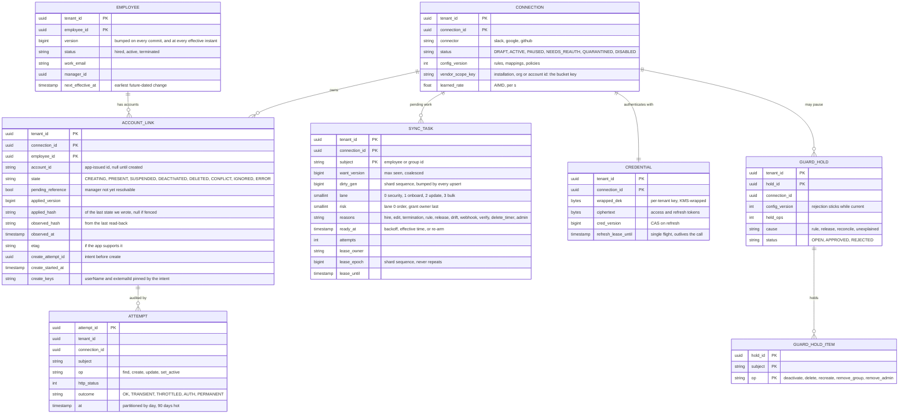

**Access patterns and why they fit.**
- **Mark dirty (the hot write).** `INSERT INTO sync_task ... ON CONFLICT (tenant_id, connection_id, subject) DO UPDATE SET want_version = GREATEST(old, new), dirty_gen = nextval(shard_seq), lane = LEAST(old, new), risk = LEAST(old, new), reasons = old ∪ new, ready_at = CASE WHEN new lane < old lane THEN now() WHEN old attempts = 0 THEN LEAST(old, new) ELSE old ready_at END`. One row per key, however many changes arrive. A higher-priority lane clears an older backoff, so a termination never waits behind a failing title update. Every upsert takes a new `dirty_gen`, so no dirtying can be lost to a run already in flight (§5.1). `reasons` labels why the row exists. The guard reads the current render, not `reasons` (§5.5).
- **Dispatch.** The dispatcher for a partition reads, per ready connection, `WHERE connection_id = $1 AND ready_at <= now() AND (lease_until IS NULL OR lease_until < now() OR (lane = 0 AND lease_until < now() + 40 s)) ORDER BY lane, risk, ready_at LIMIT k`. Partial index on `(connection_id, lane, risk, ready_at)`. A lease takes `lease_epoch = nextval(shard_seq)`.
- **Complete.** In one transaction: write the link, then `DELETE FROM sync_task WHERE pk = $1 AND lease_epoch = $mine AND dirty_gen = $leased`. Zero rows means a newer dirtying arrived during the lease (run again) or the lease was lost (fenced: §5.1).
- **Status.** The console reads `account_link` by `(tenant, employee)` or by `(connection, state = ERROR)`.
- **Partition key: `tenant_id`.** Every query is tenant-scoped, so Postgres row-level security can enforce it as well. A task and its link live on the same shard, so completion is one local transaction. The largest tenants are pinned to their own shard. The provisioning store is a **separate cluster** from the identity store, so a provisioning bug or backlog cannot slow the system of record.

Store choice: **Postgres**, 4 shards by `tenant_id` hash, each with two standbys and quorum commit (`synchronous_standby_names = 'ANY 1 (s1, s2)'`) [estimate]. With a single synchronous standby, losing that standby stalls every commit on the primary. The task table needs upsert-with-merge, conditional delete and partial indexes, which a SQL store gives for free. Peak is ~5,000 to 6,000 row writes/s across the shards (upserts, leases, link plus delete, attempt rows), ~1,500/s per shard, about a fifth of what one primary sustains [estimate]. Sharding is for blast radius and the 10x case, not for today's load.

---

## 4. High-level design

One diagram, grown one functional requirement at a time. Each step ends with what is still missing.

### 4.1 Connect an app: consent, config, a dry-run plan, then enable

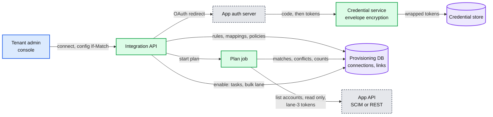

**Flow.**
1. The admin picks Slack. `POST /v1/connections` creates a `DRAFT` connection and returns the app's OAuth consent URL with the narrowest scopes the manifest needs.
2. The app redirects back with a code. The credential service exchanges it, wraps the tokens with the tenant's data key, and stores them. Workers never see a refresh token (§5.6).
3. The admin sets access rules ("department in Engineering, Product; employment type not contractor"), mappings (`userName = work_email`, `title = job_title`, `manager = manager.work_email`) and policies (drift: enforce managed attributes; unmanaged accounts: report).
4. **Plan.** A job reads every account in the app (Slack, 2 pages of 1,000 [estimate]) with lane-3 tokens from the dispatcher (§4.2), so a preview on a live connection never spends quota a termination needs. It also reads every employee of the tenant. It evaluates the rules and matches app accounts to employees: by `externalId` if the app has one we set, else by normalized work email. It writes nothing to the app.
5. The admin sees the plan: "link 1,840 existing accounts by email, create 160, update titles on 412, 3 conflicts (two accounts claim `ana@`), 37 unmanaged accounts left alone, **0 deactivations**". A first connect never deactivates. It reports.
6. **Enable.** If the config version is still the one the plan used, the API writes one `account_link` per matched account (`PRESENT`, with the app's id), and one sync task per in-scope employee in the **bulk lane**. Conflicts stay `CONFLICT` until the admin resolves them.

The plan is a **preview, not a script**. Tasks recompute the desired state when they run (§4.2), so a hire between plan and enable is still handled. The plan's job is to show the blast radius to a human before anything is written.

**Engine choice.** Plan, approve, enable is a multi-step flow that waits on a human for hours. That is durable execution, and Rippling already runs Temporal for async jobs ([research §8](research/facts-survey.md)). So this flow, like the termination DAG in #46, is a Temporal workflow. The per-account sync below is not (§10.7).

**Still missing:** what happens on the next HR edit, and how anything is written to the app.

### 4.2 Provision on every change: mark dirty, coalesce, render, diff, apply

```mermaid
%% Step 2: the change path. The identity store emits thin events; the planner only marks rows dirty; the dispatcher spends quota.
flowchart LR
    HR[HR admin, HR API,<br/>effective-date timer] -->|"edit"| ID[Identity service]
    ID -->|"row + outbox, 1 txn"| IDB[(Identity DB<br/>versioned)]
    IDB -->|"outbox relay"| K[[Kafka<br/>employee-changes]]
    K -->|"tenant, employee, version"| PL[Planner<br/>rules, scope]
    PL -->|"upsert, coalesce"| TS[(Task store<br/>one row per key)]
    TS -->|"ready rows"| DSP[Dispatcher<br/>buckets, lanes, breakers]
    DSP -->|"leased task"| WK[Sync workers<br/>render, diff]
    WK -->|"read current version"| IDB
    WK -->|"access token"| CRED[Credential service]
    WK -->|"create, patch, deactivate"| APP[App API]
    WK -->|"link, attempt, complete"| TS

    class HR client
    class ID,PL,WK,CRED service
    class IDB,TS store
    class K queue
    class DSP critical
    class APP external

    classDef client   fill:#dbeafe,stroke:#2563eb,stroke-width:2px,color:#111
    classDef service  fill:#dcfce7,stroke:#16a34a,stroke-width:2px,color:#111
    classDef store    fill:#ede9fe,stroke:#7c3aed,stroke-width:2px,color:#111
    classDef queue    fill:#cffafe,stroke:#0891b2,stroke-width:2px,color:#111
    classDef critical fill:#fee2e2,stroke:#dc2626,stroke-width:4px,color:#111
    classDef external fill:#e5e7eb,stroke:#6b7280,stroke-width:2px,color:#111,stroke-dasharray:4 3
```

**Flow: Ana's title changes from "Engineer" to "Senior Engineer".**
1. The identity service commits the new title, bumps Ana to `version 42`, and writes an outbox row in the **same transaction**. A relay publishes `{tenant, employee: ana, version: 42, changed: [title]}` to Kafka, keyed by `(tenant_id, employee_id)`, so one tenant's 50,000-row import spreads over all 64 partitions instead of queueing other tenants' terminations behind it. The event is thin: ids, a version and field names, no values.
2. The **planner** loads the tenant's compiled rules (cached by config version) and Ana's links. For each connection it asks two questions: is Ana in scope (now, or before), and does this connection map a field that changed? Slack and Google map `title`, GitHub does not. It upserts two tasks: `(slack, ana, want 42, lane 2)` and `(google, ana, want 42, lane 2)`. If a task for `(slack, ana)` is already waiting, the upsert only raises `want_version` and takes a new `dirty_gen`. **Ten edits before dispatch cost one call.**
3. The **dispatcher** owning Slack's partition sees the ready row, checks the connection's token bucket, concurrency cap and breaker, and **leases** the row (`lease_owner`, a new `lease_epoch` from the shard's sequence, `lease_until` = now + 60 s).
4. The **worker** reads Ana's current record. If a replica returns a version below 42, it reads the primary. It renders the desired Slack account from the mapping: `{userName: ana@acme.com, title: "Senior Engineer", active: true, groups: [eng, eng-backend]}`, and hashes it.
5. It compares the hash with `account_link.applied_hash`. Equal means nothing to do: complete, no call. Here only `title` differs, so it renews its lease (§5.1) and sends `PATCH /Users/{id}` with one `replace` operation, and `If-Match` with the stored ETag if Slack supports ETags. A task whose `reasons` include `drift`, `webhook` or `verify` is different: nothing changed on our side, so comparing with `applied_hash` would find nothing to do. Those tasks `GET` the account first and diff against what the app returned.
6. On `200`, in **one transaction**, it writes `applied_hash`, `applied_version = 42` and the new ETag, and **completes** the task with the fenced delete. The attempt row goes to the log. If anything dirtied the row during the call (Ana changed again, a rule changed), `dirty_gen` has moved, the delete matches zero rows, and the task runs again at once.

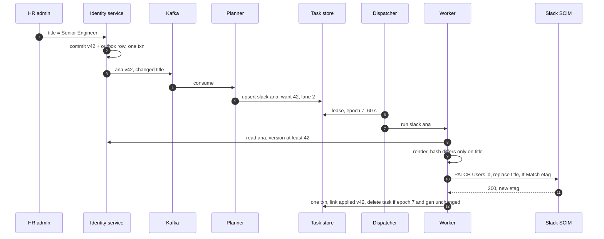

**Why the task carries no payload.** The worker always applies the **latest** state, so the order in which events arrived, retries of old events and duplicate events stop mattering. This is the Kubernetes controller pattern: "Each controller tries to move the current cluster state closer to the desired state" ([research §4e](research/facts-survey.md)). Its work queue makes the same two promises our task table does: an item added several times before it is processed "will only be processed once", and "a single item will not be processed multiple times concurrently".

**Hires and terminations use the same path.** A hire makes `desired.exists = true`, so the worker creates the account (the careful path in §5.2). A termination makes `desired.exists = false` for every connection, in **lane 0**, and the worker sets `active = false` (SCIM's deactivate). Deletion is a separate timer task after the tenant's retention period (30 days by default, Entra uses 30 too). If the link is still `CREATING` when the termination arrives, the worker first runs the same find-and-wait as a retried create (§5.2), so a create that landed late is found and deactivated. Future-dated changes (a start date, a termination at 17:00 local) are stored with the employee. At each effective instant the identity service **commits a new version**, so a scheduled change moves `want_version` like any edit and cannot be swallowed by a run already in flight (§5.1). A link the admin marked `IGNORED` stops getting updates, but is still deprovisioned.

**Still missing:** anything changed directly in the app, and any account we never knew about. Also, what keeps all this inside each app's quota (§5.3).

### 4.3 Reconcile: read the app back, correct or report

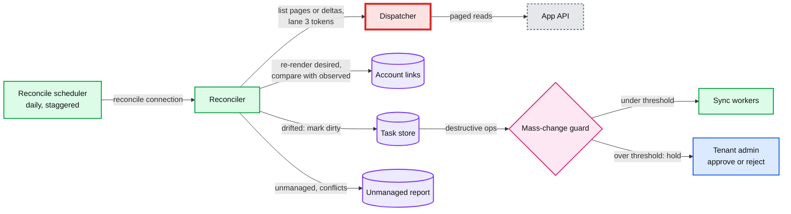

**Flow.**
1. Each connection is reconciled once a day at a time fixed by `hash(connection_id)`, so 750k reconciles spread evenly over 24 h. Apps with a change feed (Microsoft Graph delta query) are also read incrementally every 15 min [estimate].
2. The reconciler pages through the app's accounts with lane-3 tokens. It never spends more than ~10% of **any** bucket on its path [estimate], including app-wide ones such as Jira's, and pauses if higher lanes need the tokens.
3. For each account it finds the link by the app's id, hashes the **managed** attributes it observed, and **re-renders** what that account should look like now. Comparing with the desired state, not with what we last applied, also catches a task that gave up after 72 h and a change that never produced an employee event. Three outcomes:
   - **Drifted** (observed differs from desired on a managed attribute): if the policy is `enforce`, mark the task dirty with reason `drift`, in lane 3, or in **lane 0** when the render says the employee is terminated (an account re-enabled behind our back). The worker re-reads the account and overwrites the drifted attributes. If `report`, record it.
   - **Unmanaged** (no link): if its `externalId` is one of this tenant's employee ids, it is ours by construction (a create that landed after a crash), so re-link it. Otherwise try to match it to an employee and report it as "link?" or "not in Rippling, deactivate?". Never act on it automatically.
   - **Missing** (we have a link, the list does not have the account): a hint, not evidence. §5.5 explains why a list must pass four checks, and each missing account a `GET` by id, before anything acts on it.
4. The run's destructive operations and re-creates are registered with the **mass-change guard** as one batch before any is enqueued (§5.5).

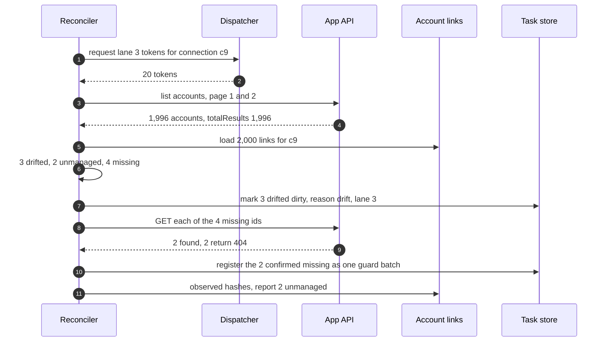

**Still missing:** how partners learn about changes, and what the apps tell us on their own.

### 4.4 Events out and in

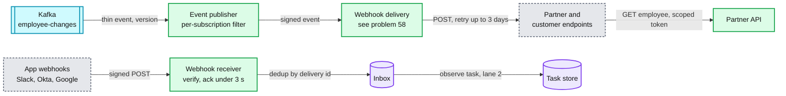

**Out.**
1. The event publisher consumes the same `employee-changes` topic. For each change it finds the subscriptions in that tenant that want the event type and are allowed to see the changed fields. It emits `{id: evt_..., type: employee.updated, employee_id, version: 42, changed_fields: [title]}`.
2. The webhook delivery service (#58) owns per-endpoint queues, retries with backoff for up to 3 days, signatures, and SSRF-safe egress. The headers follow Standard Webhooks: `webhook-id`, `webhook-timestamp`, `webhook-signature`, with an HMAC over `id.timestamp.body` ([research §7a](research/facts-survey.md)).
3. The partner reads current fields with `GET /v1/employees/{id}`, under its OAuth scopes. Events are at least once and unordered. The `version` lets a receiver drop an older event that arrives late.

**In.**
1. Some apps push changes: Slack's Events API wants a `2xx` "within three seconds" and retries up to 3 times. Okta event hooks are "at least once" with a 3 s timeout and "at most one retry". Google Directory push channels have to be renewed by us ([research §3](research/facts-survey.md)).
2. The receiver checks the app's signature, writes the delivery to an inbox keyed by the app's delivery id (duplicates are dropped there), and acks.
3. It maps the delivery to a connection (Slack team id, Okta org, Google channel id) and marks an **observe** task dirty: "re-read this account and reconcile it". The payload is never applied as truth. A lost webhook only means the daily reconcile finds the change instead.

**Still missing:** what the admin sees, and how they act on errors.

### 4.5 Show and control

1. Workers write every outcome to the link (`state`, `applied_version`, `last_error_class`, `last_error_text`) and an attempt row. The console reads links by employee ("Ana: Slack in sync 14:02, Google in sync 14:02, Zoom: error, no licences left on your Zoom plan").
2. Errors are shown in plain words from the connector's error map, with the raw vendor code underneath for support.
3. Actions write straight to the task store, so the admin reads their own write. **Retry** resets `attempts` and `ready_at`. **Skip** marks the link `IGNORED` for that employee: updates stop, deprovisioning still runs. **Re-authorize** runs the OAuth flow. Tasks parked under `NEEDS_REAUTH` then resume in their lanes. **Approve** or **reject** releases or cancels a guard hold.
4. Every external call is an attempt row: who (connection, subject), what operation, HTTP status, latency, error class, and which version it applied. No attribute values are stored, only field names and hashes. That is the audit trail and the support tool.

**Still missing, and the subject of §5:** the quota, the crash after a create, retry storms, drift that lies, tenant isolation for 750k credentials, and the partner event contract.

---

## 5. Deep dives

Each one is the question an interviewer asks, what breaks in the §4 design, the fix, and what changed.

### 5.1 "Ana's title changes three times in a minute, and a retry of the first change arrives last. What ends up in Slack, and how many calls did it cost?"

**The ladder.**

| Rung | Approach | Why it breaks, in numbers |
|---|---|---|
| Bad | One call per event, in arrival order. Failed events are retried later | Three edits are three calls. The retried first edit lands last, so Slack shows the **oldest** title. In a backlog, most of the quota goes on states that are already stale |
| Good | Per-key order: Kafka partitioned by employee, the consumer applies events in order and blocks the key on failure | Order holds. But one call per event remains, and a blocked key blocks its whole partition: one tenant's slow Slack stalls every employee hashed there, in every app. Rebuilding after a bug means replaying history at full call cost |
| **Great** | A payload-free dirty row per `(connection, subject)`. The worker renders the **latest** version, diffs against the freshest known state of the account, and completes with a fenced delete | Order no longer matters. k edits cost one call, or two if one lands mid-call. A failing app only delays its own rows |

**Why it holds.**
- **Monotonic `want_version`.** The upsert keeps `GREATEST(old, new)`, so a late duplicate of version 40 cannot lower a row that wants 42. The worker refuses to render from a record older than `want_version`: a lagging replica sends it to the primary.
- **Nothing dirties a row without bumping it.** Every upsert, whatever its cause (an edit, a rule change, a webhook, an admin's retry, drift), takes a fresh `dirty_gen` from a shard-wide sequence. Completion deletes the row only if `dirty_gen` is still the one the worker leased. A rule edit that lands mid-run therefore makes the row run again, even though `want_version` did not move. Without it, the in-flight run's delete would swallow the rule change (simulated in the deep dive).
- **The diff is against the freshest known state.** For an ordinary edit, that is `applied_hash`, the hash of the last state we wrote. A replayed or duplicated event renders the same state and costs no call. A task whose `reasons` include `drift`, `webhook` or `verify` means the app may have changed under us, so `applied_hash` proves nothing. Those tasks `GET` the account first and diff against what came back.
- **A daily sweep with no API calls.** Every link is re-rendered once a day and compared with `applied_hash` (~1,160 renders/s spread over the day [estimate]). Renders are batched per employee, one read for all of an employee's ~10 links, so the identity replicas see ~116 reads/s. A row lost to any bug we have not thought of is re-dirtied within 24 h, at zero vendor quota.
- **Coalescing is free when idle and saves the most when backlogged.** With an idle queue, an edit is applied in ~1 s, so edits 6 s apart each get a call. When a connection is quota-bound (a 10,000-person HR import that fixes a typo 5 minutes later), most employees cost one call instead of two: 10,894 calls instead of 20,000 in the deep dive's simulation. Lane 2 also waits 2 s before dispatch [estimate] to absorb a form that saves fields one at a time. Lane 0 never waits.
- **References to other people.** `manager` in Google or Okta is the manager's account in that app, resolved through the manager's link. A new hire is created **without** the manager reference and patched once the manager's account exists, which costs one extra call and never delays the create. A manager who is not in scope for that app is simply left empty. For an existing account whose manager is still being created, the task re-queues after 30 s, up to 10 times, then writes everything else and marks the link `pending_reference`.

**The zombie worker.** A worker leases `(slack, ana)`, renders version 42 (active, old title), then stalls in a GC pause or a network hang past its 60 s lease. Ana is terminated. Once the stalled lease's heartbeat is 20 s old, the lane-0 upsert takes it over: a second worker leases the row, deactivates her, and completes. The first worker wakes and sends its old write. If that write is a full `PUT` with `active: true`, **it reactivates a terminated employee.** Four defences, cheapest first:
1. **Attribute updates never carry `active`** on apps that take `PATCH`. `active` is only sent by lifecycle operations (`set_active`), so a stale `PATCH` of `title` cannot undo a deactivation. `PATCH` is optional in SCIM. On a `PUT`-only app the full body carries `active`, so the worker sets it from the employee's status re-read at call time, and defences 2 to 4 carry the rest.
2. **Conditional renew before every call.** Right before each external call the worker renews its lease with `UPDATE ... SET lease_until = now() + 60 s WHERE pk AND lease_epoch = mine AND lease_until > now() + 30 s`. Zero rows means the lease is gone or nearly gone: do not call. This does not shrink the window to zero, because a pause can still land between the renew and the send. In the [edge-case simulation](edge-cases.md) it cut unsafe sends from ~250 a day with no check to ~11.
3. **`If-Match` where the app has ETags.** SCIM ETags are optional ("Service providers MAY support weak ETags"), but where present a stale write gets `412`, "Failed to update. Resource has changed on the server" (RFC 7644 §3.12). The worker then re-reads and re-diffs.
4. **Verify after every deprovision.** Each lane-0 deactivation writes an observe task for +5 min **before** it makes the call, so even a crash right after the call leaves the check scheduled. The verify task has its **own key** (subject `verify:<employee_id>`). Written on the deactivation's own row, it would bump `dirty_gen`, fence the deactivation's completion, and the `LEAST` rule would make it due at once instead of at +5 min. The observe task reads the account back. A zombie write that slips through every gate is undone within ~5 min and alerts.

The epoch itself must never repeat. Completion deletes the row, so a per-row counter would restart at 0 and a zombie could match a later lease of the same key. `lease_epoch` therefore comes from a shard-wide sequence. A worker whose completion is fenced out (zero rows deleted) does not write `applied_hash`. It sets `applied_hash = NULL` on the link, so the next run cannot skip the call, and marks an observe task. The link write and the task delete commit in **one** transaction: both tables live on the tenant's shard.

**Effective dating.** The desired state is a function of time, and time comes from the database clock, never a worker's. At every effective instant (a start date, a termination at 17:00 local) the identity service **commits a new version** of the employee, so a scheduled change moves `want_version` exactly like an edit. A timer that only re-emitted the old version would be swallowed by an in-flight run's delete. A per-connection `provision_lead` (default 0, often 1 to 7 days for laptops and email) creates accounts before the start date. A render that is not due yet returns the next instant its output changes, and the worker re-arms `ready_at` to it. When `attempts = 0`, a same-lane upsert takes `ready_at = LEAST(old, new)`, so a start date moved earlier is not missed. Where the app supports it (Google `suspended: true` on insert), the account is created suspended and activated on the start date.

**What changed:** `want_version`, `dirty_gen`, `lease_epoch` from a sequence and the fenced delete in `SYNC_TASK`. `applied_hash`, `observed_hash` and `etag` in `ACCOUNT_LINK`. The manifest's `patch` and `etag` capabilities. Versions committed at effective instants. A verify task before every deactivation. The daily render-only sweep. [`deep-dives/desired-state-sync-and-ordering.md`](deep-dives/desired-state-sync-and-ordering.md).

### 5.2 "The worker crashed after `POST /Users` returned 201 but before we saved the id. What stops a second account?"

**The ladder.**

| Rung | Approach | Why it breaks |
|---|---|---|
| Bad | Retry the `POST` | SCIM has no idempotency key. The second `POST` is a second account, or a `409` we do not understand |
| Good | Search before **every** create (`filter=userName eq "ana@acme.com"`) | One extra call per create. And search can lag the write: Google warns that "A mutate call right after creation may fail with a propagation-related error", so a retry seconds later can miss the first account |
| **Great** | Write an intent that pins the keys, create with a natural unique key, search only on retry, and treat `409` as "go and adopt it" | One call on the happy path. The app's own unique constraint is the last line of dedup |

**The Great rung, step by step.**
1. **Intent first.** Commit `account_link.state = CREATING`, `create_attempt_id = a1`, `create_started_at = now`, and `create_keys` (the `userName` and `externalId` this attempt will send, rendered from the attempt's version). Then call. A crash at any point leaves a row that says "a create may have happened, with these keys".
2. **Create with two keys.** `userName = work email`, which RFC 7643 says "MUST be unique across the service provider's entire set of Users". And `externalId = employee_id`, which is "always issued by the provisioning client" and so is ours to choose.
3. **Happy path:** `201` with the app's `id`. Save it, `PRESENT`. One call.
4. **Retry when the row says `CREATING`: look first, with the pinned keys.** Find by `externalId` if the manifest says the app can filter on it, else by the pinned `userName`. Searching by the *current* email would miss the first account if HR fixed a typo between the crash and the retry, and the deep dive measured 49% duplicates that way. Found: adopt it, then rename it if the current keys differ. Not found and the last `POST` (`create_started_at`, reset on every attempt) is younger than the manifest's `search_settle` (60 s on apps that enforce a unique `userName`, 15 min [estimate] on apps that do not): wait, because search may lag. Then create again. If the first create did land, the app's uniqueness check returns `409` ("MUST return HTTP status code 409 (Conflict) with a scimType error code of uniqueness"), and the worker goes back to find-and-adopt.
5. **The loop has a cap.** A `409` whose account no search can find (an account our scopes cannot see) would loop forever. After 6 rounds with doubling waits (~16 min) the link goes to `CONFLICT`. Reconcile adopts it later if the account becomes visible.
6. **Adopt rules,** for a `409` on a first create or a match on first connect. Adopt only if the account is not linked to another employee, and either its `externalId` is ours, or its `externalId` is empty **and** it is active **and** (where the app reports a creation time) it was created after the employee's offer date minus the lead. An inactive account, or one created long before this person was hired, may hold a former employee's data. It goes to `CONFLICT`.

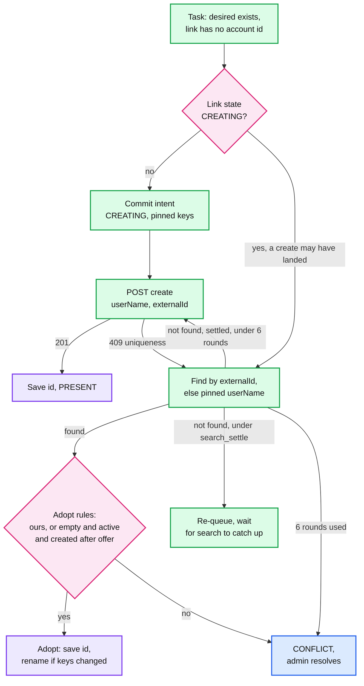

**A termination can race a create.** If Ana is terminated while her link is still `CREATING`, the termination runs the same find-and-wait first, then deactivates whatever it finds. Its +5 min verify task also searches by the pinned keys, not only by a link id that may still be empty. Otherwise a create that landed late would leave an active account nobody tracks (the deep dive measured 9,905 of 20,000 such accounts left live without find-and-wait, 9 with it). And the reconciler re-links any unmanaged account whose `externalId` is one of this tenant's employee ids: it is ours by construction.

**Matching on first connect** uses the same rules at scale. Keys in order: `externalId`, then `userName`, then primary email, normalized (lowercase, trimmed). Secondary emails and aliases only produce *suggestions* for the admin, never automatic links. Two accounts that both claim one employee go to the plan's conflict list.

**Rehires and reused emails.** These are where "match by email" leaks data.
- **Rehire** (the same `employee_id` comes back): the link is `DEACTIVATED` with the old account id. Reactivate that account if the app still has it. Create a new one only if it was deleted.
- **Reused email** (a *new* employee gets `john.smith@`, which a former employee had): the app still holds the former employee's deactivated account under that `userName`, with their files and messages. The adopt rules refuse it (linked to someone else, or inactive). It becomes `CONFLICT` ("rename the old account, then create"). The real fix is upstream: HR should not reuse an email inside the apps' retention window.
- **Name change** (Ana Lopez becomes Ana Ruiz): `userName` changes on the **existing** account, found by its id. It is never a delete plus a create.

**Creates are also the slowest operation against quota.** Google allows at most 10 user creates per domain per second. A GitHub installation has 5,000 requests an hour. So a 20,000-person first connect is minutes on Google and about 4 hours on GitHub (§5.3).

**What changed:** link states `CREATING` and `CONFLICT`, `create_attempt_id`, `create_started_at`, `create_keys`, manifest capabilities `filter_external_id`, `unique_key` and `search_settle`, the loop cap, the plan's conflict list, find-and-wait on the termination path. [`deep-dives/idempotent-creates-and-account-matching.md`](deep-dives/idempotent-creates-and-account-matching.md).

### 5.3 "This GitHub installation allows 5,000 requests an hour. The tenant just connected 20,000 people. Someone is fired now. How long until their access is gone?"

This is the red node. Every bulk scenario's latency is decided here, and a wrong decision here gets our OAuth client throttled for every tenant at once.

**The arithmetic.** 5,000 an hour is ~1.4 calls/s. 20,000 creates take ~4 hours. With one FIFO queue per connection, the termination waits behind up to 4 hours of creates.

**Six mechanisms, together.**
1. **Buckets keyed by the vendor's scope.** A call takes one token from **every** bucket on its path. The buckets and their keys come from the manifest, and the scopes are the vendor's, not ours:
   - **App-wide:** Jira's hourly quota shared by our app across all tenants, Microsoft Graph's per-app-across-tenants limit.
   - **Per vendor account:** Google's 2,400 queries a minute per user per project, GitHub's 5,000 an hour per installation. The key is the vendor's id (installation id, Slack org id, Zoom account id, Google project plus admin user), **not** our connection id. Two of our connections on one Slack org, or one managed-service admin across several tenants, share one bucket because they share one vendor quota.
   - **Method or endpoint:** Slack SCIM allows ~180 writes and ~300 reads a minute on the Users endpoints, inside an org-wide 600 writes and 1,000 reads a minute.
   - **Shared with strangers:** Slack's SCIM limits "apply to all SCIM apps in an org, not on a per-app basis", and Zoom's apply to the whole account, "shared by users for all apps installed on the account". Another vendor's provisioning job spends tokens we think we have.
2. **The bucket follows the vendor's window.** GitHub, Jira and Zoom count in fixed windows (an hour, a day). There the dispatcher tracks the vendor's own window from the headers (`remaining`, `reset`) and paces at `remaining / time to reset`. A refilling bucket that started full would let a bulk job spend GitHub's whole hour in 12 minutes, after which every call, terminations included, is refused until the reset (simulated: terminations waited up to 44 min). Per-minute limits (Google, Slack) use a refilling bucket.
3. **One owner per bucket.** Vendor scopes hash onto 64 dispatcher partitions, each leased by one engine process with a fenced partition epoch. Buckets live in that process's memory: exact, with no coordination. Only app-wide buckets need a shared store. They live in Redis, and dispatchers take tokens in small batches (~1 s worth) with a Lua script that is told the lane, so it can keep the reserve. A **missing key starts at 0**, never full: a Redis failover that reset Jira's pool to full could grant the whole 65,000-point hour at once, and Jira then refuses "All requests ... until the next hourly reset" for every tenant. If Redis is down, each partition takes a static 1/64 of the app-wide limit.
4. **Learned limits.** The manifest gives a starting rate. Headers refine it: GitHub's `x-ratelimit-remaining`, Okta's `X-Rate-Limit-Remaining` and `X-Rate-Limit-Reset`, Jira's `X-RateLimit-NearLimit`. A `429` pauses the bucket until `Retry-After` ("either an HTTP-date or a number of seconds", RFC 9110 §10.2.3) and halves the learned rate. Each clean minute adds 10% of the **manifest** rate, up to the manifest maximum. That is additive increase, multiplicative decrease (AIMD), which is what converges to a fair share against a stranger's app on a shared quota. Adding 10% of the *current* rate would be multiplicative and would not.
5. **Strict lanes with a reserve.** Lane 0 security (deactivate, remove an admin role), lane 1 onboarding, lane 2 updates, lane 3 bulk (connect, rule change, reconcile). The dispatcher always takes the lowest lane first, then `risk`, then `ready_at`. Lanes 1 to 3 may only spend while the bucket is above **20% of its quota**. On a fixed window, the reserve is released down to 50 tokens in the last 5 minutes before the reset, so it is almost never wasted. Lane 3 gets at least 10% of granted tokens when it has work, taken from lanes 1 and 2, never from lane 0. App-wide buckets keep the same reserve, and one tenant may take at most 10% of an app-wide pool [estimate]. Within lane 0, `risk` puts admins and people with production access first, but the employee who **owns a connection's OAuth grant goes last** on that connection: deactivating them first can revoke the grant and park the rest of a layoff under `NEEDS_REAUTH`. The pre-flight check flags it, and grants not tied to a person (a GitHub App installation, a Google service account) avoid it.
6. **Fair share of worker slots.** Quota is per vendor scope, but worker slots are shared by everyone. The dispatcher hands out slots by deficit round robin over connections with ready work. Each connection's in-flight cap is adaptive, `ceil(learned_rate x mean latency)`, minimum 2, starting at 4, **plus one spare slot only lane 0 may use**, so four hung bulk calls cannot hold a termination for 30 s. (Little's law: Google's 40/s at ~0.6 s needs ~25 in flight.) Each app is capped at 25% of fleet slots, each tenant at 2% [estimate], and 5% of fleet slots are kept for lane 0. Generic SCIM connections are capped per target host, because 500 different customers' SCIM servers are not one app.

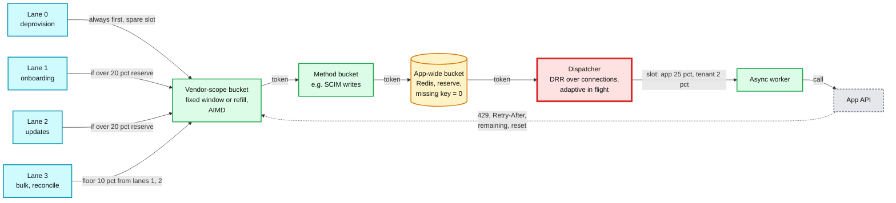

**The answer to the probe.** The termination arrives in lane 0. A lane-0 upsert also sends a nudge, so the dispatcher sees it within ~200 ms instead of on its next poll. If a bulk call on the same account is in flight, it waits for at most that one call (a lease whose heartbeat is older than 20 s is taken over). The reserve means ~1,000 of the hour's tokens are held back, and the spare slot means no bulk call is in its way. The deactivation is applied in about a second. The import still finishes in about 4 hours, because the reserve is released in the last 5 minutes of each window. What each piece buys, from the simulations: strict lanes **without pacing** let the import spend the hour early, and a termination then waits for the reset (a median of 19 min, up to 44 min). Pacing at `remaining / time to reset` fixes a single termination on its own (~1 s). The reserve is what buys **burst** headroom: 300 terminations at once finish in under 59 s with it, 220 s without.

**A 5,000-person layoff on the same installation** is 5,000 lane-0 calls at 1.4/s: up to an hour. The deep dive's simulation took 34 min, because lane 0 spends what is left of the current window and then a fresh one at the reset. No scheduler beats a vendor's quota. What is done instead:
- SSO is cut first, internally, in milliseconds (#46 §4.5). The hour covers existing sessions and tokens only.
- Lane 0 is ordered by `risk`: admins, then people with production access. The grant owner goes last.
- Batching where the app has it: Microsoft Graph takes 20 requests per `$batch`, Google 1,000 calls per batch request, SCIM Bulk is optional. **Batching saves round trips, not quota**: Graph evaluates "Requests in a batch ... individually against the applicable throttling limits".
- For a planned layoff, ask the vendor to raise the limit beforehand. GitHub's installation limit also grows with repositories, up to 12,500 an hour.

**Push back on the textbook answer.** "Put a distributed rate limiter in Redis in front of every call." At 1,500 calls/s Redis is fine, so load is not the objection. The objection is that it solves the wrong problem. A shared counter answers "how many calls so far". This problem needs "**which** waiting call gets the next token": lane, reserve, risk, fairness, and the vendor's window shape. That decision needs one owner per bucket holding the queue and the bucket together. Only the app-wide quotas need a shared counter.

**What changed:** dispatcher partitions with fenced leases, buckets keyed by vendor scope and shaped like the vendor's window, app-wide buckets in Redis that start at 0, lanes with a reserve and a spare slot, `SYNC_TASK.risk`, per-app, per-tenant and per-host slot caps, a nudge for lane 0. [`deep-dives/rate-limits-priority-and-fairness.md`](deep-dives/rate-limits-priority-and-fairness.md).

### 5.4 "Google is down for 2 hours. What happens when it comes back? And one tenant revoked our grant. What happens to the other 20,000 Google tenants?"

**Classify first.** Every response goes through the connector's `classify`. The class decides what is retried, what counts toward a breaker, and who is told.

| Class | Examples | What happens | Counts toward a breaker? |
|---|---|---|---|
| `TRANSIENT` | 5xx, timeout, connection reset | Backoff with full jitter: base 30 s, x2, cap 1 h. Give up after 72 h and show it. The daily re-render picks it up again | Yes |
| `THROTTLED` | 429, GitHub 403 with `x-ratelimit-remaining: 0` | Pause the **bucket** until `Retry-After`, halve the learned rate. The task's attempt count does not move | No, it feeds the bucket |
| `AUTH` | 401, `invalid_grant` | One refresh. Still failing: connection `NEEDS_REAUTH`, tasks parked, admin told | No, auth is per connection |
| `PERMANENT` | 400 validation, no licences left, unverified domain | Link `ERROR` with the vendor's reason in plain words. No retry until the input changes or an admin clicks retry | No |
| `NOT_FOUND` | 404 on update | Someone deleted the account in the app. Drift: re-create if still in scope, through the guard | No |
| `CONFLICT` | 409 | §5.2 | No |
| `STALE` | 412 | Re-read, re-diff, retry at once. Three in a row become `TRANSIENT` [estimate] | No |

**The retry storm, in numbers.** Google is ~10 change tasks/s of our daytime traffic [estimate]. Over a 2-hour outage that is `10 x 7,200 ≈ 72k` failing tasks. With naive per-task retries every 30 s, by the end of the outage we send `72k / 30 ≈ 2,400` calls/s at Google: **240 times** normal, aimed at a service that is trying to come back. Then every timer fires again on recovery.

**Breakers, scoped to the failure.**
- **App breaker, on the app-wide error rate.** It opens when at least 50% of at least 200 calls to the app in 2 min are `TRANSIENT` [estimate]. Each dispatcher partition publishes its per-app call and `TRANSIENT` counts to Redis every 10 s, and every dispatcher reads the pooled counts. If Redis is down, each partition judges its own counts with a 20-call minimum. An app with fewer than ~100 calls a minute never reaches 200. Connection breakers and per-task backoff protect it, which is enough because its storm is small too. Counting *connections* with open breakers does not work: the average connection makes ~13 calls a day, ~0.04 in 2 minutes, so almost none ever reaches a per-connection minimum. In the deep dive's simulation, a rule of "30% of connections open" never fired during a 2-hour outage. While the app breaker is open, only 5 canary connections probe, with a cool-down capped at 60 s so recovery is noticed within a minute. Tasks do not use up attempts while it is open (it is not their fault). The status page says "Google provisioning delayed", and the connector on-call is paged.
- **Connection breaker,** for failures that belong to one tenant (a customer's own SCIM server is down). It opens when a connection's last 3 calls were all `TRANSIENT`, or at least half of at least 20 calls in 2 min. Cool-down 30 s, doubling to 15 min. Half-open sends one probe (a cheap `GET` of a known account).
- **On close, nobody waits for their own timer.** The app's rows in transient backoff get `ready_at = now`. Lane 0 goes first, skipping the ramp and the stagger but not the 10x ceiling: sending ~300 terminations with no cap at a vendor that is just coming back makes half of them fail and retry (simulated). Lanes 1 to 3 ramp: the aggregate ceiling starts at 2 times normal and doubles every 2 min up to 10 times normal (~100/s for Google), and connections re-open spread by `hash(connection_id)` over 10 min.
- **Auth-anomaly detector.** If more than `max(2% of the app's connections, 10)` enter `NEEDS_REAUTH` within 10 min, it is not that many admins revoking us at once. It is us (a rotated client secret) or the vendor (our app suspended). Page, and **hold the "please re-authorize" emails** for an hour, so a bug of ours does not ask 20,000 admins to click a button. When it is fixed, every connection that entered `NEEDS_REAUTH` during the anomaly gets one automatic refresh, staggered.
- **Suspect egress.** If more than 3 apps' breakers open within 2 min, the common cause is on our side, usually the egress proxy. Page the platform team, not 3 connector teams.
- **Quarantine,** for a connection failing for a day: probe at 6 h, 12 h and 24 h, then daily, and disable after 28 days with notice. That schedule is Entra's, and Entra also escrows a job when "more than 40% of provisioning events fail, or there are more than 40,000 failures" ([research §4a](research/facts-survey.md)).
- **Retry budget.** Per connection, retries may be at most `max(2, 20% of first attempts)` in any minute. Above that, retries wait for the next window. The floor of 2 matters: 20% of a quiet connection's first attempts is 0.

**Draining the backlog.** Independent edits barely coalesce over 2 hours, so ~70k rows remain. Lane 0 goes first: a few hundred terminations (~300 [estimate]), applied in the first minute after the breaker closes. The rest drains under the ramp (2x to 10x normal) while new work keeps arriving at ~10/s: about 17 minutes [estimate]. Per tenant the backlog is a handful of rows, so no single tenant's quota is the limit. The ceiling exists so our recovery is not Google's next incident.

**The revoked grant.** Tenant T's admin removes our app in Google. T's next call gets `401`. The worker asks the credential service for a refresh, which returns `invalid_grant`. T's connection becomes `NEEDS_REAUTH`, and its tasks are parked, not dropped. The admin gets one email and a banner. `AUTH` never counts toward the app breaker, so the other 20,000 Google connections never notice. When the admin re-authorizes, parked tasks resume in lane order and a reconcile runs.

**Scheduled terminations get a pre-flight check.** The worst moment to discover a revoked grant is during a termination. One hour before any scheduled termination, every connection the employee has is checked: credential valid, breakers closed, grant owner not the person leaving. A second check at T minus 5 min covers people who are admins in an app, in case they revoke our grant on the way out. Anything failing pages the tenant's admin then, not afterwards. The termination's evidence (#46 §5.7) lists "GitHub: blocked, needs re-auth" instead of "complete".

**What changed:** `classify` in the connector interface, an app breaker on the app-wide error rate, connection breakers for one tenant's failures, `ready_at = now` on close, the auth-anomaly detector with automatic recovery, the egress suspicion rule, `QUARANTINED`, retry budgets with a floor, two pre-flight checks. [`deep-dives/failures-retries-and-circuit-breakers.md`](deep-dives/failures-retries-and-circuit-breakers.md).

### 5.5 "The nightly reconcile reads an empty user list from an app. What stops you from deactivating 3,000 people, or re-creating them?"

**What breaks.** Read naively, "every link is missing from the list" means either "everyone was deleted in the app, re-create them" (3,000 duplicate creates, or 3,000 `409`s) or "mark them gone". Lists lie in ordinary ways: a pagination bug that stops at page 2, an admin who narrowed our app's scope to one org unit (which returns `200`, zero rows and `totalResults: 0`), a permission change, an eventually consistent index. Mass destructive operations have other sources too: an access-rule typo, a connector bug that inverts `active`, a mapping change that rewrites every `userName`, a connector release that renders differently.

**Rules, in the order they fire.**
1. **A list is trusted only if it is complete.** Every page fetched without error, **and** the final count equals the app's `totalResults`, **and** it is within 10% of the last complete count (adjusted for our own creates and deletes since), **and** the whole read used one credential grant (refreshes are fine). An honest empty list after a scope change matches `totalResults`, so the first check alone would trust it. If the list is not trusted, the reconciler `GET`s a sample of 20 missing accounts. If they exist, the list lied: tell the admin ("our app can no longer see your users") and conclude nothing. If they return `404`, the drop is real, and it goes through the guard as one batch. When the sample confirms the list, or nothing is missing and the count only grew, the run is accepted and becomes the new baseline. Otherwise one legitimate step change (an admin adding 500 accounts by hand) would switch off missing-account detection for good. Some apps (GitHub among them) answer `404` for what a token can no longer see, so when the sample is all `404` and `totalResults` fell by more than 50%, the hold is labelled "likely scope or permission change" rather than "3,000 deleted".
2. **Absence is a hint. A `404` is evidence.** Each account missing from a trusted list gets a direct `GET` by id. Only a `404` marks it missing. Normally this is a handful of calls a day.
3. **What the guard counts.** Deactivations, deletes, re-creates, admin-role removals, and net group removals (the employee ends with fewer managed groups in that app), for employees the identity record does **not** show as terminated at render time, and not covered by a pre-approval. A reorg that moves people from one group to another is not a net removal.
4. **Terminations are never held.** An operation on an employee the identity record shows as terminated is explained, whatever its `reasons` say. When an app admin re-enables 80 fired people, the reconcile's re-deactivations (reasons `drift`) run at once. `reasons` only labels a hold's cause. Mass terminations are controlled upstream instead: the identity service requires a second HR approver for any change that terminates more than `max(3, 5%)` of a tenant in an hour, on every path (UI, CSV, API), and stamps the approval as a `bulk_action_id`. A bad CSV never becomes a termination. If provisioning ever sees more new terminations than that without a `bulk_action_id`, it pages the identity team. It alerts. It does not hold a security action.
5. **Batch admission.** Anything that produces many counted operations at once registers the whole batch with the guard **before** enqueuing: a rule edit, a reconcile run, a bulk import, a connector release. Above the hourly threshold the whole batch is held and none of it runs, unless the admin approved that count in the preview (actual at most previewed + 10%). A streaming count would let the first 60 through before noticing.
6. **Thresholds** per connection [estimate]: more than `max(3, 2% of managed accounts)` counted operations in a rolling hour, or more than `max(10, 5%)` in a rolling 24 h. The hourly limit catches bursts. The daily one catches a drip: 59 an hour would remove 47% of a 3,000-person tenant in a day under an hourly-only rule. A 10-person tenant is held at its 4th operation, not after losing everyone. Entra ships the same contract: "Anything above the threshold that you set requires an admin to explicitly allow the processing of the deletions", "evaluated each cycle" ([research §4a](research/facts-survey.md)).
7. **The admin decides, and rejection sticks.** A hold shows the count, the cause and samples. It stores its `config_version` and its items (`GUARD_HOLD_ITEM`). A rejected operation on the same subject is refused while that config version is current, so tomorrow's reconcile does not reopen the same hold. The links show "held: rejected by admin".
8. **A fleet-wide anomaly means it is our bug.** Two detectors. (a) Holds opened by more than 20 **distinct tenants** within 10 min. Counting connections would fire whenever one tenant edits a group that is mapped into 15 apps. (b) Per connector, unexplained counted operations per hour across the fleet against that connector's baseline (page at 3x [estimate]), and canary vs control during a release. A connector bug that deactivates one wrong account per connection per hour opens no hold anywhere, and only (b) sees it. Either detector pages and freezes every guard-counted operation, in every lane, for the affected connectors. Terminations still run.
9. **Show the blast radius before writing.** A rule edit runs the §4.1 plan before it is saved ("this change removes 412 people from GitHub"), and the admin's confirmation is the pre-approval for that batch. A connector release renders a sample of links with old and new code. If more than 1% of rendered accounts change, the change ships as lane-3 work with reason `release`, through batch admission.

**Reactivation is never automatic.** Deactivated to active happens for only two causes: an identity change newer than the deactivation (a rehire, a cancelled termination), or an admin explicitly reverting a config change (a rule edit or a release). A revert ships its reactivations as their own previewed batch ("this revert re-activates 412 people in GitHub"), approved like any other. Drift and reconcile never turn an account back on. An app admin re-enabling someone we deactivated is drift, and the answer is to deactivate again.

**Drift policy per attribute.** `enforce` overwrites (title, department, manager). `report` only records (attributes the app owns: profile photo, Slack status). The reconciler compares what it observed with what we **want now** (it re-renders the desired state), not with what we last applied, so it also catches a task that gave up after 72 h and a change that never produced an employee event. Entity changes do produce events: a department rename or a manager's new email makes the planner fan out to everyone who references it (lane 3, batch admission if anything destructive follows). An `enforce` loop is a real failure: an app that normalizes phone numbers rewrites our value, we rewrite it back, forever. If one attribute drifts back 3 times in 24 h after we enforced it, it is switched to `report` for that connection and a ticket goes to the connector team, whose fix is to normalize in the connector. Lifecycle (`active`) and admin roles are never switched: an app admin who re-enables a fired person 3 times gets them deactivated 3 times, and a page.

**Incremental reads reduce cost. They do not replace the full read.** Microsoft Graph delta tokens for directory objects last "seven days", and a `410 Gone` means the app "must restart with a full synchronization". Google push channels have "no automatic way to renew". Okta event hooks make "at most one retry". So deltas and webhooks give minutes of freshness, and the daily full list is the correctness guarantee.

**What changed:** list trust with four conditions and a sample check, confirm-by-GET, the guard's counting rule (current render, not `reasons`), batch admission with preview pre-approval, two windows, `GUARD_HOLD` with `config_version` and `GUARD_HOLD_ITEM`, the upstream second approver for mass terminations, the two fleet-wide detectors, the release render-diff gate, the enforce-loop detector. [`deep-dives/drift-reconciliation-and-mass-change-guard.md`](deep-dives/drift-reconciliation-and-mass-change-guard.md).

### 5.6 "750k credentials to other companies' admin APIs. How does tenant A's token never touch tenant B's app?"

**Layer by layer.**
- **Only the credential service can decrypt.** Each tenant has a data key (DEK) wrapped by its home region's KMS key **and** by the DR region's, so a failover can still decrypt. Without that, a region loss would stop every termination too. DR drills decrypt from the second region. Workers never see a refresh token or an API key at rest. They get a short-lived access token for one connection.
- **A token request needs a capability.** When the dispatcher leases a task it signs a capability: `{tenant, connection, task, epoch, expires in 60 s}`. The credential service returns a token only if the capability is valid **and** `connection.tenant_id == capability.tenant`. A worker bug that mixes up two ids gets a refusal, not tenant B's token.
- **One connector instance per task,** built with that connection's config and token only. Caches in workers are keyed by `(tenant, connection)`. Nothing global holds tenant data.
- **Rows and logs.** `tenant_id` leads every key, and Postgres row-level security enforces it as a second check. Attempt rows hold field names and hashes, not values. Logs carry ids, not emails.

**Refresh is single-flight per connection.** Access tokens are cached in the credential service until 5 min before they expire. A refresh takes a lease on the credential row that **outlives the token call** (60 s against a 20 s token-call timeout, or a shorter lease with a heartbeat), calls the token endpoint, and writes the new tokens with a compare-and-set on `cred_version` **before** returning them. Concurrent askers wait for that row. Two refreshers at once are not just waste. Under refresh token rotation, presenting a token that was already rotated tells the server about a possible breach ("one of them will present an invalidated refresh token, which will inform the authorization server of the breach"), and it may revoke the grant, which forces the legitimate client "to obtain a fresh authorization grant" (RFC 9700 §4.14.2). That is a self-inflicted `NEEDS_REAUTH`. A lease shorter than the call lets exactly that happen: the deep dive's simulation revoked 4.2% of grants that way. Providers differ, so the manifest records `refresh_rotation: none | strict | grace(seconds)`. Under `strict`, the long fixed lease is the safe choice. Under `grace` (Okta's default is 30 s, per the deep dive), a short heartbeated lease also survives a refresher that crashed mid-call.

**Provider quirks that become design rules.**
- Google allows 100 refresh tokens per account per OAuth client, and "creating a new refresh token automatically invalidates the oldest refresh token without warning". So the code exchange runs once per connection, never per worker or per retry. A loop that re-runs consent can silently break the same admin's other connections.
- Google refresh tokens expire after six months unused. The daily reconcile keeps every live connection's token in use.
- GitHub App installation tokens are minted lazily, cached for their lifetime, and only when there is work. GitHub's secondary limits include "No more than 2,000 OAuth access token requests per hour" [whether installation tokens count is unverified]. A token per task would cross that at our volume.
- A grant tied to a person dies with that person's account. §5.3 puts the grant owner last in a layoff, and the pre-flight warns about it. Installation-style grants avoid the problem.

**Egress.** All connector traffic leaves through an egress proxy (3 per availability zone) with fixed IPs per region, which customers can allowlist. Both regions' IPs are published from day one, so a failover does not break a customer's allowlist. Each connection may only reach the hosts in its manifest, plus the tenant's own subdomain where the app has one. The generic SCIM connector lets an admin type a base URL, so it is the SSRF door: HTTPS only, resolve DNS and refuse private, loopback, link-local (`169.254.169.254`) and our own ranges, pin the resolved IP for the connection to stop DNS rebinding, and follow no redirects.

**What changed:** signed capabilities on leases, the credential service with single-flight refresh, a lease that outlives the call and CAS, `refresh_rotation` in the manifest, the egress proxy with per-connection allowlists and both regions' IPs published. [`deep-dives/connectors-credentials-and-webhooks.md`](deep-dives/connectors-credentials-and-webhooks.md).

### 5.7 "Partners need employee changes too. What do you send, in what order, and what do you sign?"

**Thin events, read-after-notify.** The event says *what* changed (`employee.updated`, `version: 42`, `changed_fields: [title, manager_id]`). The partner reads current values with its own scoped token. Three reasons:
1. **Scopes are enforced in one place.** A partner without the compensation scope never receives a salary, because the read API filters fields. The publisher also drops field *names* the partner cannot see, so it never learns that a salary changed.
2. **Order stops mattering.** A receiver keeps the highest `version` it has applied and ignores lower ones, or simply reads current state. Strict per-employee ordering would add head-of-line blocking per endpoint and still not survive retries.
3. **No PII sitting in retry queues** for 3 days.

**The contract we publish.** At least once. No ordering ("Stripe doesn't guarantee the delivery of events in the order that they're generated" is the same promise). Dedup by event `id`. Signed per Standard Webhooks, an HMAC over `msg_id.timestamp.payload`. Receivers should reject timestamps more than 5 minutes old. That 5 minutes is Stripe's library default: the Standard Webhooks spec only says "some allowable tolerance". Retries for up to 3 days with backoff, then the endpoint is disabled and the owner emailed. A replay API by time range. All of it is the #58 delivery service.

**Cost of thin.** One partner `GET` per event per subscription: at ~685k changes a day and ~2 subscriptions per tenant [estimate], ~1.4 M reads a day on our partner API, rate limited per partner token.

**What changed:** the event publisher with a per-subscription field-name filter. Delivery is reused from #58. [`deep-dives/connectors-credentials-and-webhooks.md`](deep-dives/connectors-credentials-and-webhooks.md).

### 5.8 "What fails, and what is the blast radius?"

| Component | Failure | Blast radius | What users see | Mitigation |
|---|---|---|---|---|
| **Dispatcher** | **Bug in lanes or buckets** | **Every tenant on an app: throttled or banned client, or terminations stuck behind bulk** | Slow or no provisioning | Per-app slot caps, learned rates, 429 pages, canary releases per app |
| Dispatcher | Process dies | Its partitions pause for one lease, ~10 s | Nothing | Fenced partition takeover. The new owner re-leases rows whose heartbeat is older than 20 s, lane 0 first, starts at half the learned rate and relearns |
| One app | Outage | That app, all tenants | "Delayed" banner | App breaker on the app-wide error rate, `ready_at = now` on close, ramped drain (§5.4) |
| One connection | Revoked grant, expired licence | One tenant, one app | Banner, email | `NEEDS_REAUTH`, parked tasks, two pre-flight checks before terminations |
| Egress proxy | Down or misrouting | Every app at once | Delays | 3 per AZ. "More than 3 apps' breakers in 2 min" pages the platform team |
| Provisioning DB shard | Primary lost | ~1/4 of tenants pause | Delays of ~30 s | Two standbys with quorum commit, failover |
| Identity DB | Primary down | No HR edits, so no new changes | HR edits fail | Workers keep rendering from replicas while those serve reads. Fully down: tasks wait |
| Kafka | Down | New changes wait in the outbox | Delays | The outbox keeps them. The relay catches up in order |
| Planner | Lagging | Changes reach tasks late, terminations included | Delays | Keyed by employee, 16-way per partition. Page on lag over 10 s |
| Redis (app-wide buckets) | Down or key lost | Apps with app-wide quotas | Slower | Static 1/64 share per partition. A missing key starts at 0 |
| Credential service | Down | No new tokens | Delays after cached tokens expire | 3 replicas. Cached access tokens survive ~55 min |
| Reconciler | Bad list or bug | One connection, or many if it is a release | Held operations | List trust, confirm-by-GET, batch admission, the guard, the fleet-wide detectors |
| A human | Rule typo, bad CSV | One connection, or one tenant | A hold to approve, or a second HR approver | Plan preview, the guard, the upstream approver for mass terminations |
| Region | Lost | Tenants homed there | Minutes of delay, seconds of edits lost | §10.11: the new primary's version is the truth, reactivations held for HR |

---

## 6. Final design and the core flows

```mermaid
%% Final design. Red = the dispatcher: it spends every app's quota, so it decides bulk latency and is the one place a bug can get our client throttled for all tenants.
flowchart LR
    ADM[HR and IT admins<br/>HR edits, app config] -->|"edit, effective dates"| ID[Identity service]
    ID -->|"row + outbox, 1 txn"| IDB[(Identity DB)]
    IDB -->|"outbox relay"| K[[Kafka<br/>employee-changes]]
    K -->|"thin change"| PL[Planner<br/>rules, scope]
    ADM -->|"connect, plan, approve"| API[Integration API<br/>console]
    PL -->|"upsert, coalesce"| TS[(Provisioning DB<br/>tasks, links, attempts)]
    API -->|"tasks, holds"| TS
    TS -->|"ready rows"| DSP[Dispatcher<br/>buckets, lanes, breakers]
    DSP -->|"lease + capability"| WK[Workers + connectors<br/>render, diff, guard]
    WK -->|"capability"| CRED[Credential service]
    WK -->|"SCIM and REST via egress proxy"| APP[Third-party apps]
    RC[Reconciler] -->|"drift, confirmed missing"| TS
    APP -.->|"webhooks"| RX[Webhook receiver]
    RX -->|"observe task"| TS
    K -->|"thin event"| PUB[Event publisher<br/>then delivery, problem 58]

    class ADM client
    class ID,PL,API,WK,CRED,RC,RX,PUB service
    class IDB,TS store
    class K queue
    class DSP critical
    class APP external

    classDef client   fill:#dbeafe,stroke:#2563eb,stroke-width:2px,color:#111
    classDef service  fill:#dcfce7,stroke:#16a34a,stroke-width:2px,color:#111
    classDef store    fill:#ede9fe,stroke:#7c3aed,stroke-width:2px,color:#111
    classDef queue    fill:#cffafe,stroke:#0891b2,stroke-width:2px,color:#111
    classDef critical fill:#fee2e2,stroke:#dc2626,stroke-width:4px,color:#111
    classDef external fill:#e5e7eb,stroke:#6b7280,stroke-width:2px,color:#111,stroke-dasharray:4 3
```

Why each technology, in one sentence each (Stripe's design feedback is "justification for the technology choices"):
- **Postgres for tasks and links:** the coalescing upsert, the fenced conditional delete and partial indexes are each one SQL statement, and ~1,500 row writes/s per shard fits one primary with room to spare.
- **Kafka for the change stream:** four teams consume it (provisioning, partner events, payroll, search), and a new consumer or a bug fix needs replay. If provisioning were the only consumer, a poller on the outbox table would do.
- **Outbox in the identity transaction:** the change and the "tell the others" record commit together, so a crash cannot drop a termination.
- **Redis for app-wide buckets only:** a few apps have quotas shared across tenants, and Redis gives an atomic shared counter in under a millisecond. Everything else stays in the dispatcher's memory.
- **Temporal for plan, approve, enable and for terminations:** multi-step, waits on humans, resumes after crashes. Not for per-account sync, where coalescing and quota-aware scheduling are the whole problem (§10.7).
- **Async I/O workers:** calls are 300 ms to 30 s of waiting. 500 in flight per process beats threads.

Zoom-ins for every component are in [`diagrams.md`](diagrams.md).

### Flow 1: a title change (~2 s, one call)
1. HR saves Ana's new title. Version 42 and an outbox row commit together.
2. The planner marks `(slack, ana)` and `(google, ana)` dirty in lane 2, `want 42`, each with a fresh `dirty_gen`. GitHub maps no title, so no task.
3. The Slack dispatcher leases the row. The worker renders version 42. The hash differs from `applied_hash` on `title` only: one `PATCH` with `If-Match`. `200`. In one transaction, the link is updated and the task is deleted, if the epoch and `dirty_gen` are still the leased ones.

### Flow 2: a hire starting Monday, provisioned on Friday
1. The hire is committed with `start_date = Monday`. The connection's `provision_lead` is 3 days. The task's render is "not due yet", so the worker re-arms `ready_at` to Friday.
2. On Friday, lane 1. The worker writes the `CREATING` intent with the pinned keys, then `POST /Users` with `userName = work email` and `externalId = employee_id`, without the manager reference. Google gets `suspended: true`.
3. `201`. Id saved, `PRESENT`. Group adds follow, and the manager reference is patched once the manager's link exists. On Monday the identity service commits the start-date version, and the worker activates the account.

### Flow 3: a termination at 17:00 (dispatched in under 10 s)
1. At 16:00 and again at 16:55 the pre-flight checks find all 11 connections healthy, and that the leaver owns none of our grants.
2. At 17:00 the identity service cuts SSO and commits the termination as a new version. The planner writes 11 lane-0 tasks and sends a nudge.
3. Each dispatcher takes a reserved token and the spare lane-0 slot. Each worker writes the +5 min verify task, then calls `set_active(false)`. Most are applied within ~2 s, all within 60 s. Account deletion is a timer task at +30 days.

### Flow 4: the crash after a create
1. The worker commits `CREATING` with the pinned keys, the app returns `201`, and the worker dies before saving the id.
2. The lease expires (60 s, a lane-2 create has no takeover). A new worker, with a new epoch from the shard sequence, sees `CREATING`, searches by `externalId`, finds the account, checks the adopt rules, and adopts it. No second `POST`.

### Flow 5: Google is down for 2 hours
1. Within ~2 min, over half of the app's calls are `TRANSIENT`, so the app breaker opens. Only 5 canaries probe, at most once a minute. Tasks keep their attempts.
2. Google recovers. A canary probe succeeds within a minute. The app's rows get `ready_at = now`. Lane 0 (~300 terminations) is applied in the first minute.
3. ~70k rows drain under a ceiling that ramps from 2x to 10x normal while new work keeps arriving: ~17 min. No `429` storm.

### Flow 6: an empty list
1. An admin narrowed our Slack app's scope. A reconcile reads 0 accounts with `totalResults: 0` for a connection whose last complete count was 3,000. The count matches `totalResults` but is 100% below the last run, so the list is not trusted.
2. A sample of 20 `GET`s finds those accounts still there: the list lied. The admin is told "our app can no longer see your users". Nothing is concluded from absence.
3. Had the accounts really been deleted, the 3,000 re-creates would be registered as one batch against an hourly threshold of 60 (2% of 3,000). The whole batch is held. None runs without an admin.

### Flow 7: a 20,000-person tenant connects GitHub
1. The plan reads ~110 pages of existing members (100 per page), links 11,000 by email, and shows 9,000 creates and 4 conflicts. The admin approves, which pre-approves those counts.
2. 9,000 lane-3 creates at GitHub's 5,000 an hour, with the reserve released in the last 5 minutes of each hour: ~2 hours. The console shows a progress bar and an ETA.
3. Two people are terminated mid-import. Their lane-0 tasks take reserved tokens and the spare slot, and finish in seconds.

---

## 7. Trade-offs

| Decision | Option A | Option B | Chose | Why |
|---|---|---|---|---|
| Sync model | Event-driven: one call per change event, in order | Level-triggered: a dirty row, render the latest state, diff, apply | **Level-triggered** | Order, duplicates and replays stop mattering. A backlog costs one call per key, not one per event |
| Work queue | Kafka partitions as the queue, one consumer per app | Postgres task table, one row per `(connection, subject)` | **Postgres** | Coalescing is an upsert. No head-of-line blocking across 750k connections. The dispatcher picks *which* row by lane and quota, which a partition log cannot do |
| Per-account execution | A Temporal workflow per link, signal-with-start as the coalescing actor | Our own dispatcher over the task table | **Own dispatcher** | Hierarchical, shared, learned quotas with lanes and a reserve are the core of the problem. Temporal is kept for the long human-in-the-loop flows |
| Rate limiting | A central Redis limiter on every call | One owner per vendor-scope bucket holds bucket and queue together. Redis only for app-wide quotas | **Owner per bucket** | The question is which call gets the next token, not how many were spent |
| Priority | One FIFO per connection | Strict lanes, a 20% reserve and a spare slot for lane 0, a 10% floor for lane 3 | **Lanes + reserve** | A termination is never behind an import. On fixed windows the reserve is released in the last 5 min, so bulk barely slows. Unpaced lanes fail there (a termination waits for the hourly reset). Pacing fixes one termination, the reserve fixes a burst of them |
| Quota model | A refilling token bucket for every vendor | The vendor's own window: fixed windows from headers, refilling buckets for per-minute limits, keyed by the vendor's scope id | **Vendor's window and key** | A full refilling bucket spends GitHub's hour in 12 minutes. Two connections on one Slack org share one quota |
| Create safety | Search before every create | Intent row, natural unique key, search only on retry, adopt on `409` | **Intent + natural key** | One call on the happy path. Search lag cannot cause a duplicate, because the app's uniqueness check catches it |
| Drift detection | Webhooks and delta feeds only | Daily full list, plus deltas and webhooks as hints | **Both** | Push channels expire, retry once or not at all. The full list is the guarantee |
| Missing accounts | Trust the list | Confirm each with a `GET` by id | **Confirm** | Lists lie in ordinary ways (pagination, scope, permissions) |
| Mass changes | Trust the code and the admin | Plan preview at edit time, then a guard that holds unexplained destructive batches | **Preview + guard** | Our bugs and admins' typos look the same from the app's side |
| Guard admission | Count operations as they stream past | Register each batch first, hold all or none | **Batch** | A streaming count lets the first 60 of a bad batch run |
| What the guard trusts | The task's `reasons` | The employee's status in the current render | **Current render** | `reasons` is sticky. A security action must never wait for an admin |
| Mass terminations | Hold them in provisioning | A second HR approver in the identity service, provisioning only alerts | **Upstream approver** | A bad CSV never becomes a termination, and no termination is ever held |
| Breaker scope | One breaker per app, or per app on a fraction of open connections | Per connection for one tenant's failures, per app on the app-wide error rate | **Scoped, rate-based** | One tenant's revoked grant must not pause 20,000 others. Most connections make ~13 calls a day, so a count of open connection breakers never reaches a threshold |
| Partner payloads | Full employee record in the event | Thin event plus a scoped read | **Thin** | Scopes in one place, order irrelevant, no PII in 3-day retry queues |
| Partner ordering | Ordered per employee | Unordered, with `version` | **Unordered** | Ordering per endpoint is head-of-line blocking that retries break anyway |
| Credentials | Workers decrypt tokens | A credential service, signed capabilities, single-flight refresh | **Service** | 750k admin credentials. Rotation races revoke grants |
| Store placement | Tasks and links in the identity DB | A separate provisioning cluster | **Separate** | A provisioning backlog or bug cannot slow the system of record |

**Refused to build:** per-event replay as the sync mechanism, ordered delivery to partners, any "exactly-once" claim about external apps, automatic deletion of unmanaged accounts, two-way sync (apps as sources of truth), a workflow engine instance per account, customer-written connector code.

---

## 8. Staff-level notes

**Failure modes and blast radius.** The table is §5.8. The short version: an app outage is isolated to that app and drains without a storm. A tenant's broken credential is isolated to one connection. The global hazards are our own: a dispatcher bug that gets our client throttled everywhere, and a planner, mapping or connector release that produces mass destructive operations. The first is bounded by learned rates, slot caps and `429` paging. The second by batch admission, the guard and the fleet-wide detectors.

**Migration from what exists.** Assume v1 is per-connector code inside the monolith, triggered by model-save hooks, with retries in a job system. Rippling's Temporal story describes exactly that pain: "missed executions, non-stateful retries, observability" ([research §8](research/facts-survey.md)).
1. **Backfill links** from v1's stored external ids. Run one read-only reconcile per connection to fill `observed_hash`, and set `applied_hash` from it.
2. **Shadow.** v2 runs end to end with the connector in dry-run mode: it renders, diffs and logs the calls it *would* make. For two weeks, compare per connector with the calls v1 actually made. Each mismatch is a v1 bug, a v2 bug or a mapping difference, and each class gets a ticket.
3. **Cut over per connection** with a flag (#56). Ownership is a column on `CONNECTION` that both systems read, so no connection ever has two writers. Order: generic SCIM apps on small tenants, then the top 20 connectors, and Google, Microsoft and Slack last.
4. **Rollback** is flipping the owner back. Both systems check ownership when a job **runs**, not only when it is queued, so a v1 retry queued before the flip cannot fire after it. v2 exports the account ids it created during its tenure into v1's store before v1 resumes, because v1 cannot know accounts it never made. A reconcile after rollback closes any remaining gap.

**Operability.**
- **SLOs:** lane-0 dispatch p99 under 10 s. Lane-0 applied p99 under 60 s per healthy app. Lane-2 freshness p99 under 5 min. Links in `ERROR` under 0.5% [estimate]. Duplicate `externalId`s found by reconcile: 0. `429`s under 1% of calls per app.
- **What pages at 3 am:** (1) a lane-0 task older than 5 min on an app whose breaker is closed, (2) an app's `429` rate over 5% for 5 min, which is a ban risk for every tenant, (3) a fleet-wide guard anomaly (holds from more than 20 tenants in 10 min, or a connector's unexplained destructive rate above 3x its baseline), (4) a dispatcher partition unowned for 30 s, or planner lag over 10 s, (5) a spike in credential refresh failures for one app, or more than 3 apps' breakers opening within 2 min (suspect egress), (6) new terminations above the bulk limit with no `bulk_action_id` (the identity team). **Not paged:** one app's outage (a banner, and the connector team's queue), one tenant's `NEEDS_REAUTH` (the tenant is told).

**Cost.**
- **Infrastructure** is small: ~16 engine processes, 4 Postgres shards with standbys, a small Redis, credential service replicas, a share of Kafka.
- **Engineering** is the real cost. ~600 connectors break when vendors change APIs, deprecate scopes or change error formats. Generic SCIM covers a share of the catalog with no code. A **connector scorecard** (error rate, `429` rate, time in breaker, vendor deprecation notices) and nightly contract tests against vendor sandboxes find breakage before customers do.
- **Buy vs build:** unified-API vendors exist, but provisioning *is* this product's moat, and the guard, lanes and terminations are where the product's trust lives. Build the engine. Buy nothing on the termination path.

**Team boundaries.**
- **Platform team:** engine, dispatcher, task store, credential service, guard, connector SDK, console framework.
- **Connector teams:** each app's manifest, code, error map, mapping defaults and contract tests. They own the page for their app's breaker.
- **Identity team:** the system of record, the outbox, effective-dating timers.
- **Security:** the credential service, egress rules, and review of every new OAuth scope.
- **Partners** build on the public API and webhooks, never inside the engine.

---

## 9. What is expected at each level

**Mid (breadth 80, depth 20).** Change events on a queue, a worker per app calling the API, retries with backoff, a dead-letter queue, OAuth tokens stored somewhere encrypted. Probably misses coalescing, the crash-after-create duplicate, quota scope, and treats every failure as "retry".

**Senior (60 / 40).** Idempotent operations and per-key ordering or a version check. Search before create. Per-tenant rate limits and `Retry-After`. Error classes with different handling. A periodic reconcile. Terminations prioritized. Tenant isolation in data and credentials.

**Staff+ (40 / 60).** Starts from "the traffic is small, the quota is not ours, the calls cannot be undone", and **declines the event-pipeline template out loud**. Level-triggered desired state with coalescing, and says why order stops mattering. The zombie-writer reactivation case and its defences. Quota as a hierarchy whose scopes the vendor picks (app-wide, per tenant, per method, shared with other vendors), lanes with a reserve, and the cost of the reserve. Breakers scoped so blast radius matches the failure. The mass-change guard, and why absence in a list is not evidence. Pre-flight checks before scheduled terminations. Migration by shadow diff with per-connection ownership. Says the connectors, not the servers, are the cost.

---

## 10. Nitty-gritty (past interview scope)

### 10.1 Internals of each chosen technology

- **Postgres task table.** `INSERT ... ON CONFLICT DO UPDATE` locks the existing row, so concurrent upserts on one key serialize. That is fine: the hottest key is one employee being edited. The table churns (~3 M inserts and deletes a day), so autovacuum is tuned per table (scale factor ~0.01) and `fillfactor` ~80 leaves room for HOT updates of the lease columns. Each partition has one dispatcher, so it needs no `SKIP LOCKED`. The lease columns exist for crash takeover and fencing, not for competing consumers.
- **Kafka.** Topic `employee-changes`, 64 partitions keyed by `(tenant_id, employee_id)`, `acks=all`, `min.insync.replicas=2`, idempotent producer on the relay, 7-day retention. The planner works each partition 16 ways in parallel, ordered per key, and commits offsets after its upserts. Redelivery after a crash is harmless because upserts are idempotent. Keying by tenant would put a 50,000-row import in front of every other tenant on that partition, terminations included.
- **Outbox relay.** Logical decoding on the identity DB (Debezium class) or a poller on the outbox table. Either keeps per-employee order, because the commit order is the publish order.
- **Redis app-wide buckets.** One key per app. A Lua script refills from `(now - last) x rate`, takes the lane, refuses lanes 1 to 3 below the 20% reserve, grants up to `n`, and returns what it granted. Dispatchers take about 1 s of tokens at a time. A missing key (failover, eviction) is created **empty**, so a reset under-grants for a moment instead of granting a whole hour at once. The learned rate and `429` handling are the backstop.
- **SCIM 2.0.** `PATCH` is "OPTIONAL" and atomic "regardless of the number of operations". Filters are case insensitive (`userName eq "ana@acme.com"`). Pagination is `startIndex` (1-based) and `count`, capped by the provider. ETags are optional, and a stale write is `412`. Bulk is "an optional server feature" with `failOnErrors`, and the RFC's own example caps it at `maxOperations: 1000`, `maxPayloadSize: 1048576`. Capabilities (patch, bulk, filter) are discovered from `/ServiceProviderConfig`. Real clients differ from the RFC: Entra sends `"op": "Replace"` with the string `"False"` for `active` by default ([research §1](research/facts-survey.md)). So the generic connector carries per-app compatibility shims, chosen by a manifest flag, never by sniffing.
- **Microsoft Graph delta.** `GET /users/delta`, follow `@odata.nextLink` to `@odata.deltaLink`, save the token. Tokens for directory objects last 7 days. `410 Gone` means a full resync. Replays happen ("must be prepared for replays"). `@removed` with reason `changed` is a soft delete, `deleted` is permanent. Only `$select`ed properties are tracked.

### 10.2 Configuration knobs that matter

| Knob | Value | Why |
|---|---|---|
| Task lease | 60 s, heartbeat 10 s, call timeout 30 s. `lease_epoch` from a shard sequence | Lease is twice the longest call. Takeover after a crash is ~1 min. Epochs never repeat |
| Renew before each call | Conditional, requires at least 30 s left | Narrows the zombie window. The verify read closes it |
| Lane-0 lease takeover | Heartbeat older than 20 s, by a new lane-0 upsert or by the partition's new owner (lane 0 first) | A dead worker or engine cannot hold a termination for a full minute |
| Lane-2 settle delay | 2 s [estimate] | Absorbs a form that saves fields one at a time. Lane 0 is never delayed |
| Lane-0 reserve | 20% of each vendor-scope and app-wide bucket. Fixed windows release it down to 50 tokens in the last 5 min | Lane 0 always has tokens, and the reserve is rarely wasted |
| Lane-3 floor | 10% of granted tokens, from lanes 1 and 2 only | Reconcile and imports cannot starve forever |
| In-flight per connection | `ceil(learned_rate x mean latency)`, min 2, start 4, plus 1 lane-0 spare | Most vendors punish concurrency before rate. Google's 40/s needs ~25 |
| Slot caps | 25% of fleet per app, 2% per tenant, per host for generic SCIM, 5% kept for lane 0 [estimate] | A hanging app or a huge tenant cannot hold every slot |
| One tenant's share of an app-wide pool | At most 10% [estimate] | One import cannot spend every Jira tenant's hour |
| Backoff | 30 s base, x2, cap 1 h, full jitter, give up at 72 h | Spreads retries. 72 h then visible, and the daily re-render picks it up |
| App breaker | 50% `TRANSIENT` over at least 200 calls in 2 min [estimate]. 5 canaries, cool-down capped at 60 s | Trips on a real outage at our per-connection volumes |
| Connection breaker | Last 3 calls `TRANSIENT`, or 50% of at least 20 calls in 2 min. Cool-down 30 s to 15 min | One tenant's own failure |
| Recovery | `ready_at = now` for the app's rows. Lane 0 first, under the 10x ceiling only. Others ramp 2x to 10x normal, doubling every 2 min, re-open over 10 min | Our recovery is not the app's next incident |
| Retry budget | `max(2, 20% of first attempts)` per minute per connection | Caps amplification without starving quiet connections |
| AIMD | Halve on `429`, +10% of the manifest rate per clean minute | Converges to a fair share of a quota shared with strangers |
| Auth anomaly | `max(2% of the app's connections, 10)` in `NEEDS_REAUTH` within 10 min | A small app does not page on two revocations |
| Reconcile | Daily full, staggered by hash. Deltas every 15 min where supported. At most 10% of every bucket on the path | Correctness at bounded cost |
| Daily render-only sweep | Every link, no API calls (~1,160 renders/s [estimate]) | Re-dirties anything a bug lost, at zero quota |
| List trust | All pages, count equals `totalResults`, within 10% of the last complete count, one grant. Else sample 20 `GET`s | An empty or short list is never a conclusion |
| Guard | More than `max(3, 2% of managed)` counted ops an hour, or `max(10, 5%)` a day, per connection [estimate]. Batches admitted whole | Small tenants are held early, a drip is caught within a day |
| Upstream bulk approver | Terminating more than `max(3, 5%)` of a tenant in an hour needs a second HR approver | A bad CSV never becomes a termination, even in a 20-person company |
| Fleet-wide freeze | Holds from more than 20 distinct tenants in 10 min, or a connector's unexplained destructive rate above 3x baseline | It is our release |
| Release gate | Render diff on a sample. Over 1% changed: ship as lane-3 `release` work | A connector release is a bulk write |
| Verify after deprovision | Observe task at +5 min, written before the call | Catches a zombie write or an app that ignored us |
| Pre-flight | 1 h before every scheduled termination, again at 5 min for app admins | Find a revoked grant before it matters |
| Search settle | 60 s with a unique key, 15 min without [estimate]. Loop capped at 6 rounds | Search lag cannot cause a duplicate, and nothing loops forever |
| Access token refresh | 5 min before expiry, single flight, lease 60 s against a 20 s call | No refresh races, even under strict rotation |
| Delete after deactivate | 30 days, per tenant policy | Matches common retention. Entra hard-deletes 30 days after a soft delete |

### 10.3 Capacity math per component

| Component | Load at peak | Capacity | Headroom |
|---|---|---|---|
| Identity outbox and Kafka | ~170 events/s in a bulk import, ~8/s average | Any Kafka cluster | Idle |
| Planner | ~170 events/s x ~15 connections evaluated, bursts of 50,000 events from one import | Rules cached per tenant. ~50 us per evaluation [estimate]. 16 ways per partition, keyed by employee | Idle on average. Lag is paged at 10 s |
| Task store | ~5,000 to 6,000 row writes/s across 4 shards (upserts, leases, link plus delete, attempt rows), ~1,500/s per shard. Bulk enables batched 1,000 rows per statement | ~5,000 to 10,000 writes/s per primary [estimate] | ~3x to 6x per shard |
| Dispatcher | 64 partitions on ~16 processes. ~1,500 grants/s | In-memory buckets per vendor scope. Lane-0 nudge plus a 200 ms poll | Idle CPU. **The limit is vendor quota** |
| Workers | ~1,100 calls in flight | ~8,000 async slots | ~7x |
| Redis app buckets | Batched grants: under 100 ops/s | ~100k ops/s | Idle |
| Credential service | ~1.5 M refreshes a day (~17/s, ~100/s peak) plus cached token reads | 3 replicas | Large |
| Links and groups | ~140 GB with indexes over 4 shards | ~1 TB per shard [estimate] | Years |
| Attempt log | 3 GB a day, 270 GB hot | Partitioned by day, dropped after 90 days to object storage | Fine |
| **Vendor quotas** | GitHub at 1.4/s per installation, Slack SCIM ~3 user writes/s per org, Google ~40/s per tenant | Fixed by vendors | **None. This is the binding limit in every bulk scenario** |

### 10.4 Failure timeline

**A: The worker dies after the create.**

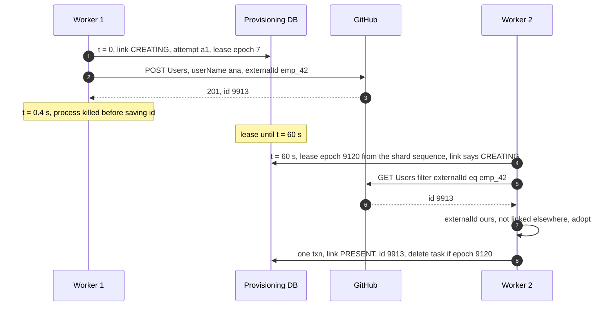

What the admin sees: Ana's GitHub row shows "creating" for about a minute, then "in sync". Data at risk: none. On-call sees nothing, because adoption is a normal outcome. It is logged and counted.

**B: Google is down for 2 hours.**

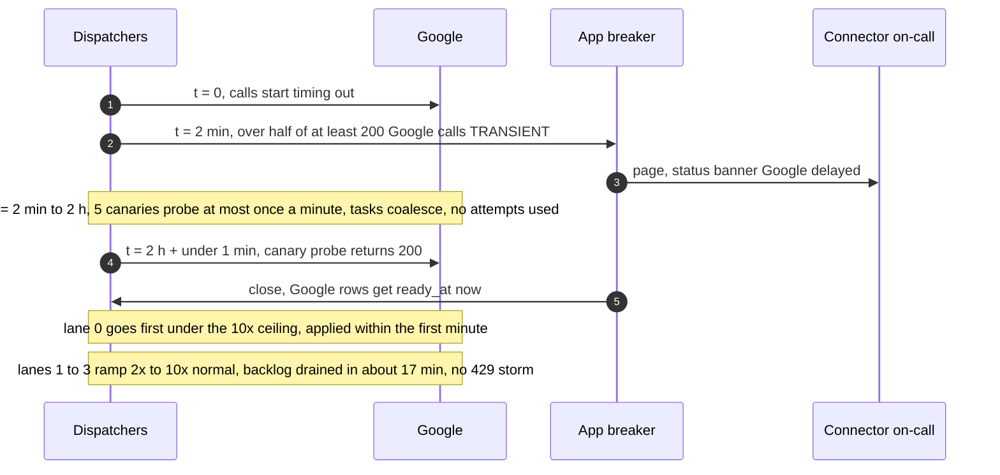

**C: A provisioning DB shard loses its primary.**
- t = 0: the primary dies. ~1/4 of tenants stop dispatching. Upserts from the planner fail, and the planner stops committing Kafka offsets, so nothing is lost.
- t = ~30 s: a quorum standby is promoted. The planner resumes from its last committed offset. Dispatchers re-read ready rows.
- Data at risk: none, because the standby is synchronous. In-flight calls that finished during the gap find their lease rows intact or fenced, and fenced ones make observe tasks.
- User impact: provisioning for those tenants is ~30 s late. A lane-0 task is still inside its 60 s target if it was dispatched before the failure.

### 10.5 Exactly-once and idempotency end to end

| Hop | Duplicate or loss risk | Defence |
|---|---|---|
| HR edit to identity DB | Double submit | Version check on the employee row (`If-Match`) |
| Identity DB to Kafka | Change committed, publish lost | Outbox in the same transaction. The relay retries, the idempotent producer drops duplicates |
| Kafka to planner | Redelivery after a crash | The upsert is idempotent: `GREATEST(want_version)` |
| Planner to task store | Many changes to one key, or a change during a run | Coalesced into one row. Every upsert bumps `dirty_gen`, so a change during a run makes it run again |
| Identity timer to task store | A scheduled termination fires while the row is leased | The identity service commits a new version at the effective instant, so `want_version` and `dirty_gen` both move |
| Task store to worker | Two workers on one key | Lease with an epoch from a shard sequence. Completion fenced by `lease_epoch` and `dirty_gen`, in one transaction with the link write |
| Worker to app (update) | Retry, replay, zombie | Diff against `applied_hash`, or against a fresh read for drift. No `active` in `PATCH` updates. Conditional renew before the call. `If-Match` where supported. Verify task written before every deprovision |
| Worker to app (create) | Crash after `201`, a key changed before the retry | Intent row with pinned keys, find on retry after `search_settle`, natural unique key, adopt on `409` by the adopt rules, loop capped at 6 rounds |
| Worker to app (deactivate) | Retry | `active = false` twice is the same state |
| App webhook to us | App retries, duplicates | Inbox keyed by delivery id. The payload only triggers a re-read |
| Us to partner | Our retries | Event `id` for dedup, `version` for order |
| Token refresh | Two refreshers | Single flight, CAS on `cred_version`, store before use |

**What is never exactly-once:** the app's side effects. A create can happen twice in a vanishingly rare race (search lag plus an app without a unique key). Reconcile counts duplicate `externalId`s and pages if it finds any, and that SLO is 0.

### 10.6 Consistency model per edge

| Edge | Model |
|---|---|
| HR edit to identity DB | Linearizable per employee, `version` |
| Identity DB to Kafka | Per-employee order, at least once |
| Planner to task store | Monotonic `want_version` per key, at least once |
| Worker read of the employee | Read at or above `want_version`. A replica that lags is skipped for the primary |
| Worker to app | Single writer per account (lease). Eventual convergence to the latest desired state |
| App to us (reconcile) | Eventual: daily full, ~15 min with deltas, ~minutes with webhooks |
| Admin console | Read-your-writes for admin actions. Sync status lags by seconds |
| Across apps | None. Each app converges on its own |
| To partners | At least once, unordered, versioned |

### 10.7 Alternatives rejected

| Alternative | Why it looked attractive | Why it lost |
|---|---|---|
| Event pipeline with a DLQ | Familiar, every team has built one | Stale states spend quota, retries reorder, the DLQ is silent drift, per-message retries storm |
| Kafka partitions as the per-connection queue | Ordering for free | 750k connections cannot each be a partition. Sharing partitions means one slow app blocks others. No coalescing. No choice of which message to send next |
| Temporal workflow per account link | Durable, retries, signal-with-start coalesces | 100 M links. The hard part, quota-aware choice across hierarchical shared buckets with lanes, is not in the engine and would be rebuilt in front of it |
| Poll every app every few minutes instead of change-driven | No change pipeline | 750k connections polled every 5 min is ~2,500 list calls/s, 20x today's total, and still cannot meet the 60 s deprovision target |
| A central rate limiter on every call | One shared implementation | Counts tokens. Does not choose between a termination and an import |
| Fat events to partners | One fewer call for partners | Scope leaks, stale data, PII in 3-day queues |
| Trust webhooks and deltas, no full reconcile | Cheap | Channels expire, retry once or never (GitHub "does not automatically redeliver failed deliveries") |
| Unified-API vendor for provisioning | Faster to market | The termination path and its guard are the product's trust. Their scheduling and quotas are opaque |

### 10.8 How the big companies do it

- **Microsoft Entra provisioning.** An initial cycle queries everything and persists a watermark. Incremental cycles then read changes since the watermark (through Graph delta query) "at intervals defined in the tutorial specific to each application". Matching uses a configured matching attribute. A disable is `active = false` for SCIM apps, and a hard delete comes "30 days after they're soft-deleted". Failed users are "continually retried, gradually scaling back the frequency". Quarantine escrows a job when "more than 40% of provisioning events fail, or there are more than 40,000 failures" (5,000 minimum), retries at 6 h, 12 h and 24 h then daily, and disables the job after 28 days. Incremental cycles drop to once a day while quarantined. Accidental-deletion prevention holds deletions above an admin-set threshold, evaluated each cycle. Initial-cycle time is 0.01 to 0.08 minutes per user, group and member, and first-time creates "take about twice as long" as matches. Our design differs in being change-driven per account (seconds, not cycles), which is what a termination needs.
- **Okta.** Event hooks are "at least once", "best-effort", with a 3 s timeout and "at most one retry". Rate limits are org-scoped buckets reported in `X-Rate-Limit-Limit`, `-Remaining` and `-Reset`. Hence our rule: a webhook is a hint, the full read is the guarantee.
- **Kubernetes controllers.** Control loops that move "the current cluster state closer to the desired state". The client-go work queue processes an item added many times "only once", never "multiple times concurrently", and re-adds it if it was "marked as dirty again while it was being processed". Our task table is that queue, made durable and quota-aware.
- **Rippling.** Advertises "600+ out-of-the-box integrations". Its core is a Django monolith of "17+ millions LoC" ([company-questions §2](../company-questions.md#2-rippling-staff)). It moved async processing from its in-house job system to Temporal over "missed executions, non-stateful retries, observability" ([research §8](research/facts-survey.md)).
- **Stripe webhooks.** Retries for "up to three days", no ordering, duplicates possible, dedup by event id, a 5-minute signature tolerance by default, manual resend for 15 days in the dashboard. Our partner contract copies it.

### 10.9 Operational runbook

- **Dashboards (the 5 metrics):** lane-0 time from effective to applied, p50 and p99 per app; lane-2 freshness p99 per app; `429` rate per app; links in `ERROR` and `NEEDS_REAUTH` per app; guard holds opened per hour, split by cause.
- **Alerts:** the §8 page list. Plus tickets to connector teams: an app's error-class mix shifts (a new `PERMANENT` code appears), an app's learned rate falls below 50% of its manifest rate for a day (someone else is sharing the quota, or the vendor changed it).
- **Connector releases:** first a render diff on a sample of links. More than 1% of rendered accounts changing means the release ships its changes as lane-3 `release` work through batch admission. Then canary on 1% of an app's connections for 1 h, compared with control on the connector's unexplained destructive rate and error-class mix. Auto-rollback if either moves. Mapping changes to defaults use the same path.
- **Engine releases:** dispatcher partitions are upgraded one at a time. A partition's new owner starts at half the learned rate.
- **Rollback:** connector code by version pin per connection. A bad mass change that an admin approved anyway is undone by reverting the rule. The level-triggered engine re-renders, and the revert's reactivations ship as one previewed batch the admin approves (§5.5). Deactivated accounts come back intact, which is one reason deletion waits 30 days.

### 10.10 Security and abuse

- **A malicious tenant admin** can point the generic SCIM connector at our network (SSRF): refused by the egress rules in §5.6. They can try to use us to flood an app: per-connection caps and the app's own quota stop it. They can try to read another tenant: capabilities and row-level security stop it.
- **A malicious or compromised partner** gets only its scopes, is rate limited per token, and receives thin events.
- **A compromised or buggy vendor** can send garbage in list responses or webhooks. Responses are size-capped and schema-validated. Webhook payloads only trigger re-reads. Text from vendors is never rendered as HTML in the console.
- **Credential theft:** no API returns a refresh token. Break-glass access to the credential service is two-person and audited. A leaked app client secret is rotated with a dual-secret window. A leaked tenant token is revoked by forcing that connection to `NEEDS_REAUTH`.
- **Least privilege:** each connector requests the narrowest scopes its capabilities need. Security reviews every new scope.

### 10.11 Evolution

- **10x tenants.** More dispatcher partitions and DB shards, both by hash with no redesign. The top 5 apps get their own engine pools, so a Google incident cannot touch Slack's slots.
- **Two-way sync** (an ATS creates the hire, an app owns the phone number). The connector interface already has `changes()`. Add a source-of-truth owner per attribute in the mapping, and inbound changes become identity-service edits with their own approval rules.
- **GDPR erasure.** The identity service emits `employee.erased`. Tasks delete accounts per policy. Links and attempts hold ids and hashes, not values, so erasure there is deleting rows. Partners get the event and must delete their copies.
- **Customer-built connectors.** Declarative only: a manifest, a mapping and HTTP templates run by a generic connector inside the same egress and quota rules. No customer code runs in the engine.
- **Multi-region and residency.** Each tenant has a home region, and each region is a full cell with its own egress IPs. Both regions' IPs are published from day one. DR to a paired region uses async replication, so seconds of edits can be lost. After a failover the new primary's version is the truth: tasks reset `want_version` to the current version. Every employee terminated in the last 24 h gets a lane-0 task again, and every connection reconciles within 6 h. A change that would **reactivate** an account whose `applied_version` is newer than the identity record (a termination the failover lost) is held for HR review, never applied. Level-triggered design makes recovery a re-derivation, not a replay.
- **Faster session kill.** Standards for pushing "session revoked" signals from an identity provider to apps (OpenID Shared Signals, CAEP) would let lane 0 end sessions in apps that support them without per-app API calls [support per app unverified].

---

## 11. Follow-up questions to expect

Ranked by how likely an interviewer is to ask them.

1. "Why not just put the change events on Kafka and call the API per event?" §1 and §5.1, edge case "three edits and a late retry".
2. "The worker crashed after the create. Now what?" §5.2, Flow 4, §10.4 A.
3. "A layoff of 5,000 people and a 5,000-an-hour quota. How fast?" §5.3. The answer is an hour, plus SSO first, risk order and vendor limit raises.
4. "Slack is down for two hours." §5.4, Flow 5, §10.4 B.
5. "One tenant's token is revoked. Does everyone else stop?" §5.4, scoped breakers.
6. "How do you know the app is in the state you think?" §4.3 and §5.5, reconcile plus confirm-by-GET.
7. "A rule typo removes the whole company from Slack." §5.5, the guard and the plan preview.
8. "How do you store 750k OAuth tokens?" §5.6, single-flight refresh and capabilities.
9. "What do partners get, and in what order?" §5.7.
10. "How would you migrate from the current per-connector code?" §8, shadow diff and per-connection ownership.

---

## 12. Running it in a 45 to 60 minute round

| Minutes | What to do | What it signals |
|---|---|---|
| 0 to 5 | Clarifying questions ([README](README.md)). Write three numbers on the board: ~115 calls/s, GitHub 5,000 an hour per tenant, 60 s to deprovision | You design from the binding constraint, not a template |
| 5 to 15 | §4.2: the dirty row, render, diff, apply. Say why order stops mattering. Draw the task row | Correctness before boxes |
| 15 to 25 | §5.2: the crash after create, intent plus natural key | You know where at-least-once actually bites |
| 25 to 37 | §5.3 and §5.4: buckets by vendor scope, lanes and reserve, scoped breakers, the drain math | The red node, with numbers |
| 37 to 47 | §5.5: reconcile, absence is not evidence, the guard | Blast radius thinking |
| 47 to 55 | Interviewer's pick: credentials (§5.6), partner events (§5.7) or connect and plan (§4.1) | Depth on demand |
| 55 to 60 | Migration, operability, what you refused | Staff scope |

**How the prompt gets mutated, and what changes.**

| Variant | Who asks it | What changes in this design |
|---|---|---|
| "Design app provisioning / onboarding and offboarding" | Rippling guides | This design. Lead with terminations and the guard |
| "Terminate an employee across 10 systems" | Rippling onsite (#46) | One workflow over these connectors. Add the DAG, the irreversible pivot and evidence of completeness |
| "Deliver our events to merchants' endpoints" | Stripe guides (#58) | Only the §4.4 outbound half, scaled up: per-endpoint queues, 3-day retries, signatures, SSRF |
| "Sync our data into customers' accounting or CRM systems" | Stripe-style integration product | The same engine pointed at invoices and payments instead of people: dirty rows per record, vendor quotas per customer, a reconcile. Money adds idempotency keys where the target has them |
| "A unified API that reads HR data from 50 HRIS vendors" | Merge-style | Reverse direction: mostly reads. The quota and breaker machinery stays, and the guard protects your customers from a vendor's bad page |

Before the round, practise one sentence of "why this technology" for every box (§6 lists them). Stripe's reported design feedback was "justification for the technology choices wasn't strong enough".
