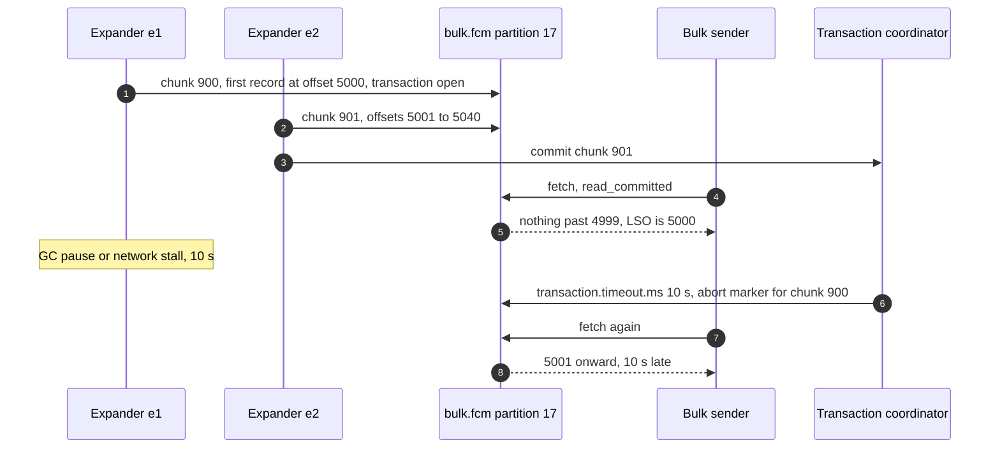

# Deep dive: campaign fan-out and scheduling

> One-line answer: freeze the audience into 10k-id chunk files ten minutes before the window, sorted by bulk partition block so each chunk lands on 16 of the 256 partitions; release chunks at a rate the controller recomputes every second (the minimum of the window pace, the bulk quota share, ≤ 30 s of queued work and the app's headroom divided by a `p × k` measured on this release); decide every user in memory, then write the chunk in **one short Kafka transaction**. The herd simulation shows a 1M/s burst peaks at 70% of the app when `p × k` is right and 111% when it is 3x off, while the controller stays at or under 70% either way. The transaction simulation shows why "short" and "16 partitions" matter: writing as you go keeps 14% of bulk records waiting over 1 s with no fault at all, and one hung expander stalls the whole lane for 10 s.

Zoom-in on [`../solution.md`](../solution.md) §4.2 (the campaign flow), §5.6 (release rate, herd, rules) and §10.1 (Kafka transactions). Reusable blocks: [`../../../concepts/fan-out-fan-in.md`](../../../concepts/fan-out-fan-in.md), [`../../../concepts/exactly-once.md`](../../../concepts/exactly-once.md), [`../../../concepts/stream-processing.md`](../../../concepts/stream-processing.md). The herd controller is the one from [`../../credit-score-alerts/deep-dives/fan-out-and-herd-control.md`](../../credit-score-alerts/deep-dives/fan-out-and-herd-control.md); the email version of campaign release is [`../../email-campaign-sending/deep-dives/campaign-fan-out-and-scheduling.md`](../../email-campaign-sending/deep-dives/campaign-fan-out-and-scheduling.md). Siblings: [`preferences-and-compliance.md`](preferences-and-compliance.md) (the per-user rules), [`priority-lanes-and-isolation.md`](priority-lanes-and-isolation.md) (the bulk share).

Acronyms: FCM (Firebase Cloud Messaging), APNs (Apple Push Notification service), LSO (last stable offset: the first offset of the oldest open transaction on a partition), DRR (deficit round robin), GC (garbage collection), KST (Korea Standard Time), SLO (service level objective), RPS and QPS (requests and queries per second).

---

## 1. The pipeline

```mermaid
%% A campaign from frozen audience to providers. The app API is red: at a busy 10:00 it binds near 100k flash-sale pushes a second, before the FCM share does.
flowchart LR
    SEG[Segment service] -->|"user ids at T minus 10 min"| SNAP[Snapshot<br/>sort by partition block,<br/>then user]
    SNAP -->|"2,000 files of 10k ids"| CH[(Chunk files<br/>blob store)]
    CH -->|"pace, window, expiry"| RC[Release controller<br/>min of 4 caps, every 1 s]
    RC -->|"chunk refs, round robin<br/>over 16 blocks"| BC[[bulk.chunks]]
    BC -->|"one chunk"| EX[Expander<br/>decide in memory,<br/>then one short transaction]
    EX -->|"records to 16 partitions,<br/>marker, offset"| BT[[bulk.fcm, bulk.apns<br/>256 partitions]]
    CC[[campaign-control<br/>pause, cancel epoch]] -->|"cancelled set"| BS
    BT -->|"read_committed"| BS[Bulk senders<br/>commit, then send]
    BS -->|"priority 5, NORMAL,<br/>collapse id = campaign"| PRV[APNs, FCM]
    PRV -->|"push"| APP[App API<br/>500k req/s]
    APP -->|"utilization, tagged load"| RC

    class SNAP,RC,EX,BS service
    class CH store
    class BC,BT,CC queue
    class SEG,PRV external
    class APP critical

    classDef service  fill:#dcfce7,stroke:#16a34a,stroke-width:2px,color:#111
    classDef store    fill:#ede9fe,stroke:#7c3aed,stroke-width:2px,color:#111
    classDef queue    fill:#cffafe,stroke:#0891b2,stroke-width:2px,color:#111
    classDef critical fill:#fee2e2,stroke:#dc2626,stroke-width:4px,color:#111
    classDef external fill:#e5e7eb,stroke:#6b7280,stroke-width:2px,color:#111,stroke-dasharray:4 3
```



## 2. Freeze and chunk

- **Freeze at T minus 10 min.** The segment service returns ids; we de-duplicate and write chunk files to the blob store. A user who joins the segment at 10:05 is not in this campaign. A user deleted at 10:05 is caught at expansion: the profile row is a tombstone.
- **Sort by partition block, then by user.** `block = (hash(user_id) mod 256) div 16`, so there are 16 blocks of 16 bulk partitions. A 20M audience is ~1.25M users and ~125 chunks per block. Every chunk's records then land on 16 partitions of `bulk.fcm` and the same 16 of `bulk.apns` (§6 says why).
- **Size.** 2,000 files of 10k ids, delta-encoded, ~20 KB each, ~40 MB in all. A chunk is ~0.3 s of one expander's work (10k users at ~31k decisions/s). **Release order:** round robin over the 16 blocks so partitions fill evenly second by second, and `hash(campaign, chunk)` order inside a block so the same users are not always last.

## 3. The release rate

Every second the controller takes the minimum of five numbers.

| Cap | Formula | 20M flash sale at 10:00 |
|---|---|---|
| Window pace | `audience ÷ (0.5 × window)` | 10:00 to 10:05: `20 M ÷ 150 s = 133k users/s` |
| Bulk FCM share | `193k msgs/s ÷ (1.1 tokens × 70% Android)` | ~250k deliveries/s |
| Bulk APNs concurrency | `270 conns × 250 streams ÷ 0.15 s` | ~450k/s |
| Queued work | bulk topic lag ≤ 30 s of work | keeps decisions ≤ ~30 s old at send |
| App headroom | `(0.7 × C − B(t)) ÷ p̂k̂` | `(350k − 250k) ÷ 1.0 = 100k pushes/s` |

- **`p̂k̂` is measured on this release**, from app requests tagged with the campaign id (the push deep link sets it), and never assumed below the prior.
- **Ramp** from 0 over 60 s (FCM: "ramp from 0 to the max RPS across a 60 second time-window"). **Halve** when utilization passes 75% or the app's p99 passes its SLO, then hold 2 minutes, because the metric is 30 to 60 s old.
- **Concurrent campaigns** share the bulk budget by DRR weighted by priority class: flash sale, then recommendations, then newsletters.

## 4. Simulation 1: a 15.9M push into the app at 10:00

15.9M pushes (the 20M audience after suppressions). App capacity 500k requests/s, organic load 250k. Each push brings `p × k` requests over ~10 minutes, about a third in the busiest minute (solution §2). The controller's prior is 1.0; the truth is 1.0, 2.0 or 3.0.

```python
# The app herd after a 15.9 M flash-sale push at 10:00. App capacity C = 500k req/s,
# organic load 250k req/s. Each push brings p x k requests, spread over ~10 minutes.
# 1 s ticks, 25 minutes. Utilization is a 10 s average, as a dashboard would show it.
import math
C, B, PUSHES, H, LAG = 500_000, 250_000, 15_900_000, 1500, 30

def open_curve(median=110.0, sigma=1.1, horizon=600):   # share of opens per second after a push
    cdf = lambda x: 0.5 * (1 + math.erf(math.log(max(x, 1e-9) / median) / (sigma * 2 ** 0.5)))
    raw = [cdf(j + 1) - cdf(j) for j in range(horizon)]
    return [r / sum(raw) for r in raw]
F = open_curve()
busiest = max(sum(F[i:i + 60]) for i in range(len(F) - 60))

def run(policy, pk_true, prior=1.0):
    rel, load, left, done = [], [], PUSHES, None
    R, pk_hat, last_cut = 0.0, prior, -999
    for t in range(H):
        load.append(B + pk_true * sum(rel[i] * F[t - i] for i in range(max(0, t - 599), t)))
        seen = sum(load[max(0, t - LAG - 9):t - LAG + 1]) / 10 if t > LAG else B   # 30 s old
        if policy.startswith("burst"):
            R = float(policy.split()[-1].replace("k/s", "")) * 1000
        elif policy == "window pace 106k/s":
            R = PUSHES / 150                       # audience / (0.5 x 5-minute window)
        else:                                      # design: ramp, measured p x k, cut once per 2 min
            if t > LAG:
                exp = sum(rel[i] * F[t - LAG - i] for i in range(max(0, t - LAG - 599), t - LAG))
                if exp > 5_000: pk_hat = max(prior, (seen - B) / exp)
            cap = (0.7 * C - B) / pk_hat
            if seen > 0.75 * C and t - last_cut >= 120:
                R, last_cut = R / 2, t
            elif t - last_cut >= 120:
                R = min(cap, R + cap / 60)         # 0 to cap over 60 s
            R = min(R, cap)
        r = min(R, left); rel.append(r); left -= r
        if left <= 0 and done is None: done = (t + 1) / 60
    u = [sum(load[i:i + 10]) / 10 / C for i in range(0, H - 10)]
    return max(u), sum(x > 0.8 for x in u) / 60, sum(x > 1.0 for x in u) / 60, done

print(f"busiest minute after a single push holds {busiest:.0%} of its opens")
print(f"{'release policy':<22}{'p x k':>6}{'peak':>6}{'min>80%':>8}{'min>100%':>9}{'all sent':>9}")
for policy in ("burst at 1000k/s", "burst at 250k/s", "window pace 106k/s", "design controller"):
    for pk in (1.0, 2.0, 3.0):
        peak, m80, m100, done = run(policy, pk)
        print(f"{policy:<22}{pk:>6.1f}{peak:>6.0%}{m80:>8.1f}{m100:>9.1f}{done:>7.1f} m")
```

Output (`python3 herd.py`):

```text
busiest minute after a single push holds 35% of its opens
release policy         p x k  peak min>80% min>100% all sent
burst at 1000k/s         1.0   70%     0.0      0.0    0.3 m
burst at 1000k/s         2.0   90%     1.1      0.0    0.3 m
burst at 1000k/s         3.0  111%     1.9      0.8    0.3 m
burst at 250k/s          1.0   68%     0.0      0.0    1.1 m
burst at 250k/s          2.0   87%     0.9      0.0    1.1 m
burst at 250k/s          3.0  105%     1.9      0.6    1.1 m
window pace 106k/s       1.0   64%     0.0      0.0    2.5 m
window pace 106k/s       2.0   78%     0.0      0.0    2.5 m
window pace 106k/s       3.0   92%     1.9      0.0    2.5 m
design controller        1.0   64%     0.0      0.0    3.1 m
design controller        2.0   68%     0.0      0.0    5.0 m
design controller        3.0   70%     0.0      0.0    7.0 m
```

**Reading the output.**
- **If `p × k` is right, even a 1M/s burst is survivable**: 70% at peak, the solution's "72%" from the busiest-minute average. So the honest case for pacing is not the expected day.
- **It is the wrong estimate.** At 2x the burst spends a minute over 80%; at 3x it spends ~50 s over 100%, before the app's own retries make it worse. Pushes cannot be recalled once sent.
- **The controller stays at or under 70% at 1x, 2x and 3x**, because it measures `p̂k̂` on the release and the ramp gives it time to see the error. It pays 3 to 7 minutes instead of 16 seconds. Not modelled: a second campaign in the same minutes (it shares the headroom through DRR).

## 5. Expansion in one short transaction

The expander's unit is one chunk: read 10k ids, multi-get `profile-bulk` 500 at a time, run the rules, run the ledger script per user, then write. The records, the `expanded` marker on `campaign-progress` and the consumed offset commit in **one Kafka transaction**, so a crash re-runs the chunk and senders never see half of it.

**The trap.** Bulk senders read with `isolation.level=read_committed`, so they can only read below the LSO of each partition. A transaction that is still open holds every partition it has written to, including records other expanders already committed after it.



Three choices make it small:
- **`transaction.timeout.ms = 10 s`**, not the 60 s default, caps a hang.
- **Decide first, write last.** Buffer the chunk's ~10k records (~3 MB) in memory, then begin, produce, send offsets and commit in ~30 ms. A partition is only held while the transaction has written to it.
- **One partition block per chunk** (§2). A transaction then touches 16 partitions of each topic, not all 256. Side effects: ~340 records per partition batch instead of ~20, and ~34 commit markers per transaction instead of ~514 (at ~93 chunks/s at the peak: ~3.2k marker writes/s instead of ~48k).

## 6. Simulation 2: how long bulk records wait to become readable

30 expanders run chunks back to back (work: p50 0.32 s, p99 1.0 s; produce and commit: p50 30 ms, p99 150 ms). In the "hang" rows, one expander stalls 10 s **inside** an open transaction, the worst place for it.

```python
# read_committed senders can only read below the last stable offset (LSO): the
# first offset of the oldest open transaction on that partition. 30 expanders each
# run one transaction per 10k-user chunk. How long do bulk records wait to become
# readable, and what does one expander that hangs for 10 s inside a transaction cost?
import random, math, bisect
random.seed(60)
EXP, PARTS, GROUP, HORIZON, HANG_AT, HANG = 30, 256, 16, 60.0, 30.0, 10.0

def ln(median, p99):
    return median * math.exp(random.gauss(0, math.log(p99 / median) / 2.326))

def txns(variant, hang):
    out = []                                           # (start, end, group)
    for e in range(EXP):
        t = random.uniform(0, 0.4)
        while t < HORIZON:
            work = ln(0.32, 1.0)                       # read ids, profiles, ledger scripts
            prod = ln(0.03, 0.15)                      # produce 10k records, commit
            if variant == "produce as you go":
                s, end = t, t + work + prod            # open on every partition the whole time
            else:
                s, end = t + work, t + work + prod     # buffer in memory, open only to produce
            if hang and e == 0 and s <= HANG_AT < end + 0.5:
                end = max(end, HANG_AT) + HANG         # held until transaction.timeout aborts it
                hang = False
            g = random.randrange(PARTS // GROUP) if variant.endswith("grouped") else 0
            out.append((s, end, g))
            t = end
    return out

def measure(variant, hang):
    tx = txns(variant, hang)
    by_group = {}
    for s, e, g in tx: by_group.setdefault(g, []).append((s, e))
    pref = {}
    for g, lst in by_group.items():
        lst.sort(); m, pm = 0.0, []
        for s, e in lst: m = max(m, e); pm.append(m)
        pref[g] = ([s for s, _ in lst], pm)
    delays = []
    for s, e, g in random.sample(tx, 4000):           # records of this transaction
        for _ in range(5):
            w = random.uniform(s, min(e, s + 1.5))
            starts, pm = pref[g]
            i = bisect.bisect_right(starts, w) - 1     # transactions that wrote before w
            v = max(e, pm[i] if i >= 0 else 0.0)       # readable once all of them are done
            delays.append(v - w)
    delays.sort()
    n = len(delays)
    # partition-seconds stalled: every partition the hung transaction touched waits ~10 s
    touched = PARTS // GROUP if variant.endswith("grouped") else PARTS
    stall = touched * HANG if hang else 0
    return delays[n // 2], delays[int(n * 0.99)], sum(d > 1 for d in delays) / n, stall

work = [ln(0.32, 1.0) for _ in range(20_000)]; prod = [ln(0.03, 0.15) for _ in range(20_000)]
print(f"share of an expander's time inside an open transaction: as you go 100%, "
      f"at the end {sum(prod) / (sum(work) + sum(prod)):.0%}")
print(f"{'variant':<30}{'hang':>5}{'p50':>7}{'p99':>7}{'over 1 s':>9}{'partition-s stalled':>21}")
for variant in ("produce as you go", "produce at the end", "produce at the end, grouped"):
    for hang in (False, True):
        p50, p99, over, stall = measure(variant, hang)
        print(f"{variant:<30}{'yes' if hang else 'no':>5}{p50:>6.2f}s{p99:>6.2f}s{over:>9.1%}{stall:>21,.0f}")
```

Output (`python3 lso.py`):

```text
share of an expander's time inside an open transaction: as you go 100%, at the end 9%
variant                        hang    p50    p99 over 1 s  partition-s stalled
produce as you go                no  0.75s  1.31s    14.3%                    0
produce as you go               yes  0.84s  9.98s    34.1%                2,560
produce at the end               no  0.04s  0.19s     0.0%                    0
produce at the end              yes  0.05s  9.70s    15.1%                2,560
produce at the end, grouped      no  0.01s  0.12s     0.0%                    0
produce at the end, grouped     yes  0.02s  0.85s     1.0%                  160
```

**Reading the output.**
- **Writing as you go costs tail latency with no fault at all.** With 30 transactions always open on every partition, a record waits for the slowest overlapping one: p50 0.75 s, 14% over 1 s. Senders see data in bursts.
- **One hang stalls the whole lane** when every transaction touches all 256 partitions: 2,560 partition-seconds, a 10 s gap in a campaign that the controller then sees as lag.
- **Producing at the end** cuts the time inside a transaction to ~9%, so a random hang usually stalls nothing; when it lands inside, it still holds all 256 partitions. **Grouping** limits that worst case to 16: 160 partition-seconds, 1% of records over 1 s.

## 7. Pause, cancel and the correction

- **Pause** stops releases at the next second. Records already in the bulk topics (≤ 30 s of work) still go; their offsets are committed before send, so they cannot be held.
- **Cancel must reach the senders.** At 100k/s with up to 30 s of work queued, a cancel that only stops releases lets up to ~3M more pushes out. So cancel also writes a **cancel epoch** to a compacted `campaign-control` topic that every bulk sender caches. A sender drops the campaign's records at dequeue with outcome `cancelled`, checks its cached control state again immediately before each provider call, and then acknowledges the epoch to the campaign service. The campaign shows `CANCELLING` until every sender has acknowledged, then `CANCELLED`, so "cancelled" means quiesced, not requested. What still leaves is work already handed to a provider client: ~1 s per sender, ~100k pushes.
- **Done means drained.** "All chunks expanded" puts the campaign in `DRAINING`, not `COMPLETED`. It completes only when every delivery record has a terminal outcome; a drain job marks any record still without one at the campaign's expiry as `unknown` (the ~2.5k a bulk sender crash can hide, since sends are at most once).
- **The correction.** Every campaign push carries `apns-collapse-id` and the Android notification `tag` set to the campaign id. A correction sent with the same ids replaces the wrong notification on phones that still show it. A shared `collapse_key: promo` alone cannot do this: it only collapses messages FCM is still storing, not one already on screen.

## 8. What actually leaves per day

The frequency cap bounds promotional pushes, however many campaigns marketing schedules. At 2 a day and 6 a week [estimate] over ~30M push-reachable users, at most ~60M promotional pushes leave on any day and ~26M a day on average over a week. If marketing schedules ~50 campaigns a day averaging ~18M users (solution §2), that is ~900M per-user decisions; most of the later ones end `CAPPED`. So expanders and the ledger are sized for decisions (~929k/s at the peak), not pushes, and the 1M/s peak is the first big campaign of the day, when most users still have their caps.

## 9. What an interviewer pushes on

1. **"Why not enqueue all 20M at 10:00 and let workers drain?"** Pause and cancel become a purge; consent is checked at 10:00 for a 10:20 send; the rate is whatever the workers do, which spends the quota and makes the herd.
2. **"Exactly-once inside Kafka: what can still go wrong?"** The LSO. A transaction left open stalls every reader of the partitions it touched. 10 s timeout, decide first and write last, one partition block per chunk.
3. **"A 1M/s burst only peaks at 70%. Why pace at all?"** Because 70% assumes `p × k` is right. At 3x the burst is 111%; the paced controller stays at 70% at 3x.
4. **"Cancel takes effect in 1 s?"** Only because the senders read `campaign-control`, re-check it before each provider call and acknowledge the cancel epoch; the console says `CANCELLING` until all of them have. Stopping releases alone leaves ~30 s of work, ~3M pushes, in the topics.

## 10. Trade-offs

| Decision | Option A | Option B | Chose | Why |
|---|---|---|---|---|
| Materialization | 20M messages at start | Frozen chunks released at a rate | Chunks | Pause, cancel, fresh decisions, one-chunk re-runs |
| Rate | Fixed per campaign | Minimum of five caps every second | Computed | The safe rate depends on organic load and a measured `p × k` |
| Transaction shape | Produce as records are decided | Buffer, then one short transaction | Short | 14% of records over 1 s versus 0% |
| Partitions per chunk | All 256 | One block of 16 | Block | A hang stalls 1/16 of the lane; bigger batches; ~15x fewer commit markers |
| Cancel | Stop releasing | Also drop at the sender, re-check before each call, acknowledge the epoch | Both | ~3M pushes versus ~100k after a cancel; `CANCELLED` only when every sender has acknowledged |
| Refused | FCM topics for campaigns, per-user scheduled jobs, autoscaling as the herd fix | | | Topics skip consent and caps; jobs per user are a 1M/s scheduler; autoscaling is slower than the herd |

## 11. Numbers to say out loud

- 20M audience: 2,000 chunk files of 10k ids, ~40 MB, frozen at T minus 10 min; 16 blocks of 16 partitions, ~125 chunks each.
- Pace `audience ÷ (0.5 × window)`; caps: ~250k deliveries/s FCM share, ~450k/s APNs, ≤ 30 s of work, `(0.7 × C − B) ÷ p̂k̂` ≈ 100k/s at 10:00.
- Herd: a 1M/s burst peaks at 70% (right estimate), 90% (2x), 111% (3x), and needs an event quota (the standing share sends 15.9M in ~64 s). Controller: ≤ 70% at all three, done in 3 to 7 minutes.
- Transaction: 10 s timeout, ~30 ms open per chunk, 16 + 16 partitions. A hang costs 160 partition-seconds instead of 2,560.
- Cancel: ≤ ~100k pushes after the click (work already handed to provider clients), not ~3M; `CANCELLING` until every sender acknowledges the epoch.
- Caps: at most ~60M promotional pushes a day for 30M users, ~26M on average.
