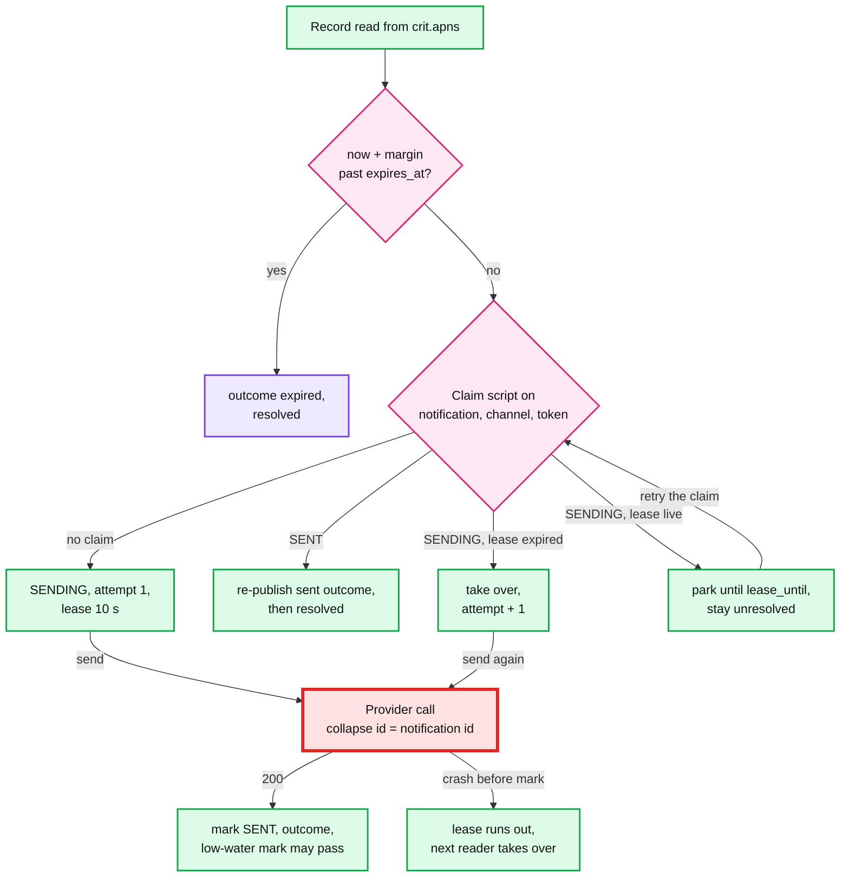

# Deep dive: expiry, dedup and retries

> One-line answer: every hop drops a message whose `expires_at` (minus a per-channel margin) has passed, and every provider call carries the remaining lifetime in that provider's own unit, because FCM keeps an undelivered message 4 weeks and Twilio queues an SMS 10 hours by default. Duplicates are removed by deterministic keys at each hop, and the last hop is a choice per lane: critical is at-least-once with a claim, a 10 s lease and the notification id as the collapse id, so a resend replaces in place; promotions are at most once, offset committed before the send. The crash simulation in §4 adds one rule: a re-read that finds a **live** lease must park the record until the lease expires, not skip it, or a 3-second pod restart loses ~340 critical messages.

Zoom-in on [`../solution.md`](../solution.md) §5.3 (expiry), §5.4 (the crash window) and §10.5 (idempotency end to end). Reusable blocks: [`../../../concepts/exactly-once.md`](../../../concepts/exactly-once.md), [`../../../concepts/leases-fencing-clocks.md`](../../../concepts/leases-fencing-clocks.md). The same claim and collapse-id pattern for a credit alert, including why a claim must be re-entrant: [`../../credit-score-alerts/deep-dives/preferences-dedup-and-delivery.md`](../../credit-score-alerts/deep-dives/preferences-dedup-and-delivery.md). Siblings: [`provider-egress-and-quotas.md`](provider-egress-and-quotas.md) (outages and drains), [`status-tracking-and-inbox.md`](status-tracking-and-inbox.md) (what a late `expired` does to status).

Acronyms: APNs (Apple Push Notification service), FCM (Firebase Cloud Messaging), OTP (one-time password), SMS (short message service), TTL (time to live), NTP (Network Time Protocol), SDK (software development kit, our mobile library), KST (Korea Standard Time), KV (key-value store), GC (garbage collection), AIMD (additive increase, multiplicative decrease).

---

## 1. Expiry at every hop, in each provider's unit

| Type | Lifetime | We drop when | APNs `apns-expiration` | FCM `android.ttl` | Twilio `ValidityPeriod` | Dedup key lives |
|---|---|---|---|---|---|---|
| OTP | 3 min | < 1 s (push) or < 30 s (SMS) left | `expires_at` | remaining | remaining − 10 s | 8 min |
| Chat | 5 min | < 1 s left | `expires_at` | remaining | n/a | 10 min |
| Order status | 24 h | < 1 s left | `expires_at` | remaining | n/a | 24 h 5 min |
| Promotion | campaign end | < 1 s left | **0** | to campaign end | own service | ledger, 7 days |
| Advert, user without night consent | min(campaign end, 20:59:30 KST) | < 1 s before that | **0** | to `send_by` | to `send_by` | ledger, 7 days |

- **The API** computes `expires_at` from the caller's `created_at` (in the request body, set and signed by the calling service), never from accept time, so a retry cannot extend it, and rejects an `expires_at` in the past or above the type's maximum with `422`. The planner, the expander and the sender each drop a record when `now + margin ≥ expires_at`, outcome `expired`.
- **`send_by` is an expiry, everywhere.** For an advert to a user without night consent, `send_by` replaces `expires_at` in the provider TTL too. Otherwise FCM could hold a 20:20 advert for an offline phone and show it at 21:40 ([`preferences-and-compliance.md`](preferences-and-compliance.md) §4).
- **Clocks.** FCM and Twilio take relative seconds computed on NTP-synced hosts; APNs takes an absolute UTC epoch. Skew budget 1 s, covered by the margins.
- **Provider expiry is best effort** ("without any guarantee"). The payload carries `expires_at`, and the SDK drops an expired notification at render time where the platform runs our code first.
- **Push back:** "`apns-expiration: 0` for chat, so it is never late." Zero means "deliver once and do not store", not "drop if late": the push can still arrive late, and an offline phone never gets it. Chat wants storage, for 5 minutes.

## 2. The APNs storage trap

For an offline device, "APNs stores only one notification per bundle ID", in most cases the latest.
- **A promotion must not evict a stored critical push.** A flash sale sent at 10:01 to an iPhone in a tunnel would replace the order-shipped push stored at 09:55. So iOS promotions go out with `apns-expiration: 0`: "APNs attempts to deliver the notification only once and doesn't store it." Second benefit: no stored advert can surface after 21:00.
- **Cost.** Offline iPhones never get the promotion; the inbox still shows it. Priority 5 notifications "might get grouped and delivered in bursts" and may be throttled, so the reach loss can exceed the offline share. We measure it from sampled delivered receipts per campaign instead of assuming 5 to 10%.
- **Critical still evicts critical.** A 5-minute chat to an offline iPhone replaces a stored 24-hour order push. If the phone returns at minute 6, neither shows. Types that matter for a day also write an inbox row, so the order is one tap away.
- **Android** sends critical messages non-collapsible and every promotion with one `collapse_key`. FCM's own storage limits (a cap on stored non-collapsible messages, 4 collapse keys at a time) come from FCM's docs; only the 4-key rule is in the survey. Verify the rest before quoting it.

## 3. The claim, and what a re-read does with it



- **Why park, not skip.** A live lease means another attempt may still be in flight. That is true during a cooperative rebalance (the old owner is finishing its in-flight sends) and false after a crash with a fast restart (the attempt died with the process). The reader cannot tell which, so it waits for the lease and keeps the record unresolved, which also stops the low-water mark from passing it.
- **Why re-publish on `SENT`.** A sender can die between marking the claim `SENT` and publishing the `sent` outcome. A reader that resolved a `SENT` claim silently would leave the status row at `accepted` forever, and the reconciler would page. So it re-publishes the `sent` outcome from the provider id stored in the claim, then commits; the status writer's merge is idempotent, so a repeat costs nothing.
- **The low-water mark.** Senders finish records out of order, so each commits the lowest offset not yet resolved (sent, expired, failed, or written to `crit.retry.15m`). A crash replays from there: duplicates, never gaps.
- **Same collapse id.** `apns-collapse-id` and the FCM `tag` equal the notification id, so a resend replaces the first notification on the phone. The residual duplicate: a user who dismissed the first one within those ~10 s sees it once more.

## 4. Simulation: what one sender crash costs in each lane

Critical: 4.6k messages/s per node; claim, POST, `200` (p50 120 ms, p99 500 ms), mark `SENT`; offsets committed every 1 s. Two restarts: the host is lost and the partition moves after the 10 s session timeout, or the pod restarts in 3 s and rejoins as the same static member with no rebalance. Bulk: 17k messages/s per node, offset committed before the send.

```python
# What one sender crash costs in each lane. Seeded Monte Carlo, 100 crash times per row.
# Critical: claim (SENDING, 10 s lease) -> POST -> 200 -> mark SENT; the offset commit
#   every 1 s is the lowest unresolved offset. A re-read finds SENT (skip), no claim
#   (send), an expired lease (take over, same collapse id) or a live lease.
# Bulk: commit a batch of 500, then send it; a crash loses what had not reached FCM.
import random, math
random.seed(60)
LEASE = 10.0

def lat():                                   # provider round trip: p50 120 ms, p99 500 ms
    return 0.12 * math.exp(random.gauss(0, math.log(0.5 / 0.12) / 2.326))

def critical(rate, restart, live_lease):
    T = random.uniform(15.0, 25.0)
    msgs, t = [], T - 4.0                    # older records are long resolved
    while t < T + 0.1:                       # (arrival, claim, post, reached provider, resolved)
        t += random.expovariate(rate)
        L = lat()
        msgs.append((t, t + 0.002, t + 0.004, t + 0.004 + L / 2, t + 0.006 + L))
    commit_at = math.floor(T)
    mark = next(i for i, m in enumerate(msgs) if m[4] > commit_at or m[0] > commit_at)
    lost = dup = resent = 0; worst = 0.0
    back = T + restart                       # when the partition is read again
    for arr, claim, post, reached, done in msgs[mark:]:
        if arr > T: break                    # not read before the crash: sent normally later
        if done <= T: continue               # SENT recorded: skipped, fine
        has_it = reached <= T
        if claim > T:                        # read but never claimed: sent on re-read
            worst = max(worst, back - arr); continue
        lease_live = back < claim + LEASE
        if lease_live and live_lease == "skip":
            lost += not has_it               # nobody will ever send it
            continue
        resend = max(back, claim + LEASE)    # take over now, or park until the lease expires
        dup += has_it; resent += 1
        worst = max(worst, resend - arr)
    return lost, resent, dup, worst

def bulk(rate, retry_429):
    # in flight = committed and handed to the HTTP/2 pool; a 429 goes back to memory
    lost = unknown = 0
    T, t = 10.0, 7.0
    while t < T:
        t += random.expovariate(rate)
        L = lat()
        if t + 0.004 + L <= T: continue      # answered before the crash
        if t + 0.004 + L / 2 > T: lost += 1  # had not reached FCM: lost
        else: unknown += 1                   # FCM may have it: outcome unknown
    if retry_429:                            # 10% got 429 in the last 2 s, waiting in memory
        lost += int(rate * 2 * 0.10)
    return lost, unknown

print("critical sender, 4.6k messages/s per node (55k/s over 12 nodes)")
print(f"{'restart':<34}{'live lease':>11}{'lost':>6}{'resent':>8}{'dup':>6}{'worst delay':>12}")
for label, restart in (("host lost, partition moves 10.5 s", 10.5), ("pod restarts in 3 s, same member", 3.0)):
    for policy in ("skip", "park"):
        runs = [critical(4_600, restart, policy) for _ in range(100)]
        lost, resent, dup = (sum(r[i] for r in runs) / len(runs) for i in range(3))
        worst = max(r[3] for r in runs)
        print(f"{label:<34}{policy:>11}{lost:>6.0f}{resent:>8.0f}{dup:>6.0f}{worst:>11.1f}s")
print()
print("bulk sender, 17k messages/s per node (1.02 M/s over 60 nodes)")
print(f"{'state at the crash':<34}{'lost':>7}{'unknown':>9}{'dup':>6}")
for label, r429 in (("normal", False), ("during a 429 back-off", True)):
    runs = [bulk(17_000, r429) for _ in range(100)]
    print(f"{label:<34}{sum(r[0] for r in runs) / 100:>7.0f}{sum(r[1] for r in runs) / 100:>9.0f}{0:>6}")
```

Output (`python3 crash.py`):

```text
critical sender, 4.6k messages/s per node (55k/s over 12 nodes)
restart                            live lease  lost  resent   dup worst delay
host lost, partition moves 10.5 s        skip     0     686   345       12.0s
host lost, partition moves 10.5 s        park     0     689   343       12.6s
pod restarts in 3 s, same member         skip   341       0     0        3.0s
pod restarts in 3 s, same member         park     0     686   343       10.0s

bulk sender, 17k messages/s per node (1.02 M/s over 60 nodes)
state at the crash                   lost  unknown   dup
normal                               1300     1233     0
during a 429 back-off                4698     1235     0
```

**Reading the output.**
- **Host lost:** ~690 records are resent after 10 to 13 s; ~345 of them had already reached Apple or Google, so the same collapse id replaces in place. Nothing is lost. This matches the solution's "~700 in flight per node".
- **Fast restart with skip loses ~341 messages per crash**: the ones claimed whose request had not yet reached the provider, whose lease is still live when the same member re-reads 3 s later. Static membership makes this the common restart (deploy, out-of-memory kill), and those losses include OTPs. The reconciler would page 15 minutes later, after the chats had died.
- **Fast restart with park:** nothing lost; the cost is waiting out the 10 s lease, well inside a 3-minute OTP or a 5-minute chat.
- **Bulk:** ~1.3k lost and ~1.2k ambiguous per crash, never a duplicate. Nothing can tell the two apart afterwards, so the campaign's drain job reports all ~2.5k as terminal `unknown`. If the crash lands in a 429 back-off, retries held in memory add ~3.4k. So the in-memory retry buffer is capped (5k per node) and the node stops fetching while it is full.
- **Is at most once acceptable for promotions?** At ~2 bulk crashes a day [estimate: one per node per month] that is ~5k promotions at risk against tens of millions sent, under 0.01%. A lost promotion costs nothing and still shows in the inbox; a duplicate is a complaint and breaks the cap. For critical the same rule would lose ~690 per crash, OTPs included: not acceptable.

## 5. Retries per provider

| Response | Critical | Bulk |
|---|---|---|
| FCM 5xx, `UNAVAILABLE` | exponential backoff with jitter, inside the lifetime | same, from memory, until expiry |
| FCM 429 | per token if one device; lane AIMD only on a 429 rate across many tokens | same |
| APNs 5xx | Apple: retry "after 15 minutes". Short-lived types take their fallback or expire; long-lived go to `crit.retry.15m` | retried from memory after 15 min if the buffer has room and the campaign is alive, else `failed` |
| APNs 429 `TooManyRequests` | back off that token | same |
| APNs 410 | delete the token if it was registered before the 410 timestamp | same |
| APNs 400 `BadCollapseId`, 413 | never retried; ids are 22-character hashes, payloads checked at template approval | same |
| SMS timeout or 5xx | same OTP, same code, to the other vendor | promotional SMS is not in this system's burst |

## 6. Keys, and why each lives as long as it does

- **API idempotency** `(caller, key)`, 24 h, holding the body hash, the original `expires_at` and `PENDING` or `ACCEPTED`. A retry an hour later gets the original `202`. It could not restart a chat's 5-minute clock anyway: `expires_at` comes from the caller's `created_at`, which the retry repeats.
- **Critical claim** `(notification, channel, token hash)`, lifetime + 5 min. No hop sends after `expires_at`, so the claim only has to outlive the last possible attempt plus skew.
- **Promotional ledger** per user, 7 days, holding `(campaign, channel, sent_at, chunk)`: the weekly cap and the campaign dedup in one record. Re-entrant per chunk, so an aborted chunk re-run does not count the cap twice.
- **Chunk marker** on `campaign-progress`, compacted for the campaign's life: a re-released chunk is skipped.
- **Status** merges forward by evidence, so a replayed outcome is harmless ([`status-tracking-and-inbox.md`](status-tracking-and-inbox.md)).

**Never silently lost, inside a region.** `202` only after `acks=all` with `min.insync.replicas=2` across three AZs. On region loss the RPO is the cross-region mirror lag (p99 under 2 s), and callers re-send anything without a terminal status from their own outbox with the same idempotency key. A reconciler joins each minute's `crit.requests` ids with terminal outcomes per channel at `minute + lifetime + 10 min`; a gap is re-driven if still alive and pages if more than 0. With the park rule it should never fire; when it does, it is a bug, not a crash.

## 7. What an interviewer pushes on

1. **"Use Kafka exactly-once."** It covers Kafka-to-Kafka hops, and we use it for the expander. The provider call is outside any transaction we can run, so the last hop is at-least-once or at-most-once by choice.
2. **"Why not at most once for critical too? No duplicates."** ~690 lost per crash, OTPs among them. A duplicate replaces in place; a lost OTP blocks a login.
3. **"Why not a claim per promotion?"** ~1.9M extra KV operations a second at the peak to turn a rare loss into a rare duplicate, and a duplicate advert is the worse outcome.
4. **"Your lease is 10 s. Why not 1 s?"** It must outlive the 2 s request timeout plus a GC pause, or two live senders send the same message routinely. 10 s also matches the session timeout, so a dead host's leases have expired when its partitions move.
5. **"What if the claim store is down?"** Critical senders send without a claim (they are at-least-once anyway, and the collapse id absorbs it). The API falls back to the deterministic `notification_id`. A retry still cannot extend a chat or OTP, because `expires_at` comes from the caller's `created_at`; what is lost is the original `202` body and the `409` on a changed body.
6. **"A provider's expiry is best effort. So?"** The SDK drops an expired payload at render time where it can, and short lifetimes keep the late window small.

## 8. Trade-offs

| Decision | Option A | Option B | Chose | Why |
|---|---|---|---|---|
| Critical last hop | At most once | At least once, same collapse id | At least once | ~690 lost per crash versus a resend that replaces the first in place (best effort) |
| Promotional last hop | Claim per message | Offset before send | Offset first | ~2.5k at risk per crash, 0 duplicates, ~1.9M KV ops/s saved |
| Live lease on re-read | Skip | Park until it expires | Park | Skip loses ~341 per fast restart |
| iOS promotions | `apns-expiration` = campaign end | 0 | 0 | Never evicts a stored critical push; never surfaces at night |
| Provider TTL | Campaign end | `min(expires_at, send_by)` | The minimum | A held advert must not show after 21:00 |
| Retry buffer, bulk | Unbounded in memory | 5k per node, fetch paused when full | Bounded | A crash in a 429 storm loses ≤ ~6.3k, not everything fetched |

## 9. Numbers to say out loud

- Lifetimes: OTP 3 min, chat 5 min, order 24 h, promotion to campaign end. Margins: push 1 s, SMS 30 s, email 5 min.
- Defaults if we forget: FCM keeps 4 weeks, Twilio queues 10 hours, APNs stores up to 30 days.
- Claim lease 10 s; claim TTL = lifetime + 5 min; idempotency 24 h; ledger 7 days.
- One critical host lost: ~690 resent, ~345 duplicates on the wire, replaced in place on the phone (best effort), 0 lost.
- Fast restart: skip loses ~341; park loses 0 and waits ≤ 10 s.
- One bulk crash: ~1.3k lost, ~1.2k unknown, 0 duplicates.
