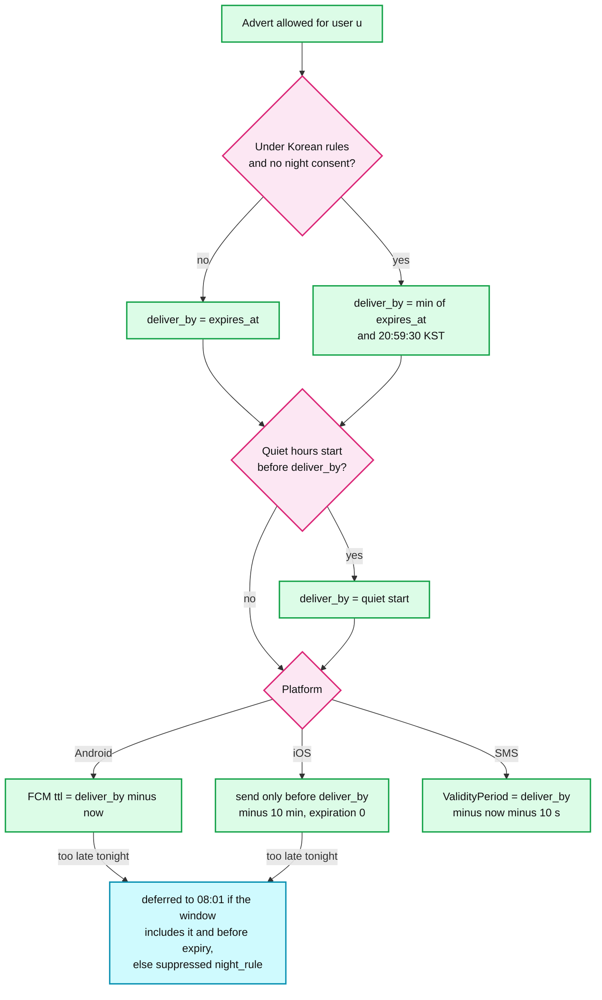

# Deep dive: preferences and compliance

> One-line answer: one rules library decides every send, cheapest rule first, on CDC-fed copies of the user's profile that are about 1 s behind the source, at plan time for critical sends and at release time for campaigns. Advertising rules (prior consent, the 21:00 to 08:00 night rule, periodic re-check, disclosure) are versioned data with an effective date, owned by compliance. The night rule is enforced on **what the phone shows**, not on when we called the provider: an advert to a user without night consent carries `send_by = 20:59:30 KST`, which also caps the FCM TTL and the SMS validity, iOS adverts stop at 20:49, and the morning release starts at 08:01. The simulation in §4 shows why: with the TTL left at the campaign's end, a 2M-user campaign sent at 20:00 shows ~97k adverts after 21:00 to users who never agreed to night adverts; capping the TTL shows none, for 5% of reach.

Zoom-in on [`../solution.md`](../solution.md) §4.3 (the rules), §5.6 (the night rule and caps) and §10.10 (security and abuse). Reusable blocks: [`../../../concepts/caching-patterns.md`](../../../concepts/caching-patterns.md) (CDC-fed copies), [`../../../concepts/stream-processing.md`](../../../concepts/stream-processing.md). Quiet hours in the device's time zone and caps counted at claim, for a credit alert: [`../../credit-score-alerts/deep-dives/preferences-dedup-and-delivery.md`](../../credit-score-alerts/deep-dives/preferences-dedup-and-delivery.md). Suppression lists for the email channel: [`../../email-campaign-sending/deep-dives/bounces-complaints-and-suppression.md`](../../email-campaign-sending/deep-dives/bounces-complaints-and-suppression.md). Siblings: [`campaign-fan-out-and-scheduling.md`](campaign-fan-out-and-scheduling.md) (where the expander runs these rules), [`expiry-dedup-and-retries.md`](expiry-dedup-and-retries.md) (`send_by` as an expiry).

Acronyms: CDC (change data capture), KST (Korea Standard Time, UTC+9), FCM (Firebase Cloud Messaging), APNs (Apple Push Notification service), SMS (short message service), TTL (time to live), KISA (Korea Internet and Security Agency), SDK (software development kit, our mobile library), OTP (one-time password), NTP (Network Time Protocol).

---

## 1. The rules, cheapest first

The same library runs in the planner (critical, one user) and the expander (campaigns, 500 users per multi-get). Every exit is an outcome with a reason.

| Order | Rule | Data | Result if it fails |
|---|---|---|---|
| 1 | Type allowed on the channel; user exists | type registry; profile row (a deleted user is a tombstone) | `suppressed deleted` |
| 2 | Opt-in for `(category, channel)` | profile | `suppressed opt_out` |
| 3 | Advertising consent, re-check not overdue (adverts only) | profile: consent date, `consent_recheck_due` | `suppressed no_ad_consent` |
| 4 | Night rule (adverts to users under Korean rules) | night consent; clock in KST | deferred to 08:01 if the campaign's window includes the morning, else `suppressed night_rule` |
| 5 | Quiet hours the user set | profile; device time zone | promotion deferred or suppressed; critical sent without sound |
| 6 | Frequency cap and campaign dedup (one atomic script) | promo ledger | `capped` (inbox only) or `dup` |
| 7 | Expiry with the channel's margin | record | `expired` |
| 8 | Disclosure (sender name, contact, easy refusal) | template | checked at template approval, not per message |

The only write is step 6, so a re-run of a chunk is cheap and safe.

## 2. One advert, one deadline

Every advert gets a per-user `deliver_by`, and every provider field is computed from it.



- **Why the provider field and not just our send time.** FCM keeps an undelivered message until its TTL (4 weeks if unset), and normal priority "is delivered immediately when the device is not sleeping"; an idle phone gets it at its next maintenance window. APNs priority 5 notifications "might get grouped and delivered in bursts". Either can turn a 20:20 send into a 21:40 notification.
- **Why iOS stops 10 minutes early.** iOS adverts already use `apns-expiration: 0`, so APNs never stores them, but there is no TTL to cap the priority-5 grouping. 10 minutes [estimate] is a guess to replace with the measured p99 of sent-to-delivered for priority 5, from sampled receipts.
- **Quiet hours** use the device's current time zone (reported on every app open), falling back to the profile's. The night rule always uses KST for users under Korean rules, wherever the phone is: a Korean customer in New York at 08:00 local is at 22:00 KST [design decision; the Act's reach abroad is not in the survey].

## 3. How fresh a decision is

- **CDC lag.** A preference write goes to the source database (read-your-writes in the app: the service returns the new profile) and reaches `profile-crit` and `profile-bulk` in ~1 s at p99. Alert at 5 s; campaigns auto-pause at 30 s; page at 60 s.
- **Decide to send.** The controller keeps bulk topics under ~30 s of work, so a campaign decision is normally ≤ 30 s old when it leaves.
- **Except after an outage.** During a 30-minute FCM outage, Android records wait in `bulk.fcm` with decisions made before it. Decision: the bulk sender checks every record older than 30 s against a **recent withdrawals** set (opt-outs and consent withdrawals of the last 24 h, fed by the same CDC stream, ~300k entries [estimate], a few MB in memory). A 20:10 opt-out then stops a 20:05 decision sent at 20:31.
- **The legal duty is on the withdrawal.** An opt-out binds every decision made ~1 s later and every send the sender checks after that. That is the sentence for the interviewer.

## 4. Simulation: the night rule at the phone

A recommendations campaign to 2M users goes out 20:00 to 20:30 KST with expiry 23:00. 70% of users lack night consent, 70% are on Android. Device behaviour [estimate]: 8% of phones offline at send, back after ~2 h on average; 25% of Android phones idle, waiting up to an hour for a maintenance window; 20% of iPhones get priority-5 pushes grouped, up to 10 minutes late; 8% of iPhones offline (expiration 0, never delivered). The second table looks at adverts decided in the last 20 minutes before 21:00.

```python
# The Korean night rule (no advertising 21:00 to 08:00 without separate consent) is
# about what the user receives, so a provider that holds an advert and delivers it at
# 21:40 breaks it even if we sent at 20:20. Campaign: 2 M users, sent 20:00 to 20:30 KST,
# expiry 23:00, 70% without night consent, 70% Android. Device behaviour is [estimate].
import random
random.seed(60)
H = lambda h, m=0, s=0: h * 3600 + m * 60 + s
NIGHT, EXPIRY, SEND_BY = H(21), H(23), H(20, 59, 30)

def receive_time(sent, android, ttl_end):
    """When the phone shows it, or None. FCM stores until ttl; APNs with expiration 0 does not."""
    r = random.random()
    if android:
        if r < 0.08:                                   # offline: phone off, no signal
            back = sent + random.expovariate(1 / H(2))  # reconnects after ~2 h on average
            return back if back <= ttl_end else None
        if r < 0.33:                                   # idle in Doze: NORMAL waits for a window
            return sent + random.uniform(0, H(1))
        return sent + random.uniform(0, 5)
    if r < 0.08:
        return None                                    # expiration 0: not stored, never shown
    if r < 0.28:
        return sent + random.uniform(0, H(0, 10))      # priority 5: grouped, delivered in bursts
    return sent + random.uniform(0, 5)

def run(policy, users=2_000_000, sample=200_000):
    night_shown = shown = 0
    for _ in range(sample):
        sent = random.uniform(H(20), H(20, 30))
        android = random.random() < 0.7
        night_ok = random.random() < 0.3
        ttl_end = EXPIRY
        if policy == "ttl capped at 20:59:30" and not night_ok:
            ttl_end = SEND_BY                          # FCM ttl = send_by - now
        t = receive_time(sent, android, ttl_end)
        if t is None or (android and t > ttl_end): continue   # FCM dropped it at ttl
        shown += 1
        night_shown += (not night_ok) and t >= NIGHT
    k = users / sample
    return night_shown * k, shown * k

base = None
print("A 20:00 to 20:30 campaign, expiry 23:00")
print(f"{'provider ttl':<26}{'night adverts shown':>20}{'reach':>8}")
for policy in ("ttl to campaign expiry", "ttl capped at 20:59:30"):
    night, shown = run(policy)
    base = base or shown
    print(f"{policy:<26}{night:>20,.0f}{shown / base:>8.1%}")

# The evening edge: adverts to users without night consent decided 20:40 to 21:00.
# A record leaves after the bulk topic lag; the phone shows it after the provider delay.
random.seed(61)
print()
print("Adverts decided 20:40 to 21:00 for users without night consent")
print(f"{'evening edge rule':<44}{'shown after 21:00':>18}{'not sent tonight':>17}")
for rule in ("no guard, ttl to expiry", "guard 20:58, send_by 20:59:30, ttl capped",
             "same, iOS stops at 20:49"):
    after = dropped = 0
    for _ in range(100_000):
        d = random.uniform(H(20, 40), H(21))
        android = random.random() < 0.7
        lag = random.lognormvariate(1.6, 1.0)                    # median ~5 s, p99 ~50 s
        if random.random() < 0.01: lag += random.uniform(60, 300)  # slow provider tail
        sent = d + lag
        if rule != "no guard, ttl to expiry":
            stop = H(20, 49) if (rule.endswith("20:49") and not android) else H(20, 58)
            if d >= stop or sent > SEND_BY:
                dropped += 1; continue
        ttl_end = EXPIRY if rule == "no guard, ttl to expiry" else SEND_BY
        t = receive_time(sent, android, ttl_end)
        if t is None or (android and t > ttl_end): continue
        after += t >= NIGHT
    print(f"{rule:<44}{after / 1000:>17.2f}%{dropped / 1000:>16.1f}%")
```

Output (`python3 night.py`):

```text
A 20:00 to 20:30 campaign, expiry 23:00
provider ttl               night adverts shown   reach
ttl to campaign expiry                  96,600  100.0%
ttl capped at 20:59:30                       0   94.9%

Adverts decided 20:40 to 21:00 for users without night consent
evening edge rule                            shown after 21:00 not sent tonight
no guard, ttl to expiry                                 20.01%             0.0%
guard 20:58, send_by 20:59:30, ttl capped                1.00%            10.2%
same, iOS stops at 20:49                                 0.00%            23.6%
```

**Reading the output.**
- **A campaign that finished at 20:30 still breaks the rule** if the TTL runs to 23:00: ~97k adverts appear after 21:00 on phones of users without night consent, from offline Android phones reconnecting and idle ones waking. Our own send times were all before 20:30.
- **Capping the provider TTL at `send_by` removes all of them** and costs ~5% of reach: those Android phones simply do not get this advert.
- **At the evening edge** the 20:58 guard and `send_by` stop our late sends, but 1% of adverts decided in the last 20 minutes still show after 21:00: iPhones whose priority-5 push was grouped. Stopping iOS adverts to these users at 20:49 brings that to 0. "Not sent tonight" adverts are deferred to 08:01 only if the campaign's send window includes the morning and the expiry allows; otherwise they are suppressed with `night_rule`.
- **The morning edge** needs the mirror guard: the deferred release starts at 08:01, spread by user hash to 08:30, so a 1 s clock skew cannot put a send at 07:59:59.

## 5. Frequency caps and the ledger

- **One script per user per decision**: drop entries older than 7 days; this campaign and chunk present means re-entrant (an aborted chunk re-run); this campaign with another chunk means `DUP`; 2 promotional pushes today or 6 this week [estimate] means `CAPPED`; otherwise append and `ALLOW`. Single-user recommendations count against the same cap.
- **Caps bound volume.** At 2 a day over ~30M push-reachable users, at most ~60M promotional pushes leave on any day, ~26M on average at 6 a week. Campaign audiences add up to far more decisions than that; the late ones mostly end `CAPPED` ([`campaign-fan-out-and-scheduling.md`](campaign-fan-out-and-scheduling.md) §8).
- **Counted at decide time.** A promotion that then expires unsent still used a slot. Undercounting would be worse.
- **First come, first served.** A 10:00 flash sale can use the slot a 19:00 personalised campaign would have earned more from. Reserving slots per priority class is the named seam, not built.
- **Fail closed.** Ledger down: campaigns and single-user promotional types pause, because caps and dedup are a promise to users. Critical types never touch the ledger.

## 6. Consent, re-check and disclosure

- **Article 50(1):** explicit prior consent for advertising sent by electronic means. Stored separately from service consent, with its date and source.
- **Article 50(8):** a periodic re-check of consent. The period is set by decree; "2 years" is not in the Act text the survey read, so it is configuration. Consent counts as missing once `consent_recheck_due` passes. Night consent is re-checked the same way.
- **Article 50(4):** the sender's name and contact and an easy way to refuse, checked at template approval.
- **Not the law:** the "(광고)" prefix is Kakao's channel policy; we add it where a channel's policy requires it. KISA says the consent request must name "광고성 정보 수신동의" (secondary).
- **Informational is not advertising** until it carries a cross-sell line. A template review flags an `order_status` template with a coupon in it; the type allowlist stops marketing from sending `order_status` at all.
- **Rules are data.** Each rule version has an effective date (the amended Act took effect 2026-10-02), runs 24 h in shadow mode (log what would change), then turns on. Compliance owns it; the platform owns the library.

## 7. What an interviewer pushes on

1. **"An opt-out at 10:00:01, the campaign started at 10:00. Does she get it?"** Not if her chunk is decided after ~10:00:02, and not if the sender sees her in the recent withdrawals set. Decided at release, checked again at the sender for anything older than 30 s.
2. **"You sent at 20:59. Is that compliant?"** Only if nothing can show it after 21:00. FCM TTL capped at `send_by`, iOS stopped at 20:49, SMS validity capped.
3. **"Why not just stop all adverts at 21:00 for everyone?"** Users who gave the separate night consent may get them; the console shows the split when the campaign is created, so marketing sees the 1.4M of 2M who will wait until morning, and can add a morning window; without one, their deferral would fall outside the send window and they are suppressed with `night_rule`.
4. **"Whose clock?"** KST for the night rule, the device's zone for quiet hours, NTP-synced hosts for both, with a 30 s guard against skew at 20:59:30 and 08:01.
5. **"Where does a cache TTL go wrong here?"** A 10-minute read-through cache ignores an opt-out for 10 minutes, a legal exposure for adverts; and 20M cold reads at 10:00 hit the source. Full CDC-fed copies have no misses and ~1 s lag.
6. **"The law changes next month."** A new rule version with an effective date, 24 h in shadow, then on. No deploy.

## 8. Trade-offs

| Decision | Option A | Option B | Chose | Why |
|---|---|---|---|---|
| Profile reads | Read-through cache with TTL | Full CDC-fed copy per lane | Copies | No miss storm; opt-outs bind in ~1 s |
| When to decide | At enqueue | At release, plus a withdrawal check at send | Release plus check | A queue can hold a decision for 30 minutes after an outage |
| Night rule target | Our send time | What the phone shows | The phone | FCM and APNs can hold an advert past 21:00 |
| Provider TTL for adverts | Campaign end | `min(expires_at, send_by)` | Minimum | ~97k night adverts versus 0, for 5% of reach |
| iOS evening stop | 20:58 | 20:49 | 20:49 | Priority-5 grouping has no TTL to cap |
| Cap counting | At send | At decide | Decide | One atomic script; a rare unsent slot is cheaper than an overshoot |
| Refused | A cap per campaign instead of per user, per-message consent lookups in the source database, cross-sell lines in informational templates | | | Each either breaks a promise to users or puts 929k reads a second on the database users write to |

## 9. Numbers to say out loud

- CDC to both caches ~1 s p99; alert 5 s; campaigns pause at 30 s; page at 60 s. Decisions normally ≤ 30 s old at send.
- Night rule: 21:00 to 08:00 KST, push and SMS (email carved out by decree). Guard 20:58, `send_by` 20:59:30, iOS stop 20:49, morning release 08:01 to 08:30.
- A 20:00 campaign with TTL to 23:00: ~97k night adverts per 2M users; with the TTL capped: 0, at 5% of reach.
- Caps 2 a day, 6 a week: ≤ ~60M promotional pushes a day for 30M users.
- 20M flash sale at 10:00: ~3.0M without ad consent, ~0.6M opted out, ~0.4M capped, ~0.1M in quiet hours, ~15.9M pushed.
